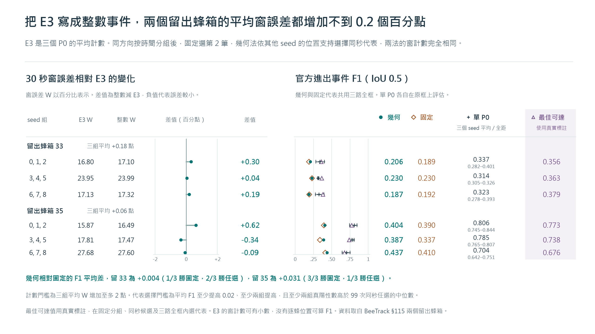
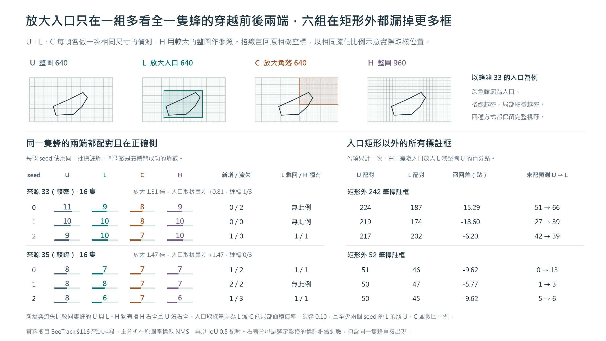
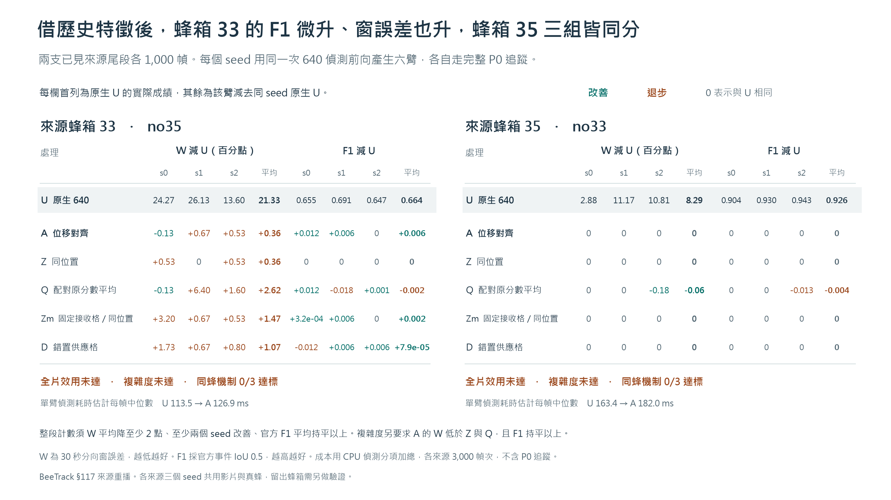
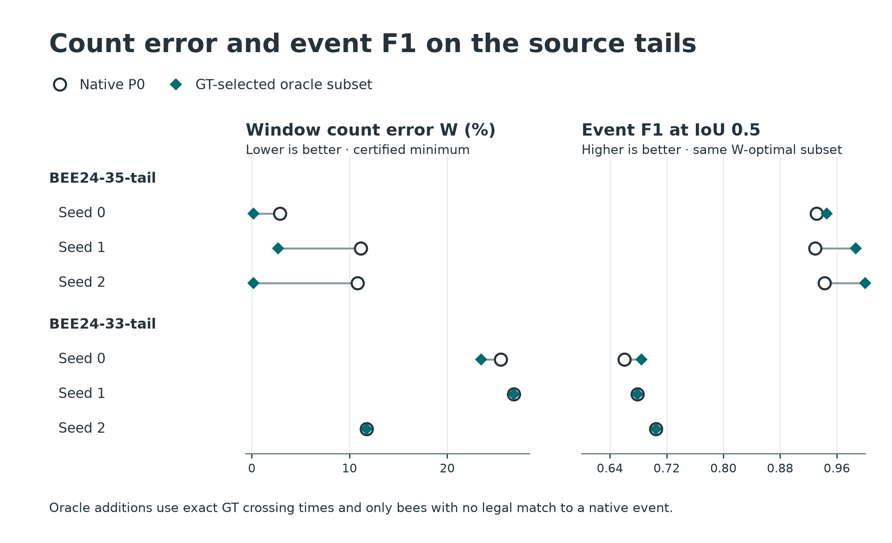
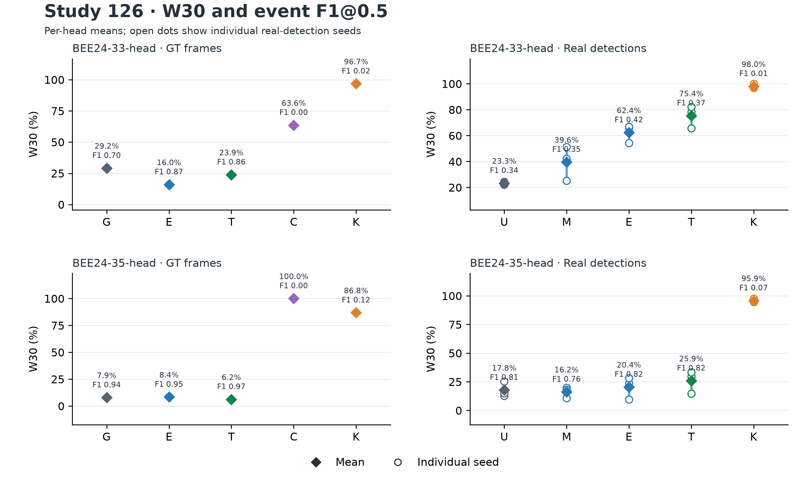
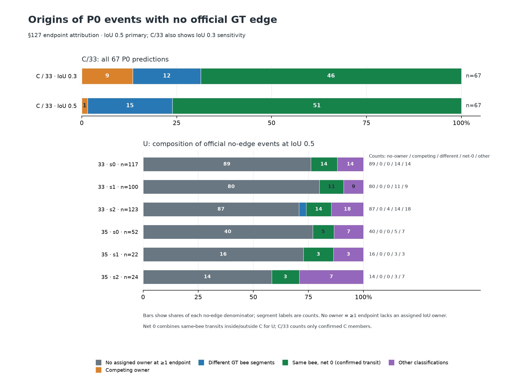

# [實驗紀錄] BeeTrack:以事件級指標改善巢口進出計數

> 目標:改善蜜蜂進出巢口的計數。每個實驗都是 動機 → 作法 → 結果 → 結論。
> 偵測器 YOLO11-s(640),追蹤 BeeTracker(ByteTrack 派生);縮寫 y = y11s_640 偵測,o = oracle 偵測(GT 框、分數 1、無 ID)。
> 帶「(未入庫)」的分析腳本在 repo 之外,只記檔名。
> 更正(2026-11-15):§67、§87–§91 留一蜂箱表格上的「校正 ByteTrack」其實沒有校正,是預設參數的 ByteTrack;見 §93。

## 0. 總覽

**決策指標:事件級 F1(true / false / missed 事件)。** 區域計數誤差(zone err)一併列出,但 false 與 missed 會互相抵銷,不能單獨當決策依據。

### 資料切分(`beetrack/common.py`)

| 切分 | 內容 | GT 事件數 | 備註 |
|---|---|---|---|
| val | BEE24-10/15/24/28 全段 + BEE24-33、BEE24-35 的最後 1000 幀(`-tail`),共 2,640 幀 | 173(全程不變) | 事件少、雜訊大:±0.02 F1 / ±5 事件視為雜訊 |
| dev | BEE24-33-head、BEE24-35-head(各取 frame 1..3950) | 最終 313(舊版 343 → 330 → 313) | 偵測器訓練時看過這些幀,真實偵測在此偏樂觀;相機靜止(位移 BEE24-33 ≤ 0.54 px、BEE24-35 ≤ 3.5 px),沿用 `-tail` 的區域多邊形 |
| test | BEE24-12/13/16/34/36,共 10,762 幀 | 405(固定協定) | 只用於最終數字 |

偵測快取:`runs/dets/<tag>/<split>/<seq>.npy`(frame, x1, y1, x2, y2, score);tag 有 y11s_640(val/test/dev)、y11s_1280、oracle(val/test/dev)、yolox_x(僅 test)。

### 計數協定

- 入口區域(`beetrack/zones.json`,手繪於第一幀,圍住入口縫隙加約一隻蜂身長)。
- 一條 track 的第一個中心在區域外、最後一個中心在區域內 = in;相反 = out。
- 一個 ID 內若有超過 `MAX_GAP = 25` 幀(1 秒,事先固定)的空隙,視為兩隻蜂(第 k 段 ID 改成 id + k·1e5);GT 與預測都套用(見 §2)。
- zone err = 各序列 |pred_in − gt_in| + |pred_out − gt_out| 之和。

### 方法論

- 只在 val + dev 上選模組與參數,test 只用來報最終數字。
- 三種評估協定絕不混表:test 舊協定(/341,已作廢)、test 固定協定(/405)、dev 最終 GT(/313);val 一律 /173。
- dev 的數字只列最終 313 事件版;舊版(343 / 330)標「舊版 dev 標註,僅供參考」。

### 目前最佳(y11s_640;val / dev;test 見 §27)

frr_obs = `flight=5, raw=1, retro=1, obs=1`;其餘為在它之上加單一選項。

| 設定 | dev(313)zone err | dev F1 | dev true/false/missed | val(173)zone err | val F1 | val true/false/missed |
|---|---|---|---|---|---|---|
| ByteTrack(bt) | 120 | 0.589 | 149/44/164 | 79 | 0.505 | 69/31/104 |
| ours(base) | 120 | 0.605 | 153/40/160 | 80 | 0.544 | 74/25/99 |
| frr_obs | 29 | 0.715 | 234/108/79 | 56 | 0.620 | 106/63/67 |
| frr_obs + fly_n=3 | 8 | 0.736 | 231/84/82 | 51 | 0.633 | 101/45/72 |
| frr_obs + hop=1 | 19 | 0.704 | 215/83/98 | 50 | 0.693 | 115/44/58 |
| **TrackletLink(兩階段,§17–§25)** | 12 | **0.749** | 230/71/83 | 36 | **0.748** | 122/31/51 |

dev + val 合併(486 事件)F1:frr_obs 0.682、fly_n=3 0.701、hop=1 0.700(見 §10)。所有新選項只多 +0.01~0.02。
TrackletLink 合併 0.749(三個 seed 平均 0.759;val / dev 為交叉擬合,連結器沒看過該序列)。test(/405):ByteTrack 0.400 → TrackletLink 0.616(§27)。

---

## 1. 事件級指標

**動機**
- 區域誤差只看淨進出數;E_in − E_out 等於淨跨界數,而追蹤器本來就算得出來,難的是 E_in + E_out(把每隻蜂來回的跨界配對正確)。
- test 固定協定下,ours 的 zone err 180、F1 0.424;ours_fl 的 zone err 222、F1 0.462:誤差變大但事件找到的更多,兩者方向相反。
- dev frr_obs:zone err 只有 29,但有 108 個 false 和 79 個 missed,誤差靠互相抵銷。
- val GT 有 451 次實體跨界,淨事件只有 173。

**作法**(`beetrack/evaluate.py` 的 `match_events`)
- 預測事件為 true 的條件:在該 track 某次同方向的跨界處,track 以逐幀 Hungarian(IoU ≥ 0.5)壓在某隻 GT 蜂上,該 GT 蜂在 ±5 幀內同方向跨界,且它自己的 GT 事件方向相同;一對一(最大二分匹配)。
- `true` = tp;`false` = pred − tp;`missed` = gt − tp;F1 = 2tp / (pred + gt)。
- `same-bee`(tp_id):事件 track 首尾配到同一隻 GT 蜂,即身分從頭到尾沒換。
- 自檢(assert):GT 當預測 → 全對;track 跨界後跳到另一隻蜂 → tp=1、tp_id=0;兩段碎片各自算同一個 in → 只算一個 true。

**結果** 見後續各節;oracle 偵測下也只有 test 0.611(ours)/ 0.744(ours_fl),因為 oracle 只有框、沒有 ID。

**結論** 採用。之後所有取捨以事件 F1 為準,zone err 當參考。

---

## 2. 計數協定修正:GT 的 ID 重用(test 341 → 405)

**動機** BEE24 的長影片會把同一個 ID 號碼重新用在另一隻蜂身上(分段標註,ID 重新開始),舊協定把整個 ID 當一隻蜂,事件被吃掉或憑空多出。

**作法**
- 例:BEE24-36 的 ID 5,第一段 in→out、第二段 out→in,舊協定算成 0 個事件。
- 證據:test BEE24-36 重用 64 次、BEE24-33 訓練段 704 次;ID 回來時框的位置中位數相距 6–7 個蜂身長。
- 修正:ID 內空隙 > `MAX_GAP = 25` 幀就切成新 track,GT 與預測同樣處理(`by_track`);TrackEval 指標仍用官方 GT。
- 自檢:ID 1 在 88 幀後再出現 → 切成兩條。

**結果** test GT 事件(舊 → 固定):

| 序列 | 固定協定 in/out |
|---|---|
| BEE24-12 | 1 / 3 |
| BEE24-13 | 10 / 11 |
| BEE24-16 | 26 / 37 |
| BEE24-34 | 84 / 88 |
| BEE24-36 | 91 / 54(舊協定該序列 81 個事件,修正後 145) |
| 合計 | 341 → 405 |

val 173 不變;dev 在此時為 343(之後見 §13)。預測端同樣被切段,val 上略有位移:ours 的 zone err 由 83 變 80。

**結論** 採用。報告與投影片裡的 /341 數字屬舊協定,需另行更新。

---

## 3. FlightLink(飛行關聯)

**動機**
- 飛行中的蜂每幀移動 1.2–4.6 個蜂身長,前後幀框不重疊;ByteTrack 的新 track 要下一幀 IoU 配到才「確認」,所以快蜂永遠無法確認。
- 偵測其實有:YOLOX(≥ 0.1)偵測召回依速度 <0.1 / 0.1–0.25 / 0.25–0.5 / 0.5–1 / 1–2 / >2(蜂身長/幀)為 0.96 / 0.94 / 0.93 / 0.91 / 0.70 / 0.59;但追蹤輸出召回只有 0.93(<0.5)/ 0.26(0.5–1)/ 0.06(≥ 1)/ 0.03(≥ 2)。
- oracle 框下 86% 的 track 斷點發生在速度 > 0.25(佔 5.3% 的幀);速度 > 0.5 時每幀斷點機率約 20%。

**作法**(`beetrack/track.py`,預設關閉)
- 未確認 track 改用中心距離延續(不看 IoU 重疊)。
- 確認條件:(a) 同一直線上連續 `fly_n + 1` 點(「chain」);(b) take-off 連結:前兩點反推回剛丟失的 track,繼承其 ID;(c) landing 連結:IoU 確認的新 track 第一點接在剛丟失的飛行 track 之後。
- 參數:`flight=5`(最大跳距,蜂身長)、`fly_tol=1.0`、`fly_n=2`、`fly_min=0.5`、`link_gap=2`、`link_cos=0.8`。
- 自檢:蜂靜止 5 幀後以 3 蜂身長/幀飛出,`flight=5` 時後兩幀保持 ID 1,關閉時無輸出。

**結果** val(173,y11s)早期變體,F1 與 true/false/missed:

| 設定 | zone err | F1 | true/false/missed |
|---|---|---|---|
| ours(無 FlightLink) | 80 | 0.544 | 74/25/99 |
| flight=5(fl,link_gap 2) | 52 | 0.596 | 90/39/83 |
| link_gap=0(無連結) | 72 | 0.550 | 77/30/96 |
| link_gap 5, link_cos 0.95 | 57 | 0.586 | 90/44/83 |
| fly_min 1, link_gap 5 | 64 | 0.570 | 86/43/87 |
| fly_tol .5, fly_min 1, link_cos .95 | 59 | 0.543 | 79/39/94 |
| fly_tol .5, link_gap 5 | 64 | 0.596 | 93/46/80 |
| flight 3 / 5 / 8(link_gap 5) | 61 / 59 / 57 | 0.598 / 0.601 / 0.599 | – |

val 上 flight 的 HOTA 55.7 → 55.5,IDSW 407 → 564;AssA 51.6 → 50.9。

dev(313,y11s):fl zone err 33、F1 0.671、199/81/114;frr zone err 52、F1 0.691、233/128/80(base 為 120、0.605、153/40/160)。

val 每序列(MAX_GAP 修正前的預測端切分,僅供參考):BEE24-15 zone err 35 → 20、BEE24-35-tail 15 → 6、BEE24-33-tail 21 → 15,多出的 false 事件大多在 BEE24-33-tail。

oracle 偵測,val(173):fl 53、0.713、113/31/60(base 71、0.648、93/21/80);dev(313):o_fl 11、0.771、241/71/72(o_base 87、0.698、188/38/125)。

**chain 組成**(frr_obs,true/false;dev 為舊版 dev 標註,僅供參考)

| 確認方式 | dev y11s(舊版) | val y11s | dev oracle(舊版) |
|---|---|---|---|
| plain(IoU 確認) | 92/22 | 50/12 | 100/12 |
| takeoff | 54/21 | 18/9 | 91/18 |
| chain | 55/34 | 23/32 | 39/7 |
| chain + takeoff | 31/26 | 12/5 | 24/14 |
| chain + land | 4/2 | 3/5 | – |
| land | 1/0 | – | 2/0 |

- 短 chain(≤ 5 個框)特別不準:dev chain 15/21、val chain 7/24。
- 短 chain 的 false(≤ 6 框):val 有些框不在任何 GT 蜂上 18、單一蜂 6、多隻蜂 3、全無蜂 2;dev 有些框不在任何蜂 22、單一蜂 11、多隻蜂 4、全無蜂 3。典型成因:分數 0.26–0.40 的偵測、與另一條 track 的框 IoU 0.5–0.7 的重複框、以及真實飛蜂未連結的碎片(例:BEE24-10 的 gt14 懸停,被切成 ID 23 → 30 → 34,每段各算一個事件)。
- oracle 框下 chain 很準(39/7),所以 false 主要來自真實偵測的雜訊。

**test 結果** 見 §16:FlightLink 使 true 增加,但在密集的 BEE24-34 的 false 增加更多,zone err 反而變大。

**結論** 採用(進入 frr_obs)。提高事件召回,但要配合後續限制 false(§10)。

---

## 4. MotionRescue(背景相減)

**動機** 快速飛行的蜂糊成一片陰影而偵測不到;鏡頭靜止,可用背景相減把區域外的前景補成偵測。

**作法**(`beetrack/bgsub.py`)
- 每 200 幀為一塊,以 25 張抽樣幀的中位數當背景。
- 前景 blob(|灰階 − 背景| 模糊後超過門檻、開運算)在入口區域外、面積為該序列偵測框面積中位數的 0.3–4 倍、與任何現有偵測 IoU ≤ 0.1,就當作新偵測(固定分數)。
- 指令:`uv run python -m beetrack.bgsub --dets yolox_x --split test [--thr 30] [--score 0.5]`;用 GT(IoU ≥ 0.3)算精確率。

**結果**(test,yolox_x)

| thr | 新增框 | 落在 GT 蜂上 |
|---|---|---|
| 30 | 3,992 | 96(2%) |
| 50 | 1,534 | 13 |

追蹤與計數結果不變。

**結論** 不採用(負面結果);程式碼保留在 `beetrack/bgsub.py` 供查。

---

## 5. 規則式過濾 / fly_zone

**動機** 用簡單規則壓掉 FlightLink 的 false 事件。

**作法與結果**
- 事件過濾規則(離邊界距離 margin、兩側幀數):test 上精確率始終 39–47%,召回下降(舊協定下的觀察)。
- `fly_zone`(只在區域外做飛行配對):測試後沒有幫助,程式碼已完整移除。
- 短 track 過濾(len 5–50、min_score 0.5):zone err 不變(82–83);只看長度則變差(86–142)(val,舊協定)。

**結論** 不採用。

---

## 6. raw / retro / obs

**動機 / 作法**

| 選項 | 做什麼 | 動機 |
|---|---|---|
| `raw` | 輸出配到的偵測框,而不是 Kalman 平滑後的狀態 | 加速中的蜂,Kalman 框落後;oracle 偵測下 DetA 只有 82.6(用 raw 為 97.1,HOTA +9.8);OC-SORT 系追蹤器本來就輸出觀測框 |
| `retro` | track 確認時,補輸出它確認前的框(最多延遲 2 幀) | 降落的蜂前 2–3 個框在區域外卻沒輸出,track 看起來像出生在區域內 |
| `obs` | 配對 IoU 取「預測框」與「最後一次偵測框」兩者較大者(stay-or-go) | Kalman 等速過衝:蜂突然停下,預測位置跑掉而丟 track |

三者預設皆關閉。

**Kalman 過衝發現** val BEE24-33-tail 中一隻持續被偵測的單獨蜂(GT 1568)在 75 幀內換了約 8 個 ID(base 也是)。第 640 幀:track 的 Kalman 速度 0.54 蜂身長/幀,但蜂已停下;預測中心偏 0.71 蜂身長,普通 IoU 0.05,cost 0.86 > match_thresh 0.8 → track 丟失、建新 ID;在邊界附近徘徊的蜂,每個碎片各算一個事件。

**結果**:val(173)與 dev(313),y11s,HOTA/DetA/AssA/IDF1/MOTA/IDSW(僅 val 有;dev 最終 GT 的 HOTA 尚未重算)

| 設定(val 173) | HOTA | DetA | AssA | IDF1 | MOTA | IDSW | zone err | F1 | true/false/missed |
|---|---|---|---|---|---|---|---|---|---|
| bt | 53.7 | 60.1 | 48.5 | 68.6 | 76.6 | 632 | 79 | 0.505 | 69/31/104 |
| base | 55.7 | 60.6 | 51.6 | 72.5 | 78.3 | 407 | 80 | 0.544 | 74/25/99 |
| rr(raw+retro) | 57.1 | 62.6 | 52.4 | 73.8 | 81.9 | 463 | 77 | 0.582 | 80/22/93 |
| rr_obs | 56.8 | 62.9 | 51.7 | 73.0 | 82.2 | 399 | 89 | 0.564 | 73/13/100 |
| fl | 55.5 | 61.2 | 50.9 | 71.9 | 78.7 | 564 | 52 | 0.596 | 90/39/83 |
| frr | 57.1 | 63.8 | 51.4 | 73.0 | 82.9 | 711 | 53 | 0.632 | 109/63/64 |
| frr_obs | 57.4 | 64.0 | 51.8 | 73.5 | 83.4 | 580 | 56 | 0.620 | 106/63/67 |

| 設定(dev 313) | zone err | F1 | true/false/missed |
|---|---|---|---|
| bt | 120 | 0.589 | 149/44/164 |
| bt_tuned | 135 | 0.587 | 144/34/169 |
| base | 120 | 0.605 | 153/40/160 |
| rr | 110 | 0.624 | 161/42/152 |
| rr_obs | 116 | 0.643 | 164/33/149 |
| fl | 33 | 0.671 | 199/81/114 |
| frr | 52 | 0.691 | 233/128/80 |
| frr_obs | 29 | 0.715 | 234/108/79 |

oracle 偵測(dev 313;val 173):

| 設定 | dev zone err | dev F1 | dev true/false/missed | val zone err | val F1 | val true/false/missed |
|---|---|---|---|---|---|---|
| bt_o | 112 | 0.642 | 165/36/148 | 72 | 0.564 | 79/28/94 |
| o_base | 87 | 0.698 | 188/38/125 | 71 | 0.648 | 93/21/80 |
| o_rr | 80 | 0.718 | – | 70 | 0.685 | 98/15/75 |
| o_rr_obs | 73 | 0.731 | 202/38/111 | 67 | 0.678 | 96/14/77 |
| o_fl | 11 | 0.771 | 241/71/72 | 53 | 0.713 | 113/31/60 |
| o_frr | 26 | 0.797 | 259/78/54 | 37 | 0.777 | 131/33/42 |
| o_frr_obs | 5 | 0.815 | 253/55/60 | 34 | 0.783 | 126/23/47 |

val 單項消融(MAX_GAP 修正前的預測端切分,僅供參考;y11s):

| 設定 | HOTA | DetA | AssA | MOTA | IDSW | zone err | F1 | true/false/missed |
|---|---|---|---|---|---|---|---|---|
| base | 55.7 | 60.6 | 51.6 | 78.3 | 407 | 83 | 0.543 | 73/23/100 |
| raw | 56.9 | 62.2 | 52.5 | 81.3 | 460 | 84 | 0.552 | 74/21/99 |
| retro | 55.9 | 61.1 | 51.5 | 78.9 | 412 | 80 | 0.566 | 77/22/96 |

val oracle 單項:raw HOTA 82.4 / DetA 97.1 / F1 0.646;raw+retro HOTA 82.8 / F1 0.662;base HOTA 72.6 / DetA 82.6 / F1 0.625。

**obs 的特性**
- 套用到所有 track(含很久前丟失的)時,IDSW 下降(val rr 463 → 399;frr 711 → 580;oracle 434 → 329),但 val 事件 F1 沒有升;假說:丟失的 track 在消失處(如入口縫)留下靜止框,去吃別的蜂。
- dev 上 obs 小而一致:rr 0.624 → rr_obs 0.643,frr 0.691 → frr_obs 0.715。
- 加快 Kalman 適應(不用 obs,y11s val,raw+retro):q_vel 1/40 F1 0.584(HOTA 56.5)、1/20 F1 0.583(HOTA 55.0),無明顯增益。

**結論** raw、retro 採用(兩者皆讓 val 與 dev 的 F1 與 HOTA 同步提升);obs 採用(dev 小幅一致,val 中性,IDSW 降低)。三者尚未寫進 `OURS`,也沒有在 test 上跑過。

---

## 7. 參數掃描

**動機** 檢查 frr 之上的 BeeTracker 參數是否有大幅增益。

**作法** val(173)、y11s,在 flight+raw+retro 之上逐一改參數(MAX_GAP 修正前的預測端切分,僅供參考)。

**結果**

| 參數 | F1(true/false) | zone err | 備註 |
|---|---|---|---|
| (基準 frr)| 0.637(109/60) | 50 | |
| grow=0 | 0.557(93/68) | 72 | 變差 |
| grow=0.05 | 0.621 | 66 | |
| speed=0 | 0.610 | 57 | |
| grow=0, speed=0 | 0.606 | 65 | |
| track_buffer 5 / 15 / 30 | 0.630 / 0.631 / 0.632 | 55 / 54 / 56 | 無影響 |
| match_thresh 0.9 | 0.620(IDSW 574) | 53 | |
| match_thresh 0.7 | 0.649(HOTA 51.5、IDSW 1408) | 68 | HOTA 與 IDSW 變差 |
| new_track_thresh 0.6 | 0.622(false 53) | 44 | |
| new_track_thresh 0.4 | 0.609(false 78) | 67 | |
| fuse_score 關 | 0.605 | 63 | |
| damp 1.0 | 0.635 | 51 | |
| damp 0.5 | 0.661(true 116、false 62) | 51 | |
| buffer 0 | 0.639 | 58 | |
| buffer 0.2 | 0.657(true 114、false 60) | 45 | |
| frr_obs + buffer 0.2 | 0.648(106/48) | 57 | |
| frr_obs + speed=0 | 0.649(109/54) | 52 | |

oracle 偵測下 frr_obs 加 q_vel=1/40:F1 0.770(119/17/54),相對 frr_obs 的 0.757 在雜訊內。

**觀察** 因 `grow`,擴張後的 track 框使 IoU ≤ (1.2 / (1 + 2r))²,丟失超過約 6–7 幀的 track 再也配不上,所以 track_buffer 超過這個長度沒有作用;buffered IoU 在偵測完全落入擴張框時有「無鑑別力的高原」,位移超過約 0.8–1 蜂身長後 IoU 歸零。

**結論** 除 grow=0 變差外,其餘全在雜訊內,不調參,維持 OURS 預設值。

---

## 8. dev 集

**動機** val 只有 173 個事件,不足以在細節上選模組;BEE24-33、BEE24-35 的訓練段與 val 的 `-tail` 共用靜止相機與區域多邊形,可當較大的開發集。

**作法**
- dev = BEE24-33-head、BEE24-35-head(frame 1..3950);GT 用 `merge_handovers` 修復(§13),最終 313 事件(gt in 160 / out 153)。
- 偵測器訓練時看過這些幀,真實偵測偏樂觀;oracle 偵測沒有此偏差。
- 場景:BEE24-01–16 白色蜂箱近景(test 12/13/16 ≈ val 10/15);17–32 另一個白色蜂箱(val 24/28);33 紅色蜂箱配綠色入口(test 34 類似、密集);35 木箱(test 36 木箱)。

**增益來源**(frr_obs,dev 313 對 base)
- true 153 → 234,false 40 → 108,missed 160 → 79;zone err 120 → 29。
- 淨誤差下降一部分是抵銷:多出來的 false 事件把總數墊回 GT 附近。

**missed / false 分類**(frr_obs,y11s;dev 為最終 313)

| | dev(missed 79) | val(missed 67) |
|---|---|---|
| 跨界處身分切換 | 9 | 15 |
| 跨界處 track 丟失 | 6 | 11 |
| 跨界後才被接上 | 18 | 17 |
| 跨界處沒有 track | 23(7 + 16) | 7 |
| track 因起訖在別隻蜂上而淨值為 0 / 不純 | 18 | 15 |
| 事件歸給了另一隻蜂 | 5 | – |
| 其他 | – | 2 |

| | dev(false 108) | val(false 63) |
|---|---|---|
| 真實跨界,但該蜂的 GT track 淨值為 0(預測是碎片) | 52 | 20 |
| 該蜂當時沒有跨界(抖動 / 交換) | 28 | 18 |
| 底下沒有 GT 蜂 | 11 | 6 |
| 方向相反 | 9 | 10 |
| 重複計數 | 8 | 9 |

oracle 偵測(frr_obs):dev missed 60 = 身分切換 17、track 不純 29、丟失 6、太晚 3;false 55 = 淨值為 0 的 32、抖動/交換 16。val missed 47 = 身分切換 9、丟失 8、太晚 9、不純 18;false 23。

早期 val(MAX_GAP 修正前,僅供參考):base 的 missed 主因是「跨界處沒有 track」47(另有 13 個覆蓋 < 20%);frr 的 missed 主因轉為身分切換 19、太晚 17。
被漏掉的 gap 型事件,跨界處 GT 速度中位數 1.4–1.55 蜂身長/幀;跨界前後兩幀都有 IoU ≥ 0.5 的偵測:y11s 47/52、oracle 49/49。

**事件蜂輪廓**(GT)

| | dev | val |
|---|---|---|
| 事件蜂數(其他蜂) | 313(1,451) | 173(414) |
| 壽命中位數(幀) | 53(10% ≤ 10) | 29(25% ≤ 12、10% ≤ 8) |
| 決定性跨界處的步長中位數(蜂身長/幀) | 0.24 | 0.52 |
| 步長 ≥ 0.5 / ≥ 1 / ≥ 2 | 110 / 64 / 25 | 89 / 50 / 23 |

→ 事件蜂是壽命短、以跳躍或疾衝速度跨界的蜂。

**結論** 採用 dev + val(486 事件)作為選型依據。

---

## 9. death audit、naive stitching

### death audit(未入庫:`death_audit.py`)

**動機** 找出 track 為何結束(依蜂的步長 0+ / 0.25+ / 0.5+ / 1+ / 2+ / 3+ 蜂身長分箱)。

**作法** dev(舊版 dev 標註,僅供參考),y11s 與 oracle,每個 track 結束歸類:底下無蜂(no bee)、蜂已消失(gone)、未偵測(undetected)、碎片(fragment)、被接管(takeover)、孤兒(orphan)。

**結果**(舊版 dev 標註,僅供參考)

| 追蹤器 | 結束數 | no bee | gone | undetected | fragment | takeover | orphan |
|---|---|---|---|---|---|---|---|
| y_rr_obs | 1200 | 325 | 106 | 220 | 49 | 109 | 391 |
| y_frr_obs | 1591 | 458 | 167 | 254 | 217 | 155 | 340 |
| y_base | 1370 | 491 | 94 | 191 | 54 | 94 | 446 |
| o_rr | 1422 | – | 770 | – | 237 | 171 | 244 |
| o_frr | 1493 | – | 849 | – | 364 | 162 | 118 |
| o_frr_obs | 1311 | – | 867 | – | 210 | 129 | 105 |

- 即使框是完美的(oracle),過早結束的 track 多半發生在步長 0.5 以上的箱(例:o_rr 的 orphan 依箱為 2/8/82/123/16/13;o_frr_obs 的 fragment 為 6/9/68/91/23/13)。
- `obs` 消除了「蜂停下」造成的碎片(步長 < 0.5):fragment 在 0+ / 0.25+ 兩箱,y_frr 為 84 / 84,y_frr_obs 降為 11 / 24(總數 355 → 217)。

**結論** 瓶頸在跳躍速度的關聯,不在偵測。

### naive stitching(負面)

**動機** 事後把斷掉的 track 接回去。
**作法** 貪婪地由近到遠縫合 tracklet(`stitch`、`stitch_dist`)。
**結果**(val,舊協定,僅供參考)

| 設定 | HOTA | zone err |
|---|---|---|
| ours | 55.7 | 83 |
| 縫合掃描 | 54.7 … 50.3 | 84–104 |

test(舊協定 /341)ours + stitch zone err 164(ours 119)。
**結論** 不採用:變差。

---

## 10. 新選項:sym、hop / hop_gap、fly_score、dup、fly_n=3

**動機** 在 frr_obs 之上降低 false、救回 hop 型 missed。

**作法**(皆預設關閉,y11s_640,基準 = frr_obs)

| 選項 | 做什麼 |
|---|---|
| `sym` | 對稱 buffered IoU:偵測框也按 track 的 r 放大。非對稱時,完美偵測的 IoU 上限為 ((1 + 2 buffer)/(1 + 2r))²(r 0.6 → 0.30、r 1.1 → 0.14),快或久未見的 track 幾乎配不到任何東西 |
| `hop` / `hop_gap` | 已確認、剛丟失框的 track(≤ `hop_gap` 幀前)可認領中心距離在每幀 `hop` 個蜂身長內的剩餘偵測(距離取「最後偵測位置」與「濾波預測位置」較小者,面積比 1/3–3) |
| `fly_score` | 偵測要達此分數才能延伸 / 開啟 FlightLink chain(fs3/fs4/fs5 = 0.3/0.4/0.5) |
| `dup` | 與已配好高分偵測 IoU ≥ dup 的剩餘偵測視為重複框,丟棄(dup5 = 0.5、dup3 = 0.3) |
| `fly_n=3` | chain 需要四點 |

自檢:蜂坐 5 幀,跳 1.5 蜂身長,坐,再跳 1.75 → 無 hop 時 3 個 ID,`hop=2` 時 1 個(手動玩具測試)。raw / retro / obs / sym / hop / dup / fly_score 尚無 assert 自檢。

**結果:dev(313)**,y11s(HOTA 等指標於最終 GT 尚未重算)

| 設定 | zone err | F1 | true/false/missed |
|---|---|---|---|
| frr_obs(基準) | 29 | 0.715 | 234/108/79 |
| fly_score 0.3 | 27 | 0.709 | 230/106/83 |
| fly_score 0.4 | 9 | 0.713 | 225/93/88 |
| fly_score 0.5 | 13 | 0.715 | 220/82/93 |
| dup 0.5 | 22 | 0.719 | 230/97/83 |
| dup 0.3 | 19 | 0.718 | 228/94/85 |
| fly_n=3 | 8 | 0.736 | 231/84/82 |
| hop=1 | 19 | 0.704 | 215/83/98 |
| hop=1.5 | 31 | 0.723 | 215/67/98 |
| hop=2 | 24 | 0.698 | 210/79/103 |
| hop=3 | 26 | 0.680 | – |
| hop=2, hop_gap=3 | 34 | 0.567 | 170/117/143 |
| sym | 39 | 0.674 | 202/84/111 |
| rr + hop=2 | 93 | 0.638 | 170/50/143 |
| rr + sym | 116 | 0.584 | 149/48/164 |

dev same-bee(身分全程不變的事件):frr_obs 167、hop=1 141。

**結果:val(173)**

| 設定 | HOTA | AssA | IDSW | zone err | F1 | true/false/missed |
|---|---|---|---|---|---|---|
| frr_obs(基準) | 57.4 | 51.8 | 580 | 56 | 0.620 | 106/63/67 |
| fly_score 0.3 | 57.3 | – | 559 | 53 | 0.629 | 106/58/67 |
| fly_score 0.4 | 57.4 | 52.0 | 533 | 51 | 0.648 | 106/48/67 |
| fly_score 0.5 | 57.1 | – | 508 | 46 | 0.636 | 98/37/75 |
| dup 0.5 | 57.4 | 51.9 | 554 | 52 | 0.642 | 106/51/67 |
| dup 0.3 | – | – | – | 56 | 0.626 | 102/51/71 |
| fly_n=3 | 57.0 | 51.2 | 508 | 51 | 0.633 | 101/45/72 |
| hop=1 | 56.4 | 50.1 | 507 | 50 | 0.693 | 115/44/58 |
| hop=1.5 | 55.9 | – | 524 | 59 | 0.640 | 104/48/69 |
| hop=2 | 55.9 | – | 529 | 64 | 0.613 | 98/49/75 |
| hop=3 | 54.5 | – | 579 | 72 | 0.604 | – |
| hop=2, hop_gap=3 | 51.5 | 42.4 | 677 | 77 | 0.525 | – |
| sym | 52.4 | 43.7 | 877 | 66 | 0.526 | 81/54/92 |
| rr + hop=2 | 55.4 | – | 429 | 67 | 0.594 | 87/33/86 |
| rr + sym | 52.0 | – | 869 | 84 | 0.504 | – |
| rr + dup 0.5 | 56.9 | 51.9 | 394 | 89 | 0.564 | 73/13/100 |

(val 另有 HOTA 以外的 DetA / IDF1 / MOTA:frr_obs 64.0 / 73.5 / 83.4;hop=1 64.2 / 71.7 / 83.6;sym 63.7 / 65.3 / 82.1;fly_n=3 64.0 / 72.7 / 83.4;hop=2,hop_gap=3 63.4 / 63.4 / 81.9;rr + dup 0.5 63.0 / 73.1 / 82.3。)

**結果:dev + val 合併(486 事件),y11s,true/false → F1**

| 設定 | true/false | F1 |
|---|---|---|
| rr_obs | 237/46 | 0.616 |
| frr_obs | 340/171 | 0.682 |
| fly_score 0.4 | 331/141 | 0.691 |
| fly_score 0.5 | 318/119 | 0.689 |
| dup 0.5 | 336/148 | 0.693 |
| fly_n=3 | 332/129 | 0.701 |
| hop=1 | 330/127 | 0.700 |
| hop=1.5 | 319/115 | 0.693 |

**結論**
- `sym` 與長 `hop_gap`(3):不採用,明顯有害。久未見的 track 取得大搜尋範圍後,去接錯的蜂;非對稱本來就是防止錯誤重新接上的隱性保護。switch audit 顯示 sym 使間隔 ≥ 11 幀的換蜂從 50 增到 412(見 §12)。
- `fly_score` 0.4、`dup` 0.5、`fly_n=3`:採用候選,合併 F1 只多 +0.01~0.02(0.682 → 0.689–0.701),以犧牲少數 true 換取較少 false。
- `hop=1`:待定。val 明顯好(true +9、false −19),但 dev 上 AssA 與 same-bee 事件下降(167 → 141);合併 F1 0.700。
- 尚未嘗試:組合(fly_n=3 + dup0.5 + fly_score 0.4 + hop=1)、`grow=0` 的 sym、新選項的 oracle 偵測實驗。

---

## 11. 完美關聯上界(oracle association,真實偵測)

**動機** 弄清楚瓶頸是偵測還是關聯。

**作法**(未入庫:`oracle_assoc.py`)把每個偵測標上其下方 GT 蜂的 ID(IoU ≥ 0.5),等於關聯完美,偵測仍用真實 y11s_640;依偵測分數門檻重跑計數。

**結果**

| 偵測門檻 | val(173)F1 | 備註 |
|---|---|---|
| ≥ 0.25 | 0.965 | zone err 8/173,true 167、false 6、missed 6 |
| ≥ 0.1 | 0.974 | |
| ≥ 0.5 | 0.950 | |

dev:≥ 0.25 為 0.937、≥ 0.5 為 0.903(中間版 dev 標註 330 事件,僅供參考);比較最佳追蹤器:val 0.62、dev(313)0.715。

**結論** 瓶頸是關聯(身分連續),不是偵測:同樣的偵測加上完美關聯可到 0.94–0.965。

---

## 12. link audit、switch audit

### link audit(未入庫:`link_audit.py`)

**作法** dev(舊版 dev 標註,僅供參考)、frr_obs、y11s:對 GT 蜂每一對連續偵測,看追蹤器是否維持同一 ID。

**結果**

| 範圍 | 連結數 | 保留 | 斷掉 | 兩端都沒 track | 第一端沒 track | 第二端沒 track | 兩個 ID |
|---|---|---|---|---|---|---|---|
| 全部 | 181,267 | 92.9% | 12,781 | 8,242 | 1,908 | 1,846 | 785 |
| 僅事件蜂 | 42,091 | 95.2% | 2,025 | 942 | 398 | 386 | 299 |

- 兩端都沒 track 的多半分數 < 0.5 且步長 < 0.25(低分的蜂從不成 track);兩個 ID 的多半分數 ≥ 0.5、步長 0.5–2。

### switch audit(未入庫:`switch_audit.py`)

**作法** 把輸出 track 中蜂換蜂的事件分類:A gone / there、B new / older、B free / taken、區域內外、間隔、跳距。
**結果**(dev 為首次 dev 修復後的 330 事件版,僅供參考;val 173)

| 追蹤器 | 換蜂次數 | track 數 | 主要類型 |
|---|---|---|---|
| frr_obs,dev | 1,456 | 1,635 | A gone / B new / B free 506;A there / B older / B free 317;A there / B new / B free 209;A there / B older / B taken 180 |
| frr_obs,val | 564 | 688 | A there / B older / B free 209;A there / B older / B taken 122;A there / B new / B free 66;A gone / B new / B free 65 |

hop=1 增加換蜂(dev 1,624;val 610),sym 更多(dev 1,924)。

**結論** 多數 track 的錯誤是「年長 track 接到另一隻剛出現/自由的蜂」,即純度問題;選項要小心增加搜尋範圍。

---

## 13. GT 的 ID handover

**動機** 分析 dev 上的 false / missed 時發現,BEE24-33 的標註常在沒有空隙的情況下把一隻蜂的 ID 換成新 ID(舊 track 結束,下一幀新 ID 在幾乎同一個框上開始;有些 ID 就是 id + 10000)。

**發現**(BEE24-33 訓練段)
- 3,588 個 ID,其中 3,236 個是嚴格 handover(IoU ≥ 0.5,lag 1–3)。
- 主要集中在前 1000 幀;每 250 幀的 handover 數依序:577、117、161、406、40、40、89、80、17、21、41、14、17、9、9、3。
- 套用 IoU ≥ 0.5 合併後的對照:lag 1 仍有 473 個新 ID 在上一個 track 結束後一幀、半個蜂身長內開始,而 lag 2–10 每個只有 13–42(其中 403 個 IoU 在 0.3–0.5,目視為重畫的框)。
- 可視化確認(未入庫:`handover_sheet.py`):IoU ≥ 0.5 明顯是同一隻蜂,0.3–0.5 多為重畫的框。
- 其餘 GT 雜訊(未修):約 13 個 ID(及 val 33-tail 的 ID 1710,879 → 880 幀)在相鄰幀跳 5–16 蜂身長;BEE24-33-head 有一條寬度為零的 GT 退化 track。

**作法**(`merge_handovers`,**只修 dev GT**)
- gap 1:IoU ≥ 0.3;gap 2–3:IoU ≥ 0.5;每個 gap 以 Hungarian 一對一。
- 自檢(assert):ID 1 在同一框上接成 ID 2 → 合併成同一 ID。

**結果**

| 項目 | 數字 |
|---|---|
| dev GT 事件 | 343 → 330(IoU ≥ 0.5,gap 1–3)→ 313(gap 1 改 IoU ≥ 0.3) |
| 最終 dev 313 | gt in 160 / out 153;BEE24-33-head 95 in / 89 out(1,540 tracks);BEE24-35-head 65 / 64(224 tracks) |
| 修復後 BEE24-33-head 的 lag-1 殘餘 | 74(其中 70 個 IoU < 0.3),其他 lag 為 10–29 |
| val handover | BEE24-33-tail 44(lag 1..10:27, 19, 9, 4, 3, 1, 4, 4, 1, 5)、BEE24-24 5;共 49 |
| test handover | BEE24-34 50(lag 1..10:16, 32, 26, 21, 20, 12, 14, 11, 7, 15,沒有 lag-1 高峰但很多短空隙重標)、BEE24-36 1;其他序列 0;共 51 |
| 若合併 val / test | val 33-tail 29/21 → 28/20;test BEE24-34 84/88 → 84/88(無變化) |

**結論** 採用(只修 dev)。val / test 協定不動,殘餘 handover(val 49、test 51)記為已知雜訊,因為合併對事件數影響極小。所有在 343 / 330 版 dev GT 上的數字作廢,最終 313 版已重新計分。

---

## 14. 事件蜂的輪廓與事件後過濾

**動機** 事件蜂的特徵(§8)是壽命短、步長大;是否能用事後過濾區分 true 與 false 事件?

**作法**(未入庫:`margin_check.py`、`gt_events_profile.py`)對 frr_obs 的預測事件,依離邊界的 margin(蜂身長)或 track 長度過濾,重算 F1。

**結果**

| 過濾 | dev(313)F1 | val(173)F1 |
|---|---|---|
| frr_obs(不過濾) | 0.715 | 0.620 |
| margin ≥ 0.25 蜂身長 | 0.686 | 較低 |
| 長度 ≥ 5 | 0.723 | 0.639 |
| 長度 ≥ 8 | 0.713 | – |

**結論** 不採用:這些幾何過濾分不開 true 與 false,最多在雜訊內微幅變動(長度 ≥ 5:dev 0.723、val 0.639)。

---

## 15. 離線連結器上界

**動機** 在既有 tracker 輸出上做離線 tracklet 連結,上限有多高?

**作法**(未入庫:`oracle_link.py`)兩種完美上界:
- merge:完美地把整條既有 track 接起來;
- relabel:完美地切開並連結 tracker 輸出的每個框。
dev 為最終 313,val 173,y11s。

**結果**(F1,括號為 true/false/missed)

| 輸出 | dev 原本 | dev merge | dev relabel | val 原本 | val merge | val relabel |
|---|---|---|---|---|---|---|
| base | 0.605 | 0.621 | 0.658(192/79/121) | 0.544 | 0.596 | 0.708 |
| rr_obs | 0.643 | 0.649 | 0.705(210/73/103) | 0.564 | 0.595 | 0.749 |
| frr_obs | 0.715(234/108/79) | 0.733(218/64/95) | 0.830(275/75/38,zone err 37) | 0.620(106/63/67) | 0.675(107/37/66) | 0.856(152/30/21,zone err 29) |

**結論**
- 只連整條既有 track 增益很小(frr_obs 上界 0.68–0.73):track 本身不純。
- 必須同時切開不純的 track 再連結(relabel)才能到 0.83–0.86;使用所有 ≥ 0.25 的偵測可到 0.94–0.965(§11)。
- 差距 = 關聯純度 + 從未進入任何 track 的偵測。這指向「第一階段保守輸出純 tracklet(含單點)+ 第二階段全域離線連結」(§17)。

---

## 16. test 結果(固定協定 /405)

**作法** 既有輸出以固定協定重新計分;事件 F1 與 zone err 採用 /405。HOTA / IDSW 為 TrackEval,與計數協定無關。**raw / retro / obs / sym / hop / dup / fly_score / fly_n=3 都沒有在 test 上跑過。**

| 追蹤器 | 偵測 | HOTA | IDSW | zone err | F1 | true/false/missed |
|---|---|---|---|---|---|---|
| bytetrack | y11s | 40.2 | 2186 | 190 | 0.400 | 124/91/281 |
| bytetrack_tuned | y11s | 45.2 | 1382 | 205 | 0.410 | 124/76/281 |
| ours | y11s | 45.2 | 1314 | 180 | 0.424 | 134/93/271 |
| ours_fl(FlightLink) | y11s | 44.8 | 1695 | 222 | 0.462 | 184/207/221 |
| 論文 tracker,demo 參數,y11s(topic_y11s_demo_post) | y11s | 45.3 | 757 | 249 | 0.364 | 102/54/303 |
| bytetrack_yolox | yolox | 46.5 | 1350 | 166 | 0.494 | 159/80/246 |
| ours_yolox | yolox | 47.6 | 1128 | 158 | 0.534 | 174/73/231 |
| ours_yolox_fl | yolox | 47.5 | 1330 | 204 | 0.571 | 238/191/167 |
| 論文 tracker + TOPIC,demo 參數(topic_main_demopara_post) | yolox | 45.9 | 1412 | 196 | 0.408 | 136/125/269 |
| 論文 tracker 無 TOPIC,demo 參數(…_notopic_post) | yolox | 50.9 | 797 | 213 | 0.499 | 149/43/256 |
| 論文 tracker,bee_test.sh 參數(topic_main_post) | yolox | 39.4 | 3624 | 219 | 0.295 | 111/237/294 |
| oracle_ours | oracle | 79.2 | 904 | 130 | 0.611 | 209/70/196 |
| oracle_ours_fl | oracle | 79.5 | 870 | 66 | 0.744 | 300/101/105 |

每序列(y11s,ours):BEE24-12 err 2;13 err 9;16 gt 26/37、pred 5/23、err 35;34 gt 84/88、pred 54/66、err 52(true 56、false 64、missed 116);36 gt 91/54、pred 41/22、err 82(true 40、false 23、missed 105)。
ours_fl:BEE24-34 pred 117/158、err 103(true 101、false 174、missed 71);36 err 79;16 err 31;13 err 7。論文 tracker:34 err 78;36 err 110;16 err 45。

**觀察**
- 召回是所有 tracker 的瓶頸(ours 只找到 134/405)。
- 論文 tracker 在其 YOLOX 偵測上的追蹤指標比我們好(HOTA 50.9 對 47.6),但 zone err 較大、事件 F1 較低。
- FlightLink 在 y11s 上多 +50 個 true、yolox 上 +64、oracle 上 +91,但真實偵測多 +114(y11s)的 false,幾乎全在密集的 BEE24-34,所以 zone err 在 test 上變大;只有 oracle 框下才同時變好(130 → 66)。

**結論** 這是舊 pipeline(尚未含 raw / retro / obs 等)的 test 基準;鎖定設定的 test 結果見 §27。

---

## 17. 兩階段架構(一):第一階段只產生純 tracklet

**動機**
- §11、§15:逐幀決策的 tracker 在蜂跳動 / 起飛時只能二選一 — 放掉這隻蜂(漏計),或把 ID 留給鄰居(誤計)。完美關聯的上界遠高於現況,差距在關聯純度。
- 改成兩階段:第一階段只接「幾乎完全重疊」的框,而且每個框都輸出(含單點),身分不混;「哪條尾接哪條頭」留到離線、看完整段序列再決定(§18)。

**作法**
- 上界(未入庫:`oracle_link.py`):把第一階段輸出逐框對到 GT 蜂(`link.under`),量三個事件 F1:
  - as is:原樣輸出。
  - merge:同一隻蜂的 tracklet 全部合成一條(tracklet 內部混到別隻蜂的框照留)= 完美連結器的上界。
  - relabel:每個框直接改成它底下那隻蜂 = 再加上 tracklet 內部也純。
- 第一階段參數掃描,共同底:`all=1, raw=1, obs=1, grow=0`(每個框都輸出、輸出原始偵測框、觀測式速度、不放大框)。

**結果**(y11s_640;as is | merge | relabel)

| 名稱 | 設定 | val | dev |
|---|---|---|---|
| p1a | score fusion 開,track_buffer=2 | 0.612 \| 0.818 \| 0.910 | 0.682 \| 0.817 \| 0.868 |
| p1b | p1a + new_track_thresh=0.25 | 0.633 \| 0.839 \| 0.905 | 0.640 \| 0.831 \| 0.864 |
| p1c | p1b + match_thresh=0.6 | 0.448 \| 0.920 \| 0.944 | 0.494 \| 0.853 \| 0.893 |
| p1d | p1b,track_buffer=5 | 0.607 \| 0.805 \| 0.905 | 0.636 \| 0.828 \| 0.862 |
| p2a | score fusion 關,match_thresh=0.5 | 0.530 \| 0.874 \| 0.911 | 0.572 \| 0.827 \| 0.876 |
| **p2b** | score fusion 關,match_thresh=0.3(IoU ≥ 0.7) | 0.383 \| **0.931** \| 0.949 | 0.486 \| **0.861** \| 0.895 |
| p2c | match_thresh=0.4 | 0.475 \| 0.901 \| 0.936 | 0.539 \| 0.849 \| 0.879 |
| p2d | 0.5 + speed=0 | — | 0.571 \| 0.829 \| 0.877 |
| p2e | 0.5 + speed=0 + buffer=0 | — | 0.559 \| 0.838 \| 0.879 |
| p2f | match_thresh=0.7 | — | 0.631 \| 0.814 \| 0.848 |

tracklet 數:p2a val 3,922 / dev 10,718;p2b val 6,592 / dev 16,453。

**結論**
- 第一階段的目標是純度,不是它自己的 F1:p2b 原樣最碎(val 0.383),但完美連結的上界最高(val 0.931、dev 0.861)。
- 採用 p2b 為 `track.PASS1`(§19 再加第二次 NMS)。

---

## 18. 兩階段架構(二):TrackletLink 學習式連結器

**動機** §9 的規則式拼接是負面結果:手寫的距離 / 間隔門檻分不出「同一隻蜂跳走」和「旁邊另一隻蜂」。改讓小網路從有 GT 的序列學。

**作法**(`beetrack/link.py`)
- 候選連結 i → j:tracklet j 在 i 結束後 1..25 幀內開始(25 = 計數協定的 `MAX_GAP`),距離 ≤ min(3·gap + 1, 6) 個身長(身長 = √框面積)。
- 特徵 25 維:gap;直線距離(與每幀距離);i 的速度往前外插、j 的速度往後外插的落差,及三者最小值;兩邊是否有速度;速度與跳躍方向的 cos;框寬高變化、IoU;兩邊速度、長度、分數;共線支持(單 / 雙框的 tracklet 沿跳躍方向等速延伸,3 幀內最近的第三段 tracklet 離延伸點多遠 = 飛行蜂「三點一線」);框是否沿跳躍方向拉長(蜂沿身體方向移動與模糊)。
- 標籤:i 最後一框底下的 GT 蜂 = j 第一框底下的 GT 蜂,且 j 是那隻蜂的下一段 → 1;不同蜂、或其中一框不在任何蜂上 → 0;同一隻蜂但不是下一段、或兩框都沒有標註蜂 → 不用。
- 模型:標準化後 2 × 32 隱藏層 MLP,BCE,Adam 1e-3,weight decay 1e-4,30 epochs,batch 2048。torch 只用於擬合,權重存成 JSON,推論純 numpy。
- 連結:機率由高到低貪婪選,每條尾、每條頭只用一次,p < thr 停;單輪。最後丟掉少於 `min_len` 框的 track。
- 交叉擬合(未入庫:`lx.py`)。val / dev 的分數一律來自「沒看過該序列的連結器」:
  - loose:val ← train;dev ← train 去掉 BEE24-33 / 35 + val。
  - strict:val ← train 去掉 33 / 35(val 的 `-tail` 與它們同場景);dev ← train 去掉 33 / 35 + val 中非 33 / 35 的序列。
  - test 用的最終模型:train + val。

**結果**(第一階段 = p2b,尚無第二次 NMS;擬合資料 1,014,337 個候選 = 16,959 true + 916,613 false + 80,765 不用;min_len 3)

| 協定 | pair AP | thr 0.1 | 0.15 | 0.2 | 0.3 |
|---|---|---|---|---|---|
| loose val | 0.828 | 0.754(129/40/44) | 0.756(130/41/43) | 0.744(128/43/45) | 0.725 |
| loose dev | 0.813 | 0.705 | 0.726(247/120/66) | 0.731(249/119/64) | 0.721 |
| strict val | 0.800 | 0.760 | 0.763 | 0.761 | 0.712 |
| strict dev | 0.789 | 0.709 | 0.700 | 0.687 | 0.666 |

- min_len(loose val,thr 0.15):1 → 0.741;3 → 0.756;5 → 0.752。
- 對照(§0):線上最佳 frr_obs val 0.620 / dev 0.715;hop=1 val 0.693 / dev 0.704。

**結論** 第一版就高於所有線上版本(val +0.06 ~ +0.13)。thr 0.15、min_len 3。

---

## 19. 標籤 oracle → 重複框 → 第二次 NMS

**動機** pair AP 只有 0.83。先問兩件事:連結器全對能到多少?錯在哪一類連結?

**作法**
- 標籤 oracle(`lx.py oracle=`):把某一類候選的機率直接換成標籤,看事件 F1 的上限。t = 真連結全給 1;f = 假連結全給 0;u = 未用標籤的也照 GT;`t1-1` = 只修 gap 1 的真連結,依此類推。
- 重複框統計(未入庫:`dup_stats.py`):第一階段輸出裡,同一幀同一隻 GT 蜂上的第二個框。

**結果**

標籤 oracle(無第二次 NMS,thr 0.2):

| | base | t | f | t+f | t+f+u | t1-1 | t2-3 | f1-1 |
|---|---|---|---|---|---|---|---|---|
| val | 0.744 | 0.832 | 0.785 | 0.840 | 0.845 | 0.816 | 0.772 | 0.769 |
| dev | 0.731 | 0.744 | 0.754 | 0.761 | 0.768 | 0.724 | 0.742 | 0.753 |

dev 連結全對也只有 0.768,遠低於 merge 上界 0.861 → 不是分類器的問題,是結構問題。

重複框:

| 序列 | 10 | 15 | 24 | 28 | 33-tail | 35-tail | 33-head | 35-head |
|---|---|---|---|---|---|---|---|---|
| 蜂上有第二個框 | 3.4% | 5.0% | 26.6% | 17.6% | 9.7% | 5.2% | 9.8% | 5.2% |

- 第二個框有 78–92% 與那隻蜂自己的框 IoU ≥ 0.5(≥ 0.3:92–100%);而 GT 蜂彼此 IoU ≥ 0.5 的只有 0–2%。
- 不在任何蜂上的框:0.6–25%(35-head 25.2%、35-tail 12.4%、24 10.1%)。
- 機制:重複框各自成一條 tracklet,佔掉尾 / 頭(每條尾只能用一次),真正的連結被擠掉。

第一階段前加第二次 NMS(`nms=` 為 IoU 門檻;連結器重新擬合;F1 於 thr 0.1 / 0.15 / 0.2 / 0.3):

| nms | val pair AP | val F1 | dev pair AP | dev F1 | val as is \| merge \| relabel | dev as is \| merge \| relabel |
|---|---|---|---|---|---|---|
| 無 | 0.828 | 0.754 / 0.756 / 0.744 / 0.725 | 0.813 | 0.705 / 0.726 / 0.731 / 0.721 | 0.383 \| 0.931 \| 0.949 | 0.486 \| 0.861 \| 0.895 |
| 0.4 | 0.879 | 0.746 / 0.752 / 0.729 / 0.711 | 0.882 | 0.757 / 0.766 / 0.766 / 0.753 | 0.379 \| 0.942 \| 0.966 | 0.503 \| 0.881 \| 0.914 |
| **0.5** | 0.871 | 0.758 / 0.735 / 0.724 / 0.708 | 0.875 | 0.744 / 0.763 / 0.768 / 0.749 | 0.376 \| 0.942 \| 0.960 | 0.502 \| 0.887 \| 0.914 |
| 0.6 | 0.860 | 0.767 / 0.760 / 0.770 / 0.743 | 0.857 | 0.739 / 0.742 / 0.752 / 0.766 | 0.377 \| 0.931 \| 0.955 | 0.497 \| 0.880 \| 0.905 |

tracklet 數(nms 0.5):val 5,687、dev 13,349。

標籤 oracle(nms 0.5,thr 0.2):val base 0.724、t 0.881、f 0.780、t+f+u 0.880、t1-1 0.842、t2-25 0.780;dev base 0.768、t 0.802、f 0.794、t+f+u 0.845、t1-1 0.787、t2-25 0.772。

**結論**
- 採用第二次 NMS(IoU 0.5):pair AP 0.83 → 0.87,dev F1 +0.04,上界也升(dev merge 0.861 → 0.887)。0.4 / 0.5 / 0.6 之間的差在雜訊內,取中間值。val 的 F1 沒有變好(雜訊內)。
- 加了之後,連結全對的上限是 val 0.88、dev 0.85,現況約 0.75。val 的缺口主要是 gap 1 的真連結(t1-1 0.842)。

---

## 20. 連結器變體:全部在雜訊內

**動機** 找還能加分的設計;同時量雜訊有多大。

**作法** 都在 `q_ps_n5`(PASS1 + nms 0.5)上做 loose 交叉擬合,看 val + dev 合併 F1(486 事件),thr 0.1 / 0.15 / 0.2 / 0.3。

**結果**

現行程式(25 特徵):

| seed | 0.1 | 0.15 | 0.2 | 0.3 | thr 0.15 的 val / dev |
|---|---|---|---|---|---|
| 0 | 0.747 | 0.749 | 0.754 | 0.733 | 0.748(122/31/51,err 36)/ 0.749(230/71/83,err 12) |
| 1 | 0.759 | 0.766 | 0.759 | 0.743 | 0.771 / 0.764 |
| 2 | 0.760 | 0.761 | 0.762 | 0.745 | 0.761 / 0.761 |

→ **只換模型 seed,合併 F1 就動 ±0.01**(thr 0.15:0.749 – 0.766,平均 0.759)。

變體(實驗當時是 27 欄版本,多 2 欄 rival;對照基準 = 第一列):

| 變體 | 0.1 | 0.15 | 0.2 | 0.3 | 備註 |
|---|---|---|---|---|---|
| 基準(無 rival,seed 0) | 0.756 | 0.760 | 0.750 | 0.739 | |
| 最佳指派(Hungarian)取代貪婪 | 0.755 | 0.756 | 0.756 | 0.737 | |
| seed 1 | 0.750 | 0.765 | 0.754 | 0.739 | |
| 3 個 seed 機率平均 | 0.752 | 0.751 | 0.748 | 0.733 | |
| hidden 64 | 0.763 | 0.762 | 0.759 | 0.752 | |
| + rival 特徵(同一條尾 / 頭的其他候選有多近) | 0.743 | 0.749 | 0.745 | 0.744 | pair AP 0.892 / 0.894;gap 1 且距離 ≥ 2 的召回 val 0.57、dev 0.89 |
| + rival,seed 1 | 0.737 | 0.761 | 0.759 | 0.753 | |
| 去掉 elongation | 0.744 | 0.751 | 0.748 | 0.736 | |
| rival、去掉 elongation | 0.744 | 0.753 | 0.752 | 0.751 | |
| 兩輪連結(0.15 → 0.15 / 0.3 → 0.15 / 0.15 → 0.05) | | 0.749 / 0.729 / 0.749 | | | 單輪 0.749 |
| strict 協定 | 0.758 | 0.738 | 0.731 | 0.702 | 擬合資料少一半以上(val 4,477 個 true);gap 1、距離 ≥ 2 的召回掉到 0.18 / 0.11 |
| + 光流特徵 | 0.756 | 0.759 | 0.752 | 0.747 | 未入庫:`flow_cache.py`;框內光流中位數(往後 / 往前一幀)對跳躍向量;pair AP 0.881 / 0.878 |
| + 像素變化特徵 | 0.759 | 0.759 | 0.753 | 0.734 | 未入庫:`diff_cache.py`;框中央的幀差與對比;pair AP 0.883 / 0.874 |
| + 光流 + 像素變化 | 0.756 | 0.756 | 0.762 | 0.756 | pair AP 0.887 / 0.876 |

第一階段的 margin 規則(最佳與次佳匹配太接近就不接,三個強度):

| | val merge \| relabel | dev merge \| relabel | 加連結器後合併 F1(0.1 / 0.15 / 0.2 / 0.3) |
|---|---|---|---|
| m1 | 0.942 \| 0.960 | 0.892 \| 0.915 | 0.758 / 0.758 / 0.750 / 0.741 |
| m2 | 0.931 \| 0.957 | 0.897 \| 0.923 | 0.744 / 0.735 / 0.727 / 0.708 |
| m3 | 0.943 \| 0.960 | 0.901 \| 0.923 | 0.718 / 0.709 / 0.711 / 0.701 |

**結論**
- 沒有任何變體超過 seed 雜訊。rival 特徵與 margin 規則拿掉(程式更短);elongation 留著(不影響結果,是飛行蜂唯一的外觀線索)。
- margin 規則把上界再抬高一點,但 tracklet 變成兩倍(m3:val 10,723、dev 27,480),連結器反而接不回來 → 上界不是瓶頸,連結才是。
- 影像線索(光流、像素變化)讓 pair AP 上升 0.01,事件 F1 不變。
- strict 協定下 F1 對門檻更敏感,主因是擬合資料變少。test 的最終模型用全部 train + val,不受影響。

---

## 21. 誤差在哪裡:區域 / gap / 距離的 oracle 拆解

**動機** pair AP 上升但事件不動,要知道是哪些連結決定事件。

**作法**(`lx.py oracle=`,nms 0.5,thr 0.15;當時的 27 欄基準)標籤 oracle 再依連結所在位置切:`@z` 兩端都在區域內、`@x` 跨區域邊界、`@o` 都在區域外;`t1-1/1-99` = gap 1 且距離 ≥ 1 身長的真連結。

**結果**

| oracle | val F1 | dev F1 | 合併 F1 | true/false/missed |
|---|---|---|---|---|
| 無(基準) | 0.772 | 0.754 | 0.760 | 360/101/126 |
| t(真連結全對) | 0.868 | 0.795 | 0.821 | 404/94/82 |
| f(假連結全拒) | 0.820 | 0.791 | 0.801 | 385/90/101 |
| t + f | 0.880 | 0.819 | 0.841 | 420/93/66 |
| t@z | 0.790 | 0.769 | 0.777 | |
| t@x | 0.842 | 0.755 | 0.786 | |
| t@o | 0.775 | 0.747 | 0.757 | |
| f@z | 0.783 | 0.764 | 0.770 | |
| f@x | 0.786 | 0.768 | 0.774 | |
| f@o | 0.782 | 0.764 | 0.770 | |
| t1-1/1-99(快的 gap 1 真連結) | 0.835 | 0.781 | 0.800 | 383/89/103 |
| t1-1/0-1(慢的 gap 1 真連結) | 0.790 | 0.753 | 0.766 | |
| t2-25 | 0.808 | 0.768 | 0.782 | |
| t@zx + f@zx | 0.881 | 0.809 | 0.835 | 412/89/74 |

**結論**
- 區域外的連結完全不影響事件(t@o 0.757 ≈ 基準)。有用的是區域內與跨邊界的連結。
- 最大的單一缺口是「快的 gap 1 真連結」:一幀內移動 ≥ 1 身長(合併 +0.04,val +0.06)。
- 即使 t + f 全對也只有 0.841:其餘來自第一階段 tracklet 內部不純與沒被偵測到的蜂。

---

## 22. GT 檢查:場景 33 的飛行蜂在空中換 ID

**動機** dev 的上界一直比 val 低(merge 0.887 對 0.942)。蜂不會憑空出現或消失 → 檢查 GT track 在哪裡開始與結束。

**作法**(未入庫:`gt_open.py`)GT track 的起點 / 終點分成:seq(序列頭尾)、edge(中心離影像邊界 < 1 身長)、zone(在入口區域內,外擴半個身長)、open(其他 = 空中)。open 終點若在 1–3 幀內、6 身長內有另一條 open 起點(一對一,最近優先),視為同一隻蜂換了 ID(paired)。

**結果**

| 序列 | track 數 | 終點 edge / open / seq / zone | 起點 edge / open / seq / zone | open 終點配到 open 起點 | 合併後事件 in/out |
|---|---|---|---|---|---|
| 10 | 34 | 5 / 9 / 11 / 9 | 7 / 5 / 10 / 12 | 0 | 6/7 → 6/7 |
| 15 | 88 | 11 / 21 / 15 / 41 | 24 / 16 / 13 / 35 | 4 | 30/26 → 28/24 |
| 24 | 43 | 5 / 8 / 10 / 20 | 5 / 6 / 12 / 20 | 3 | 1/4 → 1/4 |
| 28 | 29 | 5 / 3 / 13 / 8 | 5 / 1 / 13 / 10 | 0 | 4/8 → 4/8 |
| 33-tail | 326 | 73 / 78 / 41 / 134 | 75 / 82 / 44 / 125 | 31(< 1 身長:22) | 29/21 → 28/20 |
| 35-tail | 67 | 20 / 8 / 9 / 30 | 25 / 5 / 10 / 27 | 0 | 20/17 → 20/17 |
| 33-head | 1,540 | 329 / 514 / 38 / 659 | 328 / 522 / 41 / 649 | **261**(< 1:114、1–2:85、2–6:62) | 95/89 → 94/88 |
| 35-head | 224 | 87 / 33 / 10 / 94 | 97 / 23 / 10 / 94 | 1 | 65/64 → 64/63 |

目視(未入庫:`fast_sheet.py` 的對照圖):場景 33 的 open 配對確實是同一隻飛行蜂在連續幀被標成兩個 ID。

**結論**
- 場景 33 有三分之一的 GT track 結束在空中,其中一半在 1–3 幀內由另一個 ID 接手 = 標註把飛行軌跡切斷。§13 的 IoU 式 hand-over 修補抓不到這種(兩框不重疊)。
- 對事件數幾乎沒影響(換 ID 發生在區域外,合併後每序列只少 0–4 個事件),所以**計數協定不改**;但它壓低了 33 的 pair AP 與「同一隻蜂」數,也讓連結器在 33 學到「飛行蜂該斷」的錯誤標籤。記為已知的標註雜訊,不修。

---

## 23. 跨界連結分析與堆疊連結器(explaining away)

**動機** §21:事件由區域邊界附近的少數連結決定。逐條看沒被選到的跨界真連結。

**作法**
- 未入庫:`across.py`。列出每個序列「跨區域邊界的真候選連結」有幾條被選到;沒被選到的,是誰佔了它的尾 / 頭。
- 堆疊連結器(`lx.py stack=1`):第二個模型除了 25 特徵,再看第一個模型的機率形成的 5 個上下文欄位 — p 本身;i 的尾、j 的頭各自「其他候選」中最大的 p 與 p 的總和。等於一步訊息傳遞:別的候選已經很確定時,這條就該被解釋掉(explaining away)。先行研究:MPNTrack(Brasó & Leal-Taixé 2020)的圖訊息傳遞;階層式關聯(Huang et al. 2008)。

**結果**

跨界真連結(基準,thr 0.15):

| 序列 | 10 | 15 | 24 | 28 | 33-tail | 35-tail | 33-head | 35-head |
|---|---|---|---|---|---|---|---|---|
| 真連結 / 被選到 | 26 / 21 | 65 / 47 | 13 / 5 | 27 / 18 | 88 / 67 | 27 / 22 | 246 / 185 | 93 / 79 |
| 被選到的假跨界連結 | 0 | 5 | 4 | 2 | 17 | 2 | 47 | 4 |

- 沒被選到的約 40% 是 free(尾和頭都沒被別人用):gap 1–2、距離 1.5–3.7 身長、單框 → 單框、p 0.001–0.15 = 連結器不敢接的快速移動。
- 其餘輸給更近的競爭連結(常是假連結:距離 0.2–0.6、p 0.5–0.97),或是重複 tracklet 的殘餘。

堆疊連結器(seed 0):

| | pair AP val / dev | gap 1、距離 1–2 / ≥ 2 的召回(val) | 同(dev) | 合併 F1,thr 0.1 / 0.15 / 0.2 / 0.3 / 0.5 |
|---|---|---|---|---|
| 基準 | 0.875 / 0.873 | 0.90 / 0.38 | 0.83 / 0.21 | 0.747 / 0.749 / 0.754 / 0.733 / — |
| 堆疊 | **0.916 / 0.906** | 0.94 / 0.86 | 0.98 / 0.90 | 0.745 / 0.752 / 0.759 / 0.760 / 0.761 |

堆疊在 thr 0.5:val 0.782(129/28/44)、dev 0.750(232/74/81);「同一隻蜂」的 true 事件 252 → 263。

**結論**
- 堆疊讓成對指標大幅變好(pair AP +0.03 ~ +0.04,快速連結召回 0.2–0.4 → 0.9),但事件 F1 不變(0.75–0.76,最佳門檻移到 0.3–0.5)。**不採用**(多一個模型、沒有事件增益),但它證明「成對分類再好也不夠」,見 §24。

---

## 24. 序列 15 稽核:錯在軌跡兩端的純度;影像邊界特徵(負面)

**動機** 堆疊連結器把快速連結接回來了,事件卻沒增加。挑漏計最多的序列 15(56 個 GT 事件)逐一看。

**作法**
- 未入庫:`miss_why.py`(每個漏掉的 GT 事件歸因)、`switch_why.py`(track 內每次身分變化發生在哪、哪一種)、`fast_sheet.py`(對照圖)。
- 直接看 BEE24-15 的 GT(88 個 ID、240 幀)。
- 影像邊界特徵(`lx.py edge=1`):i 的尾、j 的頭各自離最近影像邊界的距離(身長),加在 25 特徵之後。

**結果**

序列 15 的漏計歸因:

| | 配到 | 漏計原因 |
|---|---|---|
| 基準 | 35 / 56 | 跨界後才接上 7;跨界處斷掉 4;跨界處換 ID 3;軌跡兩端不純 6;其他 1 |
| 堆疊(thr 0.3) | 33 / 56 | **軌跡起點在別隻蜂上 7;終點在別隻蜂上 6**;跨界後才接上 5;跨界處換 ID 3;遺失 1;未追到 1 |

- 堆疊把「斷掉 / 太晚接上」變成「接上了,但軌跡另一端屬於別隻蜂」。事件的方向由 track 的第一個與最後一個位置決定,任何一端接錯,事件就沒了。
- 序列 15 的身分變化(堆疊)有 37 次發生在連結上:gap 1 佔 25;距離 < 0.5 身長佔 20、0.5–1 佔 12。最多的型態是「舊蜂結束、新蜂開始」(兩端都在區域外 8、都在區域內 5)與「舊蜂繼續、新蜂開始」(區域外 6、區域內 5)。
- 整個 val(堆疊):「連結|交換|都在區域內」80、「第一階段 tracklet 內部|交換|都在區域內」42、「連結|舊蜂結束新蜂開始|都在區域外」30。
- GT 檢查:可疑的 ID 對(34/35、49/50、32/40、28/91、8/22、66/71、75/76、38/45)都是同時存在的不同蜂,不是換 ID,GT 是對的。這個序列的蜂每幀移動 75–290 px(身長約 45 px,例:(671,579) → (502,339) → (462,248)),影像清晰、等效幀率很低;很多蜂從影像下緣(y ≈ 575–585)幾乎同一個位置接連飛入。
- 機制:前一隻蜂的最後一框與下一隻蜂在邊界的第一框,距離小、gap 小 → 連結器接起來;真正的大跳躍反而沒接。

影像邊界特徵(合併 F1,thr 0.1 / 0.15 / 0.2 / 0.3):

| seed | 基準 | + 邊界特徵 | 序列 15(thr 0.15,true/false/missed) |
|---|---|---|---|
| 0 | 0.747 / 0.749 / 0.754 / 0.733 | 0.760 / 0.759 / 0.754 / 0.731 | 35/3/21 |
| 1 | 0.759 / 0.766 / 0.759 / 0.743 | 0.749 / 0.738 / 0.737 / 0.728 | 33/5/23 |
| 2 | 0.760 / 0.761 / 0.762 / 0.745 | 0.747 / 0.735 / 0.733 / 0.737 | 25/5/31 |
| 平均(thr 0.15) | 0.759 | 0.744 | |

pair AP 不變(0.875–0.878)。

**結論**
- 影像邊界特徵沒有增益(三個 seed 平均反而低 0.015,在雜訊邊緣),序列 15 也沒有改善 → **不採用**。
- 剩下的錯誤不是「少一個特徵」:在等效幀率這麼低的序列,同一位置接連出現的兩隻蜂,用成對幾何分不出來;需要整條軌跡層級的一致性(例如軌跡兩端的生滅位置合理性、全域最佳化),或外觀線索。列入下一步。

---

## 25. 鎖定設定

**設定**(`beetrack/track.py` 的 `link` preset、`beetrack/link.py`)
- 第一階段 `PASS1`:`all=1, raw=1, obs=1, grow=0, track_buffer=2, new_track_thresh=0.25, fuse_score=False, match_thresh=0.3, nms=0.5`。
- 第二階段:25 特徵、2 × 32 MLP、thr 0.15、貪婪單輪、min_len 3。
- 最終模型 `beetrack/link_model.json`:`uv run python -m beetrack.link --dets y11s_640 --fit train val`(18,350 true + 881,082 false,另 92,698 不用)。
- 執行:`uv run python -m beetrack.track --tracker link --split test`。

**val / dev(交叉擬合 loose,seed 0;y11s_640)**

| split | 設定 | HOTA | DetA | AssA | IDF1 | MOTA | IDSW | zone err | F1 | true/false/missed | 同一隻蜂 |
|---|---|---|---|---|---|---|---|---|---|---|---|
| val | ByteTrack | 53.7 | 60.1 | 48.5 | 68.6 | 76.6 | 632 | 79 | 0.505 | 69/31/104 | 51 |
| val | ours(base) | 55.7 | 60.6 | 51.6 | 72.5 | 78.3 | 407 | 80 | 0.544 | 74/25/99 | 60 |
| val | frr_obs | 57.4 | 64.0 | 51.8 | 73.5 | 83.4 | 580 | 56 | 0.620 | 106/63/67 | 69 |
| val | frr_obs + fly_n=3 | 57.0 | 64.0 | 51.2 | 72.7 | 83.4 | 508 | 51 | 0.633 | 101/45/72 | 72 |
| val | frr_obs + hop=1 | 56.4 | 64.2 | 50.1 | 71.7 | 83.6 | 507 | 50 | 0.693 | 115/44/58 | 73 |
| val | 只有第一階段 | 46.2 | 61.7 | 35.2 | 52.1 | 70.8 | 4,477 | 114 | 0.376 | 44/17/129 | 41 |
| val | **TrackletLink** | 54.6 | 61.5 | 49.0 | 68.8 | 77.8 | 694 | **36** | **0.748** | 122/31/51 | 90 |
| dev | ByteTrack | 49.6 | 58.2 | 42.6 | 62.8 | 72.8 | 1,411 | 120 | 0.589 | 149/44/164 | 124 |
| dev | ours(base) | 51.7 | 60.6 | 44.3 | 66.2 | 78.6 | 807 | 120 | 0.605 | 153/40/160 | 119 |
| dev | frr_obs | 54.2 | 64.1 | 45.9 | 68.5 | 82.7 | 1,162 | 29 | 0.715 | 234/108/79 | 167 |
| dev | frr_obs + fly_n=3 | 54.2 | 64.0 | 46.0 | 68.6 | 82.7 | 1,049 | 8 | 0.736 | 231/84/82 | 164 |
| dev | frr_obs + hop=1 | 53.4 | 63.8 | 44.9 | 67.3 | 82.2 | 974 | 19 | 0.704 | 215/83/98 | 141 |
| dev | 只有第一階段 | 43.5 | 59.4 | 32.0 | 49.1 | 68.6 | 9,935 | 84 | 0.502 | 136/93/177 | 133 |
| dev | **TrackletLink** | 51.1 | 59.4 | 44.1 | 63.2 | 72.8 | 1,735 | 12 | **0.749** | 230/71/83 | 162 |

每序列(TrackletLink,true/false/missed,err):10 10/5/3 err 2;15 36/3/20 err 17;24 3/3/2 err 3;28 7/2/5 err 3;33-tail 34/17/16 err 7;35-tail 32/1/5 err 4;33-head 117/62/67 err 5;35-head 113/9/16 err 7。

- 合併 F1(486 事件):ByteTrack 0.560 → ours 0.584 → frr_obs 0.682 → fly_n=3 0.701 → **TrackletLink 0.749**(三個 seed 0.749 / 0.766 / 0.761,平均 0.759)。
- 區域計數誤差(ByteTrack → TrackletLink):val 79 → 36,dev 120 → 12。
- **追蹤指標沒有跟著變好**:HOTA 比 frr_obs 低約 3(val 54.6 對 57.4,dev 51.1 對 54.2),IDSW 也較多。HOTA / IDF1 獎勵的是長時間停在原地的蜂有一條長軌跡;計數只取決於少數跨界的蜂。兩種指標量的不是同一件事(§1)。第一階段不補框(沒有 retro)、門檻以事件 F1 選,所以 DetA / AssA 都不是最佳。

**未採用(都有測,見 §20、§23、§24)**:rival 特徵、margin 規則、最佳指派、兩輪連結、seed 平均、hidden 64、光流 / 像素變化特徵、堆疊連結器、影像邊界特徵。

---

## 26. 鎖定設定的全域稽核;長間隔補框與候選閘門(負面)

**動機** 鎖定後,把 val + dev 剩下的 134 個漏計、102 個誤計全部歸因,並檢查兩個「也許還沒做」的結構性假設:(1) 偵測中斷超過 25 幀把軌跡切斷;(2) 真連結根本不在候選集合裡。

**作法**
- 未入庫:`miss_why.py`,對交叉擬合輸出 `q_ps_n5_cf`。
- 長間隔補框上界(未入庫:`oracle_link.py FILL=`):在 merge / relabel 上界上,把同一條軌跡內 ≤ L 幀的空隙用線性內插補滿(補滿後計數協定就不會在該處切斷)。
- 候選閘門(未入庫:`gate_miss.py`):每隻 GT 蜂相鄰的兩段 tracklet(真連結),有多少在 25 幀內卻被距離閘門 min(3·gap + 1, 6) 身長排除。

**結果**

漏計歸因(val 51 + dev 83 = 134):

| 原因 | val | dev | 合計 |
|---|---|---|---|
| 軌跡跟著蜂跨界,但軌跡一端(或兩端)在別隻蜂上 | 16 | 33 | **49** |
| 跨界後才接上 | 12 | 12 | 24 |
| 跨界處沒有追到 | 4 | 19 | 23 |
| 跨界處換 ID | 8 | 6 | 14 |
| 跨界處斷掉 | 8 | 2 | 10 |
| 同一條軌跡的事件配給了另一隻 GT 蜂 | 1 | 6 | 7 |
| 軌跡兩端都在這隻蜂上但淨事件為零(片段) | 2 | 5 | 7 |

誤計歸因(val 31 + dev 71 = 102):

| 原因 | val | dev | 合計 |
|---|---|---|---|
| 真的跨界,但那隻蜂的 GT 軌跡淨事件為零(只追到牠的一段) | 17 | 33 | **50** |
| 底下的蜂當時沒有跨界(邊界上換到別隻蜂 / 框抖動) | 8 | 20 | 28 |
| 跨界處底下沒有 GT 蜂 | 5 | 11 | 16 |
| 方向相反 | 1 | 4 | 5 |
| 同一個真事件被算兩次 | 0 | 3 | 3 |

長間隔補框上界(合併前後;F1,true/false/missed):

| | val merge | val relabel | dev merge | dev relabel |
|---|---|---|---|---|
| 不補 | 0.942(163/10/10) | 0.960 | 0.887(279/37/34) | 0.914 |
| 補 ≤ 25 幀 | 0.936 | 0.955 | 0.868(273/43/40) | 0.908 |
| 補 ≤ 50 | 0.939 | 0.957 | 0.871 | 0.903 |
| 補 ≤ 100 | 0.939 | 0.957 | 0.874 | 0.898 |
| 補 ≤ 250 | 0.936 | 0.955 | 0.881 | 0.891 |
| 全補 | 0.936 | 0.955 | 0.881 | 0.890 |

候選閘門:真連結共 14,453 對,其中間隔 > 25 幀 728 對(幾乎都在場景 33,依協定本來就算兩隻蜂);25 幀內卻在距離閘門外的只有 **24 對**(跨區域邊界的 10 對)。

**結論**
- 補框(含長間隔)不會提高上界,反而略降:內插出來的框不在蜂身上,跨界處對不到 GT。→ **不做補框、不放寬 25 幀**。
- 候選閘門只漏掉 0.2% 的真連結 → 不放寬。
- 剩下的錯誤集中在兩類,而且互為代價:連得不夠(只追到一段 → 誤計 50)與連錯(軌跡一端在別隻蜂上 → 漏計 49)。調門檻只是在兩者之間移動。

---

## 27. test 結果:鎖定設定(固定協定 /405)

**作法** 設定只在 val + dev 上決定(§25),test 只跑這一次。連結器 = `beetrack/link_model.json`(train + val,y11s_640 的 tracklet 擬合;yolox_x 與 oracle 偵測直接沿用同一個模型,僅供參考)。未入庫:`quick.py`、`ev_table.py`。frr_obs / fly_n=3 / hop=1 是舊的線上版本,這次才第一次在 test 上跑。

**結果**

| 偵測 | 追蹤器 | HOTA | DetA | AssA | IDF1 | MOTA | IDSW | zone err | F1 | true/false/missed | 同一隻蜂 |
|---|---|---|---|---|---|---|---|---|---|---|---|
| y11s_640 | ByteTrack | 40.2 | 39.0 | 41.9 | 48.1 | 15.0 | 2,186 | 190 | 0.400 | 124/91/281 | 101 |
| y11s_640 | ours(base) | 45.2 | 47.8 | 43.2 | 55.7 | 46.7 | 1,314 | 180 | 0.424 | 134/93/271 | 126 |
| y11s_640 | frr_obs | 45.7 | 47.9 | 44.2 | 57.2 | 46.9 | 1,829 | 280 | 0.524 | 243/280/162 | 195 |
| y11s_640 | frr_obs + fly_n=3 | 45.5 | 47.6 | 44.1 | 57.0 | 46.1 | 1,654 | 265 | 0.525 | 229/239/176 | 183 |
| y11s_640 | frr_obs + hop=1 | 44.0 | 46.3 | 42.4 | 55.3 | 42.0 | 1,601 | 214 | 0.539 | 226/207/179 | 151 |
| y11s_640 | 論文 tracker(demo 參數) | 45.3 | 47.7 | 43.5 | 57.3 | 59.4 | 757 | 249 | 0.364 | 102/54/303 | 89 |
| y11s_640 | **TrackletLink** | 40.7 | 38.4 | 43.8 | 49.2 | 10.5 | 2,539 | 186 | **0.616** | 258/175/147 | 209 |
| yolox_x | ByteTrack | 46.5 | 50.7 | 42.9 | 59.6 | 55.7 | 1,350 | 166 | 0.494 | 159/80/246 | 111 |
| yolox_x | ours(base) | 47.6 | 52.5 | 43.3 | 60.9 | 60.7 | 1,128 | 158 | 0.534 | 174/73/231 | 128 |
| yolox_x | frr_obs | 49.0 | 53.7 | 45.1 | 62.1 | 62.2 | 1,339 | 202 | 0.611 | 269/206/136 | 195 |
| yolox_x | 論文 tracker(無 TOPIC,demo 參數) | 50.9 | 57.2 | 45.6 | 64.8 | 72.1 | 797 | 213 | 0.499 | 149/43/256 | 100 |
| yolox_x | **TrackletLink** | 49.0 | 51.6 | 46.7 | 62.0 | 56.5 | 1,384 | **155** | **0.674** | 280/146/125 | 215 |
| oracle | ours(base) | 79.2 | 85.9 | 73.4 | 83.9 | 96.2 | 904 | 130 | 0.611 | 209/70/196 | 151 |
| oracle | frr_obs | 88.4 | 99.6 | 78.4 | 84.7 | 99.3 | 710 | 65 | 0.798 | 318/74/87 | 231 |
| oracle | **TrackletLink** | 84.9 | 98.7 | 73.0 | 80.1 | 98.0 | 1,294 | **51** | **0.804** | 313/61/92 | 274 |

每序列(true/false/missed,err):

| 追蹤器 | 12 | 13 | 16 | 34 | 36 |
|---|---|---|---|---|---|
| ByteTrack(y11s) | 3/0/1 err 1 | 9/4/12 err 8 | 23/4/40 err 36 | 49/66/123 err 57 | 40/17/105 err 88 |
| frr_obs(y11s) | 3/6/1 err 5 | 17/2/4 err 2 | 34/3/29 err 26 | 129/237/43 err 194 | 60/32/85 err 53 |
| 論文 tracker(y11s) | 1/0/3 err 3 | 8/0/13 err 13 | 16/2/47 err 45 | 47/47/125 err 78 | 30/5/115 err 110 |
| TrackletLink(y11s) | 3/1/1 err 0 | 16/1/5 err 4 | 40/5/23 err 18 | 129/150/43 err 107 | 70/18/75 err 57 |
| TrackletLink(yolox_x) | 3/4/1 err 3 | 16/0/5 err 5 | 38/0/25 err 25 | 128/129/44 err 85 | 95/13/50 err 37 |
| TrackletLink(oracle) | 3/3/1 err 2 | 15/0/6 err 6 | 33/0/30 err 30 | 141/36/31 err 5 | 121/22/24 err 8 |

**結論**
- **事件 F1:** y11s_640 上 ByteTrack 0.400 → TrackletLink 0.616(找到的真事件 124 → 258);比舊的線上最佳(hop=1 0.539)高 0.08,比論文 tracker(0.364)高 0.25。換成論文的 YOLOX 偵測:論文 tracker 0.499 → TrackletLink 0.674。val + dev 上的排序在 test 上成立。
- **區域計數誤差沒有同步改善**(y11s:190 → 186;yolox:166 → 155;oracle:130 → 51)。差距全在密集的 BEE24-34:真事件 129 個、誤計 150 個,多算約 107。其他四個序列的誤差都下降(12:1 → 0;13:8 → 4;16:36 → 18;36:88 → 57)。ByteTrack 在 34 的誤差較小(57)是因為它漏 123 個、誤計 66 個,互相抵銷。
- oracle 偵測下 34 的誤差只有 5 → 34 的誤計來自偵測品質(沒看過的密集場景),不是連結器本身。對應 val / dev 的稽核(§26):誤計的最大宗是「只追到一隻蜂的一段」。
- **TrackEval:** y11s 上 HOTA 40.7、MOTA 10.5,與 ByteTrack 同級,低於 ours / 論文 tracker(45)。原因是第一階段沿用 ByteTrack 的低門檻(new_track_thresh 0.25,每個框都輸出),在沒看過的場景多了很多低分誤檢框(DetA 38.4)。yolox_x 上 HOTA 49.0,與 frr_obs 相同,低於論文 tracker 的 50.9。這個設計是為計數選的,不是為 HOTA。
- 連結器只用 y11s 的 tracklet 擬合,直接換到 yolox_x / oracle 偵測仍然有效(0.674 / 0.804)。

---

## 28. 鎖定後的追加觀察(val + dev):1280 偵測、跨界處的偵測、身分變化

**動機** test(§27)顯示偵測品質是主因。先在 val + dev 上從三個角度看:(1) 換更高解析度的偵測有沒有用;(2) 漏計的事件在跨界那一步到底有沒有被偵測到;(3) 輸出軌跡裡的身分變化發生在哪裡。

**作法**(未入庫:`ev_table.py`、`det_at_cross.py`、`switch_why.py`、`fast_sheet.py`)
- 1280:val 上的 y11s_1280 偵測直接套同一個連結器(`beetrack/link_model.json`,已看過 val → 兩欄都是樣本內,只看相對差)。
- 跨界處的偵測:每個 GT 事件決定性的那次跨界,前後兩個 GT 框各自找 IoU ≥ 0.3 的最佳原始偵測,取兩者較弱的分數;另算那一步蜂的位移是否 ≥ 1 身長。追蹤輸出用交叉擬合的 `q_ps_n5_cf`。
- 身分變化:輸出軌跡底下的 GT 蜂每換一次記一筆,分成發生在連結上 / 第一階段 tracklet 內部,以及位置(區域內 / 外 / 跨邊界)。

**結果**

1280 偵測(val,樣本內連結器):

| 偵測 | 追蹤器 | HOTA | DetA | AssA | IDF1 | MOTA | IDSW | zone err | F1 | true/false/missed |
|---|---|---|---|---|---|---|---|---|---|---|
| y11s_640 | ByteTrack | 53.7 | 60.1 | 48.5 | 68.6 | 76.6 | 632 | 79 | 0.505 | 69/31/104 |
| y11s_1280 | ByteTrack | 56.0 | 63.1 | 50.3 | 71.0 | 81.2 | 556 | 80 | 0.504 | 68/29/105 |
| y11s_640 | TrackletLink | 54.6 | 61.6 | 48.9 | 68.7 | 77.8 | 699 | 35 | 0.788 | 128/24/45 |
| y11s_1280 | TrackletLink | 58.4 | 66.7 | 51.6 | 72.2 | 85.8 | 557 | 32 | 0.755 | 120/25/53 |

跨界處的偵測(val + dev,486 個 GT 事件):

| | 事件數 | 兩框都 ≥ 0.5 | ≥ 0.25 | ≥ 0.1 | ≥ 0.05 | 沒偵測到 | 該步位移 ≥ 1 身長 |
|---|---|---|---|---|---|---|---|
| 配到 | 353 | 316 | 29 | 5 | 1 | 2 | 54(15%) |
| 漏計 | 133 | 96 | 23 | 6 | 0 | 8 | 65(49%) |

身分變化(交叉擬合輸出;括號內 = 其中一隻蜂有跨界的次數):

| | val | dev |
|---|---|---|
| 發生在連結上 | 260 | 694 |
| 發生在第一階段 tracklet 內部 | 168 | 380 |
| 最多的型態 | 連結|交換|都在區域內 78(55);tracklet 內|交換|都在區域內 42(28) | 連結|舊蜂結束新蜂開始|都在區域外 185(38)= 場景 33 的 GT 交接(§22);tracklet 內|交換|都在區域內 82(57);連結|交換|都在區域內 76(59) |
| 連結的 gap | 1:141;2–3:53;4–10:38;11+:28 | 1:423;2–3:123;4–10:107;11+:41 |
| 連結的距離(身長) | < 0.5:145;0.5–1:76;1–2:32;≥ 2:7 | < 0.5:292;0.5–1:228;1–2:148;≥ 2:26 |

對照圖(`fast_sheet.py`,區域內被選到的「假」連結):很多其中一框底下沒有 GT 蜂,或落在互相重疊的蜂堆上 → 是標籤本身的模糊,看不出單純的幾何線索。

**結論**
- 1280 偵測讓 HOTA +3.8、DetA +5,但事件 F1 沒有增加(ByteTrack 0.505 → 0.504;TrackletLink 0.788 → 0.755)。在 val 上,**偵測解析度不是事件的瓶頸** → 不換。
- 漏計的事件 72%(96/133)在跨界那一步兩個框都有高分偵測;完全沒偵測到的只有 8 個。差別在速度:漏計事件有 49% 在跨界那一步移動 ≥ 1 身長(配到的只有 15%)。和 §21 的「快的 gap 1 真連結」是同一件事。
- 身分變化最多的真實型態是**區域內的交換**,而且有三分之一發生在第一階段 tracklet 內部(IoU ≥ 0.7 的相鄰框,底下的 GT 蜂卻換了)= 蜂堆裡一個框蓋到兩隻蜂。這一類不是連結器能修的。

---

## 29. 速度一致性特徵(負面)

**動機** 區域內「舊蜂結束、新蜂開始」的假連結:一隻蜂走進洞口,另一隻從同一個位置走出來,距離近、gap 短,但速度方向相反。

**作法** `lx.py vel=1`:在 25 特徵之後加兩欄 — |v_i尾 − v_j頭| / 身長、cos(v_i尾, v_j頭);任一端只有一個框(沒有速度)時兩欄為 0。交叉擬合,三個 seed。

**結果**(合併 F1,thr 0.1 / 0.15 / 0.2 / 0.3)

| seed | 基準 | + 速度一致性 |
|---|---|---|
| 0 | 0.747 / 0.749 / 0.754 / 0.733 | 0.750 / 0.756 / 0.759 / 0.736 |
| 1 | 0.759 / 0.766 / 0.759 / 0.743 | 0.755 / 0.760 / 0.750 / 0.737 |
| 2 | 0.760 / 0.761 / 0.762 / 0.745 | 0.752 / 0.757 / 0.760 / 0.743 |
| 平均(thr 0.15) | 0.759 | 0.758 |

pair AP 0.871–0.875(基準 0.873–0.875)。

**結論** 沒有增益 → **不採用**。原有的 cos a / cos b、速度大小與共線支持欄位已經涵蓋這個訊息。

---

## 30. 事件驗證(負面):單一事件特徵、小模型、兩個追蹤器的共識

**動機** 既然誤計有 100 個左右,能不能對每個預測事件打一個信心分數,把誤計濾掉?F1 = 2·tp / (pred + gt),拿掉一批事件要有幫助,這批事件的精確率必須低於 F1 / 2 ≈ 0.375;整體精確率是 0.78。

**作法**(未入庫:`ev_verify.py`、`ev_fit.py`、`consensus.py`)
- 對兩階段輸出的每個預測事件算 21 個特徵:方向、框數、連結數、軌跡上最小的連結機率、跨界那條連結的機率、跨界處的 gap 與步長、跨界後 / 前停留的幀數、跨界次數、起點 / 終點離區域邊界的深度(身長)、終點最好的「被拒絕的後續連結」機率與起點最好的前驅機率、平均分數、是否貼著序列頭尾、起訖離影像邊界的距離、起訖周圍 2 身長內的框數、平均速度。標籤 = 這個事件在事件比對中是否為 true。val 用 `m_val.json`、dev 用 `m_dev.json`(repo 指令擬合的交叉擬合連結器,val 0.765 / dev 0.750)。
- 小模型:L2 邏輯斯迴歸,**留一場景**(10 / 15 / 24 / 28 / 33 / 35)。
- 共識:TrackletLink 的事件是否也出現在另一個追蹤器的輸出(把另一個追蹤器當 GT 做同一套事件比對),算交集與聯集的 F1。

**結果**

單一特徵的 AUC(val + dev,355 true / 99 false;0.5 = 沒有鑑別力):起點深度 0.67、跨界後停留 0.63、平均分數 0.62、起點周圍框數 0.38(反向 0.62)、跨界連結機率 0.61、跨界前停留 0.61、終點深度 0.61、最小連結機率 0.60、起點前驅機率 0.41(反向 0.59);其餘 0.42–0.58。模糊偵測(§32)下相同。

留一場景的邏輯斯迴歸:場景外 AUC 0.57(各場景 0.47–0.69)。

| 拒絕 p < | 保留 true/false | 合併 F1 | 被拒絕的 true/false |
|---|---|---|---|
| 不拒絕 | 355/99 | 0.755 | – |
| 0.3 | 348/93 | 0.751 | 7/6 |
| 0.4 | 342/88 | 0.747 | 13/11 |
| 0.5 | 334/80 | 0.742 | 21/19 |
| 0.6 | 319/74 | 0.726 | 36/25 |

共識(A = TrackletLink 交叉擬合輸出,val + dev):

| B | A 的 true:B 也有 / 沒有 | A 的 false:B 也有 / 沒有 | 被確認 / 未確認的精確率 | A | B | A 且 B | A 或 B |
|---|---|---|---|---|---|---|---|
| frr_obs | 297 / 55 | 52 / 50 | 0.85 / 0.52 | 0.749 | 0.682 | 0.711 | 0.664 |
| hop=1 | 289 / 63 | 55 / 47 | 0.84 / 0.57 | 0.749 | 0.700 | 0.699 | 0.693 |
| fly_n=3 | 293 / 59 | 50 / 52 | 0.85 / 0.53 | 0.749 | 0.701 | 0.707 | 0.688 |
| ByteTrack | 202 / 150 | 29 / 73 | 0.87 / 0.67 | 0.749 | 0.560 | 0.566 | 0.719 |

**結論**
- 沒有任何一個特徵、模型或共識規則能圈出精確率低於 0.375 的一群事件(被拒絕的那群精確率都在 0.5 以上)→ 事件過濾只會降低 F1。**不採用**。和 §14(線上追蹤器的幾何過濾)結論相同。
- TrackletLink 的誤計有一半(52 / 102)線上追蹤器也獨立犯了;兩個追蹤器的聯集也只找到 365 / 486 個真事件。→ 剩下的錯誤多半來自資料本身(偵測、蜂堆裡的模糊),不是某一個關聯方法的問題。

---

## 31. 局部身分計數:在相隔很久的兩次跨界之間把軌跡切開(負面)

**動機** 協定用一條軌跡的第一個與最後一個位置決定事件,所以兩次跨界之間只要有一次身分交換,兩個事件都會消失(§26「軌跡一端在別隻蜂上」49 個漏計)。如果只相信 K 幀內的身分:相隔 ≤ K 幀的一進一出互相抵銷(在邊界上來回),相隔更久的就把軌跡從中間切開,各算一個事件。K = ∞ 就是原協定。

**作法**(未入庫:`cutk.py`,含 assert 自檢)對輸出軌跡做後處理,再用同一套事件比對。也對 GT 軌跡本身做一次,量「真的過很久又走回來的蜂」有多少。

**結果**(F1,true/false/missed)

| K | GT 軌跡(val + dev) | TrackletLink val | dev | 合併 |
|---|---|---|---|---|
| 0(每次跨界都算) | 0.617(486/604/0) | 0.619 | 0.548 | 0.570(413/549/73) |
| 10 | 0.806(486/234/0) | 0.708 | 0.652 | 0.670 |
| 25 | 0.868(486/148/0) | 0.746 | 0.675 | 0.697 |
| 50 | 0.920(486/84/0) | 0.751 | 0.715 | 0.727 |
| 100 | 0.959(486/42/0) | 0.756 | 0.745 | 0.748(366/126/120) |
| 200 | 0.988(486/12/0) | 0.748 | 0.748 | 0.748 |
| ∞(原協定) | 1.000 | 0.748 | 0.749 | 0.749(352/102/134) |

**結論**
- 真的蜂常常進去很久又出來:連 GT 軌跡在 K = 100 也會多出 42 個誤計。切開救回的真事件(K = 100:+14)比新增的誤計(+24)少 → **不採用**。
- 副產品:邊界上的跨界次數是事件數的 2.2 倍(486 個事件、另有 604 次不算事件的跨界)→ 這個計數問題需要長時間的身分,不能用「數跨界次數」取代。這回應了「計數很容易」的看法:在巢口,計數的難度就是追蹤的難度。

---

## 32. 偵測變差時還成立嗎:影像劣化、沒看過場景的偵測器

**動機** test 的 BEE24-34 有 150 個誤計(§27),但 val / dev 看不到這個現象(dev 的兩個場景偵測器訓練時看過)。不能拿 test 的錯誤來設計,所以在 val / dev 上做「偵測變差」的代理。

**作法**
- 影像劣化:`detect.py --corrupt blur|noise|dark` 產生 val / dev 的偵測(tag `y11s_640_blur` 等)。連結器不重新擬合:用 repo 指令擬合的交叉擬合模型(未入庫:`m_val.json` = `--fit train`;`m_dev.json` = `--fit train val --skip BEE24-33 BEE24-35`),都只看過乾淨偵測的 tracklet。
- 留一場景偵測器(未入庫:`train_lso.py`):設定同 `beetrack/train.py`,訓練與驗證清單都拿掉 BEE24-33 / 35(訓練影像 3,739 → 2,160;best epoch 31),偵測 tag `y11s_640_no3335`。連結器用完全沒看過這兩個場景的 `m_dev_strict.json`(train + val 去掉 33 / 35 與它們的 tail;5,777 真 / 386,398 假連結)。
- 偵測品質(未入庫:`det_gen.py`):每 10 幀,IoU 0.5 一對一,分數 ≥ 0.25 的 recall / precision。
- 對照圖與測試時的影像處理探測(灰階、降飽和、CLAHE、放大兩倍)。

**結果**

偵測品質(recall / precision):

| 偵測 | 33-head | 35-head | 10 | 15 | 24 | 28 | 33-tail | 35-tail |
|---|---|---|---|---|---|---|---|---|
| y11s_640 | 0.90 / 0.87 | 0.93 / 0.81 | 0.96 / 0.96 | 0.96 / 0.95 | 0.75 / 0.63 | 0.88 / 0.82 | 0.93 / 0.87 | 0.93 / 0.94 |
| 模糊 | 0.76 / 0.89 | 0.87 / 0.92 | 0.91 / 0.95 | 0.87 / 0.97 | 0.56 / 0.61 | 0.71 / 0.82 | 0.79 / 0.91 | 0.84 / 0.96 |
| 雜訊 | 0.88 / 0.85 | 0.92 / 0.83 | 0.69 / 0.83 | 0.62 / 0.86 | 0.23 / 0.71 | 0.15 / 0.89 | 0.90 / 0.83 | 0.92 / 0.91 |
| 變暗 | 0.87 / 0.90 | 0.93 / 0.81 | 0.94 / 0.98 | 0.86 / 0.94 | 0.73 / 0.66 | 0.76 / 0.82 | 0.91 / 0.87 | 0.92 / 0.94 |
| 沒看過 33 / 35 | **0.06 / 0.15** | 0.62 / 0.44 | 0.97 / 0.98 | 0.97 / 0.90 | 0.78 / 0.65 | 0.86 / 0.81 | **0.09 / 0.22** | 0.60 / 0.41 |

影像劣化下的事件(F1,true/false/missed,zone err,HOTA):

| 偵測 | 追蹤器 | val | dev |
|---|---|---|---|
| 乾淨 | ByteTrack | 0.505(69/31/104)err 79,HOTA 53.7 | 0.589(149/44/164)err 120,HOTA 49.6 |
| 乾淨 | frr_obs | 0.620(106/63/67)err 56,HOTA 57.4 | 0.715(234/108/79)err 29,HOTA 54.2 |
| 乾淨 | TrackletLink | **0.765**(125/29/48)err 39,HOTA 54.6 | **0.750**(230/70/83)err 13,HOTA 50.8 |
| 模糊 | ByteTrack | 0.463(60/26/113)err 91,HOTA 45.5 | 0.556(148/71/165)err 94,HOTA 41.8 |
| 模糊 | frr_obs | 0.611(102/59/71)err 52,HOTA 46.8 | 0.620(202/137/111)err 40,HOTA 44.1 |
| 模糊 | TrackletLink | **0.692**(110/35/63)err 42,HOTA 49.6 | **0.693**(221/104/92)err 30,HOTA 45.6 |
| 雜訊 | ByteTrack | 0.383(45/17/128)err 111,HOTA 50.2 | 0.567(143/48/170)err 122,HOTA 47.6 |
| 雜訊 | frr_obs | 0.534(83/55/90)err 71,HOTA 51.7 | 0.673(227/135/86)err 59,HOTA 53.1 |
| 雜訊 | TrackletLink | **0.638**(96/32/77)err 55,HOTA 50.2 | **0.730**(232/91/81)err 14,HOTA 49.4 |
| 變暗 | ByteTrack | 0.467(64/37/109)err 76,HOTA 53.5 | 0.582(147/45/166)err 121,HOTA 49.4 |
| 變暗 | frr_obs | 0.652(106/46/67)err 53,HOTA 56.3 | 0.674(216/112/97)err 15,HOTA 53.4 |
| 變暗 | TrackletLink | **0.762**(123/27/50)err 43,HOTA 54.7 | **0.736**(230/82/83)err 11,HOTA 51.5 |

(乾淨那三列用的也是 `m_val.json` / `m_dev.json`;val 0.765 與 §25 的 0.748 差在擬合的隨機性,屬 §20 的 seed 雜訊。)

沒看過 33 / 35 的偵測器(dev 313 事件;true/false/missed,err):

| 追蹤器 | dev F1 | HOTA | 33-head(184 事件) | 35-head(129 事件) | 33-tail | 35-tail |
|---|---|---|---|---|---|---|
| ByteTrack | 0.364 | 13.7 | 13/56/171 err 115 | 75/26/54 err 28(F1 0.652) | 5/13/45 | 15/6/22 |
| ours(base) | 0.364 | 13.0 | – | – | – | – |
| frr_obs | 0.390 | 14.4 | 12/81/172 err 91 | 97/56/32 err 24(F1 0.688) | 5/16/45 | 29/10/8 |
| TrackletLink | **0.432** | 13.5 | 15/72/169 err 97 | **100/33/29 err 6(F1 0.763)** | 5/20/45 | **33/3/4** |

同一個連結器(`m_dev_strict.json`)配原本的偵測:dev 0.742(231/79/82)。

探測(沒看過 33 / 35 的偵測器,分數 ≥ 0.25,每 100 幀):

| 測試時的影像處理 | 33-head recall / precision | 35-head |
|---|---|---|
| 原圖(640) | 0.05 / 0.15 | 0.64 / 0.47 |
| 灰階 | 0.02 / 0.06 | 0.23 / 0.21 |
| 飽和度減半 | 0.05 / 0.13 | 0.61 / 0.42 |
| 灰階 + CLAHE | 0.02 / 0.05 | 0.21 / 0.11 |
| 放大兩倍(imgsz 1280) | **0.27 / 0.29** | 0.24 / 0.12 |

- 場景 33 的蜂在畫面中只有約 31 px(其他場景 48–57 px),而且是彩色、黃色條紋的蜂、紅色蜂箱與樹葉背景;其他場景偏灰。沒看過它的偵測器在蜂身上輸出的框大了約 1.6 倍(中位數 50 px),並在樹葉、鉸鍊上誤檢。
- 原本的偵測器(看過所有場景)把影像放大兩倍:33-head 0.89 → 0.83、35-head 0.94 → 0.70。

**結論**
- **排序在偵測變差時不變。** 三種影像劣化下,TrackletLink 都比 ByteTrack 高 0.14–0.30、比 frr_obs 高 0.06–0.11;連結器沒有重新擬合。
- 在沒看過的場景 35(偵測 recall 0.93 → 0.62,中度退化),TrackletLink 仍然最好(35-head F1 0.763,ByteTrack 0.652,frr_obs 0.688),誤計沒有超過真事件。
- 在沒看過的場景 33,偵測幾乎全滅(recall 0.06):**所有追蹤器**都只剩 12–15 個真事件、56–81 個誤計。這重現了 BEE24-34 的型態(誤計 ≥ 真事件),也說明它不是連結器造成的:偵測崩潰時,斷掉的軌跡產生的事件大多是假的,追蹤端沒有解。
- **偵測器對蜂在畫面中的大小很敏感**:只是把影像放大兩倍,場景 33 的 recall 就從 0.05 升到 0.27,場景 35 則從 0.64 掉到 0.24。預設的尺度擴增(scale 0.5)沒有帶來尺度不變性。→ 下一個實驗:加強尺度擴增的偵測器,用留一場景的 recall 驗證(§34)。
- 灰階 / 對比處理沒有幫助(偵測器依賴顏色)。

---

## 33. 追蹤指標:內插補框與軌跡分數過濾(負面)

**動機** TrackletLink 的 HOTA 比 frr_obs 低約 3(§25)。試兩個不動事件的輸出端處理:連結後在軌跡內的空隙線性內插(`interp`),以及用軌跡平均分數過濾短軌跡(`min_len` + `min_score`)。

**結果**(交叉擬合;HOTA / DetA / IDSW / F1)

| 設定 | val | dev |
|---|---|---|
| TrackletLink | 54.6 / 61.5 / 692 / 0.765 | 50.8 / 59.3 / 1,728 / 0.750 |
| interp = 5 | 54.7 / 61.1 / 482 / 0.765 | 50.8 / 58.9 / 1,125 / 0.750 |
| interp = 25 | 54.2 / 60.2 / 483 / 0.765 | 50.4 / 58.1 / 1,132 / 0.750 |
| min_len 10、min_score 0.3 | 54.7 / 61.9 / 1,073 / 0.757 | 50.9 / 59.6 / 2,662 / 0.753 |
| min_len 20、min_score 0.4 | 54.9 / 62.3 / 939 / 0.762 | 51.1 / 59.8 / 2,187 / 0.756 |
| min_len 30、min_score 0.5 | 55.0 / 62.0 / 755 / 0.749 | 51.1 / 59.7 / 1,673 / 0.750 |

**結論** HOTA 只動 ±0.4,不採用。內插讓 IDSW 少三分之一(692 → 482;1,728 → 1,125),但補出來的框對不到 GT(DetA 下降),HOTA 不變。HOTA 的差距不在輸出端。

---

## 34. 偵測器的尺度擴增:留一場景驗證(不採用)

**動機** §32:偵測器對蜂在畫面中的大小敏感,沒看過的場景 33 偵測崩潰。加強訓練時的尺度擴增,能不能讓偵測器在沒看過的場景上更好,進而減少誤計?有效的話才用全部資料重訓、再跑 test。

**作法**(未入庫:`train_lso.py`、`det_gen.py`、`scale_probe.py`)
- 留一場景(訓練與驗證清單去掉 BEE24-33 / 35),其餘設定同 `beetrack/train.py`,只改擴增:A = `scale=0.9`(預設 0.5;縮放倍率 0.1–1.9,best epoch 33);B = `scale=0.9` + `flipud=0.5`(best epoch 49)。偵測 tag `lso_sc9`、`lso_sc9_ud`。每個配方只訓練一次(約 45 分鐘)。
- 連結器固定用 §32 的 `m_dev_strict.json`,不重新擬合。
- 推論尺寸探測:同一個偵測器改用 imgsz 448–1280 推論(每序列 20 幀,分數 ≥ 0.25)。

**結果**

偵測品質(recall / precision,括號 = 掃過所有分數門檻的最佳 F1):

| 偵測器 | 33-head | 35-head | 10 | 15 | 24 | 28 | 33-tail | 35-tail |
|---|---|---|---|---|---|---|---|---|
| 留一場景(§32) | 0.06 / 0.15(0.09) | 0.62 / 0.44(0.53) | 0.97 / 0.98(0.98) | 0.97 / 0.90(0.94) | 0.78 / 0.65(0.75) | 0.86 / 0.81(0.86) | 0.09 / 0.22(0.14) | 0.60 / 0.41(0.50) |
| A:scale 0.9 | 0.13 / 0.20(0.17) | 0.61 / 0.50(0.60) | 0.98 / 0.98(0.98) | 0.97 / 0.90(0.95) | 0.77 / 0.66(0.73) | 0.90 / 0.83(0.88) | 0.18 / 0.28(0.24) | 0.62 / 0.48(0.57) |
| B:scale 0.9 + 上下翻轉 | 0.07 / 0.20(0.13) | 0.65 / 0.62(0.64) | 0.97 / 0.98(0.98) | 0.96 / 0.82(0.93) | 0.75 / 0.66(0.75) | 0.91 / 0.88(0.90) | 0.12 / 0.27(0.21) | 0.69 / 0.68(0.72) |

事件(F1,true/false/missed;合併 = val + dev 486 事件):

| 偵測器 | 追蹤器 | dev | val | 合併 F1 |
|---|---|---|---|---|
| 留一場景 | ByteTrack | 0.364(88/82/225) | 0.377(49/38/124) | 0.369 |
| 留一場景 | TrackletLink | 0.432(115/105/198)err 103,HOTA 13.5 | 0.629(94/32/79)err 53,HOTA 27.6 | **0.502** |
| A | ByteTrack | 0.317(85/139/228) | 0.307(43/64/130) | 0.313 |
| A | TrackletLink | 0.394(125/196/188)err 48,HOTA 15.9 | 0.514(84/70/89)err 37,HOTA 27.3 | **0.435** |
| B | ByteTrack | 0.359(85/76/228) | 0.405(52/32/121) | 0.375 |
| B | TrackletLink | 0.463(120/85/193)err 122,HOTA 16.9 | 0.617(92/33/81)err 58,HOTA 30.6 | **0.520** |

TrackletLink 各序列(true/false/missed):

| 偵測器 | 33-head | 35-head | 10 | 15 | 24 | 28 | 33-tail | 35-tail |
|---|---|---|---|---|---|---|---|---|
| 留一場景 | 15/72/169 | 100/33/29 | 13/2/0 | 34/2/22 | 2/2/3 | 7/3/5 | 5/20/45 | 33/3/4 |
| A | 27/147/157 | 98/49/31 | 12/6/1 | 30/6/26 | 3/3/2 | 6/5/6 | 8/42/42 | 25/8/12 |
| B | 20/49/164 | 100/36/29 | 12/4/1 | 34/4/22 | 4/3/1 | 6/1/6 | 8/14/42 | 28/7/9 |

A 的框比較亂:分數 ≥ 0.25 的框裡,和另一個框 IoU ≥ 0.5 的比例,BEE24-15 0.05 → 0.12、35-head 0.09 → 0.22;35-head 的分數中位數 0.49 → 0.44。

推論尺寸探測(留一場景偵測器;recall / precision):

| imgsz | 448 | 544 | 640 | 800 | 960 | 1280 |
|---|---|---|---|---|---|---|
| 33-head | 0.02 / 0.09 | 0.03 / 0.10 | 0.07 / 0.18 | 0.12 / 0.20 | 0.16 / 0.29 | 0.29 / 0.31 |
| 35-head | 0.48 / 0.49 | 0.60 / 0.46 | 0.57 / 0.43 | 0.61 / 0.39 | 0.51 / 0.32 | 0.29 / 0.15 |
| 10 | 0.98 / 0.99 | 0.98 / 0.99 | 0.98 / 0.98 | 0.99 / 0.99 | 0.97 / 0.97 | 0.94 / 0.90 |
| 15 | 0.95 / 0.91 | 0.96 / 0.92 | 0.96 / 0.92 | 0.96 / 0.92 | 0.96 / 0.89 | 0.93 / 0.76 |
| 24 | 0.73 / 0.70 | 0.73 / 0.68 | 0.72 / 0.66 | 0.72 / 0.67 | 0.72 / 0.66 | 0.59 / 0.49 |
| 28 | 0.81 / 0.91 | 0.81 / 0.90 | 0.83 / 0.89 | 0.83 / 0.90 | 0.81 / 0.85 | 0.73 / 0.71 |

場景 33 每幀分數 ≥ 0.5 的框數隨尺寸單調上升(2.6 → 9.8,GT 約 40)。看過所有場景的原偵測器在 544–960 之間持平,1280 才掉(33-head 0.85 / 0.69、35-head 0.70 / 0.55、24 0.31 / 0.41)。

**結論**
- **沒有一個配方可靠地改善沒看過場景的計數** → 不採用,不做全資料重訓,test 不重跑。A 讓場景 33 的 recall 稍升(0.06 → 0.13),但誤計變成兩倍(合併 137 → 266);B 讓場景 35 的 precision 變好(最佳 F1 0.53 → 0.64),合併 F1 0.502 → 0.520,在雜訊內。
- **偵測器訓練本身就是很大的雜訊來源**:A 和 B 只差一個上下翻轉,合併 F1 卻差 0.085。在沒看過的場景上,偵測器的行為不是配方決定的;要比較配方得跑多個 seed(每次 45 分鐘),目前的單次結果只能說「沒有明顯的贏家」。
- 場景 33 在每個配方下都還是崩潰(recall ≤ 0.13)。把推論影像放大,recall 穩定上升(640:0.07 → 1280:0.29),但仍然遠不夠;問題不只是尺度,還有外觀(§32)。
- 排序不變:五種偵測(含 §35 的自我訓練、§37 的集成)下,TrackletLink 的合併 F1 都比 ByteTrack 高 0.12–0.17。
- 場景 24 / 28 的 recall(0.75 / 0.88)不隨推論尺寸或配方改變:那是蜂堆在入口互相重疊,不是解析度問題(與 §28 的 1280 結果一致)。

---

## 35. 追蹤引導的自我訓練(負面)

**動機** 新場景沒有標註,但鏡頭固定、影片很長。用追蹤結果過濾過的框當偽標籤,讓偵測器在目標影片上自己再訓練一輪(自我訓練式的領域適應;用追蹤篩選偽標籤的做法見 RoyChowdhury et al., CVPR 2019)。如果有效,就能在 test 的新場景上不看標註地使用。

**作法**(未入庫:`pseudo.py`、`adapt.py`)
- 來源:留一場景偵測器 + TrackletLink(`m_dev_strict.json`)在 dev 與 val 共 8 支影片上的輸出。保留 ≥ 10 個框、平均分數 ≥ 0.4 的軌跡,每 5 幀取一幀,共 2,108 張偽標籤影像(影像以 hard link 放到 `runs/pseudo/`,GT 標籤檔不動;GT 只用來量偽標籤品質)。
- 從留一場景的權重接著訓練 8 epoch(SGD,lr 0.003;原訓練清單 2,160 張 + 偽標籤 2,108 張;沒有 early stopping,取 last.pt),tag `lso_st1`。連結器不變。

**結果**

偽標籤品質(IoU 0.5 的 recall / precision):

| | 33-head | 35-head | 10 | 15 | 24 | 28 | 33-tail | 35-tail |
|---|---|---|---|---|---|---|---|---|
| 留一場景偵測器的軌跡 | 0.03 / 0.23 | 0.54 / 0.53 | 0.93 / 0.98 | 0.83 / 0.92 | 0.70 / 0.72 | 0.76 / 0.90 | 0.04 / 0.36 | 0.52 / 0.52 |
| 對照:原偵測器的軌跡(每 50 幀) | 0.86 / 0.95 | 0.91 / 0.96 | 0.88 / 0.96 | 0.90 / 1.00 | 0.85 / 0.81 | 0.75 / 0.90 | 0.90 / 0.94 | 0.91 / 0.99 |

- 軌跡長度分不出真假(35-head,不設分數門檻):≥ 3 框 0.66 / 0.44、≥ 10 框 0.62 / 0.44、≥ 30 框 0.56 / 0.43。
- 偽標籤的框有 67%(33-head)/ 50%(35-head)屬於整條移動不到 0.5 身長的軌跡。對照圖:場景 33 的在鉸鍊、樹葉、樹枝上;場景 35 的框落在蜂身上但比 GT 小,另有木節、影像邊緣的固定誤檢。把 IoU 門檻放寬到 0.1,35-head 的 precision 也只有 0.56。

自我訓練後的偵測(recall / precision,最佳 F1):

| 偵測器 | 33-head | 35-head | 10 | 15 | 24 | 28 | 33-tail | 35-tail |
|---|---|---|---|---|---|---|---|---|
| 留一場景 | 0.06 / 0.15(0.09) | 0.62 / 0.44(0.53) | 0.97 / 0.98(0.98) | 0.97 / 0.90(0.94) | 0.78 / 0.65(0.75) | 0.86 / 0.81(0.86) | 0.09 / 0.22(0.14) | 0.60 / 0.41(0.50) |
| + 自我訓練 | 0.08 / 0.41(0.21) | 0.53 / 0.42(0.48) | 0.98 / 0.76(0.97) | 0.97 / 0.91(0.94) | 0.76 / 0.45(0.76) | 0.84 / 0.53(0.86) | 0.09 / 0.47(0.26) | 0.50 / 0.39(0.45) |

事件(true/false/missed):

| 偵測器 | 追蹤器 | dev | val | 合併 F1 | 33-head | 35-head |
|---|---|---|---|---|---|---|
| 留一場景 | TrackletLink | 0.432(115/105/198) | 0.629(94/32/79) | 0.502 | 15/72/169 | 100/33/29 |
| + 自我訓練 | TrackletLink | 0.456(113/70/200)err 138,HOTA 17.2 | 0.634(97/36/76)err 62,HOTA 29.9 | 0.524 | 22/29/162 | 91/41/38 |
| + 自我訓練 | ByteTrack | 0.323(73/66/240) | 0.402(51/30/122) | 0.351 | 16/20/168 | 57/46/72 |

val 各序列(TrackletLink,自我訓練後):10 12/6/1、15 36/7/20、24 3/3/2、28 5/3/7、33-tail 8/8/42、35-tail 33/9/4。

**結論**
- 合併 F1 0.502 → 0.524,在雜訊內(§34:只差一個上下翻轉的兩次訓練,合併 F1 就差 0.085)→ **不採用**。
- 變化來自崩潰的場景 33 **框變少**(誤計 72 → 29),不是找回更多蜂(recall 0.06 → 0.08,真事件 15 → 22)。中度退化的場景 35 反而變差(recall 0.62 → 0.53,真事件 100 → 91)。
- 原因:偽標籤有一半是錯的,自我訓練只是把偵測器原本的錯誤再加強。追蹤能濾掉「閃爍」的誤檢,濾不掉「穩定」的誤檢:木節、鉸鍊這類固定的假框會形成最長的軌跡。而蜂在巢口常常站著不動,也不能用「會不會動」來篩。
- 偽標籤要有用,來源必須比偵測器自己更準(看過的場景 precision 0.9 以上,但那裡本來就不需要適應)。

---

## 36. 連結器的兩個追加嘗試(負面):生滅位置特徵、區域加權擬合

**動機** (1) §24 留下的「生滅位置先驗」:蜂消失 / 出現的位置(入口、畫面邊緣)能不能幫連結器判斷一條 tracklet 是真的結束,還是只是斷掉?(2) §21 顯示區域外的連結完全不影響事件,那擬合時把區域內的連結加重,會不會把模型的容量用在對的地方?

**作法**(`lx.py sink=1`、`lx.py zw=<k>`;`q_ps_n5` 上交叉擬合,三個 seed)
- 生滅位置特徵:每支影片自己統計,不需要標註。以該影片的身長中位數為格子、3 × 3 平滑,算每個位置的「tracklet 結束數 / 框數」「tracklet 開始數 / 框數」「每幀框數(取 log)」;候選連結 i → j 加 6 欄(i 尾端所在位置 3 欄、j 起點所在位置 3 欄)。
- 區域加權擬合:擬合時,任一端在入口區域內的候選連結重複 k 次(k = 3、10)。沒有區域多邊形的訓練序列(BEE24-14 與 24 支短片)權重 1;BEE24-33 / 35 的訓練段沿用 `-head` 的多邊形。推論時不需要區域。被加權的候選:val 的模型 232,725 / 730,888(其中真連結 3,430),dev 的模型 192,269 / 591,792(真連結 2,167)。

**結果**(合併 F1,thr 0.1 / 0.15 / 0.2 / 0.3)

| seed | 基準(§20) | + 生滅位置 | 區域加權 ×3 | 區域加權 ×10 |
|---|---|---|---|---|
| 0 | 0.747 / 0.749 / 0.754 / 0.733 | 0.747 / 0.742 / 0.740 / 0.733 | 0.747 / 0.754 / 0.737 / 0.728 | 0.750 / 0.760 / 0.734 / 0.732 |
| 1 | 0.759 / 0.766 / 0.759 / 0.743 | 0.748 / 0.745 / 0.745 / 0.739 | 0.747 / 0.747 / 0.755 / 0.743 | 0.758 / 0.753 / 0.742 / 0.726 |
| 2 | 0.760 / 0.761 / 0.762 / 0.745 | 0.755 / 0.750 / 0.744 / 0.731 | 0.752 / 0.755 / 0.749 / 0.733 | 0.746 / 0.746 / 0.739 / 0.729 |
| 平均(thr 0.15) | 0.759 | 0.746 | 0.752 | 0.753 |
| pair AP | 0.871 – 0.875 | 0.880 – 0.886 | 0.871 – 0.875 | 0.866 – 0.872 |

生滅位置特徵在 val 上掉得最多(thr 0.15 的 val F1 0.709 – 0.732,基準 0.748 – 0.771);dev 不變(0.752 – 0.761)。

**結論**
- 兩個都**不採用**。生滅位置特徵和 rival、光流、像素變化(§20)一樣:pair AP 上升 0.01,事件 F1 不升反降。val 的短片(75 – 250 幀)撐不起每支影片自己的統計;而且「結束數 / 框數」量到的主要是該位置的 tracklet 有多碎,入口的蜂堆和真正的入口分不開。
- 區域加權沒有效果:連結器在區域內不是容量不夠,是資訊不夠(§24)。
- 到這裡,連結器這一側測過的所有變體(§20、§23、§24、§26、§29、§36)都在 seed 雜訊內。

---

## 37. 偵測器集成(不採用)

**動機** §34:偵測器在沒看過場景上的表現像抽籤。把幾次訓練的偵測合起來(集成),能不能比單一偵測器好?

**作法**(未入庫:`fuse.py`,含 assert 自檢)weighted boxes fusion:每一幀裡,三個留一場景偵測器(§32 的、A、B)互相重疊(IoU ≥ 0.55,每個偵測器最多出一個框)的框合成一個,座標按分數加權平均,分數 = 分數總和 / 3(只有一個偵測器看到的框,分數剩三分之一)。tag `lso_ens3`;連結器同 §34。

**結果**

| 偵測 | 33-head | 35-head | 10 | 15 | 24 | 28 | 33-tail | 35-tail |
|---|---|---|---|---|---|---|---|---|
| 集成(recall / precision,最佳 F1) | 0.07 / 0.25(0.15) | 0.64 / 0.65(0.65) | 0.98 / 0.98(0.98) | 0.97 / 0.88(0.95) | 0.77 / 0.69(0.75) | 0.88 / 0.90(0.90) | 0.11 / 0.35(0.23) | 0.65 / 0.65(0.67) |
| TrackletLink(true/false/missed) | 21/57/163 | 100/30/29 | 13/6/0 | 33/2/23 | 4/3/1 | 6/4/6 | 6/13/44 | 28/3/9 |

| 偵測 | 追蹤器 | dev | val | 合併 F1 |
|---|---|---|---|---|
| 集成 | TrackletLink | 0.464(121/87/192)err 111,HOTA 16.4 | 0.612(90/31/83)err 68,HOTA 29.8 | 0.518 |
| 集成 | ByteTrack | 0.356(83/70/230) | 0.387(49/31/124) | 0.372 |

**結論** 集成 0.518,和三個成員中最好的一樣(0.502 / 0.435 / 0.520),沒有超過。它的作用是避開抽到差的那一次(A),不是找回更多蜂:三個偵測器在場景 33 漏掉的是同一批蜂。推論成本三倍 → **不採用**。

---

## 38. 外觀嵌入與 tracklet 切分的上界(負面)

**動機** 連結器只看幾何(位置、速度、框大小、分數);§24 的結論是「同一位置接連出現的兩隻蜂,成對幾何分不出來」。兩件還沒量過的事:(1) 外觀能不能分?(2) 第一階段 tracklet 內部混到別隻蜂(§23、§24),如果有一個完美的切分器把它切開,事件能多多少?

**作法**
- 外觀嵌入(未入庫:`emb.py`):6 層卷積的小網路,把 32 × 32 的裁切(以框中心、1.2 倍長邊的正方形)變成 64 維單位向量。用 GT 框訓練(InfoNCE,溫度 0.1):錨點是某隻蜂在第 t 幀的裁切,正樣本是同一隻蜂 g 幀後的裁切(g 為 1–25,短間隔居多),負樣本是第 t + g 幀裡離錨點舊位置最近的最多 7 隻其他蜂,也就是連結器實際要分辨的對手。每個序列按框數的平方根抽樣,3,000 步。
- 留出檢查:在沒參與訓練的序列上,「候選裡外觀最像的就是同一隻蜂」的比例,和「位置最近的就是同一隻蜂」比。
- 接進連結器(`lx.py emb=v1`):候選連結多一欄 = i 最後一框與 j 第一框嵌入的 cosine。嵌入一律出自沒看過該序列的網路:訓練序列分兩半、互相嵌入(33 與 35 各在一半);val 用全部訓練序列的網路;dev(33-head、35-head 就是訓練序列 33、35)用沒看過該場景的那一半的網路。
- 切分上界(`lx.py cut=oracle`):用 GT 把每個第一階段 tracklet 在「框從一隻蜂換到另一隻蜂」的地方切開(擬合與評估的序列都切),其餘照舊。

**結果**

嵌入本身(留出序列,3,000 個錨點):

| 網路(訓練 → 留出) | 外觀選對 | 最近位置選對 | 位置選錯時外觀選對 |
|---|---|---|---|
| 全部訓練序列 → val | 0.934 | 0.953 | 0.507(n 142) |
| 一半 A → 另一半 | 0.889 | 0.929 | 0.347(n 213) |
| 一半 B → 另一半 | 0.877 | 0.942 | 0.347(n 173) |

擬合準確率 0.943 / 0.953 / 0.977:只看過一半資料的網路明顯記住了場景,所以嵌入必須出自沒看過該序列的網路。

連結器(thr 0.15;seed 0 / 1 / 2):

| | pair AP(val / dev) | val F1 | dev F1 | 合併 F1 | 平均 |
|---|---|---|---|---|---|
| 基準(25 欄) | 0.873–0.875 / 0.873–0.875 | 0.748 / 0.771 / 0.761 | 0.749 / 0.764 / 0.761 | 0.749 / 0.766 / 0.761 | 0.759 |
| + 外觀 cosine | 0.884–0.885 / 0.871–0.874 | 0.765 / 0.760 / 0.766 | 0.756 / 0.745 / 0.755 | 0.759 / 0.750 / 0.759 | 0.756 |

切分上界(seed 0,thr 0.15):

| | val | dev | 合併 F1 | true/false/missed |
|---|---|---|---|---|
| 基準 | 0.748 | 0.749 | 0.749 | 352/102/134 |
| 完美切分 + 學習式連結器 | 0.779 | 0.758 | 0.766 | 364/101/122 |
| 連結 oracle(t + f) | 0.899 | 0.826 | 0.852 | 426/88/60 |
| 完美切分 + 連結 oracle | 0.902 | 0.875 | 0.885 | 449/80/37 |

完美切分共切 1,783 刀(train + val + dev 的 37,858 個第一階段 tracklet 的 4.7%)。

**結論**
- 外觀有訊號,但比位置弱:只看外觀 0.93,只看最近位置 0.95;位置選錯的那些,外觀能救回一半(網路看過較多場景時)。
- 接進連結器後 val 的 pair AP +0.01,事件 F1 不變(0.756 對 0.759,seed 雜訊內)→ **不採用**。和 §20、§23 一樣:成對指標變好,事件不動。
- 完美切分只多 0.017(seed 雜訊 ±0.01),學習式切分器只能拿到其中一部分 → 不做。
- 上界的排序(偵測固定):連結全對 0.852,再加完美切分 0.885,剩下的 0.115 是沒偵測到的蜂。學習式連結器離 oracle 還有 0.10,但到目前為止加進去的每一種線索(§20、§23、§24、§29、§36、本節)都沒有把它變成事件。

---

## 39. 看得到運動的偵測器(三幀堆疊)與 BatchNorm 測試時調適(負面)

**動機** 沒看過的場景偵測崩掉(§32、§34)是 test 誤差的主因。兩個不需要外部資源的想法:(1) 鏡頭是固定的,「會動的、蜂大小的東西」在任何場景都是蜂 — 讓偵測器直接看到運動,會不會比較不依賴場景的顏色與背景?(2) 不重新訓練,只用新影片自己的畫面重算偵測器每一層 BatchNorm 的平均與變異數(AdaBN,不需要標註)。

**作法**(未入庫:`stack.py`、`adabn.py`、`scene_stats.py`)
- 三幀堆疊(TrackNet 的做法):輸入不是一張彩色影像,而是第 t − 1、t、t + 1 幀的灰階,當成三個色頻。不動的蜂是灰色的,移動的蜂變成三個彩色殘影,框標在中間那一個。標註不變;訓練設定同留一場景偵測器,只關掉色相與飽和度擴增(會改掉運動的顏色)。偵測器 `lso_ms1`(early stop 於第 32 epoch,best 17)。
- AdaBN:每支影片取 200 幀,把所有 BatchNorm 層的統計量重算(權重不動);`mix` = 新統計量的比例(1 = 全換,0.5 = 和訓練時的各半;mix 0 與原偵測器輸出相同,已用 assert 檢查)。只在 dev 上測。
- 連結器固定用 `m_dev_strict.json`(同 §34)。
- 順便量每個場景的畫面統計(只用 train / val 的標註):蜂的大小(框面積的平方根)、每幀蜂數、第一幀的平均飽和度。

**結果**

場景統計:

| 序列 | 影像 | 每幀蜂數 | 蜂的大小(px) | 飽和度 |
|---|---|---|---|---|
| 01–11 | 950 × 590 | 5–10 | 51–56 | 14–20 |
| 14、15 | 950 × 600 | 13–25 | 48 | 24–26 |
| 17–32 | 950 × 600 | 5–14 | 52–69 | 8–10 |
| 33 | 950 × 505 | 40 | 32 | 96 |
| 35 | 920 × 720 | 10 | 57 | 40 |

場景 35 的蜂和背景幾乎一樣亮(框內灰階 102、整張 113;其他場景是 62–91 對 121–143)。test 影片不看標註,只看原偵測器分數 ≥ 0.5 的框:BEE24-12 / 13 / 16 的大小中位數 52 px,34 是 37 px,36 是 43 px。

偵測品質(recall / precision,括號 = 最佳 F1):

| 偵測器 | 33-head | 35-head | 10 | 15 | 24 | 28 | 33-tail | 35-tail |
|---|---|---|---|---|---|---|---|---|
| 留一場景(§32) | 0.06 / 0.15(0.09) | 0.62 / 0.44(0.53) | 0.97 / 0.98(0.98) | 0.97 / 0.90(0.94) | 0.78 / 0.65(0.75) | 0.86 / 0.81(0.86) | 0.09 / 0.22(0.14) | 0.60 / 0.41(0.50) |
| 三幀堆疊 | 0.10 / 0.24(0.16) | 0.36 / 0.31(0.33) | 0.96 / 0.95(0.96) | 0.85 / 0.94(0.91) | 0.80 / 0.71(0.77) | 0.75 / 0.81(0.78) | 0.12 / 0.30(0.21) | 0.23 / 0.22(0.24) |
| AdaBN mix 0.5 | 0.03 / 0.09(0.05) | 0.66 / 0.51(0.62) | | | | | | |
| AdaBN mix 1 | 0.04 / 0.29(0.12) | 0.54 / 0.45(0.50) | | | | | | |

三幀堆疊在看過的場景上的驗證 mAP50 / mAP50-95:0.899 / 0.551(彩色 0.944 / 0.578)。

事件(true/false/missed):

| 偵測 | 追蹤器 | 33-head | 35-head | dev | val | 合併 F1 |
|---|---|---|---|---|---|---|
| 留一場景(§32) | TrackletLink | 15/72/169 | 100/33/29 | 0.432 | 0.629(94/32/79) | 0.502 |
| 三幀堆疊 | TrackletLink | 26/134/158 | 85/83/44 | 0.346 | 0.547(93/74/80) | 0.416 |
| 三幀堆疊 | ByteTrack | | | 0.293(80/153/233) | 0.356(49/53/124) | 0.314 |
| AdaBN mix 0.5 | TrackletLink | 6/72/178 | 105/21/24 | 0.429 | | |
| AdaBN mix 1 | TrackletLink | 9/32/175 | 91/64/38 | 0.393 | | |

**結論**
- 三幀堆疊**更差**(合併 0.502 → 0.416):場景 33 的 recall 只從 0.06 到 0.10,場景 35 從 0.62 掉到 0.36,看過的場景也掉(15:0.97 → 0.85)。大部分的蜂在走路,幾乎不動,運動訊號幫不上;拿掉顏色的代價比較大。→ **不採用**。
- AdaBN 沒有救回場景 33(recall 0.06 → 0.03),場景 35 在 mix 0.5 稍好(誤計 33 → 21),dev 的 F1 不變(0.432 → 0.429);全換(mix 1)更差。→ **不採用**。
- 場景統計說明了留一場景為什麼這麼難:去掉 33 / 35 之後,訓練資料只剩三種近乎灰色的場景、蜂都在 48–69 px;場景 33 的蜂只有 32 px,而且是彩色背景。這個代理比真正的 test 悲觀:test 的偵測器看過五種場景,34 / 36 的蜂大小(37 / 43 px)落在訓練資料涵蓋的範圍內。
- TrackletLink 在三幀堆疊的偵測上仍比 ByteTrack 高 0.10(第六種偵測,排序不變)。

---

## 40. 偵測器的 seed 雜訊與測試時擴增(不採用)

**動機** §34 說單次訓練分不出配方好壞。把留一場景偵測器用同一配方、不同 seed 再訓練兩次,量出雜訊有多大,再回頭看 §34–§37 的「增益」。另外試 Ultralytics 的測試時擴增(TTA:原尺寸、0.83 倍鏡像、0.67 倍三次推論再 NMS),不用重訓。

**作法**(未入庫:`train_lso.py seed=`、`detect_tta.py`、`speed_recall.py`)
- seed 1、2:設定同 §32 的留一場景偵測器(`lso_s1`、`lso_s2`);連結器固定 `m_dev_strict.json`。
- TTA:用看過所有場景的原偵測器 `y11s_640`;val 用 `m_val.json`、dev 用 `m_dev.json`(§30 的交叉擬合連結器)。
- 依速度分的偵測 recall(GT 中心到下一幀的位移 / 身長),比較彩色偵測器、§39 的三幀偵測器與兩者聯集。

**結果**

留一場景偵測器,只換 seed(合併 = val + dev 486 個事件):

| seed | 33-head 偵測 | 35-head 偵測 | dev F1 | val F1 | TrackletLink 合併 F1 | ByteTrack 合併 F1 |
|---|---|---|---|---|---|---|
| 0(§32) | 0.06 / 0.15 | 0.62 / 0.44 | 0.432 | 0.629 | 0.502 | 0.369 |
| 1 | 0.13 / 0.22 | 0.57 / 0.42 | 0.433(124/136/189) | 0.578(91/51/82) | 0.484 | 0.332 |
| 2 | 0.18 / 0.26 | 0.62 / 0.41 | 0.401(123/178/190) | 0.543(86/58/87) | 0.449 | 0.347 |

三個 seed:平均 0.478,範圍 0.449–0.502(差 0.053)。§34–§37 的配方:A 0.435、B 0.520、自我訓練 0.524、集成 0.518。

TTA(原偵測器;val 與 dev 各用交叉擬合連結器):

| 偵測 | val F1 | dev F1 | 合併 true/false/missed | 合併 F1 |
|---|---|---|---|---|
| 原本 | 0.765 | 0.750 | 355/99/131 | 0.755 |
| TTA | 0.746 | 0.739 | 372/145/114 | 0.742 |
| TTA + 建軌門檻 0.45 | 0.737 | 0.760 | 359/110/127 | 0.752 |

TTA 的偵測 recall 稍升、precision 明顯降(33-head 0.90 / 0.87 → 0.91 / 0.66)。

依速度的 recall(val,留一場景):彩色 0.29 / 0.40 / 0.44 / 0.52(< 0.25、0.25–0.5、0.5–1、≥ 1 身長/幀),三幀 0.23 / 0.41 / 0.46 / 0.47,聯集 0.35 / 0.48 / 0.56 / 0.57;原偵測器在 val 上 0.93 / 0.83 / 0.89 / 0.90。

**結論**
- **同一配方換 seed,合併 F1 就差 0.053**;§34–§37 的 B、自我訓練、集成(0.518–0.524)只比三個 seed 中最好的高 0.02,比平均高 0.04–0.05,仍不足以說是配方的功勞(每個配方只訓練一次)。A(0.435)低於所有 seed。結論不變:**不採用**;要證明一個偵測器配方,至少要各跑三個 seed。
- seed 也改變場景 33 的 recall(0.06 / 0.13 / 0.18):沒看過的場景上,偵測器的行為主要由訓練的隨機性決定。
- 三種 seed 下 TrackletLink 都比 ByteTrack 高 0.10–0.14,排序穩定。
- TTA 多找回 17 個真事件,但多 46 個誤計;調高建軌門檻也只回到原本的水準(且是在同一批資料上調的)→ **不採用**。
- 三幀偵測器沒有在快速移動的蜂上補足彩色偵測器:聯集只多 0.05–0.12 recall,而三幀本身在慢速蜂上更差(§39)。

---

## 41. 實務指標:每個時間窗的計數誤差(test,既有輸出重新計分)

**動機** 實際使用者(養蜂人、研究者)看的是「每段時間進出幾隻」,不是單一事件對不對。事件 F1 的進步有沒有變成這個指標的進步?

**作法**(未入庫:`window_err.py`(含 assert 自檢:整段的誤差 = zone err)、`seq_bias.py`)每個事件以軌跡在該方向最後一次跨界的幀定時間;把影片切成 10 / 30 / 60 秒的時間窗與整段,逐窗比較預測與真實的 in、out 數。計數誤差 = Σ(|in 誤差| + |out 誤差|) / 405;偏差 = Σ(預測 − 真實) / 405;淨流量誤差 = Σ|(in − out) 預測 − (in − out) 真實| / 405;ok = in 與 out 都在真實值 ±20%(至少 ±1)以內的時間窗數。test 共 7.2 分鐘、405 個事件;只用 §27 已有的輸出。

**結果**

| 偵測 | 追蹤器 | 10 秒窗誤差 | 30 秒 | 60 秒 | 整段 | 偏差 | 淨流量誤差(30 秒) | ok(30 秒窗) |
|---|---|---|---|---|---|---|---|---|
| y11s | ByteTrack | 50% | 48% | 47% | 47% | −47% | 17% | 2 / 17 |
| y11s | ours(base) | 51% | 46% | 45% | 44% | −44% | 14% | 5 / 17 |
| y11s | frr_obs | 75% | 71% | 71% | 69% | +29% | 11% | 2 / 17 |
| y11s | frr_obs + hop=1 | 56% | 54% | 54% | 53% | +7% | 11% | 1 / 17 |
| y11s | 論文 tracker | 66% | 61% | 61% | 61% | −61% | 14% | 1 / 17 |
| y11s | **TrackletLink** | 51% | 47% | 47% | 46% | +7% | 9% | 2 / 17 |
| yolox_x | ByteTrack | 47% | 41% | 41% | 41% | −41% | 11% | 3 / 17 |
| yolox_x | 論文 tracker | 54% | 53% | 53% | 53% | −53% | 13% | 1 / 17 |
| yolox_x | **TrackletLink** | 45% | 42% | 41% | 38% | +5% | 10% | 1 / 17 |
| oracle | ours(base) | 39% | 35% | 34% | 32% | −31% | 14% | 1 / 17 |
| oracle | **TrackletLink** | 29% | 20% | 19% | 13% | −8% | 7% | 7 / 17 |

每序列的總數(預測 − 真實,% 真實事件):

| 序列(真實 in/out) | ByteTrack | 論文 tracker | TrackletLink | TrackletLink(yolox) | TrackletLink(oracle) |
|---|---|---|---|---|---|
| 12(1/3) | −25% | −75% | 0% | +75% | +50% |
| 13(10/11) | −38% | −62% | −19% | −24% | −29% |
| 16(26/37) | −57% | −71% | −29% | −40% | −48% |
| 34(84/88) | −33% | −45% | **+62%** | +49% | +3% |
| 36(91/54) | −61% | −76% | −39% | −26% | −1% |

**結論**
- **用真實偵測時,事件 F1 的進步沒有變成時間窗計數的進步**:y11s 上 TrackletLink 每 30 秒窗的誤差 47%,ByteTrack 48%;yolox_x 上 42% 對 41%。
- 兩者錯的方式不同。ByteTrack 在五個序列都少算(−25% ~ −61%),方向一致;論文 tracker 也一樣,少算更多。TrackletLink 在 13 / 16 / 36 少算、在密集的 34 多算 62%,整體偏差 +7% 是**跨序列互相抵銷**,不是每個序列都準。
- 偵測完美時 TrackletLink 才在實務指標上明顯領先:30 秒窗誤差 20%(線上追蹤器 35%),34 與 36 的總數幾乎正確(+3%、−1%)。追蹤器本身可用,瓶頸是偵測。
- 淨流量(進 − 出)誤差各方法都小(30 秒窗 7–17%),因為漏計與誤計在 in、out 兩邊都會發生。
- 報告應同時列出事件 F1 與時間窗計數誤差,不能只用 F1 宣稱計數變好。

---

## 42. 研究迴圈的新主指標:val + dev 的 30 秒窗計數誤差與它的 seed 雜訊

**動機** §41 顯示事件 F1 的進步不一定變成時間窗計數的進步。之後的實驗改以 **val + dev(486 事件、7.0 分鐘、8 序列)上 30 秒窗計數誤差**為主指標、事件 F1 為副指標。要先知道這個指標本身的雜訊有多大,才能判斷之後的差異是不是真的。

**作法**(未入庫:`lx.py`、`window_err.py`,可合併多個 split)
- 鎖定設定(§25:第一階段 `q_ps_n5`,thr 0.15,min_len 3,交叉擬合 loose)。
- 連結器 seed 0 / 1 / 2 各跑一次。
- 雜訊 = 三個 seed 的 30 秒窗誤差全距(最大 − 最小)。
- **規則**:之後的改變要比鎖定設定好超過 2 倍雜訊才採用,否則記為「不採用」。

**預測(跑之前寫下)** 
- ByteTrack(`q_bt_y`)已知:30 秒窗 41%,偏差 −40%。
- TrackletLink 30 秒窗誤差預測 22–32%,三個 seed 全距 ≤ 3 個百分點。

**結果**(val + dev 合併;括號內為 30 秒窗的 val / dev 各自值)

| 追蹤器 | 10 秒窗 | 30 秒 | 60 秒 | 整段 | 偏差 | 淨流量誤差(30 秒) | ok(30 秒窗) | 事件 F1 |
|---|---|---|---|---|---|---|---|---|
| ByteTrack | 44% | 41%(46 / 39) | 41% | 41% | −40% | 18% | 2 / 20 | 0.560 |
| TrackletLink seed 0 | 23% | 17%(21 / 15) | 15% | 10% | −7% | 10% | 10 / 20 | 0.749 |
| TrackletLink seed 1 | 22% | 18%(21 / 16) | 15% | 10% | −6% | 12% | 10 / 20 | 0.766 |
| TrackletLink seed 2 | 24% | 17%(23 / 14) | 15% | 10% | −6% | 12% | 8 / 20 | 0.761 |

**結論**
- 連結器 seed 的雜訊很小:30 秒窗誤差全距 1 個百分點。**之後的門檻是 2 個百分點**(以 seed 0–2 的平均 17.3% 為基準)。
- 比預測(22–32%)好。在 val + dev 上,TrackletLink 把 30 秒窗誤差從 41% 降到 17%,但在 test 上沒有降(§41:47% 對 48%)。
- 差別在偵測器。val + dev 的場景偵測器訓練時都看過(dev 就是訓練序列 33、35 的前段),偵測好,追蹤的改進就留得住;test 是沒看過的場景。**所以這個主指標只能評估追蹤這一側**。偵測器的實驗要改用留一場景代理(§32、§40:偵測器不看 33/35,在 dev 上評估)的 30 秒窗誤差。

---

## 43. 留一場景代理上的時間窗計數誤差與偵測器 seed 雜訊

**動機** §42 的 val + dev 主指標對偵測器的泛化不敏感。§40 的三個留一場景偵測器(seed 0 / 1 / 2)已經有 dev 上的追蹤輸出,可以直接量出代理上的 30 秒窗誤差和它的 seed 雜訊。

**作法** 只用既有輸出重新計分,不重跑。
- `q_bt_lso` = ByteTrack;`q_lk_lso`、`q_lk_s1`、`q_lk_s2` = TrackletLink(連結器固定 `m_dev_strict.json`),偵測器 seed 0 / 1 / 2。
- 同時給 §34–§40 各偵測器配方的輸出計分,對照偵測器 seed 雜訊。

**預測(跑之前寫下)** TrackletLink 在代理上的 30 秒窗誤差 30–45%,ByteTrack 45–55%;偵測器三個 seed 的全距 ≥ 5 個百分點。

**結果**(dev,313 事件,5.3 分鐘;30 秒窗共 12 個)

| 偵測器 | ByteTrack 30 秒窗 | 偏差 | TrackletLink 30 秒窗 | 偏差 | 差 |
|---|---|---|---|---|---|
| 留一場景 seed 0 | 48% | −46% | 35% | −30% | −13 |
| 留一場景 seed 1 | 44% | −41% | 28% | −17% | −16 |
| 留一場景 seed 2 | 33% | −30% | 27% | −4% | −6 |
| 看過 33/35 的 y11s(參考) | 39% | −38% | 15%(§42) | −4% | −24 |

各偵測器配方(TrackletLink,30 秒窗):尺度擴增 A 25%、B 43%;自我訓練 48%;集成 39%;三幀堆疊 31%;AdaBN 57% / mix 0.5 37%。全都落在 seed 0–2 的範圍(27–35%)附近或更差。

**結論**
- 預測大致成立:TrackletLink 27–35%,ByteTrack 33–48%。偵測器 seed 的全距是 8 個百分點(ByteTrack 15 個),比連結器 seed 的 1 個百分點大很多。
- **同一個偵測器之下,TrackletLink 每次都比 ByteTrack 低 6–16 個百分點**。這和 test(§41,沒有差)不同。代理上的錯誤主要是少算(偏差 −4% ~ −30%),不會重現 test 34 那種大量多算。所以代理能量偵測器的泛化,卻沒有重現 test 的失敗方式。
- 偵測器配方之間的差別都在 seed 雜訊之內,和 §40 用事件 F1 得到的結論一樣。只有尺度擴增 A(25%)略好於 seed 範圍,但只有一個 seed,不能採用。

---

## 44. 簡單基準:只把 ByteTrack 的計數乘上一個校正係數

**動機**(發想角度:簡單基準)ByteTrack 的錯誤主要是穩定的少算(偏差約 −40%)。如果把它的 in、out 計數乘上一個固定係數,時間窗誤差能不能追上 TrackletLink?能的話,TrackletLink 在實務上的價值就要重新評估。

**作法**(未入庫:`calib.py`)
- 交叉擬合:係數 k_in = 真實 in 總數 / 預測 in 總數,k_out 同理。在 val 上擬合後用在 dev,在 dev 上擬合後用在 val;30 秒窗計數直接乘 k(允許小數)。
- TrackletLink(seed 0–2)也用同樣方式校正,比較公平。

**預測(跑之前寫下)** 校正後的 ByteTrack 在 val + dev 上 30 秒窗誤差 25–32%,仍比 TrackletLink(17.3%)差超過 2 個百分點;校正後的 TrackletLink 變化在 ±1 個百分點內。

**結果**(val + dev 合併,30 秒窗)

| 追蹤器 | 原始 | 校正後 | 係數(val 用 dev 擬合的 / dev 用 val 擬合的) |
|---|---|---|---|
| ByteTrack | 41.4% | 34.1% | val:k_in 1.86、k_out 1.43;dev:k_in 2.37、k_out 1.34 |
| TrackletLink seed 0 | 16.9% | 19.4% | val:1.06 / 1.02;dev:1.20 / 1.06 |
| TrackletLink seed 1 | 17.7% | 21.4% | val:1.05 / 1.02;dev:1.23 / 1.02 |
| TrackletLink seed 2 | 17.5% | 21.1% | val:1.06 / 1.01;dev:1.25 / 1.02 |

**結論**
- 校正只修掉 ByteTrack 一部分的誤差:41% → 34%,仍比 TrackletLink 差 17 個百分點。ByteTrack 少算的比例會隨序列和時間窗變(val 要乘 2.4,dev 只要 1.9),乘一個固定係數修不掉。
- TrackletLink 校正後反而變差 2–4 個百分點,因為它幾乎沒有偏差,用另一個 split 的係數只會加進雜訊。**不採用校正**。
- 預測方向對,但 ByteTrack 校正後(34%)比預測的 25–32% 差。

---

## 45. 校正基準在 test 上(只跑一次)

**動機** §44 的校正 ByteTrack 是只用 val + dev 決定的基準(係數由 val + dev 合併擬合)。test 上 ByteTrack 也是穩定少算(§41:偏差 −47%),而 TrackletLink 在 test 上沒有勝過 ByteTrack。報告要誠實,所以必須知道:**簡單的校正在 test 上會不會勝過 TrackletLink**。只用既有輸出重新計分。

**作法** `calib.py`:k 用 val + dev 合併擬合,套用到 test 的 `q_bt_y`(ByteTrack)與 `q_lk_final`(鎖定的 TrackletLink)。

**預測(跑之前寫下)** 校正 ByteTrack 在 test 上的 30 秒窗誤差 30–38%,**會低於** TrackletLink 的 47%;校正後的 TrackletLink 約 50%(34 號的多算會被放大)。

**結果**(test,405 事件,30 秒窗)

| 追蹤器 | 原始 | 校正後 | 係數(val + dev 擬合) |
|---|---|---|---|
| ByteTrack | 47.9% | **31.5%** | k_in 2.02、k_out 1.40 |
| TrackletLink(鎖定) | 47.4% | 49.6% | k_in 1.11、k_out 1.04 |

**結論**
- 預測成立。**在沒看過的場景上,「ByteTrack + 固定校正係數」是目前最準的計數器**,30 秒窗誤差 31.5%,比 TrackletLink 低 16 個百分點。
- 原因:ByteTrack 少算的比例在 val + dev 與 test 之間相當穩定(in 都要乘約 2,out 約 1.4),所以校正係數能帶過去。TrackletLink 整體幾乎無偏,但每個序列錯的方向不同(§41:34 多算 62%,其他序列少算),這種錯誤校正不了。
- 在 val + dev 上結論相反(§44:校正 ByteTrack 34%,TrackletLink 17%)。val + dev 的場景偵測器看過,TrackletLink 的優勢只在偵測好的時候成立(與 §41、§42 一致)。
- 對報告的意義:事件 F1 上 TrackletLink 明顯較好(test 0.616 對 0.400),但「在新場景上數得比較準」的說法**不成立**。實務上要計數的話,校正過的 ByteTrack 是更強的基準,報告應該列出來。
- 這是 test 上的結果,只能報告,不能拿來設計新模組。之後要在 val + dev(或留一場景代理)上找出同樣的現象,才能據以改進。

---

## 46. 代理能重現「校正 ByteTrack 勝過 TrackletLink」嗎

**動機** §45 是 test 上的結果,不能拿來設計。要先確認留一場景代理會不會出現同樣的反轉;如果會,之後就能在代理上改進計數器,不必碰 test。

**作法** `calib.py`。偵測器 = 留一場景的 seed 0 / 1 / 2(沒看過 33、35)。
- k 只用 val 裡偵測器看過的場景擬合(10、15、24、28,去掉 33-tail、35-tail)。
- 套到 dev(33-head、35-head),比較 `q_bt_*` 與 `q_lk_*`。
- 這和 test 的情況一樣:校正在看過的場景,使用在沒看過的場景。

**預測(跑之前寫下)** 代理上 TrackletLink 的錯誤是少算(§43),不像 test 那樣多算,所以**不會**重現反轉:校正 ByteTrack 與 TrackletLink 的差在 ±5 個百分點內。

**結果**(dev,30 秒窗;k 由 val 的 10、15、24、28 擬合)

| 偵測器 seed | ByteTrack 原始 | 校正後 | k_in / k_out | TrackletLink 原始 | 校正後 | k_in / k_out |
|---|---|---|---|---|---|---|
| 0 | 47.6% | 42.8% | 2.73 / 1.36 | 34.8% | 40.2% | 1.52 / 1.18 |
| 1 | 44.4% | 73.0% | 3.73 / 1.32 | 28.4% | 31.7% | 1.46 / 1.07 |
| 2 | 32.6% | 149.7% | 5.12 / 1.29 | 26.8% | 40.5% | 1.52 / 1.10 |

**結論**
- 沒有重現反轉:代理上原始的 TrackletLink(27–35%)仍是最好的。但原因和預測不同。
- **校正係數本身不穩**。只用 4 個短序列擬合時,ByteTrack 的 k_in 在三個 seed 間從 2.7 跳到 5.1,校正後的誤差可以到 150%。§45 的校正之所以在 test 上有效,是因為 k 來自 val + dev 合併的 486 個事件,而且剛好能帶到 test。
- 所以校正 ByteTrack 不是穩定的做法,要先有足夠的校正資料;用在新的蜂箱,等於要先人工數一段。報告可以把它列成「需要現場校正的基準」,和 TrackletLink(不需校正)並列。
- 代理(dev 只有 2 個序列)不足以判斷計數器在新場景上的變異,這是代理的限制。

---

## 47. 外層檢討(§42–§46)

**結果分群**
- 指標與協定(§42、§43):30 秒窗誤差的連結器 seed 雜訊是 1 個百分點,偵測器 seed 雜訊是 8 個。val + dev 對偵測器的泛化不敏感(TrackletLink 17% 對 ByteTrack 41%);留一場景代理敏感,但只會少算,不會重現 test 的多算。
- 簡單基準(§44–§46):校正 ByteTrack 在 val + dev 輸、在 test 贏(31.5% 對 47.4%)、在代理上不穩。重點是錯誤的**型態**:一致的偏差可以校正,依場景改變方向的錯誤不行。

**目前的理解** TrackletLink 減少了追蹤造成的漏算(偏差 −40% → −7%),但在新場景上,它每個序列的錯誤方向不一樣,變異反而大。實務計數要的是低變異,不只是無偏。

**新假說**(括號內為發想角度)
1. (組合)兩種計數器的錯誤型態不同,取平均能降低變異:每個時間窗用 TrackletLink 的計數和校正 ByteTrack 的計數平均。在 val + dev(交叉擬合)和代理上測。
2. (張力:硬決策 vs 機率)軟計數:每個事件依連結機率加權,以期望值計數,不用 0 / 1 的硬事件。在偵測不好的場景,低信心的連結少算一點。
3. (拆解瓶頸)在代理 dev 上,只把區域內(或區域外)的偵測換成 GT,量出計數誤差主要來自哪一區的偵測錯誤。
4. (失敗分析)在代理 dev 上,把多算與漏算的事件自動分類:斷軌、身分交換、假框、邊界抖動。
5. (跨領域借用:交通計數)兩條平行的計數線,兩條都跨過才算一次,減少邊界抖動造成的多算。
6. (什麼改變了)開放詞彙偵測器當老師產生偽標籤,直接改善新場景的偵測(要下載權重,需要同意)。
7. (使用者角度)養蜂人看的是每小時或每天的進出量。60 秒以上的窗口,誤差主要來自偏差而非變異,報告應列出不同窗口長度下的排名。

**方向:擴展**。在 val + dev 上,追蹤這一側已經接近飽和(17%,門檻 2 個百分點)。剩下的問題是新場景上的變異。先做假說 1 與 2(便宜,直接針對變異),再做 3 與 4(給報告用的錯誤分解)。假說 6 等使用者同意。

---

## 48. 兩個計數器的加權融合(§47 假說 1)

**動機**(發想角度:組合)TrackletLink 與校正 ByteTrack 的錯誤型態不同:前者每序列方向不定,後者是穩定的少算。兩者加權平均也許能降低變異。

**作法**(未入庫:`fuse_count.py`)
- 每個 30 秒窗的計數 = w × TrackletLink + (1 − w) × k × ByteTrack。
- k 與 w(0、0.25、0.5、0.75、1)都交叉擬合:在 val 上選、用在 dev,在 dev 上選、用在 val。TrackletLink 用 seed 0。

**預測(跑之前寫下)** 兩個 split 都會選 w = 1 或 0.75,融合後的誤差不會比 TrackletLink 單獨(17%)好超過 2 個百分點。**不採用**。

**結果** val 選 w = 1(在 dev 上選的),誤差 20.8%;dev 選 w = 0.75(在 val 上選的),誤差 15.0%。合併 17.1%,TrackletLink 單獨 16.9%。w 從 0 到 1 的格點上,ByteTrack 的權重越低越好(val:39.6 → 20.8%;dev:31.0 → 14.7%)。

**結論** 預測成立,**不採用**。在 val + dev 上校正 ByteTrack 的誤差是 TrackletLink 的兩倍,加進來只會變差。在新場景上兩者的優劣會反過來(§45),但 val + dev 量不到這件事,所以權重在這裡選不出來。

---

## 49. 多個門檻平均的軟計數(§47 假說 2)

**動機**(發想角度:硬決策 vs 機率)連結門檻 0.15 是硬決策。把幾個門檻的計數平均,等於對連結信心做積分:高信心的事件在每個門檻都在,低信心的只被算到一部分。

**作法** `lx.py` seed 0,門檻 0.1 / 0.15 / 0.2 / 0.3 各寫一份輸出;每個 30 秒窗的計數 = 四份輸出計數的平均。

**預測(跑之前寫下)** 在 val + dev 上與門檻 0.15 的差在 ±1 個百分點內,**不採用**。

**結果**(val + dev,30 秒窗)門檻 0.1:16.7%;0.15:16.9%;0.2:17.7%;0.3:19.5%;四者平均:17.2%。事件 F1 依序是 0.747 / 0.749 / 0.754 / 0.733。

**結論** 預測成立,**不採用**。平均後與單一門檻的差都在 1 個百分點內。門檻在 0.1–0.2 之間對計數幾乎沒有影響,所以連結信心並不是計數誤差的來源。

---

## 50. 偵測器換成 YOLO26-s(issue #1)

**動機** 新的研究目標是在沒看過的場景上數得更準,而 §41、§43 顯示瓶頸在偵測。YOLO26 是 Ultralytics 新一代的偵測器:不需要 NMS(end-to-end)、改進了小物件的損失。換掉骨幹網路是最直接、也還沒試過的偵測側改變。

**作法**(未入庫:`train_lso.py model=yolo26s.pt seed=k`)
- 留一場景設定與 §32 相同:訓練與驗證清單都拿掉 33 / 35,imgsz 640,50 epoch,其餘設定同 `beetrack/train.py`。
- 跑 seed 0 / 1 / 2,偵測 tag `lso26_s<k>`。
- 在 dev 上跑 TrackletLink(連結器固定 `m_dev_strict.json`)與 ByteTrack。
- 權重:`yolo26s.pt`,Ultralytics 官方 GitHub release(ultralytics/assets),由 Ultralytics 自動下載;20,422,725 bytes。

**預測(跑之前寫下)** YOLO26-s 三個 seed 平均的 30 秒窗誤差(TrackletLink)落在 26–34%;和 YOLO11-s 的平均(30%,§43)相差小於 seed 全距(8 個百分點),**不採用**,除非平均好 8 個百分點以上。

**結果**(dev;三個數字依序是 seed 0 / 1 / 2;最佳 epoch:YOLO26-s 26 / 12 / 15,都提早停止)

| | YOLO11-s | 平均 | YOLO26-s | 平均 |
|---|---|---|---|---|
| TrackletLink 30 秒窗誤差 | 35 / 28 / 27% | 30% | 28 / 34 / 22% | 28% |
| 偏差 | −30 / −17 / −4% | | −18 / −16 / −8% | |
| ByteTrack 30 秒窗誤差 | 48 / 44 / 33% | 42% | 35 / 39 / 36% | 37% |
| TrackletLink 事件 F1 | 0.432 / 0.433 / 0.401 | 0.422 | 0.443 / 0.513 / 0.493 | 0.483 |
| 對的事件數(GT 313) | 115 / 124 / 123 | 121 | 126 / 148 / 148 | 141 |
| 漏事件中「蜂沒被追到」 | 165 / 135 / 125 | 142 | 120 / 127 / 104 | 117 |
| 33-head recall(IoU ≥ 0.5) | 0.06 / 0.13 / 0.18 | 0.12 | 0.14 / 0.12 / 0.21 | 0.16 |
| 35-head recall | 0.63 / 0.57 / 0.62 | 0.61 | 0.60 / 0.74 / 0.76 | 0.70 |

(事件數與歸因:`evattr.py`;recall:`iou_probe.py`,每 10 幀、分數 ≥ 0.25。)

**結論**
- 預測成立,主指標上**不採用**:平均 30% → 28%,差 2 個百分點,遠小於 seed 全距(YOLO11-s 8、YOLO26-s 12 個百分點)。
- 副指標有一致的訊號:YOLO26-s 三個 seed 的事件 F1(0.443–0.513)都高於 YOLO11-s 的三個 seed(0.401–0.433),對的事件平均多 20 個。增益主要來自場景 35(recall 0.61 → 0.70);場景 33 仍然崩潰(0.12 → 0.16)。
- 換骨幹網路不能解決場景 33:偵測框仍然是 GT 的 1.1 倍寬、1.5–1.6 倍高。失敗的原因不在網路架構。
- 之後的偵測器實驗仍以 YOLO11-s 的三個留一場景 seed 為基準(所有既有比較都建立在它上面);若某個做法有效,再用 YOLO26-s 確認一次。

---

## 51. 錯誤分解:只把出入口區域內(或外)的偵測換成 GT(issue #4)

**動機** 偵測錯誤是主因(§41、§43),但出入口區域內和區域外的偵測錯誤,哪一個影響計數比較大?答案決定 #1 偵測器該往哪裡改:如果是區域內,就可以只在出入口附近加強偵測(高解析度裁切、小物件頭)。

**作法**(未入庫:`zswap.py`、`quick.py`)
- 代理 dev:留一場景偵測器 seed 0(`y11s_640_no3335`)。
- 依框中心是否在出入口多邊形內,做出兩種混合偵測:區域內換成 GT 框(分數 1)、區域外保留真實偵測;以及反過來。
- 加上全部真實與全部 GT,共四種,都跑 TrackletLink(`m_dev_strict.json`)與 ByteTrack。

**預測(跑之前寫下)** TrackletLink 的 30 秒窗誤差:全部真實 35%(§43)→ 區域內換 GT 約 20%、區域外換 GT 約 32%、全部 GT 約 12%。區域內的偵測錯誤佔大部分。

**結果**(dev,30 秒窗;括號內為事件 F1)

| 偵測 | TrackletLink | 偏差 | ByteTrack | 偏差 |
|---|---|---|---|---|
| 全部真實 | 35% | −30% | 48% | −46% |
| 區域內換 GT | 50%(0.490) | −47% | 44%(0.448) | −44% |
| 區域外換 GT | 50%(0.518) | −46% | 44%(0.481) | −42% |
| 全部 GT | 20%(0.791) | +10% | 37% | −36% |

**結論** **設計無效**,不能拿來分解。兩種混合都比全部真實還差,因為換框的分界就是出入口:蜂跨過邊界時,框從真實框跳成 GT 框,位置與大小不連續,邊界附近還可能同時有兩個框。軌跡正好在事件發生的地方斷掉。分解必須沿著「錯誤類型」做,不能沿著「空間區域」做(§52)。

---

## 52. 錯誤分解:依錯誤類型修正偵測(issue #4)

**動機** §51 的空間分界會在出入口製造斷軌。改成逐幀把偵測和 GT 配對(IoU ≥ 0.5,一對一),每次只修一種錯誤,其餘不動,框的連續性就不會被破壞。

**作法**(未入庫:`dswap.py`、`quick.py`)代理 dev,留一場景偵測器 seed 0,做出三種修正:
- 補漏:加入沒有被任何偵測框配到的 GT 框(分數 1)。
- 刪假:刪掉沒有配到任何 GT 的偵測框。
- 修位置:配到的偵測框改成它對應 GT 框的座標,分數不變。

都跑 TrackletLink(`m_dev_strict.json`)與 ByteTrack。

**預測(跑之前寫下)** TrackletLink 的 30 秒窗誤差:全部真實 35% → 補漏約 22%、刪假約 33%、修位置約 34%(全部 GT 是 20%,§51)。漏偵測佔大部分,所以偏差是少算。

**結果**(dev,30 秒窗;括號內為事件 F1)

| 偵測 | TrackletLink | 偏差 | ByteTrack | 偏差 |
|---|---|---|---|---|
| 全部真實 | 35% | −30% | 48% | −46% |
| 補漏 | 49%(0.628) | **+49%** | **23%**(0.481) | −3% |
| 刪假 | 58%(0.470) | −52% | 62%(0.371) | −60% |
| 修位置 | 36%(0.431) | −27% | 46%(0.375) | −45% |
| 全部 GT | 20%(0.791) | +10% | 37% | −36% |

配對本身(未入庫:`iou_probe.py`,每 10 幀;每個 GT 框和分數 ≥ 0.25 的偵測框的最大 IoU):

| 場景 | 偵測器 | IoU ≥ 0.5 | ≥ 0.3 | ≥ 0.1 | 偵測框 / GT 的寬、高(中位數) |
|---|---|---|---|---|---|
| 33-head(密集,GT 33 × 29 px) | 留一場景 | **0.06** | 0.14 | 0.27 | **1.31 / 1.80** |
| 33-head | 看過 33 的 y11s | 0.90 | 0.94 | 0.96 | 1.03 / 1.05 |
| 35-head(GT 52 × 64 px) | 留一場景 | 0.63 | 0.75 | 0.84 | 0.90 / 0.96 |
| 35-head | 看過 35 的 y11s | 0.94 | 0.98 | 0.99 | 0.98 / 1.01 |

**結論**
- 預測錯了,但找到了真正的失敗方式:**在沒看過的密集場景(33)上,偵測器把好幾隻蜂框成一個大框**。IoU ≥ 0.1 也只找到 27% 的蜂,找到的框比 GT 寬 1.3 倍、高 1.8 倍。影像寬約 950 像素,640 輸入下蜂仍有約 22 像素,問題不在解析度(與 §28、§32 一致),而是場景外觀的轉移。
- 因為合併框配不到 GT,依 IoU 分類的結果被汙染:「刪假」把帶著真蜂的合併框刪掉,所以更差;「補漏」在合併框旁邊再補上 GT 框,同一隻蜂就有兩個框。
- **TrackletLink 在重複框之下會大量多算**(補漏後 +49%);ByteTrack 反而變好(23%、偏差 −3%)。這和 test 密集場景 34 的多算(§41:+62%)是同一種型態,但這次是在代理上看到的,可以拿來設計。
- 修位置幾乎沒有影響:框的位置精度不是問題。
- 對各區的意義:
  - #1 偵測器的目標是**密集場景的召回、不要合併框**,不是解析度。可試:YOLO26(不需 NMS)、密集擴增(copy-paste 把更多蜂貼進影像)、YOLOE-26 在新場景產生偽標籤。
  - #2 連結器要能**承受重複框**:例如連結前去重,或在訓練時加入重複框的擾動。

---

## 53. 錯誤分解:補漏框的分數中性化與事件歸因(issue #4)

**動機** §52 有兩個沒回答的問題。
- 補漏用的是分數 1 的 GT 框。ByteTrack 依分數分兩階段關聯,只有高分框能開新軌跡,等於被告知哪些框是真的;TrackletLink 的第一階段不這樣用分數。「TrackletLink 怕重複框、ByteTrack 不怕」可能只是分數洩漏造成的。
- 到目前只知道多算或少算的總量,不知道假事件和漏事件各自是怎麼產生的(假框、身分交換、斷軌、邊界),#2 與 #3 沒有設計依據。

**作法**(未入庫:`dswap.py` 新增 `fns`、新腳本 `evattr.py`)
- A. 分數中性的補漏:補上的 GT 框,分數改成從同一序列「有配到 GT 的真實偵測框」的分數裡隨機抽(固定 seed)。其餘同 §52。
- B. 事件歸因:沿用 `match_events` 的配對,對每個假事件與漏事件分類(框與 GT 的對應用 IoU ≥ 0.3)。
  - 假事件(預測軌跡):**幽靈**(過半的框配不到任何 GT)/ **身分交換**(軌跡起點與終點是不同的蜂)/ **重複**(同一隻蜂、同方向的 GT 事件已被另一條軌跡配走)/ **片段**(同一隻蜂,但這隻蜂沒有這個方向的 GT 事件:軌跡只蓋到蜂的一部分)/ 其他。
  - 漏事件(GT 蜂):**未被追到**(這隻蜂的幀被預測框蓋到不足一半)/ **跨界時無框**(跨界前後 5 幀沒有配到的預測框)/ **斷軌**(被兩條以上的軌跡分段蓋住)/ **身分交換**(蓋住它的軌跡也蓋到別的蜂)/ **邊界**(單一乾淨軌跡仍沒有事件)。
- 三種情境 × 兩個 tracker:看過場景(val + dev)、代理真實偵測(dev,留一場景 seed 0)、代理中性補漏。

**預測(跑之前寫下)**
- A:ByteTrack 補漏後的 30 秒窗誤差由 23% 升到 30% 以上、偏差轉負(分數洩漏存在);TrackletLink 仍然多算(偏差 ≥ +30%)。
- B:中性補漏下,TrackletLink 的假事件過半是幽靈軌跡。看過場景時,假事件以身分交換最多、漏事件以斷軌最多。代理真實偵測下,漏事件以「未被追到」最多。

**結果 A**(dev,30 秒窗;括號內為事件 F1。補上的框:33-head 141,109 個、平均分數 0.31;35-head 7,721 個、平均 0.45)

| 偵測 | TrackletLink | 偏差 | ByteTrack | 偏差 |
|---|---|---|---|---|
| 全部真實 | 35%(0.432) | −30% | 48%(0.364) | −46% |
| 補漏,分數 1(§52) | 49%(0.628) | +49% | 23%(0.481) | −3% |
| 補漏,分數中性 | **22%**(0.562) | **+12%** | 26%(0.432) | −6% |

**結果 B**(事件數;看過場景 = val + dev 共 486 個 GT 事件,代理 = dev 313 個)

| | 看過場景 TrackletLink | 看過場景 ByteTrack | 代理真實 TrackletLink | 代理真實 ByteTrack | 代理中性補漏 TrackletLink | 代理中性補漏 ByteTrack |
|---|---|---|---|---|---|---|
| 預測事件 / 正確 | 454 / 352 | 293 / 218 | 220 / 115 | 170 / 88 | 349 / 186 | 294 / 131 |
| **假事件** | 102 | 75 | 105 | 82 | 163 | 163 |
| 片段 | **46** | 33 | **44** | 34 | **78** | 79 |
| 身分交換 | 40 | 28 | 11 | 6 | 19 | 14 |
| 幽靈 | 9 | 6 | 28 | 24 | 36 | 35 |
| 重複 | 2 | 2 | 2 | 3 | 19 | 24 |
| 其他 | 5 | 6 | 20 | 15 | 11 | 11 |
| **漏事件** | 134 | 268 | 198 | 225 | 127 | 182 |
| 未被追到 | 14 | **110** | **165** | **202** | 41 | 104 |
| 斷軌 | **62** | 88 | 22 | 11 | 69 | 63 |
| 身分交換 | 35 | 29 | 3 | 2 | 1 | 0 |
| 邊界 | 21 | 33 | 6 | 8 | 9 | 9 |
| 跨界時無框 / 其他 | 2 | 8 | 2 | 2 | 7 | 6 |

「其他」假事件多半是兩個 IoU 門檻的差別(事件配對用 0.5,歸因用 0.3)。歸因規則只用合成例子自我檢查,沒有逐一對照影像。

**結論**
- A 的兩個預測都錯。
  - ByteTrack 幾乎不變(23% → 26%):它在補漏後變好,不是因為分數洩漏。
  - TrackletLink 由 49%(+49%)降到 22%(+12%):§52 看到的「大量多算」是分數 1 的框造成的,不是重複框本身。分數中性之後兩個 tracker 相近(22% 對 26%,單一 seed,在雜訊之內)。
  - → **撤回 §52 結論的第三點**。「連結器要能承受重複框」不再是 #2 的優先項目。
  - 方法上的教訓:把合成的框注入偵測來推論 tracker 的性質,結果會跟著分數的假設大幅改變,之後不再這樣用。
- B 的預測對了一半(斷軌、未被追到說對;幽靈、身分交換說錯)。
  - **沒看過的場景:83% 的漏事件(165 / 198)是蜂根本沒被追到**,也就是偵測就丟了。#2、#3 在這裡碰不到大部分的錯誤,要先解決 #1。
  - **看過的場景:TrackletLink 剩下的 236 個錯誤中,斷軌佔 46%**(假事件的「片段」46 + 漏事件的「斷軌」62),身分交換佔 32%(40 + 35),幽靈和未被追到合計只有 10%。
  - 「片段」在每一種情境下都是最大的假事件來源(42–48%):軌跡只蓋到一隻蜂的一段,這一段自己的起點和終點剛好在出入口兩側,就多出一個事件。
  - TrackletLink 勝過 ByteTrack 的來源很清楚:ByteTrack 有 110 個漏事件是偵測器有框、但沒有輸出軌跡;TrackletLink 只剩 14 個。
- 對各區的意義:
  - #1 是沒看過場景上的第一優先(§54 的探測)。
  - #2 的目標改成**減少斷軌**(片段 + 斷軌共 108 個事件),其次是身分交換;不是去重。
  - #3 可以針對「片段」:一段軌跡的起點如果不是蜂真正出現的地方(畫面邊緣、出入口),它產生的事件就可疑。

---

## 54. YOLOE-26 開放詞彙偵測器的零樣本探測(issue #1)

**動機** 場景 33 的偵測失敗不是尺度問題:§32、§34 把影像放大到 1280,recall 仍只有 0.29。這次直接量各序列的 GT 並看影像(未入庫:`sizes.py`,只讀 train 資料夾):

| 序列 | 每幀蜂數(中位數) | GT 框寬 × 高(px) | 640 輸入下的邊長(√面積,p10 / p50 / p90) |
|---|---|---|---|
| 33 | **40** | **34 × 30** | **15 / 22 / 27** |
| 35 | 10 | 51 × 63 | 31 / 40 / 49 |
| 其餘 29 個序列 | 5–25 | 42–60 × 46–85 | p50 在 32–47 之間 |

33 在三方面都是離群值:蜂只有其他序列的 0.6 倍大、密度是 2–8 倍、框是橫的。影像上,33 的背景是泥土、落葉和石頭,蜂的條紋顏色也和其他場景不同。27 個訓練序列裡沒有相似的場景,而且其中 22 個只有 75 幀。在這麼少的場景上訓練,偵測器學不到「蜂」的一般外觀;開放詞彙偵測器在大量資料上預訓練,可能認得。先用最便宜的方式確認:零樣本、文字提示、不訓練。

**作法**(未入庫:`yoloe_probe.py`)
- 模型:YOLOE-26 的 s 與 l(Ultralytics 官方 release 的權重),文字提示 "bee"、"honeybee"、"insect",imgsz 640 與 1280。
- 資料:train 資料夾的 31 個序列,每個序列等距取 10 幀;33、35 在 dev 範圍內各取 40 幀。對零樣本模型來說,每個序列都是沒看過的場景。不碰 test。
- 指標:每個序列的 recall 與 precision(IoU ≥ 0.5,一對一配對),分數門檻在 0.05–0.5 之間掃。
- 設定(模型、提示、尺寸、門檻)只用 33 / 35 以外的序列選,再報告 33、35 的數字,模擬部署到新場景。
- 對照:留一場景 YOLO11-s(seed 0)在同樣的幀上。

**預測(跑之前寫下)** 選出的設定在其他序列上平均 recall 約 0.5、precision 約 0.6。33 的 recall 在 0.3–0.5(遠高於留一場景偵測器的 0.06,但密集的小蜂對零樣本模型仍然難),35 約 0.7。判定:33 的 recall ≥ 0.5 且 precision ≥ 0.7,才直接拿來當偽標籤老師;否則下一步改成「用 YOLOE-26 的預訓練權重在 BEE24 上微調」。

**作法的更動(跑之前寫下)** 文字提示在這個環境跑不了:Ultralytics 的 YOLOE 文字編碼器要用 `clip` 套件的分詞器,環境裡沒有;安裝新套件不在目前允許的下載範圍(只有模型權重),先擱著。改用 YOLOE 的**視覺提示**(不需要 `clip`):拿另一個序列裡一張有標註的幀,把它的 GT 框當提示,在新場景上找「長得像這些框裡的東西」。這也更貼近我們的情境,因為我們本來就有標註好的蜂。
- 提示來源兩種:(1) 單張參考幀(BEE24-10 第 1 幀);(2) 8 個不同序列各取一幀,提示向量取平均(都不含 33、35;API 做得到才做)。
- 評估時排除參考幀本身。模型(s / l)、imgsz(640 / 1280)、選設定的方式與判定門檻都不變;分數門檻的下限放寬到 0.01。
- 已下載的檔案(Ultralytics 官方 release v8.4.0,存在 repo 之外):`yoloe-26s-seg.pt` 31,072,171 bytes、`yoloe-26l-seg.pt` 79,417,413 bytes、`mobileclip2_b.ts` 253,794,476 bytes(文字編碼器,目前用不到)。

**預測(視覺提示,跑之前寫下)** 比文字提示保守:選出的設定在其他序列上平均 recall 約 0.5;33 的 recall 0.2–0.4、precision 約 0.5;35 的 recall 約 0.6。達不到「recall ≥ 0.5 且 precision ≥ 0.7」。

**結果**(IoU ≥ 0.5;每個設定取其他 29 個序列平均 F1 最高的門檻。平均提示的 8 個參考序列是 01、05、09、15、20、24、28、32 的第 1 幀)

| 設定 | 門檻 | 其他 29 序列:recall / precision | 33:recall / precision | 35:recall / precision |
|---|---|---|---|---|
| 單張提示,s,640 | 0.05 | 0.60 / 0.36 | 0.001 / 0.50 | 0.06 / 0.24 |
| 單張提示,l,640 | 0.05 | 0.53 / 0.49 | 0 / – | 0.01 / 0.50 |
| 單張提示,l,1280 | 0.05 | 0.45 / 0.54 | 0 / – | 0.04 / 0.75 |
| 平均提示,s,640 | 0.15 | 0.51 / 0.61 | 0 / – | 0.02 / 0.60 |
| **平均提示,l,640(選出)** | 0.10 | **0.56 / 0.57** | **0 / –** | **0.16 / 0.83** |
| 平均提示,l,1280 | 0.15 | 0.52 / 0.53 | 0 / – | 0.003 / 1.00 |
| 對照:留一場景 YOLO11-s | 0.25 | (訓練時看過) | 0.063 / 0.16 | 0.62 / 0.44 |

- 選出的設定在沒有提供提示的 21 個序列上是 0.56 / 0.57,和全部 29 個幾乎相同;各序列的 recall 從 0.27(24)到 0.89(09)。
- 33:40 幀共 1,607 個 GT 框,分數 ≥ 0.01 的偵測只有 51 個,最高分 0.061。把門檻降到 0.01,recall 也只有 0.022。
- 35:最高分 0.39。門檻 0.01 時 recall 0.65(precision 0.44),0.05 時 0.33,到選出的 0.10 只剩 0.16。
- 和提示同一個場景(序列 10,用它第 1 幀當提示,測其餘 249 幀):recall 0.38–0.58、precision 0.45–0.56。

**結論**
- 預測只對了一項(其他序列的平均)。33 預測 0.2–0.4,實際是 0;35 預測 0.6,實際 0.16。
- **YOLOE-26 的視覺提示不能當偽標籤老師。** 在兩個代理場景上都遠不如我們自己的留一場景偵測器,33 完全找不到蜂。
- 即使和提示同一個場景,recall 也只有 0.4–0.6:這個模型對「俯視的小蜂」本來就弱,不只是場景轉移的問題。
- 分數的尺度會隨場景漂移(35 最高 0.39、33 最高 0.06),在別的序列選好的門檻搬到新場景就失效。零樣本模型的分數不能跨場景用固定門檻。
- 「在大量資料上預訓練的模型自然認得蜂」這個假說,在視覺提示的形式下**不成立**。文字提示沒有測(缺 `clip` 套件);同場景都只有 0.4–0.6,估計文字提示也不足以當老師,優先度降低。
- #1 在「完全不給新場景標註」的條件下,到目前沒有任何有效的方法(§34–§40 的六種配方、本節)。下一次外層檢討要評估是否把設定放寬成「新場景給少量標註幀」。

---

## 55. 外層檢討(§48–§54)

這次檢討另外請了一個沒看過結論的審查者,只給資料和設計,要它找漏洞並獨立提假說。它的分析腳本與輸出未入庫(`review_fable/`);下面引用的數字,我都重跑或讀原始輸出核對過。

**結果分群**
- 計數層的組合(§48、§49):融合與軟計數都在 1 個百分點內。把現有輸出重新組合已經沒有空間。
- 錯誤分解(§51–§53):沿空間切的設計無效(§51);注入合成框的結果被分數假設主導(§52 的結論在 §53 收回);事件歸因(`evattr.py`)可用。
- 新場景的偵測器(§50、§54):換成 YOLO26-s,主指標在雜訊內,事件 F1 有一致的小增益;YOLOE-26 視覺提示在場景 33 的 recall 是 0。

**審查發現的問題**

1. **代理的合併指標會獎勵假事件。** dev 的 313 個事件有 184 個在 33-head,而偵測器在那裡崩潰,預測事件大多是假的。假事件會抵銷漏事件,30 秒窗誤差因此變好(`perseq.py`,TrackletLink):

   | 偵測器 | 33-head 對 / 假 / 漏 | 33-head 窗誤差 | 33-head F1 | 35-head 窗誤差 | 35-head F1 | 合併窗誤差 | 合併 F1 |
   |---|---|---|---|---|---|---|---|
   | 留一場景 seed 0 | 15 / 72 / 169 | 53% | 0.111 | 9% | 0.763 | 35% | 0.432 |
   | seed 1 | 33 / 90 / 151 | 38% | 0.215 | 16% | 0.684 | 28% | 0.433 |
   | seed 2 | 34 / 120 / 150 | 32% | 0.201 | 20% | 0.645 | 27% | 0.401 |
   | §34 的配方 A | 27 / 147 / 157 | 24% | 0.151 | 26% | 0.710 | 25% | 0.394 |
   | 看過 33 / 35 的偵測器 | 118 / 68 / 66 | 24% | 0.638 | 13% | 0.893 | 19% | 0.742 |

   - seed 0 → seed 2:合併誤差 35% → 27%,但 33-head 只多對 19 個事件、多了 48 個假事件,35-head 反而變差。
   - 配方 A 在 33-head 的窗誤差(24%)和看過該場景的偵測器一樣,F1 卻是 0.151 對 0.638。
   - 所以 §43 量到的「seed 全距 8 個百分點」大半是 33-head 的假事件數,不是計數品質。
2. **「83% 的漏事件是蜂沒被追到」只對場景 33 成立。** seed 0:33-head 159 / 169;35-head 只有 6 / 29,那裡最多的是斷軌(18 / 29)。偵測只是中度變差時,第一個問題是在較弱的偵測上連結。
3. **§53 收回的結論收得太多。** 補上分數中性的漏框後,35-head 仍然從少算變成多算(預測 133 → 154 個事件,GT 129;窗誤差 12 → 25 個事件)。「TrackletLink 在重複框下會多算」在 35-head 上還是看得到,只是沒有 §52 那麼大。合併的 22% 有一部分是 33-head 少算、35-head 多算互相抵銷。
4. **§53 的「斷軌 46%、身分交換 32%」是事件數的比例,不是誤差的比例。** 在 val + dev(17%)上直接修事件再算窗誤差:只刪假事件 26–28%、只補漏事件 20–21%(單邊修會變差);同時修斷軌的兩邊 12–13%;同時修身分交換 14.6–14.8%;補上「軌跡乾淨卻沒對上」的漏事件 13.8–14.8%;兩者都修 8–9%。
5. **§54 的結論應該是「不能單獨當老師」。** 在場景 35,我們的偵測器(分數 ≥ 0.25)和 YOLOE-26l(≥ 0.01)都框到的框,precision 0.84 / recall 0.45;各自單獨都只有 0.44。場景 33 則兩者幾乎沒有交集。
6. **「沒有任何零標註方法有效」證據不足。** §34–§40 每個配方只跑一個 seed,又是用上面那個有漏洞的合併指標判讀。只能說「用這個代理看不出增益」。

**代理的讀法從這裡改掉**
- 33-head 與 35-head 分開列,不再只看合併。
- 窗誤差變好的同時,事件 F1 不能下降。
- 偵測器的改動要在同一個基底 seed 上成對比較(改之前、改之後),不拿不成對的 seed 全距當門檻。
- 用這個讀法重看 §50:YOLO26-s 的 33-head F1 是 0.238 / 0.230 / 0.295(YOLO11-s 0.111 / 0.215 / 0.201),35-head 是 0.677 / 0.828 / 0.739(0.763 / 0.684 / 0.645)。方向一致但不成對,結論不變。

**目前的理解**
- 新場景分兩種情況。偵測崩潰(33):蜂根本沒被框到,追蹤和計數都無從改起。偵測中度變差(35):蜂有被框到,損失來自斷軌。兩種要分開處理。
- 新場景有一樣一直沒用上的資源:它自己的無標註影片。攝影機固定、蜂會動,用時間中位數背景相減就能把蜂分出來(33、35 的 GT 框 96–99% 被前景遮罩蓋到 25% 以上)。§4 與 §39 用過運動,但都是在看過的場景上當追蹤或輸入的輔助,沒有拿來產生新場景的訓練資料。
- 看過的場景上(val + dev),序列 15 一個序列就佔了 82 個誤差事件裡的 17 個,全是少算(GT 56、預測 39):快速飛行的蜂,軌跡太晚才開始。

**新假說**(括號內為發想角度;標 ★ 的是審查者獨立提出、和我的想法重疊)
1. ★(還有什麼資源沒用)運動自舉的場景合成:從新場景的無標註影片取出單隻蜂的貼圖,貼回乾淨背景,得到有完整標註的合成影像,用來微調偵測器。不需要人工標註。→ §56
2. (拆解瓶頸)短小軌跡的收養:快速飛行的蜂在第一階段變成一串只有 1 個框的小軌跡,沒被連上就被丟掉。先量上界。→ §57
3. ★(放寬限制)少量標註:新場景標 K 幀(1、5、20),量誤差對 K 的曲線。這改變了「完全不給標註」的設定,先當成假說 1 的參考上界。
4. (訓練與使用的落差)連結器改用變差的偵測擬合(隨機丟框、分數偏移),針對 35-head 的斷軌(看過的偵測器 9 個,沒看過的 18 / 30 / 31 個)。
5. (兩個弱訊號取交集)用「我們的偵測器 ∩ 低門檻 YOLOE」當偽標籤做自我訓練。§35 失敗時偽標籤的 precision 約 0.5,交集是 0.84。只對 35 這類場景有用。
6. (換一種監督)新場景人工數最前面 60 秒,擬合一個計數倍率。上界:代理 35 / 28 / 27% → 14 / 20 / 26%。不用標註估倍率的做法已經確認不可行(每幀框數和倍率的相關只在場景內成立)。
7. (代理的弱點)鎖定前再加一折留一場景,確認方法不是只對 33 有效。

**不再做的項目**:只刪假事件的規則(oracle 顯示會變差)、依連結機率的軟計數(§49 已經是平的)、雙計數線(時間誤差的下限只有 0.4%)、學習式切分(§38 上界 +0.017)、YOLOE 單獨當老師(由假說 5 取代)。

**方向:加深 #1,同時在 #2 開一個上界測試。** 先做假說 1(直接針對偵測崩潰的場景,工具已寫好)和假說 2(只用 CPU,和訓練並行)。接著是假說 3(參考上界)、4、5。

---

## 56. 運動自舉的場景合成:用新場景的無標註影片調適偵測器(issue #1)

**動機** §55 假說 1。場景 33 的偵測崩潰(recall 0.06–0.18),現成的零樣本模型(§54)和既有序列內的配方(§34–§40)都救不了。但場景 33 自己的影片裡,蜂用背景相減就分得出來。如果把這些蜂當成貼圖,貼回沒有蜂的背景,每一隻的位置都是已知的,就得到這個場景專屬、標註完整的訓練影像,而且沒有人工標註。

**作法**(未入庫:`scene_synth.py`、`finetune_lso.py`)
- 來源:場景 33 的尾段第 4001–5000 幀,當成無標註影片。評估用的 33-head 是第 1–3950 幀,不重疊。
- 背景:60 幀的逐像素時間中位數。
- 前景:|幀 − 背景| 模糊後大於 25 的像素,取連通區塊,去掉小於 150 px 的。
- 單隻蜂的大小不靠標註:A* = 區塊面積的眾數(log2 面積、0.25 一格)。面積在 0.5–1.3 A*、長寬比在 0.4–2.5 的區塊當成單隻蜂的貼圖。
- 合成 600 張:背景乘上 0.9–1.1 的亮度;每張貼 5–60 隻;隨機旋轉、翻轉、縮放 0.85–1.2;位置 70% 依前景出現的頻率、30% 均勻;被遮住超過 60% 的蜂不標。
- 微調:從留一場景偵測器(YOLO11-s seed 0 / 1 / 2)出發,訓練清單 = 原本的 2,160 幀 + 600 張合成影像,15 epoch,不提早停止,取最後一個 epoch。選模型不用任何 33 / 35 的標註。
- 對照:同樣微調 15 epoch,但不加合成影像,用來排除「只是多訓練」。
- 評估:dev,TrackletLink(`m_dev_strict.json`)與 ByteTrack,依 §55 的讀法分場景、成對比較。
- 場景 35 這一版不做合成。那裡的蜂多半停在巢口不動,會被吸進中位數背景;取出的區塊 95% 不是蜂。微調後的偵測器照樣用在 35-head,看有沒有副作用。(「被吸進背景」這個解釋是錯的,見結果的「反方審查」。)
- 貼圖的品質(GT 只用來報告,不參與挑選):1,189 張貼圖,92% 剛好含一隻蜂、6% 含兩隻以上、2% 不是蜂;框和 GT 的 IoU 中位數 0.68。貼圖邊緣常帶一小塊原來的背景。(「不參與挑選」這句不成立,見結果的「反方審查」。)

**判定規則(跑之前寫下)** 三個 seed 各自和微調前比。採用的條件:
1. 33-head 的事件 F1 三個 seed 都上升,平均升幅大於 0.10,而且大於對照的升幅。
2. 33-head 的 30 秒窗誤差平均不變差。
3. 35-head 的事件 F1 平均下降不超過 0.05。

合併 dev 的 30 秒窗誤差照樣列出,但不單獨當依據(§55)。

**預測(跑之前寫下)**
- 33-head recall(IoU ≥ 0.5):平均 0.12 → 0.40 以上。
- 33-head 對的事件:平均 27 個 → 60 個以上(看過該場景的偵測器是 118 個);F1 0.18 → 0.40。
- 33-head 窗誤差:平均 41% → 30% 左右。
- 35-head 的 F1 變動在 ±0.05 內。
- 對照的 33-head F1 變動在 ±0.05 內。
- 信心約五成。主要風險是合成影像和真實畫面的落差:真實畫面裡蜂互相緊貼,貼圖邊緣又帶著舊背景,recall 可能只到 0.25。

**結果**(代理 dev;每格是偵測器 seed 0 / 1 / 2。TL = TrackletLink,連結器 `m_dev_strict.json`。數字由主控重跑算分核對)

TrackletLink,33-head(184 個 GT 事件;看過該場景的偵測器:F1 0.638、窗誤差 24%):

| 偵測器 | 對的事件 | 假事件 | 漏事件 | 事件 F1 | 平均 | 30 秒窗誤差 | 平均 | 偏差 |
|---|---|---|---|---|---|---|---|---|
| 微調前 | 15 / 33 / 34 | 72 / 90 / 120 | 169 / 151 / 150 | 0.111 / 0.215 / 0.201 | 0.176 | 53 / 38 / 32% | 41% | −97 / −61 / −30 |
| 加合成影像 | 111 / 107 / 107 | 100 / 104 / 100 | 73 / 77 / 77 | 0.562 / 0.542 / 0.547 | 0.550 | 23 / 26 / 18% | 22% | +27 / +27 / +23 |
| 對照(只多訓練) | 28 / 29 / 39 | 95 / 84 / 143 | 156 / 155 / 145 | 0.182 / 0.195 / 0.213 | 0.197 | 40 / 45 / 28% | 38% | −61 / −71 / −2 |

TrackletLink,35-head(129 個 GT 事件;看過該場景的偵測器:F1 0.893、窗誤差 13%):

| 偵測器 | 對的事件 | 假事件 | 漏事件 | 事件 F1 | 平均 | 30 秒窗誤差 | 平均 | 偏差 |
|---|---|---|---|---|---|---|---|---|
| 微調前 | 100 / 91 / 89 | 33 / 46 / 58 | 29 / 38 / 40 | 0.763 / 0.684 / 0.645 | 0.697 | 9 / 16 / 20% | 15% | +4 / +8 / +18 |
| 加合成影像(場景 33 的) | 98 / 107 / 104 | 75 / 125 / 81 | 31 / 22 / 25 | 0.649 / 0.593 / 0.662 | 0.635 | 37 / 80 / 43% | 53% | +44 / +103 / +56 |
| 對照(只多訓練) | 103 / 92 / 99 | 41 / 45 / 45 | 26 / 37 / 30 | 0.755 / 0.692 / 0.725 | 0.724 | 21 / 16 / 18% | 18% | +15 / +8 / +15 |

ByteTrack(預設參數):

| 偵測器 | 33-head 事件 F1 | 33-head 窗誤差 | 35-head 事件 F1 | 35-head 窗誤差 |
|---|---|---|---|---|
| 微調前 | 0.103 / 0.168 / 0.182 | 62 / 55 / 42% | 0.652 / 0.460 / 0.502 | 26 / 29 / 19% |
| 加合成影像 | 0.375 / 0.348 / 0.389 | 38 / 30 / 35% | 0.510 / 0.493 / 0.489 | 33 / 29 / 31% |
| 對照 | 0.165 / 0.142 / 0.190 | 42 / 52 / 42% | 0.615 / 0.515 / 0.506 | 21 / 24 / 24% |

偵測的 recall(IoU ≥ 0.5):

| 偵測器 | 33-head | 35-head |
|---|---|---|
| 微調前 | 0.06 / 0.13 / 0.18 | 0.63 / 0.57 / 0.62 |
| 加合成影像 | 0.68 / 0.70 / 0.68 | 0.84 / 0.86 / 0.86 |
| 對照 | 0.10 / 0.08 / 0.23 | 0.66 / 0.65 / 0.58 |

- 33-head 調適後,IoU 門檻放到 0.3 時 recall 是 0.87–0.88。偵測框比 GT 寬 20%、高 21–24%。
- 33-head 的事件歸因(微調前 → 加合成影像,seed 0 / 1 / 2):
  - 漏事件裡「蜂沒被追到」:159 → 10、127 → 12、117 → 11。
  - 漏事件裡斷軌:4 → 33、14 → 34、24 → 39;身分交換:1 → 18、4 → 18、3 → 18。
  - 假事件裡不對應任何蜂的:24 → 4、24 → 6、27 → 10;身分交換:7 → 36、12 → 32、12 → 32;只追到一段:32 → 47、46 → 52、64 → 43。
  - 看過該場景的偵測器:沒被追到 16、斷軌 25、身分交換 17(漏);身分交換 24、只追到一段 41(假)。
- 35-head 的假事件(微調前 → 加合成影像):不對應任何蜂的 4 → 27、8 → 72、17 → 37;重複軌跡 2 → 10、4 → 9、5 → 10。

**判定**
- 規則 1 過:33-head 的 F1 三個 seed 都上升(+0.451 / +0.327 / +0.346,平均 +0.375);對照是 +0.071 / −0.020 / +0.012(平均 +0.021)。
- 規則 2 過:33-head 的窗誤差平均 41% → 22%。
- 規則 3 **不過**:35-head 的 F1 平均下降 0.063(−0.114 / −0.091 / +0.017),超過 0.05;窗誤差平均 15% → 53%。
- 依事前規則,**不採用**為所有場景共用的偵測器。

**預測對照**
- 33-head 的 recall 預測 0.40 以上,實際 0.68–0.70;對的事件預測 60 個以上,實際 107–111;F1 預測 0.40,實際 0.55;窗誤差預測 30% 左右,實際 22%。方向對,幅度低估。
- 35-head 的 F1 預測在 ±0.05 內,實際平均 −0.063,窗誤差大幅變差(錯)。
- 對照預測在 ±0.05 內,實際 +0.071 / −0.020 / +0.012(seed 0 略超出)。

**反方審查**(全新的 Fable,只拿到資料和設計,沒有拿到主控的結論。它的原始輸出主控抽查過,和它的報告一致)

沒有發現標註外洩:
- 訓練和驗證清單裡沒有任何場景 33 / 35 的真實影像;合成程式在讀標註之前就寫完影像和標籤,重跑逐位元相同。
- 取模型用最後一個 epoch,不經挑選。來源是第 4001–5000 幀,評估是第 1–3950 幀。
- 連結器重新擬合後逐位元組相同,追蹤輸出可重現。把預測事件平移 25 或 250 幀,對的事件掉到 4 個以下,所以事件比對沒有灌水。
- 看過的場景上偵測沒有變差(val mAP50 0.950 / 0.939,微調前 0.944–0.951)。

要更正的地方:
1. 「GT 只用來報告,不參與挑選」不成立。鎖定規則之前,主控用場景 33 / 35 的標註看過貼圖的純度,然後才改了設定:單隻蜂的面積上限從 1.7 A* 改成 1.3 A*,並決定場景 35 不做。這讓貼圖「剛好一隻蜂」的比例從 0.82 升到 0.92。所以訓練資料沒有用到標註,但做法的設定看過標註。
2. 場景 35 的解釋錯了。那裡 89% 的 GT 框有四分之一以上落在前景裡,蜂沒有被吸進背景。失敗的是單隻蜂大小的估計:面積眾數落在 166–332 px 的雜訊團塊上,真蜂大約 1,700 px。把前景門檻改成 40、最小面積改成 400,場景 35 的純度就有 0.82;但這組設定要看標註才找得到。
3. 公布的設定離開場景 33 就不能用。貼圖剛好含一隻蜂的比例:

   | 場景 | 純度 |
   |---|---|
   | 場景 33(不同區段) | 0.81–0.92 |
   | 場景 35 | 0.05–0.16 |
   | BEE24-14 | 0.09 |
   | BEE24-10 | 0.01 |
   | BEE24-15 | 0.18 |

   在場景 33 內,9 組(前景門檻 × 最小面積)裡有 3 組失敗。
4. 追蹤器的超參數(第一階段、連結門檻 0.15、min_len 3)當初是在含場景 33 / 35 標註的 val+dev 上選的(§25)。這會抬高絕對值,不影響成對的差。ByteTrack 用預設參數也有同樣的跳升。
5. 33-head 的窗誤差 22% 靠的是互相抵銷:假事件約 100 個、漏事件約 75 個,偏差只有 +23 到 +27。
6. 沒有排除的其他解釋:
   - 一般性的貼圖擴增效果。場景 35 沒有任何自己的資料,recall 也從 0.57–0.63 升到 0.84–0.86。
   - 把新場景的背景當負樣本。33-head 每幀的背景假框從 8.1 個降到 0.5 個。
   - 蜂的大小和密度。
   - 來源和評估是同一支連續影片。離尾段近的區段 recall 較高:每 500 幀依序 0.77、0.69、0.62、0.55、0.57、0.60、0.80、0.85。
   - 加了合成影像後,每個 epoch 多 28% 的梯度步數。

舊配方用新讀法重看(§34–§40,都是 seed 0 的基底;對照的微調前是 33-head 0.111 / 53%、35-head 0.763 / 9%):

| 配方 | 33-head 對 / 假 | 33-head F1 | 33-head 窗誤差 | 35-head F1 | 35-head 窗誤差 |
|---|---|---|---|---|---|
| §34 A:尺度擴增 | 27 / 147 | 0.151 | 24% | 0.710 | 26% |
| §34 B:尺度擴增 + 上下翻轉 | 20 / 49 | 0.158 | 62% | 0.755 | 15% |
| §35 自我訓練 | 22 / 29 | 0.187 | 72% | 0.697 | 13% |
| §37 集成 | 21 / 57 | 0.160 | 58% | 0.772 | 13% |
| §39 三幀堆疊 | 26 / 134 | 0.151 | 30% | 0.572 | 32% |

舊配方在 33-head 的 F1 都在 0.15–0.19,落在三個基底 seed 的範圍(0.111–0.215)內,沒有一個救得了場景 33。當時「不採用」的結論不變。配方 A 和三幀堆疊的窗誤差看起來低,是 130–150 個假事件抵銷了漏事件。

**結論**
- 在場景 33,用它自己的無標註影片合成訓練影像,偵測從崩潰回到接近看過該場景的水準(recall 0.68–0.70 對 0.90;事件 F1 0.55 對 0.64)。三個 seed 一致,ByteTrack 也看得到,只多訓練的對照沒有這個效果。到目前為止,這是代理上最大的一個效果。
- 但它不能當成共用的偵測器:拿去用在場景 35,偵測到的蜂變多(recall 0.84–0.86),假框也變多(每幀的框從 14 個增到 19–24 個),多出來的假框變成假事件,計數多算 44–103 個。
- 也還不能說是「零標註、任何新蜂箱都能用」的方法:做法的設定看過場景 33 的標註,而且離開場景 33 就切不出乾淨的貼圖。
- 場景 33 調適之後,錯誤的型態和看過該場景的偵測器一樣:蜂沒被追到的漏事件幾乎消失,剩下斷軌、身分交換、只追到一段的軌跡。
- 事後的讀法(沒有事前登記,不當依據):如果每個蜂箱各用各的偵測器(場景 33 用調適後的,場景 35 用微調前的),合併 dev 的窗誤差是 18 / 21 / 19%,微調前是 35 / 28 / 27%,看過兩個場景的偵測器是 19%。這個讀法要另外登記再測。
- 接下來要回答的三件事:切貼圖能不能換成不靠場景專屬設定的做法;效果來自蜂的外觀、背景,還是一般性的擴增;每個蜂箱各自調適時,原本就還可以的場景(35)會不會被弄壞。

---

## 57. 短小軌跡連結的上界(issue #2)

**動機** §55 假說 2。val + dev 上「軌跡乾淨卻沒對上事件」的漏事件有 21 個,其中 11 個是軌跡比蜂晚 1–6 幀才開始,8 個在序列 15。這些蜂在軌跡開始前的 33 個 GT 框裡,31 個有偵測框(IoU ≥ 0.3,分數多在 0.5–0.78);其中 18 個在第一階段成了只有 1 個框的小軌跡,沒被連上,最後被 min_len = 3 丟掉。11 隻蜂裡只有 2 隻的單幀位移超過候選閘門。§21 已經知道「快的 gap 1 真連結」是最大的單一缺口(F1 +0.04),但當時沒有用時間窗誤差量,也沒有把範圍縮到短小軌跡。

**作法**(未入庫:`lx.py` 加一種 oracle)
- 標籤 oracle 只作用在「至少一端是 ≤ 2 個框的小軌跡」的候選連結:真連結給機率 1、假連結給 0,其餘連結照模型。
- val + dev,連結器 seed 0 / 1 / 2,量 30 秒窗誤差與事件 F1。
- 對照:既有的 `t1-1/1-99` oracle(所有快的 gap 1 真連結)。

**預測(跑之前寫下)** 上界是 17% → 14–15%(好 2–3 個百分點),事件 F1 +0.02 到 +0.03,增益集中在序列 15。上界不到 2 個百分點就放棄這條路;達到才設計不靠標籤的做法(例如把一串方向一致的單框小軌跡整串收養)。

**結果**(val + dev,486 個 GT 事件;每格是連結器 seed 0 / 1 / 2。基準和鎖定設定的輸出逐位元相同)

| 設定 | 30 秒窗誤差 | 平均 | 偏差(事件數) | 事件 F1 | 平均 | 序列 15 的誤差事件 |
|---|---|---|---|---|---|---|
| 現況 | 16.9 / 17.7 / 17.5% | 17.4% | −32 / −30 / −31 | 0.749 / 0.766 / 0.761 | 0.759 | 17 / 18 / 17 |
| 短小軌跡(≤ 2 框)的真連結全接受 | 16.5 / 15.4 / 13.8% | 15.2% | +36 / +41 / +37 | 0.810 / 0.815 / 0.819 | 0.815 | 3 / 3 / 1 |
| 同上,只限單框 | 14.8 / 16.0 / 13.0% | 14.6% | +36 / +50 / +37 | 0.810 / 0.806 / 0.815 | 0.810 | 4 / 4 / 2 |
| 真連結全接受,假連結全拒絕(≤ 2 框) | 12.6 / 14.0 / 13.8% | 13.4% | +31 / +36 / +37 | 0.839 / 0.845 / 0.842 | 0.842 | 0 / 1 / 1 |
| 對照:所有快的 gap 1 真連結 | 14.2 / 15.2 / 15.2% | 14.9% | −15 / −14 / −16 | 0.786 / 0.802 / 0.793 | 0.794 | 6 / 6 / 7 |
| 對照:所有真連結 | 14.0 / 13.8 / 12.6% | 13.4% | +28 / +21 / +15 | 0.812 / 0.816 / 0.819 | 0.816 | 4 / 5 / 4 |

「短小軌跡的真連結全接受」前後,各序列的變化(seed 0):

| 序列 | 對的事件 | 假事件 | 窗誤差(事件) | 偏差 |
|---|---|---|---|---|
| 15 | 36 → 50 | 3 → 3 | 17 → 3 | −17 → −3 |
| 33-head | 117 → 135 | 62 → 67 | 31 → 36 | −5 → +18 |
| 33-tail | 34 → 44 | 17 → 20 | 7 → 14 | +1 → +14 |
| 35-head | 113 → 117 | 9 → 13 | 15 → 15 | −7 → +1 |
| 其餘 4 個序列合計 | 52 → 62 | 11 → 11 | 12 → 12 | |

- 至少一端 ≤ 2 框的候選連結有 595,523 個,其中真連結 11,259 個。oracle 讓大約 1,550 個原本低於門檻的真連結過關。
- 10.5% 的短小候選沒有標籤(框不在任何一隻蜂上),oracle 不動它們。

**結論**
- 上界過了 2 個百分點的門檻,但很勉強:平均好 2.2 個百分點,三個 seed 分別是 0.4 / 2.3 / 3.7。預測是 2–3 個百分點。
- 事件 F1 的增益比預測大一倍(+0.056,預測 +0.02 到 +0.03),連結器 seed 的雜訊只有約 0.01。序列 15 幾乎完全修好(誤差 17 → 3 個事件),和預測一致。
- 窗誤差升得少,是因為場景 33 從少算翻成多算。33-head 原本假事件 62、漏事件 67,幾乎互相抵銷(偏差 −5);多對 18 個事件之後,變成多算 18 個,窗誤差反而從 31 變 36。這和 §55 在代理上看到的是同一件事:原本靠抵銷的地方,補回真事件不會讓窗誤差變好。
- 再加上「拒絕短小軌跡的假連結」,窗誤差 13.4%、F1 0.842。窗誤差和「所有真連結都接受」一樣,F1 更高。也就是說,連結這一層剩下的空間,大部分在短小軌跡上。
- 單框小軌跡佔了絕大部分(只限單框時 14.6%、F1 0.810)。
- **這條路繼續做**,但目標要是「接受真的、同時拒絕假的」,而且要盯著場景 33 的偏差。下一個實驗先量模型在短小候選上的機率分佈,分清楚是門檻的問題還是特徵的問題(單框小軌跡沒有速度,現有的 25 個特徵可能根本分不開)。

---

## 58. 沒看過場景上的連結上界;用變差的偵測擬合連結器(issue #2)

**動機**
- §57 的下一步原本是量短小候選的機率分佈。回頭查程式和紀錄後改了順序:現有的 25 個特徵已經包含三點共線(第 21–22 欄)和「框沿著跳躍方向拉長」(第 23–24 欄);堆疊、最佳指派、兩輪連結、區域加權也都測過(§23、§24、§26、§36),結論是資訊不夠。再做一個短小候選專用的模型,預期會重複同樣的結果,先放回排隊。
- 大目標是沒看過的場景。§55:35-head(偵測中度變差)的 29 個漏事件裡,18 個是斷軌。§56 的 seed 0 初步結果(完整結果寫在 §56):場景 33 的偵測調適之後,「蜂沒被追到」的漏事件從 159 降到 10,剩下的是斷軌 33、身分交換 18、只追到一段的假事件 47。看過該場景的偵測器是 25、17、41,同一種型態。也就是說,偵測修好之後,沒看過場景的瓶頸會移到追蹤。
- 連結器擬合時看到的小軌跡,來自偵測召回 0.91 的資料(訓練段 0.909、val 0.928;IoU ≥ 0.5,未入庫 `recall_split.py`)。沒看過的場景召回只有 0.57–0.68(§56)。間隔更長、小軌跡更短、分數更低,連結器沒看過這種輸入。
- 兩個問題:(1) 在沒看過的場景上,連結做到完美能多拿多少(上界)?(2) 讓連結器在擬合時看過變差的偵測,能拿到其中多少?

**作法**
- 資料:代理 dev(33-head、35-head)。偵測器是三個留一場景基底(seed 0 / 1 / 2),加上 §56 調適後的三個(只看 33-head)。分場景讀,同一個偵測器成對比較。不訓練偵測器。
- 第一步,上界(標籤 oracle):第一階段的小軌跡不變,連結器用 `m_dev_strict.json`,門檻 0.15,min_len 3。`t` = 所有真連結都接受;`t+f` = 再拒絕所有假連結。
- 第二步,兩個連結器變體。其他都和 `m_dev_strict.json` 一樣(擬合資料 = 訓練段去掉場景 33 / 35,加上整段的 val 序列):
  - 變差擬合:每個擬合序列的偵測,刪掉分數最低的 q 比例(q = 0.15、0.30、0.45)。偵測器漏掉的多半是低分的難例,而且在時間上連續,所以用分數刪,不用隨機刪。刪完重跑第一階段,標上真假連結,和原本的擬合資料合在一起擬合。推論時什麼都不變。
  - 不看分數:四個分數欄(第 17–20 欄)歸零後擬合。換場景後分數整體下降,分數欄可能變成負擔。
- 看過場景的檢查:val+dev(486 個事件),鎖定設定加上同樣的兩個變體,連結器三個 seed。
- 採用規則(事前寫定):(1) 35-head 的事件 F1 在三個偵測器 seed 都上升,平均上升 ≥ 0.03;(2) 35-head 的 30 秒窗誤差平均不變差;(3) val+dev 的窗誤差平均變差不超過 1 個百分點。調適後的 33-head 用同樣的 (1)(2) 另外報告。

**預測**
- 上界 `t`:35-head 的事件 F1 平均 +0.05(0.697 → 約 0.75);調適後的 33-head 也是 +0.05;沒調適的 33-head 幾乎不變(蜂沒被偵測到,沒有東西可以接)。
- 變差擬合:35-head 的斷軌漏事件減少(seed 0:18 → 約 13),F1 平均 +0.02,大約拿到上界的三分之一,達不到 0.03 的門檻;身分交換的假事件略增。
- 不看分數:±0.01 以內。
- val+dev:兩個變體都在 ±1 個百分點以內。
- 採用的機率約 30%。即使不採用,上界本身會回答「沒看過的場景上,追蹤這一側還值不值得做」。

**結果**(代理 dev。偵測器:基底 = 三個留一場景偵測器,調適後 = §56 的三個。每格是偵測器 seed 0 / 1 / 2。未入庫:`h3/` 下的 `lk_oracle.py`、`fitlink.py`、`degrade.py`。程式由 Opus 代理寫,表內數字由主控重跑算分核對)

驗收:
- 用 repo 的指令重新擬合,得到的連結器和 `m_dev_strict.json` 逐位元組相同。不加 oracle 時的輸出,和既有的兩階段輸出逐位元組相同(12 個檔案)。
- 變差偵測的召回(IoU ≥ 0.5,訓練段 / val):原本 0.909 / 0.928;q = 0.15 是 0.857 / 0.858;q = 0.30 是 0.724 / 0.723;q = 0.45 是 0.571 / 0.577。涵蓋了沒看過場景的 0.57–0.68。

第一步,上界(連結器 `m_dev_strict.json`):

| 場景 | 設定 | 事件 F1 | 平均 ΔF1 | 30 秒窗誤差(事件數) | 平均變化 |
|---|---|---|---|---|---|
| 35-head(基底) | 現況 | 0.763 / 0.684 / 0.645 | | 12 / 20 / 26 | |
| | `t` | 0.841 / 0.748 / 0.667 | +0.055 | 17 / 36 / 51 | +15.3 |
| | `t+f` | 0.801 / 0.759 / 0.679 | +0.049 | 24 / 39 / 54 | +19.7 |
| 33-head(基底) | 現況 | 0.111 / 0.215 / 0.201 | | 97 / 69 / 58 | |
| | `t` | 0.158 / 0.275 / 0.288 | +0.065 | 78 / 57 / 44 | −15.0 |
| | `t+f` | 0.160 / 0.279 / 0.292 | +0.068 | 72 / 56 / 50 | −15.3 |
| 33-head(調適後) | 現況 | 0.562 / 0.542 / 0.547 | | 43 / 47 / 33 | |
| | `t` | 0.587 / 0.591 / 0.573 | +0.033 | 48 / 52 / 45 | +7.3 |
| | `t+f` | 0.657 / 0.627 / 0.644 | +0.092 | 58 / 49 / 54 | +12.7 |

35-head 在 `t` 之下的事件歸因(現況 → `t`,seed 0 / 1 / 2):
- 斷軌的漏事件:18 → 7、30 → 12、31 → 21。
- 假事件:33 → 28、46 → 55、58 → 77。其中重複軌跡的假事件 2 → 3、4 → 9、5 → 15。
- 偏差:+4 → +13、+8 → +36、+18 → +51。

第二步,兩個變體(每個連結器是 seed 0 / 1 / 2 三個模型的平均機率;變化相對於同樣做法的基準):

| 場景 | 連結器 | 事件 F1 | 平均 ΔF1 | 30 秒窗誤差(事件數) | 平均變化 |
|---|---|---|---|---|---|
| 35-head(基底) | 基準 | 0.765 / 0.669 / 0.638 | | 14 / 23 / 27 | |
| | 不看分數 | 0.763 / 0.672 / 0.658 | +0.007 | 10 / 14 / 34 | −2.0 |
| | 變差擬合 | 0.776 / 0.682 / 0.643 | +0.009 | 17 / 21 / 28 | +0.7 |
| 33-head(調適後) | 基準 | 0.556 / 0.541 / 0.556 | | 47 / 40 / 36 | |
| | 不看分數 | 0.556 / 0.553 / 0.543 | −0.001 | 50 / 58 / 40 | +8.3 |
| | 變差擬合 | 0.559 / 0.553 / 0.556 | +0.005 | 36 / 50 / 29 | −2.7 |

- 變差擬合下,35-head 的斷軌漏事件:17 → 15、31 → 32、31 → 31。
- 看過的場景(val+dev,連結器 seed 0 / 1 / 2):

| 連結器 | 30 秒窗誤差 | 平均 | 事件 F1 平均 |
|---|---|---|---|
| 基準 | 16.9 / 17.7 / 17.5% | 17.4% | 0.759 |
| 不看分數 | 18.3 / 18.3 / 19.8% | 18.8% | 0.748 |
| 變差擬合 | 16.7 / 20.2 / 17.7% | 18.2% | 0.756 |

**結論**
- 依事前規則,兩個變體都不採用。變差擬合讓 35-head 的 F1 在三個 seed 都上升,但平均只有 +0.009,門檻是 +0.03。不看分數是 +0.007。val+dev 上兩者都沒有變好(差 +0.8、+1.4 個百分點)。
- 預測對照:
  - 上界 `t` 在 35-head 是 +0.055(預測 +0.05,對)。調適後的 33-head 是 +0.033(預測 +0.05,略低)。
  - 沒調適的 33-head 預測幾乎不變,實際 +0.065(錯)。偵測到的少數蜂斷得很碎,接起來仍有增益,但 F1 還是只有 0.16–0.29。
  - 變差擬合預測 +0.02、斷軌漏事件 18 → 13;實際 +0.009,斷軌幾乎沒有減少(預測偏樂觀)。不看分數在 ±0.01 內(對)。
- 更重要的是上界本身:在沒看過的場景,連結做到完美,窗誤差反而變差。35-head 多了 15 個誤差事件,調適後的 33-head 多 7 個。原因和 §55、§57 一樣:補回真事件之後,假事件不再被漏事件抵銷,計數變成多算。真連結也會把重複框的軌跡接完整,多出重複的假事件(seed 2:5 → 15)。
- 所以在沒看過的場景,主指標的瓶頸不在連結,在假事件:只追到一段的軌跡、背景上的假框、重複框。假事件降下來之前,改進連結在窗誤差上看不到好處。
- 連結器對擬合時的偵測品質不敏感:用召回 0.57–0.86 的偵測擬合,和用 0.91 的偵測擬合,結果幾乎一樣。這條路收尾。issue #2 在沒看過場景這一側的下一步,要等假事件的來源處理之後再看。

---

## 59. 場景 33 的偵測為什麼崩潰:蜂、背景、大小互換(issue #4)

**動機**
- §56 的做法要靠蜂會動:場景 35 的蜂多半停著,從它自己的影片切不出乾淨的貼圖。要知道一個新場景到底缺什麼:是背景、蜂的外觀,還是蜂的大小。如果只缺背景,那麼蜂不太動的場景也有辦法處理:把別的場景的蜂貼到新場景的背景上。
- 這是 issue #4 留下的項目。

**作法**
- 用 §56 的工具合成**測試**影像(框是精確的),每一格 200 張,每張固定 20 隻蜂,擺放規則相同。三個因子,共 8 格:
  - 貼圖來源:場景 33(第 4001–5000 幀)/ BEE24-14(留一場景偵測器訓練時看過的場景,360 幀)。
  - 背景:場景 33 的中位數背景 / BEE24-14 的中位數背景。
  - 貼圖大小:縮放到框面積平方根的中位數為 32 px(場景 33 的大小)/ 48 px(BEE24-14 的大小)。
- 這是分析,不是方法,所以貼圖用標註過濾:只留剛好對到一隻標註蜂(IoU ≥ 0.3)的團塊,排除「貼圖不是蜂」這個干擾。
- 偵測器:三個留一場景基底(seed 0 / 1 / 2),不調適。推論 640,分數 ≥ 0.25。量 recall(IoU ≥ 0.5)和每張影像的假框數(和任何合成蜂的 IoU 都 < 0.3)。另外兩張不貼蜂的空背景,量假框數。
- 先看兩個錨點,確認合成影像可信:全部用場景 33 的那一格,recall 應該和真實影像一樣低(真實 0.06–0.18);全部用 BEE24-14 的那一格應該 ≥ 0.85。任一個錨點不成立,這個分析就不能解讀,照實寫。
- 每個因子的效果 = 其他兩個因子各水準平均後的 recall 差,三個 seed 分開算。

**預測**
- 兩個錨點成立(全 33 ≤ 0.25,全 14 ≥ 0.85)。
- recall 的主效果(三個 seed 平均):蜂的外觀(33 的貼圖比 14 的貼圖)−0.35;大小(32 px 比 48 px)−0.25;背景(33 比 14)−0.10。也就是外觀和大小為主,背景是小頭,「別的場景的蜂貼到新背景」不夠用。信心約 50%。
- 場景 33 的空背景上,假框每張不到 1 個。

**結果怎麼用(事前寫定)** 背景的效果最大 → 下一個 #1 實驗做「別的場景的貼圖 + 新場景的背景」,在場景 35 上測。大小的效果最大 → 測推論時放大影像(用運動團塊的面積估蜂的大小,不需要標註)。外觀的效果最大 → 新場景自己的貼圖不可少,蜂不動的場景要另找來源(少量標註或偽標籤)。

**結果**(未入庫:`swap/swap_synth.py`、`swap/swap_eval.py`。程式由 Opus 代理寫;主控另外寫了幾行程式抽查三格和空背景,數字相符)

錨點(recall,IoU ≥ 0.5,seed 0 / 1 / 2):
- 全部用場景 33、32 px:0.30 / 0.37 / 0.44,平均 0.37。要求 ≤ 0.25,**不成立**。用同一種算法,真實的場景 33(第 4001–5000 幀)是 0.09 / 0.19 / 0.24。
- 全部用 BEE24-14、48 px:0.77 / 0.71 / 0.77,平均 0.75。要求 ≥ 0.85,**不成立**。真實的 BEE24-14 是 0.98–0.99(訓練時看過)。

依事前寫的規則,這個分析不能解讀。下面的數字照實列出,不當結論。

| 貼圖 | 背景 | recall,32 px | recall,48 px | 每張假框,32 px | 每張假框,48 px |
|---|---|---|---|---|---|
| 場景 33 | 場景 33 | 0.37 | 0.61 | 15.1 | 14.2 |
| 場景 33 | BEE24-14 | 0.63 | 0.74 | 3.4 | 3.7 |
| BEE24-14 | 場景 33 | 0.35 | 0.53 | 15.1 | 14.6 |
| BEE24-14 | BEE24-14 | 0.68 | 0.75 | 3.3 | 3.6 |

(三個 seed 平均。)

- 主效果(seed 0 / 1 / 2 → 平均):外觀(33 比 14)−0.03 / +0.05 / +0.01 → +0.01;背景(33 比 14)−0.29 / −0.18 / −0.23 → −0.23;大小(32 比 48 px)−0.17 / −0.20 / −0.10 → −0.15。
- 不貼蜂的空背景:場景 33 上有 12 / 15 / 17 個框,落在樹枝、石頭、落葉、鉸鏈上;BEE24-14 上有 4 / 3 / 3 個(背景裡還留著幾隻不動的真蜂)。

和作法不一致的地方:
- BEE24-14 照規格只切得出 2 張貼圖:面積眾數落在 166 px 的碎片上,真蜂(1,300–1,900 px)全被排除。改成用標註遮住蜂再取中位數背景、用全部 360 幀、面積眾數只對通過標註過濾的團塊取,得到 797 張貼圖,來自 36 隻蜂。目測約 20–25% 不是乾淨的單隻蜂。場景 33 照規格(1,082 張,137 隻蜂)。
- recall 的算法是「有任何偵測框重疊到門檻就算」,不是一對一。所以和 33-head 已知的 0.06 / 0.13 / 0.18 不能直接比,要和上面同一種算法的真實影像比。
- 每張固定 20 隻、位置均勻。真實的場景 33 每幀約 40 隻,集中在巢口。

**結論**
- 兩個錨點都不成立(預測它們成立,錯)。合成的場景 33 比真實的好認(0.37 比 0.09–0.24),合成的 BEE24-14 比真實的難認(0.75 比 0.98)。主效果的大小不能當成「真實場景缺什麼」的答案。
- 可能的原因(沒有驗證):貼圖只取得到孤立、和背景對比明顯的蜂;每張 20 隻、均勻擺放,真實是 40 隻、擠在巢口;BEE24-14 的貼圖有雜質;貼上去的蜂帶著來源背景的邊。
- 有一個觀察不靠合成的保真度:場景 33 的空背景是真實影像的中位數,沒有貼任何東西,三個基底偵測器在上面各打出 12–17 個框(預測不到 1 個,錯)。這和 §56 審查的數字一致:微調前 33-head 每幀有 8.1 個背景假框,調適後剩 0.5 個。新場景的背景本身就是假框的來源。
- 表內的方向和預測相反:預測外觀最大(−0.35)、背景最小(−0.10);表裡外觀接近 0、背景最大。因為錨點不成立,這只能當線索。
- 事前寫的用法是「背景的效果最大 → 做別的場景的貼圖 + 新場景的背景」。這個分析不能當依據,但那個實驗直接在真實影像上量事件,不靠合成的保真度,§56 的審查也把它列為缺少的對照。排進下一輪。
- BEE24-14 上照規格切不出貼圖,和 §56 審查的結果一致:§56 切貼圖的做法離開場景 33 就不能用。

---

## 60. 合成調適的兩個參照:換成 YOLO26-s;少量標註的參考曲線(issue #1)

**動機**
- §56 的 seed 0 初步結果很大(33-head 的事件 F1 0.111 → 0.562)。要知道這個數字的份量,還缺兩件事:(1) 換一個架構還成不成立;(2) 它相當於幾張人工標註。
- §58、§59 只用 CPU,這段時間 GPU 是空的。

**作法**
- 甲、YOLO26-s:三個留一場景基底(§50 的 `lso26_s0` / `s1` / `s2`)。微調設定和 §56 完全相同(同一批 600 張合成影像、15 epochs、取 `last.pt`)。每個 seed 也跑不加合成影像的對照。讀法同 §56:33-head、35-head 分開,和微調前成對比較。
- 乙、少量標註:從新場景的尾段(第 4001–5000 幀,就是 §56 拿來合成的那一段)等間隔取 K 張有標註的幀,K = 1、5、20。重複到 600 筆,加進訓練清單,其餘和 §56 相同。YOLO11-s 的三個基底。場景 33、35 分開做(各自只加自己場景的幀),各自在自己的 head 上評估。共 18 次微調。
  - 尾段屬於 val。這些偵測器只在 dev(head)上評估,不拿來算 val。
  - 這是參考線,不是零標註的方法。它回答「合成相當於幾張標註」和「場景 35 有標註時能到哪裡」。
- 一次只跑一個訓練。順序:甲 → 乙的場景 33 → 乙的場景 35。

**預測**
- 甲:三個 seed 的 33-head 事件 F1 都上升,平均從 0.254 升到 0.50 以上;對照的變化在 ±0.08 以內。35-head 和 YOLO11-s 一樣會掉(平均掉 0.05 以上)。信心 70%。
- 乙,場景 33(事件 F1 的三 seed 平均):K = 1 約 0.30,K = 5 約 0.45,K = 20 約 0.55。也就是說,合成(seed 0 是 0.56)大約相當於 20 張標註。信心 40%。
- 乙,場景 35:K = 5 約 0.78,K = 20 約 0.83(微調前平均 0.697;看過該場景的偵測器 0.893)。

**結果(甲,YOLO26-s)** 數字我用 `perseq.py`、`win_shift.py` 重算過。每格三個數 = 微調前 / 加合成影像 / 只多訓練的對照。窗誤差是 30 種起點的平均。追蹤器是 TrackletLink。

| seed | 33-head 事件 F1 | 33-head 窗誤差 | 35-head 事件 F1 | 35-head 窗誤差 |
|---|---|---|---|---|
| 0 | 0.238 / 0.538 / 0.177 | 38 / 24 / 47% | 0.677 / 0.621 / 0.782 | 15 / 40 / 14% |
| 1 | 0.230 / 0.539 / 0.130 | 43 / 29 / 43% | 0.828 / 0.567 / 0.776 | 14 / 54 / 11% |
| 2 | 0.295 / 0.552 / 0.235 | 28 / 29 / 24% | 0.739 / 0.654 / 0.766 | 15 / 39 / 15% |
| 平均 | 0.254 / 0.543 / 0.181 | 36 / 27 / 38% | 0.748 / 0.614 / 0.775 | 15 / 44 / 13% |

- 33-head 的事件(對 / 假 / 漏),加合成影像後:106 / 104 / 78、111 / 117 / 73、112 / 110 / 72。微調前:36 / 83 / 148、35 / 85 / 149、49 / 99 / 135。
- ByteTrack 的事件 F1,33-head:0.192 / 0.166 / 0.268 → 0.389 / 0.394 / 0.406。35-head:0.536 / 0.628 / 0.566 → 0.508 / 0.549 / 0.502。
- 對照 YOLO11-s(§56):33-head 事件 F1 0.176 → 0.550,35-head 掉 0.063。

**預測對照(甲)**
- 33-head 三個 seed 都上升,平均 0.254 → 0.543(預測 0.50 以上):對。
- 對照的變化在 ±0.08 以內:不完全對。三個 seed 是 −0.061、−0.100、−0.060,都往下。只多訓練 15 個 epoch 會讓 YOLO26-s 在場景 33 變差(YOLO11-s 是 +0.021)。
- 35-head 平均掉 0.05 以上:對,掉 0.134,比 YOLO11-s 掉得多。

**結論(甲)**
- 合成調適的效果不靠特定架構:換成 YOLO26-s,場景 33 一樣救回來(+0.289),場景 35 一樣被弄壞。
- YOLO26-s 沒有比 YOLO11-s 好。調適後 33-head 的事件 F1 是 0.543 對 0.550,窗誤差 27% 對 21–24%。微調前兩者一樣崩潰。換新架構不是這個問題的解法(§65 的動機)。
- seed 2 的事件 F1 從 0.295 升到 0.552,窗誤差卻沒有變好(28% → 29%):計數偏差從 −36 變成 +38,少算換成一樣多的多算。又一次看到窗誤差跟著偏差的方向走(§63)。
- 乙(少量標註的參考線)排在 GPU 佇列最後,結果另補。

**乙的更動(2026-11-13)**
- 留一場景版只跑完 `fs33k1_s0`(場景 33、K = 1、基底 seed 0)。33-head:事件 F1 0.111 → 0.526(對 87、假 60、漏 97;IoU 0.3 是 0.538),窗誤差 53% → 33%,偏差 −37。35-head(沒有加它的幀):0.763 → 0.831,窗誤差 9% → 12%。ByteTrack 的 33-head 是 0.103 → 0.412。
- 預測是 K = 1 約 0.30,低估很多。一張有標註的幀(重複 600 次)就拿到合成(seed 0 是 0.562)的大部分。只有一個 seed。
- 其餘 17 次不跑。留一場景的基底偏悲觀(§64),這條參考線改在留一蜂箱的基底上做,併入 §78。

---

## 61. 別的場景的蜂 + 新場景的背景:不靠場景專屬設定的調適(issue #1)

**動機**
- §56 用場景 33 自己的貼圖救回了場景 33,但留下三個問題:切貼圖的設定看過標註;同一組設定在別的場景切不出乾淨的貼圖;調適過的偵測器拿去場景 35 會多算。
- §56 的審查列了幾個沒排除的解釋:一般性的貼圖擴增、把新場景的背景當負樣本、蜂的大小、梯度步數。
- §59 雖然不能解讀,它的方向是「蜂的外觀幾乎沒差,差在背景和大小」。
- 如果不需要新場景自己的蜂,調適就只需要新場景的一張背景圖(時間中位數)。這樣沒有任何要看標註才能調的設定,每個蜂箱都能照做。

**作法**
- 貼圖庫:只用 25 個留一場景訓練場景(不含 33 / 35)的有標註影格。每個 GT 框當提示,用 SAM 取出蜂的遮罩。SAM 用 Ultralytics 提供的公開權重(先用 `mobile_sam.pt`;遮罩用眼睛看不行再換 `sam2.1_b.pt`),檔名、來源、大小在結果寫明。
  - 篩選:和其他 GT 框的 IoU ≤ 0.05、不碰影像邊界、遮罩面積佔框面積的 0.25–0.9。
  - 貼圖的品質只用預覽圖看,不讀場景 33 / 35 的標註。貼圖庫在任何微調之前就固定。
- 合成(每個目標場景各做一份,600 張):
  - 背景:目標場景無標註尾段(第 4001–5000 幀)取 60 幀的時間中位數,和 §56 相同。
  - 每張貼 5–60 隻蜂,隨機旋轉、翻轉。每隻蜂縮放到「框面積的平方根」在 20–64 像素之間(對數均勻)。不估計目標場景的蜂有多大。
  - 每隻蜂的亮度乘上 0.7–1.3 的隨機倍率。
  - 位置和 §56 相同:70% 依目標場景的前景頻率圖抽,30% 均勻抽。被蓋住超過 60% 的蜂不留標籤。
- 四個條件,各用三個留一場景基底(seed 0 / 1 / 2)。微調設定和 §56 相同(15 epochs,取 `last.pt`):
  - 甲 `ebg33`:別的場景的蜂 + 場景 33 的背景。在 33-head 上評估。
  - 乙 `ebg35`:別的場景的蜂 + 場景 35 的背景。在 35-head 上評估。
  - 丙 `bgo33`:只有場景 33 的背景,不貼蜂(600 張,標籤是空的,亮度一樣隨機)。
  - 丁 `cpf`:一般性的貼圖擴增。同一批蜂貼到 600 張別的場景的真實訓練影格上,原來的標籤保留(被蓋住超過 60% 的拿掉)。完全不用場景 33 / 35 的資料。
- 讀法:每個蜂箱用為它調適的偵測器,和同一個基底 seed 成對比較。TrackletLink(`m_dev_strict.json`)和 ByteTrack(預設參數)都算。交叉使用(甲用在 35-head、乙用在 33-head)只當附帶資訊。
- 另外量 35-head 上「停著的蜂」和「移動的蜂」的 recall(GT 在前後 12 幀內位移小於 5 像素算停著),檢查背景中位數有沒有把停著的蜂教成負樣本。
- GPU 順序:甲 → 乙 → 丙 → 丁,共 12 次微調,排在 §60 甲之後、§60 乙之前。

**判準(事前)**
1. 甲有效:33-head 的事件 F1 三個 seed 都上升,平均增益 ≥ 0.20(§56 的對照是 +0.021,§56 自己的貼圖是 +0.375);窗誤差平均降 10 個百分點以上(41% → 31% 以下)。
2. 乙無害:35-head 的事件 F1 平均變化 ≥ −0.03;窗誤差平均變差不超過 5 個百分點(15% → 20% 以內)。
3. 兩條都過 → 「別的場景的蜂 + 自己的背景、每個蜂箱各自調適」成為候選做法。下一步是第二折留一場景、在看過的場景上確認無害、把流程固定下來。
4. 只過第 1 條 → 做法依場景而定,用事件歸因看乙壞在哪裡。第 1 條不過 → 需要新場景自己的蜂,回頭把切貼圖做穩。
5. 機制的讀法(不影響採用):丙的平均 F1 增益達到甲的一半 → 主要是背景當負樣本。丁達到甲的一半 → 主要是一般性的擴增。

**預測**
- 甲:33-head 的 recall(IoU ≥ 0.5)從 0.06–0.18 升到 0.45–0.55。事件 F1 平均 0.176 → 0.40 左右(介於對照的 0.20 和 §56 的 0.55 之間)。窗誤差 41% → 28% 左右。第 1 條過,信心 55%。
- 乙:35-head 的 recall 從 0.57–0.63 升到 0.80 左右。事件 F1 平均 0.697 → 0.70–0.75。不對應任何蜂的假事件不會像 §56 那樣暴增。窗誤差 15% → 15–20%。第 2 條過,信心 50%。主要風險:停在巢口不動的蜂被吸進背景,變成沒標籤的負樣本,停著的蜂的 recall 下降。
- 丙:F1 增益不超過 0.05(假框變少,但 recall 不會上來)。
- 丁:33-head 的 F1 增益不超過 0.08;35-head 的 recall 上升約 0.1。
- 交叉:甲用在 35-head 仍然會多算(F1 平均下降 0.03 以上),信心 50%。

**事前修正(資料做好、還沒有任何微調時寫)**
- 貼圖庫:`mobile_sam.pt`,40,728,226 bytes,來源 `https://github.com/ultralytics/assets/releases/download/v8.4.0/mobile_sam.pt`(Ultralytics 8.4.208 自動下載的版本)。25 個場景各取 12 幀,2,607 個 GT 框,篩選後留下 1,556 張貼圖。我看了 200 張的預覽:大多是整隻蜂,少數(2–3%)是半隻或帶一點背景。沒有換 `sam2.1_b.pt`。
- 看預覽圖發現的問題:背景中位數裡留著真的蜂。場景 35 的巢口有 6–7 隻清楚的蜂(停了整段 40 秒),場景 33 有一團模糊的蜂影和下方 2–3 隻。照原來的作法,這些蜂在合成圖裡沒有標籤,等於教偵測器「這個蜂箱的真蜂是背景」。
- 修正:算出中位數後,用留一場景基底(seed 0)在這張圖上偵測一次(conf 0.10),每個框四邊放大 15%,用 `cv2.inpaint` 補掉,補完的圖才當背景。這一步不讀標註,每個蜂箱都能照做。甲、乙、丙都改用補過的背景;沒補的版本不跑。丁不用背景,不受影響。
- 已知的限制:基底在場景 33 幾乎偵測不到蜂,那裡的殘留大概清不掉。清掉幾個框、還剩幾隻,在結果裡照實寫。
- 第二次修正(清完、看過前後對照圖、仍然沒有任何微調時寫):
  - 場景 35:清掉 15 個框,巢口的 6–7 隻和木板邊的 1 隻都不見了,肉眼看不到剩下的蜂。補過的地方是一片抹糊的色塊,正好在蜂最常出現的巢口。
  - 場景 33:清掉 28 個框(佔畫面 19%),只有 1–2 個是真蜂,其餘是鉸鏈、石頭、葉子、木頭上的污漬,也就是基底在空背景上的假框(§59)。這些正是調適該學成背景的東西,抹掉等於把最有用的負樣本拿走。巢口的模糊蜂影沒被偵測到,還在。
  - 所以「一律用偵測器清背景」不能當通用步驟。改成:甲(場景 33)、丙用原來的中位數;場景 35 兩種都跑,乙 `ebg35` 用原中位數,乙′ `ebg35c` 用清過的,貼蜂的位置完全相同,只差背景。共 15 次微調。
  - 判準 2 對乙和乙′分別套用。乙過 → 流程用原中位數,不清(最簡單)。乙不過、乙′過 → 殘留的蜂確實有害,流程需要「只清會動的東西」的版本(用影片裡的變化量把靜止的背景假框留下),另外登記再測。兩個都不過 → 這種調適會傷害原本還可以的蜂箱,需要先判斷「要不要調適」(空背景探針)。
  - 預測:乙(原中位數)在 35-head 停著的蜂的 recall 下降 0.1 以上,事件 F1 持平或小降;乙′比乙的事件 F1 高 0.02 以上。信心 45%。
- 另一個觀察(不改作法):貼圖來自白板、灰板的相機,顏色偏灰偏暗,和場景 33 偏黃、模糊的蜂差很多。我對甲的信心從 55% 降到 40%;判準不變。

**排程調整與停止條件**(2026-11-13;甲的 seed 0、1 出來、seed 2 訓練中、乙丙丁還沒有任何結果時寫)
- 甲的 seed 0、1:33-head 的事件 F1 是 0.023(對 3、假 69、漏 181)和 0.000(對 0、假 92、漏 184)。同一個偵測器在 35-head 是 0.100 和 0.055。兩個場景都崩潰,判準 1 已經確定不過。完整的數字等 seed 2 做完一起寫。
- 看了一幀的對照圖(`ebg/look.py`,33-head 和 35-head 的第 500 幀;基底、甲、§56):甲把背景上的假框清掉了,但真的蜂只被框到一小塊,或整隻漏掉。§56 用場景自己的貼圖沒有這個現象。只看了一幀,當線索,不當結論。
- 猜測的機制(由丙、丁驗證):貼圖來自模糊的短片,貼到清楚的背景上,「模糊的一團」變成認蜂的線索,場景裡真的蜂反而不像蜂。
- 排程改成:甲 seed 2 → 乙 seed 0 → 丙三個 seed → 丁三個 seed → §64 留白板 → 乙的 seed 1、2 和乙′。理由:甲崩潰之後,丙、丁才是能說明原因的對照;丙(只有背景)也可能是一個不需要貼圖的做法。工作內容不變,只改順序。
- 停止條件:乙 seed 0 在 35-head 的事件 F1 比同一個基底掉超過 0.30(配對 IoU 0.5 和 0.3 都是)→ 另外兩個 seed 要平均升 0.10 以上才救得回判準 2 的平均,而甲的兩個 seed 方向一致 → 乙的 seed 1、2 和乙′ 不跑。沒掉這麼多 → 照原計畫補齊。
- 追加預測:丁不會讓兩個場景崩潰(33-head、35-head 的事件 F1 各掉不超過 0.10),信心 60%。丁也崩潰 → 問題在貼圖本身(切出來的邊緣、縮放),不是「模糊的蜂配清楚的背景」。丙的預測不變(33-head 事件 F1 的增益不超過 0.05)。

**結果:甲三個 seed、乙 seed 0**(2026-11-13;丙、丁還在跑)
- 微調本身正常:別的場景的驗證集上 mAP50 是 0.93–0.94。
- TrackletLink(`m_dev_strict.json`)。每格:基底 → 微調後,事件 F1(配對 IoU 0.5)/ 窗誤差(30 種起點的平均)。主控用 `win_exact.py` 算。

| 條件 | seed | 33-head | 35-head |
|---|---|---|---|
| 甲 `ebg33` | 0 | 0.111 / 53.3% → 0.023 / 61.4% | 0.763 / 11.5% → 0.100 / 48.6% |
| | 1 | 0.215 / 37.3% → 0.000 / 55.1% | 0.684 / 15.8% → 0.055 / 26.9% |
| | 2 | 0.201 / 27.4% → 0.008 / 62.8% | 0.645 / 19.1% → 0.049 / 49.1% |
| 乙 `ebg35` | 0 | 0.111 / 53.3% → 0.047 / 39.2% | 0.763 / 11.5% → 0.033 / 30.1% |

- 配對 IoU 0.3:甲的 33-head 是 0.162 / 0.280 / 0.243 → 0.023 / 0.007 / 0.016。乙 seed 0 的 35-head 是 0.817 → 0.155。
- ByteTrack 也一樣:甲的 33-head 0.103 / 0.168 / 0.182 → 0.000 / 0.000 / 0.009;乙 seed 0 的 35-head 0.652 → 0.047。
- recall 探針(每個 GT 框最好的偵測框):
  - 甲在 33-head:IoU ≥ 0.5 / 0.3 / 0.1 的比例是 0.01 / 0.02 / 0.12–0.14。偵測框的寬是 GT 的 0.63–0.68 倍,高 0.74–0.77 倍。
  - 乙 seed 0 在 35-head:0.02 / 0.10 / 0.51。寬 0.57 倍,高 0.45 倍。一半的蜂還碰得到,但框只有半隻蜂大。

**對照判準與預測(甲、乙)**
- 判準 1(甲有效):不過。三個 seed 的事件 F1 都下降,平均 0.176 → 0.010;窗誤差平均 39% → 60%。預測(0.40 左右)方向相反。
- 判準 2(乙無害):seed 0 在 35-head 掉 0.730(配對 IoU 0.3 掉 0.662),超過停止條件的 0.30。乙的 seed 1、2 和乙′ 不跑,已從佇列拿掉。判準 2 用一個 seed 判定不過。
- 交叉使用的預測(甲用在 35-head 會多算):不中。不是多算,是整個崩潰(偏差 −58、−4、−55)。
- 登記的「停著的蜂、移動的蜂的 recall」不做:整體 recall 已經接近 0,分開看沒有意義。

**結論(甲、乙;機制等丙、丁)**
- 「別的場景的蜂 + 新場景的背景」不能用。兩個蜂箱都崩潰,而且壞法相同:框縮成半隻蜂。照判準 4,需要新場景自己的蜂。
- §56(場景自己的貼圖)有效,這裡崩潰,差別只在貼圖從哪裡來。蜂箱之間蜂的外觀差異,比 §59 讀出來的大。
- 機制還不能定。丙(只有背景)不崩潰、丁(一般性的貼圖)崩潰 → 問題在貼圖本身。兩個都不崩潰 → 問題在「別處的蜂配這裡的背景」這個組合。

**結果:丙三個 seed**(2026-11-13;丁還在跑)
- 每格:基底 → 微調後,事件 F1(配對 IoU 0.5;括號內是對 / 假 / 漏)/ 窗誤差(30 種起點的平均)。主控用 `win_exact.py` 算。

| 條件 | seed | 33-head | 35-head |
|---|---|---|---|
| 丙 `bgo33` | 0 | 0.111 / 53.3% → 0.042 (4/2/180) / 96.7% | 0.763 / 11.5% → 0.688 (87/37/42) / 14.2% |
| | 1 | 0.215 / 37.3% → 0.021 (2/1/182) / 98.4% | 0.684 / 15.8% → 0.650 (80/37/49) / 13.9% |
| | 2 | 0.201 / 27.4% → 0.000 (0/0/184) / 100.0% | 0.645 / 19.1% → 0.629 (72/28/57) / 26.2% |

- 配對 IoU 0.3:33-head 0.162 / 0.280 / 0.243 → 0.042 / 0.021 / 0.000;35-head 0.817 / 0.722 / 0.710 → 0.711 / 0.691 / 0.655。
- ByteTrack:33-head 0.103 / 0.168 / 0.182 → 0.031 / 0.032 / 0.000;35-head 0.652 / 0.460 / 0.502 → 0.539 / 0.536 / 0.444。
- recall 探針(IoU ≥ 0.5 / 0.3 / 0.1):
  - 33-head:0.01 / 0.01 / 0.01(seed 0、1),0.00(seed 2)。偵測框的寬是 GT 的 1.06–1.07 倍,高 1.12–1.29 倍。
  - 35-head:0.47 / 0.55 / 0.62、0.44 / 0.53 / 0.60、0.30 / 0.38 / 0.44。寬 0.81–0.86 倍,高 0.93–0.97 倍。

**對照預測(丙)**
- 「33-head 事件 F1 的增益不超過 0.05」:中,但實際是崩潰。平均 0.176 → 0.021,整段 40 秒只剩 0–6 個事件。
- 只給場景 33 的背景當負樣本,偵測器在場景 33 幾乎不出框。背景中位數裡留著模糊的蜂影(見上面第二次修正),基底在這個場景本來就分不太出蜂和背景,負樣本把僅有的偵測也壓掉。
- 丙沒有縮框(寬高是 GT 的 1.06–1.29 倍)。甲、乙的縮框來自貼上去的蜂,不是背景。
- 同一個偵測器拿到 35-head 只小降(事件 F1 平均 −0.04),比甲(−0.63)輕得多。
- 「只有背景」不是一個可用的調適。機制的判讀和 §61 的最後結論等丁。

**結果:丁三個 seed**(2026-11-13)
- 微調正常:別的場景的驗證集上 mAP50 是 0.95。
- 每格:基底 → 微調後,事件 F1(配對 IoU 0.5;括號內是對 / 假 / 漏)/ 窗誤差(30 種起點的平均)/ 偏差。主控用 `win_exact.py` 算。

| 條件 | seed | 33-head | 35-head |
|---|---|---|---|
| 丁 `cpf` | 0 | 0.111 / 53.3% → 0.301 (54/121/130) / 17.6% / −9 | 0.763 / 11.5% → 0.667 (92/55/37) / 18.7% / +18 |
| | 1 | 0.215 / 37.3% → 0.265 (69/268/115) / 85.4% / +153 | 0.684 / 15.8% → 0.607 (88/73/41) / 25.6% / +32 |
| | 2 | 0.201 / 27.4% → 0.250 (71/312/113) / 108.8% / +199 | 0.645 / 19.1% → 0.520 (77/90/52) / 31.7% / +38 |
| | 平均 | 0.176 / 39.3% → 0.272 / 70.6% | 0.697 / 15.5% → 0.598 / 25.3% |

- 配對 IoU 0.3:33-head 0.162 / 0.280 / 0.243 → 0.312 / 0.288 / 0.279;35-head 0.817 / 0.722 / 0.710 → 0.739 / 0.683 / 0.635。
- ByteTrack:33-head 0.103 / 0.168 / 0.182 → 0.231 / 0.217 / 0.202(窗誤差 33% / 40% / 61%);35-head 0.652 / 0.460 / 0.502 → 0.544 / 0.492 / 0.432。
- recall 探針(IoU ≥ 0.5 / 0.3 / 0.1):
  - 33-head:0.17 / 0.28 / 0.43、0.29 / 0.46 / 0.72、0.45 / 0.62 / 0.80。偵測框的寬是 GT 的 1.12–1.22 倍,高 1.22–1.49 倍。
  - 35-head:0.66 / 0.82 / 0.91、0.70 / 0.90 / 0.96、0.65 / 0.89 / 0.98。寬 0.81–0.90 倍,高 0.84–0.93 倍。

**對照預測(丁)**
- 「33-head 的 F1 增益不超過 0.08」:平均 +0.096,略超過(+0.190 / +0.050 / +0.049)。
- 「35-head 的 recall 上升約 0.1」:大致對(0.57–0.63 → 0.65–0.70)。但事件 F1 是下降的。
- 「不會讓兩個場景崩潰(事件 F1 各掉不超過 0.10)」:33-head 是上升;35-head 平均掉 0.099,seed 2 掉 0.125。沒有像甲、乙那樣崩潰,但在邊上。
- 沒有預測到的:場景 33 的 recall 上來了,計數卻更差。seed 1、2 的假事件有 268、312 個(GT 184 個),窗誤差 85%、109%。框比 GT 高 2–5 成,定位不準的框讓軌跡斷開、在邊界來回。

**機制的判讀**
- 事前寫的兩種讀法(「丙不崩潰、丁崩潰」和「兩個都不崩潰」)都沒有發生。實際是丙崩潰、丁不崩潰。
- 縮框只出現在甲、乙。同一批貼圖混進有真蜂、真標籤的影格(丁),框沒有縮。所以不是切出來的貼圖本身讓框縮小。
- 甲、乙和丁差在兩件事:正樣本只有貼上去的蜂、背景是目標場景。這四個條件分不開這兩件事。要分開得再加一個條件(別處的蜂貼在別處的空背景上),對下一步沒有影響,不跑。
- 丙說明另一件事:場景 33 的背景中位數留著蜂影,拿它當純負樣本會把僅有的偵測壓掉。

**§61 的結論**
- 四個條件都不能用。
  - 甲、乙(別處的蜂 + 這裡的背景):兩個蜂箱都崩潰,框縮成半隻。
  - 丙(只有背景):場景 33 幾乎不出框。
  - 丁(一般性的貼圖擴增):場景 33 的 recall 上升,但三個 seed 裡兩個大量多算;場景 35 的窗誤差變差 10 個百分點。
- 不用新蜂箱自己的蜂的調適,到這裡沒有一種可行。到目前為止有效的只有 §56(蜂箱自己的貼圖)。照判準 4,回頭把切貼圖做穩。
- 乙的 seed 1、2 和乙′ 照停止條件不跑。登記的「停著的蜂、移動的蜂的 recall」不做。
- 這一節用的是留一場景的基底(沒看過 33、35 兩箱)。數字只能和 §56 比,不能和 §64 之後的留一蜂箱基底比。
- #1 的下一個實驗:蜂箱自己的貼圖,設定不看標註,放在留一蜂箱的基底和選好的尺度上。另外登記。

---

## 62. 外層檢討(§56–§60)

這次檢討有三份獨立的輸入:§56 的反方審查、一個只讀紀錄的全新顧問(獨立提假說)、一個假事件的診斷(代理寫腳本出圖)。下面的數字我都重跑過,圖都親眼看過。腳本與輸出未入庫(`win_shift.py`、`ghost/`)。§60 還在跑,它的結果讀完補在 §60。

**結果分群**
- 新場景的偵測調適(§56、§60 甲):用新場景自己的無標註影片合成訓練影像,場景 33 從崩潰回到接近看過該場景的水準(事件 F1 0.176 → 0.550)。但做法還不通用:設定看過標註,別的場景切不出貼圖,共用時弄壞場景 35。
- 看過的場景的連結(§57):短小軌跡的上界剛好過門檻(窗誤差 17.4% → 15.2%;同時拒絕假連結 13.4%),事件 F1 +0.056 到 +0.083。
- 新場景的連結(§58):上界很小(F1 +0.03 到 +0.09),窗誤差反而變差。兩個變體在雜訊內。
- 錯誤來源的分析(§59):合成的互換分析沒過錨點,不能解讀。

**這次查出來的四件事**

1. **訓練資料除了場景 33、35,其實只有兩個蜂箱。** 把每個序列的第一幀排在一起看:
   - 白板蜂箱:序列 01–11、14、15。
   - 灰板蜂箱:序列 17–32。
   - val 的 10、15 是白板,24、28 是灰板。
   - 所以代理是「看過 2 個蜂箱 → 新蜂箱」,最後的偵測器看過 4 個。場景 33 的崩潰和調適的增益,都可能被高估。
   - 以蜂箱為單位有 4 個,可以做留一蜂箱的折(訓練看 3 箱,留 1 箱)。
2. **每個場景的窗誤差,光是窗的起點怎麼切就差 4–12 個百分點。** 每個 head 只有 5.3 個窗。把窗的起點平移 0–29 秒(TrackletLink,seed 0 / 1 / 2):

   | 輸出 | 33-head:30 種起點的平均 | 33-head:最小–最大 | 35-head:平均 | 35-head:最小–最大 |
   |---|---|---|---|---|
   | 看過該場景的偵測器 | 22% | 17–27% | 12% | 10–13% |
   | 微調前 | 53 / 37 / 27% | 53–57 / 33–43 / 22–33% | 11 / 16 / 19% | 8–14 / 12–20 / 17–25% |
   | §56 加合成影像 | 24 / 24 / 21% | 20–28 / 20–29 / 17–23% | 37 / 80 / 44% | 34–39 / 80–81 / 43–45% |
   | §56 對照 | 39 / 44 / 30% | 33–45 / 39–51 / 25–37% | 17 / 14 / 18% | 12–22 / 8–20 / 16–19% |

   - 單一場景上小於 5 個百分點的差,分不出來。§56 的結論不受影響(差距遠大於這個範圍)。
   - 從這裡起,代理的窗誤差報「30 種起點的平均」。事件 F1 和偏差仍然是防線。
3. **§56 在 35-head 多出來的假事件是兩種東西**(不對應任何蜂的假事件:微調前 4 / 8 / 17 個,調適後 27 / 72 / 37 個;代理自動分類,我看過 seed 1 的抽樣圖):
   - 木頭裂縫上的固定假框:0 / 0 / 1 → 4 / 48 / 15 個。集中在三個固定位置,都在出入口區域的邊緣上。框本身不動,大小每幀在抖,框中心就在邊緣兩側來回,被算成進或出。微調前同一位置完全沒有框。
   - 蜂身上的部位小框:1 / 6 / 14 → 23 / 23 / 21 個。只框到頭胸或腹部,面積約是整隻蜂的 0.6 倍,同一隻蜂通常另有一個完整的框。微調前就有,調適後變得連續,串成跨過邊緣的軌跡。
   - 沒有發現「畫面上有蜂、GT 沒標」的情況。
4. **在主指標上,調適後的新場景已經到了看過場景的水準。** 33-head 調適後 21–24%,看過該場景的偵測器 22%。dev 用 GT 偵測也有 20%(§51)。剩下的誤差和看過的場景是同一種。

**目前的理解**
- 新場景的計數誤差有兩層。第一層是偵測器在新場景崩潰或變差;用該蜂箱自己的無標註影片調適,可以拉回看過場景的水準(目前只在場景 33 證實)。第二層是看過場景本身的誤差(17–24%),來自斷軌、身分交換、短小軌跡和假事件。
- 窗誤差靠假事件和漏事件互相抵銷。只補真事件或只刪假事件,常常讓它變差(§55、§57、§58 都看到)。要兩邊一起動,並用事件 F1 和偏差一起判讀。
- 假事件有兩個具體、可以直接處理的來源:在區域邊緣抖動的框、部位小框。
- 代理只有 2 個新場景,每個 5 個窗,基底只看過 2 個蜂箱。結論需要更多折來支撐。

**新假說**(標 ★ 的是顧問獨立提出、和我的想法重疊)
1. ★ 別的場景的蜂 + 新場景的背景,每個蜂箱各自調適(§61,已登記)。顧問另外提醒:test 有 3 支影片只有約 250 幀,背景要能只用 250 幀估。§61 有效的話補這個檢查。
2. ★ 留一蜂箱的折:訓練看 3 箱、留 1 箱。先回答「場景 33 的崩潰是不是因為基底只看過 2 箱」。→ §64
3. 穿越深度門檻(計數邏輯):事件除了起點、終點在區域兩側,還要離邊緣夠遠,擋掉在邊緣抖動的框。→ §63
4. 部位小框的抑制(偵測後處理):一個框大部分落在另一個分數較高、較大的框裡就丟掉。→ §63
5. ★ 空背景探針:對新場景的背景中位數圖跑一次偵測。出框的位置當作固定假框的名單;框數當作「要不要調適」的訊號(場景 33 的空背景 12–17 個框,BEE24-14 只有 3–4 個,§59)。
6. ★ 顏色與背景隨機化的共用基底:同一批貼圖貼到隨機紋理上、加大色相擴增,不需要目標場景的資料。信心三成。
7. 短小候選的機率分佈(§57 留下的診斷),用來設計短小軌跡的收養。
8. 把流程固定下來:每支新影片自動做「背景 → 合成 → 微調 → 偵測 → 追蹤 → 計數」,加上不需標註的閘門。鎖定後對 test 跑一次。

**不再做**:連結器在新場景上的變體(§58)、合成影像的互換分析(§59)、運動自舉切貼圖的設定調整(由 §61 取代;§61 失敗再回頭)。

**方向:加深 #1(§61、留一蜂箱),同時把 #3 打開(§63,只用 CPU)。**
- §61 直接處理 §56 的三個缺點,§64 檢查代理本身站不站得住。兩個都要 GPU,依序排。
- §63 針對「新場景的瓶頸是假事件」(§58),不佔 GPU,和訓練並行。
- 之後是假說 5、7、8。目標是 11 月底前把流程固定,12 月上旬跑 test。

---

## 63. 假事件的兩個來源:邊緣抖動與部位小框(issue #3)

**動機**
- §58:新場景上的瓶頸是假事件,不是連結。
- §62 的診斷找到兩個具體來源。(1) 框在出入口區域的邊緣抖動:現在的事件定義只看軌跡起點、終點各在區域的哪一側,跨過邊緣幾個像素也算一個事件。(2) 部位小框:它和完整框的 IoU 低,一般的 NMS 不會刪掉。
- 這兩個都能用不需要標註的規則處理,而且不必重新訓練。

**作法**(只用 CPU,全部用現有的偵測結果)
- 甲、穿越深度門檻:事件的定義不變,另外要求軌跡的起點和終點到區域邊緣的距離都至少是 α × s。s 是該軌跡自己的框面積平方根的中位數。
  - α 只用 train 分割的 GT 軌跡決定:取「至少保留 95% GT 事件」的最大值,候選 0.1、0.2、0.3、0.5。定了就不改。
  - GT 事件的定義不變(評估不動)。
- 乙、部位小框的抑制:NMS 之後,如果框 j 有 τ 以上的面積落在另一個分數不低於它的框 i 裡,而且 j 的面積不到 i 的 ρ 倍,就丟掉 j。
  - (τ, ρ) 只用 train 分割決定(看過場景的偵測器的偵測結果對 train 的 GT):在 recall 損失不超過 0.5% 的組合裡,取 precision 增加最多的。候選 τ = 0.6、0.7、0.8,ρ = 0.5、0.7、0.9。定了就不改。
- 四個條件:都不做、甲、乙、甲 + 乙。
- 評估的設定:
  - val + dev,看過場景的偵測器,連結器 seed 0 / 1 / 2。
  - 代理 dev,分場景:微調前三個基底;§56 調適後的三個(33-head 是「每個蜂箱各自調適」的讀法,35-head 是交叉使用);§56 的對照。
  - 追蹤器用 TrackletLink;ByteTrack 只算甲當附帶資訊。
- 窗誤差報 30 種起點的平均(§62)。

**判準(事前)**
1. val + dev 不能壞:窗誤差(三個連結器 seed 平均)變差不超過 1 個百分點,事件 F1 下降不超過 0.01。
2. 代理要有用:用「每個蜂箱各自」的讀法(33-head 用調適後的偵測器,35-head 用微調前的),至少一個場景的事件 F1 平均上升 0.03 以上且三個 seed 都不下降;另一個場景下降不超過 0.02。
3. 兩條都過才採用(甲、乙可以分開採用)。只過第 1 條 → 規則留著,等 §61 的輸出出來再測一次。

**預測**
- 交叉使用的 35-head(診斷的來源):甲 + 乙讓假事件從 75 / 125 / 81 降到大約 45 / 60 / 50,事件 F1 平均 0.635 → 0.72 左右。這一格不算判準。
- 微調前的 35-head:假事件 33 / 46 / 58 → 少 5–12 個,對的事件少 2–4 個,F1 +0.01 到 +0.03。
- 調適後的 33-head:假事件約 100 → 85–90,對的事件少 5 個左右,F1 +0.01 左右。
- val + dev:假事件少 10–15 個,對的事件少 5–10 個;F1 變化在 ±0.005 內;窗誤差 17.4% → 18% 左右(少算變多)。
- 整體:第 1 條過(信心 60%),第 2 條過(信心 35%)。乙的效果比甲小。

**事前修正(四個條件都還沒跑時寫)**
- α 沒辦法照原訂的用 train 選:train 的 25 個白板、灰板序列沒有畫出入口多邊形,算不出 GT 事件;剩下的 BEE24-33、35 的 train 影格就是 dev 的前段。
- 改成:α 用 val 的白板、灰板序列(BEE24-10、15、24、28,共 86 個 GT 事件)選,規則不變(GT 事件保留 ≥ 95% 的最大值)。不用 33-tail、35-tail 和 dev 的標註,所以代理上的讀數仍然乾淨。
- 代價:判準 1 的 val + dev 裡,這四個序列同時是選 α 的資料。結果拆成「val 四個序列」「33-tail + 35-tail」「dev」三列分開看。
- (τ, ρ):用 train 去掉 BEE24-33 / 35 的 25 個序列選(23,380 個 GT 框),理由相同。選到 τ = 0.6、ρ = 0.5:precision +0.26、recall −0.12 個百分點。在這些場景上部位小框很少,乙的效果預期很小。

**結果**(2026-11-12。程式與表在暫存區 `fe/`;下面的數字我都用 `perseq.py`、`win_shift.py` 重算過)

選到的參數:α = 0.1。四個 val 序列的 86 個 GT 事件,α = 0.1 保留 84 個(97.7%),0.2 只保留 80 個(93.0%)。真的蜂的軌跡本來就常在區域邊緣附近開始或結束,門檻沒辦法設得更深。

val + dev(看過場景的偵測器,三個連結器 seed 的平均):

| 條件 | 事件 F1 | 30 秒窗誤差 | 偏差(事件數) | 對 / 假 |
|---|---|---|---|---|
| 都不做 | 0.759 | 17.4% | −31 | 357 / 98 |
| 甲 | 0.759 | 19.5% | −69 | 343 / 75 |
| 乙 | 0.764 | 17.1% | −34 | 358 / 94 |
| 甲 + 乙 | 0.764 | 18.8% | −71 | 344 / 71 |

- 拿掉選 α 用過的四個 val 序列,只看 33-tail、35-tail 和 dev(400 個事件):都不做 14.8%,甲 16.7%,乙 14.4%,甲 + 乙 15.8%。結論相同。

代理 dev,「每個蜂箱各自」的讀法(TrackletLink;每格是 seed 0 / 1 / 2;窗誤差是 30 種起點的平均):

| 設定 | 條件 | 事件 F1 | 窗誤差 | 假事件 | 對的事件 |
|---|---|---|---|---|---|
| 33-head,§56 調適後 | 都不做 | 0.562 / 0.542 / 0.547 | 24 / 24 / 21% | 100 / 104 / 100 | 111 / 107 / 107 |
| | 甲 | 0.581 / 0.573 / 0.572 | 19 / 20 / 17% | 75 / 70 / 73 | 106 / 102 / 103 |
| | 乙 | 0.562 / 0.542 / 0.558 | 平均 23% | 100 / 101 / 100 | 111 / 106 / 110 |
| | 甲 + 乙 | 0.585 / 0.575 / 0.582 | 19 / 21 / 17% | 75 / 66 / 74 | 107 / 101 / 106 |
| 35-head,微調前 | 都不做 | 0.763 / 0.684 / 0.645 | 11 / 16 / 19% | 33 / 46 / 58 | 100 / 91 / 89 |
| | 甲 | 0.773 / 0.678 / 0.645 | 12 / 18 / 20% | 25 / 33 / 41 | 97 / 83 / 81 |
| | 乙 | 0.763 / 0.689 / 0.664 | 平均 15% | 33 / 44 / 52 | 100 / 91 / 90 |
| | 甲 + 乙 | 0.773 / 0.689 / 0.648 | 12 / 17 / 21% | 25 / 31 / 40 | 97 / 84 / 81 |

不算判準的兩格:

| 設定 | 條件 | 事件 F1 | 窗誤差 | 假事件 |
|---|---|---|---|---|
| 35-head,交叉使用(為場景 33 調適的偵測器) | 都不做 | 0.649 / 0.593 / 0.662 | 37 / 80 / 44% | 75 / 125 / 81 |
| | 甲 | 0.642 / 0.658 / 0.692 | 26 / 28 / 16% | 53 / 67 / 45 |
| | 乙 | 0.667 / 0.616 / 0.709 | 平均 45% | 69 / 109 / 66 |
| | 甲 + 乙 | 0.652 / 0.698 / 0.744 | 26 / 19 / 14% | 49 / 52 / 33 |
| 33-head,微調前(偵測崩潰) | 都不做 | 0.111 / 0.215 / 0.201 | 53 / 37 / 27% | 72 / 90 / 120 |
| | 甲 | 0.090 / 0.195 / 0.201 | 79 / 66 / 54% | 29 / 38 / 58 |

- ByteTrack 加甲:微調前的事件 F1 在兩個場景都下降(33-head −0.038 / −0.006 / −0.028,35-head −0.046 / −0.038 / −0.025);調適後在 ±0.01 內。ByteTrack 的軌跡短,起點終點更常落在邊緣附近。
- 事件歸因(35-head 交叉使用;這一行是代理的輸出,我沒有重算):不對應任何蜂的假事件 27 / 72 / 37 → 甲 + 乙 14 / 19 / 7。代價是斷軌的漏事件 30 / 21 / 22 → 37 / 25 / 24。

**判準**
1. val + dev 不能壞(窗誤差變差 ≤ 1 個百分點,F1 下降 ≤ 0.01):甲不過(+2.1 個百分點),乙過(−0.3),甲 + 乙不過(+1.4)。F1 都沒有下降。
2. 代理要有用(一個場景 F1 平均 +0.03 以上且沒有 seed 下降,另一個下降 ≤ 0.02):甲不過(33-head +0.025,差一點);乙不過(+0.004、+0.008);甲 + 乙剛好過(33-head +0.023 / +0.033 / +0.035,平均 +0.030;35-head +0.006)。
3. 沒有一個條件兩條都過 → **都不採用**。乙只過第 1 條,照事前的規則留著,等 §61 的輸出再測。

**預測對照**
- 交叉使用的 35-head:預測假事件降到約 45 / 60 / 50、F1 約 0.72;實際 49 / 52 / 33、F1 0.698。對。
- 調適後的 33-head:預測假事件 100 → 85–90、F1 +0.01;實際 → 66–75、F1 +0.030。效果比預測大。
- 微調前的 35-head:預測對的事件少 2–4 個;實際少 3–8 個。代價比預測大。
- val + dev:預測假事件少 10–15、對的少 5–10、窗誤差到 18% 左右;實際假事件少 27、對的少 13、窗誤差 18.8%。兩邊都比預測大,第 1 條因此沒過(預測會過,錯)。
- 乙的效果比甲小:對。

**結論**
- 深度門檻(甲)是一個穩定的「刪假事件」規則:在偵測正常的設定拿掉 23–33% 的假事件和 3–9% 的對的事件;交叉使用時拿掉 29–46% 的假事件和 10–12% 的對的事件。事件 F1 在這些設定都不降(val + dev 持平,調適後 +0.025,交叉使用 +0.03 到 +0.06)。
- 但主指標往哪邊動,完全看原來的偏差是正是負:
  - 原來多算的(調適後的 33-head、交叉使用的 35-head)變準:23% → 19%,53% → 20–23%。
  - 原來少算的(看過場景的 val + dev、偵測崩潰的 33-head)變差:17.4% → 19.5%,39% → 66%。
  - 這和 §55、§57、§58 是同一件事,第四次看到:窗誤差由偏差決定,假事件在少算的地方是在幫忙抵銷。
- 所以它不能當預設的計數規則。它的用處比較窄:偵測器調適之後會多算,甲 + 乙把交叉使用的 35-head 從 F1 0.635、窗誤差 53% 拉回 0.698、20%,和微調前(0.697、15%)同一級。但這一格正是診斷的來源,不能當證據。
- 部位小框的抑制(乙)單獨幾乎沒有效果(白板、灰板上部位小框很少),只在交叉使用時有一點(假事件 94 → 81)。
- α 被真事件限制在 0.1(約 5 像素)。診斷看到的邊緣抖動有 6–10 像素,這個門檻只擋掉一部分。

**後續(事前登記,§61 的輸出還不存在時寫)**
- §61 的每個輸出出來後,用同樣固定的參數(α = 0.1、τ = 0.6、ρ = 0.5)各跑一次甲 + 乙。這些輸出現在還沒有,所以是樣本外的檢查。
- 預測:原來偏差在 +10% 以上(多算)的輸出,窗誤差(30 種起點平均)降 10 個百分點以上,F1 不降;偏差是負的輸出,窗誤差變差 2–5 個百分點,F1 在 ±0.01 內。
- 採用的規則:只看「每個蜂箱各自」的輸出(甲 → 33-head,乙 / 乙′ → 35-head)。兩個場景的 F1 平均都不降、窗誤差平均都不變差超過 2 個百分點,而且至少一個場景降 5 個百分點以上 → 甲 + 乙列入「調適後」的固定流程。否則收尾。

---

## 64. 留一蜂箱:基底看過 3 個蜂箱時,新蜂箱還會不會崩潰(issue #1、#4)

**動機** §62 第 1 點。現在的代理基底只看過白板、灰板兩個蜂箱。最後要用的偵測器看過 4 個。如果多看一個不同的蜂箱就不崩潰,代理上的崩潰和調適增益都被高估了。

**作法**
- 4 個蜂箱:白板(01–11、14、15)、灰板(17–32)、場景 33、場景 35。
- 三折,每折訓練看 3 個蜂箱(用 train 分割裡屬於這 3 箱的影格),配方和留一場景基底相同(YOLO11-s、640、50 epochs、patience 15,取 `best.pt`;驗證清單拿掉被留下的蜂箱):
  - 留 33:白板 + 灰板 + 場景 35 → 在 33-head 評估。
  - 留 35:白板 + 灰板 + 場景 33 → 在 35-head 評估。
  - 留白板:灰板 + 場景 33 + 場景 35 → 在 val 的序列 10、15 評估(69 個 GT 事件)。序列只有 10 秒,不算 30 秒窗,看事件 F1 和整段的計數誤差。
- 留灰板不做:val 的灰板序列(24、28)各只有 75 幀,事件太少。
- 連結器:留 33、留 35 用 `m_dev_strict.json`(和現在的代理相同,差別只在偵測器)。留白板另外擬合一個不含白板序列的連結器。
- 先各跑 seed 0(3 次訓練,每次約 30 分鐘)。結果在下面的灰色地帶才補 seed 1、2。

**讀法(事前)** 這是檢查代理,不是採用決定。
- 留 33:33-head 的 recall(IoU ≥ 0.5)到 0.40 以上,或事件 F1 到 0.40 以上 → 崩潰主要是「只看過 2 箱」造成的。主要代理改成留一蜂箱的折,調適的增益要在新基底上重量。
- recall 在 0.25 以下 → 看過 3 箱照樣崩潰,現在的代理站得住。
- 0.25–0.40 之間 → 補 seed 1、2 再判讀。
- 留白板:事件 F1 在看過白板的偵測器的 0.05 以內 → 白板對只看過灰板的偵測器不算新場景;這種蜂箱上,調適的要求是「不傷害」。

**預測**
- 留 33:recall 從 0.06–0.18(看過 2 箱)升到 0.25–0.40,事件 F1 從 0.176 升到 0.30 左右。部分改善,仍然遠低於看過場景 33 的 0.638。信心 40%。
- 留 35:recall 從 0.57–0.63 升到 0.70 左右,事件 F1 從 0.697 升到 0.76 左右。
- 留白板:recall 0.85 以上,事件 F1 在看過白板的偵測器的 0.05 以內。

**參照值(訓練前先算)** 看過白板的偵測器(`y11s_640`)配不含白板序列的連結器,在 val:
- BEE24-10:13 個 GT 事件,對 10、假 4、漏 3,事件 F1 0.741;recall(IoU ≥ 0.5)0.96。
- BEE24-15:56 個 GT 事件,對 29、假 5、漏 27,事件 F1 0.644;recall 0.96。
- 兩個序列合計:對 39、假 9、漏 30,事件 F1 0.667。整段計數:預測 48、GT 69。
- ByteTrack:事件 F1 0.235 / 0.425。

**結果(留 33,seed 0;2026-11-13)** `loho_no33_s0`,第 36 個 epoch 提早停止,`best.pt` 是第 21 個 epoch。33-head,184 個 GT 事件。「看過 2 箱」是三個留一場景基底(seed 0 / 1 / 2)。

| 33-head | 看過 2 箱(seed 0 / 1 / 2) | 留 33(看過 3 箱,seed 0) |
|---|---|---|
| 偵測 recall,IoU ≥ 0.5 | 0.06 / 0.13 / 0.18 | 0.32 |
| 偵測 recall,IoU ≥ 0.3 | 0.14 / 0.25 / 0.30 | 0.62 |
| 偵測 recall,IoU ≥ 0.1 | 0.27 / 0.40 / 0.43 | 0.82 |
| 框 ÷ GT 的寬、高(中位數) | 1.31、1.80 / 1.17、1.66 / 1.05、1.55 | 1.30、1.62 |
| TrackletLink 事件 F1 | 0.111 / 0.215 / 0.201 | 0.327(對 59、假 118、漏 125) |
| ByteTrack 事件 F1 | 0.103 / 0.168 / 0.182 | 0.258(對 39、假 79、漏 145) |
| TrackletLink 窗誤差(30 種起點平均) | 53% / 37% / 27% | 22%(18–28%),偏差 −7 個事件 |
| ByteTrack 窗誤差(30 種起點平均) | 62% / 52% / 41% | 38% |

- 照事前的讀法,recall 0.32、事件 F1 0.327 都落在 0.25–0.40 的中間帶 → 補 seed 1、2(已排進 GPU 佇列),補完才判讀。
- 預測命中:recall 在 0.25–0.40 內,事件 F1 0.327(預測 0.30 左右)。
- 窗誤差 22% 來自假事件(118)和漏事件(125)互相抵銷,不能單獨當成進步(§55)。
- 多看場景 35 之後,多數的蜂找到了(IoU ≥ 0.1 的 recall 0.27–0.43 → 0.82),但框還是畫太大,寬高的倍率和看過 2 箱時一樣。場景 33 的蜂是 33 × 29 px(寬比高大),訓練看到的三個蜂箱是 50–58 px、高比寬大(§65 的表)。IoU ≥ 0.5 的 recall 低,有一大部分是框的大小,不是沒找到。
- 這一折的 35-head 是看過的場景(訓練影格來自同一段),只當參照:TrackletLink 事件 F1 0.949、窗誤差 6%;ByteTrack 0.798、29%。
- 留 35(seed 0,`loho_no35_s0`,第 25 個 epoch 提早停止,`best.pt` 是第 10 個 epoch),35-head,129 個 GT 事件。「看過 2 箱」同上:

| 35-head | 看過 2 箱(seed 0 / 1 / 2) | 留 35(看過 3 箱,seed 0) |
|---|---|---|
| 偵測 recall,IoU ≥ 0.5 | 0.63 / 0.57 / 0.62 | 0.74 |
| 偵測 recall,IoU ≥ 0.1 | 0.84 / 0.80 / 0.85 | 0.98 |
| 框 ÷ GT 的寬、高(中位數) | 0.90、0.96 / 0.83、0.99 / 0.83、0.98 | 0.85、0.77 |
| TrackletLink 事件 F1 | 0.763 / 0.684 / 0.645 | 0.745(對 108、假 53、漏 21) |
| ByteTrack 事件 F1 | 0.652 / 0.460 / 0.502 | 0.492(對 61、假 58、漏 68) |
| TrackletLink 窗誤差(30 種起點平均) | 11% / 16% / 19% | 25%,偏差 +32 個事件 |
| ByteTrack 窗誤差(30 種起點平均) | 28% / 28% / 22% | 24% |

- 留 35 的預測命中:recall 0.74(預測 0.70 左右),事件 F1 0.745(預測 0.76 左右)。
- 留 35 的 recall 升了,事件 F1 沒有比看過 2 箱的好(0.745 對平均 0.697,在 seed 全距 0.118 內),窗誤差變差(25% 對 11–19%)。多看了場景 33 的小蜂之後,偵測器在場景 35 的大蜂上出小框(高只有 GT 的 0.77 倍),每幀 21.9 個框,GT 約 10 個,所以多算。這和 §62 的「蜂身上的部位小框」是同一種錯。
- 兩折合起來看:多看一個蜂箱會讓偵測器找到更多蜂,但框的大小跟著訓練資料走,事件和計數沒有跟著變好。後續在 §66。
- 執行備註:這次訓練從 11/12 20:51 拖到 11/13 12:45。原因是舊批次的排程迴圈沒有停乾淨,另一個微調同時佔用 GPU,加上電腦夜間停了約 12.5 小時。訓練本身是完整的一次(固定 seed、`deterministic=True`)。12:53 電腦藍屏重開機(bugcheck 0xD1),留 35 折在第 5 個 epoch 中斷,14:43 從頭重跑。

**結果(留 33,三個 seed;2026-11-13)** `loho_no33_s1` 在第 27 個 epoch 提早停止,`loho_no33_s2` 在第 27 個。33-head、imgsz 640:

| 33-head | 留 33,seed 0 | seed 1 | seed 2 | 看過 2 箱(seed 0 / 1 / 2) |
|---|---|---|---|---|
| 偵測 recall,IoU ≥ 0.5 / 0.3 / 0.1 | 0.32 / 0.62 / 0.82 | 0.28 / 0.48 / 0.65 | 0.55 / 0.80 / 0.92 | IoU ≥ 0.5:0.06 / 0.13 / 0.18 |
| 框 ÷ GT 的寬、高(中位數) | 1.30、1.62 | 1.31、1.51 | 1.21、1.38 | |
| 每幀框數(GT 約 40) | 41.0 | 29.1 | 65.2 | |
| TrackletLink 事件 F1(對 / 假 / 漏) | 0.327(59 / 118 / 125) | 0.282(47 / 102 / 137) | 0.401(77 / 123 / 107) | 0.111 / 0.215 / 0.201 |
| ByteTrack 事件 F1 | 0.258 | 0.247 | 0.277 | 0.103 / 0.168 / 0.182 |
| TrackletLink 窗誤差(30 種起點平均),偏差 | 22%,−7 | 24%,−35 | 23%,+16 | 53% / 37% / 27% |
| ByteTrack 窗誤差(30 種起點平均) | 38% | 38% | 32% | 62% / 52% / 41% |

- 看過的 35-head(三個 seed):TrackletLink 事件 F1 0.949 / 0.925 / 0.925。

**結論(留 33)**
- 事件 F1 平均 0.337,看過 2 箱是 0.176。差 0.161,大於兩邊的 seed 全距(0.119、0.104),三個 seed 也都高於看過 2 箱的每一個。多看一個蜂箱,新蜂箱上的事件 F1 大約加倍。算數。
- 照事前的讀法是中間帶:recall 0.32 / 0.28 / 0.55、事件 F1 0.327 / 0.282 / 0.401,只有 seed 2 過 0.40。離看過場景 33 的偵測器(0.61–0.64)還很遠。
- 窗誤差 22–24%,看過 2 箱是 27–53%。平均差 16 個百分點,但小於看過 2 箱自己的 seed 全距(26),照規則不算。
- seed 之間差很多:每幀框數 29 到 65(GT 約 40),偏差從 −35 到 +16。同一個配方,新蜂箱上少算還是多算要看 seed。
- 代理的處置:留一場景代理(看過 2 箱)偏悲觀。之後偵測器的實驗以留一蜂箱的折為主要代理,§56、§61 這類調適的增益要在這個基底上重量。
- IoU ≥ 0.5 的 recall 受標註鬆緊影響(§66 的補充),這裡的門檻是事前定的,照原樣報。

**結果(留白板,seed 0;2026-11-13)** `loho_noW_s0`(灰板 + 場景 33 + 場景 35),第 28 個 epoch 提早停止,`best.pt` 是第 13 個 epoch。val 的序列 10、15,imgsz 640,連結器是不含白板序列的 `loho/m_noW.json`。

| 白板(val 的序列 10、15) | 看過白板(`y11s_640`) | 留白板(seed 0) |
|---|---|---|
| 偵測 recall,IoU ≥ 0.5(序列 10 / 15) | 0.96 / 0.96 | 0.93 / 0.91 |
| TrackletLink 事件 F1,序列 10(對 / 假 / 漏) | 0.741(10 / 4 / 3) | 0.692(9 / 4 / 4) |
| TrackletLink 事件 F1,序列 15 | 0.644(29 / 5 / 27) | 0.689(31 / 3 / 25) |
| 兩段合計 | 0.667(39 / 9 / 30) | 0.690(40 / 7 / 29) |
| 整段計數(GT 69) | 48 | 47 |
| ByteTrack 事件 F1(序列 10 / 15) | 0.235 / 0.425 | 0.235 / 0.405 |

- 預測命中:recall 0.93 / 0.91(預測 0.85 以上);事件 F1 合計 0.690,看過白板的是 0.667,差 +0.023,在 0.05 以內。
- 照事前的讀法:白板對只看過灰板和兩支長片的偵測器不算新場景。這種蜂箱上,調適和選尺度的要求是「不傷害」。
- 框的大小在 640 就對:框 ÷ GT 的寬、高是 0.99、0.97(序列 10)和 1.08、1.03(序列 15)。
- 只有一個 seed、69 個事件(1 個事件約 0.014)。結果沒有落在灰色地帶,不補 seed。
- 兩種偵測器在序列 15 都漏掉將近一半的事件(25–27 個),整段少算 22 個。這不是「沒看過白板」造成的。
- 三折合起來:白板和看過的一樣;場景 35 選尺度後接近看過的(§68);只有場景 33(蜂最小、最密)離看過的還很遠。

---

## 65. 針對情境設計偵測器的輸入:背景參照(issue #1)

**動機**
- 偵測器這一區到目前換過的都是通用的東西:換架構(YOLO26-s,§50、§60 甲)、尺度擴增(§34)、三幀堆疊(§39)。YOLO26-s 在新場景一樣崩潰(§60 甲已完成的兩個 seed:33-head 事件 F1 0.238、0.230)。把模型換新、換大,解不了這個問題。
- 改成從資料的特性出發。下面的數字是今天重量的(只用 train 資料夾裡的序列,不讀 test;腳本未入庫:`ds_stats.py`、`bg_cover.py`)。

| 特性 | 數字 | 對設計的意思 |
|---|---|---|
| 兩種影片 | 序列 01–32(白板、灰板):29 段 3–5 秒的短片,模糊、接近灰階,蜂是深色的一團。場景 33、35:5000 幀的長片,清楚、彩色 | 留一場景代理同時換了蜂箱和影片的畫質。§64 的折把兩件事分開 |
| 蜂的大小(框面積的平方根,中位數) | 白板 50、灰板 58、場景 35 57、場景 33 32 px。同一個蜂箱內,5–95 百分位大約是中位數的 ±30–40% | 蜂箱之間差 1.8 倍,蜂箱之內很窄。放大推論在 §32、§34 測過:場景 33 的 recall 0.07 → 0.29,不夠 |
| 每幀位移 ÷ 身長 | 中位數 0.03–0.09,90 百分位 0.15–0.41。超過 1 個身長的只有 1–3% | 相鄰幀幾乎一樣。§39 的三幀堆疊看不到運動,原因在這裡。時間上的線索要用長基線 |
| 鏡頭固定 | 用影片自己的時間中位數當背景,GT 框有 25% 以上面積和背景不同(灰階差 > 25)的比例:場景 33 0.94、場景 35 0.93(相鄰幀不動的蜂也有 0.91–0.92)。白板 0.65、灰板 0.71(短片裡停著不動的蜂會進到背景) | 長片上,「和背景不同」幾乎涵蓋所有的蜂,而且和蜂箱的顏色、木紋無關 |
| 出入口區域 | 占畫面 7–11%,裡面有 37–69% 的框。67–93% 的軌跡碰到區域 | 計數只需要區域附近。整段都不動的蜂不會產生事件 |
| 重疊 | 和另一個框 IoU > 0.3 的框只有 2–5% | 擁擠不是主要問題,不必為擁擠改 head |
| 資料量 | 場景 33、35 以外只有 2,800 幀、3.1 萬個框、兩種板子 | 外觀的多樣性很少,偵測器記住的是板子 |

- 已經知道、不重做的:測試時轉灰階更差(§32);放大推論只救回一部分(§32、§34);三幀堆疊更差(§39)。
- 還沒試過的:把「這支影片的背景」直接給網路當輸入。§56、§61 是用背景做訓練資料,每個蜂箱要微調一次;這裡是讓網路在輸入就看得到背景,不必微調。
- 用前景團塊估蜂的大小不準(團塊大小中位數 13–24 px,GT 是 31–58 px),所以「每個蜂箱先把蜂縮放到固定大小」這條路缺一個不看標註的大小估計,先擱著。

**作法**
- 輸入的三個色頻改成:灰階影格、背景(同一支影片的時間中位數,灰階)、兩者差的絕對值 × 2(上限 255)。網路本身不改(YOLO11-s),從同樣的預訓練權重開始。關掉 HSV 擴增(色頻不再是顏色),其餘訓練設定和對照相同。
- 背景:短片用全部影格;長片用訓練段等間隔 200 幀。推論時用該影片自己的影格,不需要標註。
- 標註不變。停著不動的蜂照樣標,網路還看得到灰階影格。
- 先導,各 1 個 seed,共 3 次訓練(每次約 30 分鐘):
  - 留 33(白板 + 灰板 + 場景 35)→ 33-head。對照 = §64 的 `loho_no33_s0`。
  - 留 35(白板 + 灰板 + 場景 33)→ 35-head。對照 = `loho_no35_s0`。
  - 留一場景(只有白板 + 灰板)→ 33-head、35-head。對照 = 三個留一場景基底。
- 追蹤與算分同 §64:TrackletLink(`m_dev_strict.json`)和 ByteTrack。看被留下的場景的事件 F1、recall、窗誤差(30 種起點平均)。
- 先導的門檻(只有一個 seed,所以門檻設得比 seed 全距大):被留下的場景上,事件 F1 比對照高 0.10 以上的折至少一個,而且沒有任何一折低 0.05 以上 → 補到 3 個 seed 再判讀。否則收尾。
- 過了門檻才做第二步:保留彩色輸入,另加一條差異圖的支路(初始權重為零,起點等於原偵測器)。這一步才動到網路結構。
- 歸因對照(2026-11-13 補,先導還沒有結果):這個輸入同時改了兩件事,拿掉顏色、加上背景與差異。先導過了門檻的話,補 seed 時在過門檻的那一折同時跑「只有灰階」的對照(三個色頻都是灰階影格,同樣關掉 HSV 擴增),兩邊各 3 個 seed。背景參照的平均事件 F1 比只有灰階的高,而且差距大於 seed 全距,才說增益來自背景。否則增益記在「訓練時拿掉顏色」,後續改走灰階訓練,不加差異圖支路。先導沒過門檻就不跑這個對照。

**預測**
- 留 33:33-head 的事件 F1 比對照高 0.10 以上。信心 35%。
- 留一場景:33-head 的事件 F1 從 0.176(三個基底平均)到 0.30 以上。信心 30%。訓練只有短片,差異圖在 30–35% 的蜂身上是空的,網路可能學成只看灰階。
- 留 35:35-head 的事件 F1 在對照的 ±0.05 內。
- 看過的白板、灰板序列(val 的 10、15、24、28):偵測 recall 比對照低 0.02–0.05。
- 反面的理由:§39 拿掉顏色後變差,§32 顯示偵測器依賴顏色。這次不同的地方是差異圖在長片上幾乎完整。

**結果(先導的留 33 折,seed 0;2026-11-13)** `bgref_no33_s0`,第 40 個 epoch 提早停止,`best.pt` 是第 25 個 epoch。對照是 §64 的 `loho_no33_s0`(同一份訓練清單、同一個 seed)。

| 33-head(沒看過) | 對照(彩色) | 背景參照 |
|---|---|---|
| 偵測 recall,IoU ≥ 0.5 / 0.3 / 0.1 | 0.32 / 0.62 / 0.82 | 0.13 / 0.34 / 0.63 |
| 框 ÷ GT 的寬、高(中位數) | 1.30、1.62 | 1.43、1.68 |
| 每幀框數(GT 約 40) | 41.0 | 19.2 |
| TrackletLink 事件 F1 | 0.327(對 59、假 118、漏 125) | 0.162(對 29、假 146、漏 155) |
| ByteTrack 事件 F1 | 0.258 | 0.140(對 24、假 135、漏 160) |
| TrackletLink 窗誤差(30 種起點平均) | 22% | 28% |
| ByteTrack 窗誤差(30 種起點平均) | 38% | 23% |

| 看過的蜂箱 | 對照(彩色) | 背景參照 |
|---|---|---|
| 35-head,TrackletLink 事件 F1 | 0.949 | 0.889 |
| 訓練時的驗證集(序列 10、15、24、28、35-tail):recall / mAP50 / mAP50-95 | 0.878 / 0.944 / 0.558 | 0.847 / 0.931 / 0.539 |

**結論**
- 先導不過門檻。被留下的場景上,事件 F1 比對照低 0.165(門檻是任何一折都不能低 0.05 以上)。照事前的規則收尾。
- 另外兩折(留 35、留一場景)不管結果如何都改變不了門檻的判定,從 GPU 佇列拿掉,省約 1 小時。
- 預測落空(信心 35%)。事前寫的反面理由成立:拿掉顏色的代價比背景帶來的好處大。看過的蜂箱上也略差,驗證 recall 低 0.03,在預測的 0.02–0.05 內。
- ByteTrack 的窗誤差 23% 比對照的 38% 低,但事件 F1 更低(0.140 對 0.258),是假事件和漏事件互相抵銷,不算進步(§55)。
- 差異圖沒有幫到框的大小:框還是 GT 的 1.43 × 1.68 倍。
- 限制:這個輸入同時拿掉顏色、加上背景,先導分不開兩者。能說的是「用灰階 + 背景 + 差異取代彩色」不行;「保留彩色,另加差異圖支路」沒有測到。這個變體留到下一次外層檢討,排在 §66 之後:§64 顯示新蜂箱上蜂大多找得到,錯在框的大小,而背景差異幫的是「找到」。

---

## 66. 新蜂箱上的尺度:推論尺度掃描,和不看標註的選法(issue #1)

**動機** §64 的兩折從兩個方向指到同一件事。
- 留 33 的偵測器在 33-head:IoU ≥ 0.1 的 recall 是 0.82,IoU ≥ 0.5 只有 0.32;框是 GT 的 1.30 × 1.62 倍(寬 × 高)。
- 留 35 的偵測器在 35-head:IoU ≥ 0.5 / 0.1 的 recall 是 0.74 / 0.98,框是 GT 的 0.85 × 0.77 倍,每幀 21.9 個框(GT 約 10 個),多算 32 個事件。
- 資料特性(§65):蜂的大小在蜂箱之間差 1.8 倍,蜂箱之內很窄。鏡頭固定,所以一個蜂箱只需要一個尺度。
- 假說:偵測器把訓練時的蜂大小當成先驗。蜂比訓練時小 → 框畫大,密集處被 NMS 吃掉 → 漏事件。蜂比訓練時大 → 一隻蜂出好幾個小框 → 假事件。把影像縮放到訓練時的蜂大小,兩種錯都會少。
- 已知:只看過 2 箱的基底把 33-head 放大到 1280,recall 0.07 → 0.29,35-head 在 1280 崩潰(§32)。所以尺度要每個蜂箱各自選,而且不能看標註。訓練時的尺度擴增沒有可靠增益(§34)。

**作法** 只做推論,不訓練。(未入庫:`scale/scale_job.sh`、`scale/stats.py`)
- 留 33 的偵測器(`loho_no33_s0`):imgsz 640(已有)、800、960、1120、1280,看 33-head。
- 留 35 的偵測器(`loho_no35_s0`):imgsz 352、448、544、640(已有)、800,看 35-head。
- 每個尺度:TrackletLink(`m_dev_strict.json`)和 ByteTrack,事件 F1、recall、窗誤差(30 種起點平均)、框 ÷ GT 的倍率。
- 每個尺度另外算不看標註的統計(分數 ≥ 0.25 的框):每幀框數、平均分數、框大小的中位數換算成網路輸入的像素。
- 兩個不看標註的選法,事前定好:
  - 甲(大小自洽):選「輸出框的大小中位數(網路輸入像素)最接近訓練集中位數」的尺度。訓練集中位數:留 33 折 36.7 px(25 / 75 百分位 32.0 / 41.7);留 35 折 24.8 px(20.0 / 34.1,雙峰:場景 33 的小蜂和白板、灰板的大蜂)。
  - 乙(分數):選平均分數最高的尺度。
- 用標註選出的最佳尺度只當上限,不是做法。

**參照值(掃描前,imgsz 640)**

| 偵測器 → 影片 | 每幀框數(GT) | 平均分數 | 框大小中位數(網路輸入;GT) |
|---|---|---|---|
| 留 33 → 33-head(沒看過) | 41.0(約 40) | 0.450 | 31.9 px(約 22) |
| 留 33 → 35-head(看過) | 10.2(約 10) | 0.706 | 39.1 px(約 40) |
| 留 35 → 35-head(沒看過) | 21.9(約 10) | 0.417 | 30.4 px(約 40) |
| 留 35 → 33-head(看過) | 43.7(約 40) | 0.583 | 21.6 px(約 22) |

- 沒看過的影片上平均分數低(0.42–0.45),看過的高(0.58–0.71)。輸出框的大小被拉向訓練時的大小。

**預測**
- 留 33 → 33-head:最佳尺度在 960–1120。recall(IoU ≥ 0.5)0.32 → 0.55 以上,事件 F1 0.327 → 0.45 以上。信心 50%。
- 留 35 → 35-head:縮小到 448–544 時,每幀框數從 21.9 降到 15 以下,多算從 +32 降到 ±15 以內,事件 F1 0.745 → 0.78 以上。信心 35%。訓練集是雙峰,偵測器可能兩種大小都出框,縮小不一定有用。
- 選法甲在兩折都選到最佳尺度或相鄰一格:信心 40%。選法乙:信心 40%。

**判讀(事前)** 只有一個 seed、一個偵測器,這裡只決定要不要往下做,不是採用決定。
- 33-head 的事件 F1 在最佳尺度比 640 高 0.12 以上(超過 seed 全距 0.10)→ 尺度是新蜂箱上的主要槓桿。下一個實驗:訓練時把每個蜂箱縮放到同一個蜂大小,推論時用不看標註的選法定尺度。
- 每個尺度都高不到 0.05 → 框的大小不是瓶頸,收尾。
- 尺度有用,但兩個選法都選不到最佳或相鄰一格 → 要另外找估計蜂大小的辦法(§65 的前景團塊估不準)。

**結果(2026-11-13)** 每格是同一個偵測器、同一支影片,只換推論尺度。窗誤差是 30 種起點的平均。

留 33 的偵測器 → 33-head(184 個 GT 事件,每幀約 40 隻;訓練集的蜂大小中位數 36.7 px):

| imgsz | recall(IoU ≥ 0.5 / 0.1) | 框 ÷ GT(寬、高) | TrackletLink 事件 F1(對 / 假 / 漏) | 窗誤差 | ByteTrack 事件 F1 / 窗誤差 | 每幀框數 | 平均分數 | 框大小(網路輸入) |
|---|---|---|---|---|---|---|---|---|
| 640 | 0.32 / 0.82 | 1.30、1.62 | 0.327(59 / 118 / 125) | 22% | 0.258 / 38% | 41.0 | 0.450 | 31.9 px |
| 800 | 0.40 / 0.84 | 1.27、1.52 | 0.366(64 / 102 / 120) | 25% | 0.258 / 40% | 40.0 | 0.463 | 38.0 px |
| 960 | 0.46 / 0.87 | 1.26、1.46 | 0.416(74 / 98 / 110) | 22% | 0.289 / 37% | 44.0 | 0.472 | 44.8 px |
| 1120 | 0.53 / 0.88 | 1.22、1.40 | 0.446(78 / 88 / 106) | 23% | 0.324 / 40% | 47.8 | 0.465 | 50.6 px |
| 1280 | 0.60 / 0.90 | 1.19、1.34 | 0.484(83 / 76 / 101) | 25% | 0.377 / 36% | 52.6 | 0.470 | 55.1 px |

留 35 的偵測器 → 35-head(129 個 GT 事件,每幀約 10 隻;訓練集的蜂大小中位數 24.8 px):

| imgsz | recall(IoU ≥ 0.5 / 0.1) | 框 ÷ GT(寬、高) | TrackletLink 事件 F1(對 / 假 / 漏) | 窗誤差(偏差) | ByteTrack 事件 F1 / 窗誤差 | 每幀框數 | 平均分數 | 框大小(網路輸入) |
|---|---|---|---|---|---|---|---|---|
| 352 | 0.81 / 0.96 | 0.97、0.82 | 0.844(116 / 30 / 13) | 16%(+17) | 0.625 / 27% | 14.4 | 0.483 | 19.2 px |
| 448 | 0.79 / 0.98 | 0.92、0.82 | 0.840(113 / 27 / 16) | 11%(+11) | 0.629 / 25% | 16.3 | 0.462 | 23.0 px |
| 544 | 0.75 / 0.98 | 0.87、0.79 | 0.812(112 / 35 / 17) | 17%(+18) | 0.510 / 24% | 16.9 | 0.464 | 26.5 px |
| 640 | 0.74 / 0.98 | 0.85、0.77 | 0.745(108 / 53 / 21) | 25%(+32) | 0.492 / 24% | 21.9 | 0.417 | 30.4 px |
| 800 | 0.64 / 0.98 | 0.80、0.75 | 0.549(81 / 85 / 48) | 30%(+37) | 0.432 / 34% | 26.6 | 0.398 | 34.6 px |

不看標註的選法:

| | 33-head 選到的尺度 → 事件 F1(640 是 0.327,最佳 1280 是 0.484) | 35-head 選到的尺度 → 事件 F1、窗誤差(640 是 0.745、25%,最佳 448 是 0.840、11%) |
|---|---|---|
| 甲(大小自洽) | 800 → 0.366 | 544 → 0.812、17% |
| 乙(平均分數) | 960 → 0.416(960、1120、1280 的分數只差 0.002–0.007) | 352 → 0.844、16% |

- 每個蜂箱的尺度不能共用:留 33 的偵測器在看過的 35-head 上,1280 時事件 F1 從 0.949 掉到 0.569。

**預測對照**
- 留 33:recall 0.55 以上、事件 F1 0.45 以上都命中(1280:0.60、0.484)。但最佳尺度不在預測的 960–1120,是掃描的上限 1280,而且還在上升。
- 留 35:事件 F1 0.78 以上命中(448:0.840),多算降到 ±15 以內命中(+11)。每幀框數降到 15 以下落空(16.3)。
- 選法甲、乙都只在一折選到最佳或相鄰一格(35-head),33-head 都選得太小。落空。

**結論**
- 推論尺度是新蜂箱上的大槓桿,兩個蜂箱都是。33-head 的事件 F1 +0.157(超過事前定的 0.12),假事件加漏事件從 243 降到 177。35-head 的事件 F1 +0.095,窗誤差 25% → 11%。
- 33-head 的窗誤差沒有跟著降(22% → 25%)。640 的 22% 是假事件和漏事件互相抵銷的結果,放大之後兩種錯都少了,但淨計數沒有更準。主指標在這個蜂箱上沒有進步。
- 兩個選法的方向都對,選到的尺度都沒有比 640 差,但 33-head 只拿到一部分增益(甲 +0.039,乙 +0.089)。照事前的判讀:尺度有用,但還選不準。
- 33-head 到 1280 還在升,這時蜂在網路輸入已經是 42 px,比訓練時的 36.7 px 大。所以不只是「把蜂對齊到訓練時的大小」,可能還有解析度的成分(場景 33 的畫面小、蜂密)。框在每個尺度都比 GT 大(1280 時仍是 1.19 × 1.34 倍),所以用偵測器自己的框大小估尺度會偏。
- 限制:每折一個 seed、一個偵測器;「最佳尺度」是看 dev 的標註選的,只是上限。
- 事後追加(看過上面的結果才加,不算事前登記的部分):33-head 補 imgsz 1440、1600,分辨「對齊大小」和「解析度」。預測:1440、1600 的事件 F1 在 1280 的 ±0.03 內(信心 50%);續升 0.03 以上 25%;下降 0.03 以上 25%。

---

**追加的結果(2026-11-13)** 留 33 的偵測器(seed 0)→ 33-head:

| imgsz | recall(IoU ≥ 0.5 / 0.3 / 0.1) | TrackletLink 事件 F1(對 / 假 / 漏) | 窗誤差(偏差) | ByteTrack 事件 F1 / 窗誤差 | 每幀框數 |
|---|---|---|---|---|---|
| 1280(上表) | 0.60 / 0.80 / 0.90 | 0.484(83 / 76 / 101) | 25%(−25) | 0.377 / 36% | 52.6 |
| 1440 | 0.64 / 0.83 / 0.91 | 0.497(88 / 82 / 96) | 22%(−14) | 0.358 / 36% | 57.1 |
| 1600 | 0.69 / 0.85 / 0.92 | 0.519(88 / 67 / 96) | 27%(−29) | 0.351 / 31% | 65.9 |

- 預測對照:1440 在 1280 的 ±0.03 內(+0.013)。1600 是 +0.035,超出 0.005,落在「續升」那一邊。預測(信心 50%)算落空。
- 事件 F1 到 1600 還在慢慢升,這時蜂在網路輸入是 55 px,是訓練時(36.7 px)的 1.5 倍。所以場景 33 要的不是「對齊訓練時的大小」,是解析度:蜂小又擠,放大才分得開。
- 窗誤差還是沒有變好(22–27%)。對的事件 1440、1600 都是 88 個,只有假事件變少。
- 同一個偵測器在看過的 35-head 上:1440 的事件 F1 0.336,1600 是 0.126。

**參照:偵測完美時的上限(2026-11-13)** 把標註框當成偵測,同樣的追蹤和連結(`m_dev_strict.json`):

| | TrackletLink 事件 F1(對 / 假 / 漏) | 窗誤差(偏差) | ByteTrack 事件 F1 / 窗誤差 |
|---|---|---|---|
| 33-head | 0.698(140 / 77 / 44) | 29%(+33) | 0.486 / 46% |
| 35-head | 0.938(120 / 7 / 9) | 8%(−2) | 0.835 / 23% |

- 場景 33 上就算偵測完美,TrackletLink 還是有 77 個假事件,窗誤差 29%,比現在用真偵測器的 22–27% 還差。現在的窗誤差是少算(偏差 −7 到 −29),偵測變好之後會變成多算。
- 所以在蜂多又擠的蜂箱上,主指標卡在追蹤和事件判定,不只是偵測器。偵測器再進步,33-head 的事件 F1 上限是 0.70。這一點帶進外層檢討,決定要不要輪到 #2、#3。

**補充:各蜂箱的標註鬆緊不同(2026-11-13,看圖)**
- 把標註框和偵測框畫在同一張影格上看(`scale/viz.py`,每個蜂箱一張)。場景 35 的標註框包含腳和翅膀,留邊多。場景 33 的標註框貼著身體。白板、灰板介於中間,影像模糊。
- 所以「框 ÷ GT」混了兩件事:標註的鬆緊,和尺度。留 35 的偵測器學的是場景 33 的緊框,在場景 35 上就畫緊框(0.85 × 0.77)。留 33 的偵測器學的是場景 35 的鬆框,在場景 33 上就畫鬆框(1.2–1.6 倍)。
- §64 的「框的大小跟著訓練資料走」要改讀成「框的鬆緊跟著訓練資料走」。新蜂箱上 IoU ≥ 0.5 的 recall 因此偏低:框是 GT 的 1.30 × 1.62 倍時,中心完全對準 IoU 也只有 0.47。之後新蜂箱上的 recall 以 IoU ≥ 0.3 為主。事件 F1 和窗誤差不看框的大小,不受影響。
- 用同一種(緊)框量,場景 35 的蜂大約是場景 33 的 1.5 倍,不是 GT 框算出來的 1.8 倍(留 35 的偵測器在 448 的框,換算回 640 是 32.9 px;場景 33 的 GT 是 22 px)。
- 場景 35 上真正的錯是一隻蜂多個框(頭、腹各一個)。縮到 448 就少了,這時蜂在網路輸入是 23 px,正好是訓練集裡場景 33 的蜂大小。
- 限制:每個蜂箱只看一張影格,是目視,沒有量化。

## 67. 訓練時把各蜂箱的蜂拉到同一個大小(留 35 那一折)(issue #1)

**動機**
- §66:留 35 的偵測器在場景 35 上要縮到 448 才準,這時蜂的大小正好等於訓練集裡場景 33 的蜂。
- 訓練集裡清楚的彩色影片只有場景 33,蜂又特別小。假說:偵測器把「清楚的彩色畫面」和「小蜂」綁在一起。到了蜂比較大的新蜂箱,就把頭、腹各框成一隻。
- 這是資料的特性造成的捷徑:蜂的大小在蜂箱之內很窄,蜂箱之間差很多。訓練時把這個差異拿掉,偵測器就只能看蜂本身。
- 最後要用的偵測器看過 4 個蜂箱,兩個清楚的彩色場景一大一小。新蜂箱會被歸到哪一邊沒有保證。
- 照 §66 事前定的判讀,這是下一個實驗。

**作法**
- 只改留 35 那一折(白板 + 灰板 + 場景 33)。留 33 那一折的三個蜂箱本來就差不多大(34、39、40 px),拉齊等於沒改。
- 場景 33 的每張訓練影格隨機切兩塊,邊長是原圖的 2/3。放大到 640 後蜂變 1.5 倍(22 → 33 px),和白板(34 px)、灰板(39 px)同一級。切兩塊是為了讓場景 33 的框數和對照差不多。白板、灰板不動。
- 框超出切塊的部分裁掉;留在切塊內的面積不到一半就丟掉。驗證清單裡場景 33 的影格同樣處理(每張一塊)。
- 其餘和 §64 相同(YOLO11-s、640、50 epoch、seed 0)。名稱 `eq_no35_s0`,對照是 §64 的 `loho_no35_s0`(同一個 seed)。
- 評估:35-head(沒看過)用 640,另跑 448、800,看最佳尺度有沒有移到 640。33-head(看過,訓練時放大了 1.5 倍)用 960 和 640。TrackletLink 和校正 ByteTrack 都跑。
- 混在一起的因素:切塊也讓每張圖的蜂變少。有效的話,再做「切完補邊回原來大小」的對照來分。

**預測**
- 35-head、640:TrackletLink 事件 F1 0.82 以上(對照 0.745),每幀框數 17 以下(對照 21.9),窗誤差 17% 以下(對照 25%)。信心 50%。
- 最佳尺度移到 640:640 的事件 F1 不比 448 低超過 0.02。信心 50%。
- 33-head、960:事件 F1 0.55 以上(對照在 640 是 0.614)。這一段是訓練影格,只當健全檢查。

**判讀(事前定)**
- 640 的事件 F1 ≥ 0.80,而且窗誤差 ≤ 18% → 補 seed 1、2(對照和實驗各兩個)。三個 seed 都過,就把「拉齊大小」列為最後 4 蜂箱偵測器的候選。
- 640 的事件 F1 < 0.78,而且最佳尺度還在 448 以下 → 大小的捷徑不是原因,或切塊拆不掉它。收尾,改做推論時選尺度。
- 介於中間 → 先補一個 seed 再判。

**執行前的更動(2026-11-13,訓練還沒開始)**
- 改成每張影格只切一塊。場景 33 的蜂集中在畫面中間,一塊就留住 74% 的框。切兩塊的話框數是對照的 1.45 倍,影像也多 27%,每個 epoch 的更新次數就和對照不同。
- 切一塊:影像數和對照相同(2,950 張),場景 33 的框 31,755 → 23,377,蜂的大小中位數 20.9 → 30.7 px(其他蜂箱 35.5 px)。
- 資料由 Opus 代理的 `eq/build_eq.py` 產生,影像數、框數、大小由主控另寫幾行重算核對過。

**結果(seed 0,2026-11-13)**
- 訓練在第 15 個 epoch 最佳,第 30 個 epoch 早停。以下數字由主控重跑算分核對。窗誤差是 30 種起點的平均,括號是整段的偏差。

沒看過的 35-head(GT 每幀約 9.9 個框):

| | imgsz | recall IoU ≥ 0.5 / 0.3 / 0.1 | TrackletLink 事件 F1(對 / 假 / 漏) | 窗誤差 | ByteTrack 事件 F1 / 窗誤差 | 每幀框數 |
|---|---|---|---|---|---|---|
| 拉齊 | 448 | 0.82 / 0.90 / 0.95 | 0.880(114 / 16 / 15) | 5%(+1) | 0.682 / 32% | 10.4 |
| 拉齊 | 640 | 0.85 / 0.94 / 0.98 | **0.909**(120 / 15 / 9) | **8%**(+6) | 0.651 / 33% | 13.0 |
| 拉齊 | 800 | 0.83 / 0.95 / 0.98 | 0.865(112 / 18 / 17) | 6%(+1) | 0.606 / 24% | 13.6 |
| 拉齊 | 960 | 0.78 / 0.95 / 0.98 | 0.782(102 / 30 / 27) | 8%(+3) | 0.553 / 24% | 14.5 |
| 對照 | 448 | 0.79 / 0.94 / 0.98 | 0.840(113 / 27 / 16) | 11%(+11) | 0.629 / 25% | 16.3 |
| 對照 | 640 | 0.74 / 0.94 / 0.98 | 0.745(108 / 53 / 21) | 25%(+32) | 0.492 / 24% | 21.9 |
| 對照 | 800 | 0.64 / 0.93 / 0.98 | 0.549(81 / 85 / 48) | 30%(+37) | 0.432 / 34% | 26.6 |

看過的 33-head(訓練影格,只當健全檢查):

| | imgsz | TrackletLink 事件 F1(對 / 假 / 漏) | 窗誤差 | ByteTrack 事件 F1 / 窗誤差 | 每幀框數 |
|---|---|---|---|---|---|
| 拉齊 | 448 | 0.570 | 22% | 0.409 / 35% | 40.4 |
| 拉齊 | 640 | 0.624(112 / 63 / 72) | 22%(−9) | 0.476 / 42% | 39.9 |
| 拉齊 | 800 | 0.637 | 17% | 0.481 / 44% | 40.0 |
| 拉齊 | 960 | 0.646(116 / 59 / 68) | 16%(−9) | 0.451 / 39% | 40.4 |
| 對照 | 448 | 0.630 | 24% | 0.428 / 28% | 42.7 |
| 對照 | 640 | 0.614(117 / 80 / 67) | 20%(+13) | 0.457 / 37% | 43.7 |
| 對照 | 800 | 0.607 | 19% | 0.458 / 37% | 45.2 |

- 三個預測都中:640 的事件 F1 0.909(門檻 0.82)、每幀框數 13.0(門檻 17)、窗誤差 8%(門檻 17%);最佳尺度移到 640(比 448 高 0.029);33-head 在 960 是 0.646(門檻 0.55)。
- 35-head 在 640 的假事件 53 → 15,漏事件 21 → 9。已經貼近偵測完美時的參照(§66:0.938、8%),剩下的錯在追蹤那一側。
- 尺度不再敏感:448–800 的事件 F1 是 0.865–0.909、窗誤差 5–8%;對照是 0.549–0.840、11–30%。
- 校正 ByteTrack 的事件 F1 也升(0.492 → 0.651),但窗誤差 24% → 33%(少算)。TrackletLink 兩個指標都比它好。
- 33-head 沒有變差(640:0.624 對 0.614)。

**判讀(照事前的規則,seed 0)**
- 640 的事件 F1 ≥ 0.80 且窗誤差 ≤ 18% → 補 seed 1、2。對照的 seed 1、2 已經在佇列(§68 追加的驗證),實驗組 `eq_no35_s1`、`eq_no35_s2` 排在它們後面,各加 448、800 兩個推論。裁切的資料三個 seed 共用,只換訓練的 seed。
- 還不能下的結論:原因是不是「大小的捷徑」。裁切同時改了每張圖的蜂數,也可能只是一種擴增。已請一個全新的 Fable 做反方審查,回來後和三個 seed 一起寫結論。

**反方審查(全新的 Fable,只給資料和設計;以下數字由主控重跑它的腳本核對,2026-11-13)**
- seed:對照 seed 1(§68 追加的驗證)在 35-head、640 是 0.830(112 / 29 / 17)、窗誤差 13%、每幀 17.3 框。seed 0 的增益有一部分來自對照 seed 0 特別差。
- 成對 bootstrap(16 個 10 秒區塊)。拉齊(640)減對照:

| 對照 | 事件 F1 的差 | 95% 區間 |
|---|---|---|
| seed 0,640 | +0.164 | +0.099 ~ +0.240 |
| seed 1,640 | +0.080 | +0.037 ~ +0.122 |
| seed 0,448(對照自己較好的尺度) | +0.069 | +0.024 ~ +0.108 |

- 「每幀框數」不適合當證據:對照多出來的框大半是背景框。分數 ≥ 0.25 的框分三類(每幀平均):

| | 和 GT 一對一配到(IoU ≥ 0.3) | 蜂身上多的框 | 其他(背景) | 身上有 2 個以上框中心的蜂 |
|---|---|---|---|---|
| 拉齊 seed 0 | 9.2 | **0.7** | 3.1 | 11.5% |
| 對照 seed 0 | 9.3 | 4.6 | 7.9 | 35.1% |
| 對照 seed 1 | 9.1 | 2.9 | 5.3 | 27.8% |

- 審查者另外回報(主控沒有重算):背景框的位置固定,在出入口區域外;對照的 best 和 last 權重,蜂身上多的框都在 2.9–4.6,拉齊組都是 0.7,所以不是早停的時機造成的。
- 追蹤的分數門檻從 0.25 提到 0.40,對照補回一部分,拉齊組也再變好(事件 F1 / 窗誤差):

| | 0.25 | 0.40 |
|---|---|---|
| 拉齊 seed 0 | 0.909 / 8% | 0.934(120 / 8 / 9)/ 4% |
| 對照 seed 0 | 0.745 / 25% | 0.781(107 / 38 / 22)/ 16% |
| 對照 seed 1 | 0.830 / 13% | 0.879(113 / 15 / 16)/ 11% |

- 修正先前的寫法:「最佳尺度移到 640」說得太滿。640 減 448 是 +0.029(區間 −0.011 ~ +0.075),448 的窗誤差(5%)還比較低。能說的是 448 到 640 分不出來。事前的預測寫的是「640 不比 448 低超過 0.02」,這一點成立。
- 站得住的:裁切讓「蜂身上多出來的框」明顯變少(0.7 對 2.9–4.6),事件 F1 的增益在兩個對照 seed 上都超過 bootstrap 區間。
- 還分不開的:是蜂變大的功勞,還是裁切的其他作用(每張圖的蜂變少;放大後的場景 33 整張圖更像近拍的場景 35)。
- 門檻 0.40 是新的線索(計數那一側,issue #3),放進外層檢討,這裡不追。

**追加的對照:切完補邊回原來大小(2026-11-13 登記,還沒訓練)**
- 作法:同一批裁切(同樣 790 張、同樣 23,377 個框),貼回 950 × 505 的灰底中央。蜂在 640 輸入下是 20.5 px(裁切組 30.7 px,原本 20.9 px)。其餘相同,seed 0,名稱 `eq_padno35_s0`。工具 `eq/build_pad.py`(框數和大小在腳本裡用 assert 檢查)。
- 看的量:35-head、640、分數 ≥ 0.25 時每幀「蜂身上多的框」。兩個對照 seed 是 4.6、2.9,裁切組 0.7,比事件 F1 分得開。
- 預測:補邊組在 2.5 以上,事件 F1 在 0.85 以下(原因是大小)。信心 60%。
- 判讀:≥ 2.5 → 支持「大小」;≤ 1.2 → 不是大小,是裁切的其他作用,動機要改寫;介於中間 → 補一個 seed。
- 排在 `eq_no35_s2` 之後。

**結果(三個 seed 和補邊對照,2026-11-13)**
- 以下數字由主控重跑算分核對。35-head、640、TrackletLink。事件 F1 照 §71 的規則報兩個配對門檻(IoU 0.5 / 0.3)。「蜂身上多的框」是分數 ≥ 0.25 時每幀的平均。

| seed | 拉齊:事件 F1 / 窗誤差(偏差)/ 蜂身上多的框 | 對照:同上 |
|---|---|---|
| 0 | 0.909 / 0.924 / 8.2%(+6)/ 0.7 | 0.745 / 0.793 / 25.4%(+32)/ 4.6 |
| 1 | 0.840 / 0.893 / 6.1%(+4)/ 1.3 | 0.830 / 0.844 / 12.7%(+12)/ 2.9 |
| 2 | 0.787(105 / 33 / 24)/ 0.824 / 12.9%(+9)/ 2.3 | 0.844 / 0.859 / 15.1%(+12)/ 1.6 |
| 平均 | 0.845 / 0.880 / 9.1% / 1.4 | 0.806 / 0.832 / 17.7% / 3.0 |

- 成對的差(拉齊減對照):事件 F1 +0.164、+0.010、−0.057,平均 +0.039(IoU 0.3 是 +0.048);窗誤差 −17.2、−6.6、−2.2,平均 −8.7 個百分點。對照自己的 seed 全距:事件 F1 0.099,窗誤差 12.7。
- 拉齊組在其他尺度(事件 F1 / 窗誤差):

| seed | 448 | 640 | 800 |
|---|---|---|---|
| 0 | 0.880 / 5.3% | 0.909 / 8.2% | 0.865 / 5.8% |
| 1 | 0.907 / 4.1% | 0.840 / 6.1% | 0.714 / 13.3% |
| 2 | 0.814 / 12.4% | 0.787 / 12.9% | 0.747 / 16.3% |

- seed 1、2 最好的尺度又回到 448。「640 不比 448 低超過 0.02」只在 seed 0 成立。
- 推論時不看標註選尺度(§68 的丙)之後:對照是 0.840 / 11.2%(448)、0.895 / 8.8%(352)、0.900 / 9.6%(352),平均 0.878 / 9.9%。拉齊組是 0.909 / 8.2%(640)、0.907 / 4.1%(448)、0.814 / 12.4%(448),平均 0.877 / 8.2%。
- 看過的 33-head 沒有變差(seed 2、640:0.641 / 21.1%,對照 0.640 / 19.6%)。
- 補邊對照 `eq_padno35_s0`(同一批裁切,蜂的大小不變),35-head、640:事件 F1 0.695(97 / 53 / 32),IoU 0.3 是 0.796,窗誤差 20.2%(+21)。蜂身上多的框 2.6,背景框 2.5(拉齊 0.7 和 3.1,對照 4.6 和 7.9)。校正 ByteTrack 0.510 / 25.8%。33-head 0.617 / 21.4%。
- 補邊對照的預測(多的框 ≥ 2.5、事件 F1 ≤ 0.85)成立,但 2.6 只比門檻多一點。

**結論**
- 事前的條件是三個 seed 都過(640 的事件 F1 ≥ 0.80 且窗誤差 ≤ 18%)。seed 2 的事件 F1 是 0.787,沒過。「拉齊大小」不列為最後 4 蜂箱偵測器的候選。
- 三個 seed 的平均增益(事件 F1 +0.039,窗誤差 −8.7 個百分點)都小於對照的 seed 全距(0.099、12.7),照規則不算進步。seed 0 的大增益主要來自對照的 seed 0 特別差。
- 對照在推論時選尺度之後(0.878 / 9.9%),和拉齊組(640:0.845 / 9.1%;選尺度後:0.877 / 8.2%)分不出來。拉齊大小沒有比「推論時選尺度」多給東西,後者還不用重新訓練。
- 補邊對照說明 seed 0 的現象:蜂身上多的框跟著蜂的大小走(補邊 2.6、裁切 0.7);背景框變少是裁切本身的作用(補邊 2.5、裁切 3.1、對照 7.9)。「大小的捷徑」在 seed 0 是真的,但不是每個 seed 都出現(seed 2 的對照只有 1.6,拉齊組反而 2.3)。
- 留 35 這一折最大的變數是 seed(對照的事件 F1 0.745–0.844),比這個做法的效果大。
- 「4 蜂箱偵測器加裁切」不做。偵測器這一區在連結器(§72、§73)修好之前不加新實驗。
- 預測對照:seed 0 的三個預測都中;「三個 seed 都過」沒中。

## 68. 不看標註選尺度:每幀框數的閃爍(issue #1)

**動機**
- §66 的兩個選法(甲:框大小自洽;乙:平均分數)在 33-head 都選得太小。
- 資料的特性:相鄰幀幾乎不動(每幀位移是身長的 0.03–0.09 倍)。真的蜂下一幀還在,每幀的框數應該變得很慢;GT 的閃爍只有 0.011。尺度不對時,同一隻蜂這一幀一個框、下一幀兩個框或沒有框,框數就跳。

**作法**
- 閃爍 = 相鄰兩幀框數差的絕對值的平均 ÷ 平均框數(分數 ≥ 0.25 的框,整段影片)。
- 規則丙:幾個尺度各跑一遍,選閃爍最小的。不看標註,也不用追蹤。腳本 `scale/crit.py`。
- 這個指標是看過 §66 的輸出才挑的。同時看了三個:閃爍、下一幀有沒有對應的框、框中框的比例。所以下表是探索,不是驗證。

探索(§66 的輸出,seed 0;括號內是閃爍):

| 偵測器 → 影片 | 各尺度的閃爍 | 丙選到 | 事件 F1:選到 / 最佳 |
|---|---|---|---|
| 留 33 → 33-head(沒看過) | 640(0.0675)、800(0.0637)、960(0.0594)、1120(0.0586)、1280(0.0570) | 1280 | 0.484 / 0.484 |
| 留 35 → 35-head(沒看過) | 352(0.1223)、448(0.1166)、544(0.1196)、640(0.1313)、800(0.1267) | 448 | 0.840 / 0.844 |
| 留 33 → 35-head(看過) | 640(0.0514)、800(0.0603)、960(0.0830)、1120(0.1090)、1280(0.1294) | 640 | 0.949 / 0.949 |
| 留 35 → 33-head(看過) | 352(0.0537)、448(0.0512)、544(0.0488)、640(0.0465)、800(0.0468) | 640 | 0.614 / 0.630 |

- 只用前 250 幀就比較吵:35-head 選到 448、800(差一格以內),33-head 沒看過那一列選到 960(事件 F1 0.416)。

**驗證(事前定;下面的資料都還沒出來)**
1. 33-head 補的 1440、1600(§66 的追加,排隊中):丙在 640–1600 七個尺度裡選到的那個,事件 F1 離最佳不超過 0.03。信心 55%。
2. 留 33 的 seed 1、2(新訓練的偵測器):各掃 640、960、1280、1600。兩個 seed 都要「選到的離最佳不超過 0.03」。信心 50%。
3. §67 的偵測器(`eq_no35_s0`):448、640、800、960 四個尺度,33-head、35-head 各判一次,同樣的標準。信心 50%。

**判讀(事前定)**
- 上面共 5 個案例(1 + 2 + 2)。至少 4 個過 → 丙列為流程的候選(新蜂箱先用幾個尺度各跑一遍,選閃爍最小的),接著測需要多少幀。
- 2 個以下 → 丙是事後挑出來的巧合,收尾。
- 3 個 → 加上留白板那一折再判。
- 另外要報:丙選到的尺度和固定 640 相比的事件 F1、窗誤差。這才是對計數的淨效果。

**結果(進行中)**
- 案例 1(2026-11-13):33-head 七個尺度的閃爍是 0.0675、0.0637、0.0594、0.0586、0.0570、0.0548(1440)、0.0540(1600)。丙選到 1600,事件 F1 0.519,就是七個裡最高的。過。
- 和固定 640 比:事件 F1 0.327 → 0.519;窗誤差 22% → 27%(5 個百分點以內,不算變化)。
- 留意:1600 時每幀 65.9 個框,GT 約 40 個。閃爍除以框數,框多的時候會被壓低。後面的案例要看這會不會讓丙偏向大尺度。
- 案例 2(2026-11-13):留 33 的 seed 1、2 → 33-head。

| 偵測器 | 640 | 960 | 1280 | 1600 | 丙選到 | 事件 F1:選到 / 最佳 |
|---|---|---|---|---|---|---|
| seed 1 的閃爍 | 0.0817 | 0.0650 | 0.0577 | 0.0592 | 1280 | 0.460 / 0.460 |
| seed 1 的事件 F1 | 0.282 | 0.378 | 0.460 | 0.443 | | |
| seed 2 的閃爍 | 0.05377 | 0.05258 | 0.05430 | 0.05261 | 960 | 0.417 / 0.417 |
| seed 2 的事件 F1 | 0.401 | 0.417 | 0.401 | 0.357 | | |

- seed 1 過。seed 2 照字面也過,但 960 和 1600 的閃爍只差 0.00003,等於平手;影片前半選 960,後半選 1600。選到 1600 的話事件 F1 是 0.357,比最佳低 0.06。這一例不能當成規則有效的證據。
- 目前 5 個案例裡 3 個過(其中 1 個是平手)。剩 §67 的兩個。
- 丙選到的尺度和固定 640 比(33-head,seed 0 / 1 / 2):事件 F1 0.327 / 0.282 / 0.401 → 0.519 / 0.460 / 0.417,平均 +0.128,大於 640 的 seed 全距(0.119),三個 seed 都升。窗誤差 22 / 24 / 23% → 27 / 23 / 18%,平均不變。ByteTrack 事件 F1 0.258 / 0.247 / 0.277 → 0.351 / 0.322 / 0.298。
- 尺度的效果要看 seed:seed 0、1 放大後事件 F1 升 0.18–0.19,seed 2 只升 0.016。seed 2 在 640 就有每幀 65 個框。
- 另外看的(不在 5 個案例裡):seed 1、2 在看過的 35-head 上,丙都選 640,正是最佳(事件 F1 0.925)。

**追加的驗證:留 35 的 seed 1、2(2026-11-13 登記,還沒訓練)**
- 理由:35-head 是目前唯一看到主指標進步的地方(§66:窗誤差 25% → 11%),但只有 seed 0。§64 顯示新蜂箱上 seed 之間差很多,要三個 seed 才算。
- 作法:`loho_no35_s1`、`loho_no35_s2`(配方同 §64),各掃 352、448、640、800。
- 預測(一):兩個 seed 的最佳尺度都在 352–448,事件 F1 比 640 高 0.05 以上,窗誤差低 5 個百分點以上。信心 50%。
- 預測(二):丙選到的尺度,事件 F1 離最佳不超過 0.03,兩個 seed 都要。信心 50%。
- 判讀:三個 seed 合起來,「丙選到的尺度」對「固定 640」的窗誤差平均差大於 seed 全距 → 35-head 上算主指標的進步,連同 33-head 的事件 F1,把「每個蜂箱用丙選尺度」列入要鎖定的流程。不到 → 只當事件 F1 的改善記錄。

**結果:案例 3(§67 的偵測器 `eq_no35_s0`,2026-11-13)**

| 場景 | | 448 | 640 | 800 | 960 | 丙選的 |
|---|---|---|---|---|---|---|
| 35-head(沒看過) | 閃爍 | 0.0795 | **0.0726** | 0.0830 | 0.1073 | 640 |
| | 事件 F1 | 0.880 | **0.909** | 0.865 | 0.782 | 最佳 |
| 33-head(看過) | 閃爍 | 0.0527 | 0.0424 | 0.0379 | **0.0353** | 960 |
| | 事件 F1 | 0.570 | 0.624 | 0.637 | **0.646** | 最佳 |

- 兩個案例都過。33-head 這一個是單調的,選到的是測過的最大尺度,不能說明丙會不會選過頭。
- 5 個事前登記的案例全過(其中留 33 的 seed 2 是平手)。照事前的規則:丙列為流程的候選,接著測需要多少幀。

**需要多少幀(只用現有的偵測輸出)**
- 作法:把影片切成 N 幀的窗(每 N/2 幀一個起點),每個窗各自用丙選尺度,看選到的尺度在整段影片上的事件 F1 離最佳差多少。工具 `scale/crit_win.py`。
- 每格:選到的尺度離最佳不超過 0.03 的窗的比例 / 平均差距。

| 案例 | 50 幀 | 125 幀 | 250 幀 | 500 幀 | 1000 幀 | 2000 幀 |
|---|---|---|---|---|---|---|
| 留 33 seed 0,33-head(7 個尺度) | 54% / 0.042 | 68% / 0.028 | 87% / 0.018 | 79% / 0.024 | 100% / 0.000 | 100% / 0.000 |
| 留 33 seed 1,33-head | 85% / 0.020 | 89% / 0.016 | 87% / 0.016 | 93% / 0.011 | 100% / 0.006 | 100% / 0.009 |
| 留 33 seed 2,33-head | 71% / 0.025 | 66% / 0.025 | 67% / 0.025 | 57% / 0.029 | 67% / 0.023 | 100% / 0.000 |
| 拉齊 seed 0,35-head | 85% / 0.018 | 90% / 0.015 | 93% / 0.012 | 93% / 0.014 | 100% / 0.010 | 100% / 0.000 |
| 拉齊 seed 0,33-head | 98% / 0.007 | 98% / 0.005 | 100% / 0.002 | 100% / 0.002 | 100% / 0.003 | 100% / 0.000 |
| 留 35 seed 0,35-head(探索用,5 個尺度) | 50% / 0.062 | 53% / 0.053 | 70% / 0.011 | 71% / 0.011 | 67% / 0.012 | 50% / 0.018 |

- 1000 幀(40 秒)以上:平均差距 0.012 以下;例外是留 33 的 seed 2(0.023),它的曲線本來就平(各尺度相差不到 0.06)。
- 250 幀(10 秒):平均差距 0.002–0.025,最差的窗差 0.10。
- 125 幀以下不夠:留 35 seed 0 有的窗會選到 800(差 0.295)。
- 所以流程裡每個蜂箱要有 250 幀以上,最好 1000 幀。短片(75–125 幀)要把同一個蜂箱的幾段合起來算,這一點還沒測。
- 限制:所有案例只來自兩支長片。閃爍用框數正規化,也可能和事件 F1 有共同的原因。等反方審查回來再下結論。

**反方審查(同一位審查者;數字由主控重跑核對,2026-11-13)**
- 在 33-head 上,丙是靠「除以框數」過關的。留 33 seed 0:相鄰幀的框數變化本身隨尺度變大(2.76 → 3.56),是框數漲得更快(每幀 41 → 66,GT 40),比值才下降。
- 換別的選法,5 個事前案例的過關數和最差的差距:

| 選法 | 過關 | 平均差距 | 最差 |
|---|---|---|---|
| 丙(變化 ÷ 框數) | 5 / 5 | 0.000 | 0.000 |
| 變化 ÷ √框數 | 4 / 5 | 0.026 | 0.103 |
| 變化不除 | 3 / 5 | 0.075 | 0.178 |
| 選框最多的 | 3 / 5 | 0.041 | 0.127 |
| 選最大的尺度 | 3 / 5 | 0.041 | 0.127 |
| 固定 640 | 3 / 5 | 0.082 | 0.192 |
| 隨機選 | 期望 2.8 / 5 | | 全過的機率 0.04,至少過 4 個 0.25 |

- 35-head 上丙不是在選框多的:那裡框最多的尺度最差。所以丙在兩支影片上做的事不一樣,33-head 上為什麼對還說不出理由。
- 留 33 seed 2 的平手:區塊 bootstrap 之下選 960、1600 各 47%,過關率 53%。其他 4 例是 100%。
- 數框的分數門檻(加上探索的留 35 seed 0,共 6 例):0.25 時 6 例全過;0.10、0.15、0.35、0.50 是 5、5、4、5 例。0.25 是事前定的,不是挑的,但不是每個門檻都過。
- 主指標沒有動:丙選的尺度對固定 640,事件 F1 平均 +0.082,窗誤差平均 −1.5 個百分點(各例 +5、−2、−5、0、−6)。

**修正後的判讀**
- 丙比亂選好,但證據比「5 例全過」弱:只有兩支影片;密集場景上它的作用等於偏好框多的尺度,原因不明;窗誤差沒有因為它變好。
- 保留為流程的候選。鎖定前先把規則寫死,再用還沒看過結果的案例驗:
  - 數框的門檻 0.25;閃爍相對差不到 2% 算平手,平手選較小的尺度。
  - 尺度格點在看結果之前定:留 35 的 seed 2 用 352、448、640、800;§67 的 seed 1、2 用 448、640、800。
  - 之後補:留白板那一折、val 的短片(同一個蜂箱的幾段合起來算)。

**追加驗證的第一筆:留 35 的 seed 1(`loho_no35_s1`,35-head,沒看過)**

| imgsz | 事件 F1(對 / 假 / 漏) | 窗誤差 | 每幀框數 | 閃爍 |
|---|---|---|---|---|
| 352 | **0.895**(119 / 18 / 10) | 9% | 12.4 | **0.1154** |
| 448 | 0.876(117 / 21 / 12) | 9% | 13.6 | 0.1300 |
| 640 | 0.830(112 / 29 / 17) | 13% | 17.3 | 0.1200 |
| 800 | 0.756(104 / 42 / 25) | 17% | 18.0 | 0.1348 |

- 預測(一)沒有全中:最佳尺度 352、事件 F1 比 640 高 0.065(中),窗誤差只低 4 個百分點(門檻 5,沒中)。
- 預測(二)中:丙選 352,就是最佳。
- 這個 seed 在 640 就比 seed 0 好很多(0.830 對 0.745)。新蜂箱上「固定 640」的結果隨 seed 變動很大,選尺度之後兩個 seed 接近(0.840–0.895)。seed 2 出來後一起判。

**追加驗證的第二筆:留 35 的 seed 2(`loho_no35_s2`,35-head,沒看過;規則寫死之後的第一個案例)**

| imgsz | 事件 F1(對 / 假 / 漏) | 窗誤差 | 每幀框數 | 閃爍 | recall(IoU ≥ 0.5 / 0.3 / 0.1) |
|---|---|---|---|---|---|
| 352 | **0.900**(117 / 14 / 12) | 9.6% | 10.1 | 0.0868 | 0.80 / 0.88 / 0.93 |
| 448 | 0.884(118 / 20 / 11) | 10.1% | 10.6 | **0.0860** | 0.82 / 0.91 / 0.96 |
| 640 | 0.844(114 / 27 / 15) | 15.1% | 12.7 | 0.1171 | 0.83 / 0.95 / 0.98 |
| 800 | 0.822(111 / 30 / 18) | 11.7% | 15.1 | 0.1276 | 0.76 / 0.95 / 0.98 |

- 預測(一)在這個 seed 中:最佳尺度 352,事件 F1 比 640 高 0.056,窗誤差低 5.5 個百分點。兩個 seed 合起來只中一個(seed 1 的窗誤差差 3.9)。
- 預測(二)中:352 和 448 的閃爍只差 0.9%,照寫死的規則算平手、選較小的 352,就是最佳。不用平手規則會選 448,離最佳 0.016,也在 0.03 以內。
- 同一個偵測器在看過的 33-head 上:閃爍 352 / 448 / 640 / 800 = 0.0471 / 0.0412 / 0.0364 / 0.0351,選 800;事件 F1 0.578 / 0.629 / 0.640 / 0.648,800 也是最佳。

**三個 seed 合起來(35-head,沒看過;丙選的尺度對固定 640)**

| seed | 丙選到 | 事件 F1:640 → 丙 | 窗誤差:640 → 丙 | ByteTrack 事件 F1:640 → 丙 | ByteTrack 窗誤差 |
|---|---|---|---|---|---|
| 0 | 448 | 0.745 → 0.840 | 25.4% → 11.2% | 0.492 → 0.629 | 23.7% → 25.0% |
| 1 | 352 | 0.830 → 0.895 | 12.7% → 8.8% | 0.573 → 0.688 | 30.5% → 29.5% |
| 2 | 352 | 0.844 → 0.900 | 15.1% → 9.6% | 0.638 → 0.702 | 27.5% → 27.6% |
| 平均 | | +0.072 | −7.9 個百分點 | +0.105 | 不變 |

- 照事前的判讀:窗誤差平均差 7.9 個百分點,640 的 seed 全距是 12.7 → 不到。不算主指標的進步,只當事件 F1 的改善記錄。事件 F1 的平均差(+0.072)也小於 640 的 seed 全距(0.099)。
- 三個 seed 的方向一致(窗誤差 −14.2、−3.9、−5.5;事件 F1 +0.095、+0.065、+0.056)。差距不到全距,是因為 640 的 seed 0 特別差。
- 選完尺度之後 seed 之間收斂:窗誤差 8.8–11.2%(全距 2.4),事件 F1 0.840–0.900(全距 0.060)。丙在這裡的作用比較像「把壞的 seed 拉回來」,不是把平均往上推。
- 和 §67 比:裁切的 seed 0 在 640 是 0.909 / 8.2%。對照選完尺度後的平均是 0.878 / 9.9%,只差 0.031 / 1.7 個百分點。「訓練時拉齊大小」和「推論時選尺度」在這個蜂箱上拿到的大致是同一份增益。§67 的 seed 1、2 出來後才能分。
- 丙的案例累計:事前的 5 個 + 留 35 的 seed 1 + seed 2(規則寫死後),7 個都選到離最佳 0.03 以內;其中兩個靠平手(留 33 的 seed 2、這一個)。

**追加驗證:留白板那一折(2026-11-13 登記,還沒跑)**
- 這是「不傷害」的案例:白板對這個偵測器不算新蜂箱(§64:640 時事件 F1 和看過白板的一樣,框的寬高是 GT 的 0.97–1.08 倍)。
- 偵測器 `loho_noW_s0`,val 的序列 10、15(250、240 幀)。尺度格點 448、640、800、960,看結果之前定。
- 兩段合起來算一個閃爍:框數變化只在同一段的相鄰幀之間算,兩段的變化加總 ÷ 兩段的框數加總。這是「同一個蜂箱的短片合起來算」的第一個案例,合計 490 幀。平手規則照舊(相對差不到 2% 選較小的尺度)。
- 預測:丙選到 640。選到的尺度,兩段合計的事件 F1 離四個尺度的最佳不超過 0.03。信心 55%。
- 69 個事件時 0.03 大約是 2 個事件,這一例的份量比長片輕。
- 判讀:過 → 丙的案例累計 8 個,這是第一個「尺度本來就對」的蜂箱。不過 → 記成丙的第一個反例,流程定案前要另外處理不需要換尺度的蜂箱。

**結果:留白板那一折(2026-11-13)**

| imgsz | 事件 F1,兩段合計(對 / 假 / 漏) | 整段計數(GT 69) | 每幀框數 | 合併的閃爍 | recall,IoU ≥ 0.5(序列 10 / 15) |
|---|---|---|---|---|---|
| 448 | 0.649(37 / 8 / 32) | 45 | 11.7 | **0.0646** | 0.91 / 0.89 |
| 640 | **0.690**(40 / 7 / 29) | 47 | 11.6 | 0.0797 | 0.93 / 0.91 |
| 800 | 0.655(37 / 7 / 32) | 44 | 11.9 | 0.0813 | 0.91 / 0.93 |
| 960 | 0.667(38 / 7 / 31) | 45 | 12.5 | 0.1068 | 0.93 / 0.89 |

- 沒過:丙選到 448(兩段各自算也都選 448),事件 F1 0.649,比最佳的 640 低 0.041,超過 0.03。預測(選到 640)沒中。
- 差距是 3 個對的事件(37 對 40);整段計數 45 對 47,GT 69。傷害不大,但照事前的判讀記成丙的第一個反例。丙的案例累計 8 個,7 個過。
- 四個尺度的事件 F1 都在 0.649–0.690,曲線是平的;閃爍卻隨尺度一路變大(0.065 → 0.107)。稀疏的蜂箱上閃爍偏好小尺度:場景 35 上小尺度剛好也是對的,白板上不是。
- 丙不能無條件套用。流程定案前要有一道不看標註的檢查,分出不需要換尺度的蜂箱。還沒設計。

---

## 69. 外層檢討(§63–§68)

**分群**

| 群 | 實驗 | 結果 |
|---|---|---|
| A 訓練資料裡有幾個蜂箱 | §64 | 多看一個蜂箱,新蜂箱的事件 F1 約兩倍(0.176 → 0.337)。留一場景代理偏悲觀。seed 之間差很多。 |
| B 蜂的大小與尺度 | §66、§67、§68 | 目前最大的槓桿。稀疏的新蜂箱(35):0.745 / 25% → 0.84–0.91 / 8–11%,貼近偵測完美(只有部分有三個 seed)。密集的新蜂箱(33):事件 F1 平均 0.34 → 0.47,窗誤差不動。 |
| C 輸入設計 | §65 | 背景參照的輸入失敗,收尾。 |
| D 計數那一側 | §63、§66 的偵測完美參照、§67 審查的門檻線索 | §63 兩個修正都不採用。密集蜂箱偵測完美也只有 0.698 / 29%。 |

**跨群的觀察**
1. 新蜂箱上的錯不是找不到蜂(IoU ≥ 0.1 的 recall 0.82–0.98),是框的形狀和多出來的低分框:部位小框、合併大框、固定位置的背景框。有效的槓桿都在處理這件事(推論尺度、訓練時蜂的大小、分數門檻)。換輸入、換架構沒有用。
2. 主指標只在稀疏的蜂箱上動。密集的蜂箱窗誤差一直在 16–29%,連偵測完美也是 29%。那裡的主指標由追蹤、事件邏輯和 GT 品質(§22)決定,偵測器再好也推不動;事件 F1 才看得出偵測的進步。
3. 新蜂箱上單一 seed 不可信:固定 640 時,留 35 是 0.745 對 0.830,留 33 是 0.28–0.40。選尺度之後 seed 之間比較接近。
4. 反方審查一次就找出兩處寫得太滿(§67 的框數證據、§68 的「5 例全過」)。之後可能進流程的結果,下結論之前都先送審。
5. 佇列裡 §61、§60 乙 的基底是留一場景,照 §64 已經不是主要代理。

**新假說(各從一個發想角度)**
- 合併:整條流程(裁切 + 每個蜂箱選尺度)沒有在同一折一起起作用過。留 35 那折,裁切之後丙選 640(等於沒選);留 33 那折,裁切等於沒改。
- 放大失敗處:密集的新蜂箱選完尺度後,事件 F1 還比看過的低 0.15(0.47 對 0.62)。差在哪一種錯 → §71。
- 換一側:分數門檻。新蜂箱上分數整體偏低,0.25 放進很多部位框和背景框。密集的蜂箱上提高門檻可能反而掉 recall → §70。
- 移除風險:最後的 4 蜂箱偵測器加上裁切,看過的蜂箱會不會變差(val + dev 追蹤側,門檻 2 個百分點)。
- 轉用:§56、§61 的每蜂箱調適,換到留一蜂箱的基底、在選好的尺度上做,增益還在不在。
- 反轉:不放大場景 33,改把白板、灰板縮小(審查者提的對照)。只在補邊對照分不出來時才做。

**決定**
- 加深 B,目標是鎖定。順序:§67 三個 seed 和補邊對照(排隊中)→ 4 蜂箱偵測器「加裁切」對「不加」,確認 val + dev 不變差 → 丙的規則寫死後在新案例驗(§68)。
- 輪替到 #3、#4,先做兩個不佔 GPU 的實驗:§70 分數門檻、§71 密集新蜂箱的錯誤分解。#2(追蹤與連結)等 §71 的結果決定要不要回去。
- §61 甲、乙 照原樣先跑(已登記、資料已備好,約 80 分鐘)。它回答的是:不靠場景專屬設定的調適,在悲觀的基底上有沒有 §56 的效果。有效才在留一蜂箱的基底上重做。乙′、丙、丁、§60 乙 往後排。
- C 收尾。偵測器的通用升級繼續延後。
- test 不動。11 月底前把流程定案。

---

## 70. 追蹤的分數門檻:新蜂箱上要不要提高(issue #3)

**動機**
- §67 的審查:TrackletLink 的 `track_high_thresh` 和 `new_track_thresh` 從 0.25 提到 0.40,沒看過的 35-head 上三個偵測器的事件 F1 都升(0.745 → 0.781、0.830 → 0.879、0.909 → 0.934)。
- 新蜂箱上偵測分數整體偏低,低分的框多半是部位框和背景框。
- 這三個數字已經看過,不算預測。要驗的是還沒看過的地方:密集的新蜂箱、選完尺度之後、看過的蜂箱。

**作法**(不佔 GPU,只用現有的偵測輸出)
- 門檻 0.25(現行)、0.30、0.40、0.50,兩個參數一起改,其餘不動。工具 `quick.py`(加兩個參數),算分用 `perseq.py`、`win_shift.py`。只跑 TrackletLink。
- 沒看過的 33-head:`loho_no33_s{0,1,2}`,各在 640 和丙選的尺度(1600、1280、960)。
- 沒看過的 35-head:`loho_no35_s{0,1}` 在 640 和丙選的尺度(448、352);seed 2 和 §67 的 seed 1、2 跑完後補上。`eq_no35_s0` 在 448。
- 看過的蜂箱(追蹤側):val + dev,標準偵測器 `y11s_640`。

**預測**
- 沒看過的 33-head(密集):0.40 對 0.25,六個設定的事件 F1 平均變化在 ±0.03 之內,窗誤差沒有變好。理由:這裡假事件和漏事件都多,刪掉低分框會同時減假事件、增斷軌。信心 50%。
- 沒看過的 35-head:在丙選的尺度上還有增益,但不到 640 時的一半(尺度已經先拿掉一部分部位框)。信心 50%。
- 看過的蜂箱:0.40 的事件 F1 下降 0.01–0.03,窗誤差的變化在 2 個百分點內。信心 40%。

**判讀(事前定)**
- 要把預設門檻改成 0.40(或 0.30),三個條件都要過:沒看過的 35-head 在丙選的尺度上每個 seed 都不變差、平均有增益;沒看過的 33-head 事件 F1 平均不掉超過 0.02;看過的 val + dev 窗誤差不變差超過 2 個百分點。
- 只有稀疏的蜂箱受益 → 門檻要跟著蜂箱走。記錄下來,列為「不看標註選門檻」的假說,不改預設。
- 都沒有增益 → 收尾。

**結果**(2026-11-13)
- 工具:`thr/thr_job.sh`(跑四個門檻)、`thr/thr_table.py`(算分)。門檻 0.25 的輸出和原本的輸出逐檔相同(`y11s_640` 對 §32 的 `q_lk_px_y11s_640`;留一蜂箱各設定的事件數和 §66–§68 一致)。
- 每格:事件 F1 / 30 秒窗誤差(30 種起點平均)/ 偏差(預測事件數 − GT 事件數)。「丙」= §68 規則選的尺度。

沒看過的 33-head(密集,184 個 GT 事件):

| 偵測器、尺度 | 0.25 | 0.30 | 0.40 | 0.50 |
|---|---|---|---|---|
| 留 33 seed 0、640 | 0.327 / 22% / −7 | 0.350 / 25% / −25 | 0.324 / 26% / −35 | 0.339 / 33% / −55 |
| 留 33 seed 0、1600(丙) | 0.519 / 27% / −29 | 0.524 / 26% / −28 | 0.506 / 29% / −44 | 0.436 / 35% / −61 |
| 留 33 seed 1、640 | 0.282 / 24% / −35 | 0.291 / 29% / −52 | 0.304 / 43% / −79 | 0.261 / 54% / −100 |
| 留 33 seed 1、1280(丙) | 0.460 / 23% / −3 | 0.454 / 25% / −20 | 0.435 / 26% / −32 | 0.410 / 32% / −56 |
| 留 33 seed 2、640 | 0.401 / 23% / +16 | 0.402 / 20% / 0 | 0.418 / 18% / −14 | 0.433 / 23% / −40 |
| 留 33 seed 2、960(丙) | 0.417 / 18% / −8 | 0.440 / 19% / −18 | 0.444 / 18% / −21 | 0.457 / 22% / −31 |

沒看過的 35-head(稀疏,129 個 GT 事件):

| 偵測器、尺度 | 0.25 | 0.30 | 0.40 | 0.50 |
|---|---|---|---|---|
| 留 35 seed 0、640 | 0.745 / 25% / +32 | 0.756 / 20% / +25 | 0.781 / 16% / +16 | 0.748 / 13% / −4 |
| 留 35 seed 0、448(丙) | 0.840 / 11% / +11 | 0.848 / 11% / +11 | 0.863 / 10% / +4 | 0.830 / 11% / +7 |
| 留 35 seed 1、640 | 0.830 / 13% / +12 | 0.842 / 12% / +8 | 0.879 / 11% / −1 | 0.858 / 10% / −4 |
| 留 35 seed 1、352(丙) | 0.895 / 9% / +8 | 0.884 / 8% / +9 | 0.893 / 7% / +4 | 0.881 / 8% / +3 |
| 留 35 seed 2、640(後補) | 0.844 / 15% / +12 | 0.848 / 14% / +11 | 0.848 / 14% / +6 | 0.865 / 10% / −6 |
| 留 35 seed 2、352(丙,後補) | 0.900 / 10% / +2 | 0.897 / 10% / +3 | 0.903 / 10% / +1 | 0.884 / 12% / 0 |
| §67 裁切 seed 0、640(丙) | 0.909 / 8% / +6 | 0.913 / 7% / +5 | 0.934 / 4% / −1 | 0.919 / 5% / +1 |
| §67 裁切 seed 0、448 | 0.880 / 5% / +1 | 0.876 / 7% / 0 | 0.880 / 9% / −8 | 0.906 / 8% / −4 |
| §67 裁切 seed 1、640(後補) | 0.840 / 6% / +4 | 0.845 / 5% / 0 | 0.831 / 6% / −3 | 0.840 / 9% / +4 |
| §67 裁切 seed 1、448(丙,後補) | 0.907 / 4% / 0 | 0.903 / 5% / −1 | 0.918 / 4% / −1 | 0.884 / 7% / −7 |
| §67 裁切 seed 2、640(後補) | 0.787 / 13% / +9 | 0.781 / 16% / +16 | 0.812 / 12% / +8 | 0.781 / 10% / −2 |
| §67 裁切 seed 2、448(丙,後補) | 0.814 / 12% / 0 | 0.847 / 10% / +4 | 0.842 / 8% / +1 | 0.857 / 10% / −6 |

看過的蜂箱(`y11s_640`,追蹤側):

| | 0.25 | 0.30 | 0.40 | 0.50 |
|---|---|---|---|---|
| dev(313 個 GT 事件) | 0.750 / 16% / −13 | 0.742 / 16% / −22 | 0.756 / 14% / −20 | 0.751 / 16% / −35 |
| val(173) | 0.765 / 24% / −19 | 0.765 / 23% / −22 | 0.761 / 26% / −28 | 0.717 / 29% / −31 |
| val + dev(486) | 0.755 / 18.7% / −32 | 0.750 / 18.8% / −44 | 0.758 / 18.1% / −48 | 0.740 / 20.6% / −66 |

**對照預測**(0.40 對 0.25)
- 沒看過的 33-head:中。六個設定的事件 F1 變化是 −0.025 到 +0.027,平均 +0.004。窗誤差平均變差 3.8 個百分點(丙選的三個尺度平均 +1.7)。
- 沒看過的 35-head:一半中。640 的增益是 +0.036、+0.049;丙選的尺度是 +0.023、−0.002,平均 +0.011,不到 640 的一半。但「還有增益」只在一個 seed 成立。
- 看過的蜂箱:一半中。事件 F1 沒有下降(0.755 → 0.758),窗誤差的變化在 2 個百分點內(18.7% → 18.1%)。

**結論**
- 預設門檻維持 0.25。事前的三個條件裡,第一個不成立:丙選的尺度上,一個 seed 持平(−0.002,差 1 個事件),平均增益 +0.011 到 +0.015(1–2 個事件),小到不算數。0.30 更沒有。
- 門檻是偏差的旋鈕:每往上調一格,預測事件數就往下掉。沒看過的 33-head 掉 13–44 個(184 個裡),看過的 val + dev 掉 16 個。
- 所以只有「多算」的時候才有用:沒看過的稀疏蜂箱、640、沒有做過尺度處理(偏差 +12 到 +32)。選完尺度或訓練時拉齊蜂的大小之後,偏差只剩 +6 到 +11,門檻能拿的就不多。多算的來源已經在偵測那一側處理掉(§66、§67)。
- 密集的新蜂箱和看過的蜂箱本來就少算,調高門檻只會少算更多:33-head 在丙選的尺度上,偏差平均從 −13 變成 −32。
- 「門檻跟著蜂箱走」記為假說,不排入:要先有不看標註判斷「這個蜂箱多算還是少算」的辦法。
- §67 的審查看到的增益(三個偵測器都升)是真的,但那是 640、沒選尺度的情況。這次事前登記的讀法擋下了一個只在單一條件有效的改動。
- 留 35 的 seed 2 和 §67 的 seed 1、2 跑完後補進表裡。只有它們在丙選的尺度上都升 0.03 以上,才重開這個結論。
- 後補(留 35 的 seed 2):0.40 對 0.25,640 是 +0.004,丙選的尺度是 +0.003。結論不變。
- 後補(§67 的 seed 1、2,2026-11-13):0.40 對 0.25,丙選的尺度(448)是 +0.011、+0.028,640 是 −0.009、+0.025。沒有「都升 0.03 以上」,不重開。門檻 0.25 的四列和 §67 的數字逐一相同。§70 到此收尾。

---

## 71. 密集的新蜂箱:選完尺度後還差在哪一種錯(issue #4)

**動機**
- 沒看過的 33-head,選完尺度後事件 F1 是 0.42–0.52;同一段影片在看過它的偵測器上是 0.62,偵測完美是 0.70。
- 要知道差的是哪一種錯,才能決定 #1 在密集蜂箱上下一步做什麼(補 recall、去掉多的框、還是不用再做偵測)。
- §52 做過同樣的分解,但那是留一場景的基底、640、用 IoU ≥ 0.5 配對,合併框把分類汙染了。

**作法**(不佔 GPU;腳本由 Opus 代理寫,數字由主控核對)
- 配對:逐幀一對一,IoU ≥ 0.3(場景 33 的標註貼身,§66)。分數 ≥ 0.25 的框才算。
- 沒配到的偵測框分三類:合併框(蓋住 2 隻以上 GT 的中心)、蜂身上多的框(一半以上面積落在某隻蜂的 GT 框裡)、背景框(其他)。
- 四種修正,每次只做一種:刪背景框、刪蜂身上多的框、把合併框換成它蓋住的那幾個 GT 框、補上沒配到的 GT 框。另做「四種全做」。
- 對象:`loho_no33_s{0,1,2}`,各在 640 和丙選的尺度(1600、1280、960),33-head。TrackletLink 和校正 ByteTrack,報事件 F1、窗誤差和偏差。

**預測**
- 在丙選的尺度上,單一修正裡增益最大的是「補漏」:三個 seed 平均事件 F1 +0.08 以上。其次是刪背景框。合併框在大尺度下已經不是主因(不到 +0.03)。信心 40%。
- 四種全做之後接近偵測完美(0.70),差距在 0.05 以內。

**判讀(事前定)**
- 補漏最大 → #1 在密集蜂箱上做 recall:每蜂箱調適、在選好的尺度上自我訓練。
- 刪背景框或蜂身上多的框最大 → 先做 §70 的門檻或去重,不必動偵測器。
- 四種各自都小(< 0.03),全做才接近 0.70 → 錯誤彼此牽連,單修一種沒用;回到追蹤那一側(#2)。

**結果**(2026-11-13。腳本和表在暫存區 `decomp33/`,由 Opus 代理寫。下面的數字我用自己的算分腳本 `win_exact.py` 全部重算過;6 個原始設定重跑後和既有輸出逐檔相同,偵測完美的參照也重現)

每幀平均(33-head,3,950 幀,GT 每幀 40.2 隻;只看分數 ≥ 0.25 的框):

| 偵測 | 框數 | 配到 | 合併框 | 蜂身上多的框 | 背景框 | 漏掉的 GT |
|---|---|---|---|---|---|---|
| seed 0,640 | 41.0 | 24.1 | 3.3 | 0.1 | 13.5 | 16.2 |
| seed 0,1600 | 65.9 | 33.8 | 1.1 | 3.0 | 27.9 | 6.5 |
| seed 1,640 | 29.1 | 18.7 | 1.6 | 0.1 | 8.8 | 21.6 |
| seed 1,1280 | 51.2 | 30.1 | 0.5 | 0.8 | 19.9 | 10.2 |
| seed 2,640 | 65.2 | 31.7 | 2.0 | 0.7 | 30.8 | 8.5 |
| seed 2,960 | 68.0 | 32.5 | 1.7 | 0.8 | 33.1 | 7.8 |

TrackletLink,丙選的尺度(每格:事件 F1 / 窗誤差 / 偏差;184 個 GT 事件):

| 版本 | seed 0(1600) | seed 1(1280) | seed 2(960) | F1 平均的變化 |
|---|---|---|---|---|
| 原本 | 0.519 / 27.5% / −29 | 0.460 / 22.9% / −3 | 0.417 / 17.7% / −8 | |
| 刪背景框 | 0.528 / 24.9% / −31 | 0.471 / 27.7% / −7 | 0.431 / 16.3% / −11 | +0.011 |
| 刪蜂身上多的框 | 0.514 / 27.1% / −22 | 0.470 / 25.1% / −2 | 0.411 / 19.5% / −8 | 0.000 |
| 拆合併框 | 0.524 / 28.0% / −21 | 0.462 / 24.5% / 0 | 0.427 / 17.6% / −7 | +0.006 |
| 補漏 | 0.585 / 28.2% / +32 | 0.504 / 31.4% / +37 | 0.455 / 38.5% / +54 | +0.049 |
| 四種全做 | 0.584 / 27.2% / +33 | 0.532 / 31.6% / +27 | 0.465 / 24.5% / +23 | +0.062 |
| 偵測完美 | 0.698 / 29.2% / +33 | | | |

- 640:補漏 +0.096(0.418 / 0.441 / 0.439),但窗誤差變成 44 / 64 / 42%(偏差 +67 / +104 / +65);全做 +0.116(0.426 / 0.453 / 0.480),窗誤差 37 / 46 / 28%。其他三種在 ±0.02 內。
- 四種修正的增益大致可以相加(丙選的尺度:四個單項加起來 +0.066,全做 +0.062)。
- 沒有校正的 ByteTrack,丙選的尺度:原本 0.351 / 0.322 / 0.298;補漏 +0.050;全做 +0.079(0.422 / 0.406 / 0.380)。偵測完美時 0.486、窗誤差 46%、偏差 −84。補上的框分數是 1,ByteTrack 的增益可能偏高(§53)。
- 沒有一種修正讓窗誤差變好。原本是少算(−3 到 −29),補漏之後變成多算(+32 到 +54),和偵測完美時的 +33 同方向。

背景框是什麼(我看了兩張整幀的圖:seed 0 的 1600、seed 2 的 640):
- 是真的誤報:鉸鏈的螺絲、右邊地面的枯枝和碎石。不是沒標註的蜂。
- 93–98% 的背景框中心離出入口多邊形 30 px 以上(每幀 8.5–31.9 個;多邊形裡只有 0.2–1.5 個)。它們多半固定在同一個位置(71–79% 在 1 秒後 5 px 內還有框),不會跨界,所以刪掉幾乎不影響計數。

事後追加:「全做」之後還差在哪(看到全做離偵測完美還差 0.11–0.23 之後才加,不算事前登記)
- 全做之後每一幀分數 ≥ 0.25 的框數剛好等於 GT 數。和偵測完美只剩三個差別:配到的框用的是偵測器的座標、偵測器的分數,以及分數 < 0.25 的框還在(每幀 121–216 個)。
- 配到的框和 GT 的 IoU 中位數只有 0.64 / 0.64 / 0.58(第 10 百分位 0.46 / 0.46 / 0.40);分數低於 0.5 的佔 40 / 51 / 32%。
- 從「全做」出發,各改一項(TrackletLink,丙選的尺度):

| 版本 | seed 0(1600) | seed 1(1280) | seed 2(960) | F1 平均 |
|---|---|---|---|---|
| 四種全做 | 0.584 / 27.2% / +33 | 0.532 / 31.6% / +27 | 0.465 / 24.5% / +23 | 0.527 |
| 拿掉分數 < 0.25 的框 | 0.619 / 20.8% / +20 | 0.533 / 28.0% / +11 | 0.503 / 18.6% / +2 | 0.552 |
| 分數全改成 1(同時拿掉低分框) | 0.622 / 29.1% / +34 | 0.551 / 28.2% / +31 | 0.462 / 20.9% / +22 | 0.545 |
| 配到的框換成 GT 的座標 | 0.628 / 24.1% / +24 | 0.648 / 24.0% / +15 | 0.670 / 22.1% / +14 | 0.649 |
| 偵測完美(座標和分數都換) | 0.698 / 29.2% / +33 | | | |

- 框的座標是最大的一項:+0.044 / +0.116 / +0.205(平均 +0.122),假事件 100 / 106 / 116 → 85 / 75 / 70,漏事件 67 / 79 / 93 → 61 / 60 / 56。分數和低分框各只有 +0.02 左右。

事後發現:事件配對的門檻在新蜂箱上太嚴(沒有事前登記;送了一個全新的 Fable 反方審查,只給資料和問題,不給我的結論)
- 事件 F1 的配對要求預測框和 GT 框 IoU ≥ 0.5。沒看過的蜂箱上,偵測器畫的框大小不照那個蜂箱的標註習慣:密集的場景 33 標註貼身,框比 GT 高 1.4–1.6 倍;稀疏的場景 35 相反,框比 GT 小。數對的事件因此被判成假事件。
- 把配對門檻放寬到 IoU ≥ 0.3(時間容許仍是 ±5 幀)重算,計數本身不變:

| 33-head,TrackletLink | 官方(IoU 0.5) | IoU 0.3 | 框 / GT 的寬、高(中位數) |
|---|---|---|---|
| 沒看過,seed 0,640 | 0.327 | 0.493 | 1.30、1.62 |
| 沒看過,seed 0,1600 | 0.519 | 0.543 | 1.13、1.25 |
| 沒看過,seed 1,640 | 0.282 | 0.414 | 1.31、1.51 |
| 沒看過,seed 1,1280 | 0.460 | 0.488 | 1.16、1.23 |
| 沒看過,seed 2,640 | 0.401 | 0.510 | 1.21、1.38 |
| 沒看過,seed 2,960 | 0.417 | 0.517 | 1.21、1.37 |
| 看過(`y11s_640`) | 0.646 | 0.652 | 1.03、1.05 |
| 偵測完美 | 0.698 | 0.698 | 1、1 |

- 35-head(框 / GT 的高 0.77–0.94):640 是 0.745 → 0.793、0.830 → 0.844、0.844 → 0.859;丙選的尺度是 0.840 → 0.848、0.895 → 0.895、0.900 → 0.900;看過的偵測器 0.900 → 0.908。
- 放寬不是隨機配上的:把預測往後移 75 或 250 幀再配,IoU 0.3 下只配到 0–3 個(每個輸出有 135–211 個預測事件)。
- 審查者自己做的對照(數字是審查者的,我只核對了框的大小那一項):新配上的事件裡,預測框的中心 94–100% 落在那隻蜂的 GT 框裡,89–100% 那隻蜂就是最近的 GT;先把預測框照中位數比例縮回去、再用 IoU 0.5 配,結果和直接用 0.3 幾乎一樣(640:0.493 / 0.414 / 0.505)。審查的結論是發現成立,建議兩個門檻都報。

這個發現改掉的舊結論:
- §66、§68 說密集蜂箱選完尺度事件 F1 從 0.337 升到 0.465(+0.129)。用 IoU 0.3 是 0.472 → 0.516(+0.044),小於 seed 全距(0.096)。那個增益大半是框變得比較貼標註,不是計數變準。窗誤差本來也沒有變好(640:22 / 25 / 23%;丙:28 / 23 / 18%)。
- 丙選的尺度在 IoU 0.3 下仍然是各 seed 最好的那一個(seed 0:1600 的 0.543;seed 1:1280 的 0.488;seed 2:960 的 0.517),選法本身不用改。
- 稀疏蜂箱選尺度的方向不變:+0.072 變成 +0.049,窗誤差也是變好的(§68)。
- §64「多看一個蜂箱,新蜂箱上的事件 F1 大約加倍」不變:官方 0.176 → 0.337,IoU 0.3 是 0.228 → 0.472。
- 本節四種修正的排名不變、幅度變小(IoU 0.3,丙選的尺度):刪背景框 +0.006、刪多的框 −0.001、拆合併框 +0.001、補漏 +0.040、全做 +0.047。全做之後再把框換成 GT 的座標是 +0.086(官方 +0.122):框不貼合不只讓算分吃虧,也真的讓追蹤變差。

之後的讀法(現在定下來,跑 test 之前不再改):
- 主指標(窗誤差)只比數量、不做配對,不受影響。
- 沒看過的蜂箱上,事件 F1 同時報 IoU 0.5(官方)和 IoU 0.3。兩個方向一致、而且都超過 seed 全距,才算事件 F1 的進步。
- 時間容許維持 ±5 幀。IoU 0.3 下不報「同一隻蜂」的嚴格計數。

**預測對照**
- 「丙選的尺度上,單一修正裡補漏最大,+0.08 以上」:排名對,幅度錯。補漏是 +0.049(IoU 0.3 是 +0.040)。刪背景框排第二但只有 +0.011;合併框不到 +0.03,對。
- 「四種全做之後離偵測完美 0.05 以內」:錯。全做是 0.527(IoU 0.3 是 0.563),離 0.698 還有 0.14–0.17。剩下的主要是框的座標。

**結論**
- 密集的新蜂箱上,偵測這一側怎麼修,主指標都不動:六個版本的窗誤差在 16–39%,偵測完美也是 29.2%。原本少算,把漏的蜂補回來就變成多算。
- 照事前定的判讀,「補漏最大」應該走 #1 補 recall。我不照這一條走,理由是它用事件 F1 定的,而主指標沒有跟著動;補漏之後多出來的是假事件(偏差 +32 到 +54),問題在追蹤。這是偏離事前判讀,記在這裡。
- 背景框是真的誤報,但離出入口遠、不會跨界,對計數沒有影響。這個蜂箱不需要為了它們調門檻(§70)。
- 框的座標比四種修正都大,而且在寬鬆配對下還在:偵測器在新蜂箱上的框鬆、不穩,第一階段(要求 IoU ≥ 0.7)和連結器都會受影響。
- 下一步是 §72:偵測完美時還有 29% 的窗誤差,錯在追蹤的哪一層。

---

## 72. 偵測完美時,密集蜂箱的假事件和漏事件是哪一種追蹤錯誤(issue #4、#2)

**動機**
- §71:密集的新蜂箱上,偵測這一側怎麼修,窗誤差都不動(18–32%)。偵測完美時 TrackletLink 也只有事件 F1 0.698、窗誤差 29%(對 140 / 假 77 / 漏 44,偏差 +33);ByteTrack 是 0.486、46%、偏差 −84。
- 偵測完美時每個框都剛好是一隻蜂,錯只可能來自身分:第一階段把兩隻蜂接成一條、連結器接錯、該接的沒接。要知道錯在哪一層,才能決定 #2 改第一階段、改連結器,還是改事件邏輯(#3)。
- 之前的事件歸因(§53、§55)用的是真偵測器,身分錯誤和偵測錯誤混在一起。

**作法**(只用 CPU,現有的工具,主控自己跑)
- 對象:dev 的 33-head(密集)和 35-head(稀疏,當對照),偵測用標註框。追蹤輸出 `q_lk_oracle`(連結器 `m_dev_strict.json`)、`q_bt_oracle`,另外產生只跑第一階段的輸出。
- 甲、事件歸因(`evattr.py`):每個假事件、漏事件歸到一類(身分交換、同一隻蜂的片段、重複、斷軌、邊界…)。
- 乙、身分交換發生在哪(`switch_why.py`):在第一階段的小軌跡裡面,還是在連結的地方;發生在區域內、區域外,還是跨界。
- 丙、上界(`oracle_link.py`):第一階段的小軌跡不動、連結全對(merge);連小軌跡也在換蜂的地方切開(relabel)。報事件 F1、窗誤差、偏差。

**預測**
- 假事件過半(≥ 50%)是身分交換,而且多數發生在連結,不在第一階段的小軌跡裡。信心 50%。
- 漏事件過半是斷軌(一隻蜂被切成兩條以上,每一條都沒有跨界)。信心 50%。
- 上界 merge(小軌跡不動、連結全對):33-head 事件 F1 ≥ 0.90、窗誤差 ≤ 10%。也就是第一階段夠純,錯在連結。信心 55%。
- 35-head 的 7 個假事件、9 個漏事件沒有集中在哪一類。

**判讀(事前定)**
- merge ≥ 0.90,交換多在連結 → #2 做連結器在密集場景的決策(門檻、密度相關的特徵、全域的一對一指派)。
- merge < 0.85 → 第一階段的小軌跡不純,先改第一階段(擁擠處更保守、寧可切斷)。
- 假事件多是「同一隻蜂的片段」(頭尾是同一隻蜂,但那隻蜂在 GT 沒有這個方向的事件)→ 改事件邏輯(#3):片段的端點不在影像邊緣或出入口深處時不算事件。

**結果**(2026-11-13,主控自己跑;輸出在暫存區 `t72/`)

甲、事件歸因(偵測完美;33-head 184 個 GT 事件,35-head 129 個):

| | 33-head TrackletLink | 33-head ByteTrack | 33-head 只跑第一階段 | 35-head TrackletLink |
|---|---|---|---|---|
| 假事件 | 77 | 31 | 136 | 7 |
| 　身分交換(頭尾是不同的蜂) | 23 | 18 | 1 | 3 |
| 　同一隻蜂的片段(那隻蜂沒有這個方向的事件) | 49 | 11 | 112 | 3 |
| 　重複(同一個事件算兩次) | 4 | 1 | 23 | 1 |
| 　其他 | 1 | 1 | 0 | 0 |
| 漏事件 | 44 | 115 | 117 | 9 |
| 　斷軌(一隻蜂切成兩條以上) | 23 | 41 | 63 | 5 |
| 　身分交換 | 10 | 21 | 0 | 2 |
| 　沒被追到 | 6 | 34 | 0 | 1 |
| 　邊界 / 其他 | 5 | 19 | 54 | 1 |

乙、連結後的軌跡裡,身分改變發生在哪(33-head,偵測完美):
- 共 730 次:567 次在連結的地方,163 次在第一階段的小軌跡裡面。
- 連結處的 567 次裡,251 次是「舊的蜂標註結束、新的蜂標註開始」。這大多是 GT 自己在空中換 ID(§22 數到 261 對),連結其實是對的。
- 兩隻蜂都還在、軌跡卻換了蜂(真的交換):連結處 95 次(52 次在區域內),小軌跡內 30 次。
- 連結的間隔:1 幀 495 次,2–3 幀 46 次,4–10 幀 26 次。

丙、上界(偵測完美;每格:事件 F1(對 / 假 / 漏)/ 窗誤差 / 偏差):

| | 33-head | 35-head |
|---|---|---|
| 只跑第一階段(33-head 有 16,392 條小軌跡) | 0.346(67 / 136 / 117)/ 34.3% / +19 | 0.649 / 24.1% / −30 |
| 第一階段 + 連結全對(merge) | **0.967(177 / 5 / 7)/ 3.3% / −2** | 1.000 / 0.0% / 0 |
| TrackletLink(現在的連結器) | 0.698(140 / 77 / 44)/ 29.2% / +33 | 0.938 / 7.9% / −2 |
| TrackletLink 的軌跡整條合併(merge) | 0.730(131 / 44 / 53)/ 16.7% / −9 | 0.973 / 4.5% / −3 |
| TrackletLink 逐框改成對的身分(relabel) | 0.950(171 / 5 / 13)/ 6.5% / −8 | 0.992 / 1.6% / −2 |
| ByteTrack | 0.486 / 46.3% / −84 | 0.835 / 22.8% / −28 |
| ByteTrack 逐框改成對的身分 | 0.699 / 14.9% / −19 | 0.932 / 10.9% / −9 |

**預測對照**
- 「假事件過半是身分交換」:錯。身分交換只有 23 / 77(30%);49 個(64%)是同一隻蜂的片段。
- 「漏事件過半是斷軌」:對,23 / 44(52%)。
- 「merge 上界 ≥ 0.90、窗誤差 ≤ 10%」:對,0.967、3.3%。
- 35-head 的錯沒有集中在哪一類:對。

**追加(看到上界之後、跑之前寫)**
- 丁、同樣的「第一階段 + 連結全對」上界,換成沒看過場景 33 的真偵測器(`loho_no33_s{0,1,2}`,640 和丙選的尺度)。框對蜂的對應用 IoU ≥ 0.3(新蜂箱上框不貼合,§66)。
- 預測:丙選的尺度上,上界的窗誤差三個 seed 都 ≤ 15%,事件 F1 平均 ≥ 0.70(現在 0.465)。信心 40%。
- 判讀:成立 → 密集的新蜂箱上只改連結器就能動主指標。不成立 → 偵測和連結要一起動,連結器的實驗先在偵測完美和看過的偵測器上做。

丁的結果(33-head;每格:事件 F1 / 窗誤差 / 偏差;最後一欄是「連結全對」在 IoU 0.3 配對下的事件 F1,§71):

| 偵測 | 現在的 TrackletLink | 第一階段 + 連結全對 | 連結全對,IoU 0.3 |
|---|---|---|---|
| 沒看過,seed 0,640 | 0.327 / 22.2% / −7 | 0.426 / 22.4% / −39 | 0.644 |
| 沒看過,seed 0,1600(丙) | 0.519 / 27.5% / −29 | 0.686 / 20.5% / −24 | 0.709 |
| 沒看過,seed 1,640 | 0.282 / 24.5% / −35 | 0.366 / 20.7% / −29 | 0.507 |
| 沒看過,seed 1,1280(丙) | 0.460 / 22.9% / −3 | 0.655 / 20.6% / −29 | 0.702 |
| 沒看過,seed 2,640 | 0.401 / 23.2% / +16 | 0.516 / 16.3% / 0 | 0.674 |
| 沒看過,seed 2,960(丙) | 0.417 / 17.7% / −8 | 0.532 / 14.8% / −11 | 0.678 |
| 看過(`y11s_640`) | 0.646 / 19.8% / −6 | 0.842(157 / 32 / 27)/ 10.2% / +5 | 0.853 |
| 偵測完美 | 0.698 / 29.2% / +33 | 0.967 / 3.3% / −2 | 0.967 |

- 真偵測器上的「連結全對」不是嚴格的上界:只把多數框落在同一隻蜂上的小軌跡併成一條,其他小軌跡(背景、跨兩隻蜂的)原樣留著。
- 丁的預測不成立:丙選的尺度上窗誤差是 20.5 / 20.6 / 14.8%(只有一個 seed ≤ 15%),事件 F1 平均 0.624(IoU 0.3 是 0.696)。
- 連結全對讓事件 F1 大幅上升(丙選的尺度平均 +0.159;IoU 0.3 是 +0.180),但窗誤差平均只降 4.1 個百分點(22.7% → 18.6%),偏差還是負的(−24 / −29 / −11):漏偵測的蜂,連結再對也數不到。

窗誤差(33-head),偵測和連結各換一級:

| 偵測 | 現在的連結器 | 連結全對 |
|---|---|---|
| 沒看過(丙選的尺度,三個 seed 平均) | 22.7% | 18.6% |
| 看過 | 19.8% | 10.2% |
| 完美 | 29.2% | 3.3% |

戊、同一個上界放到整個 val + dev(事後追加,沒有預測;看過的偵測器 `y11s_640`,8 支影片,486 個 GT 事件;窗誤差是 30 種起點的平均):

| 序列 | 現在的 TrackletLink | 第一階段 + 連結全對 |
|---|---|---|
| 10 | 0.714 / 18.5% | 0.960 / 7.7% |
| 15 | 0.737 / 30.5% | 0.991 / 2.0% |
| 24 | 0.545 / 60.0% | 0.727 / 20.0% |
| 28 | 0.727 / 18.3% | 0.957 / 10.0% |
| 33-tail | 0.725 / 23.6% | 0.860 / 12.5% |
| 35-tail | 0.928 / 13.5% | 1.000 / 0.2% |
| 33-head | 0.646 / 19.8% | 0.842 / 10.2% |
| 35-head | 0.900 / 10.2% | 0.957 / 1.8% |
| 合計 | 0.755(355 / 99 / 131),18.7% | 0.908(443 / 47 / 43),6.5% |

- 合計的窗誤差用固定起點算是 17.3% → 6.2%(和主指標 (a) 的 17.4% 同一種算法)。
- 每一支影片都有空間,不只密集的場景 33。序列 15 的 21 個漏事件在連結全對時是 0 個。
- 這修正了 §57 的讀法。§57 只對「至少一端 ≤ 2 框」的候選做 oracle,得到 13.4%,就說「連結這一層剩下的空間大部分在短小軌跡上」。當時沒有量全部連結都對的上界;量了是 6.5%,短小軌跡只佔一半左右。兩個上界的定義也不同:§57 只能改候選裡的連結,這裡不受候選閘門限制(差多少由 §73 的「不是候選」那一類回答)。

**結論**
- 偵測完美時,第一階段的小軌跡夠純(連結全對就有 0.967 / 3.3%),密集場景的瓶頸是連結器(0.698 / 29.2%)。
- 看過的偵測器在整個 val + dev 上,連結全對是 18.7% → 6.5%(戊)。連結器是追蹤側主指標 (a) 上最大的一塊,遠超過 2 個百分點的門檻。
- 壞事件多半來自沒接上的連結:假事件 77 個裡 49 個是同一隻蜂的片段,漏事件 44 個裡 23 個是斷軌。接錯的排第二(23 個假事件、10 個漏事件)。
- 但只補沒接上的不夠:把現在的軌跡整條併起來只到 0.730 / 16.7%,逐框改對才到 0.950。接錯的連結把兩隻蜂綁在一條軌跡上,不拆開就併不乾淨。連結器要同時接得更多、接得更準,只移門檻做不到。
- 用現在的連結器,偵測越好窗誤差反而越差(22.7% → 19.8% → 29.2%):真偵測器漏掉的蜂和片段多算的事件互相抵銷。現在的窗誤差有一部分是抵銷出來的,這也是偵測那一側的改進在密集場景看不出來的原因。
- 連結器修好之後,偵測才值得(右欄 18.6% → 10.2% → 3.3%)。所以優先順序是 #2 的連結器先做,而且先在偵測完美和看過的偵測器上量(丁的事前判讀)。
- 假事件多是片段,也符合事前定的第三條判讀(改事件邏輯,#3)。這一條留作備案:連結器接得上的話片段自然會少。

---

## 73. 連結器在密集場景錯在哪:沒接上和接錯的連結逐條歸因(issue #2)

**動機**
- §72:偵測完美時,第一階段的小軌跡連結全對有 0.967 / 3.3%,現在的連結器只有 0.698 / 29.2%。看過的偵測器也一樣(0.842 / 10.2% 對 0.646 / 19.8%)。
- 連結器有三層可以錯:候選(間隔 ≤ 25 幀、距離的閘門)、模型給的機率(門檻 0.3)、指派(機率高的先接,每個頭尾只用一次)。要知道錯在哪一層才知道改什麼。
- 連結模型 `m_dev_strict.json` 是用 4 個稀疏場景的真偵測擬合的(5,777 條真連結),沒看過場景 33 這種密度,也沒看過分數全是 1 的框。

**作法**(只用 CPU;腳本由 Opus 代理寫在暫存區 `t73/`,數字由主控核對)
- 對象:dev 的 33-head。偵測完美 + `m_dev_strict.json`(現有輸出 `q_lk_oracle`);看過的偵測器 `y11s_640` + `m_dev.json`(現有輸出 `q_lk_px_y11s_640`)。35-head 當對照。
- 「該接的連結」照 `link.labelled` 的定義:同一隻蜂,而且是那隻蜂的下一條小軌跡。
- 甲、逐條歸因。該接而沒接的分成:不是候選(間隔超過 25 幀,或被距離的閘門擋掉)/ 是候選但機率 < 0.3 / 機率夠但頭或尾被別的連結先用掉 / 有接上。接錯的連結:機率多少;對的那一條是不是候選、機率多少;或者那隻蜂其實沒有下一條(不該接)。各類再照間隔(1、2–3、4–10、11–25 幀)、位置(出入口區域內、離區域邊界 2 個身長內、其他)和周圍密度分。
- 乙、事件層的反事實修正,每次只做一種,算事件 F1、窗誤差、偏差:只補機率不夠的、只補被搶走的(同時拆掉搶它的那一條)、只補不是候選的、只拆接錯的、全做。全做要回到 §72 的上界(0.967 / 3.3%),當自我檢查。
- 丙、不改模型的兩個便宜改法:門檻從 0.05 掃到 0.7;同一個門檻下把「機率高的先接」換成全域的一對一指派。

**預測**
- 偵測完美的 33-head 上,該接而沒接的連結過半(≥ 50%)是「是候選但機率不夠」,「不是候選」不到 15%。信心 50%。
- 乙:單項裡「只補機率不夠的」增益最大,但到不了 0.85(接錯的還綁著兩隻蜂);「只拆接錯的」不到 +0.05。信心 45%。
- 丙:掃門檻找不到一個值讓 33-head(偵測完美)的事件 F1 ≥ 0.80。信心 60%。全域指派對事件 F1 的影響 < 0.02。信心 65%。

**判讀(事前定)**
- 機率不夠為主 → 改模型的分辨力:加競爭和密度的特徵,用密集、分數是 1 的小軌跡重新擬合。
- 被搶走為主 → 改指派(全域一對一、最小成本流)。
- 不是候選為主 → 放寬閘門,並檢查是不是 GT 自己換 ID 造成的。
- 掃門檻就能到 F1 ≥ 0.80 → 只要一個隨密度變的門檻(用不看標註的方式選),最省事。
- 沒接上的尾巴集中在出入口附近、而且對的後續存在 → 可以加「蜂不會憑空消失」的先驗:離洞口和影像邊緣遠的尾巴一定要接。

**更正(作法)**
- 實際運作的門檻是 0.15(`track.PRESETS["link"]`),連結後再丟掉少於 3 框的軌跡。登記時寫的 0.3 是 `link.link` 的預設值,寫錯了。以下「機率不夠」都指 < 0.15。門檻掃描裡 0.15 那一列就是現有的輸出。

**結果(2026-11-13)**
- 腳本和輸出在暫存區 `t73/`(Opus 代理寫)。步驟 0:把現有的連結集合寫回去,四個情況都和現有輸出逐位元組相同。
- 事件分數由主控重跑算分核對。甲的條數由主控用代理的模組另寫一支腳本重數(`t73/clean3.py`),一致。接錯連結的細分和事件歸因是代理的輸出,主控讀過定義,沒有另外重算。

甲、該接的連結(33-head):

| | 偵測完美 | 看過的偵測器 |
|---|---|---|
| 第一階段的小軌跡 | 16,392 | 10,871 |
| 候選 | 768,625 | 358,442 |
| 現在接上的連結 | 13,158 | 7,874 |
| 該接的連結 | 14,796 | 8,050 |
| 　有接上 | 12,498(84.5%) | 5,897(73.3%) |
| 　不是候選 | 253(1.7%;其中間隔 > 25 幀 228) | 566(7.0%;553) |
| 　是候選,機率 < 0.15 | 1,573(10.6%) | 957(11.9%) |
| 　機率夠,但頭或尾被別的連結用掉 | 472(3.2%) | 630(7.8%) |

- 「該接的連結」這個定義本身有問題(代理發現,主控重數確認)。偵測完美時有 1,152 個小軌跡的開頭同時被兩個結尾需要。
- 原因:第一階段的小軌跡丟了框以後會保留 2 幀(`track_buffer=2`)。蜂在第 14–15 幀跳了一下(和預測框的 IoU < 0.7),這兩幀另起一條小軌跡 B,第 16 幀原來的 A 又接回去。B 落在 A 的時間範圍裡。照定義,A 的結尾和 B 的結尾都該接到這隻蜂的下一條。有洞的小軌跡有 1,638 條,洞共 3,301 幀。
- 把「跳過同一隻蜂的框」的連結(間隔裡這隻蜂在別的小軌跡上)分開:

| 偵測完美,33-head | 全部 | 跳過同一隻蜂的框 | 乾淨的 |
|---|---|---|---|
| 該接的連結 | 14,796 | 1,431 | 13,365 |
| 有接上 | 12,498 | 50 | 12,448(93.1%) |
| 不是候選 | 253 | 231 | 22 |
| 機率 < 0.15 | 1,573 | 924 | 649 |
| 頭或尾被用掉 | 472 | 226 | 246 |

- 乾淨的連結有 93.1% 接上。沒接上的 917 條裡 649 條是機率不夠,其中 619 條的間隔是 1 幀:小軌跡在第 f 幀斷掉,同一隻蜂在 f+1 幀另起一條。它們的機率多在 0.01–0.15(< 0.01 只有 90 條)。
- 機率 < 0.01 的 686 條裡有 596 條是跳接,模型不接是對的。「不是候選」的 253 條裡有 231 條也是跳接。候選的閘門沒有問題。
- 看過的偵測器:乾淨的 6,560 條接上 87.5%。沒接上的 820 條裡,機率不夠 432 條(間隔 1 幀 221 條、2–3 幀 134 條),被用掉 370 條,不是候選 18 條。

接錯的連結(現在接上、但不是該接的):

| | 偵測完美 | 看過的偵測器 |
|---|---|---|
| 合計 | 660(接上的 5.0%) | 1,977(25.1%) |
| 兩邊是不同的蜂 | 612 | 741 |
| 同一隻蜂但跳過一條 | 48 | 88 |
| 一邊不在蜂上 | 0 | 513 |
| 兩邊都不在蜂上 | 0 | 635 |

- 接到不同蜂的 612 條(偵測完美):540 條(88%)間隔 1 幀;433 條(71%)周圍 3 個身長內有 6 隻以上別的蜂;349 條(57%)的那隻蜂後面已經沒有小軌跡,根本不該接。
- 接錯的連結自己的機率不低:0.15–0.3 有 209 條,0.3–0.5 有 151 條,0.5–0.9 有 167 條,≥ 0.9 有 85 條。提高門檻拆不掉。
- 位置:各類都是一半左右在出入口區域邊界 2 個身長內(機率不夠 49%、被用掉 55%、接錯 58%),沒有集中在某一處。

乙、事件層的修正(33-head;事件 F1(對 / 假 / 漏)/ 窗誤差 / 偏差):

| | 偵測完美 | 看過的偵測器 |
|---|---|---|
| 現在 | 0.698(140 / 77 / 44)/ 29.2% / +33 | 0.646(117 / 61 / 67)/ 19.8% / −6 |
| 只補機率不夠的 | 0.757(154 / 69 / 30)/ 27.6% / +39 | 0.714(135 / 59 / 49)/ 17.8% / +10 |
| 只補被用掉的 | 0.700 / 30.1% / +38 | 0.663 / 23.0% / +3 |
| 只補不是候選的 | 0.713 / 29.9% / +47 | 0.643 / 26.4% / +21 |
| 只拆接錯的 | 0.743(146 / 63 / 38)/ 25.2% / +25 | 0.693(130 / 61 / 54)/ 18.8% / +7 |
| 全做(照登記的作法) | 0.812(169 / 63 / 15)/ 28.8% / +48 | 0.736(148 / 70 / 36)/ 23.8% / +34 |
| 全做,但不拆已經接對的(代理追加) | 0.871(165 / 30 / 19)/ 14.4% / +11 | 0.772(146 / 48 / 38)/ 15.9% / +10 |
| 上界(§72:整條小軌跡歸給多數的那隻蜂) | 0.967(177 / 5 / 7)/ 3.3% / −2 | 0.842(157 / 32 / 27)/ 10.2% / +5 |

- 自我檢查沒過:「全做」只到 0.812,回不到 0.967。這是登記的作法(主控的設計)有缺陷:該接的連結不是一對一,強制接上一條會拆掉已經接對的(1,081 條)。代理追加「不拆已經接對的」之後是 0.871 / 14.4%。
- 一對一、頭接尾的連結即使每一條都對,在密集場景也只到 0.871 / 14.4%(看過的偵測器 0.772 / 15.9%),離上界還差 11 個百分點(看過的偵測器 6 個)。差在兩處:
  - 交錯的小軌跡接不成一條。A 和 B 輪流拿到同一隻蜂的框時,照定義沒有一條連結把 A 接到 B。剩下的假事件 30 個裡 21 個是片段,漏事件 19 個裡 12 個是斷軌。
  - 不純的小軌跡。142 條的第一框和最後一框在不同的蜂上(看過的偵測器 360 條),頭接尾會把兩隻蜂串成一條。把交錯的也硬併進去(代理追加)是 0.883(151 / 7 / 33)/ 15.5% / −26:片段沒了,身分交換造成的漏事件變成 13 個。
- 稀疏的 35-head 沒有這個差。偵測完美時一對一全對就是 1.000 / 0.0%(現在 0.938 / 7.9%)。看過的偵測器是 0.929 / 6.7%(現在 0.900 / 10.2%,上界 0.957 / 1.8%)。

丙、門檻掃描和全域指派(33-head;事件 F1 / 窗誤差 / 偏差):

| 門檻 | 偵測完美 | 看過的偵測器 |
|---|---|---|
| 0.05 | 0.730 / 22.4% / +13 | 0.612 / 20.2% / −12 |
| 0.10 | 0.696 / 24.7% / +23 | 0.622 / 20.5% / −8 |
| 0.15(現在) | 0.698 / 29.2% / +33 | 0.646 / 19.8% / −6 |
| 0.20 | 0.693 / 28.3% / +30 | 0.659 / 20.3% / −4 |
| 0.30 | 0.630 / 21.1% / 0 | 0.631 / 23.3% / +6 |
| 0.50 | 0.603 / 23.4% / −23 | 0.628 / 21.1% / −2 |
| 0.70 | 0.583 / 20.8% / −25 | 0.561 / 25.0% / −26 |
| 全域一對一指派(0.15) | 0.698 / 28.6% / +33 | 0.633 / 20.6% / −14 |

- 沒有一個門檻到 0.80(最高 0.730)。門檻和窗誤差沒有單調的關係:偏差從 +33 走到 −25,窗誤差一直在 21–29%。
- 全域指派和「機率高的先接」只差 62 和 91 條連結(偵測完美),事件 F1 不變。35-head 是 +0.011(偵測完美)和 0(看過的偵測器)。

**追加(事後,沒有預測):上界裡有多少是標註的軌跡切法**
- 33-head 的 GT 有 1,540 條軌跡,長度中位數只有 20 框(35-head 是 224 條、31 框)。1,502 條在片段結束前就斷了。其中 279 條斷掉的下一幀,1 個身長內剛好有另一條 GT 軌跡開始(0.5 個身長內 74 條)。35-head 只有 3 條。
- 這些地方前後兩個框幾乎不重疊(IoU ≥ 0.3 的只有 6 對)。只看位置,它們和「同一隻蜂跳了一下」分不出來。
- §22 看過空中的那一部分:目視是同一隻飛行蜂被標成兩個 ID,接起來事件只少 2 個。這裡補上出入口區域內的。
- 把這些地方接起來的 GT 當成追蹤器的輸出,對官方 GT 算分(主控的 `t73/physgt.py`;「區域內」照 §22,區域外擴半個身長):

| 接的條件(下一幀) | 接了幾條 | 33-head:事件 F1(對 / 假 / 漏)/ 窗誤差 |
|---|---|---|
| 0.5 個身長內 | 71 | 0.984(180 / 2 / 4)/ 2.4% |
| 1 個身長內 | 255 | 0.937(170 / 9 / 14)/ 6.4% |
| 　只接空中的 | 129 | 0.992(182 / 1 / 2)/ 0.8% |
| 　只接出入口區域內的 | 129 | 0.942(171 / 8 / 13)/ 6.4% |
| 2 個身長內 | 398 | 0.906(163 / 13 / 21)/ 9.7% |

- 35-head 都是 1.000 / 0.0%。
- 空中的接起來沒有影響(和 §22 一致)。會改變事件的是出入口區域內的 129 處:一條 GT 軌跡在那裡結束,下一幀 1 個身長內有另一條開始。是不是同一隻蜂沒有確認。
- 密集場景的上界 0.967 / 3.3% 因此偏樂觀:它假設連結器知道這 129 處不能接。只看幾何的連結器,天花板大約是 0.94 / 6%。階梯還是成立(現在 0.698 / 29.2%)。
- 補充 §72:連結處有 251 次是「舊的 GT 軌跡結束、新的開始」,現在接錯的 612 條裡有 231 條是這一種。空中的那些照 §22 是標註換 ID,不影響事件;在出入口區域內的那些會影響事件。兩種各佔多少沒有分。

**預測對照**
- 預測 1(機率不夠 ≥ 50%、不是候選 < 15%):成立。沒接上的 2,298 條裡機率不夠 68%、不是候選 11%。但把跳接分開後,真正機率不夠的是 649 條,而且幾乎都是間隔 1 幀。
- 預測 2:成立。「只補機率不夠的」最大(+0.059)、到不了 0.85;「只拆接錯的」+0.045。
- 預測 3:成立。門檻最高 0.730;全域指派 0.000。
- 沒預料到的:該接的連結不是一對一;一對一全對在密集場景只到 0.871 / 14.4%。

**結論**
- 三層裡,候選和指派都不是問題。錯在機率,而且集中在一種情況:間隔 1 幀的連結。沒接上的(乾淨的 649 條裡 619 條)和接錯的(612 條裡 540 條)都在這裡。這是第一階段的 IoU ≥ 0.7 接不上的那一幀,周圍又很擠,模型分不出「同一隻蜂跳了一下」和「旁邊另一隻」。
- 移門檻、換指派都沒用。要改的是模型在間隔 1 幀、密集鄰域的分辨力。
- 另外有一個和模型無關的損失:第一階段保留 2 幀的作法讓小軌跡在同一隻蜂上交錯,頭接尾的連結接不乾淨。連結全對也只到 0.871 / 14.4%。稀疏場景沒有這個損失。
- 連結模型擬合時的標籤也受影響:跳接被標成「該接」(偵測完美的 33-head 上 1,431 條,佔 10%)。
- 照事前的判讀,這是「機率不夠為主 → 改模型的分辨力」。但要先修第一階段:小軌跡在時間上連續(丟框就結束),該接的連結才是一對一,標籤才乾淨,上界才量得準。這是 §74。
- 「蜂不會憑空消失」的先驗不做:沒接上的尾巴沒有集中在哪裡,而且接錯的有 57% 是那隻蜂真的沒有後續。

---

## 74. 第一階段改成時間上連續的小軌跡;連結器看過密集場景的上界(issue #2)

**動機**
- §73:第一階段丟框後保留 2 幀,小軌跡在同一隻蜂上交錯。頭接尾全對也只到 0.871 / 14.4%(上界 0.967 / 3.3%),擬合的標籤有 10% 是跳接。
- §73:真正沒接上和接錯的都集中在間隔 1 幀、周圍很擠的地方。連結模型只看過 4 個稀疏場景,沒看過這種密度。先量「看過密度」能拿回多少,再決定要不要做不必看新蜂箱的版本(把稀疏場景的軌跡疊在一起造出密度)。

**作法**(只用 CPU;Opus 代理寫在暫存區 `t74/`,不改 repo;數字由主控核對)
- 甲、第一階段:小軌跡一丟框就結束,不接回去。兩種實作都量:追蹤時就不保留;或保留現在的輸出,事後在洞的地方切開。量小軌跡數、有洞的條數(要是 0)、不純的條數、該接的連結是不是一對一、一對一全對的事件分數(§73 的「全做,但不拆已經接對的」)、整條歸給多數蜂的上界。
- 乙、連結模型用新的小軌跡重新擬合。擬合資料和現在一樣(train + val,去掉場景 33、35)。照現在的流程連結(門檻 0.15、丟掉少於 3 框的)。門檻另掃 0.05–0.5,只當敏感度。
- 丙、「看過密度」的上界:擬合資料加上場景 33 不在 dev 的部分(訓練段和 33-tail),新舊第一階段各擬合一個。這個模型看過要測的蜂箱,只當上界,不能採用。
- 對象:33-head 和 35-head,偵測完美和看過的偵測器(`y11s_640`)。甲、乙另外跑整個 val + dev(看過的偵測器;val 的模型照 `m_val` 的擬合方式),和主指標 (a) 的 17.4% 比。
- 基準(舊的第一階段 + 現在的模型):偵測完美 33-head 0.698 / 29.2%、35-head 0.938 / 7.9%;看過的偵測器 0.646 / 19.8%、0.900 / 10.2%。

**預測**
1. 甲:新的第一階段下,偵測完美時該接的連結是一對一(沒有共用的開頭)。一對一全對在 33-head 的事件 F1 ≥ 0.92、窗誤差 ≤ 9%(舊的 0.871 / 14.4%)。信心 55%。剩下的差來自不純的小軌跡。
2. 乙:重新擬合後,偵測完美的 33-head 事件 F1 ≥ 0.74、窗誤差 ≤ 25%(現在 0.698 / 29.2%);看過的偵測器 ≥ 0.67、≤ 19%(現在 0.646 / 19.8%)。信心 40%。風險:要接的連結變多,間隔 1 幀的難題還在。
3. 丙:看過密度的模型在偵測完美的 33-head 上,事件 F1 比同一個第一階段的乙高 0.05 以上。信心 50%。
4. val + dev(看過的偵測器)合計的窗誤差比現在好 2 個百分點以上。信心 25%。

**判讀(事前定)**
- 預測 1 成立 → 之後連結器的實驗都用新的第一階段(標籤乾淨、上界量得準),即使乙沒有進步。
- 預測 1 不成立(一對一全對 < 0.90)→ 不純的小軌跡是主因,先改第一階段的配對(兩條小軌跡都搶得到同一個框時就切斷)。
- 丙 ≥ +0.05 → 值得做「疊加稀疏場景造出密度」的擬合資料(不必看新蜂箱)。丙 < +0.02 → 資料不是瓶頸,改特徵(候選之間的競爭:這一條在同一個結尾的所有候選裡排第幾、和第二近的差多少)。
- 乙在 val + dev 上變差超過 2 個百分點 → 第一階段保留 2 幀在稀疏場景有用,改成只在密集處切開。

**結果**(2026-11-13)
- 工具在暫存區 `t74/`(`fp.py`、`fit.py`、`parta.py`、`partb.py`、`valdev.py`、`tables.py`,指令在 `reproduce.sh`)。事件分數由主控用 `win_exact.py` 重算,和代理的表相同;val + dev 合計用 `t74v/pool.py` 另算。
- 重現檢查(主控逐檔比對):舊的第一階段照同樣流程重新擬合的三個模型,和 `m_dev_strict`、`m_dev`、`m_val` 逐位元組相同;門檻 0.15 的輸出和現有的 `q_lk_oracle`、`q_lk_px_y11s_640` 在 dev 兩支和 val 六支影片上逐檔相同。
- 兩種實作:
  - 新一(追蹤時就不接回):丟框的小軌跡搜尋框設成空的(`grow=-10`),之後不會再被配到。只把 `track_buffer` 設成 0 做不到:追蹤器會把剛丟的軌跡多留一幀,偵測完美的 33-head 還有 1,396 條有洞。新一在 33-head 少了 223 個框(158,678 → 158,455),原因沒有追。
  - 新二(事後切開):舊的輸出在每個洞切開。框一個不少(主控比對過)。
  - 兩種都沒有洞(主控抽查 6 個快取)。

甲、第一階段(33-head)。每格:舊 / 新一 / 新二。

| | 偵測完美 | 看過的偵測器 |
|---|---|---|
| 小軌跡數 | 16,392 / 17,474 / 18,514 | 10,871 / 12,494 / 12,920 |
| 有洞的 | 1,638 / 0 / 0 | 1,427 / 0 / 0 |
| 被兩個以上的結尾需要的開頭 | 1,152 / 36 / 35 | 861 / 740 / 764 |
| 「該接」但跳過同一隻蜂的框 | 1,431 / 38 / 38 | 1,490 / 797 / 811 |
| 頭尾在不同蜂上的 | 142 / 50 / 49 | 360 / 274 / 266 |
| 一對一全對:事件 F1 / 窗誤差 | 0.871 / 14.4% → 0.939 / 7.9% → 0.944 / 7.2% | 0.772 / 14.1% → 0.816 / 11.5% → 0.816 / 11.5% |
| 整條歸給多數蜂的上界 | 0.967 / 3.3% → 0.986 / 1.7% → 0.986 / 1.7% | 0.842 / 10.2% → 0.889 / 7.6% → 0.894 / 7.0% |

- 35-head:偵測完美時三種都是 1.000 / 0.0%。看過的偵測器,一對一全對 0.921 / 8.1% → 0.937 / 6.0% → 0.937 / 5.9%;上界 0.957 / 1.8% → 0.953 / 2.5%(兩種都是)。
- 看過的偵測器上,共用的開頭還有 740 個以上。猜測是同一隻蜂上同時有兩條小軌跡(重複框),沒有驗證。

乙、重新擬合後照現在的流程連結(門檻 0.15,丟掉少於 3 框的)。每格:事件 F1(對 / 假 / 漏)/ 窗誤差 / 偏差。每個實作只擬合一次(seed 0)。

| | 舊 | 新一 | 新二 |
|---|---|---|---|
| 偵測完美 33-head | 0.698 (140/77/44) / 29.2% / +33 | 0.731 (140/59/44) / 19.5% / +15 | 0.714 (135/59/49) / 23.5% / +10 |
| 偵測完美 35-head | 0.938 (120/7/9) / 7.9% / −2 | 0.929 (117/6/12) / 6.0% / −6 | 0.921 (117/8/12) / 6.7% / −4 |
| 看過的偵測器 33-head | 0.646 (117/61/67) / 19.8% / −6 | 0.656 (119/60/65) / 18.4% / −5 | 0.631 (113/61/71) / 16.9% / −10 |
| 看過的偵測器 35-head | 0.900 (113/9/16) / 10.2% / −7 | 0.897 (113/10/16) / 8.1% / −6 | 0.910 (116/10/13) / 7.3% / −3 |
| val + dev 合計(486 個 GT 事件,30 種起點) | 0.755 / 18.7% / −32 | 0.754 / 18.3% / −36 | 0.749 / 16.6% / −30 |
| 同上,只算一種起點(§42 的算法) | 17.3% | 16.0% | 14.8% |

- val 的四支短片各只有 5–56 個事件,新一、新二在其中兩三支各差 1–2 個事件(序列 28:對的事件 8 → 6、7)。
- 逐條歸因(偵測完美 33-head,舊 / 新一 / 新二):
  - 該接的連結接上 84.5% / 93.0% / 91.3%。
  - 沒接上、機率不夠的:1,573 / 596 / 832 條。其中間隔 1 幀的 619 / 496 / 763 條,間隔 4 幀以上的 814 / 34 / 33 條。
  - 接到不同蜂的:612 / 665 / 569 條,其中間隔 1 幀的 540 / 592 / 498 條。
  - 同一隻蜂但跳過一條小軌跡的:48 / 135 / 223 條。
- 門檻掃描(只當敏感度,偵測完美 33-head):新一在 0.05–0.20 都是 0.73–0.74,新二 0.71–0.75。沒有哪個門檻超過 0.75。

丙、擬合資料加上密集場景。每格:不加 → 加上 33-tail。

| | 舊的第一階段 | 新一 |
|---|---|---|
| 偵測完美 33-head | 0.698 / 29.2% → 0.709 / 23.3% | 0.731 / 19.5% → 0.706 / 18.6% |
| 偵測完美 35-head | 0.938 / 7.9% → 0.972 / 5.4% | 0.929 / 6.0% → 0.940 / 6.4% |
| 看過的偵測器 33-head | 0.638 / 22.3% → 0.650 / 21.3% | 0.621 / 18.4% → 0.654 / 18.2% |
| 看過的偵測器 35-head | 0.893 / 11.7% → 0.900 / 10.2% | 0.913 / 7.4% → 0.921 / 6.1% |

- 和登記不同的地方:場景 33 的訓練段就是 dev 的 33-head,不能拿來擬合。所以只加了 33-tail(1,000 幀)。這是登記時主控寫錯。
- 加了之後,擬合資料裡真的連結多五成(舊 5,777 → 8,794,新一 6,247 → 9,526)。
- 看過的偵測器那兩列,「不加」用的是嚴格擬合(不含場景 33、35 的尾段),所以和乙的表(含兩個尾段)不同。
- 丙只跑新一:代理照偵測完美 33-head 的事件 F1(0.731 對 0.714)選的。

**對照預測**
1. 中。偵測完美時共用的開頭從 1,152 個降到 36 個,一對一全對是 0.939 / 7.9%(新一)和 0.944 / 7.2%(新二),過了 0.92 / 9%。
2. 一半。窗誤差都過(偵測完美 19.5%、23.5%;看過的偵測器 18.4%、16.9%),事件 F1 都沒過(0.731、0.714 對 0.74;0.656、0.631 對 0.67)。對的事件數沒有增加(140 → 140、135),少的是假事件(77 → 59)。
3. 不中。+0.011(舊的第一階段)、−0.025(新一),都不到 +0.02。
4. 新二到了(18.7% → 16.6%,好 2.2 個百分點),新一沒到(好 0.4)。每個只擬合一次,連結模型的 seed 雜訊大約 1 個百分點(§42),要等下面的追加才能下結論。

**結論**(第一部分;實作選哪一個、主指標有沒有進步,等追加)
- 之後連結器的實驗都用連續的小軌跡(事前的判讀)。標籤乾淨了:跳接從 1,431 條降到 38 條。上界也變高:偵測完美 33-head 的一對一全對 0.871 → 0.94,歸給多數蜂 0.967 → 0.986;看過的偵測器 0.842 → 0.89。
- 連結模型本身沒有變好。重新擬合後對的事件數不變,和一對一全對還差 0.21(0.73 對 0.94)。剩下的錯幾乎都在間隔 1 幀:沒接上的 596 條裡 496 條,接到不同蜂的 665 條裡 592 條(新一)。間隔 4 幀以上沒接上的從 814 條降到 34 條,那一類原來是交錯造成的。
- 資料不是瓶頸。擬合資料加了密集場景(真的連結多五成),偵測完美 33-head 的事件 F1 沒有動。照事前的判讀,下一步改特徵(候選之間的競爭),不做「疊加稀疏場景造出密度」。
- 稀疏場景沒有變差:35-head 的事件 F1 在 ±0.02 內,窗誤差好 1–3 個百分點。「保留 2 幀在稀疏場景有用」不成立。

**追加(2026-11-13 登記,還沒跑)**
- A、連結模型的 seed。舊、新一、新二各擬合 seed 0 / 1 / 2(三種擬合方式都做),重算上面乙的表。
  - 選實作的規則:看 val + dev 合計窗誤差(30 種起點)的三個 seed 平均。新一、新二的差不到 seed 全距 → 選新二(框一個不少,只是事後切開,不必改追蹤器)。
  - 預測:每個實作的 seed 全距不超過 1.5 個百分點。新二對舊的平均差是 −1 到 −2 個百分點,到不了 2(信心 55%)。偵測完美 33-head 的事件 F1,新一和新二的差在 seed 全距內。
- B、留一蜂箱代理(主指標 b)。`loho_no33_s{0,1,2}` 的 33-head、`loho_no35_s{0,1,2}` 的 35-head,640。舊、新一、新二都跑,連結模型用嚴格擬合(不含場景 33、35)的三個 seed。事件 F1 報配對 IoU 0.5 和 0.3。
  - 預測:35-head 的窗誤差平均好 1–3 個百分點;33-head 的事件 F1 變化在 ±0.02 內。兩邊的平均差都小於偵測器的 seed 全距,照規則不算 (b) 的進步。信心 60%。
- 判讀:選出的實作在 (a) 平均好 2 個百分點以上,在 (b) 不變差(兩個蜂箱的事件 F1 平均不掉超過 0.02、窗誤差平均不變差)→ 列為候選設定,再和校正 ByteTrack 比。(a) 沒到 → 只當之後連結器實驗的基礎,不算一項改進。

**追加的結果**(2026-11-13)
- 代理的表在 `t74/tables_seeds.txt`。主控用 `win_exact.py`、`t74v/pool.py`、`win_iou.py`、`t74v/loho_tab.py` 重算,數字相同。
- 檢查:明確指定 seed 0 重新擬合,模型檔和原來的逐位元組相同。舊的第一階段 + seed 0 在留一蜂箱偵測上的輸出,和現有的 `q_lk_loho_*` 逐檔相同(6 個)。

A、連結模型的 seed。每格:三個 seed 的平均(括號內是全距),事件 F1 / 窗誤差。

| | 舊 | 新一 | 新二 |
|---|---|---|---|
| 偵測完美 33-head | 0.710 (0.022) / 24.1% (8.1) | 0.721 (0.016) / 21.4% (4.7) | 0.717 (0.006) / 21.2% (5.0) |
| 偵測完美 35-head | 0.955 (0.027) / 5.6% (3.9) | 0.925 (0.009) / 7.1% (2.8) | 0.933 (0.023) / 6.1% (1.5) |
| 看過的偵測器 33-head | 0.639 (0.013) / 21.6% (2.8) | 0.647 (0.021) / 19.0% (1.4) | 0.623 (0.024) / 19.0% (3.4) |
| 看過的偵測器 35-head | 0.903 (0.009) / 9.8% (1.1) | 0.904 (0.016) / 7.4% (1.3) | 0.904 (0.013) / 8.0% (1.6) |
| val + dev 合計(30 種起點) | 0.753 (0.006) / 18.9% (0.3) | 0.751 (0.006) / 18.3% (1.6) | 0.739 (0.024) / 18.3% (2.9) |

- 舊的第一階段在偵測完美 33-head 的三個 seed:0.698 / 29.2%、0.720 / 22.0%、0.713 / 21.1%,假事件 77、56、58 個。§66 以來一直引用的 0.698 / 29.2% 是三個裡最差的。

B、留一蜂箱代理。每格:三個偵測器 seed 的平均(括號內是偵測器 seed 的全距)。每個偵測器 seed 先對 3 個連結 seed 取平均。

| | | 舊 | 新一 | 新二 |
|---|---|---|---|---|
| 留 33 → 33-head | 事件 F1(配對 IoU 0.5) | 0.337 (0.115) | 0.327 (0.100) | 0.330 (0.114) |
| | 事件 F1(配對 IoU 0.3) | 0.473 (0.096) | 0.452 (0.107) | 0.454 (0.111) |
| | 窗誤差 | 23.1% (3.3) | 27.1% (3.4) | 25.4% (6.1) |
| 留 35 → 35-head | 事件 F1(配對 IoU 0.5) | 0.806 (0.109) | 0.814 (0.140) | 0.800 (0.147) |
| | 事件 F1(配對 IoU 0.3) | 0.835 (0.078) | 0.843 (0.096) | 0.829 (0.108) |
| | 窗誤差 | 18.3% (15.2) | 15.6% (18.4) | 16.2% (15.9) |

- 窗誤差的成對差(同一個偵測器 seed,新 − 舊,百分點):
  - 留 33:新一 +3.2 / +3.3 / +5.8,新二 +2.5 / +3.9 / +0.6。
  - 留 35:新一 +0.4 / −2.1 / −6.3,新二 −1.1 / 0.0 / −5.3。

**對照預測(追加)**
- A:
  - 「seed 全距不超過 1.5 個百分點」:舊 0.3(中),新一 1.6、新二 2.9(不中)。
  - 「新二對舊的平均差是 −1 到 −2,到不了 2」:實際 −0.6。到不了 2(中),但比預測的還小。
  - 「新一和新二在偵測完美 33-head 的事件 F1 差在 seed 全距內」:差 0.004(中)。
- B:
  - 35-head 的窗誤差平均好 2.7(新一)、2.1(新二)個百分點(中)。
  - 33-head 的事件 F1 變化 −0.009、−0.006(中);配對 IoU 0.3 是 −0.021、−0.019(在邊上)。
  - 「兩邊的平均差都小於偵測器 seed 全距」:不中。留 33 的窗誤差,新一變差 4.1 個百分點,大於 seed 全距(3.3–3.4),三個 seed 同方向。新二變差 2.3,在全距內。

**結論(最後)**
- 照登記的規則選新二:val + dev 合計窗誤差的三個 seed 平均,新一和新二都是 18.3%,差不到 seed 全距。
- 連續的小軌跡不算一項改進:
  - 主指標 (a):18.9% → 18.3%,好 0.6 個百分點。不到 2,也在 seed 全距內。
  - 主指標 (b):稀疏的新蜂箱好 2.1 個百分點,密集的新蜂箱差 2.3 個百分點,都小於偵測器 seed 全距,不算。
- 第一部分有兩句話是 seed 雜訊,在這裡更正:
  - 「重新擬合後假事件變少(77 → 59),窗誤差 29.2% → 19.5%」。三個 seed 平均是 0.710 / 24.1%(舊)對 0.721 / 21.4%(新一)、0.717 / 21.2%(新二),差在全距內。預測 2 的「一半」不算數。
  - 預測 4「新二到了(好 2.2 個百分點)」。那是 seed 0;平均只好 0.6。
- 不受 seed 影響的部分成立:標籤乾淨(跳接 1,431 → 38 條),上界變高(一對一全對 0.871 → 0.94)。新二留作連結器實驗的基礎。候選設定仍然要和舊的 TrackletLink、校正 ByteTrack 比。
- 留 33 變差的可能原因(沒有驗證):新蜂箱上偵測器會漏框。把每個洞都切開,「偵測器漏一幀」的地方也被切開,那裡原本靠保留 2 幀接著。
- 連結模型的 seed 雜訊比之前以為的大。單一密集影片的窗誤差,三個 seed 差 5–8 個百分點;val + dev 合計差到 2.9。之後連結器的比較都這樣做:
  - 每個做法擬合 3 個 seed,比平均;差要大於 seed 全距才算。
  - 階梯的起點改用三個 seed 的平均(新二):偵測完美 33-head 0.717 / 21.2%,看過的偵測器 0.623 / 19.0%。

---

## 75. 外層檢討(§70–§74,加上 §61 甲、乙、丙)

這次檢討有一份獨立的輸入:一個拿到完整脈絡的 Fable 各自發想假說,並用自己寫的腳本量了一批數字(`peer76/`,未入庫)。下面標「發想者」的數字是它量的。標 ✔ 的我重跑或另外算過;其餘我只讀過它的輸出檔,當線索,不當結論。

**分群**

| 群 | 實驗 | 結果 |
|---|---|---|
| A 新蜂箱上的門檻與錯誤分解 | §70、§71 | 分數門檻不改。密集的新蜂箱上,偵測怎麼修窗誤差都不動。事件 F1 要同時報配對 IoU 0.5 和 0.3。 |
| B 密集場景的連結 | §72、§73、§74 | 上界很高(偵測完美 33-head 一對一全對 0.944 / 7.2%),實際的連結器 0.717 / 21.2%。門檻、全域指派、連續的小軌跡、加密集的擬合資料,都沒有讓實際的數字動。 |
| C 每個蜂箱各自調適,不用該蜂箱的蜂 | §61 甲、乙、丙 | 都不能用。貼別處的蜂:框縮成半隻。只給背景:場景 33 幾乎不出框。 |
| D 尺度(上一輪留下的) | §67、§68 | 訓練時拉齊大小不採用。不看標註選尺度:留 35 平均好 7.9 個百分點,小於 seed 全距。 |

**跨群的觀察**
1. B 群的型態一致:量上界的實驗都說空間很大,動實際連結器的實驗都說沒變。四個改法改的都是「每一條連結判得準不準」的周邊(門檻、指派、標籤、資料量)。
2. 發想者的解釋:密集和稀疏場景每條連結的準確率一樣(事件軌跡上該接的連結,接上的是 94.1% 對 92.7%),差在要接幾次。
   - 33-head 的事件軌跡,中位數要接對 17 條才完整。0.94 的 17 次方是 0.35,和它量到的「完整的事件軌跡 39%」對得上。
   - 蜂在出入口邊緣來回:原始跨界 860 次對 184 個事件(35-head 是 225 次對 129 個)。斷一次就可能多一對假事件。
   - 把接錯的 800 條連結全拿掉,假事件還有 58 個;把沒接上的全補上是 0.888 / 8.8%。假事件主要來自沒接上,不是接錯。
3. 我核對的結構(`t74v/tracklet_stats.py`,偵測完美):
   - ✔ 新二的小軌跡有 42% 只有一個框(33-head,7,741 / 18,514),沒有速度可用。35-head 是 60%,所以單框比例本身不是密集場景特有的。
   - ✔ GT 同一隻蜂相鄰兩幀的 IoU 低於 0.7 的有 14.4%(33-head,22,625 步),其中 69% 的位移不到 0.25 個身長。第一階段的 IoU ≥ 0.7 在蜂正常走動時就會切開。低於 0.5 的是 4.0%,低於 0.3 的是 1.9%。35-head 是 10.5% / 4.3% / 2.7%。
4. 第一階段的門檻是 §17 選的,當時連結器還不存在,依據是上界(純度)。有了連結器之後,沒有用實際的連結結果重選過。
5. 雜訊底有三層:連結模型的 seed(單一密集影片 5–8 個百分點)、偵測器的 seed(留一蜂箱 3–15 個百分點)、單一影片只有 184 個事件(發想者:兩個做法之間約有 12 個事件互換,事件 F1 差 0.03 以內分不出來)。§70–§74 裡單一 seed 的差,多數在這個範圍內。
6. C 群:§56(蜂箱自己的貼圖)有效,§61(別處的蜂、只有背景)崩潰。到目前為止,每蜂箱調適有效的只有用到該蜂箱自己的蜂的那一種。

**新假說**(H 開頭是發想者提的;數字是它在新一、偵測完美 33-head、連結 seed 0 上量的)
- H2 減少要判的次數(換單位):間隔 1 幀、IoU ≥ 0.3 的先用逐幀的一對一指派接起來,剩下的才給連結器。
  - ✔ 接合階段接了 12,871 條,對 12,619、錯 252。事件 F1 / 窗誤差 0.731 / 19.5% → 0.767 / 15.6%,連結模型沒有重新擬合。
  - ✔ 沒接上的該接連結 1,118 → 758 條,接錯的 800 → 604 條。
  - ✔ IoU ≥ 0.5 是 0.740 / 17.0%;IoU > 0 是 0.733 / 17.8%。只做接合、不用連結器是 0.557。
- H3 快速通過的蜂:184 個事件裡 83 個有一步超過 0.5 個身長,這些事件的命中率 67%(慢的 84%)。用三點(二階)的代價處理。上界 0.798。
- H4 「這條小軌跡要不要接下去」另外學:知道哪些結尾該接、再強制接上,是 0.861 / 12.2%。§36、§73 的結果是位置和「蜂不會憑空消失」的先驗沒有用,所以要先過一個便宜的檢查。
- H5 只有跨過邊緣的軌跡上的連結會影響事件:把「非事件、但跨界」的軌跡上沒接的 171 條補上,假事件 59 → 25(0.816)。
- H6 GT 自己的斷點:279 處「結束後 1 個身長內另一條開始」,其中約 240 處是同一隻蜂。擬合時標成未知;另外報一份對「接起來的 GT」的分數。
- H1 把計數的定義從「頭尾在兩側」換成「穿過一條帶子」:偵測完美時 0.710 → 0.894,但 GT 的事件數從 184 變成 346,量的東西變了。只當分析,不當協定。
- 我的(反轉):§74 留下的猜測是「新蜂箱上偵測器漏框的地方被切開,所以密集的新蜂箱變差」。接合階段接的是間隔 1 幀,補不了漏框;但小軌跡變長以後有速度,連結器跨過漏框時比較有依據。H2 在密集的新蜂箱上應該變好,不是變差。這是 H2 在主指標 (b) 上可以被否證的地方。
- 我的(回頭):§62 寫過「§61 失敗再回頭做運動自舉切貼圖」。§61 的甲、乙、丙都失敗了。#1 的下一個實驗是蜂箱自己的貼圖(§56),設定不看標註,放在留一蜂箱的基底和選好的尺度上。等丁的結果再登記。

發想者試過、被它自己的資料否定的:第一階段加等速預測、用同一個模型分層再連一次(0.58–0.68)、先連擁擠處、區域縮放、換最短長度、事件成對抵銷、GT 身分交換(只有 16 處)。它另外量到:同一個結尾的候選裡,排第一的有 95.4% 是對的。issue #2 清單上的「候選之間的競爭特徵」預期增益很低。

**決定**
- 加深 #2,換槓桿:不再改「每條判得多準」,改「要判幾次」。下一個實驗是 §76:第一階段後面加一個幾何的接合階段(H2),連結模型重新擬合,三個 seed。
- H3、H4 排在 §76 之後,各先做便宜的否證。H6 在 §76 裡只量、不改標籤。
- 清單調整:「候選之間的競爭特徵」移到不做(95.4% 的反證)。「以出入口為中心的關聯」「計數導向的損失」對應 H5,等 §76 之後看剩下的錯在哪再決定。
- #1:§61 等丁做完收尾。GPU 接著跑已排的 §64 留白板、§60 乙。之後是「蜂箱自己的貼圖 + 留一蜂箱基底」。
- #3、#4 這一輪不開新實驗。H1 記在 #3 當分析;要不要另外加一個「通過次數」的指標,留給使用者決定,協定不動。
- 連結器的比較一律用三個 seed 的平均,以 val + dev 合計(486 個事件)為主,單一影片只當階梯。
- test 不動。

---

## 76. 第一階段後面加幾何接合:減少連結器要判的次數(issue #2)

**動機** §75 的觀察 2–4。密集場景的事件軌跡要接對十幾條連結才完整,每條的準確率再高也會斷。其中大部分是間隔 1 幀、兩個框還明顯重疊的連結,可以不經過學習的模型就接起來。接完以後小軌跡變長,剩下的連結兩端都有速度。

**作法**(實作交給 Opus;腳本放 `t76/`,未入庫)
- 基礎:新二的小軌跡(§74)。
- 接合階段:對每一對相鄰的幀 (t, t+1),取「在 t 結束的小軌跡的最後一框」和「在 t+1 開始的小軌跡的第一框」,用原始框的 IoU 做一對一指派(匈牙利法,IoU 總和最大),只接受 IoU ≥ g 的配對。接完還是時間上連續的小軌跡。
- 三個變體:
  - J50:g = 0.5。
  - J30:g = 0.3。
  - U30:g = 0.3,另外要求不模糊。t+1 幀沒有別的框和這個結尾的 IoU ≥ 0.3,t 幀沒有別的框和這個開頭的 IoU ≥ 0.3(別的框包含小軌跡中間的框)。
- 不需要標註,不看場景,參數只有 g。
- 連結模型照 §74 的流程在各變體的小軌跡上重新擬合:三種擬合資料 × 3 個 seed。門檻 0.15、最短長度 3 不動。
- 對照:新二(§74 的數字)、舊的 TrackletLink、校正 ByteTrack。另外量「J30 的小軌跡 + 新二的模型」(不重新擬合),把結構和重新擬合的效果分開。
- 量測:
  1. 結構(不擬合;偵測完美、看過的偵測器;33-head、35-head):小軌跡數、單框比例、該接的連結數、每條事件軌跡要接幾條(中位數)、接合階段接錯幾條、混到兩隻蜂以上的小軌跡、一對一全對和歸給多數蜂的上界。H6 的 GT 斷點有幾處被接合階段接起來,也在這裡數。
  2. 階梯:偵測完美和看過的偵測器,33-head、35-head,三個 seed。
  3. 主指標 (a):val + dev 合計(看過的偵測器,30 種起點),三個 seed 的平均和全距。
  4. 主指標 (b):留一蜂箱代理(留 33、留 35,各 3 個偵測器 seed × 3 個連結 seed,配對 IoU 0.5 和 0.3)。只對下面規則選出的一個變體跑。
  5. 門檻 0.05–0.30 的掃描,只當敏感度(偵測完美 33-head),不用來選。

**選擇規則與判準**(跑之前寫)
- 選變體:val + dev 合計窗誤差的三個 seed 平均最低的。差在 seed 全距內時,選一對一上界較高的(較純)。
- 算改進要兩個都過:
  - (a) val + dev 合計對新二(18.3%)和舊的(18.9%)都好 2 個百分點以上,而且大於 seed 全距。
  - (b) 留一蜂箱的兩個蜂箱,成對差的平均都沒有變差超過偵測器 seed 全距。
  - 過了才算候選設定,再和校正 ByteTrack 比。
- (a) 不到 2,但偵測完美 33-head 的事件 F1 平均升 0.03 以上、而且大於 seed 全距:機制成立,往剩下的連結走(H3)。
- 偵測完美 33-head 也不動:「要判幾次」這個說法在這個形式下不成立。#2 這條線做完 H4 的便宜檢查後輪替。
- 一對一上界掉 0.03 以上:純度是限制,看 U30 有沒有守住。

**預測**
1. 結構(偵測完美 33-head):J30 該接的連結降到新二的 30% 以下,單框比例從 42% 降到 30% 以下。一對一上界:J50 ≥ 0.92,J30 0.88–0.92,U30 比 J30 高 0.01 以上。
2. 偵測完美 33-head(三個 seed 平均):J30 的事件 F1 0.74–0.77(新二 0.717),窗誤差 16–19%(新二 21.2%)。事件 F1 的增益大於 seed 全距:信心 60%。
3. val + dev 合計:18.3% → 17.0–18.0%。到 2 個百分點(16.3% 以下):信心 25%。
4. 重新擬合比不重新擬合好 0.01 以上(偵測完美 33-head 的事件 F1):信心 55%。
5. 留一蜂箱:兩個蜂箱的平均差都在偵測器 seed 全距內(信心 70%)。密集的新蜂箱方向是變好(和 §74 相反):信心 55%。

**結果**(2026-11-13;Opus 實作並跑完,表在 `t76/tables.txt`。下面的事件 F1 和窗誤差我都用 `pool.py`、`win_exact.py`、`win_iou.py` 對同一批輸出重算過,和回報一致;結構表我讀的是各變體的結構紀錄檔)

結構(偵測完美 33-head,不擬合):

| | 新二 | J50 | J30 | U30 |
|---|---|---|---|---|
| 小軌跡數 | 18,514 | 7,858 | 4,457 | 5,108 |
| 單框比例 | 0.418 | 0.539 | 0.587 | 0.563 |
| 該接的連結 | 16,999 | 6,347 | 2,929 | 3,601 |
| 每條事件軌跡要接幾條(中位數) | 17.5 | 6 | 2 | 3 |
| 接合:接對 / 接到另一隻蜂 | – | 10,545 / 111 | 13,804 / 253 | 13,253 / 153 |
| 混到兩隻蜂以上的小軌跡(佔框數) | 53 (1.0%) | 147 (12.9%) | 212 (42.7%) | 162 (24.1%) |
| 一對一全對:事件 F1 / 窗誤差 | 0.944 / 7.2% | 0.894 / 11.4% | 0.852 / 13.7% | 0.883 / 13.5% |
| 歸給多數蜂的上界 | 0.986 / 1.7% | 0.970 / 5.0% | 0.888 / 11.2% | 0.931 / 8.9% |

- 接錯的連結裡,落在 GT 自己的斷點(H6:一條結束、下一幀另一條開始)的只有 0 / 4 / 4 條。接錯的幾乎都是真的兩隻蜂。
- 看過的偵測器 33-head:一對一全對從 0.816 / 11.5% 掉到 0.782 / 13.7%(J50)、0.739 / 16.1%(J30)、0.747 / 14.2%(U30)。接合有 458 條(J50)、650 條(J30)的一端不在任何 GT 蜂上。
- 擬合資料變少:嚴格那一份的真連結,新二 6,395 條,J50 3,196,J30 1,583,U30 2,186。

階梯(三個 seed 的平均,事件 F1 / 窗誤差;括號是窗誤差的 seed 全距):

| | 新二 | J50 | J30 | U30 | J30 不重新擬合 |
|---|---|---|---|---|---|
| 偵測完美 33-head | 0.717 / 21.2% (5.0) | 0.664 / 26.3% (5.4) | 0.661 / 21.6% (14.4) | 0.726 / 23.3% (5.7) | 0.720 / 18.3% (0.7) |
| 偵測完美 35-head | 0.933 / 6.1% (1.5) | 0.909 / 11.0% (3.8) | 0.925 / 11.3% (2.8) | 0.927 / 8.2% (5.3) | 0.924 / 7.5% (1.0) |
| 看過的偵測器 33-head | 0.623 / 19.0% (3.4) | 0.640 / 18.2% (1.3) | 0.675 / 17.4% (4.5) | 0.653 / 16.4% (1.2) | 0.643 / 18.9% (1.7) |
| 看過的偵測器 35-head | 0.904 / 8.0% (1.6) | 0.904 / 7.5% (2.0) | 0.874 / 12.2% (2.4) | 0.904 / 9.1% (1.6) | 0.874 / 9.8% (1.2) |

主指標 (a):val + dev 合計(看過的偵測器,486 個事件,30 種起點):

| | 舊 | 新二 | J50 | J30 | U30 | J30 不重新擬合 |
|---|---|---|---|---|---|---|
| 事件 F1(平均) | 0.753 | 0.739 | 0.761 | 0.760 | 0.761 | 0.727 |
| 窗誤差,三個 seed | 18.74 / 19.01 / 18.93 | 16.57 / 19.44 / 18.88 | 17.28 / 16.50 / 17.06 | 19.27 / 18.34 / 18.29 | 17.50 / 18.38 / 17.97 | 20.27 / 20.73 / 19.67 |
| 窗誤差,平均(全距) | 18.9% (0.3) | 18.3% (2.9) | 16.9% (0.8) | 18.6% (1.0) | 18.0% (0.9) | 20.2% (1.1) |

- 照規則選 J50(平均最低;U30 差 1.0、J30 差 1.7,都在 seed 全距之外)。
- J50 對新二:−1.35 個百分點,同 seed 的差是 +0.71 / −2.94 / −1.82,方向不一致,在新二的 seed 全距內。
- J50 對舊的:−1.95 個百分點,三個 seed 都好(−1.46 / −2.51 / −1.87),大於兩邊的 seed 全距,但不到 2。

主指標 (b):留一蜂箱代理,J50(3 個偵測器 seed × 3 個連結 seed;每格是偵測器 seed 的平均,事件 F1 配對 IoU 0.5 / 0.3 / 窗誤差):

| | 舊 | 新二 | J50 | J50 − 舊(窗誤差,各偵測器 seed) |
|---|---|---|---|---|
| 沒看過 33 → 33-head | 0.337 / 0.473 / 23.1% | 0.330 / 0.454 / 25.4% | 0.348 / 0.485 / 27.3% | +3.7 / +3.7 / +5.4(平均 +4.3;偵測器 seed 全距 3.3) |
| 沒看過 35 → 35-head | 0.806 / 0.835 / 18.3% | 0.800 / 0.829 / 16.2% | 0.813 / 0.839 / 16.8% | +1.0 / −0.2 / −5.4(平均 −1.5;全距 15–18) |

門檻掃描(只當敏感度,偵測完美 33-head,三個 seed 平均):每個變體最好的門檻都是 0.05。事件 F1:新二 0.746,J50 0.717,J30 0.738,U30 0.750。沒有一個變體在任何門檻上明顯高過新二。

**對照預測**
1. 結構:該接的連結 J30 降到新二的 17%(預測 30% 以下,對)。單框比例沒有降,反而升到 54–59%(預測 30% 以下,錯):接合接起來的多半是本來就有好幾框的小軌跡,單框的數量從 7,741 降到 2,614(J30),但其他的降得更多。一對一上界 J50 0.894(預測 ≥ 0.92,錯)、J30 0.852(預測 0.88–0.92,錯)、U30 比 J30 高 0.031(對)。
2. 偵測完美 33-head:J30 是 0.661 / 21.6%(預測 0.74–0.77 / 16–19%,錯)。
3. val + dev 合計:J50 16.9%(預測 17.0–18.0%,比預測略好);沒有到 16.3%(我給 25%)。
4. 重新擬合比不重新擬合差 0.059(偵測完美 33-head,0.661 對 0.720;預測好 0.01 以上,錯)。在 val + dev 合計上反過來:重新擬合 18.6%,不重新擬合 20.2%。
5. 留一蜂箱:密集的新蜂箱窗誤差對舊的變差 4.3 個百分點,三個偵測器 seed 同方向,超過偵測器 seed 全距(預測在全距內,錯;預測變好,錯)。事件 F1 +0.012,在全距內。稀疏的新蜂箱在全距內。

預測偏樂觀,而且同一個方向。起點是 §75 引用的 0.731 → 0.767(發想者的代理:新一、連結 seed 0、不重新擬合)。同樣不重新擬合,換到新二、三個 seed,是 0.717 → 0.720。登記預測之前應該先用三個 seed 重做那一個數字,那只要一次便宜的執行。

**結論**
- 不算一項改進,不採用。(a) 對新二 −1.35、對舊的 −1.95,都不到 2 個百分點。(b) 密集的新蜂箱變差 4.3 個百分點,超過偵測器 seed 全距。
- 偵測完美 33-head 沒有動(J50、J30 的事件 F1 降 0.05,U30 +0.009,在 seed 全距內;掃門檻也一樣)。照登記的判準:「要判幾次」這個說法在這個形式下不成立。
- 為什麼不成立:連結的難度不是平均分布的。
  - 發想者的算法(0.94 的 17 次方)假設每條連結一樣難。J30 把該接的連結拿走 81%(13,804 / 16,999),事件 F1 沒有變。決定事件對不對的,是剩下那兩成和接合自己接錯的那些。
  - ✔ 新一、連結 seed 0:連結器沒接上的間隔 1 幀連結(961 條),IoU 的中位數是 0.29,第 75 百分位是 0.40。該接的整體中位數是 0.55。沒接上的有一半以上 J30 接不到,四分之三以上 J50 接不到。
  - 每一類連結上連結器各錯多少,這次沒有直接量,放進 §77。
- 純度是限制。接合的錯誤率只有 1.0–1.8%,但接錯不能回頭:111 條接錯(J50)讓一對一上界從 0.944 掉到 0.894。U30 的「不模糊」條件沒有守住(0.883)。只看幾何,間隔 1 幀、IoU ≥ 0.5 的配對在擁擠處仍有 1% 是另一隻蜂。
- 重新擬合:接合之後真連結少一半到四分之三,而且剩下的都是難的。偵測完美 33-head 上 seed 全距變大(J30 的窗誤差 14.4),最好的門檻移到 0.05。固定門檻 0.15 的比較對重新擬合的變體不利,但掃過門檻也沒有贏。
- 留下來的觀察(不當結論):看過的偵測器上,三個變體的 val + dev 事件 F1 都是 0.76(新二 0.739、舊 0.753),seed 全距比新二小(0.8–1.0 對 2.9)。J50 對舊的 −1.95 個百分點是到目前為止追蹤側最接近門檻的一次,但留一蜂箱那一側是變差的。
- §75 我的「反轉」猜測(小軌跡變長以後,在密集的新蜂箱上會變好)被否定。
- test 不動。

**後續** 照登記的規則:#2 做完 H4 的便宜檢查(§77)後輪替。H3(快速通過的蜂)留在假說池,下一次外層檢討再評。

---

## 77. H4 的便宜檢查:「這個結尾要不要接下去」有沒有連結器機率以外的資訊(issue #2)

**動機**
- §73:接錯的連結有 57% 是那隻蜂真的沒有後續;沒接上的是該接、但機率不到門檻。兩種錯都出在「這個結尾到底該不該接」。
- §76:錯集中在難的連結上,幾何接合拿不走。
- 發想者的上界(新一、連結 seed 0,我沒有核對):知道哪些結尾該接、強制接到機率最高的候選,是 0.861 / 12.2%。
- 如果有連結器機率以外的訊號能分出「真的結束」和「該接」,每個結尾就能用不同的門檻。§36(生滅位置特徵)和 §73(沒接上的尾巴沒有集中在哪裡)都說位置沒有用,所以只做便宜的否證,不先做插入實驗。

**作法**(實作交給 Opus;腳本放 `t77/`,未入庫;只用 CPU,不訓練偵測器)
- 基礎:新二的小軌跡、§74 的新二連結模型(三個 seed)、偵測完美。看過的偵測器只當參考。
- 單位:每條小軌跡的結尾(最後一框)。標籤由 GT 決定:該接 = 同一隻蜂之後還有別的小軌跡;真的結束 = 沒有。
- 量測:
  0. 連結器在每一類該接的連結上各錯多少(33-head、35-head,三個 seed):間隔 1 幀且 IoU ≥ 0.5、0.3–0.5、小於 0.3、間隔 2 幀以上。補 §76 沒有直接量的那一項。
  1. 上界重算(新二,三個 seed,33-head、35-head):(甲)該接的結尾強制接到機率最高的候選;(乙)真的結束的結尾不准接;(丙)兩個都做。
  2. 分類器:在擬合連結模型用的那些影片上擬合(不含 val、dev),在 33-head、35-head 上算 AUC。
     - 特徵 A(連結器自己的):這個結尾的候選裡最高的機率、第二高的機率、候選數。
     - 特徵 B(脈絡,不看標註):結尾框到影像邊緣的距離、到出入口區域邊界的距離和在內在外、小軌跡長度、最後一步的位移(單框標記為缺)、框的大小對該影片中位數的比、結束那一幀和下一幀 1 個身長內的框數、下一幀裡和結尾框 IoU 最高的任何一個框的 IoU。距離都除以身長。
     - 三個模型:只用最高機率、A、A + B。邏輯迴歸;沒有 sklearn,用 numpy 寫,或沿用 `link.fit` 的小型 MLP。
     - AUC 分三處報:所有結尾;連結器(門檻 0.15)沒有接的結尾(該接對真的結束);連結器接了的結尾。
     - 敏感度:把 GT 自己的斷點(H6)從「真的結束」裡拿掉再算一次。
- 不做插入實驗。過了才另外登記。

**判準**(跑之前寫)
- 過:33-head 上,連結器沒有接的結尾裡,A + B 的 AUC ≥ 0.90,而且比只用最高機率高 0.05 以上;同時上界(丙)的三個 seed 平均事件 F1 ≥ 0.80。過了才登記插入實驗(每個結尾各自的門檻,參數只用擬合影片選)。
- 不過:H4 收掉。#2 輪替。
- 上界(丙)不到 0.80:就算分得出來也不值得做,同樣收掉。

**預測**
1. 量測 0:連結器沒接上的比例,間隔 1 幀且 IoU ≥ 0.5 的在 2% 以下,IoU 小於 0.3 的在 25% 以上(信心 75%)。
2. 上界(甲)三個 seed 平均 0.82–0.87(發想者的 0.861 大致重現:信心 60%)。(丙)比(甲)高不到 0.03。
3. 連結器沒有接的結尾裡:只用最高機率的 AUC 0.65–0.75;A + B 是 0.78–0.86。過判準(≥ 0.90 而且 +0.05):信心 20%。
4. B 裡面最有用的是「下一幀還有框在原地」和周圍的框數,不是位置(信心 60%)。

**結果**(2026-11-13;Opus 實作並跑完,表在 `t77/tables.txt`。上界的事件 F1 和窗誤差我用 `win_exact.py` 對同一批輸出重算過。AUC 我另外寫了算法,從每個結尾的資料檔重算,和回報的數字一致。量測 0 的連結數沒有獨立重算。)

結尾數(偵測完美;最後 25 幀內結束的不算):
- 33-head:18,386 個。該接 16,915,真的結束 1,471(其中 315 個是 GT 自己的斷點)。
- 35-head:3,358 個。該接 3,146,真的結束 212(斷點 4 個)。

量測 0:連結器沒接上的比例(偵測完美,三個 seed 平均)

| 連結的類別 | 33-head 該接 | 沒接上 | 35-head 該接 | 沒接上 |
|---|---|---|---|---|
| 間隔 1 幀,IoU ≥ 0.5 | 10,517 | 2.5% | 1,476 | 5.6% |
| 間隔 1 幀,IoU 0.3–0.5 | 3,318 | 11.7% | 593 | 3.3% |
| 間隔 1 幀,IoU < 0.3 | 2,883 | 20.9% | 1,009 | 11.6% |
| 間隔 2 幀以上 | 197 | 46.2% | 68 | 63.7% |
| 全部 | 16,915 | 8.0% | 3,146 | 8.3% |

- 33-head 沒接上的 1,346 條:IoU < 0.3 的 604 條,0.3–0.5 的 388 條,≥ 0.5 的 263 條,間隔 2 幀以上 91 條。
- 33-head 接錯的 870 條:348 條的結尾是真的結束;522 條的結尾該接,但接到別的開頭。接錯的集中在 IoU < 0.3(389 條)和間隔 2 幀以上(310 條)。

量測 1:上界(三個 seed 平均,事件 F1 / 窗誤差)

| | 現在(新二) | (甲)該接的強制接 | (乙)真的結束的不准接 | (丙)兩個都做 |
|---|---|---|---|---|
| 偵測完美 33-head | 0.717 / 21.2% | 0.682 / 17.8% | 0.780 / 17.5% | 0.791 / 15.8% |
| 看過的偵測器 33-head | 0.623 / 19.0% | 0.556 / 18.2% | 0.687 / 16.6% | 0.658 / 29.0% |
| 偵測完美 35-head | 0.933 / 6.1% | 0.917 / 13.1% | 0.944 / 5.1% | 0.949 / 7.6% |
| 看過的偵測器 35-head | 0.904 / 8.0% | 0.843 / 13.0% | 0.910 / 7.4% | 0.850 / 10.6% |

- (甲)讓事件 F1 變差。偵測完美 33-head 上,強制之後多出 781 條連結,其中該接的淨增 437 條(56%)。連結器沒接的結尾,機率最高的候選有四成多是別隻蜂。
- (乙)少 307 條連結,接對的反而多 40 條,事件 F1 +0.063。
- (丙)0.791,不到判準的 0.80。看過的偵測器上(丙)多算(偏差 +39 到 +42 個事件),窗誤差比現在差 10 個百分點。

量測 2:分類器的 AUC(該接是正類;三個 seed 平均)

| | 33-head 全部 | 沒接的 | 接了的 | 35-head 全部 | 沒接的 | 接了的 |
|---|---|---|---|---|---|---|
| 只用最高機率 | 0.947 | 0.833 | 0.863 | 0.980 | 0.906 | 0.776 |
| A | 0.945 | 0.824 | 0.855 | 0.979 | 0.897 | 0.776 |
| A + B(不含到出入口的距離) | 0.922 | 0.752 | 0.781 | 0.971 | 0.796 | 0.797 |
| A + B(全部) | 0.867 | 0.690 | 0.668 | 0.877 | 0.671 | 0.832 |
| MLP(A + B,不含到出入口的距離) | 0.865 | 0.665 | 0.750 | 0.925 | 0.766 | 0.676 |

- 沒接的結尾(seed 0):33-head 2,151 個(該接 985,真的結束 1,166);35-head 439 個(236、203)。35-head 接了的結尾裡,真的結束只有 9–10 個,那一欄不可靠。
- 擬合影片上自己的 AUC(樣本內):只用最高機率 0.860,A + B 0.867。脈絡特徵在樣本內只多 0.007。
- 單一特徵(33-head 沒接的結尾):第二高的機率 0.731,下一幀的最高 IoU 0.727;其餘在 0.39–0.61(到影像邊緣 0.528,到出入口 0.525,周圍框數 0.495 和 0.587)。
- 敏感度:拿掉 GT 的斷點後,33-head 沒接的結尾是 0.858(只用最高機率)對 0.768(A + B)。排序不變。
- 對照(排除換蜂箱的偏移):在 33-head 自己的一半影格上擬合 A + 全部 B,在另一半上算。沒接的結尾是 0.806;同一半上只用最高機率是 0.842。在同一個蜂箱上擬合也沒有超過。

作法的更動(代理回報,我看過):
- 擬合影片裡 25 支 train 短片沒有出入口多邊形。A + B 分成兩個版本:不含到出入口的距離(29 支影片擬合);全部特徵(只在序列 10、15、24、28 上擬合)。
- 擬合用看過的偵測器的小軌跡(擬合連結模型的同一批),連結機率在這些影片上是樣本內的;評估用偵測完美。
- 擬合集小:該接 4,904 個,真的結束 720 個。短片只有 75 幀,1,989 個結尾落在最後 25 幀內,被排除。

**對照預測**
1. 錯。IoU ≥ 0.5 的是 2.5%(35-head 5.6%),不在 2% 以下。IoU < 0.3 的是 20.9%(35-head 11.6%),不到 25%。方向對(IoU 越低錯越多),數字都偏。
2. 錯。(甲)是 0.682,不是 0.82–0.87;發想者的 0.861 沒有重現。(丙)比(甲)高 0.109,不是不到 0.03。上界的增益來自「不准接」,不是「強制接」。
3. 兩個區間都沒中:只用最高機率是 0.833(預測 0.65–0.75),A + B 是 0.752(預測 0.78–0.86)。沒過判準,和預測的方向一致。
4. 一半對。最有用的脈絡特徵是下一幀的最高 IoU(0.727)。周圍框數沒有用(0.495、0.587)。位置沒有用(0.53),和預測一致。

**結論**
- 判準兩項都沒過。沒接的結尾上,A + B 是 0.752,比只用最高機率(0.833)低;上界(丙)是 0.791,不到 0.80。H4 收掉,不做插入實驗。
- 「這個結尾該不該接」在這些特徵裡,沒有連結器機率以外的資訊。位置、長度、密度、下一幀的框都加不上去,在同一個蜂箱上擬合也一樣。§36、§73 說位置沒有用,這裡再確認一次。
- 知道「該接」沒有用。連結器沒接的結尾,機率最高的候選只有 56% 是對的。難的是「接哪一個」,不是「要不要接」。
- 知道「真的結束」有用(偵測完美 33-head +0.063,看過的偵測器 +0.064),但沒有訊號能認出這些結尾。
- 偵測完美 33-head 的階梯:現在 0.717 → 兩種都知道 0.791 → 一對一全對 0.944。剩下的 0.15 在「同一個結尾的幾個候選裡選哪一個」。
- §75 把「候選之間的競爭特徵」列為不做,根據是排第一的候選有 95.4% 是對的。那個數字被容易的連結拉高;在連結器沒接的結尾上只有 56%。這一項放回假說池,下一次外層檢討再評,現在不做。
- 發想者的先導數字第二次沒有重現(§76 的 0.731 → 0.767,這裡的 0.861)。之後發想者給的上界,先由主控用三個 seed 重算,再拿來登記。

**後續** 照登記的規則,#2 輪替。

---

## 78. 蜂箱自己的貼圖:切法不看標註,基底換成留一蜂箱(issue #1)

**動機**
- §56 是到目前為止唯一有效的調適(33-head 事件 F1 0.176 → 0.550)。它有三個缺口:切貼圖的設定看過場景 33 的標註,離開場景 33 純度只有 0.01–0.18;基底是留一場景的,偏悲觀(§64);「每個蜂箱各自調適」沒有事前登記過。§61 的四種替代做法都無效。
- 之後多了兩樣東西:留一蜂箱的基底(33-head 0.337)和不看標註選尺度(§68)。要問的是:在這個基底上,蜂箱自己的貼圖能不能比「基底 + 選尺度」多拿到東西,而且不傷到本來就還可以的蜂箱。
- 資料的特性:鏡頭固定,背景可以用時間中位數估。§56 失敗的地方是「哪些運動區塊是單隻蜂」靠面積眾數猜。留一蜂箱的基底在新蜂箱上已經找得到大部分的蜂(IoU ≥ 0.1 的 recall 0.65–0.98),可以拿它的框來認單隻蜂。

**起點(主控重算,三個 seed;2026-11-13)** TrackletLink。每格是事件 F1(配對 IoU 0.5 / 0.3)和窗誤差(30 種起點平均)。「選尺度」是 §68 規則丙選到的尺度。

| | seed 0 | seed 1 | seed 2 | 平均 | seed 全距 |
|---|---|---|---|---|---|
| 留 33 → 33-head,640 | 0.327 / 0.493,22.2% | 0.282 / 0.414,24.5% | 0.401 / 0.510,23.2% | 0.337 / 0.472,23.3% | 0.119 / 0.096,2.3 |
| 留 33 → 33-head,選尺度(1600 / 1280 / 960) | 0.519 / 0.543,27.5% | 0.460 / 0.488,22.9% | 0.417 / 0.517,17.7% | 0.465 / 0.516,22.7% | 0.102 / 0.055,9.8 |
| 留 35 → 35-head,640 | 0.745 / 0.793,25.4% | 0.830 / 0.844,12.7% | 0.844 / 0.859,15.1% | 0.806 / 0.832,17.7% | 0.099 / 0.066,12.7 |
| 留 35 → 35-head,選尺度(448 / 352 / 352) | 0.840 / 0.848,11.2% | 0.895 / 0.895,8.8% | 0.900 / 0.900,9.6% | 0.878 / 0.881,9.9% | 0.060 / 0.052,2.4 |
| §56(留一場景基底 + 場景 33 的貼圖)→ 33-head,640 | 0.562 / 0.623,23.6% | 0.542 / 0.608,23.8% | 0.547 / 0.634,20.7% | 0.550 / 0.622,22.7% | 0.020 / 0.026,3.1 |

- 這張表已經說了一件事:§56 把 33-head 的事件 F1 拉到 0.550,窗誤差是 22.7%,和「留 33 + 選尺度」的 22.7% 一樣。§71 也量過,33-head 上偵測怎麼修窗誤差都不動(偵測完美 29%)。這個實驗在 33-head 上能動的是副指標(事件 F1),不是主指標。
- 看過該場景的偵測器:33-head 0.638 / 24%,35-head 0.893 / 13%(§56)。

**作法**
- 每個蜂箱各自調適,用自己那一折的基底:蜂箱 33 用 `loho_no33_s0`、`s1`、`s2`,蜂箱 35 用 `loho_no35_s0`、`s1`、`s2`。
- 來源是該蜂箱影片的第 4001–5000 幀,只用影像,不用標註。評估在第 1–3950 幀(33-head、35-head)。尾段屬於 val,這些偵測器不拿來算 val。
- 切貼圖(「一致切法」,不看標註):
  1. 背景 = 60 幀的時間中位數。前景 = 模糊後的 |影格 − 背景| 超過門檻,開運算 3×3,取連通區塊(同 §56)。
  2. 基底在來源幀上用 §68 選到的尺度出框(分數 ≥ 0.25)。
  3. 一個區塊算「單隻蜂」的條件:剛好一個框的中心落在區塊的外接框裡;這個框和區塊外接框的 IoU ≥ 0.5;這個框沒有被別的區塊用掉;區塊不碰影像邊界。
  4. 前景門檻從 15、25、40 裡選「單隻蜂」區塊最多的那個,平手選 25。
  5. 不再用 §56 的面積眾數 A*、面積範圍、最小面積。
  6. 單隻蜂區塊不到 200 個就不調適:這個蜂箱的這個 seed 直接用「基底 + 選尺度」的數字,照實報。
- 合成和微調同 §56:600 張,每張 5–60 隻,旋轉、翻轉、縮放 0.85–1.2,七成依前景頻率放,被遮超過六成的不標。標註框是區塊的外接框。微調 15 epochs、640、取最後一個 epoch。訓練清單 = 這一折的清單(2,950 張)+ 600 張合成。每個 seed 的貼圖由那個 seed 的基底自己切。
- 四組,各三個 seed:
  - 甲:蜂箱 33,一致切法。
  - 乙:蜂箱 35,一致切法。
  - 丙(參照):蜂箱 33,直接用 §56 的 600 張(`synth_v2`,切法看過標註,不靠偵測器)。用來分開「換基底」和「換切法」。
  - 參考線:§60 乙改到留一蜂箱的基底上做。新蜂箱尾段取 K = 1、5、20 張有標註的幀(§60 已經做好的資料),兩個蜂箱各三個 seed。這不是零標註的方法,只回答「貼圖相當於幾張標註」。
- 共 9 + 18 次微調,每次約 14 分鐘。§60 乙原本排的留一場景版只跑完 `fs33k1_s0`,其餘不跑(留一場景的基底偏悲觀,和這裡的數字不能比)。
- 調適後在 640 評估(微調是在 640 上看這個蜂箱的蜂)。比較對象是同一個 seed 的「基底 + 選尺度」,這是目前不看標註做得到最好的;也報基底 640。TrackletLink 和 ByteTrack 都報。
- 對照(只多訓練 15 epochs、不加合成影像):甲或乙過了判準才跑,跑那個蜂箱的三個 seed。
- 調適後的偵測器要不要再選尺度:甲沒過判準 1 或乙沒過「不傷害」時才補 448、960 兩個尺度,用規則丙選。只當探索,不當採用的依據。
- GT 只用來報告貼圖的純度(剛好含一隻蜂的比例)和框的 IoU,在影像和標籤寫完之後才讀。設定在跑之前全部寫死,看過純度之後不改;要改就另外登記成新的一版。

**判準(事前)** 同一個 seed 成對比較:調適後(640)對「基底 + 選尺度」。
- 蜂箱 33「有效」,三條都要過:
  1. 事件 F1(IoU 0.5)平均差大於 0.102(對照的 seed 全距),三個 seed 都升。
  2. 事件 F1(IoU 0.3)平均差大於 0.055,三個 seed 都升。
  3. 窗誤差平均沒有變差超過 5 個百分點。
- 蜂箱 33 的窗誤差要算主指標的進步,平均差要大於 9.8 個百分點(seed 全距)。
- 蜂箱 35「不傷害」:事件 F1(IoU 0.5 和 0.3)平均下降不超過 0.03;窗誤差平均上升不超過 5 個百分點。
- ByteTrack 的方向要和 TrackletLink 一致,否則只記錄、不算。
- 讀法:
  - 甲有效、乙不傷害 → 「每個蜂箱用自己的貼圖調適」列為固定流程的候選。接著跑對照,再測短片(250 幀)做不做得出背景和貼圖。
  - 甲無效、丙有效 → 弱點在不看標註的切法。看純度和貼圖數,允許改一版(另外登記)。
  - 甲、丙都無效 → 基底看過 3 個蜂箱之後,貼圖沒有比選尺度多拿到東西。蜂箱自己的貼圖在 #1 收尾。
  - 乙傷害 → 調適不能當預設,只能當「選尺度之後還很差的蜂箱」的選項;要有不看標註的啟動條件才能進流程。

**預測**
- 丙(§56 的貼圖 + 留一蜂箱基底):33-head 事件 F1 0.55–0.60,平均 0.57 左右;IoU 0.3 是 0.62–0.66。理由:§56 和 §60 甲的兩種基底(0.176、0.254)調適後都到 0.54–0.55,基底變好不會加多少。對「選尺度」的差大約 +0.10(IoU 0.5,就在 0.102 邊上)和 +0.11(IoU 0.3)。判準 1 過的機率 45%,判準 2 過 75%。
- 甲(一致切法):三個 seed 的單隻蜂區塊都超過 200 個(80%)。純度 0.85 以上(60%)。事件 F1 0.50–0.58,比丙低一點:貼圖只來自基底已經框得好的蜂,種類比較少。三條判準都過的機率 30%。
- 33-head 的窗誤差:甲、丙都在 18–28%,和「選尺度」差不到 5 個百分點(80%)。偏差從負的變成正的(§56 是 +23 到 +27)。主指標在這個蜂箱上不會動。
- 乙:單隻蜂區塊超過 200 個(85%)。35-head 事件 F1 0.84–0.90,窗誤差 9–14%。「不傷害」過的機率 55%。風險有兩個:區塊的外接框比場景 35 的標註緊(標註含腳和翅膀),IoU 0.5 的事件 F1 可能掉、IoU 0.3 不掉;背景裡停著不動的蜂沒有標註。
- 參考線(三個 seed 平均的事件 F1):登記前已經看到留一場景版 `fs33k1_s0` 的結果(K = 1 就到 0.526,§60),下面的預測據此調高過。蜂箱 33 的 K = 1 / 5 / 20 是 0.50 / 0.56 / 0.61;蜂箱 35 是 0.85 / 0.88 / 0.89。也就是甲大約相當於 1–5 張標註。信心 40%。

**切貼圖的結果(2026-11-14;交辦實作,主控核對過表格、影像數和回歸檢查)**
- 預設模式的回歸:重跑 §56 的設定,600 張影像和 600 個標籤的 sha256 和 `synth_v2` 全部相同。
- 六組都超過 200 個,沒有一組放棄。

| 貼圖 | 基底出框的尺度 | 選到的門檻 | 單隻蜂區塊(門檻 15 / 25 / 40) | 純度(剛好一隻 / 零隻 / 兩隻以上) | 框 ÷ GT(寬 / 高) | 每張合成影像的框數 |
|---|---|---|---|---|---|---|
| 蜂箱 33,seed 0 | 1600 | 40 | 445 / 976 / 1,489 | 0.94 / 0.00 / 0.06 | 0.89 / 0.88 | 32.3 |
| 蜂箱 33,seed 1 | 1280 | 40 | 462 / 1,047 / 1,517 | 0.91 / 0.00 / 0.09 | 0.89 / 0.88 | 32.5 |
| 蜂箱 33,seed 2 | 960 | 40 | 520 / 1,058 / 1,223 | 0.91 / 0.00 / 0.09 | 0.92 / 0.92 | 31.0 |
| 蜂箱 35,seed 0 | 448 | 40 | 162 / 271 / 308 | 0.96 / 0.02 / 0.02 | 0.90 / 0.89 | 27.3 |
| 蜂箱 35,seed 1 | 352 | 25 | 169 / 403 / 331 | 0.98 / 0.00 / 0.01 | 1.00 / 0.90 | 29.1 |
| 蜂箱 35,seed 2 | 352 | 25 | 191 / 443 / 373 | 0.98 / 0.00 / 0.02 | 1.00 / 0.91 | 28.3 |

- 對照預測:「三個 seed 的單隻蜂區塊都超過 200 個」兩個蜂箱都中;「純度 0.85 以上」中(0.91–0.98)。§56 看過標註的切法,純度是 0.92。
- 來源幀上有 GT 框的蜂,只有 16–23% 被切成貼圖。
- 已知的弱點,這一版不改(設定在看純度之前寫死):
  - 蜂箱 33 三個 seed 都選到格點的上緣 40,seed 0、1 的區塊數到 40 還在快速增加。門檻越高區塊越緊,標註框比 GT 小一成。
  - 每張合成影像 5–60 隻是 §56 留下來的設定。來源幀實際每幀約 37 隻(蜂箱 33)和 10 隻(蜂箱 35);蜂箱 35 的合成影像平均 27–29 隻,是實際的 3 倍。乙如果多算,先查這一項。
  - 切貼圖用的尺度是規則丙在評估幀(頭段)上選的,不是在來源幀上選的。規則丙本身是看著這兩支影片的標註設計的(§68)。
  - 來源和評估在同一支影片。換一天、換鏡頭位置還做不做得出來,這個實驗答不了。

**資料的新特性:影片 33 裡 GT 框的鬆緊會隨時間變(2026-11-14;反方審查提出,主控重算並目視確認)**
- 每 500 幀的 GT 框中位數(寬 × 高,px):38×35、32×28、30×27、29×26、29×26、31×26、35×30、35×32(頭段第 1–3950 幀);尾段(第 4001–5000 幀)38×33。中段的框面積只有頭尾的 57%。
- 目視第 250、2000、4500 幀:鏡頭和蜂的大小沒有變。頭尾的框包含腳和翅膀,中段的框貼著身體。變的是標註習慣。
- 影片 35 沒有這個現象(每 500 幀的中位數 48–55 × 62–68)。
- 後果:33-head 上配對 IoU 0.5 的事件 F1,有一部分量到的是「框的大小和那一段的標註合不合」。框大小一致的偵測器,在中段或頭尾總有一邊吃虧。貼圖的標註框(區塊外接框)和 K 張標註(取自尾段,框鬆)都帶著尾段的大小。
- §66 寫過「場景 33 的框貼著身體」,那是中段的樣子,不是整支影片。

**修訂(2026-11-14;寫的時候丙、甲、乙的結果都還沒看)** 反方審查(全新的 Fable,只給設計和資料,不給預測)提了 8 點。採用的:
1. 蜂箱 33 的「有效」改成兩條:判準 2(IoU 0.3)和判準 3(窗誤差)。判準 1(IoU 0.5)照樣報,不再決定有效與否。理由是上面的標註鬆緊,來自標註本身,和任何一組的結果無關。原來三條都要過的讀法也並列報告。蜂箱 35 的「不傷害」不改。
2. 多報幾項,不改判準:每個 seed 的成對差;對 / 假 / 漏的事件數;有正負號的偏差;33-head 每 500 幀的 recall(IoU 0.5 / 0.3)和框 ÷ GT 的比。
3. ByteTrack 的「方向一致」只看事件 F1 平均差的正負號。ByteTrack 的窗誤差照報、不判:ByteTrack 多半少算,TrackletLink 補到漏的蜂之後會轉成多算,兩者窗誤差的方向不同可能是追蹤器造成的。
4. 對照(只多訓練 15 epochs、不加影像)改成無條件跑,兩個蜂箱各三個 seed。基底是提前停止後的 `best.pt`,微調等於多了一整段學習率下降;乙如果傷害,要有對照才分得出是貼圖還是多訓練。
5. 調適後的偵測器選尺度改成無條件做:甲、乙、丙各補 448、960,規則丙在 448 / 640 / 960 裡選。報 2×2(基底、調適後 × 640、選尺度)和推論的像素量(蜂箱 33 的「基底 + 選尺度」是 640 的 2.3–6.3 倍)。主要比較不變(調適後 640 對基底 + 選尺度),2×2 只當說明。
6. 加一組丁(蜂箱 33,三個 seed):偽標籤蒸餾。尾段隨機取 600 幀真實影格,標註 = 基底在選到的尺度上出的框(分數 ≥ 0.25),微調同上。用來分開另一個解釋:甲的增益可能只是把基底在大尺度上的框蒸餾進 640,和切貼圖、合成無關。丁和甲差不多 → 不必切貼圖,流程更簡單。丁明顯比甲差 → 運動篩選和合成有用。

沒有採用的:
- 門檻格點加寬、合成密度改成跟著基底的框數、在來源幀上重選尺度:都是改切法或合成,照登記的規矩要另開一版。列在上面「已知的弱點」。
- 時間區塊的 bootstrap:每個蜂箱只有一支影片、5 個窗,先報成對差和事件數。
- 尾段每隻 GT 蜂的去向(成為貼圖、被拒、沒有區塊;依大小、速度、擁擠程度分):甲和「基底 + 選尺度」分不出來、而丙比較好的時候才做。審查的預測是「甲會等於基底 + 選尺度,不會更好」,因為貼圖只來自基底已經框得好的蜂。

**補的預測(2026-11-14,結果都還沒看)**
- 丁:33-head 事件 F1(IoU 0.3)三個 seed 平均 0.50–0.58。比甲低 0.03 以上的機率 55%:基底漏掉的蜂在偽標籤裡變成背景,會教偵測器繼續漏;§35 的自我訓練(同尺度的偽標籤)沒有增益。丁和甲差在 0.03 以內 35%,丁比甲高 0.03 以上 10%。
- 對照:33-head、35-head 的事件 F1(IoU 0.3)對基底 640 的變化,三個 seed 平均在 ±0.05 以內(70%)。§56 的對照是 +0.021。
- 調適後選尺度:甲、丙在蜂箱 33 上,規則丙選到 640 或 960;選尺度後的事件 F1(IoU 0.3)和 640 差在 0.03 以內(60%)。合成影像是在 640 上訓練的,調適後應該已經對好這個蜂箱的大小。
- 判準改過之後,甲「有效」的機率從 30% 調到 40%(原來主要卡在判準 1),丙從 45% 調到 65%。

GPU 的順序改成:丙(跑到一半)→ 甲、乙 → 丁 → 對照 → 調適後的尺度 → 參考線。微調從 9 + 18 次變成 9 + 3 + 6 + 18 次。

**結果一:丙、甲、乙(2026-11-14;主控用 `t78_table.py` 重算。丁、對照、調適後的尺度、參考線還在跑)**

TrackletLink。每格是事件 F1(配對 IoU 0.5 / 0.3)、窗誤差、偏差(算出的事件數 − GT 的事件數)。「差」是同一個 seed 對「基底 + 選尺度」。

| | seed 0 | seed 1 | seed 2 | 平均 | 平均差(IoU 0.5 / IoU 0.3 / 窗誤差) | 升的 seed 數(IoU 0.5 / 0.3) |
|---|---|---|---|---|---|---|
| 33-head,基底 + 選尺度 | 0.519 / 0.543,27.5%,−29 | 0.460 / 0.488,22.9%,−3 | 0.417 / 0.517,17.7%,−8 | 0.465 / 0.516,22.7% | | |
| 33-head,丙 | 0.525 / 0.580,28.4%,+32 | 0.530 / 0.605,24.9%,+32 | 0.526 / 0.607,24.0%,+31 | 0.527 / 0.597,25.8% | +0.062 / +0.081 / +3.1 | 3 / 3 |
| 33-head,甲 | 0.545 / 0.569,31.1%,+43 | 0.575 / 0.600,30.1%,+32 | 0.570 / 0.585,27.3%,+32 | 0.563 / 0.585,29.5% | +0.098 / +0.069 / +6.8 | 3 / 3 |
| 35-head,基底 + 選尺度 | 0.840 / 0.848,11.2%,+11 | 0.895 / 0.895,8.8%,+8 | 0.900 / 0.900,9.6%,+2 | 0.878 / 0.881,9.9% | | |
| 35-head,乙 | 0.788 / 0.818,11.4%,+11 | 0.782 / 0.803,27.9%,+36 | 0.744 / 0.757,46.0%,+59 | 0.771 / 0.793,28.4% | −0.107 / −0.088 / +18.6 | 0 / 0 |

事件數(IoU 0.3;對 / 假 / 漏,seed 0、1、2):
- 33-head(GT 184 個):基底 + 選尺度 92 / 63 / 92、89 / 92 / 95、93 / 83 / 91;丙 116 / 100 / 68、121 / 95 / 63、121 / 94 / 63;甲 117 / 110 / 67、120 / 96 / 64、117 / 99 / 67。
- 35-head(GT 129 個):基底 + 選尺度 114 / 26 / 15、119 / 18 / 10、117 / 14 / 12;乙 110 / 30 / 19、118 / 47 / 11、120 / 68 / 9。

ByteTrack(三個 seed 平均;事件 F1 IoU 0.5 / 0.3,窗誤差):
- 33-head:基底 + 選尺度 0.324 / 0.384,33.1%;丙 0.356 / 0.415,28.7%(差 +0.033 / +0.031 / −4.4,三個 seed 都升);甲 0.409 / 0.455,31.2%(差 +0.085 / +0.071 / −1.9,三個 seed 都升)。偏差都是負的(丙、甲 −34 到 −56;基底 + 選尺度 −49 到 −64)。
- 35-head:基底 + 選尺度 0.673 / 0.738,27.4%;乙 0.708 / 0.727,21.9%(差 +0.035 / −0.011 / −5.5;IoU 0.5 三個 seed 都升,IoU 0.3 一升兩降)。

偵測本身(頭段每一幀,分數 ≥ 0.25;seed 0、1、2)。「在蜂上」= 和某個 GT 框的 IoU ≥ 0.3,「碰到蜂」= 0.05–0.3,「背景」= 小於 0.05:

| | recall(IoU 0.5 / 0.3) | 每幀框數 | 在蜂上 / 碰到蜂 / 背景 |
|---|---|---|---|
| 33-head,基底 + 選尺度(GT 每幀 40.2) | 0.69 / 0.85、0.62 / 0.76、0.57 / 0.82 | 65.9、51.2、68.0 | 0.59 / 0.07 / 0.34、0.62 / 0.05 / 0.33、0.52 / 0.07 / 0.41 |
| 33-head,丙 | 0.67 / 0.87、0.67 / 0.87、0.71 / 0.87 | 40.2、41.4、41.7 | 0.94 / 0.04 / 0.02、0.95 / 0.04 / 0.01、0.94 / 0.03 / 0.03 |
| 33-head,甲 | 0.79 / 0.90、0.78 / 0.89、0.77 / 0.88 | 42.4、42.8、42.5 | 0.95 / 0.03 / 0.02、0.95 / 0.03 / 0.02、0.96 / 0.03 / 0.01 |
| 35-head,基底 + 選尺度(GT 每幀 9.9) | 0.79 / 0.94、0.80 / 0.89、0.80 / 0.88 | 16.3、12.4、10.1 | 0.70 / 0.04 / 0.26、0.77 / 0.04 / 0.19、0.88 / 0.02 / 0.10 |
| 35-head,乙 | 0.73 / 0.85、0.83 / 0.94、0.83 / 0.95 | 11.3、13.4、14.9 | 0.94 / 0.06 / 0.01、0.91 / 0.08 / 0.01、0.82 / 0.12 / 0.06 |

33-head 分段(每 500 幀一段;中段 = 第 1001–3000 幀的四段,頭尾 = 第 1–500、3001–3950 幀的三段;三個 seed 的範圍):

| | recall IoU 0.5(中段 / 頭尾) | recall IoU 0.3(中段 / 頭尾) | 框寬 ÷ GT 寬(中段 / 頭尾) |
|---|---|---|---|
| 基底 + 選尺度 | 0.39–0.65 / 0.71–0.84 | 0.72–0.84 / 0.79–0.91 | 1.19–1.34 / 1.01–1.13 |
| 丙 | 0.53–0.67 / 0.78–0.85 | 0.81–0.88 / 0.88–0.91 | 1.23–1.32 / 1.04–1.15 |
| 甲 | 0.70–0.77 / 0.79–0.88 | 0.84–0.91 / 0.89–0.93 | 1.15–1.19 / 0.98–1.04 |

- 甲的框比丙緊,所以中段(GT 框貼著身體)IoU 0.5 的 recall 比丙高;IoU 0.3 兩者一樣。這就是修訂時說的「IoU 0.5 量到一部分框的鬆緊」。

上界的對照(主控重算):偵測完美 + 同一個 TrackletLink,33-head 是 0.698(對 140 / 假 77 / 漏 44),29.2%,偏差 +33;35-head 是 0.938,7.9%,偏差 −2。ByteTrack:33-head 0.486,46.3%,−84;35-head 0.835,22.8%,−28。

**結果一的判讀**
- 丙:判準 2 過(+0.081,大於 0.055,三個 seed 都升),判準 3 過(+3.1)。修訂後的讀法是有效。原來三條都要過的讀法:判準 1 沒過(+0.062,小於 0.102),無效。
- 甲:判準 2 過(+0.069,三個 seed 都升),判準 3 沒過(+6.8,大於 5)。兩種讀法都不算有效。判準 1 是 +0.098,差 0.004。
- 主指標:蜂箱 33 的窗誤差沒有進步,甲、丙都變高。
- 乙:傷害。事件 F1 掉 0.107 / 0.088,窗誤差升 18.6 個百分點。seed 0 的窗誤差沒變(+0.2),事件 F1 掉 0.052 / 0.030;seed 1、2 多算(偏差 +36、+59)。ByteTrack 上 IoU 0.5 是升、IoU 0.3 是微降,方向和 TrackletLink 不一致,照規矩 ByteTrack 這一條只記錄。「不傷害」要的是 TrackletLink 上沒有掉,這一點沒過。
- 照登記的讀法,「乙傷害 → 調適不能當預設,要有不看標註的啟動條件」成立,接著做 §79。
- 「甲無效、丙有效 → 弱點在切法,允許改一版」字面上也成立。我不照這一條走,蜂箱 33 不改切法,理由如下。

**判準 3 量到的是追蹤器,不是偵測(寫判準時就該看出來)**
- 偵測完美時 33-head 的窗誤差是 29.2%,偏差 +33,比「基底 + 選尺度」的 22.7% 高 6.5 個百分點。完美的偵測器自己就過不了判準 3 的 5 個百分點。
- 「基底 + 選尺度」漏的蜂多(recall 0.76–0.85,偏差 −3 到 −29),漏掉的事件抵掉連結器多算的事件。調適後偵測變乾淨,偏差變成 +31 到 +43,和偵測完美時的 +33 同一級。
- 甲的偵測每一項都不比丙差:recall(IoU 0.5)0.77–0.79 對 0.67–0.71,recall(IoU 0.3)0.88–0.90 對 0.87,背景框一樣少。甲和丙的窗誤差差 3.7 個百分點,在 seed 全距(9.8)以內。「切法是弱點」沒有證據支持。
- 這和 §71、§72 是同一件事:密集蜂箱上偵測變好,窗誤差不動或變高,錯在連結。起點那一段也寫了「這個實驗在 33-head 上能動的是副指標」。判準 3 的門檻訂得比已知的上界差距還緊,是我的疏忽。
- 這個判斷和登記的讀法不同,全部做完後交給反方審查(全新的 Fable,只給資料和判準)。

**乙為什麼傷害(目前看到的;對照和調適後的尺度做完再下結論)**
- 背景框幾乎消失(10–26% → 1–6%)。recall 在 seed 1、2 沒有掉(IoU 0.3 是 0.94–0.95),seed 0 掉到 0.85。
- seed 1、2 每幀 13.4、14.9 個框,GT 是 9.9 個。其中在蜂上的框每幀 12.2 個,比蜂還多,也就是一隻蜂不只一個框;另外 8–12% 是碰到蜂的小框(面積中位數是 GT 的 0.39–0.44 倍)。
- 「基底 + 選尺度」的 seed 1、2 是每幀 12.4、10.1 個框,多出來的主要是背景框。背景框不影響計數(§71),蜂身上的重複框和部分框會(§55、§58)。所以乙的偵測比較乾淨,計數卻比較差。
- 可能的來源是登記時列的弱點:合成影像每張 27–29 隻,是實際的 3 倍;互相遮住的蜂只要露出四成就標。這還沒有驗證,只是假說。

**對照預測(結果一)**
- 丙的 33-head 事件 F1 預測 0.55–0.60(IoU 0.5)、0.62–0.66(IoU 0.3):都偏高,實際 0.527、0.597。對「選尺度」的差預測 +0.10、+0.11,實際 +0.062、+0.081。「判準 1 過」(45%)沒中,「判準 2 過」(75%)中。
- 甲的事件 F1 預測 0.50–0.58:中(0.563)。「比丙低一點」:IoU 0.3 中(0.585 對 0.597);IoU 0.5 相反(0.563 對 0.527),因為甲的框比較緊。
- 「33-head 窗誤差 18–28%,和選尺度差不到 5 個百分點」:丙中(25.8%,+3.1),甲沒中(29.5%,+6.8)。「偏差變成正的」中。「主指標不會動」中。
- 乙的 35-head 預測事件 F1 0.84–0.90、窗誤差 9–14%:都沒中(0.771,28.4%)。「不傷害」(55%)沒中。我列的風險是「框比標註緊,IoU 0.5 掉、IoU 0.3 不掉」,實際是兩個都掉,原因是重複框,不是框的鬆緊。風險的方向猜錯。
- 修訂後甲「有效」的機率 40%:沒有。丙 65%:有。
- 反方審查的預測「甲會等於基底 + 選尺度,不會更好」:事件 F1 上沒中(+0.069 到 +0.098,三個 seed 都升),偵測的 recall 也比較高。

**結果二:丁,以及甲、乙調適後的尺度(2026-11-14;主控用 `t78_table.py` 重算。對照、丙調適後的尺度、參考線還在跑)**

丁的偽標籤(老師 = 基底在選到的尺度上出的框,分數 ≥ 0.25;尾段整段的品質,seed 0、1、2):每幀 67.2、51.7、68.3 個框(GT 37.3 個);recall(IoU 0.5 / 0.3)0.85 / 0.91、0.76 / 0.82、0.79 / 0.91;在蜂上的框占 0.58、0.61、0.52,背景框占 0.37、0.35、0.42。三到四成的標註是錯的,蜂漏一到兩成。

TrackletLink(格式同結果一):

| | seed 0 | seed 1 | seed 2 | 平均 | 平均差(IoU 0.5 / IoU 0.3 / 窗誤差) | 升的 seed 數(IoU 0.5 / 0.3) |
|---|---|---|---|---|---|---|
| 33-head,基底 + 選尺度 | 0.519 / 0.543,27.5%,−29 | 0.460 / 0.488,22.9%,−3 | 0.417 / 0.517,17.7%,−8 | 0.465 / 0.516,22.7% | | |
| 33-head,丁 | 0.615 / 0.626,19.5%,−10 | 0.538 / 0.578,25.5%,−15 | 0.459 / 0.605,21.5%,+2 | 0.537 / 0.603,22.2% | +0.072 / +0.087 / −0.5 | 3 / 3 |
| 33-head,甲,448 | 0.527 / 0.562,26.8%,+38 | 0.549 / 0.574,29.9%,+29 | 0.522 / 0.558,26.7%,+19 | 0.533 / 0.565,27.8% | +0.067 / +0.049 / +5.1 | 3 / 3 |
| 33-head,甲,960 | 0.598 / 0.604,31.0%,+23 | 0.601 / 0.621,26.8%,+15 | 0.565 / 0.580,30.6%,+25 | 0.588 / 0.602,29.5% | +0.123 / +0.086 / +6.8 | 3 / 3 |
| 35-head,乙,448 | 0.815 / 0.830,14.2%,+12 | 0.785 / 0.815,14.9%,+17 | 0.820 / 0.834,19.4%,+25 | 0.807 / 0.826,16.2% | −0.072 / −0.055 / +6.3 | 0 / 0 |
| 35-head,乙,960 | 0.753 / 0.781,26.9%,+34 | 0.735 / 0.756,25.6%,+33 | 0.675 / 0.700,50.7%,+65 | 0.721 / 0.746,34.4% | −0.157 / −0.135 / +24.5 | 0 / 0 |

- 丁的事件數(IoU 0.3;對 / 假 / 漏):112 / 62 / 72、102 / 67 / 82、112 / 74 / 72。
- ByteTrack(三個 seed 平均;差是對「基底 + 選尺度」):
  - 丁 0.386 / 0.438,40.1%(差 +0.062 / +0.055 / +7.0,三個 seed 都升;偏差 −67 到 −76)。
  - 甲 448:0.379 / 0.426,26.6%(+0.055 / +0.043 / −6.5,三個 seed 都升)。甲 960:0.404 / 0.431,32.5%(+0.081 / +0.048 / −0.6,三個 seed 都升)。
  - 乙 448:0.727 / 0.749,24.8%(+0.054 / +0.011 / −2.6,三個 seed 都升)。乙 960:0.663 / 0.684,28.4%(−0.010 / −0.054 / +1.0)。
- 丁的偵測(33-head,分數 ≥ 0.25;seed 0、1、2):recall(IoU 0.5 / 0.3)0.77 / 0.90、0.72 / 0.83、0.69 / 0.89;每幀 68.3、54.8、80.8 個框;在蜂上 / 碰到蜂 / 背景 0.57 / 0.06 / 0.37、0.62 / 0.04 / 0.34、0.46 / 0.07 / 0.47。框的平均分數:在蜂上 0.73–0.75,背景 0.63–0.70。
- 丁的分段(三個 seed 的範圍;中段 / 頭尾):recall IoU 0.5 是 0.53–0.73 / 0.79–0.89;IoU 0.3 是 0.79–0.90 / 0.85–0.93;框寬 ÷ GT 寬 1.16–1.27 / 0.98–1.08。
- 調適後各尺度的框(每幀框數;背景框的比例):甲 448 是 43.0、42.4、41.4(0.01–0.02);甲 960 是 39.7、40.1、41.6(0.01)。乙 448 是 10.4、13.1、12.7(0.01–0.06);乙 960 是 13.6、13.6、15.2(0.02–0.05)。蜂箱 35 的 GT 是每幀 9.9 個。
- 不看標註的統計量(33-head,seed 0、1、2):flicker 基底 + 選尺度 0.054、0.058、0.053;丙 0.057、0.059、0.061;甲 0.058、0.059、0.062;丁 0.033、0.033、0.030。persist 依序 0.89、0.88、0.90;0.91、0.90、0.90;0.90、0.89、0.89;0.94、0.94、0.95。
- 蜂身上的框在時間上連不連續(用 GT 量;每 100 個被框到的 GT 框,下一幀就丟掉的次數,IoU 0.3):基底 + 選尺度 3.5、5.3、3.8;丙 2.6、2.6、2.4;甲 2.1、2.3、2.4;丁 1.7、2.6、2.0。

**丁的判讀**
- 判準 2 過(+0.087,大於 0.055,三個 seed 都升),判準 3 過(−0.5)。修訂後的讀法是有效。原來三條都要過的讀法:判準 1 沒過(+0.072,小於 0.102),無效。ByteTrack 的事件 F1 方向一致(+0.062 / +0.055,三個 seed 都升)。
- 主指標:窗誤差 22.2% 對 22.7%,沒有進步。ByteTrack 的窗誤差高 7.0 個百分點(少算得更多;照修訂只報不判)。
- 丁對甲:IoU 0.3 是 0.603 對 0.585,丁高 0.018,在 0.03 以內。IoU 0.5 是 0.537 對 0.563,丁低 0.026;丁的 seed 全距 0.156,seed 2 的框偏鬆。照登記的讀法:「丁和甲差不多 → 不必切貼圖,流程更簡單」。
- 學生比老師好。老師是「基底 + 選尺度」(0.516),學生在 640 上是 0.603;recall(IoU 0.3)從 0.85、0.76、0.82 升到 0.90、0.83、0.89。推論的像素量是老師的 1/6.3、1/4、1/2.3。這是偽標籤的作用還是多訓練 15 epochs 的作用,要等對照。
- 丁和甲到同一個事件 F1,走的路不同:
  - 甲把背景框清掉(剩 1–2%),每幀框數接近 GT。
  - 丁把老師的背景框原樣學起來(34–47%,每幀 55–81 個框),分數還變高。
  - 假事件:丁 62–74 個,甲 96–110 個,丙 94–100 個。對的事件:丁 102–112 個,甲 117–120 個。丁的假事件比甲少三成。
  - 四成背景框沒有讓假事件變多(同 §71:背景框不影響計數)。
- 丁的假事件為什麼比甲少,沒有查出來。
  - 排除一項:蜂身上的框的連續性,丁和甲差不多(上面最後一行)。丁的 flicker 低,主要來自不動的背景框。
  - 還沒查的兩項:分數的高低(蜂身上的框,分數 ≥ 0.05 的中位數:丁 0.75–0.78,甲 0.35–0.42);重疊的框(nested:丁 0.06–0.21,甲 0.24–0.30)。列進 #4 的候選。
- 對判準 3 的補充:丁過、甲沒過,差在假事件的數量,不在偵測乾不乾淨。丁的偏差(−10、−15、+2)接近零,是漏掉的事件(72–82 個)和假事件(62–74 個)相抵。判準 3 沒過不代表偵測差(甲),過了也不代表偵測好(丁有四成背景框)。

**甲、乙調適後的尺度(2×2,只當說明)** 規則丙在調適後偵測器的 448 / 640 / 960 裡選 flicker 最小的:甲選到 960、960、640;乙選到 448、448、448。

| | 640 | 選尺度 |
|---|---|---|
| 33-head,基底 | 0.337 / 0.472,23.3% | 0.465 / 0.516,22.7%(1600、1280、960) |
| 33-head,甲 | 0.563 / 0.585,29.5% | 0.590 / 0.603,28.4%(960、960、640) |
| 35-head,基底 | 0.806 / 0.832,17.7% | 0.878 / 0.881,9.9%(448、352、352) |
| 35-head,乙 | 0.771 / 0.793,28.4% | 0.807 / 0.826,16.2%(448、448、448) |

- 甲:規則丙選到的尺度,剛好是每個 seed 事件 F1(IoU 0.3)最高的那個。選尺度比 640 多 +0.027 / +0.018。推論的像素量是 640 的 2.25、2.25、1 倍;「基底 + 選尺度」是 6.25、4、2.25 倍。
- 乙:選尺度後(448)傷害變小,但還在。對「基底 + 選尺度」事件 F1 −0.072 / −0.055,窗誤差 +6.3,三個 seed 都降。seed 1、2 在 448 每幀還有 13.1、12.7 個框,重複框沒有消失。960 更差。
- 乙的傷害不是「640 不合這個蜂箱的大小」就能解釋的。尺度解釋了一部分(28.4% → 16.2%),剩下的在偵測器本身。合成影像太密的假說還是沒有驗證。

**對照預測(結果二)**
- 丁的事件 F1(IoU 0.3)預測 0.50–0.58:沒中,實際 0.603。「比甲低 0.03 以上」(55%)沒中,落在「差在 0.03 以內」(35%)。我的理由「基底漏掉的蜂在偽標籤裡變成背景,會教偵測器繼續漏」不成立:學生的 recall 比老師高。§35 同尺度的自我訓練沒有增益,這裡有;差別是老師用了選到的尺度、基底換成留一蜂箱的,哪一項起作用沒有分開。
- 調適後選尺度:「甲選到 640 或 960」中(960、960、640);「選尺度後的事件 F1(IoU 0.3)和 640 差在 0.03 以內」中(+0.018)。丙的還沒跑。

**結果三:對照,以及丙調適後的尺度(2026-11-14;主控用 `t78_table.py` 重算,偵測的組成用 `extra_probe.py`、`iou_probe.py`。參考線還在排隊)**

對照 = 同一個基底、同一份訓練清單(2,950 張,沒有新蜂箱的影像)、再訓練 15 epochs、640、取最後一個 epoch。不加任何新影像。兩個蜂箱各三個 seed。

TrackletLink(格式同結果一):

| | seed 0 | seed 1 | seed 2 | 平均 | 對基底 640 的差(IoU 0.5 / IoU 0.3 / 窗誤差) | 對「基底 + 選尺度」的平均差 |
|---|---|---|---|---|---|---|
| 33-head,基底 640 | 0.327 / 0.493,22.2%,−7 | 0.282 / 0.414,24.5%,−35 | 0.401 / 0.510,23.2%,+16 | 0.337 / 0.472,23.3% | | −0.129 / −0.044 / +0.6 |
| 33-head,對照 | 0.263 / 0.401,23.8%,−34 | 0.325 / 0.439,24.1%,−17 | 0.334 / 0.415,25.1%,−21 | 0.307 / 0.418,24.3% | −0.030 / −0.054 / +1.0 | −0.158 / −0.098 / +1.6 |
| 35-head,基底 640 | 0.745 / 0.793,25.4%,+32 | 0.830 / 0.844,12.7%,+12 | 0.844 / 0.859,15.1%,+12 | 0.806 / 0.832,17.7% | | −0.072 / −0.049 / +7.9 |
| 35-head,對照 | 0.685 / 0.786,29.4%,+37 | 0.694 / 0.785,23.8%,+30 | 0.591 / 0.765,31.5%,+40 | 0.657 / 0.779,28.2% | −0.149 / −0.053 / +10.5 | −0.222 / −0.102 / +18.4 |
| 33-head,丙,448 | 0.479 / 0.574,30.1%,+33 | 0.511 / 0.590,27.0%,+39 | 0.494 / 0.569,25.3%,+33 | 0.495 / 0.578,27.5% | | +0.029 / +0.062 / +4.8 |
| 33-head,丙,960 | 0.532 / 0.568,25.9%,+19 | 0.516 / 0.554,37.4%,+51 | 0.582 / 0.617,29.0%,+34 | 0.543 / 0.580,30.8% | | +0.078 / +0.064 / +8.1 |

- 對照每個 seed 對基底 640(IoU 0.3 / 窗誤差):33-head 是 −0.092 / +1.6、+0.025 / −0.4、−0.095 / +1.9;35-head 是 −0.007 / +4.0、−0.059 / +11.1、−0.094 / +16.4。
- 事件數(IoU 0.3;對 / 假 / 漏):33-head 基底 640 是 89 / 88 / 95、69 / 80 / 115、98 / 102 / 86,對照 67 / 83 / 117、77 / 90 / 107、72 / 91 / 112。35-head 基底 640 是 115 / 46 / 14、114 / 27 / 15、116 / 25 / 13,對照 116 / 50 / 13、113 / 46 / 16、114 / 55 / 15。
- ByteTrack(三個 seed 平均):33-head 對照 0.228 / 0.321,35.4%(基底 640 是 0.261 / 0.360,35.9%);35-head 對照 0.485 / 0.652,25.4%(基底 640 是 0.568 / 0.682,27.2%)。事件 F1 的方向和 TrackletLink 一致(降)。
- 偵測本身(頭段,分數 ≥ 0.25;seed 0、1、2;「被框到」每 10 幀取一幀算):

| | GT 框被框到的比例(IoU 0.5 / 0.3) | 每幀框數 | 在蜂上 / 碰到蜂 / 背景 |
|---|---|---|---|
| 33-head,基底 640(GT 每幀 40.2) | 0.32 / 0.62、0.28 / 0.48、0.55 / 0.80 | 41.0、29.1、65.2 | 0.62 / 0.13 / 0.25、0.66 / 0.08 / 0.26、0.53 / 0.08 / 0.39 |
| 33-head,對照 | 0.23 / 0.48、0.28 / 0.52、0.25 / 0.49 | 27.4、35.8、31.7 | 0.70 / 0.12 / 0.18、0.58 / 0.13 / 0.29、0.62 / 0.12 / 0.26 |
| 35-head,基底 640(GT 每幀 9.9) | 0.74 / 0.94、0.78 / 0.93、0.83 / 0.95 | 21.9、17.3、12.7 | 0.56 / 0.08 / 0.35、0.62 / 0.10 / 0.28、0.81 / 0.06 / 0.13 |
| 35-head,對照 | 0.71 / 0.95、0.74 / 0.95、0.60 / 0.93 | 21.2、16.3、20.5 | 0.59 / 0.16 / 0.25、0.70 / 0.12 / 0.19、0.61 / 0.15 / 0.25 |

- 35-head 對照的框:「碰到蜂」的小框(面積中位數是 GT 的 0.28–0.32 倍)每幀約 2.0–3.4 個,基底 640 是 0.8–1.8 個。在蜂上的框每幀約 11.4–12.5 個(基底 640 是 10.3–12.3 個,GT 9.9 個),面積中位數是 GT 的 0.54–0.65 倍(基底 640 是 0.61–0.75 倍)。

**對照的判讀**
- 蜂箱 33:只多訓練沒有用,還低一點(對基底 640 是 −0.030 / −0.054,一升兩降;窗誤差 +1.0)。GT 框被框到的比例沒有升(IoU 0.3:0.62、0.48、0.80 → 0.48、0.52、0.49)。甲、丙、丁的事件 F1(IoU 0.3)是 0.585、0.597、0.603,比對照的 0.418 高 0.17–0.19。調適的增益來自蜂箱自己的影像(貼圖或偽標籤),不是多訓練。結果二留下的問題「學生比老師好,是偽標籤還是多訓練」:是偽標籤。
- 蜂箱 35:只多訓練就傷害。對基底 640,事件 F1 −0.149 / −0.053,窗誤差 +10.5 個百分點(三個 seed 都變差)。對「基底 + 選尺度」是 −0.222 / −0.102 / +18.4,超過「不傷害」的門檻。
- 同樣是在 640 多訓練 15 epochs,蜂箱 35 的三種做法(三個 seed 平均的事件 F1 和窗誤差):對照 0.657 / 0.779,28.2%;乙(貼圖)0.771 / 0.793,28.4%;丁(蒸餾,§80)0.894 / 0.904,9.5%。「基底 + 選尺度」是 0.878 / 0.881,9.9%。
  - 乙在主指標上的傷害不是貼圖特有的:什麼影像都不加,窗誤差一樣到 28%。貼圖改變的是框(背景框 19–25% → 1–6%;蜂身上的框,面積從 GT 的 0.54–0.65 倍變成 1.07–1.13 倍),IoU 0.5 的事件 F1 比對照高 0.114,計數沒有變準。
  - 兩者多算的來源不一樣,結果一樣:對照是蜂身上的小框變多,乙是蜂身上完整大小的重複框(結果一)。都是一隻蜂不只一個框,偏差是 +30 到 +40(對照)、+11 到 +59(乙)。
  - 丁沒有付這個代價:偽標籤來自蜂箱自己的真實影格,而且是基底在選到的尺度(448、352、352)上出的框,等於把「這個蜂箱的蜂有多大」教給 640。
- 乙「合成影像太密」的假說:多算不需要它來解釋(對照沒有合成影像,一樣多算)。這個假說沒有驗證,不再排。
- 多訓練為什麼會傷到沒看過的蜂箱,沒有查。假說:基底是提前停止選出來的 `best.pt`,再訓練一輪、取最後一個 epoch,往看過的三個蜂箱多擬合了一點;蜂箱 35 的蜂在 640 上比偵測器習慣的大(選到的尺度是 448、352、352),先壞在這裡。
- 對流程的意思:在新蜂箱上微調,要先付「多訓練」的代價(蜂箱 35 是窗誤差 10 個百分點)。蜂箱 35 上付得起的只有蒸餾。這支持「選尺度 → 蒸餾 → 640」當固定流程的候選;不帶新蜂箱真實影格的微調不能做。

**丙調適後的尺度(2×2 的補充,只當說明)** 規則丙在 448 / 640 / 960 裡選 flicker 最小的:丙選到 960、640、960(flicker 依序是 0.0607 / 0.0565 / 0.0546、0.0644 / 0.0594 / 0.0598、0.0628 / 0.0609 / 0.0575)。

| | 640 | 選尺度 |
|---|---|---|
| 33-head,丙 | 0.527 / 0.597,25.8% | 0.548 / 0.597,26.6%(960、640、960) |

- 選尺度對 640:+0.021 / −0.001 / +0.8。和甲不同,規則丙選到的不是每個 seed 最好的:seed 0 選 960(IoU 0.3 是 0.568),640 是 0.580。448 三個 seed 的 IoU 0.3 都比 640 低。
- 調適後再選尺度,在蜂箱 33 上沒有算得上的增益(甲 +0.018,丙 −0.001)。調適後固定用 640。

**對照預測(結果三)**
- 對照:事件 F1(IoU 0.3)對基底 640 的變化在 ±0.05 以內(70%):沒中。兩個蜂箱都剛好在外面(−0.054、−0.053),方向都是降。§56 的對照是 +0.021(留一場景的基底)。我把「多訓練」當成中性的,它不是。
- 丙調適後選尺度:「選到 640 或 960」中(960、640、960);「和 640 差在 0.03 以內」中(−0.001)。

**結果四:參考線(2026-11-15;主控用 `t78_table.py` 重算;偵測的組成用 `extra_probe.py`,recall 取自每次評估紀錄裡的 `iou_probe.py`)**

TrackletLink。每格是事件 F1(配對 IoU 0.5 / 0.3)、窗誤差、偏差。「差」是同一個 seed 對「基底 + 選尺度」。K = 新蜂箱尾段(第 4001–5000 幀)等間隔取的有標註幀數,重複到 600 筆加進這一折的訓練清單,微調 15 epochs、640、取最後一個 epoch(和甲、乙、丙、丁相同)。

| | seed 0 | seed 1 | seed 2 | 平均 | 平均差(IoU 0.5 / IoU 0.3 / 窗誤差) | 升的 seed 數(IoU 0.5 / 0.3) |
|---|---|---|---|---|---|---|
| 33-head,基底 + 選尺度 | 0.519 / 0.543,27.5%,−29 | 0.460 / 0.488,22.9%,−3 | 0.417 / 0.517,17.7%,−8 | 0.465 / 0.516,22.7% |  |  |
| 33-head,K = 1 | 0.576 / 0.593,19.7%,−14 | 0.555 / 0.571,28.0%,−11 | 0.577 / 0.599,25.8%,−11 | 0.569 / 0.588,24.5% | +0.104 / +0.072 / +1.8 | 3 / 3 |
| 33-head,K = 5 | 0.537 / 0.559,25.2%,−14 | 0.572 / 0.583,27.4%,+13 | 0.578 / 0.605,24.4%,+9 | 0.562 / 0.582,25.7% | +0.097 / +0.066 / +3.0 | 3 / 3 |
| 33-head,K = 20 | 0.617 / 0.627,20.8%,+18 | 0.642 / 0.653,22.3%,+15 | 0.613 / 0.634,17.5%,+4 | 0.624 / 0.638,20.2% | +0.159 / +0.122 / −2.5 | 3 / 3 |
| 35-head,基底 + 選尺度 | 0.840 / 0.848,11.2%,+11 | 0.895 / 0.895,8.8%,+8 | 0.900 / 0.900,9.6%,+2 | 0.878 / 0.881,9.9% |  |  |
| 35-head,K = 1 | 0.875 / 0.898,9.6%,+7 | 0.887 / 0.911,8.4%,−1 | 0.831 / 0.861,9.7%,+9 | 0.864 / 0.890,9.2% | −0.014 / +0.009 / −0.6 | 1 / 2 |
| 35-head,K = 5 | 0.931 / 0.938,6.1%,+2 | 0.871 / 0.886,5.7%,+6 | 0.915 / 0.915,5.8%,+0 | 0.906 / 0.913,5.9% | +0.027 / +0.032 / −4.0 | 2 / 2 |
| 35-head,K = 20 | 0.924 / 0.924,7.3%,+6 | 0.889 / 0.889,10.0%,+3 | 0.891 / 0.891,8.4%,+7 | 0.901 / 0.901,8.6% | +0.023 / +0.020 / −1.3 | 1 / 1 |

事件數(IoU 0.3;對 / 假 / 漏,seed 0、1、2):
- 33-head K = 1:105 / 65 / 79、102 / 71 / 82、107 / 66 / 77
- 33-head K = 5:99 / 71 / 85、111 / 86 / 73、114 / 79 / 70
- 33-head K = 20:121 / 81 / 63、125 / 74 / 59、118 / 70 / 66
- 33-head 甲(貼圖,一致切法)(前面已報,放在一起比):117 / 110 / 67、120 / 96 / 64、117 / 99 / 67
- 33-head 丙(§56 的貼圖)(前面已報,放在一起比):116 / 100 / 68、121 / 95 / 63、121 / 94 / 63
- 33-head 丁(蒸餾)(前面已報,放在一起比):112 / 62 / 72、102 / 67 / 82、112 / 74 / 72
- 35-head K = 1:119 / 17 / 10、117 / 11 / 12、115 / 23 / 14
- 35-head K = 5:122 / 9 / 7、117 / 18 / 12、118 / 11 / 11
- 35-head K = 20:122 / 13 / 7、116 / 16 / 13、118 / 18 / 11
- 35-head 乙(貼圖)(前面已報,放在一起比):110 / 30 / 19、118 / 47 / 11、120 / 68 / 9

ByteTrack(三個 seed 平均;事件 F1 IoU 0.5 / 0.3,窗誤差;差是對「基底 + 選尺度」):
- 33-head K = 1:0.422 / 0.442,42.4%(差 +0.098 / +0.058 / +9.3;升的 seed 數 3 / 3)
- 33-head K = 5:0.409 / 0.451,36.3%(差 +0.086 / +0.067 / +3.2;升的 seed 數 3 / 3)
- 33-head K = 20:0.437 / 0.468,40.2%(差 +0.113 / +0.084 / +7.1;升的 seed 數 3 / 3)
- 35-head K = 1:0.654 / 0.745,27.0%(差 −0.019 / +0.007 / −0.4;升的 seed 數 1 / 2)
- 35-head K = 5:0.690 / 0.747,28.8%(差 +0.017 / +0.009 / +1.4;升的 seed 數 2 / 2)
- 35-head K = 20:0.752 / 0.766,24.4%(差 +0.079 / +0.028 / −3.0;升的 seed 數 3 / 3)

偵測本身(頭段每一幀,分數 ≥ 0.25;seed 0、1、2):

| | recall(IoU 0.5 / 0.3) | 每幀框數 | 在蜂上 / 碰到蜂 / 背景 |
|---|---|---|---|
| 33-head,K = 1(GT 每幀 40.2) | 0.70 / 0.77、0.71 / 0.78、0.68 / 0.74 | 34.3、34.0、31.6 | 0.92 / 0.03 / 0.05、0.94 / 0.02 / 0.04、0.95 / 0.02 / 0.03 |
| 33-head,K = 5 | 0.80 / 0.88、0.81 / 0.89、0.81 / 0.89 | 37.9、37.8、38.0 | 0.96 / 0.02 / 0.02、0.97 / 0.02 / 0.01、0.97 / 0.02 / 0.01 |
| 33-head,K = 20 | 0.85 / 0.92、0.85 / 0.93、0.85 / 0.92 | 40.7、40.6、40.5 | 0.96 / 0.03 / 0.02、0.96 / 0.02 / 0.02、0.96 / 0.02 / 0.02 |
| 35-head,K = 1(GT 每幀 9.9) | 0.84 / 0.93、0.83 / 0.92、0.84 / 0.94 | 9.8、9.6、10.2 | 0.98 / 0.02 / 0.00、0.98 / 0.02 / 0.00、0.96 / 0.04 / 0.00 |
| 35-head,K = 5 | 0.89 / 0.97、0.89 / 0.97、0.88 / 0.97 | 10.2、10.0、10.0 | 0.98 / 0.02 / 0.00、0.97 / 0.02 / 0.00、0.98 / 0.02 / 0.00 |
| 35-head,K = 20 | 0.91 / 0.98、0.91 / 0.98、0.91 / 0.98 | 10.5、10.7、10.3 | 0.96 / 0.03 / 0.00、0.96 / 0.04 / 0.01、0.97 / 0.03 / 0.00 |

- 33-head 上在蜂上的框的平均分數:K = 1、5、20 是 0.81–0.86,甲、丙 0.58–0.61,丁 0.73–0.75。

**參考線的判讀**
- 這一組用了新蜂箱的標註,不是零標註的做法,不和甲、乙、丙、丁競爭。判準只拿來當尺。
- 蜂箱 33,同一把尺:K = 1 三條都過(判準 1 是 +0.104,只過 0.002);K = 5 過判準 2、3,判準 1 沒過(+0.097);K = 20 三條都過(+0.159 / +0.122 / −2.5)。主指標:窗誤差的平均差是 +1.8、+3.0、−2.5,沒有一個超過 seed 全距 9.8。有 20 張標註,蜂箱 33 的主指標也沒有算得上的進步。
- K 不是單調的:K = 1 和 K = 5 的事件 F1 分不開(0.569 / 0.588 對 0.562 / 0.582),K = 20 才往上(0.624 / 0.638)。偵測本身是單調的(recall IoU 0.3:0.74–0.78 → 0.88–0.89 → 0.92–0.93)。
- 蜂箱 35:三個 K 都不傷害(事件 F1 的平均差 −0.014 / +0.009、+0.027 / +0.032、+0.023 / +0.020;窗誤差 −0.6、−4.0、−1.3)。K = 5 的窗誤差是 5.9%,三個 seed 都降(−5.1、−3.1、−3.8),平均差超過「基底 + 選尺度」的 seed 全距 2.4;K = 20 沒有重現(−1.3),不當成一項結果。偵測完美是 7.9%。
- 「貼圖相當於幾張標註」:
  - 看事件 F1(IoU 0.3):甲 0.585、丙 0.597、丁 0.603,K = 1 是 0.588,K = 5 是 0.582。答案是 1–5 張,而且 1 張和 5 張分不開。
  - 看對的事件數(三個 seed 平均):甲 118、丙 119,等於 K = 20(121)。
  - 看假事件數:甲 102、丙 96,比 K = 1(67)、K = 5(79)、K = 20(75)都多。
  - 丁和 K = 1 在兩項上都一樣(對 109、假 68;對 105、假 67)。
  - 蜂箱 35:乙比一張都不標還差。
  - 這個問法不成立:不是一個維度,K 也不單調。看過這個蜂箱影像的做法(甲、丙、丁、K = 1、K = 5)事件 F1(IoU 0.3)都在 0.58–0.60,只多訓練的對照是 0.418。
- 對主設定(基底 640)的距離,當作「現場標幾張」的參考:蜂箱 35 是 17.7% → 9.2%(K = 1)、5.9%(K = 5)、8.6%(K = 20),不看標註選尺度是 9.9%;蜂箱 33 是 23.3% → 24.5%、25.7%、20.2%。稀疏的蜂箱標一張就拿到選尺度的增益;密集的蜂箱標 20 張,窗誤差也沒有動到算得上的程度。

**對照預測(參考線)**
- 蜂箱 33 的事件 F1(IoU 0.5)預測 0.50 / 0.56 / 0.61,實際 0.569 / 0.562 / 0.624。K = 1 又低估(差 0.07),照 `fs33k1_s0` 調高過還是不夠;K = 5、K = 20 在 0.015 以內。
- 蜂箱 35 預測 0.85 / 0.88 / 0.89,實際 0.864 / 0.906 / 0.901,都在 0.03 以內。
- 「甲大約相當於 1–5 張標註」(40%):照事件 F1 是中;照上面的拆法,這句話只對一個維度成立。

**蜂身上多出來的框(2026-11-15;`t78/dup_probe.py`、`t78/dup_corr.py`;讀 GT,只是診斷)**
- 量法:每一幀裡,和某個 GT 框 IoU ≥ 0.3 的偵測框(分數 ≥ 0.25)的數目,減掉「至少是一個偵測框的最佳配對」的 GT 框數。除以後者再乘 100,就是每 100 隻被框到的蜂多出幾個框。
- 事件數是 TrackletLink、IoU 0.3。沒有另外標的格子是三個 seed 的平均。

| | 每 100 隻被框到的蜂多出的框(seed 0 / 1 / 2;平均) | 被框到的比例 | 對 | 假(seed 0 / 1 / 2;平均) | 漏 | 偏差 | 窗誤差 |
|---|---|---|---|---|---|---|---|
| 33-head,基底 640 | 6.5 / 3.5 / 8.6;6.2 | 0.61 | 85 | 88 / 80 / 102;90 | 99 | −9 | 23.3% |
| 33-head,對照 | 2.5 / 3.9 / 3.9;3.4 | 0.48 | 72 | 83 / 90 / 91;88 | 112 | −24 | 24.3% |
| 33-head,基底 + 選尺度 | 15.3 / 5.2 / 8.3;9.6 | 0.80 | 91 | 63 / 92 / 83;79 | 93 | −13 | 22.7% |
| 33-head,甲 | 12.5 / 15.1 / 16.6;14.7 | 0.88 | 118 | 110 / 96 / 99;102 | 66 | +36 | 29.5% |
| 33-head,丙 | 10.0 / 14.0 / 13.5;12.5 | 0.86 | 119 | 100 / 95 / 94;96 | 65 | +32 | 25.8% |
| 33-head,丁 | 7.9 / 2.6 / 5.4;5.3 | 0.86 | 109 | 62 / 67 / 74;68 | 75 | −8 | 22.2% |
| 33-head,K = 1 | 3.9 / 3.5 / 3.5;3.6 | 0.75 | 105 | 65 / 71 / 66;67 | 79 | −12 | 24.5% |
| 33-head,K = 5 | 4.1 / 4.0 / 4.3;4.1 | 0.87 | 108 | 71 / 86 / 79;79 | 76 | +3 | 25.7% |
| 33-head,K = 20 | 5.8 / 5.3 / 5.7;5.6 | 0.92 | 121 | 81 / 74 / 70;75 | 63 | +12 | 20.2% |
| 35-head,基底 640 | 34.3 / 18.8 / 11.3;21.5 | 0.93 | 115 | 46 / 27 / 25;33 | 14 | +19 | 17.7% |
| 35-head,對照 | 34.7 / 23.1 / 36.1;31.3 | 0.93 | 114 | 50 / 46 / 55;50 | 15 | +36 | 28.2% |
| 35-head,基底 + 選尺度 | 25.3 / 11.3 / 6.3;14.3 | 0.88 | 117 | 26 / 18 / 14;19 | 12 | +7 | 9.9% |
| 35-head,乙 | 28.7 / 32.9 / 32.0;31.2 | 0.90 | 116 | 30 / 47 / 68;48 | 13 | +35 | 28.4% |
| 35-head,蒸餾(§80) | 28.1 / 5.5 / 3.4;12.3 | 0.94 | 121 | 27 / 12 / 15;18 | 8 | +10 | 9.5% |
| 35-head,K = 1 | 5.9 / 5.0 / 6.8;5.9 | 0.91 | 117 | 17 / 11 / 23;17 | 12 | +5 | 9.2% |
| 35-head,K = 5 | 5.4 / 3.8 / 3.5;4.2 | 0.95 | 119 | 9 / 18 / 11;13 | 10 | +3 | 5.9% |
| 35-head,K = 20 | 5.3 / 6.6 / 4.4;5.4 | 0.97 | 119 | 13 / 16 / 18;16 | 10 | +5 | 8.6% |

等級相關(Spearman):
- 33-head(27 次,9 組):多出的框對假事件數 +0.46、對偏差 +0.70、對窗誤差 +0.10;被框到的比例對假事件數 −0.06;各組平均的多出的框對假事件數 +0.67。
- 35-head(24 次,8 組):多出的框對假事件數 +0.88、對偏差 +0.84、對窗誤差 +0.92;被框到的比例對假事件數 −0.25;各組平均的多出的框對假事件數 +1.00。

- 蜂箱 35(稀疏):各組的假事件數照多出的框排,次序完全一樣。傷害的兩組(乙、對照)是每 100 隻多 31 個;不傷害的(K = 1、5、20,蒸餾的 seed 1、2,基底 + 選尺度的 seed 1、2)是 3–11 個;蒸餾和基底 + 選尺度的 seed 0 是 25–28 個,假事件 26–27 個,在中間。窗誤差也跟著走(+0.92)。
- 蜂箱 33(密集):假事件數和偏差跟著多出的框走(+0.46、+0.70),窗誤差不跟(+0.10),因為漏的和假的互相抵。對的事件數一樣多的三組:K = 20 是對 121、假 75、多出的框 5.6;甲是 118、102、14.7;丙是 119、96、12.5。貼圖的兩組多 21–27 個假事件,多出的框是 2.2–2.6 倍。
- 回答結果二留下的「丁的假事件為什麼比甲少」的另一半:§81 已經追到框的穩定度;這裡補上重疊的框(丁 5.3,甲 14.7)。§86 的「貼圖輸在重複的框」在偵測這一側看得到。
- 這是跨組的相關,各組之間不只差這一項,不是因果。量法要讀 GT,不能當不看標註的訊號(§94 已經否定用框的重疊率當啟動條件,這裡不重開)。處理重複框的三種做法(§87 合併、§89 相對分數、NMS 0.3)都試過,不採用。

**反方審查(2026-11-15;全新的 Fable,只給登記的設計、判準、修訂和結果表,不給判讀和預測)**
- 判定和我的一樣:甲兩種讀法都無效;丙、丁修訂後有效、原讀法無效;乙傷害。原讀法觸發「甲、丙都無效 → 收尾」,修訂後的讀法觸發「甲無效、丙有效 → 弱點在切法」,兩種都觸發「乙傷害」。
- 判準 3 量到的是 TrackletLink 下「假 − 漏」的淨偏差,不是偵測的好壞。偵測完美也過不了(29.2 − 22.7 = +6.5)。審查列了三個解釋:
  - 追蹤器裡的互相抵消(支持):基底假 63–92、漏 91–95,對的只有一半,窗誤差 22.7%;甲對的 117–120,偏差 +32 到 +43,29.5%。換成 ByteTrack 方向相反(甲 −1.9,丁 +7.0,K = 20 +7.1)。
  - 貼圖多出假事件(部分支持):甲 96–110、丙 94–100;偵測完美 77,K = 20 是 70–81。
  - 雜訊(部分支持):K = 1 三個 seed 的偏差是 −14、−11、−11,窗誤差卻是 19.7–28.0%;甲和丙只差 3.7。反面的證據:貼圖的 18 次(甲、丙各三個尺度)全部多算(+15 到 +51)。
  - 還缺的量測:假事件逐筆歸因(甲的假事件和偵測完美的 77 筆重疊多少);逐窗、分進出的有號誤差。
- 不改切法:資料支持。純度和貼圖數正常;甲的偵測不輸丙;甲、丙只靠 3.7 個百分點分開,丙一樣多算,問題在兩者共用的合成;登記寫的是「允許」改,不是必須。
- 審查列的「算事後找理由」的四個條件,逐條對:
  - 把甲改稱有效:沒有,甲照登記是無效。
  - 對甲不採判準 3,卻用它說丙、丁有效或丁勝甲:判準 3 對四組一樣算。丙、丁「有效」是照修訂後的讀法報的,同時並列原讀法(無效)。不寫「丁勝甲」。
  - 不交代「偵測完美 29%」登記前就知道:起點那一段寫了。門檻 5 訂得比已知的差距緊,是登記時的疏忽(結果一已經寫)。
  - 之後又回頭改切法:不改,蜂箱自己的貼圖在 #1 收尾。
- 參考線改掉的兩點:K = 20 是 0.638、20.2%、偏差 +4 到 +18,事件 F1 高不一定多算,貼圖的假事件是真的缺點;蜂箱 35 上 K = 1、5、20 都不傷害,傷害的不是「調適」本身,是貼圖或多訓練。
- 審查的數字我對過表,都對得上。

**更正結果一的一句話**
- 結果一寫「判準 3 量到的是追蹤器,不是偵測」。這句話說得太滿。對的說法:判準 3 量的是淨偏差的方向;偵測完美時也過不了,所以沒過不能直接讀成偵測差。但 K = 20 用差不多的對的事件數,假事件少 21–27 個,窗誤差是 20.2%;甲沒過(+6.8)、丙剛好過(+3.1),有一部分是貼圖調適後的偵測器自己的問題(蜂身上多出的框)。
- 「切法是弱點」仍然沒有證據:甲、丙的假事件數和多出的框差不多,差別在它們共用的合成,不在切法。

**結論**
- 照登記:甲(不看標註的切法)兩種讀法都無效;丙、丁修訂後有效;乙傷害。「每個蜂箱用自己的貼圖調適」不進固定流程,蜂箱自己的貼圖在 #1 收尾,不改切法。
- 主指標:零標註的四種做法在蜂箱 33 都沒有改善窗誤差(最好的是丁 −0.5,門檻 9.8)。有標註的 K = 20 也沒有(−2.5)。密集蜂箱的窗誤差不是調適偵測器動得了的(同 §71、§72、§81)。
- 不看標註的切法本身做得出來:六組都超過 200 個,純度 0.91–0.98,偵測不輸看過標註的切法。弱點在合成:貼圖調適後的偵測器,蜂身上多出的框是用真實影格的做法的 2–3 倍,假事件多 21–27 個(蜂箱 33),蜂箱 35 直接變成多算。
- 有用的是新蜂箱自己的真實影格:蒸餾(丁)和 1 張標註在蜂箱 33 上到同一個地方(對 109、假 68;對 105、假 67)。只多訓練、不給新影像,兩個新蜂箱都變差。
- 調適的代價照蜂箱不同:蜂箱 35 上貼圖和只多訓練的窗誤差都是 28%(基底 + 選尺度 9.9%,基底 640 是 17.7%);蒸餾(§80)和有標註的 K 不會。這一條在 §84(白板)已經用掉:蒸餾也不能當不加條件的固定流程。主設定(固定 640)和副臂(選尺度)不變。
- 參考線留給報告用:在新蜂箱標 1–5 張,稀疏的蜂箱窗誤差 17.7% → 5.9–9.2%,密集的蜂箱不動。這不是本專題的做法(目標是不看標註),只當上界的參考。
- 限制:兩支影片,來源和評估在同一支(尾段對頭段);每格三個 seed;K 張標註取自尾段(屬於 val,這些偵測器不拿來算 val);K = 5 在蜂箱 35 的 5.9% 沒有被 K = 20 重現;多出的框是跨組的相關;判準 3 的門檻訂得比偵測完美的差距緊。

---

## 79. 不看標註決定要不要用調適後的偵測器:選尺度的統計量也拿來選偵測器(issue #1)

**動機**
- §78 結果一:蜂箱 33 調適後偵測乾淨很多(背景框 33–41% → 1–3%),事件 F1(IoU 0.3)+0.069,三個 seed 都升。蜂箱 35 調適後在 640 上,蜂身上多出重複框和部分框,TrackletLink 多算(偏差 +36、+59),事件 F1 掉 0.088。
- §78 登記的讀法:調適要有不看標註的啟動條件才能進流程。
- 資料的特性:鏡頭固定,蜂在相鄰兩幀幾乎不動,每一幀的框數應該很穩。§68 的規則丙用「相鄰兩幀框數的變化 ÷ 平均框數」(flicker)選尺度。重複框和部分框通常忽有忽無,同一個統計量應該也看得出調適後有沒有變差。

**作法**
- 每個蜂箱、每個 seed 有 4 個候選:「基底 + 規則丙選的尺度」1 個;調適後的偵測器(蜂箱 33 是 §78 的甲,蜂箱 35 是乙)在 448、640、960,共 3 個。
- 在頭段(評估幀)的偵測結果上算 flicker(分數 ≥ 0.25,同 §68),選最小的。不用標註,不加門檻,沒有可調的參數。
- 丙(切法看過標註)和丁不當候選;丁的 flicker 只報告。
- 不需要新的訓練。448、960 的推論是 §78 已經排的工作,提到對照前面。
- 評估:選到的候選對同一個 seed 的「基底 + 選尺度」成對比較(TrackletLink 為主,ByteTrack 並列)。同時報「永遠用調適後 640」和「事後最佳」(每個 seed 挑 IoU 0.3 事件 F1 最高的候選),看選擇器離兩者多遠。也報 crit.py 另外兩個統計量(persist、nested),只當說明。

**判準(事前)**
- 蜂箱 33:事件 F1(IoU 0.3)平均差大於 0.055,三個 seed 都不降。窗誤差不用 §78 的判準 3(完美的偵測器過不了),改成:平均不超過偵測完美時的 29.2% 加 5 個百分點(34.2%)。窗誤差對「基底 + 選尺度」的差照報。
- 蜂箱 35「不傷害」,同 §78:事件 F1(IoU 0.5 和 0.3)平均下降不超過 0.03;窗誤差平均上升不超過 5 個百分點。
- 兩個蜂箱都過 → 「切貼圖、微調、用 flicker 在基底和調適後之間選」列為固定流程的候選。鎖定前還要在第三個蜂箱上驗證,而且來源要換成同一個蜂箱的另一支影片(§78 列的弱點)。
- 蜂箱 35 沒過 → flicker 分不出蜂身上的重複框。調適不進流程。要換統計量(例如 nested)得另外登記,而且只剩兩個蜂箱可以試,很容易對著資料調。
- 蜂箱 33 有 seed 選回基底 → 選擇器太保守,照實記錄。

**預測**
- 蜂箱 33:三個 seed 都選調適後(80%),尺度是 640 或 960。事件 F1(IoU 0.3)平均差 +0.05 到 +0.09。過判準的機率 60%:甲在 640 是 +0.069,只比門檻高一點,選到別的尺度可能掉下來。
- 蜂箱 35:seed 1、2 選「基底 + 選尺度」或調適後 448;seed 0 選調適後。「不傷害」過的機率 55%。
- 兩個蜂箱都過:35%。
- 寫預測時已經看過的:調適後 640 的每幀框數和框的組成(用到標註,見 §78 結果一)。還沒看過的:任何一個調適後偵測結果的 flicker,以及 448、960 的結果。

**結果(2026-11-14;主控用 `t79_select.py` 算)**

每格是 flicker;TrackletLink 的事件 F1(IoU 0.5 / 0.3),窗誤差,偏差。粗體是 flicker 最小的,也就是選到的。

| 蜂箱,seed | 基底 + 選尺度 | 調適後 448 | 調適後 640 | 調適後 960 |
|---|---|---|---|---|
| 33,seed 0 | **0.0540**;0.519 / 0.543,27.5%,−29 | 0.0623;0.527 / 0.562,26.8%,+38 | 0.0582;0.545 / 0.569,31.1%,+43 | 0.0561;0.598 / 0.604,31.0%,+23 |
| 33,seed 1 | 0.0577;0.460 / 0.488,22.9%,−3 | 0.0630;0.549 / 0.574,29.9%,+29 | 0.0591;0.575 / 0.600,30.1%,+32 | **0.0545**;0.601 / 0.621,26.8%,+15 |
| 33,seed 2 | **0.0526**;0.417 / 0.517,17.7%,−8 | 0.0629;0.522 / 0.558,26.7%,+19 | 0.0619;0.570 / 0.585,27.3%,+32 | 0.0620;0.565 / 0.580,30.6%,+25 |
| 35,seed 0 | **0.1166**;0.840 / 0.848,11.2%,+11 | 0.1374;0.815 / 0.830,14.2%,+12 | 0.1558;0.788 / 0.818,11.4%,+11 | 0.1564;0.753 / 0.781,26.9%,+34 |
| 35,seed 1 | **0.1154**;0.895 / 0.895,8.8%,+8 | 0.1433;0.785 / 0.815,14.9%,+17 | 0.1451;0.782 / 0.803,27.9%,+36 | 0.1550;0.735 / 0.756,25.6%,+33 |
| 35,seed 2 | **0.0868**;0.900 / 0.900,9.6%,+2 | 0.1411;0.820 / 0.834,19.4%,+25 | 0.1443;0.744 / 0.757,46.0%,+59 | 0.1560;0.675 / 0.700,50.7%,+65 |

三種規則對「基底 + 選尺度」的平均差(TrackletLink;事件 F1 IoU 0.5 / IoU 0.3 / 窗誤差):

| | 蜂箱 33 | 蜂箱 35 |
|---|---|---|
| 選擇器(flicker 最小) | +0.047 / +0.044 / +1.3(平均 0.512 / 0.560,24.0%) | 0 / 0 / 0(三個 seed 都選基底) |
| 永遠用調適後 640 | +0.098 / +0.069 / +6.8 | −0.107 / −0.088 / +18.6 |
| 事後最佳(每個 seed 挑 IoU 0.3 最高的) | +0.124 / +0.087 / +5.7 | 0 / 0 / 0 |

- 選擇器在蜂箱 33 每個 seed 的差(IoU 0.3):0、+0.133、0。seed 1 的窗誤差高 3.9 個百分點。
- ByteTrack(選擇器):蜂箱 33 是 +0.037 / +0.025 / −1.5;蜂箱 35 都是 0。
- 另外兩個統計量(只當說明):
  - nested,蜂箱 35:基底 0.27、0.19、0.12,調適後 0.35–0.53,每個 seed 都是基底最小。蜂箱 33:基底 0.32、0.14、0.25,調適後 960 是 0.19、0.22、0.24。
  - persist,蜂箱 33:基底 0.89、0.88、0.90,調適後 960 是 0.91、0.90、0.89。
- 丁(不是候選,只報):flicker 0.0333、0.0333、0.0295,比所有候選都低。

**判讀**
- 蜂箱 33:沒過。事件 F1(IoU 0.3)平均差 +0.044,小於 0.055。「三個 seed 都不降」過(0、+0.133、0);窗誤差平均 24.0%,低於 34.2%,也過。seed 0、2 選回基底,照登記的讀法是「選擇器太保守」。
- 蜂箱 35:「不傷害」過。三個 seed 都選基底,差是 0。
- 兩個蜂箱沒有都過 → 「切貼圖、微調、用 flicker 在基底和調適後之間選」不列為固定流程的候選。
- 「蜂箱 35 沒過 → flicker 分不出重複框」沒有發生。蜂箱 35 上調適後的 9 個候選,flicker 都比基底高(0.137–0.156 對 0.087–0.117)。flicker 看得到乙的毛病。

**為什麼在蜂箱 33 選回基底**
- flicker 的分母是每幀的框數。「基底 + 選尺度」每幀 51–68 個框,三到四成是背景框。背景框不動、不閃,把分母墊高。
- 換成每幀變動的框數(flicker × 每幀框數):基底 3.6、3.0、3.6 個;調適後 640 是 2.5、2.5、2.6 個;調適後 960 是 2.2、2.2、2.6 個。絕對量上調適後比較穩,除以框數之後和基底差不多。
- 同一個偵測器換尺度時,框數跟著尺度變,除以框數是對的(§68)。跨偵測器比的時候,兩邊背景框的量不同,這個除法偏向背景框多的那一邊。丁的 flicker 最低也是同一個原因(§78 結果二)。
- 所以 flicker 擋得住「蜂身上多出忽有忽無的框」(蜂箱 35),不能拿來比兩個背景框數量差很多的偵測器(蜂箱 33)。
- 事後看:改用「每幀變動的框數」(不除以框數),蜂箱 33 三個 seed 都會選調適後 960,蜂箱 35 會選 448、基底、基底。這是看著這 6 格湊出來的,不算證據,不採用。

**對照預測**
- 「蜂箱 33 三個 seed 都選調適後」(80%):沒中,只有 seed 1。這是信心最高的一條。錯在沒想到背景框會讓基底的 flicker 變低。
- 「事件 F1(IoU 0.3)平均差 +0.05 到 +0.09」:沒中(+0.044)。「過判準」(60%):沒中。
- 蜂箱 35「seed 1、2 選基底或調適後 448」:中(都選基底)。「seed 0 選調適後」:沒中(選基底)。「不傷害過」(55%):中。
- 「兩個蜂箱都過」(35%):沒有。

**結論**
- 用 flicker 在「基底 + 選尺度」和「貼圖調適後」之間選,是安全的:6 格裡 5 格選基底,事件 F1 沒有一格變差。但它拿不到貼圖調適在蜂箱 33 的增益(+0.044,永遠調適是 +0.069)。不列入固定流程。
- 貼圖調適(§78 的甲、乙)到這裡的狀態:蜂箱 33 事件 F1 升、主指標不動;蜂箱 35 傷害,選尺度後還是傷害;沒有可用的啟動條件。
- 偽標籤蒸餾(§78 的丁)在蜂箱 33 上不輸甲,而且不用切貼圖。下一個實驗(§80)把它搬到蜂箱 35。
- 主指標:這個實驗沒有讓任何一個蜂箱的窗誤差進步。

---

## 80. 偽標籤蒸餾搬到蜂箱 35:不加啟動條件會不會傷害(issue #1)

**動機**
- §78 結果二:蜂箱 33 上,把「基底 + 選尺度」的框當標註,在蜂箱自己的 600 幀上微調(丁)。事件 F1(IoU 0.3)比老師高 0.087,三個 seed 都升,窗誤差不變(−0.5)。和切貼圖的甲差在 0.03 以內,流程短很多:不用估背景、不用切區塊、不用合成。
- 乙(貼圖)在蜂箱 35 上傷害,選尺度後還是傷害。§79 的選擇器在蜂箱 33 拿不到增益。貼圖這條線沒有能進流程的形式。
- 乙的毛病是蜂身上的重複框和部分框,懷疑來自合成影像(密度是實際的 3 倍,被遮住的蜂也標)。丁只用真實影格,沒有這個來源。丁在蜂箱 35 上如果不傷害,「選尺度 → 蒸餾成蜂箱自己的 640 偵測器」就可以對每個蜂箱都做,不需要啟動條件。
- 資料的特性:鏡頭固定,同一個蜂箱裡蜂在畫面上的大小不變;蜂箱自己的影像隨時都有,不用標。規則丙選到的尺度可以直接訓練進這個蜂箱專用的偵測器,之後都在 640 推論。

**作法**
- 丁35:蜂箱 35,三個 seed,做法和 §78 的丁完全一樣(`pl_synth.py`)。來源是影片 35 的第 4001–5000 幀,隨機取 600 幀,只用影像。標註 = 該 seed 的基底(`loho_no35_s0`、`s1`、`s2`)在選到的尺度(448、352、352)上出的框,分數 ≥ 0.25。微調 15 epochs、640、取最後一個 epoch;訓練清單 = 這一折的清單 + 600 幀。
- 在 35-head 上用 640 評估,對同一個 seed 的「基底 + 選尺度」成對比較。TrackletLink 為主,ByteTrack 並列(只看事件 F1 平均差的正負號)。
- 不看標註的選擇(順帶報):每個 seed 在「基底 + 選尺度」和丁35 之間選 flicker 小的。蜂箱 33 的答案已經知道(丁的 flicker 0.030–0.033,基底 0.053–0.058,三個 seed 都會選丁),只有蜂箱 35 算測試。§79 說 flicker 偏向背景框多的偵測器;這裡學生學的是老師的框,兩邊的背景框應該差不多。
- 3 次微調,約 45 分鐘,排在對照前面。§78 已經排的對照(`ctln35`,只多訓練 15 epochs)用來分開「偽標籤」和「多訓練」。
- GT 只在影像和標籤寫完之後讀,用來報偽標籤的品質。

**判準(事前)**
- 「不傷害」同 §78:35-head 事件 F1(IoU 0.5 和 0.3)平均下降不超過 0.03;窗誤差平均上升不超過 5 個百分點。「永遠用丁35」和「flicker 選」各判一次。
- 讀法:
  - 永遠用丁35 就過 → 「選尺度 → 蒸餾 → 640」列為固定流程的候選,不需要啟動條件。鎖定前要在第三個蜂箱上驗證,來源換成同一個蜂箱的另一支影片(白板蜂箱:來源取白板的訓練影片,在 val 的 10、15 上評估;留白板的基底目前只有 seed 0,要補 seed)。另外登記。
  - 永遠用沒過、flicker 選過了 → 蒸餾要搭配 flicker 才能用。這個搭配只在兩個蜂箱上看過,標成弱證據。
  - 兩個都沒過 → 蒸餾不進流程。#1 的「每個蜂箱各自調適」在這裡收尾,留一蜂箱上的偵測做法維持「基底 + 選尺度」。
- 蜂箱 35 的事件 F1 要算進步:IoU 0.3 平均差大於 0.052(seed 全距),三個 seed 都升。窗誤差要算主指標的進步:平均差大於 2.4 個百分點。偵測完美時是 0.938、7.9%,現在是 0.878、9.9%,不預期有進步。

**預測**
- 偽標籤的品質(蜂箱 35 尾段,還沒看):recall(IoU 0.3)0.88–0.95,背景框占 0.10–0.25,和頭段上「基底 + 選尺度」的組成差不多。
- 丁35 在 35-head:事件 F1(IoU 0.5)0.85–0.90,窗誤差 9–14%。「永遠用丁35」過「不傷害」的機率 60%。
- 風險:這個蜂箱選到的尺度比 640 小(448、352、352),學生在 640 上看到的蜂,比老師看到的大 1.4–1.8 倍。蜂箱 33 是反方向(老師 960–1600),學生學得起來;這個方向沒有試過。學不起來的話,學生在 640 上會像基底 640(0.806 / 0.832,17.7%),「不傷害」就不過。
- 每幀框數和老師差不多或更多(老師在頭段是 16.3、12.4、10.1),背景框留著。不會出現乙那種蜂身上的重複框:nested 低於 0.30(乙是 0.42–0.47)。信心 65%。
- flicker:丁35 比「基底 + 選尺度」低的 seed 至少 2 個(70%)。蜂箱 33 上丁的 flicker 是基底的六成。
- ByteTrack 的事件 F1 平均差是正的(55%)。
- 寫預測時已經看過的:乙和乙調適後尺度的全部結果、蜂箱 35 頭段上「基底 + 選尺度」的框組成。還沒看過的:蜂箱 35 尾段偽標籤的品質、任何 `pl35` 的結果。

**結果(2026-11-14;主控用 `t78_table.py` 重算)**

偽標籤(老師 = 基底在選到的尺度上出的框,分數 ≥ 0.25;取到的 600 幀,seed 0、1、2):每幀 15.9、11.5、10.7 個框(GT 9.8 個);recall(IoU 0.5 / 0.3)0.86 / 0.95、0.89 / 0.93、0.91 / 0.95;precision 0.60 / 0.72、0.80 / 0.86、0.84 / 0.87。尾段整段的組成(在蜂上 / 碰到蜂 / 背景):0.72 / 0.03 / 0.25、0.86 / 0.03 / 0.11、0.86 / 0.01 / 0.13。

TrackletLink(格式同 §78):

| | seed 0 | seed 1 | seed 2 | 平均 | 平均差(IoU 0.5 / IoU 0.3 / 窗誤差) | 升的 seed 數(IoU 0.5 / 0.3) |
|---|---|---|---|---|---|---|
| 35-head,基底 + 選尺度 | 0.840 / 0.848,11.2%,+11 | 0.895 / 0.895,8.8%,+8 | 0.900 / 0.900,9.6%,+2 | 0.878 / 0.881,9.9% | | |
| 35-head,丁35 | 0.855 / 0.870,15.2%,+18 | 0.912 / 0.920,6.0%,+3 | 0.914 / 0.921,7.4%,+9 | 0.894 / 0.904,9.5% | +0.015 / +0.023 / −0.3 | 3 / 3 |

- 每個 seed 的差(IoU 0.5 / IoU 0.3 / 窗誤差):+0.015 / +0.022 / +4.0;+0.017 / +0.025 / −2.8;+0.014 / +0.021 / −2.2。
- 事件數(IoU 0.3;對 / 假 / 漏):基底 + 選尺度 114 / 26 / 15、119 / 18 / 10、117 / 14 / 12;丁35 120 / 27 / 9、120 / 12 / 9、123 / 15 / 6。
- ByteTrack(三個 seed 平均):基底 + 選尺度 0.673 / 0.738,27.4%;丁35 0.680 / 0.752,25.9%(差 +0.007 / +0.014 / −1.4;升的 seed 數 1 / 2;偏差 −22、−32、−28)。
- 偵測(35-head,分數 ≥ 0.25;seed 0、1、2;老師 → 學生):
  - recall(IoU 0.3)0.94、0.89、0.88 → 0.95、0.95、0.96;recall(IoU 0.5)0.79、0.80、0.80 → 0.75、0.86、0.88。
  - 每幀框數 16.3、12.4、10.1 → 17.6、11.0、12.0(GT 9.9 個)。背景框 0.26、0.19、0.10 → 0.22、0.08、0.17。碰到蜂的小框 0.04、0.04、0.02 → 0.10、0.03、0.02。
  - 蜂身上的框在時間上的連續(每 100 個被框到的 GT 框,下一幀就丟掉的次數):2.0、2.9、2.7 → 1.6、1.4、1.2。連續被框到的平均長度 40、30、32 幀 → 49、56、63 幀。
  - 學生的框寬 / 框高是 GT 的 0.90 / 0.79、0.95 / 0.86、0.97 / 0.89 倍(中位數),比老師略緊(老師各 500 幀一段的寬是 0.87–1.11 倍,高是 0.78–0.99 倍)。
- 不看標註的統計量(老師 → 學生):flicker 0.117、0.115、0.087 → 0.098、0.079、0.074;persist 0.83、0.87、0.90 → 0.89、0.91、0.91;nested 0.27、0.19、0.12 → 0.30、0.11、0.06。
- flicker 選:三個 seed 都選丁35,和「永遠用丁35」是同一組結果。
- 執行紀錄:seed 2 第一次訓練在第 13–14 個 epoch 當掉(`torch.AcceleratorError: CUDA error: an illegal memory access`,04:41),接著工作階段當機。重啟後用同一個指令從頭重跑(15:08–15:24),沒有錯誤。表裡是重跑的結果。

**判讀**
- 「永遠用丁35」過「不傷害」:事件 F1 +0.015 / +0.023,三個 seed 都升;窗誤差 −0.3。「flicker 選」三個 seed 都選丁35,同樣過。
- 照登記的讀法:「選尺度 → 蒸餾 → 640」列為固定流程的候選,不需要啟動條件。鎖定前要在第三個蜂箱上驗證(另外登記)。
- 不算進步:IoU 0.3 的平均差 +0.023,小於 0.052;窗誤差 −0.3,小於 2.4。主指標沒有進步。
- seed 0 的窗誤差升了 4.0 個百分點(11.2% → 15.2%,偏差 +11 → +18)。平均過判準,單一 seed 沒有判準,照實記下。這個 seed 的老師背景框最多(26%),學生多出碰到蜂的小框(4% → 10%,面積是 GT 的 0.30 倍),nested 0.302。是乙那種毛病的輕微版本,只出現在 seed 0。
- 學生比老師好的地方和蜂箱 33 一樣:recall(IoU 0.3)升到 0.95–0.96,蜂身上的框丟掉的次數減半。漏掉的事件 15、10、12 → 9、9、6。
- 兩個蜂箱合起來(丁對「基底 + 選尺度」,TrackletLink):蜂箱 33 事件 F1(IoU 0.3)+0.087、窗誤差 −0.5;蜂箱 35 +0.023、−0.3。6 個 seed 的事件 F1 都升,窗誤差都沒有進步。
- 推論成本:學生固定在 640。蜂箱 33 的老師是 1600、1280、960,蒸餾後像素量是 1/6.3、1/4、1/2.3。蜂箱 35 的老師是 448、352、352,本來就比 640 便宜,蒸餾在這裡沒有省推論。

**對照預測**
- 偽標籤 recall(IoU 0.3)0.88–0.95:中(0.95、0.93、0.95)。背景框 0.10–0.25:中(0.25、0.11、0.13;seed 0 在邊上)。
- 事件 F1(IoU 0.5)0.85–0.90:平均 0.894 中;seed 1、2(0.912、0.914)高過範圍。窗誤差 9–14%:平均 9.5% 中;單看 seed 是 15.2%、6.0%、7.4%,三個都在範圍外,範圍給得太窄。
- 「永遠用丁35 過不傷害」(60%):中。
- 風險「學生在 640 上看到的蜂比老師大 1.4–1.8 倍,學不起來」:沒有發生。
- 「每幀框數和老師差不多或更多」:seed 0、2 中(17.6、12.0),seed 1 少一點(11.0 對 12.4)。「nested 低於 0.30」(65%):seed 1、2 中(0.11、0.06);seed 0 是 0.302,差一點,沒中。
- 「flicker 丁35 較低的 seed 至少 2 個」(70%):中(3 個)。
- 「ByteTrack 事件 F1 平均差是正的」(55%):中(+0.007 / +0.014),但只有 1 / 2 個 seed 升,在雜訊內。

**結論**
- 偽標籤蒸餾在稀疏的蜂箱 35 上,不加啟動條件也不傷害。事件 F1 小升(三個 seed 一致),窗誤差不變。
- 「選尺度 → 蒸餾 → 640」成為 #1 的固定流程候選。還缺兩件事:
  - 第三個蜂箱的驗證(另外登記)。
  - 對照(只多訓練 15 epochs)。蜂箱 35 的還在跑。蜂箱 33 跑完的兩個 seed,事件 F1(IoU 0.3)是 0.401、0.439,遠低於丁的 0.626、0.578,所以丁在蜂箱 33 的增益不是多訓練來的。完整的表寫在 §78。
- 主指標:這個實驗沒有讓窗誤差進步。蜂箱 35 離偵測完美(7.9%)只剩 1.6 個百分點。蜂箱 33 的窗誤差從 §71 起就不跟著偵測動,下一個實驗(§81)分解原因。

---

## 81. 蒸餾後的偵測器配上全對的連結:密集的新蜂箱現在卡在偵測還是連結(issue #4)

**動機**
- §72 丁:「基底 + 選尺度」的偵測配上全對的連結(第一階段的小軌跡不動,同一隻蜂的整條接起來),33-head 的窗誤差是 20.5%、20.6%、14.8%(平均 18.6%),和當時的 TrackletLink(27.5%、22.9%、17.7%)差不多。那時的結論是偵測和連結要一起動。
- §78 的丁之後偵測變了:33-head 的 recall(IoU 0.3)0.85、0.76、0.82 → 0.90、0.83、0.89,蜂身上的框丟掉的次數減半,事件 F1 +0.087。窗誤差沒有動(22.2% 對 22.7%)。
- 要知道的事:偵測的進步是不是已經在那裡,只是被連結器吃掉。這決定下一輪輪到 #2(連結器,改在蒸餾後的偵測上做)還是留在 #1(繼續補偵測漏掉的蜂)。
- 順便回答 §78 留下的問題:丁的假事件為什麼比甲少三成(62–74 個對 96–110 個)。
- 已經做過的介入(外層檢討的獨立發想提出,主控重跑核對;暫存區 `peer81/`;33-head,TrackletLink,假事件數是 IoU 0.3,seed 0、1、2):
  - 丁的框加上隨機抖動(中心 0.031 個身長,寬高取對數後 0.052;大小是照甲的框在相鄰兩幀的穩定度定的):62、67、74 → 83、71、85(另一組亂數 86、77、91)。劑量減半 69、61、72;加倍 289、251、288。
  - 甲的分數換成丁的分數分布(框不變):108、104、111(原本 110、96、99),沒有變少。
  - 甲的框用 GT 的身分做 5 幀中位數平滑:107、94、101,沒有變少,窗誤差更差(34.0%、28.4%、31.6%)。
  - 相鄰兩幀同一隻蜂的框 IoU ≥ 0.7 的比例:丁 0.939–0.948,基底 + 選尺度 0.915–0.934,丙 0.891–0.904,甲 0.876–0.884,標註框自己 0.855–0.875。
  - 讀法:框的抖動最多解釋丁和甲差距(平均 34 個)的三分之一到一半,而且很不線性(第一階段的 IoU ≥ 0.7 是一道懸崖)。把甲的抖動拿掉救不回來。分數不是原因。

**作法**(CPU,主控自己跑;不訓練)
- 上界:只跑第一階段(`t81/ps.py`;同樣的設定在 `loho_no33_s0_i1600` 上和 §72 的舊檔逐位元組相同),再用 `t72/bounds.py` 的 merge(THR=0.3)。偵測:33-head 的丁(`pl33_s0–2`)、甲(`agr33_s0–2`);35-head 的「基底 + 選尺度」和丁35。「基底 + 選尺度」在 33-head 的數字 §72 已經有。
- 算分同 §78:事件 F1(IoU 0.5 和 0.3)、窗誤差、偏差。
- 事件歸因(`evattr.py`,§72 的分類):33-head 上「基底 + 選尺度」、丁、甲各三個 seed 的 TrackletLink 輸出,假事件和漏事件各分幾類。

**判讀(事前)**
- 丁配全對的連結,33-head 的窗誤差三個 seed 平均 ≤ 12%,而且比「基底 + 選尺度」配全對的連結(18.6%)低 5 個百分點以上 → 蒸餾之後,密集的新蜂箱卡在連結器。#2 的實驗改在蒸餾後的偵測上評估,下一輪輪到 #2。
- 平均 > 16% → 還是卡在偵測(漏掉的蜂)。#1 繼續,方向是補偽標籤裡漏掉的蜂(例如用老師的軌跡補洞)。
- 中間 → 兩邊都要,照成本排。
- 歸因:丁和甲的假事件差在哪一類(片段、身分交換、重複、沒有蜂的框)。一類占差距的六成以上才算找到原因。

**預測**
- 丁配全對的連結(33-head,三個 seed 平均):事件 F1(IoU 0.3)0.76–0.82,窗誤差 12–17%,偏差 −10 到 −25(少算,來自漏偵測)。落在「中間」50%,「≤ 12%」25%,「> 16%」25%。
- 甲配全對的連結:事件 F1(IoU 0.3)比丁高 0.02–0.06(甲對的事件多 5–15 個),窗誤差 10–15%。
- 35-head:兩種偵測配全對的連結,事件 F1 都在 0.93–0.98,窗誤差 3–8%;丁35 不比「基底 + 選尺度」差。
- 歸因:丁比甲少的假事件主要是「片段」(同一隻蜂的一段;信心 55%)。理由:甲多框到一些蜂,多框到的蜂多半只框到一段。
- 寫預測時已經看過的:§72 丁的全部數字;上面列的介入結果。還沒看過的:任何蒸餾後或貼圖調適後偵測的上界和歸因。

**結果(2026-11-14;主控自己跑,輸出在暫存區 `t81/`)**

上界(第一階段 + 連結全對)。每格:事件 F1(IoU 0.5 / 0.3),窗誤差,偏差。最後一欄是同一批偵測配現在的 TrackletLink(三個 seed 平均)。

| | seed 0 | seed 1 | seed 2 | 平均 | 現在的 TrackletLink |
|---|---|---|---|---|---|
| 33-head,基底 + 選尺度(§72) | 0.686 / 0.709,20.5%,−24 | 0.655 / 0.702,20.6%,−29 | 0.532 / 0.678,14.8%,−11 | 0.624 / 0.696,18.6% | 0.465 / 0.516,22.7% |
| 33-head,丁 | 0.728 / 0.745,15.5%,−11 | 0.735 / 0.781,14.9%,−17 | 0.569 / 0.732,17.4%,−13 | 0.677 / 0.753,15.9% | 0.537 / 0.603,22.2% |
| 33-head,甲(640) | 0.763 / 0.800,11.1%,+12 | 0.788 / 0.821,11.4%,0 | 0.761 / 0.810,11.6%,0 | 0.771 / 0.810,11.4% | 0.563 / 0.585,29.5% |
| 35-head,基底 + 選尺度 | 0.950 / 0.965,2.9%,+1 | 0.977 / 0.984,0.2%,0 | 0.973 / 0.973,0.9%,−1 | 0.967 / 0.974,1.3% | 0.878 / 0.881,9.9% |
| 35-head,丁35 | 0.935 / 0.943,4.5%,+5 | 0.965 / 0.981,2.3%,+1 | 0.954 / 0.962,4.1%,+2 | 0.951 / 0.962,3.6% | 0.894 / 0.904,9.5% |

- 偵測完美時(§72):33-head 連結全對 0.967、3.3%,現在的連結器 0.698、29.2%;35-head 是 1.000、0.0% 和 0.938、7.9%。
- 逐框改成對的身分(relabel)的窗誤差:丁 8.3%、11.4%、14.6%;甲 11.6%、8.7%、10.1%;35-head 兩種偵測都在 0.9–1.8%。
- 第一階段的小軌跡數 → 連結全對之後的軌跡數(33-head):丁 9,149 → 4,168、7,715 → 2,916、9,346 → 4,620;甲 15,176 → 5,497、15,412 → 5,544、15,411 → 5,405。要接的次數:丁 4.7–5.0 千次,甲 9.7–10.0 千次。

事件歸因(現在的 TrackletLink;配對 IoU 0.5;每格是 seed 0、1、2):

| 33-head | 基底 + 選尺度 | 丁 | 甲 |
|---|---|---|---|
| 假事件 | 67、97、101 | 64、74、101 | 115、101、102 |
| 　片段(同一隻蜂的一段,那隻蜂沒有這個方向的事件) | 39、43、43 | 33、40、37 | 65、65、56 |
| 　身分交換 | 15、33、31 | 24、27、44 | 33、26、27 |
| 　沒有蜂的框 | 9、13、14 | 3、0、7 | 9、3、7 |
| 　重複 / 其他 | 4、8、13 | 4、7、13 | 8、7、12 |
| 漏事件 | 96、100、109 | 74、89、99 | 72、69、70 |
| 　斷軌(一隻蜂切成兩條以上) | 41、43、49 | 26、35、35 | 40、34、36 |
| 　沒被追到 | 32、29、29 | 19、22、23 | 14、14、16 |
| 　身分交換 | 10、15、19 | 19、20、28 | 9、16、10 |
| 　跨界處沒有框 / 邊界 / 其他 | 13、13、12 | 10、12、13 | 9、5、8 |

- 35-head(基底 + 選尺度;丁35):假事件 27、18、14;29、13、16,其中片段 13、11、5;11、6、7,身分交換 2、0、3;3、1、0。漏事件 16、10、12;11、10、7,其中斷軌 12、6、6;7、6、3。
- 「同一隻蜂的軌跡沒接起來」(片段 + 斷軌)占全部事件錯誤的比例:33-head 基底 + 選尺度 49%、44%、44%,丁 43%、46%、36%,甲 56%、58%、53%;35-head 基底 + 選尺度 58%、61%、42%,丁35 45%、52%、43%。15 格裡 14 格是最大的一類(丁 seed 2 和身分交換並列,都是 72 個)。

**判讀**
- 丁配全對的連結:窗誤差平均 15.9%,落在「中間」;比「基底 + 選尺度」低 2.7 個百分點,不到 5。照登記的讀法:兩邊都要,照成本排。
- 歸因:甲比丁多的假事件平均 26 個,其中 25 個是片段,過「六成以上」。原因:甲的框在相鄰兩幀之間比較不穩(§81 動機的穩定度),第一階段斷成兩倍的小軌跡,要接的次數是丁的兩倍,沒接上的地方變成片段。和「丁加抖動,假事件變多」的介入一致。
- 沒有事前判準的兩件事,照實記成觀察:
  - 甲配全對的連結是 11.4%(三個 seed 11.1–11.6%),比基底 + 選尺度低 7.2 個百分點,比丁低 4.5。貼圖調適的偵測進步是真的,現在的連結器把它變成三種裡最差的窗誤差(29.5%)。丁的假事件少不是因為偵測比較好。
  - 35-head 上基底 + 選尺度配全對的連結是 1.3%,現在是 9.9%。稀疏的蜂箱也卡在連結。

**對照預測**
- 丁:事件 F1(IoU 0.3)0.76–0.82,實際 0.753,差一點沒中。窗誤差 12–17%:中(15.9%)。偏差 −10 到 −25:中(−11、−17、−13)。「中間」(50%):中。
- 甲比丁高 0.02–0.06:中(+0.057)。窗誤差 10–15%:中(11.4%)。
- 35-head 事件 F1 0.93–0.98:中。窗誤差 3–8%:丁35 中(3.6%);基底 + 選尺度比預測好(1.3%)。「丁35 不比基底 + 選尺度差」:沒中(3.6% 對 1.3%,事件 F1 0.962 對 0.974)。
- 「丁比甲少的假事件主要是片段」(55%):中。

**結論**
- 蜂箱 35 的主指標卡在連結器:9.9% → 連結全對 1.3%。
- 蜂箱 33 偵測和連結都有份。連結全對可以降 4.1(基底 + 選尺度)、6.3(丁)、18.1(甲)個百分點;全對之後還剩 18.6%、15.9%、11.4%,在偵測和小軌跡的純度(偵測完美時 3.3%)。
- 最大的一類錯誤是「同一隻蜂的軌跡沒接起來」,占事件錯誤的 36–61%。身分交換在蜂箱 33 排第二,在蜂箱 35 幾乎沒有。
- 偵測器的好壞要配上連結器才看得出來。連結全對時是甲 > 丁 > 基底 + 選尺度;配現在的連結器,窗誤差是丁 ≈ 基底 + 選尺度 < 甲。#1 的候選在連結器改動之前不鎖定。
- §78 留下的問題「丁的假事件為什麼比甲少」結案:框的穩定度 → 第一階段斷幾次 → 沒接上的片段。
- 限制:上界用到標註。merge 只接整條小軌跡,小軌跡不純的部分沒算進去(丁的 relabel 比 merge 再低 4.5 個百分點)。

---

## 82. 外層檢討(§76–§81)

**分群**
- A、連結器怎麼判(#2):§76(幾何接合,不採用)、§77(用脈絡特徵認出真的結尾,收掉)。
- B、用蜂箱自己的影像調適偵測器(#1):§78(貼圖的甲、乙、丙和蒸餾的丁;對照、丙調適後的尺度、參考線還在跑)、§79(用 flicker 在基底和調適後之間選,不採用)、§80(蒸餾在蜂箱 35 不傷害)。
- C、錯誤分解(#4):§81。

**每一群學到什麼**
- A:兩個做法的前提是「少判幾次」或「知道哪裡是真的結尾」就夠,都不成立。
- B:事件 F1 在兩個新蜂箱上都升(蒸餾:6 個 seed 都升,+0.087、+0.023)。主指標一次都沒有動。貼圖在稀疏的蜂箱傷害,沒有可用的啟動條件;蒸餾不需要啟動條件。
- C:主指標不動,主要的原因在連結器。同一批偵測換成全對的連結,窗誤差降 4–18 個百分點(蜂箱 35 是 8.6;蜂箱 33 上偵測愈好降愈多)。蜂箱 33 全對之後還剩 11–19%,偵測也還有份。

**跨群的觀察**
1. #1 從 §61 到 §80 在留一蜂箱上的主指標,只有選尺度在蜂箱 35 動過(17.7% → 9.9%,不到 seed 全距)。之後的偵測改進都停在事件 F1。預期增益現在集中在 #2。
2. 連結器的錯以「沒接起來」為主,不是「接錯」。§76、§77 處理的是怎麼判。沒接起來的原因(沒進候選、機率不到門檻、被別條搶走、小軌跡被丟掉)在真實偵測上沒有分過。
3. 稀疏的蜂箱 35 是比較好下手的地方:每幀 10 隻蜂,候選少,卻有 8.6 個百分點留在連結上。之前連結器的實驗都盯著密集的 33-head。
4. 偵測器和連結器要一起評。之後連結器的實驗除了偵測完美、看過的偵測器、val + dev,也在三種真實偵測上報:35-head 的基底 + 選尺度,33-head 的丁和甲。

**發想**
- 獨立發想(fork,有完整脈絡)提出、主控重跑核對過的:丁加抖動、甲換分數、甲用 GT 身分平滑、框的穩定度(數字在 §81 動機)。
- 獨立發想提的三個方向:
  - 快速移動的那一步用等速預測。主控把 GT 的統計擴到 val 的短片:單步 IoU < 0.3 的步占 2.0–10.3%;這些步上等速預測比最近的框多對 10–13 個百分點,在兩支長片上都是(33-head、35-head、35-tail:0.855 對 0.727、0.887 對 0.780、0.929 對 0.817);短片四支裡三支沒有差(序列 15、24、28:0.650 對 0.642、0.867 對 0.853、0.561 對 0.609),序列 10 是 0.714 對 0.588(只有 70 步)。這個統計讓所有框一起競爭,不是連結器實際面對的情況。弱,不排。
  - 小軌跡平滑:上界是負的(甲平滑後假事件沒有變少)。不做。
  - 成對抵銷(把相鄰的一進一出兩個假事件接成一條):偵測完美時事件數從 140 / 77 / 44 變成 121 / 58 / 63,對的和假的一起少,只是把偏差往下移。不做。
- 主控這一輪加的:
  - 沒接起來的原因分解,先看蜂箱 35(§83)。
  - 用蜂箱自己的影片教連結器(把長的小軌跡切開當正例):不排。§58 說連結器對擬合資料的偵測品質不敏感;§32 換成沒看過場景 33、35 的連結器,配看過的偵測器 dev 還有 0.742。看不出連結器有蜂箱之間的落差。

**決定**
- #2:加深,換目標。從「判得多準」換成「為什麼沒接起來」。§83 先分解,再決定修哪裡。
- #1:進入收尾。固定流程的候選是「選尺度 → 蒸餾 → 640」。§81 說偵測器的排名會跟著連結器變,鎖定延到 #2 這一輪之後。GPU 把 §78 剩下的跑完;第三個蜂箱(留白板)的驗證另外登記,排在參考線之後。
- #3:不輪。§72、§77 說過,事件邏輯分不出片段和真的結尾。
- #4:§81 做完。§83 的分解算在 #2。
- 留一蜂箱上主指標的現況(TrackletLink,三個 seed 平均;括號是連結全對):
  - 蜂箱 33:基底 + 選尺度 22.7%(18.6%),丁 22.2%(15.9%),甲 29.5%(11.4%)。
  - 蜂箱 35:基底 + 選尺度 9.9%(1.3%),丁35 9.5%(3.6%)。
- 下一次外層檢討:§83 起算的第 5 個實驗之後。

---

## 83. 同一隻蜂的軌跡為什麼沒接起來:沒進候選、機率太低、被搶走,還是被丟掉(issue #2)

**動機**
- §81:兩個新蜂箱上,事件錯誤的 36–61% 是同一隻蜂的軌跡沒接起來(假事件裡的片段 + 漏事件裡的斷軌)。把該接的全部接上,35-head 的窗誤差從 9.9% 降到 1.3%。
- §73–§77 問的是連結器判得準不準,主要在偵測完美和看過的偵測器上分析。沒看過的蜂箱的真實偵測上「該接而沒接」的地方卡在流程的哪一步,沒有分過。
- 資料的特性:蜂箱 35 每幀只有 10 隻蜂。出入口附近的蜂會停下來、被別的蜂遮住,偵測中斷一段時間之後在原地附近再出現。這種中斷如果超過連結器看的間隔,再準的機率也接不到。

**作法**(CPU;不訓練;分析腳本交給 Opus 代理寫,數字由主控重跑核對)
- 對象:35-head 的「基底 + 選尺度」三個 seed(主要);33-head 的丁和甲各三個 seed(對照)。連結器 `m_dev_strict.json`,設定和 `q_lk_*` 的輸出完全相同;腳本先重現既有輸出(逐位元組相同)才算數。
- 單位:第一階段的小軌跡用標註歸給蜂(IoU ≥ 0.3,過半的框在同一隻蜂上)。同一隻蜂在時間上相鄰的兩條小軌跡是一個「該接的地方」。
- 分母:落在有錯的蜂上的該接處。有錯的蜂 = `evattr.py` 判成片段的假事件所在的蜂,加上斷軌的漏事件的蜂。
- 每個該接處先看最後有沒有在同一條軌跡上。沒有的話分到第一個成立的原因:
  1. 小軌跡被丟掉(長度或分數的過濾)。
  2. 這一對沒進候選(間隔或距離超過連結器的閘門;閘門的值從 `beetrack/link.py` 讀出來寫進報告)。
  3. 進了候選,機率不到門檻 0.15。
  4. 機率過門檻,被別的小軌跡搶走(其中一端接到別隻蜂或同一隻蜂的另一段)。
  5. 其他。
- 每個該接處另外記:間隔幀數、兩端中心的距離(身長)、兩條小軌跡的長度、時間上有沒有重疊。

**判讀(事前)**
- 蜂箱 35 上有一個原因占分母的五成以上(三個 seed 合計,而且至少兩個 seed 各自是最大的一類)→ 下一個實驗只修那一個原因,先在 35-head 三個 seed 上看窗誤差,再到 33-head 的三種偵測和 val + dev。
- 沒有一個原因過半 → 沒接起來是混合的。#2 不做單點的修補,改評估整體不同的第一階段(依蜂的大小調整的距離門檻),或收尾。
- 這個實驗只做分解,不判主指標有沒有進步。

**預測**
- 蜂箱 35:「沒進候選」最多,占四成以上(信心 45%);「機率不到門檻」三成左右;「被搶走」不到兩成。
- 蜂箱 35 沒接上的地方,間隔的中位數在 10 幀以上(偵測器漏掉一段)。
- 蜂箱 33 的甲:間隔 1–2 幀的占七成以上(斷在框的抖動);「機率不到門檻」加「被搶走」占六成以上(信心 60%),「沒進候選」不到四分之一。
- 有一個原因在蜂箱 35 過半:40%。
- 寫預測時已經看過的:§81 的歸因表、§72–§77 在偵測完美時的分析。還沒看過的:任何真實偵測上該接處的間隔、距離、機率。

**結果**(2026-11-14;腳本 `t83/joins.py` 由 Opus 代理寫。主控讀過程式、重跑一次,報告和 9 個 CSV 逐位元組相同;另外用自己的彙總從 CSV 重算,數字一致)

- 重現:9 組的最後輸出都和既有的 `q_lk_*` 逐位元組相同,第一階段和 `q_ps_*` 相同。
- 流程裡實際的閘門和過濾(讀自 `beetrack/link.py`、`beetrack/track.py`):
  - 候選:b 要在 a 結束後 1–25 幀開始(時間重疊、同一幀都不算);兩端中心的距離除以身長 ≤ min(3 × 間隔 + 1, 6)。
  - 連結:一次貪婪,機率由高到低,每條小軌跡的尾和頭各用一次。
  - 過濾:只有長度(連結之後少於 3 個框的軌跡丟掉),沒有分數的過濾。丟掉發生在連結之後。

| | 35-head 基底 + 選尺度 | 33-head 丁 | 33-head 甲 |
|---|---|---|---|
| 第一階段的小軌跡(seed 0、1、2) | 7,407、4,673、3,552 | 9,149、7,715、9,346 | 15,176、15,412、15,411 |
| 　歸不到蜂的 | 47%、27%、16% | 33%、23%、37% | 28%、27%、27% |
| 該接處(全部的蜂,三個 seed 合計) | 9,686 | 14,506 | 29,553 |
| 　已經接上 | 64.7% | 69.0% | 60.7% |
| 有錯的蜂(seed 0、1、2) | 20、12、9 | 54、71、65 | 93、79、81 |
| 有錯的蜂上的該接處(合計) | 1,291 | 2,141 | 4,607 |
| 　沒接上 = 分母 | 542 | 641 | 1,814 |
| 　每隻有錯的蜂沒接上幾處 | 13.2 | 3.6 | 7.3 |

| 原因(登記的順序;占分母,括號是 seed 0、1、2) | 35-head | 33-head 丁 | 33-head 甲 |
|---|---|---|---|
| 1 小軌跡被丟掉 | 44.6%(37.6、48.9、64.5) | 49.5%(50.5、55.9、40.9) | 50.6%(53.8、48.1、49.6) |
| 2 沒進候選 | 31.2%(33.4、31.1、21.0) | 24.2%(22.0、22.3、28.6) | 29.6%(27.0、29.9、32.1) |
| 3 機率不到門檻 | 13.8%(16.9、10.5、9.7) | 19.3%(21.5、16.0、21.2) | 12.1%(11.7、14.4、10.4) |
| 4 被搶走 | 10.3%(12.1、9.5、4.8) | 7.0%(6.0、5.9、9.4) | 7.7%(7.5、7.7、8.0) |
| 5 其他 | 0 | 0 | 0 |

- 間隔(b 的第一幀 − a 的最後一幀;分母上的四分位):35-head −2 / 1 / 3 幀,丁 −1 / 2 / 8,甲 −3 / 1 / 8。重疊或同一幀(≤ 0)的占 38.6%、27.5%、40.1%;1–2 幀的 35.1%、37.0%、25.1%;10 幀以上的 12.7%、23.6%、22.1%。
- 小軌跡的長度:分母裡有一邊只有 1 個框的占 61%、75%、68%;有一邊不到 3 個框的占 74%、81%、78%。
- 「沒進候選」的內容(不管有沒有被丟掉,看連結器有沒有把這一對當候選):35-head 246 處裡 209 處是時間重疊,37 處間隔超過 25 幀,被距離閘門擋掉的是 0;丁 276 = 176 + 94 + 6;甲 936 = 727 + 196 + 13。
- 「被搶走」(35-head 56 處):38 處是其中一端接到歸不到蜂的小軌跡,9 處接到別隻蜂,9 處接到同一隻蜂的另一段。

補充(沒有事前登記;代理提出,主控核對過數字。只當下一個實驗的假說):
- 丟掉發生在連結之後,所以「被丟掉」的小軌跡就是連結器沒接上的 1–2 個框。不看丟掉、只看連結器對這一對做了什麼:35-head 沒進候選 45.4%、機率不到門檻 36.0%、被搶走 15.9%、接上了但整條還是不到 3 個框 2.8%;丁 43.1%、43.8%、9.4%、3.7%;甲 51.6%、33.4%、13.1%、1.9%。
- 「該接處」不都是真的斷點。短的小軌跡在時間上夾在較長的軌跡裡面或旁邊時,那隻蜂的軌跡其實跨過它接上了。這種地方占分母的 41.7%、18.9%、37.1%。拿掉之後(316、520、1,141 處):機率不到門檻 48.4%(三個 seed 48.2、46.7、53.5)、50.0%、42.3%;沒進候選 35.8%、37.1%、44.6%;被搶走 11.1%、8.3%、10.0%。
- 35-head 上「機率不到門檻」的地方(拿掉跨過的,153 處):間隔的四分位 1 / 2 / 4 幀,兩端的距離 0.58 / 1.17 / 1.88 個身長,84% 有一邊只有 1 個框,60% 兩邊都是,機率的中位數 0.05。同一批蜂上已經接上的地方:間隔 1 / 1 / 1 幀,距離 0.19 / 0.26 / 0.59 個身長。
- 35-head 上時間重疊的地方(拿掉跨過的,89 處):間隔的四分位 −5 / −3 / −1 幀(b 在 a 結束之前就開始),兩端相距 0.32 個身長(中位數),a 的中位數 8 個框、b 3 個框。

**對照預測**
- 蜂箱 35「沒進候選」最多、占四成以上:沒中(31.2%,排第二)。不看丟掉時是 45.4%、最多,但內容不是預測的那一種:85% 是時間重疊,超過 25 幀的只占分母的 6.8%。
- 「機率不到門檻」三成左右:沒中(13.8%;不看丟掉 36.0%)。「被搶走」不到兩成:中(10.3%)。
- 沒接上的地方間隔的中位數 10 幀以上:沒中,差很遠(1 幀)。
- 甲:間隔 1–2 幀占七成以上:沒中(25.1%)。「機率不到門檻」加「被搶走」六成以上:沒中(19.8%;不看丟掉 46.5%)。「沒進候選」不到四分之一:沒中(29.6%)。
- 有一個原因在蜂箱 35 過半(40%):沒有發生。
- 前七項只中一項。動機裡的想像(蜂停下來或被遮住,偵測中斷一長段,超過連結器看的間隔)不成立。

**結論**
- 照登記的判準:蜂箱 35 沒有一個原因過半(最大的是「被丟掉」44.6%,三個 seed 都排第一)。#2 不做單點的修補。
- 連結器的閘門不是問題:距離閘門在蜂箱 35 沒有擋掉任何一處,25 幀的上限擋掉 6.8%(蜂箱 35)到 14.7%(丁)。放寬候選沒有用。
- 「被搶走」只有一成。§77 留下的「候選之間的競爭特徵」收掉。
- 沒接上的是很短的片段:74–81% 的地方有一邊不到 3 個框。「被丟掉」是沒接上的結果,不是另一個原因;登記的順序把它排第一,排錯了。
- 補充的讀法(假說):沒接上的地方有兩種結構,都是第一階段的輸出造成的。
  - 同一隻蜂上時間重疊的小軌跡。第一階段丟框後保留 2 幀(§73 的交錯),連結器規定候選不能重疊。
  - 單一個框的小軌跡,1–2 幀內離上一段 1 個身長左右,連結器給的機率只有 0.05。看起來是移動快的蜂(起飛、降落、衝刺)加上斷斷續續的偵測;還沒有用 GT 的速度驗過。§82 把「快速通過的蜂」評成弱,根據的是全部的步;有錯的蜂上可能集中得多。
- 這個實驗的單位有兩個缺點:四成的「該接處」不是真的斷點;地方的比例也不是主指標。下一個實驗(§85)改成反事實:一次把一類的地方接上,直接看窗誤差。
- 限制:小軌跡歸給蜂要 IoU ≥ 0.3、過半,歸不到蜂的小軌跡(16–47%)不在分析裡。蜂箱 35 每隻有錯的蜂有 13 處沒接上,造成事件錯誤的是哪一處沒有分。

---

## 84. 「選尺度 → 蒸餾 → 640」在第三個蜂箱上會不會傷害(留白板;issue #1)

**動機**
- §80:「選尺度 → 蒸餾 → 640」是固定流程的候選,不加啟動條件。密集的蜂箱 33 和稀疏的蜂箱 35 上,6 個 seed 的事件 F1 都升。鎖定前要在第三個蜂箱上驗證(§80 的判讀、§82 的決定)。
- 白板是另一種情況:基底本來就行(§64:事件 F1 0.690,看過白板的偵測器 0.667),而且丙在這裡選錯尺度(§68:選到 448,比 640 低 0.041)。不加啟動條件的流程,在這種蜂箱上的要求是不傷害。
- 資料的特性:白板的影片是 3–15 秒的短片(75–360 幀),模糊、接近灰階,和 test 的三支短片同一型。前兩個蜂箱的偽標籤來自同一支長片的另一段(600 幀);短片的蜂箱沒有這種來源。實際拿到一支新的短片時,能用的只有影片本身。

**作法**(GPU,排在 §78 的參考線之後;工具交給 Opus 代理寫,排程和數字由主控負責)
- 基底:`loho_noW_s0`(已有),補 `loho_noW_s1`、`loho_noW_s2`(照 §64 的作法)。連結器用不含白板序列的 `loho/m_noW.json`。
- 評估:val 的序列 10、15(250、240 幀,GT 69 個事件),imgsz 640。序列只有 10 秒,不算 30 秒窗;看事件 F1(配對 IoU 0.5 / 0.3)和整段的計數誤差(進、出分開算)。
- 兩種偽標籤的來源,各三個 seed:
  - 他片:白板的訓練短片(序列 01–09、11、14,共 11 段 1,110 幀),抽 600 幀。和前兩個蜂箱同一種作法(同一個蜂箱、不同的影片)。
  - 本片:要評估的那兩段本身(序列 10、15,490 幀全用)。這是 test 的短片上實際的情況;全程不用標註。
- 每一種來源的步驟相同:丙在來源的幾段上合起來算閃爍(§68 的合併算法),從 448、640、800、960 選尺度;基底在選到的尺度上出的框(分數 ≥ 0.25)當標註;在「留白板的訓練清單 + 這些幀」上微調 15 epochs;640 推論。
- 比較三列:基底 640(什麼都不做)、基底 + 選尺度(流程的第一步)、蒸餾後 640(整個流程)。
- 不跑「只多訓練」的對照:這個實驗問的是會不會傷害,不是增益從哪裡來。

**判讀(事前)**
- 不傷害的門檻照 §80:對「基底 640」,事件 F1 三個 seed 平均下降不超過 0.03(IoU 0.5 和 0.3 都要),整段計數誤差平均上升不超過 5 個百分點。兩種來源分開判。
- 兩種都過 → 流程在三個蜂箱上都不傷害,「本片」的作法可以用在 test 的短片。候選維持;鎖定照 §82 延到 #2 這一輪之後。
- 他片過、本片不過 → 短片不能用影片本身蒸餾。流程在短片上退回「基底 + 選尺度」或「基底」,定案前再決定。
- 兩種都不過 → 先看是不是選尺度造成的(「基底 + 選尺度」已經比「基底 640」低 0.03 以上)。是 → 補一臂「老師用 640,不選尺度」再判,流程要加上「不需要換尺度」的檢查。不是 → 蒸餾在基底本來就行的蜂箱上會傷害,候選撤回,流程要有啟動條件。
- 69 個事件時 0.03 大約是 2 個事件。單一 seed 不判,只看三個 seed 的平均和方向。

**預測**
- 丙選的尺度:他片上三個 seed 至少兩個選到 448(信心 60%;稀疏的蜂箱上閃爍偏好小尺度)。本片的 seed 0 選 448(§68 已知),seed 1、2 也選 448(65%)。
- 基底 640 三個 seed 的事件 F1(IoU 0.5)全距在 0.05 以上(70%)。
- 基底 + 選尺度對基底 640:平均 −0.02 到 −0.05。
- 蒸餾後 640(他片)對基底 640:過不傷害(65%)。
- 蒸餾後 640(本片)對基底 640:過不傷害(55%)。風險:只有 490 幀,老師漏掉的蜂被當成背景學進去。
- 寫預測時已經看過的:§64、§68 在 seed 0 的結果。還沒看過的:seed 1、2 的任何數字,白板訓練短片上的偵測。

**結果(2026-11-14;三個 seed 的表主控重跑 `t84/table.py`,輸出在暫存區 `t84/table_all.txt`)**

- 丙選的尺度:他片 448 / 448 / 800,本片 448 / 448 / 800。每個 seed 兩種來源選到同一個尺度,所以「基底 + 選尺度」只有一列。
- val 的序列 10、15 合計,GT 69 個事件。每一格是事件 F1(對 / 假 / 漏)和整段計數誤差;IoU 0.5 和 0.3 只有一格不同(seed 2 的基底 + 選尺度,IoU 0.3 是 0.694,42 / 10 / 27)。

| | seed 0 | seed 1 | seed 2 | 事件 F1 平均(IoU 0.5 / 0.3) | 對基底 640 | 計數誤差平均 | 對基底 640 |
|---|---|---|---|---|---|---|---|
| 基底 640 | 0.690(40 / 7 / 29),35% | 0.596(34 / 11 / 35),35% | 0.700(42 / 9 / 27),32% | 0.662 / 0.662 | | 33.8% | |
| 基底 + 選尺度 | 0.649(37 / 8 / 32),38% | 0.607(34 / 9 / 35),38% | 0.678(41 / 11 / 28),36% | 0.645 / 0.650 | −0.017 / −0.012 | 37.2% | +3.4 |
| 蒸餾後 640(他片) | 0.625(35 / 8 / 34),46% | 0.655(36 / 5 / 33),41% | 0.613(34 / 8 / 35),42% | 0.631 / 0.631 | −0.031 / −0.031 | 43.0% | +9.2 |
| 蒸餾後 640(本片) | 0.636(35 / 6 / 34),43% | 0.590(31 / 5 / 38),48% | 0.655(38 / 9 / 31),38% | 0.627 / 0.627 | −0.035 / −0.035 | 43.0% | +9.2 |

- 照登記的判讀:
  - 他片:事件 F1 平均 −0.031(門檻 0.03;三個 seed 是 −0.065 / +0.058 / −0.087),計數誤差 +9.2 個百分點(門檻 5;三個 seed 都升)。不過。
  - 本片:事件 F1 平均 −0.035(−0.053 / −0.006 / −0.045,三個 seed 都降),計數誤差 +9.2 個百分點(三個 seed 都升)。不過。
  - 兩種都不過,先看是不是選尺度造成的:「基底 + 選尺度」對基底 640 是 −0.017 / −0.012,不到 0.03,不是。照登記走「蒸餾在基底本來就行的蜂箱上會傷害,候選撤回,流程要有啟動條件」。
- 錯在哪一種:蒸餾後漏事件變多(他片 29 → 34、35 → 33、27 → 35;本片 29 → 34、35 → 38、27 → 31),假事件持平或變少(他片 7 → 8、11 → 5、9 → 8;本片 7 → 6、11 → 5、9 → 9)。計數誤差升是因為數得更少。和登記時寫的風險(老師漏掉的蜂被當成背景學進去)同方向,但沒有在偵測層驗證。

**對照預測**
- 他片至少兩個 seed 選到 448(60%):中(448 / 448 / 800)。本片 seed 1、2 也選 448(65%):沒中,seed 2 選 800。
- 基底 640 三個 seed 的事件 F1 全距在 0.05 以上(70%):中,0.104(0.596–0.700)。
- 基底 + 選尺度平均 −0.02 到 −0.05:差一點,−0.017。
- 蒸餾後 640(他片)過不傷害(65%):沒中。蒸餾後 640(本片)過不傷害(55%):沒中。
- 我把蜂箱 33、35 上 6 個 seed 都升的結果外推到第三個蜂箱。那兩個蜂箱的基底在 640 是壞的(蜂的大小不合),老師換了尺度之後比基底好很多。白板的基底本來就行,選到的尺度(448 或 800)比 640 還差一點,學生學的是比較差的老師。

**結論**
- 「選尺度 → 蒸餾 → 640」不能當不加條件的固定流程,候選撤回。
- 蜂箱 33、35 上的結果不變(§78、§80:事件 F1 6 個 seed 都升,窗誤差沒有超過 seed 全距的進步)。
- 「基底 + 選尺度」在三個蜂箱上都沒有超過不傷害的門檻(白板 −0.017、+3.4 個百分點),但在白板上也是往差的方向。
- 啟動條件要一個不看標註的訊號,分得出「基底壞了」(蜂箱 33、35)和「基底本來就行」(白板)。看已有的數字,選到的尺度對 640 的閃爍差距分不開:白板他片是 −7%、−4%、−4%,蜂箱 33 是 −16%、−29%、−2%,蜂箱 35 的 seed 0、1 是 −11%、−4%。這個觀察沒有事前登記。要不要找啟動條件,交給外層檢討(§88)。
- 白板型的短片上,現在的證據支持用基底 640,不蒸餾。
- 限制:
  - 只有 69 個事件。他片的事件 F1 只比門檻多 0.001,判不過主要靠計數誤差(兩種來源、三個 seed 共 6 次都升)。
  - 序列太短,沒有 30 秒窗誤差,和另外兩個蜂箱的主指標不能直接比。
  - 沒有「老師用 640、不選尺度」這一臂(登記的判讀在這個分支不要求)。老師固定 640 會不會不傷害,不知道。
  - 沒有在偵測層看偽標籤的召回率。

---

## 85. 一次接上一類沒接上的地方,窗誤差降多少(issue #2)

**動機**
- §83:沒接上的地方沒有一個原因過半;閘門和搶走都不是主因。沒接上的地方看起來分兩種:時間重疊的小軌跡、單一個框而且跳得遠的小軌跡。
- §83 量的是地方的比例,不是主指標,而且四成的地方不是真的斷點。要決定第一階段往哪裡改,要知道哪一類接上之後窗誤差會降。
- 資料的特性:出入口是蜂起飛和降落的地方。蜂從爬行變成飛行的那幾幀移動快、影像模糊,偵測斷斷續續;事件(從區域外到區域內,或反過來)常常就發生在這幾幀。這是假說,這個實驗用 GT 的速度驗。

**作法**(CPU;不訓練;在 §83 的 `joins.py` 上加,交給 Opus 代理寫,數字由主控重跑核對)
- 對象同 §83:35-head 的「基底 + 選尺度」三個 seed(主要),33-head 的丁和甲各三個 seed(對照)。起點是實際的 TrackletLink 輸出(先重現 `q_lk_*`)。
- 沒接上的該接處(全部的蜂,不只有錯的蜂)照連結器對那一對做了什麼分成五類:
  - 重疊:時間重疊或同一幀(間隔 ≤ 0)。
  - 長間隔:間隔超過 25 幀(加上被距離閘門擋掉的少數)。
  - 低機率、遠:進了候選,機率不到 0.15,兩端相距 0.5 個身長以上。
  - 低機率、近:同上,相距不到 0.5 個身長。
  - 被搶走:機率過門檻,其中一端被機率更高的連結用掉。
- 反事實:一次只接上一類。把那一類每一處兩邊的軌跡合成同一個身分(同一幀有兩個框時留分數高的),丟掉少於 3 個框的軌跡,再算分。另外跑「重疊 + 低機率(遠和近)」和「五類全部接上」。
- 分數:30 秒窗誤差(30 種起點的平均)、事件 F1(配對 IoU 0.5 和 0.3)。
- 每一處另外記那隻蜂在斷點附近的 GT 速度(GT 中心每幀移動幾個身長),按類別報四分位;已經接上的地方也報,當對照。

**判讀(事前)**
- 主要看 35-head 三個 seed 的平均。可以回收的量 = 實際的窗誤差 − 五類全部接上的窗誤差。
- 有一類單獨接上就回收五成以上,而且三個 seed 的窗誤差都往下、事件 F1 沒有往下 → 下一個實驗針對那一類:
  - 低機率、遠 → 短的小軌跡加一輪連結(看運動連不連續;周圍沒有別的候選才接)。
  - 重疊 → 第一階段改成連續的小軌跡(§74 的版本),或合併時間重疊的重複軌跡。
  - 低機率、近 → 連結模型對單一個框的小軌跡的特徵(沒有速度)。
  - 長間隔、被搶走 → §83 之後不預期。發生的話先查腳本。
- 沒有一類單獨過五成,但「重疊 + 低機率」回收八成以上 → 兩類一起處理,改第一階段的配對(周圍沒有別的蜂時放寬)。
- 兩者都不到 → 可以回收的量分散,或卡在歸不到蜂的小軌跡。#2 收尾,時間轉到定案和報告。
- 33-head 的丁和甲同樣報,當對照,不拿來做決定。
- 窗誤差降而事件 F1 沒有升的類不算(錯誤互相抵銷)。

**預測**
- 35-head「五類全部接上」的窗誤差在 4.3% 以下(§81 的連結全對上界 1.3% 加 3 個百分點;信心 65%)。差在連結器已經接錯的連結還留著。
- 35-head:「低機率、遠」單獨回收五成以上(50%)。「重疊」單獨回收不到三成(60%;§74 改成連續的小軌跡在稀疏的蜂箱只好 2 個百分點)。「被搶走」不到 15%(75%)。「長間隔」不到 10%(80%)。
- GT 速度的中位數:「低機率、遠」每幀 0.3 個身長以上(65%);已經接上的地方 0.1 以下(70%)。
- 33-head:沒有一類單獨過五成(60%)。
- 寫預測時已經看過的:§83 的全部表。還沒看過的:任何一類接上之後的分數、GT 的速度。

**結果**(2026-11-14;腳本 `t85/oracle.py` 由 Opus 代理寫。主控讀過程式。另外寫了一支只讀輸出檔的檢查:63 個輸出裡,那一類的每一處只要兩邊都還有框,就在同一個 ID 上(0 處違反),輸出的框都是第一階段的框。分數由主控用 `win_iou.py` 重算,72 列和代理的表完全相同;GT 速度和「混了別隻蜂的軌跡數」由主控另外寫的算法重算,一致)

- 重現:9 組的 `q_lk_*`、`q_ps_*` 逐位元組相同;一處都不接時,輸出和 `q_lk_*` 逐位元組相同;該接處的數目和 §83 相同(9,686 / 14,506 / 29,553)。
- 沒接上的處數(全部的蜂,三個 seed 合計):

| | 重疊 | 長間隔 | 低機率、遠 | 低機率、近 | 被搶走 | 接上了但整條被丟掉(不算一類) |
|---|---|---|---|---|---|---|
| 35-head 基底 + 選尺度 | 1,195 | 308 | 908 | 450 | 454 | 101 |
| 33-head 丁 | 1,321 | 746 | 1,269 | 498 | 472 | 192 |
| 33-head 甲 | 4,839 | 1,276 | 2,044 | 1,665 | 1,520 | 280 |

- 登記的量算不出來。「五類全部接上」比實際的輸出差很多,「可以回收的量」是負的。三個 seed 平均(事件 F1 IoU 0.5 / IoU 0.3 / 窗誤差 / 預測事件數 − GT 事件數):

| | 35-head 基底 + 選尺度 | 33-head 丁 | 33-head 甲 |
|---|---|---|---|
| 實際的輸出 | 0.878 / 0.881 / 9.9% / +7 | 0.537 / 0.603 / 22.2% / −8 | 0.563 / 0.585 / 29.5% / +36 |
| 只接「重疊」 | 0.867 / 0.872 / 10.2% / −6 | 0.505 / 0.562 / 28.1% / −48 | 0.532 / 0.553 / 21.5% / −32 |
| 只接「長間隔」 | 0.877 / 0.880 / 9.9% / +7 | 0.511 / 0.576 / 23.1% / −28 | 0.554 / 0.578 / 24.0% / +26 |
| 只接「低機率、遠」 | 0.893 / 0.901 / 8.4% / 0 | 0.541 / 0.610 / 23.6% / −28 | 0.572 / 0.608 / 24.7% / +21 |
| 只接「低機率、近」 | 0.865 / 0.868 / 10.2% / +4 | 0.533 / 0.597 / 23.9% / −18 | 0.551 / 0.572 / 25.7% / +24 |
| 只接「被搶走」 | 0.877 / 0.882 / 9.4% / +1 | 0.515 / 0.578 / 23.2% / −26 | 0.538 / 0.558 / 24.9% / +1 |
| 重疊 + 低機率(遠和近) | 0.862 / 0.868 / 15.9% / −19 | 0.478 / 0.540 / 43.4% / −79 | 0.459 / 0.494 / 41.4% / −75 |
| 五類全部 | 0.807 / 0.816 / 27.3% / −35 | 0.398 / 0.440 / 61.8% / −114 | 0.317 / 0.352 / 67.6% / −124 |
| 連結全對(§81) | 0.967 / 0.974 / 1.3% / 0 | 0.677 / 0.753 / 15.9% / −14 | 0.771 / 0.810 / 11.4% / +4 |

- 原因在反事實的作法。「把兩邊的軌跡合成一個身分」合的是連結之後的整條軌跡,連結器已經接錯的連結留在裡面。多接一處,兩條各自混了別隻蜂的軌跡就串成一條。35-head 上一個身分最多蓋到 4 隻蜂(實際的輸出),五類全部接上後是 20、45、39 隻(三個 seed;代理的統計)。同一幀同一個身分只留一個框,同時在場的別隻蜂的框就被刪掉:五類全部接上,三個 seed 各刪掉 13,745、14,159、12,591 個框(實際的輸出有 68,452、52,931、39,572 個)。事件從多算變成少算:假事件 19.7 → 4.0,漏事件 12.7 → 39.0。
- 「連結全對」沒有這個問題:它從第一階段的小軌跡出發,只照 GT 的蜂分組,不保留連結器的任何連結。
- 單獨接一類的數字受同一個問題影響(35-head 只接「重疊」就刪掉 864–3,566 個框),不是乾淨的估計。35-head 三個 seed 的窗誤差(實際是 11.2、8.8、9.6):
  - 低機率、遠:8.9、8.8、7.6;事件 F1 三個 seed 都升(IoU 0.5:+0.026、+0.009、+0.008)。假事件 19.7 → 13.7,漏事件 12.7 → 14.0。
  - 被搶走:9.8、8.4、9.9。重疊:9.0、8.5、13.1。低機率、近:10.8、9.6、10.1。長間隔:11.2、8.8、9.6(超過 25 幀的接合在算分時又被切開,等於沒接)。
- GT 的速度(那隻蜂在斷點附近每幀移動幾個身長;35-head,三個 seed 合計):

| 類 | 處數 | 平均速度(q1 / 中位數 / q3) | 最大的一步(中位數) |
|---|---|---|---|
| 重疊 | 1,195 | 0.005 / 0.016 / 0.044 | 0.14 |
| 長間隔 | 308 | 0.001 / 0.002 / 0.006 | 0.20 |
| 低機率、遠 | 908 | 0.319 / 1.232 / 1.941 | 1.51 |
| 低機率、近 | 450 | 0.003 / 0.009 / 0.018 | 0.13 |
| 被搶走 | 454 | 0.021 / 0.057 / 0.150 | 0.16 |
| 已經接上的地方 | 6,270 | 0.111 / 0.228 / 0.589 | 0.36 |
| 接上了但整條被丟掉 | 101 | 1.051 / 1.436 / 2.010 | 1.74 |

  「重疊」和「長間隔」的平均速度是一段時間的平均,和其他類不能直接比,看最大的一步。33-head 的方向相同:「低機率、遠」的中位數是 0.94(丁)、0.47(甲),「重疊」「長間隔」「低機率、近」都在 0.04 以下。

**對照預測**
- 35-head「五類全部接上」在 4.3% 以下(65%):沒中,差很遠(27.3%)。預測裡寫了「差在連結器已經接錯的連結還留著」,方向對,大小差了一個量級。
- 「低機率、遠」單獨回收五成以上(50%):登記的分母不能用。改用「實際 − 連結全對」(8.5 個百分點)當分母是 17%,沒中。
- 「重疊」不到三成(60%)、「被搶走」不到 15%(75%)、「長間隔」不到 10%(80%):用同一個替代的分母是 −4%、6%、0%,三項都中。
- GT 速度:「低機率、遠」每幀 0.3 個身長以上(65%):中(1.23)。已經接上的地方 0.1 以下(70%):沒中(0.23)。
- 33-head 沒有一類單獨過五成(60%):中。替代的分母下,丁每一類都是負的;甲最大的是「重疊」44%,事件 F1 三個 seed 都降。

**結論**
- 這個實驗沒有回答登記的問題。錯在主控的設計:「把兩邊的軌跡合成一個身分」沒有考慮連結器現有的錯連結會被一起串起來。登記的三條判讀都不套用,不能拿這個結果說 #2 該收尾。
- 學到三件事:
  1. 多接和接對要一起看。35-head 實際的輸出裡,有框落在兩隻以上的蜂上的軌跡每個 seed 有 107、99、84 條(1,636、858、551 條裡),事件上卻看不出來(§81:蜂箱 35 幾乎沒有身分交換造成的事件錯誤),因為軌跡短。該接的全部接上之後,同一批錯連結讓窗誤差從 1.3%(沒有錯連結)變成 27.3%。連結器現在停在「接得少,錯連結不礙事」的位置;只提高接上的比例,主指標會變差。這和 §55(只修一邊會變差)、§75(每條連結的準確率 × 要接的次數)是同一件事,這次直接在主指標上看到。
  2. 「低機率、遠」是快速移動的蜂:GT 速度的中位數每幀 1.2 個身長,已經接上的地方是 0.23。§83 的假說成立。接上之後事件 F1 三個 seed 都升的也只有這一類;窗誤差平均降 1.4 個百分點,不到 seed 全距(2.4)。
  3. 沒接上的地方有六成在幾乎不動的蜂上(重疊、長間隔、低機率近共 1,953 處,全部 3,315 處;速度的中位數每幀 0.002–0.016 個身長)。鏡頭固定,不動的蜂照理最好接;現在的流程卻斷在這裡。這些地方對事件有多少影響,這個實驗量不出來。
- 下一個實驗用乾淨的反事實重做:先把連結器跨蜂的連結切開,再一次接上一類;另外從全部接對往回,一次拿掉一類。設計先交反方審查,通過後登記。
- 限制:小軌跡歸給蜂的規則同 §83(IoU ≥ 0.3、過半),歸不到蜂的小軌跡不在五類裡。接合沒有逐處看過影像。

---

## 86. 乾淨的反事實:先切開跨蜂的連結,再一次接上一類(§85 的重做;issue #2、#4)

**動機**
- §85 的反事實無效:合併的是連結後的整條軌跡,連結器的錯連結被串在一起。問題沒有變:沒接上的五類裡,哪一類接上之後事件和窗誤差會動,用來決定 #2 接下來做哪一種機制。
- 設計草稿交給全新的 Fable 反方審查(只給設計和資料,不給主控的預測)。審查者為了檢查設計,自己在 35-head 上把整張表試跑了一次,主控讀了它的腳本和輸出。35-head 的數字在登記前已經看過,這一節對 35-head 不寫預測,門檻也是看過之後訂的。沒看過的是 33-head(丁、甲各三個 seed),預測只寫這一部分。

**作法**(CPU;不訓練)
- 程式用審查者試跑的腳本(`t86/review/base.py`、`proto2.py`、`breaks.py`),主控逐行讀過,複製到 `t86/run/`,只加上「蜂箱和標籤由環境變數指定」。這次沒有另外交給 Opus 重寫:程式已經有了,而且自帶三個檢查(見下)。35-head 主控在登記前重跑過,輸出和試跑逐行相同。
- 對象同 §85:35-head 的「基底 + 選尺度」三個 seed,33-head 的丁和甲各三個 seed。
- 單位同 §83、§85:第一階段的小軌跡照「IoU ≥ 0.3 而且過半的框在同一隻蜂上」歸給蜂,歸不到的叫無主。沒接上的該接處照 §85 分五類(重疊、長間隔、低機率遠、低機率近、被搶走)。
- 起點 P0:重放連結器,沿著每條軌跡走,蜂的標籤換了(A 之後出現 B)就把兩隻蜂之間的連結切開,夾在中間的無主小軌跡各自獨立;同一隻蜂因此被切成兩段的(A…B…A)再合回去。其他連結不動。
- 接合在小軌跡的層級做:一處 (a, b) 接上 = a 和 b 所在的身分合成一個;同一幀有兩個框留分數高的;最後照實際流程丟掉少於 3 個框的軌跡。
- 列(每一列都報窗誤差、事件 F1、IoU 0.3 的對 / 假 / 漏、偏差;每個 seed 和三個 seed 平均):
  - 實際(逐位元組重現 `q_lk_*`)、P0、Q(P0 + 五類全部)。
  - 先加:P0 + 一類(五列)。後加:Q − 一類(五列)。
  - 重疊再分:交接(b 比 a 晚結束)、交接而且重疊 ≤ 3 幀、巢狀(b 在 a 的時間範圍內結束,同一隻蜂上的重複軌跡)。
  - 被搶走再分:搶走它的那條連到同一隻蜂、別隻蜂、無主。
  - 另一個起點:無主的小軌跡全部從蜂的身分上拆下來(uP0、uQ、uP0 + 一類、uQ − 一類)。
  - 參考:§81 的連結全對。
- 檢查:實際的輸出逐位元組重現;P0 之後每個身分上有主的小軌跡都屬於同一隻蜂;Q 裡每隻蜂的小軌跡都在同一個身分上。
- 每一類的份額用事件錯誤算(IoU 0.3 的假事件 + 漏事件;R = P0 的事件錯誤 − Q 的事件錯誤),先加和後加各一個數。窗誤差每一列照報,不拿來算份額。

**照反方審查改掉的(和草稿不同的地方)**
- 份額從窗誤差改成事件錯誤。窗誤差讓假事件和漏事件在同一個窗裡互相抵銷,一類的「份額」量到的是偏差的正負號:試跑裡五類先加的份額加起來是 65%,後加是 141%;用事件錯誤是 97%、102%,接近可加。
- 拿掉「不動的一組(重疊 + 長間隔 + 低機率近)→ 位置記憶」這條分支:試跑裡這一組的效果全部來自重疊,長間隔和低機率近先加都是 0。重疊改成分交接和巢狀兩種看,對應的做法不同(交接 → 候選允許時間重疊;巢狀 → 合併重複軌跡)。
- 拿掉「實際 − P0 = 錯連結值多少」這個問題:P0 回答不了。它只切有主對有主的跨蜂連結(每個 seed 61–82 條),一端無主的連結(130–541 條)留著;被切的跨蜂連結有 66–75% 兩端的框其實疊在同一隻 GT 蜂上(歸蜂規則的誤差,不是真的接錯)。P0 只當乾淨的起點用,「實際」和 P0 的差只報不判。
- 不做內插:間隔超過 25 幀的接合,算分時會被 `by_track` 再切開,這一類照計分規則就是 0;內插只是多出幾千個假框。
- 加「無主的小軌跡拆下來」這個起點:試跑裡 P0 是 10.8%,拆下來是 9.4%。無主的框 78–87% 和任何 GT 框的 IoU 都不到 0.1(背景或沒標的東西),它們接在蜂的軌跡頭尾時會改掉事件。
- 沒有照做的:審查者建議把單位從「該接處」換成「真的斷點」(同一隻蜂前後兩段之間,35-head 三個 seed 共 1,656 個,另有 925 個巢狀的重複身分)。這次沿用該接處,因為要和 §83、§85 的類別對得上,而且單類就能接上的 1,526 個斷點裡,1,524 個的類別和該接處的類別一樣。限制照記:3,315 處該接處裡大約一半不是真的斷點,8% 的斷點要兩類以上一起接才接得起來。

**登記前已經看過的:35-head(審查者的試跑,主控重跑的輸出相同;三個 seed 平均)**

| | 窗誤差(每個 seed) | 事件錯誤(IoU 0.3) | 對 / 假 / 漏 | 偏差 |
|---|---|---|---|---|
| 實際 | 9.9%(11.2 / 8.8 / 9.6) | 31.7 | 116.7 / 19.3 / 12.3 | +7.0 |
| P0 | 10.8%(12.9 / 9.1 / 10.4) | 34.3 | 116.3 / 21.7 / 12.7 | +9.0 |
| P0 + 重疊 | 8.1%(8.7 / 8.1 / 7.4) | 26.7 | 117.0 / 14.7 / 12.0 | +2.7 |
| P0 + 重疊,只接交接 | 8.7%(10.4 / 8.8 / 6.8) | 29.0 | 116.7 / 16.7 / 12.3 | +4.3 |
| P0 + 重疊,只接巢狀 | 10.1%(12.1 / 7.8 / 10.3) | 32.3 | 116.3 / 19.7 / 12.7 | +7.0 |
| P0 + 長間隔 | 10.8% | 34.3 | 116.3 / 21.7 / 12.7 | +9.0 |
| P0 + 低機率遠 | 9.5%(13.0 / 7.6 / 7.9) | 21.7 | 123.0 / 15.7 / 6.0 | +9.7 |
| P0 + 低機率近 | 10.8% | 34.3 | 116.3 / 21.7 / 12.7 | +9.0 |
| P0 + 被搶走 | 9.2%(10.7 / 8.8 / 8.1) | 28.0 | 118.3 / 17.3 / 10.7 | +6.7 |
| Q | 2.2%(3.2 / 2.5 / 0.9) | 7.0 | 125.3 / 3.3 / 3.7 | −0.3 |
| Q − 重疊 | 6.4%(7.9 / 6.7 / 4.7) | 14.0 | 125.3 / 10.3 / 3.7 | +6.7 |
| Q − 低機率遠 | 5.6%(5.8 / 6.4 / 4.5) | 20.7 | 118.3 / 10.0 / 10.7 | −0.7 |
| Q − 被搶走 | 5.5%(8.7 / 4.4 / 3.3) | 12.3 | 124.0 / 7.3 / 5.0 | +2.3 |
| 無主拆下來的 P0 / Q | 9.4% / 2.0% | 32.3 / 7.7 | | +6.3 / +1.0 |
| 連結全對(§81) | 1.3% | | | |

- 事件錯誤的份額(先加 / 後加;R = 27.3 個事件):低機率遠 46% / 50%,重疊 28% / 26%,被搶走 23% / 20%,低機率近 0% / 5%,長間隔 0% / 1%。
- 試跑看到的樣子:低機率遠(快速移動的蜂)是事件錯誤最大的一類,但接上之後預測的事件數幾乎不變(偏差 +9.0 → +9.7),是假事件變成對的事件,窗誤差只降 1.3 個百分點。窗誤差跟著偏差走,偏差來自重疊和被搶走(多出來的假事件)。沒有一類單獨先加超過 2.7 個百分點;35-head 實際輸出的 seed 全距是 2.4。

**判讀(事前;35-head 的部分是看過試跑之後訂的)**
- 「主指標的目標」= 在一個設定上,P0 + 這一類的窗誤差三個 seed 都降,而且 Q − 這一類的窗誤差三個 seed 都比 Q 高。35-head 上照試跑是重疊和被搶走;低機率遠不是(先加只有兩個 seed 降)。
- 「事件的目標」= 同樣的兩個條件,量的是事件錯誤。35-head 上照試跑是低機率遠、重疊、被搶走。
- 下一個實驗(§87)做真的機制,不再做反事實。先做「在最多設定上是主指標目標」的那一類(設定 = 35-head、33-head 丁、33-head 甲);一樣多時先做 35-head 上先加降得多的。各類對應的做法:
  - 重疊 → 連結器的候選允許時間重疊(`link.py` 現在要求 b 在 a 結束後才開始),合併時重疊的幾幀留分數高的框;巢狀的重複軌跡另外合併。
  - 低機率遠 → 短的小軌跡加一輪「周圍沒有別的候選才接」的配對。
  - 被搶走 → 沒有現成的做法(§73:指派不是問題)。排到了就先看搶走它的那條連結連到誰。
- 一類的先加在 33-head 的丁和甲上都讓窗誤差三個 seed 都升 → 這個機制在密集蜂箱預期會傷害。§87 要先講清楚不看標註怎麼判斷該不該啟動,講不出來就不做這一類。
- 33-head 上沒有一類是主指標的目標 → 蜂箱 33 的窗誤差不卡在這五類(和 §71 一致),機制只在 35-head 和 val + dev 上判,33-head 只看有沒有傷害。
- 先講明的上限:35-head 上單獨一類先加最多 2.7 個百分點,真的機制只會更少,單獨一個機制預期過不了「平均差大於 seed 全距」。§87 先看「真的機制有沒有拿到反事實先加的一半,而且 val + dev 不變差」;拿不到一半,#2 在下一次外層檢討收尾。主指標要過門檻,需要假事件和漏事件兩邊的機制一起。

**預測(只有 33-head;三個 seed 平均。看過的相關數字:§81 的實際和連結全對,丁 22.2% → 15.9%、甲 29.5% → 11.4%;§85 無效的那張表)**
- Q 的窗誤差:丁在 19% 以下(65%);甲在 17% 以下(65%)。
- P0 和實際的窗誤差差在 3 個百分點以內,丁和甲都是(55%)。密集場景跨蜂的連結多,歸蜂的誤差也多,方向不猜。
- 事件錯誤的份額(先加和後加的平均):丁和甲都沒有一類過 50%(70%)。最大的一類:甲是重疊(55%;貼圖的框不穩,重複的軌跡多),丁是低機率遠(45%)。
- 重疊先加,窗誤差三個 seed 都降:甲(60%),丁(45%)。
- 低機率遠先加:漏事件三個 seed 都減少,丁和甲都是(70%);窗誤差的變化在 ±2 個百分點以內(65%)。和蜂箱 35 一樣,假事件變成對的事件,事件數不變。
- 33-head 上至少有一個偵測器,重疊是主指標的目標(50%)。

**結果(2026-11-14;33-head,丁和甲各三個 seed,盲測)**

- 檢查都過:六個標籤的實際輸出逐位元組重現;P0 之後「一個身分上有兩隻以上的蜂」都是 0;Q 裡「一隻蜂分在兩個以上的身分」都是 0。實際那一列和 §78 的數字相同(丁 22.2%、甲 29.5%)。
- 輸出:`t86/run/out33_pl33.txt`、`out33_agr33.txt`、`breaks33_*.txt`。

丁(偽標籤蒸餾),三個 seed 平均;GT 事件 184 個:

| | 窗誤差(每個 seed) | 事件錯誤(IoU 0.3) | 對 / 假 / 漏 | 偏差 |
|---|---|---|---|---|
| 實際 | 22.2%(19.5 / 25.5 / 21.5) | 143.0 | 108.7 / 67.7 / 75.3 | −7.7 |
| P0 | 20.2%(18.6 / 21.8 / 20.3) | 129.0 | 122.0 / 67.0 / 62.0 | +5.0 |
| P0 + 重疊 | 17.7%(16.0 / 19.4 / 17.8) | 124.3 | 121.3 / 61.7 / 62.7 | −1.0 |
| P0 + 重疊,只接交接 | 18.7%(17.4 / 20.1 / 18.5) | 124.3 | 123.3 / 63.7 / 60.7 | +3.0 |
| P0 + 重疊,只接巢狀 | 19.0%(16.6 / 21.2 / 19.1) | 128.7 | 120.3 / 65.0 / 63.7 | +1.3 |
| P0 + 長間隔 | 19.7%(18.1 / 21.8 / 19.1) | 128.7 | 123.0 / 67.7 / 61.0 | +6.7 |
| P0 + 低機率遠 | 18.8%(18.6 / 20.0 / 17.9) | 112.0 | 131.0 / 59.0 / 53.0 | +6.0 |
| P0 + 低機率近 | 19.6%(17.4 / 21.4 / 19.8) | 122.3 | 122.3 / 60.7 / 61.7 | −1.0 |
| P0 + 被搶走 | 19.9%(18.7 / 20.7 / 20.3) | 124.3 | 123.3 / 63.7 / 60.7 | +3.0 |
| Q | 17.1%(17.3 / 16.8 / 17.1) | 86.7 | 131.7 / 34.3 / 52.3 | −18.0 |
| Q − 重疊 | 16.7%(16.0 / 18.2 / 15.8) | 94.7 | 134.0 / 44.7 / 50.0 | −5.3 |
| Q − 長間隔 | 17.1%(17.2 / 15.5 / 18.6) | 89.0 | 130.7 / 35.7 / 53.3 | −17.7 |
| Q − 低機率遠 | 17.4%(16.0 / 19.5 / 16.7) | 111.7 | 123.3 / 51.0 / 60.7 | −9.7 |
| Q − 低機率近 | 15.8%(15.0 / 16.3 / 16.0) | 93.7 | 131.7 / 41.3 / 52.3 | −11.0 |
| Q − 被搶走 | 15.6%(14.4 / 17.2 / 15.3) | 93.7 | 130.7 / 40.3 / 53.3 | −13.0 |
| 無主拆下來的 P0 / Q | 20.0% / 16.6% | 130.3 / 87.0 | | +2.3 / −17.7 |
| 連結全對(§81) | 15.9% | | | |

甲(貼圖),三個 seed 平均:

| | 窗誤差(每個 seed) | 事件錯誤(IoU 0.3) | 對 / 假 / 漏 | 偏差 |
|---|---|---|---|---|
| 實際 | 29.5%(31.1 / 30.1 / 27.3) | 167.7 | 118.0 / 101.7 / 66.0 | +35.7 |
| P0 | 32.2%(34.2 / 30.4 / 31.8) | 161.3 | 124.3 / 101.7 / 59.7 | +42.0 |
| P0 + 重疊 | 18.6%(19.6 / 16.4 / 19.7) | 134.0 | 123.3 / 73.3 / 60.7 | +12.7 |
| P0 + 重疊,只接交接 | 24.1%(22.8 / 23.0 / 26.3) | 145.7 | 124.3 / 86.0 / 59.7 | +26.3 |
| P0 + 重疊,只接巢狀 | 26.0%(27.8 / 24.1 / 26.1) | 151.7 | 122.7 / 90.3 / 61.3 | +29.0 |
| P0 + 長間隔 | 31.1%(33.5 / 30.6 / 29.3) | 159.3 | 127.7 / 103.0 / 56.3 | +46.7 |
| P0 + 低機率遠 | 36.0%(39.2 / 36.1 / 32.7) | 133.7 | 144.3 / 94.0 / 39.7 | +54.3 |
| P0 + 低機率近 | 31.3%(33.8 / 29.9 / 30.2) | 160.0 | 124.0 / 100.0 / 60.0 | +40.0 |
| P0 + 被搶走 | 28.7%(29.8 / 26.1 / 30.1) | 149.0 | 125.3 / 90.3 / 58.7 | +31.7 |
| Q | 11.1%(8.5 / 11.9 / 12.8) | 70.3 | 147.3 / 33.7 / 36.7 | −3.0 |
| Q − 重疊 | 25.4%(29.3 / 22.6 / 24.2) | 108.7 | 149.3 / 74.0 / 34.7 | +39.3 |
| Q − 長間隔 | 12.5%(11.9 / 13.4 / 12.2) | 77.3 | 144.0 / 37.3 / 40.0 | −2.7 |
| Q − 低機率遠 | 15.2%(11.9 / 16.3 / 17.4) | 113.0 | 127.3 / 56.3 / 56.7 | −0.3 |
| Q − 低機率近 | 11.9%(10.1 / 13.5 / 12.1) | 74.7 | 147.3 / 38.0 / 36.7 | +1.3 |
| Q − 被搶走 | 15.2%(14.0 / 17.2 / 14.3) | 92.7 | 146.3 / 55.0 / 37.7 | +17.3 |
| 無主拆下來的 P0 / Q | 29.9% / 11.4% | 157.0 / 72.7 | | +36.3 / −2.0 |
| 連結全對(§81) | 11.4% | | | |

- 事件錯誤的份額(先加 / 後加):
  - 丁(R = 42.3 個事件):低機率遠 40% / 59%,低機率近 16% / 17%,重疊 11% / 19%,被搶走 11% / 17%,長間隔 1% / 6%。五類加起來 79% / 118%。
  - 甲(R = 91.0 個事件):低機率遠 30% / 47%,重疊 30% / 42%,被搶走 14% / 25%,長間隔 2% / 8%,低機率近 1% / 5%。五類加起來 77% / 127%。
  - 35-head 是 97% / 102%。密集蜂箱上各類互相牽連,份額不那麼可加。
- 照登記的定義,各設定上的目標:

| | 主指標的目標 | 事件的目標 |
|---|---|---|
| 35-head(基底 + 選尺度) | 重疊、被搶走 | 低機率遠、重疊、被搶走 |
| 33-head 丁 | 沒有 | 低機率遠、重疊、被搶走、低機率近 |
| 33-head 甲 | 重疊、被搶走 | 低機率遠、重疊、被搶走、長間隔 |

- 丁上面重疊沒過的是後加那一半:Q − 重疊只有一個 seed 比 Q 高。低機率近是先加三個 seed 都降,後加三個 seed 都比 Q 低。
- 對到的 GT 事件(184 個裡,每個 seed):丁是實際 112 / 102 / 112 → P0 124 / 116 / 126 → Q 132 / 132 / 131;甲是 117 / 120 / 117 → 126 / 125 / 122 → 147 / 148 / 147。
- 低機率遠先加,從漏變成對到的 GT 事件(每個 seed):丁 10 / 14 / 6(反過來丟掉 2 / 1 / 0),甲 23 / 21 / 20(丟掉 1 / 0 / 3)。
- 真的斷點(審查者的單位,只報):丁三個 seed 共 2,599 個,另有 1,208 個巢狀的重複身分;甲 5,094 個和 3,862 個。要兩類以上一起接才接得起來的:丁 8.7%,甲 12.0%。
- 無主的框:丁每個 seed 97,257–174,645 個,86–90% 和任何 GT 框的 IoU 不到 0.1;甲 11,529–14,978 個,18–38%。甲的無主框多半是蜂身上的第二個框。

**對照預測**
- Q 的窗誤差:丁 17.1%(預測 19% 以下),中;甲 11.1%(17% 以下),中。
- P0 和實際差在 3 個百分點以內:丁 −1.95,甲 +2.68,中。
- 沒有一類過 50%:中,但丁的低機率遠是 49.6%,剛好在線下。最大的一類:丁猜低機率遠,中;甲猜重疊,沒中(低機率遠 38.6%,重疊 36.1%)。
- 重疊先加三個 seed 都降:甲中,丁中。
- 低機率遠先加,漏事件三個 seed 都減少:中。窗誤差的變化在 ±2 個百分點以內:丁 −1.4,中;甲 +3.8,沒中,三個 seed 都升。我以為和蜂箱 35 一樣是假事件變成對的事件。甲上面不是:對的事件多 20 個,假事件只少 8 個,而 P0 本來就多算 42 個。
- 至少一個偵測器上重疊是主指標的目標:中(甲)。

**結論**
- §87 做重疊。重疊和被搶走各在兩個設定上是主指標的目標(35-head、33-head 甲);照登記的規則,一樣多時先做 35-head 上先加降得多的,重疊是 2.7 個百分點,被搶走是 1.6。
- 重疊值多少看偵測器。先加 / 後加的窗誤差:甲 −13.6 / +14.3,35-head −2.7 / +4.2,丁 −2.5 / −0.4。甲上面交接和巢狀都大(單獨先加 −8.1、−6.2),§87 兩種都要處理。
- 新線索(不是登記的問題,只記):全部接上時甲是 11.1%,丁是 17.1%;甲對到 147 個 GT 事件,丁 132 個。甲實際比丁差(29.5% 對 22.2%),差的幾乎全在重疊這一類;只接重疊,甲是 18.6%,比丁的實際低。貼圖調適在主指標上輸給蒸餾,輸在重複的框,不是偵測不到(§78 在蜂箱 35 上看到乙的傷害是蜂身上完整大小的重複框,是同一件事)。重疊的機制做得出來的話,要回頭把甲、乙和丁重比一次。
- 蜂箱 33 配丁:沒有一類是主指標的目標。全部接上還是 17.1%,偏差 −18,184 個事件裡漏 52 個。接上之後假事件從 67 個降到 34 個,少算才露出來;這時拿掉任何一類,多出來的假事件抵銷少算,窗誤差反而好看。丁在蜂箱 33 的主指標卡在漏事件,是偵測那一邊(和 §71、§81 一致)。
- 低機率遠在三個設定上都是事件錯誤最大的一類(份額的平均 48%、50%、39%),但在哪裡都不是主指標的目標:先加時預測的事件數不降(35-head 和丁幾乎不變,甲多 12 個)。其他都接好之後拿掉它,窗誤差升 3.4(35-head)、0.3(丁)、4.1(甲)個百分點。順序是先重疊,再低機率遠。
- 「一類的先加在丁和甲上都讓窗誤差三個 seed 都升」沒有發生。低機率遠只在甲上三個 seed 都升。
- 限制:
  - 份額在密集蜂箱上不可加(先加 77–79%,後加 118–127%)。
  - P0 對實際的差只報不判(事件錯誤:丁 −14.0,甲 −6.3)。
  - 35-head 的門檻是看過試跑之後訂的。
  - 丁的無主框是什麼沒有查;拆下來對窗誤差的影響在 0.5 個百分點以內(甲的 P0 是 −2.3)。

---

## 87. 連結之前合併同一隻蜂上時間重疊的小軌跡(重疊的機制;issue #2)

**動機**
- §86:重疊(同一隻蜂上、時間重疊的兩條小軌跡;`link.py` 的候選要求 b 在 a 結束之後才開始,所以連結器不會接)在兩個設定上是主指標的目標。反事實單獨先加:35-head −2.7 個百分點(10.8% → 8.1%),33-head 甲 −13.6(32.2% → 18.6%),丁 −2.5(20.2% → 17.7%)。甲上面交接(−8.1)和巢狀(−6.2)都大。
- 這一節做真的機制:不看標註,在連結之前把重複的小軌跡合成一個身分。
- 從資料的特性看為什麼是這個做法:出入口的蜂大多很慢或不動;沒看過的蜂箱上框不穩,同一隻蜂上常有兩個框(第二次 NMS 的門檻是 IoU 0.5,兩個框的 IoU 不到 0.5 就都留下)。第一階段替第二個框開一條新的小軌跡 b;之後原來的 a 消失、b 留下來(交接),或 b 很快消失(巢狀)。35-head 上交接的重疊長度中位數 3 幀,93–100% 在 10 幀以內;a 的結尾到 b 的開頭,中位數 0.3 個身長(§86 的該接處,主控量的)。乙在蜂箱 35 的傷害也是重複框(§78)。
- 和 §86 登記的做法不同:那時寫「候選允許時間重疊,巢狀另外合併」。改成一個機制(連結前合併),兩種一起處理。理由:連結模型的第一個特徵是 log(間隔),間隔 ≤ 0 沒有定義,模型也沒看過「b 開始之後 a 還在」的配對;放寬候選就要換特徵、重新擬合,等於一次改兩件事。重疊的那幾幀裡兩個框疊不疊在一起,是沒有重疊的配對拿不到的直接證據,用它就夠。

**作法**(CPU;不訓練;不改 `beetrack/`,程式放 `t87/`,交給 Opus 代理,數字由主控重跑核對)
- 流程:偵測 → 第一階段(不變)→ **合併** → 連結(`link()`,模型和門檻 0.15 不變,不重新擬合)→ 丟掉少於 3 個框的軌跡(不變)。
- 合併:兩條小軌跡有共同的幀(同一幀兩條都有框),而且共同幀上的統計量過門檻 → 同一個身分(union-find,可以連鎖)。合併後同一幀有兩個框的留分數高的(和 §86 的反事實相同)。
- 規則的族(一個統計量 + 一個門檻):
  - 統計量,在共同幀上算:IoU 的平均、最小;交集除以較小框的面積(IoS)的平均、最小;中心距離除以身長((w_a h_a w_b h_b)^(1/4),和 `link.py` 相同)的平均、最大。
  - 共同幀數的下限 1 或 2;上限 10 或不限。
- 選規則只用訓練資料,不碰 val、dev、test:
  - 影片:訓練清單裡白板和灰板的 25 段(不含 BEE24-33、BEE24-35:它們的訓練段就是 dev 的 head)。
  - 偵測三種,合在一起:`y11s_640`(看過這些影片的偵測器,25 段);`loho_noW_s0_tr_i448`、`loho_noW_s0_tr_i640`(沒看過白板的偵測器在白板的 11 段上;§84 留下的快取)。
  - 標籤:每個框底下的蜂用 `link.under()`(同一隻蜂上的第二個框也算那隻蜂),過半的框在同一隻蜂上的小軌跡歸給那隻蜂,其他算無主。正例 = 兩條都有主而且是同一隻蜂;反例 = 不同的蜂,或有一條無主。這裡不用 §83 的歸蜂規則:它每幀一對一,同一隻蜂上的第二個框會變成無主。
  - 配對的母體:有共同的幀,而且至少一個共同幀上兩個框有交集。
  - 「嚴」= 精確率 ≥ 0.95 之下召回率最高的規則;「寬」= 精確率 ≥ 0.90 之下召回率最高的。同分取族裡排在前面的。判讀用嚴,寬只當劑量的對照。
  - 選完把兩條規則寫進這一節並提交,之後才跑下面的評估;評估開始後規則不改。
- 評估(都和 TrackletLink(現在的輸出)、校正 ByteTrack 比;窗誤差、事件 F1(IoU 0.5 和 0.3)、對 / 假 / 漏、偏差;每個 seed 和平均):
  - 留一蜂箱(偵測器三個 seed,連結模型 `m_dev_strict.json`):35-head 的基底 + 選尺度、丁35(`pl35`)、乙(`agr35`);33-head 的丁(`pl33`)、甲(`agr33`)。
  - val + dev(看過的偵測器 `y11s_640`,連結模型三個 seed,30 種起點;§74 的算法,基準 18.9%)。
  - 檢查:不合併時逐位元組重現現有的 `q_lk_*`;合併後每個身分每一幀只有一個框;val + dev 的基準重現 18.9%。
- 只當診斷(用 dev 的標註,不拿來選東西):合併了幾對、其中同一隻蜂的比例;§86 的重疊該接處(交接、巢狀分開)有幾成在合併後是同一個身分。

**判讀(事前)**
- §86 登記的:真的機制有沒有拿到反事實先加的一半,而且 val + dev 不變差。寫成數字(嚴的規則,三個 seed 平均):
  - 35-head 基底 + 選尺度:窗誤差 ≤ 8.55%(實際 9.9% − 2.7 / 2)。事件錯誤(IoU 0.3)≤ 27.9(31.7 − 7.6 / 2)一起報,不當門檻。
  - 33-head 甲:窗誤差 ≤ 22.7%(29.5% − 13.6 / 2)。
  - 不變差:val + dev 的窗誤差上升不超過 0.5 個百分點;33-head 丁上升不超過 1.5(它的 seed 全距是 6.0)。
- 兩個「一半」都到,而且不變差 → 機制有效:TrackletLink + 合併列為候選設定,下一個機制(低機率遠)疊在上面;甲、乙、丁重比(§86 的新線索)。算不算 (b) 的進步另外照目標的規則判:每個設定對 TrackletLink 和校正 ByteTrack 的平均差都要大於 seed 全距。35-head 基底 + 選尺度預期過不了(反事實的上限 2.7,seed 全距 2.4);甲有機會。
- 只到一個 → 記下是哪一個,外層檢討決定。兩個都沒到 → 照 §86 的登記,#2 在外層檢討收尾。
- 「一半」到了,但 val + dev 或丁變差 → 不能無條件啟動,不列候選;外層檢討討論啟動條件。
- 訓練資料上嚴的規則召回率不到 30% → 只靠幾何分不出重複的小軌跡和相鄰的蜂。評估照跑(寬的也跑),結論照上面的規則。
- 診斷的讀法:35-head 上 §86 的重疊該接處有六成以上被合併、合併的精確率 ≥ 0.9,窗誤差卻沒到一半 → 問題不在合併的規則,是重疊和連結器其他的錯分不開(反事實是從 P0 量的,不是從實際的輸出)。

**預測(機制在哪裡都還沒跑過;看過的相關數字:§86 的反事實、35-head 重疊該接處的幾何、§78 乙的三個 seed 11.4 / 27.9 / 46.0%)**
- 選規則:嚴的規則在訓練資料上召回率 ≥ 50%(55%)。選到的統計量是 IoS 或中心距離,不是 IoU(60%;NMS 之後同一隻蜂上兩個框的 IoU 本來就不到 0.5,和相鄰的蜂分不開)。
- 35-head 基底 + 選尺度:窗誤差 ≤ 8.55%(45%);三個 seed 至少兩個降(65%)。
- 33-head 甲:窗誤差 ≤ 22.7%(50%);三個 seed 都降(70%)。
- 33-head 丁:變化在 ±1.5 個百分點以內(65%)。
- 35-head 乙:三個 seed 平均降 5 個百分點以上(45%);偏差(+11 / +36 / +59)三個 seed 都變小(70%)。
- 35-head 丁35:變化在 ±1.5 個百分點以內(60%)。
- val + dev:變化在 ±0.5 個百分點以內(65%);到不了 (a) 的 2 個百分點(85%)。
- 診斷:合併的精確率在 35-head ≥ 0.85(60%),在 33-head 甲 ≥ 0.80(50%);35-head 交接的該接處有六成以上被合併(55%)。
- 寬比嚴:甲上窗誤差更低(55%);35-head 上兩者差不到 1 個百分點(60%)。

**限制(事前)**
- 選規則的資料是稀疏和中等密度的蜂箱,多數來自看過這些影片的偵測器;重複框在這裡比較少,幾何也可能和密集的新蜂箱不同。
- 連結模型不重新擬合:合併後的小軌跡比擬合時看到的長。
- 「一半」的門檻是從 P0 量的反事實換算的,套在實際的輸出上。
- 設計沒有送反方審查(機制單純,外層檢討緊接在後)。

**選定的規則(2026-11-14;只用訓練資料;評估之前提交)**
- 母體:三種偵測合起來 8,145 對(`y11s_640` 5,185、`loho_noW_s0_tr_i448` 1,544、`loho_noW_s0_tr_i640` 1,416)。正例 397 對(4.9%):交接 104、巢狀 293;只共同 1 幀的 309 對。反例裡不同蜂 6,570 對,有一條無主 1,178 對。
- 族裡 544 條規則。IoU 和 IoS 的四個統計量沒有一條到精確率 0.90。到 0.95 的只有「平均中心距離 ≤ 0.10 個身長,共同幀數不限」:合併 3 對,3 對都對,召回率 0.8%。嚴和寬選到同一條。
- 參考(不拿來選):召回率 ≥ 10% 的規則裡,精確率最高是 0.65(最大中心距離 ≤ 0.30,召回率 17.6%);「平均 IoU ≥ 0.45 而且共同幀 ≤ 10」是 0.63 / 25.4%。
- 照事前的判讀:嚴的規則召回率不到 30%,只靠共同幀上的幾何分不出重複的小軌跡和相鄰的蜂。規則凍結成這一條,評估照跑;它幾乎不合併,預期結果和不合併差不多。
- 核對:主控重跑選規則,`select.txt` 和 `rule.json` 與代理的輸出逐位元組相同;`merge.py`、`select_rule.py`、`run_loho.py` 主控讀過。腳本叫 `select_rule.py`(放在路徑上的 `select.py` 會蓋掉標準函式庫的 `select`)。

**結果(2026-11-14;完整評估主控自己跑,輸出在暫存區 `t87/full_loho.txt`、`t87/full_valdev.txt`)**

- 檢查都過:15 個標籤不合併時逐位元組重現 `q_lk_*`;val + dev 8 段、連結模型三個 seed 逐位元組重現 `q_t74_v0_seen_thr15*`,基準 18.74 / 19.01 / 18.93%(平均 18.89%)。
- 凍結的規則在 dev 上幾乎不合併。每一格的窗誤差、事件 F1、對 / 假 / 漏、偏差都和不合併相同(嚴和寬是同一條規則):

| 設定 | TrackletLink(每個 seed) | 加上合併 | 校正 ByteTrack | 合併的對數(每個 seed) |
|---|---|---|---|---|
| 35-head 基底 + 選尺度 | 9.87%(11.21 / 8.79 / 9.61) | 9.87% | 27.36% | 1 / 0 / 0 |
| 35-head 丁35 | 9.54%(15.19 / 5.99 / 7.44) | 9.54% | 25.96% | 1 / 0 / 0 |
| 35-head 乙 | 28.44%(11.42 / 27.91 / 45.99) | 28.44% | 21.86% | 4 / 14 / 6 |
| 33-head 丁 | 22.17%(19.49 / 25.51 / 21.52) | 22.17% | 40.07% | 0 / 0 / 0 |
| 33-head 甲 | 29.47%(31.05 / 30.07 / 27.28) | 29.47% | 31.24% | 0 / 3 / 0 |
| val + dev(連結模型三個 seed) | 18.89%(18.74 / 19.01 / 18.93) | 18.89% | 沒有重算 | 0 / 0 / 0 |

- 診斷:15 個標籤一共合併 29 對,同一隻蜂 16 對、不同蜂 2 對、有一條無主 11 對。§86 的重疊該接處一處都沒有接上(三個 seed 合計:35-head 基底 + 選尺度的交接 404 處、巢狀 791 處;丁 348、973;甲 1,572、3,267)。

**為什麼選不出規則(訓練資料;`t87/why.py`、`t87/trim_probe.py`,主控寫的;沒有事前登記,只當解釋)**
- 同一隻蜂的配對在共同幀上的平均 IoU,四分位是 0.30 / 0.40 / 0.45;第二次 NMS(門檻 0.5)把上限壓在 0.5 以下。不同蜂的配對是 0.02 / 0.05 / 0.10,但數量是同一隻蜂的 16.5 倍。平均 IoU 0.4–0.5 這一格:同一隻蜂 196 對、不同蜂 86 對、有一條無主 64 對,同一隻蜂只占 57%。
- 平均中心距離:同一隻蜂 0.31 / 0.37 / 0.50 個身長,不同蜂 0.79 / 0.97 / 1.14。重複的框不是疊在原來的框正中間,是偏開三到五成的身長;出入口相鄰的蜂靠到這麼近的,數量比重複的框多。IoS 一樣分不開(同一隻蜂 0.55 / 0.70 / 0.88)。
- 正例的 78% 只共同 1 幀(397 對裡 309 對)。巢狀的 293 對裡有 205 對,裡面那一條只有 1 個框;這種就算認得出來,那個框本來也會被丟掉。
- 補充的探針:幾何只提名,讓現有的連結器決定。交接形狀的配對(b 在 a 還在的時候開始、比 a 晚結束、共同幀 ≤ 10、平均 IoU ≥ 0.2)把 a 的尾巴從 b 的第一幀起截掉,這一對就變成間隔 1 幀的普通候選。同一隻蜂的 81 對裡連結器直接接上 59 對,其他的 120 對裡也接上 37 對。全部連結的淨變化是同一隻蜂 +17、不同蜂 +10、一端無主 +18(原來是 5,578 / 344 / 445)。門檻拉到 0.4 是 +13 / +6 / +6。連結器也分不開。

**診斷:dev 上是不是同一回事(用 dev 的標註,只報,不拿來選;`t87/why_dev.py`)**

| | 重疊的配對 | 同一隻蜂 | 每 1,000 條小軌跡有幾對同蜂的重疊 | 「平均 IoU ≥ 0.40」的精確率 / 召回率 | 這條規則的合併裡不同蜂的比例 |
|---|---|---|---|---|---|
| 訓練資料(選規則用的) | 8,145 | 4.9% | 45 | 0.57 / 0.49 | 24.9% |
| 35-head 基底 + 選尺度 | 14,509 | 17.1% | 159 | 0.68 / 0.42 | 8.7% |
| 35-head 丁35 | 11,365 | 15.5% | 143 | 0.68 / 0.41 | 7.4% |
| 35-head 乙 | 37,139 | 17.4% | 295 | 0.70 / 0.46 | 4.9% |
| 33-head 丁 | 55,273 | 3.9% | 83 | 0.39 / 0.52 | 19.3% |
| 33-head 甲 | 78,977 | 10.8% | 185 | 0.59 / 0.56 | 20.0% |

- `select.txt` 列的五條參考規則在五個設定上的精確率是 0.23–0.74,沒有一條到 0.90。選不出規則不是訓練資料特有的。
- 錯的合併裡多數是「有一條無主」。只算不同蜂的話,蜂箱 35 是 5–9%,蜂箱 33 是 19–20%,訓練資料 25%。稀疏的蜂箱上相鄰的蜂少,幾何比較夠用;密集的蜂箱和訓練資料不行。
- 新蜂箱上同一隻蜂的重疊配對比訓練資料密 2–7 倍。

**對照預測**
- 嚴的規則在訓練資料上召回率 ≥ 50%(55%):沒中,0.8%。
- 選到 IoS 或中心距離,不是 IoU(60%):字面上中(平均中心距離),但那條規則只合併 3 對,不算驗證。理由說對一半:IoU 被 NMS 壓住,分不開;我以為 IoS 和中心距離分得開,也分不開。
- 35-head 基底 + 選尺度 ≤ 8.55%(45%)、至少兩個 seed 降(65%):都沒中,三個 seed 都沒有動。
- 33-head 甲 ≤ 22.7%(50%)、三個 seed 都降(70%):都沒中。
- 35-head 乙平均降 5 個百分點以上(45%)、偏差三個 seed 都變小(70%):都沒中。
- 33-head 丁、35-head 丁35 的變化在 ±1.5 以內,val + dev 在 ±0.5 以內、到不了 2 個百分點:都中,因為什麼都沒有變。
- 診斷的三項(合併的精確率、交接的該接處六成以上被合併)和「寬比嚴」的兩項:35-head 只合併 1 對、甲 3 對,判不了;交接接上 0%。
- 有內容的預測全部沒中。我高估了幾何的鑑別力:以為同一隻蜂上的第二個框會貼著第一個框,和相鄰的蜂有一段距離。實際上它偏開 0.3–0.5 個身長,正好是出入口兩隻蜂擠在一起的距離。

**結論**
- 不採用,TrackletLink 不變。
- 照登記的判讀:訓練資料上嚴的規則召回率 0.8%,不到 30%,只靠共同幀上的幾何分不出重複的小軌跡和相鄰的蜂。兩個「一半」都沒到(35-head 9.87% 對 8.55%,甲 29.47% 對 22.7%),照 §86 的登記,#2 在外層檢討收尾。
- 要分清楚的是:這次沒到是機制沒有啟動(dev 上 15 個標籤一共只合併 29 對),不是合併了卻沒有用。§86 量到的重疊的上限(35-head 2.7、甲 13.6 個百分點)沒有被否定,也沒有拿到。被否定的是「不看標註、只用兩條小軌跡之間的幾何就能認出重複」。把判斷交給現有的連結器也一樣(補充的探針)。
- 稀疏的蜂箱 35 上,寬的幾何規則錯接到別隻蜂的比例只有 5–9%。要用它,得先有不看標註的啟動條件(例如框的局部密度),而 35-head 上重疊這一類的上限只有 2.7 個百分點,seed 全距是 2.4。划不划得來交給外層檢討(§88)。
- 新線索:重複的小軌跡是偵測器在新蜂箱上的行為(每 1,000 條小軌跡 83–295 對,訓練資料 45 對),乙和甲最多。從連結這一側補不回來,根源在偵測那一側(#1、#4)。
- 限制:
  - 「有一條無主」算成反例是事前訂的。這種配對有多少其實是同一隻蜂上偏掉的框,沒有查。
  - dev 的配對表已經看過(精確率、召回率);之後任何幾何規則在這些設定上的精確率都不算盲測。合併之後的窗誤差沒有看過。
  - 訓練資料的正例只有 397 對,交接 104 對。

---

## 88. 外層檢討(§83–§87)

**分群**
- A、同一隻蜂的軌跡為什麼沒接起來(#2、#4):§83(原因分解)、§85(一次接上一類;設計無效)、§86(乾淨的反事實)、§87(連結之前合併時間重疊的小軌跡,不採用)。
- B、固定流程搬到第三個蜂箱(#1):§84(「選尺度 → 蒸餾 → 640」在留白板上沒過不傷害,候選撤回)。

**每一群學到什麼**
- A:
  - 連結器的閘門和「被搶走」都不是主因。沒接上的地方 74–81% 有一邊不到 3 個框(§83)。
  - 連結器停在「接得少,錯連結不礙事」的位置。該接的全部接上、錯連結留著,35-head 的窗誤差是 27.3%;錯連結也拿掉是 1.3%(§85)。
  - 上限很高,但分散在好幾類,每一類在候選的設定上都不超過 seed 全距:35-head 先接重疊降 2.7、先接被搶走降 1.6 個百分點,全距 2.4;丁全部接上是 17.1%(實際 22.2%,全距 6.0),卡在漏事件(§86)。
  - 不看標註認不出重複的小軌跡。只用共同幀上的幾何,訓練資料上沒有一條規則到精確率 0.90(§87)。§87 之後主控在同一批訓練資料上補查(暫存區 `t87/why_feat.py`;8,145 對,397 對是同一隻蜂):加上分數、偏移的方向、大小、長度共 15 個特徵做邏輯迴歸(留一支影片),召回率 0.3 時精確率 0.52;只用登記的四個特徵是 0.58。多的特徵沒有幫助。
- B:蒸餾在基底本來就行的蜂箱上會傷害(白板:事件 F1 −0.031、−0.035,計數誤差 +9.2 個百分點)。三個蜂箱都沒超過不傷害門檻的只有「基底 + 選尺度」(白板 −0.017、+3.4 個百分點)。選到的尺度對 640 的閃爍差距分不出「基底壞了」和「基底本來就行」。

**跨群的觀察**
1. 從 §72 起,#2 的每一個機制都要在小軌跡這一層分出「同一隻蜂」和「旁邊的蜂」:幾何(§76、§87)、連結器的機率、脈絡(§77)、分數和大小(這一輪)。都分不出來。出入口上,同一隻蜂的第二個框偏開 0.3–0.5 個身長,旁邊的蜂也在這個距離。
2. 留一蜂箱的判準(平均差大於 seed 全距)現在是實際的限制。全距是 2.4(35-head 的基底 + 選尺度)到 6.0(丁)個百分點;在這兩個設定上,量到的單一機制的上限都不超過全距。剩下的時間裡,單一機制很難算成進步。
3. 主指標跟著偏差走。減少假事件的機制只在多算的設定上有用(35-head 偏差 +7.0,甲 +35.7);丁在蜂箱 33 少算(−7.7),假事件變少窗誤差反而升。
4. 預測不準。§84 兩個「過不傷害」都沒中,§87 有內容的預測全部沒中。兩次都是把別處的結果外推到新的地方(蜂箱 33、35 → 白板;「第二個框貼著第一個框」→ 實際偏開半個身長)。之後登記機制之前,先量它的前提。
5. 偵測這一側的調適(貼圖、蒸餾)只在基底壞掉的蜂箱有用,而且沒有不看標註的啟動條件(§79、§84)。

**發想**
- 獨立發想(fork,有完整脈絡)做了十個檢查。主控把十支腳本原樣重跑,輸出逐位元相同(暫存區 `t88f/re/`),並讀過其中兩支(`oracle_dets.py`、`box_rule.py`)。都只用 dev 的留一蜂箱偵測和 val + dev 的 GT,沒有碰 test。
- 去掉重複框的上界,在實際的流程上量(第一階段 → 連結 0.15 → 丟掉短於 3 的;用 GT 刪框,是上界不是做法)。窗誤差,三個 seed 平均:

| | 實際 | 每隻蜂每幀只留分數最高的框 | 拿掉底下沒有蜂的框 | 兩個都做 |
|---|---|---|---|---|
| 35-head 基底 + 選尺度 | 9.87% | 7.41% | 9.42% | 8.04% |
| 35-head 丁35 | 9.54% | 6.08% | 7.42% | 5.32% |
| 35-head 乙 | 28.44% | 18.97% | 13.45% | 7.79% |
| 33-head 丁 | 22.17% | 22.66% | 22.19% | 22.83% |
| 33-head 甲 | 29.47% | 23.59% | 28.43% | 22.72% |

  - 第二個框(同一幀同一隻蜂上分數不是最高的框)占框數的 7.4%(35-head 基底 + 選尺度)、7.3%(丁35)、23.4%(乙)、2.9%(丁)、15.6%(甲)。分數的中位數 0.10–0.13,同一隻蜂上第一個框是 0.50–0.74。
  - 更正 §86 的一句話。§86 寫「只接重疊,甲是 18.6%,比丁的實際低」,那是從切開跨蜂連結的起點量的。在實際的流程上,框去重複做到完美,甲是 23.59%,還是比丁的 22.17% 差。§87 給甲訂的「一半」(22.7%)在實際的連結器下本來就到不了。
  - 丁有一半的框底下沒有蜂(三個 seed 50–59%),拿掉也不動(22.19%)。§86 留下的「丁的無主框是什麼」不再查。
- 框層級的規則(只看 dev 的框標註,沒有跑追蹤):NMS 0.5 之後,同一幀有分數更高的框和它 IoU ≥ 0.3,而且它的分數不到那個框的一半,就拿掉。五個設定上,拿掉的框有 94–98% 是第二個框或底下沒有蜂的框;第二個框的召回率 71–84%;每隻蜂每幀最好的那個框被誤刪 0.6–1.4%。小軌跡這一層分不開的(觀察 1),在框這一層用相對分數分得開。這是 §89 的前提。
- 蜂箱 33 的事件帳本(184 個 GT 事件;一層一層問「這個事件還數得出來嗎」,三個 seed 平均):

| | 偵測之後 | 第一階段的框 | 小軌跡歸給多數的蜂 | 穿越時間在 5 幀內 | 實際對到(IoU 0.3) | 假事件 |
|---|---|---|---|---|---|---|
| 丁 | 158.3 | 153.7 | 136.7 | 132.0 | 108.7 | 67.7 |
| 甲 | 171.3 | 165.7 | 154.0 | 150.7 | 118.0 | 101.7 |

  - 丁漏的 75.3 個事件:偵測 25.7、第一階段沒收進去 4.6、小軌跡混了別隻蜂 17.0、穿越時間 4.7,剩下的 23.3 算在連結器(這一項是相減出來的,包含其他沒分出來的原因)。甲漏 66.0 個:12.7、5.6、11.7、3.3、32.7。
  - 丁在連結之前就丟掉 52.0 個(前四項),到第四層剩 132.0 個,和 §86 全部接上時對到 132 個一致。
  - 35-head 三個設定在每一層都數得出 127.7–129 個(129 個裡),實際對到 116–121 個。蜂箱 35 的錯不在偵測,也不在小軌跡的純度。
  - 丁在偵測這一層丟的事件(三個 seed 合計 77 個):27 個是出發那一側從來沒被偵測到(GT 在那一側的中位數只有 2 幀,速度每幀 1.59 個身長,74% 是出),23 個是到達那一側沒被偵測到(2 幀,78% 是進)。是一出洞就飛走、或飛過來直接進洞的蜂。
- 獨立發想自己否定的:
  - 小軌跡的純度:在蜂換掉的地方用 GT 切開,再跑實際的連結器,9.87% → 8.91%(35-head 基底 + 選尺度)、22.17% → 22.73%(丁)、29.47% → 29.11%(甲)。不做。
  - 不經身分直接數跨界:用 GT 的軌跡數穿越區域邊界、要求連續 k 幀確認,val + dev 的窗誤差是 216.0%(k = 1)、48.3%(5)、34.2%(10)、57.8%(25)。蜂在邊界上來回,用 GT 的軌跡都數不準。
  - 用兩側的長度驗證事件:val + dev 的 486 個 GT 事件有 33.5% 某一側不到 5 幀(33-head 41.3%,序列 15 是 69.6%)。會砍掉真的事件。
  - 從偵測器那一側補快速的蜂:丁在蜂箱 33 上,速度每幀 1 個身長以上的框召回率 0.76,但這種框只占 GT 框的 0.8%,要重訓偵測器才動得了。#1 在收尾,不做;同一批事件改從計數邏輯那一側補(H3)。
- 獨立發想留下的假說:
  - H1(#2):上面的框層級規則放進流程。登記成 §89。
  - H3(#3):軌跡在出入口旁邊開始或結束、又在快速移動時,往洞口的方向外推,補上沒被偵測到的那一側。帳本上丁每個 seed 有 16.7 個事件(9.1%)屬於這一種。要先查精確率:同樣長相的軌跡有多少不是事件。
  - H5(#2):35-head 上框去重複之後,再處理快速的蜂的連結。§89 在 35-head 的基底 + 選尺度上降 1.5 個百分點以上才做。
  - H8(#4):密集蜂箱上把事件 F1(IoU 0.3)列為副判準,用它自己的 seed 全距(丁:0.626 / 0.578 / 0.605,全距 0.048)。
- 主控這一輪加的:
  - 偵測器三個 seed 做集成:是通用的升級,不是針對這個場景;照判準要 9 個 seed 才判得了。不排。
  - 白板(留白板的基底)當 §89 的第三個蜂箱,和 §84 用同一個不傷害的門檻。

**決定**
- #2:收尾,留最後一個實驗。小軌跡這一層的機制不再做(觀察 1)。§89 從框這一側做,前提已經量過。H5 有條件。除此之外 TrackletLink 不變。
- #1:收尾。固定流程的候選是「基底 + 不看標註選尺度」,蒸餾和貼圖不放進流程。不找啟動條件:只有三個蜂箱,找到的條件沒有第四個蜂箱可以驗。GPU 把 §78 的參考線跑完就停。通用升級(YOLO26-m、yolo26-p2、1280)維持延後。
- #3:擴展一個。§82 寫「不輪」,根據是事件邏輯分不出片段和真的結尾;H3 問的是另一件事(偵測不到的那一側)。先做便宜的精確率檢查,過了才登記。「不經追蹤直接數跨界」和「用長度驗證事件」收掉。
- #4:加深。蜂箱 33 的事件帳本列為固定的診斷,之後的實驗在蜂箱 33 上都報。密集蜂箱的副判準加上事件 F1(IoU 0.3)和它自己的 seed 全距(H8)。
- 時程:11 月底前把便宜的實驗做完,鎖定設定;12 月第一週對鎖定的設定跑一次 test;之後到 12/14 更新報告和簡報(現在還是舊協定的數字)。
- 留一蜂箱上主指標的現況(三個 seed 平均;TrackletLink / 校正 ByteTrack):
  - 蜂箱 35:基底 + 選尺度 9.9% / 27.4%,丁35 9.5% / 26.0%。
  - 蜂箱 33:丁 22.2% / 40.1%,甲 29.5% / 31.2%;基底 + 選尺度的 TrackletLink 是 22.7%。
  - val + dev(看過的偵測器):TrackletLink 18.9%。
- 下一次外層檢討:§89 起算的第 5 個實驗之後,或鎖定設定的時候,先到的那一個。

---

## 89. 進第一階段之前,用相對分數拿掉同一隻蜂上的第二個框(issue #2)

**動機**
- §86、§87:重複的小軌跡是偵測器在新蜂箱上的行為,在小軌跡這一層認不出來。§88 的檢查:在框這一層,第二個框的分數只有第一個框的兩成左右(中位數 0.10–0.13 對 0.50–0.74);旁邊的蜂是另一個分數也高的框。
- 上界(§88 的表,用 GT 刪框):35-head 的基底 + 選尺度 9.87% → 7.41%,丁35 9.54% → 6.08%,甲 29.47% → 23.59%;丁在蜂箱 33 不動。
- 這是 #2 最後一個實驗。問的只有一件事:不看標註的框規則拿得到多少上界,會不會在別處傷害。

**作法**
- 規則(一條,固定):追蹤器的 NMS(0.5)之後、第一階段之前,同一幀裡如果有框 a 的分數比框 b 高、IoU(a, b) ≥ 0.3、而且 b 的分數 ≤ 0.5 × a 的分數,就拿掉 b。不迭代(a 自己被拿掉也照樣算)。
- 對照臂:把追蹤器的 NMS 門檻從 0.5 降到 0.3,不看分數比。只用來解讀:有用的是相對分數,還是只要壓掉重疊的框就好。
- 之後的流程不變:第一階段 → 連結(門檻 0.15)→ 丟掉短於 3 的。連結模型不重新擬合,用現有輸出的那一個。
- 評估三處:
  1. 留一蜂箱 dev,6 個設定 × 3 個偵測器 seed:35-head 的基底 + 選尺度、丁35、乙;33-head 的基底 + 選尺度(1600 / 1280 / 960)、丁、甲。
  2. val + dev,看過的偵測器(`y11s_640`),連結模型 3 個 seed(§74)。基準 18.74 / 19.01 / 18.93%。
  3. 白板(留白板的基底 640,3 個 seed),val 的序列 10、15,和 §84 的「基底 640」那一列比(事件 F1 0.690 / 0.596 / 0.700,計數誤差平均 33.8%)。
- 每一處先重現不加規則的基準,對不上就停。
- 和兩個基準比:TrackletLink(同一批偵測,不加規則)和校正 ByteTrack(現有的數字,不重跑)。
- 不碰 test,不訓練。

**判讀(事前)**
- 主指標(留一蜂箱):一個設定上三個 seed 平均的窗誤差下降超過那個設定不加規則時的 seed 全距,才算進步。全距:35-head 基底 + 選尺度 2.43、丁35 9.20、乙 34.57;33-head 基底 + 選尺度 9.8、丁 6.01、甲 3.77。
- 不傷害(三條都要過):
  - 留一蜂箱 6 個設定沒有一個平均上升超過 2 個百分點;
  - val + dev 三個 seed 平均上升不超過 1 個百分點;
  - 白板:事件 F1 平均下降不超過 0.03,計數誤差上升不超過 5 個百分點(和 §84 同一個門檻)。
- 採用(放進固定流程):候選的設定(35-head 或 33-head 的基底 + 選尺度)至少一個算進步,而且不傷害。
- 只有不是候選的設定(丁35、乙、丁、甲)算進步:不採用,只記下來。
- 不傷害但沒有設定算進步:不採用,TrackletLink 不變,#2 收尾。
- 傷害:不採用,#2 收尾。
- H5(§88)的條件:35-head 基底 + 選尺度的平均下降 1.5 個百分點以上。
- 副指標:事件 F1(IoU 0.5 和 0.3)照報,附 seed 全距;不拿來決定採用。蜂箱 33 的兩個設定報事件帳本(§88)。

**預測(主控)**
- 35-head 基底 + 選尺度:8.3%(−1.6,上界的六成半)。降超過 2.43 的機會 20%。
- 丁35:7.5%(−2.0)。乙:20%(−8)。都不到自己的全距。
- 33-head 基底 + 選尺度:23.5%(+0.8)。這個設定少算(偏差 −29 / −3 / −8),拿掉框只會數得更少。上升超過 2 個百分點的機會 15%。
- 33-head 丁:22.5%(+0.3),在 ±1 以內。
- 33-head 甲:25.0%(−4.5)。降超過 3.77 的機會 55%。
- val + dev:19.0%(+0.1)。過不傷害的機會 85%。
- 白板:事件 F1 −0.01,計數誤差 +2 個百分點。過不傷害的機會 70%。
- 整體:最可能是「不傷害但候選的設定沒有算進步」(50%);採用 15%;傷害 35%(最可能壞在白板)。
- 對照臂(NMS 0.3):33-head 三個設定的平均比規則差 1 個百分點以上(密集處把旁邊的蜂也壓掉);35-head 上和規則差不多。

**限制(登記時)**
- 參數(0.3、0.5)是看過 dev 的框標註統計之後選的(§88:6 組參數在 5 個設定上的表)。dev 上這 5 個設定的結果對這條規則不算盲測。沒看過框統計的是 33-head 的基底 + 選尺度、val + dev 的看過的偵測器、白板。
- 寫預測時已經看過:§88 的上界表和框標註的統計。沒看過:任何一個設定加上規則之後的追蹤或計數結果。
- 規則只有一組參數,不掃。要掃另外登記。
- 校正 ByteTrack 不加規則重跑,比的是現有的數字。

**結果**(2026-11-14)
- 腳本在暫存區 `t89/run89.py`(Opus 代理寫的,主控讀過全文)。代理只跑不加規則的基準;四處都重現,追蹤輸出和現有的檔案逐位元相同。加規則的兩臂由主控跑(`t89/arms_*.txt`),下面的表用 `t89/tab89.py` 從輸出檔整理。
- 自我檢查:規則拿掉的框和 §88 的 `box_rule.py` 相同(`loho_no35_s1_i352`:NMS 0.5 之後 107,241 個框拿掉 16,301 個);規則的輸出再做 NMS 0.5 不會再少。
- 留一蜂箱 dev,窗誤差(三個 seed 平均;括號是三個 seed):

| | 不加規則 | 規則 | 差 | 不加規則的 seed 全距 | NMS 0.3(對照臂) | 上界(§88) | 校正 ByteTrack |
|---|---|---|---|---|---|---|---|
| 35-head 基底 + 選尺度 | 9.87% | 7.96%(5.94 / 9.87 / 8.06) | −1.91(−5.27 / +1.08 / −1.55) | 2.43 | 8.03% | 7.41% | 27.36% |
| 35-head 丁35 | 9.54% | 6.43%(10.65 / 4.81 / 3.82) | −3.11(−4.54 / −1.18 / −3.62) | 9.20 | 6.77% | 6.08% | 25.96% |
| 35-head 乙 | 28.44% | 20.81%(10.80 / 18.40 / 33.23) | −7.63(−0.62 / −9.51 / −12.76) | 34.57 | 17.35% | 18.97% | 21.86% |
| 33-head 基底 + 選尺度 | 22.67% | 23.06%(25.80 / 22.17 / 21.20) | +0.39(−1.66 / −0.69 / +3.52) | 9.78 | 22.49% | 沒量 | 沒跑 |
| 33-head 丁 | 22.17% | 22.84%(19.06 / 24.53 / 24.93) | +0.67(−0.43 / −0.98 / +3.41) | 6.01 | 22.66% | 22.66% | 40.07% |
| 33-head 甲 | 29.47% | 25.11%(27.14 / 21.52 / 26.67) | −4.36(−3.91 / −8.55 / −0.61) | 3.77 | 23.19% | 23.59% | 31.24% |

- 偏差和事件(三個 seed 平均;不加規則 → 規則):

| | 偏差 | 事件 F1(IoU 0.5) | 事件 F1(IoU 0.3) | F1(IoU 0.3)不加規則的 seed 全距 | 對的 / 假的 / 漏的(IoU 0.3) |
|---|---|---|---|---|---|
| 35-head 基底 + 選尺度 | +7.0 → +1.3 | 0.878 → 0.887 | 0.881 → 0.892 | 0.052 | 116.7 / 19.3 / 12.3 → 115.7 / 14.7 / 13.3 |
| 35-head 丁35 | +10.0 → +4.3 | 0.894 → 0.908 | 0.903 → 0.918 | 0.051 | 121.0 / 18.0 / 8.0 → 120.3 / 13.0 / 8.7 |
| 35-head 乙 | +35.3 → +24.3 | 0.772 → 0.808 | 0.793 → 0.827 | 0.061 | 116.0 / 48.3 / 13.0 → 116.7 / 36.7 / 12.3 |
| 33-head 基底 + 選尺度 | −13.3 → −16.3 | 0.465 → 0.469 | 0.516 → 0.518 | 0.055 | 91.3 / 79.3 / 92.7 → 91.0 / 76.7 / 93.0 |
| 33-head 丁 | −7.7 → −12.3 | 0.537 → 0.539 | 0.603 → 0.609 | 0.048 | 108.7 / 67.7 / 75.3 → 108.3 / 63.3 / 75.7 |
| 33-head 甲 | +35.7 → +19.7 | 0.563 → 0.575 | 0.585 → 0.595 | 0.031 | 118.0 / 101.7 / 66.0 → 115.3 / 88.3 / 68.7 |

  - 事件 F1 六個設定都沒有降,升幅都在自己的 seed 全距以內。35-head 的 9 個偵測器(三個設定 × 三個 seed)在 IoU 0.3 都升。
  - 少掉的是假事件。對的事件最多少 2.7 個(甲)。
- val + dev(看過的偵測器,連結模型三個 seed):18.89% → 19.54%(19.88 / 20.14 / 18.61),+0.65。事件 F1 0.753 → 0.754(IoU 0.5)、0.759 → 0.760(IoU 0.3)。對的事件(IoU 0.5)355 / 355 / 350 → 354 / 355 / 350,預測的事件數 454 / 456 / 448 → 452 / 455 / 444(GT 486)。NMS 0.3:18.48%,事件 F1 0.745、0.751,對的事件 351 / 350 / 342。
- 白板(留白板的基底 640;val 的 10、15,共 69 個事件):事件 F1 0.662 → 0.664(0.684 / 0.609 / 0.700),計數誤差 33.8% → 32.9%(36.2 / 33.3 / 29.0)。NMS 0.3:0.635(0.649 / 0.584 / 0.672),34.8%。
- 蜂箱 33 的事件帳本(184 個事件,三個 seed 平均;不加規則的兩列抄自 §88;`t89/ledger89.txt`):

| | 偵測之後 | 第一階段的框 | 小軌跡歸給多數的蜂 | 穿越時間在 5 幀內 | 實際對到(IoU 0.3) | 假事件 |
|---|---|---|---|---|---|---|
| 丁 | 158.3 | 153.7 | 136.7 | 132.0 | 108.7 | 67.7 |
| 丁 + 規則 | 158.0 | 153.7 | 137.0 | 132.0 | 108.3 | 63.3 |
| 甲 | 171.3 | 165.7 | 154.0 | 150.7 | 118.0 | 101.7 |
| 甲 + 規則 | 169.3 | 165.7 | 155.7 | 152.7 | 115.3 | 88.3 |

  - 規則在偵測這一層多丟 0.3 個(丁)、2.0 個(甲)事件;小軌跡這一層反而多數得出 0.3、1.7 個。帳本的前四層幾乎不動,動的是假事件(丁 −4.4,甲 −13.4)。

**對照預測**
- 35-head 基底 + 選尺度 8.3%(−1.6):7.96%(−1.91)。中。沒有超過 2.43(預測的機會 20%)。
- 丁35 7.5%(−2.0):6.43%(−3.11),降得比預測多。乙 20%(−8):20.81%(−7.63),中。都不到自己的全距:中。
- 33-head 基底 + 選尺度 23.5%(+0.8):23.06%(+0.39)。中;理由也對(偏差 −13.3 → −16.3,數得更少)。
- 33-head 丁 22.5%(+0.3),在 ±1 以內:22.84%(+0.67)。中。
- 33-head 甲 25.0%(−4.5):25.11%(−4.36),超過 3.77。中。
- val + dev 19.0%(+0.1):19.54%(+0.65)。過了不傷害;上升的量低估。
- 白板事件 F1 −0.01、計數誤差 +2 個百分點:+0.002、−0.9 個百分點。過了不傷害;預測偏悲觀。
- 整體「不傷害但候選的設定沒有算進步」(50%):中。
- 對照臂「33-head 三個設定的平均比規則差 1 個百分點以上」:沒中。規則 23.67%,NMS 0.3 是 22.78%,反而低 0.89。「35-head 上差不多」:候選的兩個設定差不多(8.03 對 7.96、6.77 對 6.43),乙低 3.5。
- 這一次先量了前提(§88 的框統計和上界)才寫預測,六個設定的數字都差在 1.1 個百分點以內。沒中的是沒有量過前提的對照臂。

**結論**
1. 不採用(照登記的判準)。不傷害三條都過:留一蜂箱最多上升 0.67(門檻 2);val + dev +0.65(門檻 1);白板事件 F1 +0.002、計數誤差 −0.9 個百分點。算進步的只有 33-head 甲(−4.36,全距 3.77),不是候選的設定,只記下來。候選的兩個設定:35-head −1.91(全距 2.43),33-head +0.39。TrackletLink 不變。
2. 規則做到了它該做的。上界不是零的四個設定,拿到上界的 78%(35-head 基底 + 選尺度)、90%(丁35)、81%(乙)、74%(甲)。沒過判準是因為上界本身比 seed 全距小(§88 的觀察 2),不是規則沒有作用。
3. 和兩個基準比:五個有校正 ByteTrack 數字的設定上,加了規則的 TrackletLink 都比較低(7.96 對 27.36、6.43 對 25.96、20.81 對 21.86、22.84 對 40.07、25.11 對 31.24)。乙是不加規則時 TrackletLink 唯一輸給校正 ByteTrack 的設定(28.44 對 21.86);加了規則之後低 1.05,在全距以內。ByteTrack 沒有加規則重跑。
4. 對照臂:在窗誤差上,相對分數不是關鍵。NMS 0.3 和規則一樣或更低(六個設定的平均 16.75% 對 17.70%;不加規則 20.36%)。差別在對的事件:規則幾乎不動(val + dev 對的事件 354 / 355 / 350,不加規則 355 / 355 / 350;白板事件 F1 +0.002),NMS 0.3 會壓掉旁邊的蜂(val + dev 351 / 350 / 342,事件 F1 −0.008;白板 −0.027,離門檻 0.03 很近)。NMS 0.3 的窗誤差低是因為數得更少(甲的偏差 +35.7 → +5.0,規則是 +19.7):在多算的設定上少數一點就比較準。這是偏差的旋鈕,不是比較好的去重複。NMS 門檻不改。
5. 窗誤差的變化跟著原來的偏差走。多算的四個設定(偏差 +7.0、+10.0、+35.3、+35.7)都降,少算的兩個(−13.3、−7.7)升 0.4、0.7。和 §63、§70 同一個型態:只會讓事件變少的做法,在少算的蜂箱沒有用。
6. H5(§88)的條件成立(−1.91,門檻 1.5)。照 §88 的觀察 4 先量前提,不直接登記:規則之後,把「低機率、遠」的斷點用 GT 接上(§85 的做法),看 35-head 基底 + 選尺度的窗誤差到多少。門檻在看到數字之前訂:三個 seed 平均到 6.5% 以下(比不加規則低 3.4 個百分點以上)才登記成實驗。理由:實際的做法只拿得到上界的一部分,合起來要超過全距 2.43 才算進步。不到 6.5% 就不做。
7. #2 的狀態:小軌跡這一層(§87)和框這一層(這一個)都做完。除了 H5 的前提檢查,不再排實驗。

**補記:H5 的前提檢查(2026-11-14,不是登記的實驗)**
- 腳本在暫存區 `t91/h5_premise.py`(Opus 代理寫的,主控讀過全文並重跑,輸出逐位元相同)。每個偵測器四列:不加規則 / 加規則,各有現在的輸出、和用 GT 把「低機率、遠」的斷點全部接上(§85 的做法)。前三列都對得上現有的數字:追蹤輸出和 `q_lk` 逐位元相同,斷點的清單和 §85 的 CSV 相同,§85 的表和 §89 的兩臂都重現。
- 35-head 基底 + 選尺度(三個 seed 平均;括號是三個 seed):

| | 窗誤差 | 事件 F1(IoU 0.3) | 對的 / 假的 / 漏的(IoU 0.3) | 偏差 |
|---|---|---|---|---|
| 不加規則 | 9.87%(11.21 / 8.79 / 9.61) | 0.881 | 116.7 / 19.3 / 12.3 | +7.0 |
| 不加規則,接上低機率遠 | 8.44%(8.94 / 8.79 / 7.60) | 0.900 | 116.0 / 12.7 / 13.0 | −0.3 |
| 規則 | 7.96%(5.94 / 9.87 / 8.06) | 0.892 | 115.7 / 14.7 / 13.3 | +1.3 |
| 規則,接上低機率遠 | 8.35%(7.13 / 10.03 / 7.91) | 0.907 | 117.0 / 12.0 / 12.0 | +0.0 |

- 沒到門檻 6.5%:8.35%,比只加規則還高 0.40(三個 seed +1.19 / +0.16 / −0.16)。H5 不登記成實驗。
- 規則幾乎不動這一類斷點(每個 seed 平均 303 → 300 處)。加了規則之後再用 GT 接上,假事件還會少(14.7 → 12.0),事件 F1 也升(0.892 → 0.907),但窗誤差不降。
- 主控的解讀(沒有另外量):加了規則之後偏差已經接近 0(+1.3)。這個水準的窗誤差(8%,大約 10 個事件)看的是假事件和漏事件在各個窗裡抵銷了多少,不再跟著事件的對錯走。不加規則時接上這一類有 −1.43,拿的是和規則同一塊(把多算的量降下來),兩個不能相加。
- 蜂箱 33(參考,不拿來決定):丁加規則 22.84% → 接上之後 25.58%(偏差 −12.3 → −32.3,少算得更多);甲加規則 25.11% → 22.55%(三個 seed −2.28 / −2.10 / −3.30;偏差 +19.7 → +8.0)。和結論 5 同一個型態:只會讓事件變少的做法,在多算的設定有用,在少算的設定變差。
- #2 到這裡沒有排定的實驗。

---

## 90. 出入口旁邊開始的快速軌跡補一個事件(H3;issue #3)

**動機**
- §88 的帳本:蜂箱 33 配丁,偵測這一層每個 seed 丟 25.7 個事件,其中 16.7 個(全部事件的 9.1%)是某一側從來沒被偵測到。標註在那一側只有 2 幀左右:一出洞就飛走,或飛過來直接進洞的蜂。偵測器那一側補不了(這種框只占 0.8%),改從計數邏輯補。
- 前提檢查(§88 之後做的,不是登記的實驗;暫存區 `t90/h3_premise.py`,Opus 代理寫的,主控重跑,輸出逐位元相同):
  - 召回這一側(dev 的留一蜂箱,用標註):現在的輸出漏掉的事件裡,穿越前後 10 幀內、同一隻蜂身上有一條沒有事件的軌跡在出發那一側結束或在到達那一側開始的,每個 seed 平均:35-head 基底 + 選尺度漏 12.3 個裡 8.7 個;33-head 基底 + 選尺度 92.7 個裡 34.0 個;丁 75.3 個裡 20.7 個;甲 66.0 個裡 22.0 個。
  - 精確率這一側(只看 val,不看 dev):規則是「沒有事件的軌跡,起點離區域邊界不到 0.5 個身長,而且前三個框以每幀 0.10 個身長以上的速度離開邊界」。看過的偵測器(val 六段,173 個事件,現在預測 154.3 個):每個 seed 觸發 13.7 次,7.3 次補到漏掉的事件,2.0 次是已經數過的事件,4.3 次是假的(精確率 0.53)。留白板的基底(序列 10、15,69 個事件,預測 47.7 個):觸發 9.3 次,7.3 次補到,2.0 次是假的(0.79)。
  - 結尾那一側(軌跡在邊界旁邊結束、正在靠近邊界)不行:同樣的門檻下精確率 0.41(看過的偵測器)、0.2(白板)。只做起點。
- §89 之後加的想法:§89 的框規則只會讓事件變少,在多算的設定有用;起點規則只會讓事件變多,在少算的設定有用。兩條各自針對一種錯(重複框的假事件;沒被偵測到的那一側的漏事件),合起來才可能在兩種蜂箱都不傷害。所以加一個合併臂。

**作法**
- 起點規則(一條,參數固定):連結和丟掉短軌跡之後,對每一條沒有事件的軌跡(照協定在超過 25 幀的間隔切開之後的一段;至少 2 個框;不是從影片第一幀開始)算兩個量:
  - 起點離邊界的距離 = 第一個框的中心到出入口多邊形邊界的距離 ÷ 第一個框的 sqrt(寬 × 高);
  - 離開邊界的速度 = 從第一個框到第三個框(不到三個就到最後一個),離邊界的距離增加多少 ÷ 幀數 ÷ 第一個框的 sqrt(寬 × 高)。
- 距離 ≤ 0.5 而且速度 ≥ 0.10,就補一個事件:方向是「進到第一個框所在的那一側」(第一個框在區域內是進,在區域外是出),時間是軌跡的第一幀。
- 實作:在軌跡的前一幀補一個 1 × 1 像素的框,中心放在邊界的另一側,再用原來的算分程式(`beetrack/evaluate.py` 不改)。這個框太小,對不到任何標註的蜂;事件對不對,看的是軌跡第一個真的框底下的蜂,和前提檢查同一個定義。
- 四臂:不加(現在的 TrackletLink,重現基準)、起點規則、框規則(§89,重現 §89 的數字)、框規則 + 起點規則。
- 評估三處,和 §89 相同:留一蜂箱 dev 的 6 個設定 × 3 個偵測器 seed;val + dev 看過的偵測器(連結模型 3 個 seed;val 和 dev 分開報);白板(留白板的基底,3 個 seed)。
- 不重新擬合任何東西,不訓練,不碰 test。校正 ByteTrack 用現有的數字。
- 另外報(診斷,不拿來決定):每一處觸發幾次;dev 上觸發的裡面,補到漏事件、重複、假的各幾次。

**判讀(事前)**
- 起點規則、框規則 + 起點規則各自和現在的 TrackletLink 比。
- 不傷害(三條都要過,和 §89 相同):留一蜂箱 6 個設定沒有一個平均上升超過 2 個百分點;val + dev 平均上升不超過 1 個百分點;白板事件 F1 平均下降不超過 0.03、計數誤差上升不超過 5 個百分點。
- 進步(兩種,有一種就算):
  - 追蹤側:val + dev 三個 seed 平均的窗誤差下降 2 個百分點以上,而且只算 dev 那兩段(參數沒有看過的)也下降;
  - 泛化側:候選的設定(35-head 或 33-head 的基底 + 選尺度)平均下降超過那個設定的 seed 全距(2.43、9.78)。
- 採用 = 不傷害而且進步。兩臂都過的話,取 val + dev、35-head 基底 + 選尺度、33-head 基底 + 選尺度三個平均的和比較低的那一臂。
- 只在不是候選的設定(丁35、乙、丁、甲)超過全距:不採用,只記下來。
- 兩臂都沒過:不採用,計數邏輯維持現在的規則,#3 這一條收掉。
- 副指標:事件 F1(IoU 0.5 和 0.3)附 seed 全距,不拿來決定採用。

**預測(主控)**
- 觸發次數(每個 seed 平均;dev 上沒看過):35-head 基底 + 選尺度 8 次,33-head 基底 + 選尺度 35 次。dev 上的精確率比 val 低:35-head 0.3,33-head 0.15(密集的蜂箱斷掉的片段多,片段的起點到處都是)。
- 起點規則:
  - 35-head 基底 + 選尺度 12.0%(+2.1;這個設定本來多算 7 個)。上升超過 2 的機會 50%。丁35 11.5%(+2.0)。乙 32%(+3.5)。
  - 33-head 基底 + 選尺度 21.5%(−1.2)。丁 22.0%(−0.2)。甲 34%(+4.5)。
  - val + dev 17.4%(−1.5):val 降得多(參數是在 val 上選的),dev 持平。降 2 以上的機會 30%。
  - 白板(參數看過):事件 F1 0.72(+0.06),計數誤差 22%(−12 個百分點)。
  - 不傷害沒過的機會 60%(最可能壞在甲、乙或 35-head)。
- 框規則 + 起點規則:
  - 35-head 基底 + 選尺度 9.5%(−0.4)。丁35 8.0%。乙 24%。
  - 33-head 基底 + 選尺度 21.5%。丁 22.5%。甲 29%(−0.5)。
  - val + dev 17.9%(−1.0)。降 2 以上的機會 20%。
  - 白板:事件 F1 0.72,計數誤差 22%。
  - 過不傷害的機會 45%。
- 整體:採用(任一臂)12%。最可能的是「起點規則在多算的設定傷害,合併臂不傷害但沒有算進步」(45%)。

**限制(登記時)**
- 參數(0.5、0.10)是在 val 上從 4 × 4 的格子裡挑的(前提檢查的 Part B)。val 六段和白板(序列 10、15 就在 val 裡)對這條規則不是盲測。盲測的是 dev:留一蜂箱的 6 個設定,和看過的偵測器在 33-head、35-head 上。
- 前提檢查時主控心裡的門檻是「觸發至少 10 次、精確率 0.6 以上、補到的比假的和重複的加起來多」,沒有事先寫下來。看過的偵測器是 0.53,沒到 0.6;白板 0.79,但只觸發 9.3 次。照這個門檻是沒過的。主控還是登記,理由是事件 F1 的損益平衡點大約在精確率 0.4。這是事後的理由,判讀時要記得。
- dev 上已經看過的:漏事件裡有多少在穿越附近有一條軌跡的起點在到達那一側(上面召回這一側的數字),以及在這組參數下大約只補得到 1–5 個。沒看過的:dev 上的觸發次數、精確率、任何一臂的分數。
- 合併臂是看過 §89 四處的結果之後才加的。
- 一組參數,不掃。

**結果**(2026-11-14)
- 腳本在暫存區 `t90/run90.py`(Opus 代理寫的,主控讀過全文)。代理只跑不加和框規則兩臂(四處都重現現有的數字;不加那一臂的追蹤輸出和現有的檔案逐位元相同),和 val、白板上的觸發次數。四臂由主控重跑(`t90/arms_*.txt`),留一蜂箱的表用 `t90/tab90.py` 從輸出檔整理。
- 自我檢查:合成的軌跡上,在邊界旁邊開始而且正在離開才觸發;離得遠、從第一幀開始、只有一個框、太慢都不觸發;已經有事件的軌跡不動。每一段序列都檢查:事件數 = 原來的 + 觸發次數,只有觸發的那幾段事件改變。
- 和前提檢查對帳:val 上每個 seed 觸發 15 / 13 / 13 次、補到 8 / 7 / 7 個,和前提檢查相同。白板 seed 0 少一次(11 對 12):那一段從影片第一幀開始,登記的規則不算。登記的規則在白板是觸發 9.0 次、補到 7.3 次、假的 1.7 次(0.81),不是登記時寫的 9.3、7.3、2.0(0.79)。
- 留一蜂箱 dev,窗誤差(三個 seed 平均;括號是三個 seed;差是和不加比,三個 seed 配對差的平均):

| | 不加 | 起點規則 | 差 | 框規則 | 框規則 + 起點規則 | 差 | 不加的 seed 全距 |
|---|---|---|---|---|---|---|---|
| 35-head 基底 + 選尺度 | 9.87% | 14.02%(16.38 / 14.99 / 10.70) | +4.15(+5.17 / +6.20 / +1.09) | 7.96% | 10.22%(10.28 / 11.11 / 9.25) | +0.34(−0.93 / +2.32 / −0.36) | 2.43 |
| 35-head 丁35 | 9.54% | 12.40%(21.60 / 6.61 / 8.99) | +2.86(+6.41 / +0.62 / +1.55) | 6.43% | 8.34%(14.32 / 5.37 / 5.32) | −1.20(−0.87 / −0.62 / −2.12) | 9.20 |
| 35-head 乙 | 28.44% | 39.88%(15.76 / 37.98 / 65.89) | +11.44(+4.34 / +10.07 / +19.90) | 20.81% | 29.30%(14.57 / 26.82 / 46.51) | +0.86(+3.15 / −1.09 / +0.52) | 34.57 |
| 33-head 基底 + 選尺度 | 22.67% | 24.15%(26.30 / 27.17 / 18.99) | +1.49(−1.16 / +4.31 / +1.31) | 23.06% | 23.48%(24.09 / 26.85 / 19.49) | +0.81(−3.37 / +3.99 / +1.81) | 9.78 |
| 33-head 丁 | 22.17% | 21.36%(17.50 / 25.29 / 21.30) | −0.81(−1.99 / −0.22 / −0.22) | 22.84% | 22.28%(18.55 / 24.38 / 23.91) | +0.11(−0.94 / −1.13 / +2.39) | 6.01 |
| 33-head 甲 | 29.47% | 39.07%(44.53 / 37.72 / 34.96) | +9.60(+13.48 / +7.65 / +7.68) | 25.11% | 31.64%(34.86 / 27.64 / 32.43) | +2.18(+3.81 / −2.43 / +5.15) | 3.77 |

- 偏差和事件(三個 seed 平均;四個數字依序是不加 / 起點規則 / 框規則 / 兩個都做):

| | 偏差 | 事件 F1(IoU 0.5) | 事件 F1(IoU 0.3) | F1(IoU 0.3)不加的 seed 全距 | 對的 / 假的 / 漏的(IoU 0.3):不加 → 起點規則 |
|---|---|---|---|---|---|
| 35-head 基底 + 選尺度 | +7.0 / +13.0 / +1.3 / +6.7 | 0.878 / 0.871 / 0.887 / 0.882 | 0.881 / 0.874 / 0.892 / 0.887 | 0.052 | 116.7 / 19.3 / 12.3 → 118.3 / 23.7 / 10.7 |
| 35-head 丁35 | +10.0 / +14.3 / +4.3 / +7.3 | 0.894 / 0.883 / 0.908 / 0.900 | 0.903 / 0.892 / 0.918 / 0.910 | 0.051 | 121.0 / 18.0 / 8.0 → 121.3 / 22.0 / 7.7 |
| 35-head 乙 | +35.3 / +50.7 / +24.3 / +36.7 | 0.772 / 0.739 / 0.808 / 0.777 | 0.793 / 0.762 / 0.827 / 0.798 | 0.061 | 116.0 / 48.3 / 13.0 → 117.0 / 62.7 / 12.0 |
| 33-head 基底 + 選尺度 | −13.3 / +6.3 / −16.3 / +2.3 | 0.465 / 0.462 / 0.469 / 0.469 | 0.516 / 0.515 / 0.518 / 0.521 | 0.055 | 91.3 / 79.3 / 92.7 → 96.3 / 94.0 / 87.7 |
| 33-head 丁 | −7.7 / +2.0 / −12.3 / −2.3 | 0.537 / 0.536 / 0.539 / 0.538 | 0.603 / 0.603 / 0.609 / 0.611 | 0.048 | 108.7 / 67.7 / 75.3 → 111.7 / 74.3 / 72.3 |
| 33-head 甲 | +35.7 / +60.7 / +19.7 / +39.7 | 0.563 / 0.560 / 0.575 / 0.574 | 0.585 / 0.580 / 0.595 / 0.594 | 0.031 | 118.0 / 101.7 / 66.0 → 124.3 / 120.3 / 59.7 |

  - 起點規則:事件 F1(IoU 0.3)六個設定都沒有升(−0.007、−0.011、−0.031、−0.001、0.000、−0.005)。對的事件多 0.3–6.3 個,假的多 4.0–18.7 個。
  - 兩個都做:事件 F1(IoU 0.3)六個設定都比不加高 0.005–0.009,都在全距以內。
- 觸發的診斷(起點規則那一臂,每個 seed 平均;對錯的定義和前提檢查相同,不拿來決定):

| | 觸發 | 補到漏掉的事件 | 已經數過的事件 | 假的,底下有蜂 | 假的,底下沒有蜂 | 補到的比例 |
|---|---|---|---|---|---|---|
| val,看過的偵測器(參數在這裡選) | 13.7 | 7.3 | 2.0 | 4.0 | 0.3 | 0.54 |
| 白板,留白板的基底(參數看過) | 9.0 | 7.3 | 0.0 | 1.7 | 0.0 | 0.81 |
| dev,看過的偵測器(33-head、35-head) | 8.0 | 0.0 | 0.0 | 6.0 | 2.0 | 0.00 |
| 35-head 基底 + 選尺度 | 6.0 | 1.7 | 1.7 | 1.3 | 1.3 | 0.28 |
| 35-head 丁35 | 4.3 | 0.3 | 1.0 | 0.3 | 2.7 | 0.08 |
| 35-head 乙 | 15.3 | 1.0 | 1.3 | 2.3 | 10.7 | 0.07 |
| 33-head 基底 + 選尺度 | 19.7 | 4.7 | 0.0 | 12.0 | 3.0 | 0.24 |
| 33-head 丁 | 9.7 | 2.0 | 0.3 | 6.0 | 1.3 | 0.21 |
| 33-head 甲 | 25.0 | 5.0 | 1.0 | 12.3 | 6.7 | 0.20 |

  - 兩個都做那一臂幾乎一樣:val 10.0 次補到 5.7 個(0.57),白板 8.7 次補到 7.0 個(0.81),dev 看過的偵測器 8.0 次補到 0 個,留一蜂箱 6 個設定 0.05–0.31。
  - 看過的偵測器分序列(結果出來之後加的,`t90/perseq90.py`,主控寫的):val 補到的 7.3 個全部在白板的兩段(序列 10:觸發 3.0 次補到 2.0 個;序列 15:5.3 次補到 5.3 個)。灰板的兩段(24、28)沒有觸發。蜂箱 33、35 的四段(33-tail、35-tail、33-head、35-head)合起來觸發 13.3 次,補到 0 個。
  - 登記寫的是「時間是軌跡的第一幀」。算分程式取的是同方向的最後一次穿越,觸發的那一段後面如果又有同方向的穿越,事件的時間就不在起點。這種每個設定每個 seed 有 0–4.3 段(35-head 基底 + 選尺度 6.0 次裡 1.7 段,甲 25.0 次裡 4.3 段)。算分程式照登記不改。
- val + dev(看過的偵測器,連結模型三個 seed):

| | 合併 | val(參數在這裡選) | dev(盲測) | 事件 F1,合併(IoU 0.5 / 0.3) | 事件 F1,dev(IoU 0.5 / 0.3) | 偏差,合併 | 偏差,dev |
|---|---|---|---|---|---|---|---|
| 不加 | 18.89%(18.74 / 19.01 / 18.93) | 22.72% | 16.78% | 0.753 / 0.759 | 0.748 / 0.755 | −33.3 | −14.7 |
| 起點規則 | 17.57%(17.30 / 17.72 / 17.68) | 21.32% | 15.49% | 0.753 / 0.759 | 0.742 / 0.748 | −11.7 | −6.7 |
| 框規則 | 19.54%(19.88 / 20.14 / 18.61) | 24.08% | 17.03% | 0.754 / 0.760 | 0.753 / 0.760 | −35.7 | −19.0 |
| 框規則 + 起點規則 | 17.95%(18.30 / 18.49 / 17.06) | 22.16% | 15.63% | 0.754 / 0.759 | 0.747 / 0.753 | −17.7 | −11.0 |

  - 起點規則:合併 −1.32,val −1.40,dev −1.29。兩個都做:−0.94、−0.56、−1.15。
- 白板(留白板的基底 640;val 的 10、15,共 69 個事件):事件 F1(IoU 0.5)0.662 → 0.737(0.803 / 0.661 / 0.746;起點規則)、0.735(0.787 / 0.672 / 0.746;兩個都做)。計數誤差 33.8% → 24.6%(24.6 / 23.2 / 26.1)、25.1%(27.5 / 24.6 / 23.2)。起點規則讓對的事件每個 seed 多 11 / 7 / 5 個,假的多 0 / 3 / 1 個。

**對照預測**
- 觸發次數:35-head 基底 + 選尺度 8 次,實際 6.0;33-head 基底 + 選尺度 35 次,實際 19.7(高估將近一倍)。精確率:35-head 0.3,實際 0.28,中;33-head 0.15,實際 0.24。
- 起點規則:
  - 35-head 基底 + 選尺度 12.0%(+2.1):14.02%(+4.15)。方向對,量低估一倍;上升超過 2(機會 50%)發生了。丁35 11.5%(+2.0):12.40%(+2.86)。乙 32%(+3.5):39.88%(+11.44),低估三倍。
  - 33-head 基底 + 選尺度 21.5%(−1.2):24.15%(+1.49),方向錯。丁 22.0%(−0.2):21.36%(−0.81),中。甲 34%(+4.5):39.07%(+9.60),低估一倍。
  - val + dev 17.4%(−1.5):17.57%(−1.32),中。「val 降得多,dev 持平」沒中:dev 降 1.29,和 val 的 1.40 差不多(原因見結論 3)。降 2 以上(機會 30%)沒發生。
  - 白板事件 F1 0.72(+0.06):0.737(+0.075),中。計數誤差 22%(−12 個百分點):24.6%(−9.2)。
  - 不傷害沒過(60%;最可能壞在甲、乙或 35-head):中,三個都壞,加上丁35。
- 框規則 + 起點規則:
  - 35-head 基底 + 選尺度 9.5%(−0.4):10.22%(+0.34)。丁35 8.0%:8.34%,中。乙 24%:29.30%,差 5.3。
  - 33-head 基底 + 選尺度 21.5%:23.48%,差 2.0。丁 22.5%:22.28%,中。甲 29%(−0.5):31.64%(+2.18),方向錯。
  - val + dev 17.9%(−1.0):17.95%(−0.94),中。白板 0.72、22%:0.735、25.1%。
  - 過不傷害(45%):沒過,壞在甲,超過門檻 0.18。
- 整體:採用 12%,沒採用。「起點規則在多算的設定傷害,合併臂不傷害但沒有算進步」(45%):起點規則和「沒有算進步」中;合併臂的不傷害差 0.18 沒過。
- 誤差的型態:多算的設定上,起點規則的傷害全部低估(+2.1 → +4.15、+3.5 → +11.44、+4.5 → +9.60)。乙和甲(貼圖調適的偵測器)觸發最多(15.3、25.0 次),乙的 15.3 次裡 10.7 次底下沒有蜂;預測時沒有想到假框也會在邊界旁邊開始一條軌跡。合併臂的預測假設框規則蓋得住起點規則的假事件,框規則不管這一種。val + dev 和白板(看過的地方)都中。

**結論**
1. 兩臂都不採用(照登記的判準)。計數邏輯維持現在的規則,#3 這一條收掉。
   - 起點規則:不傷害沒過。留一蜂箱 6 個設定有 4 個平均上升超過 2 個百分點(35-head 基底 + 選尺度 +4.15、丁35 +2.86、乙 +11.44、甲 +9.60)。val + dev(−1.32)和白板都過。也沒有算進步:val + dev 不到 2;候選的兩個設定是 +4.15、+1.49。
   - 框規則 + 起點規則:不傷害沒過,壞在甲(+2.18,門檻 2;三個 seed +3.81 / −2.43 / +5.15,平均在全距 3.77 以內)。其他五個設定最多 +0.86,val + dev −0.94,白板過。就算把甲算成過,也沒有算進步:val + dev −0.94;候選的兩個設定 +0.34、+0.81。
2. 這條規則只在白板上有用。看過的偵測器在 val 的精確率 0.54 是兩種序列的平均:白板的兩段觸發 8.3 次補到 7.3 個(0.88),蜂箱 33、35 的四段觸發 13.3 次補到 0 個。留一蜂箱的偵測器在 33-head、35-head 上是 0.07–0.28。白板上漏掉的事件是某一側沒被偵測到的蜂,起點旁邊沒有別的片段;蜂箱 33、35 上在邊界旁邊開始的軌跡,大多是本來就在那裡的蜂斷掉之後的下一段(假的,底下有蜂),或假框(乙、甲)。後半句是主控的解讀,沒有另外量。
3. dev 上窗誤差降了 1.29(看過的偵測器),但補到的漏事件是 0 個:8.0 次觸發全是假事件,事件 F1 0.748 → 0.742。窗誤差會降,是因為這兩段本來少算(偏差 −14.7 → −6.7),假事件把數量補回來。和 §89 的結論 5 是同一件事的另一面:只會讓事件變多的做法,在少算的設定窗誤差會降,不管補的事件對不對。追蹤側的判準(降 2 以上)沒有過,這一次沒有誤判。之後只加事件或只減事件的做法,判讀時除了窗誤差,要同時報補到(或拿掉)的事件有幾個是對的。
4. 兩條規則合起來,窗誤差回到不加的水準(六個設定 +0.34、−1.20、+0.86、+0.81、+0.11、+2.18)。這是兩個方向相反的偏差互相抵銷:框規則拿掉的假事件(35-head 基底 + 選尺度 19.3 → 14.7 個),被起點規則的假事件補回去(18.3 個)。事件 F1 留下框規則的那一點(+0.005–+0.009)。登記時想的「兩條各修一種錯,合起來兩種蜂箱都不傷害」只成立一半:不傷害差一點,但沒有東西變好。
5. 上限(主控的估計,沒有另外跑):就算有完美的把關,只留補到漏事件的觸發,35-head 基底 + 選尺度每個 seed 補到 1.7 個(129 個事件的 1.3%),33-head 基底 + 選尺度 4.7 個(184 個的 2.6%)。一個事件最多讓窗誤差的分子動 1,所以窗誤差最多降 1.3、2.6 個百分點,不到全距(2.43、9.78)。不再調這條規則的參數,也不加把關的條件。
6. 白板的增益(事件 F1 +0.075,計數誤差 −9.2 個百分點,補到的比例 0.81)不能當證據:參數看過這兩段。要用就要先有「這個蜂箱是稀疏的」的判斷,和 #3 待試的「不看標註判斷多算還是少算」是同一個缺口;只有四個蜂箱,條件沒辦法驗證(§79、§84 的教訓)。不排。
7. 和兩個基準比:五個有校正 ByteTrack 數字的設定(27.36、25.96、21.86、40.07、31.24;33-head 基底 + 選尺度沒跑)。起點規則在乙(39.88)和甲(39.07)輸;兩個都做在乙(29.30)和甲(31.64,高 0.40)輸;現在的 TrackletLink 只輸乙(28.44)。val + dev 校正 ByteTrack 是 34%(§44),四臂都在 17.6–19.5%。
8. 前提檢查的教訓:§90 登記前量了 val 上的精確率,但只看六段合起來的數字。分蜂箱看就會知道補到的全部來自白板,在別的蜂箱是 0,dev 上的結果是可以預期的。之後前提檢查的數字一律分蜂箱報。登記時寫下的事後理由(精確率 0.53 沒到心裡的門檻 0.6,還是登記)這一次是錯的。
9. #3 的狀態:穿越深度、部位小框(§63)、分數門檻(§70)、起點外推(這一個)都不採用。四個做法都是偏差的旋鈕:往一個方向推事件數,原來偏那一邊的蜂箱變準,另一邊變差。待試只剩需要蜂箱層級判斷的(不看標註判斷多算還是少算)、看影像驗證事件、現場校正。

---

## 91. 固定流程的總驗:長片用閃爍選尺度,短片用 640(issue #1)

**動機**
- §88 的決定:固定流程的候選是「基底 + 不看標註選尺度」,11 月底前鎖定。鎖定之前還缺三件事。
  1. 格點。丙(§68)在每一折用的尺度格點不一樣(留 35 是 352–800,留 33 是 640–1600,留白板是 448–960),都是看著那個蜂箱訂的。流程只能有一個格點。換成通用的格點之後選到的尺度會不會變,沒有量過。
  2. 看過的蜂箱。最後要用的偵測器看過 4 個蜂箱。它在看過的蜂箱上選尺度會不會傷害(val + dev,追蹤側),沒有量過。現有的只有留一蜂箱的偵測器在「看過的那一支長片」上的 4 例(§68),都選到離最佳 0.03 以內。
  3. seed。4 蜂箱的偵測器只有一個(`y11s_640`)。新蜂箱上固定 640 的結果隨 seed 變動很大(§64、§68),test 要報三個 seed。
- 短片。白板那一折是丙的反例(§68:選到 448,事件 F1 −0.041;三個 seed 平均 −0.017,計數誤差 +3.4 個百分點,§84)。§68 的幀數分析:250 幀時最差的窗差 0.10,1000 幀以上平均差距才到 0.012 以下。val 的短片是 75–250 幀;test 的三支短片是 250、258、254 幀(只讀 `seqinfo.ini`,沒有看 test 的任何輸出或標註)。
- 前提(照 §68 表裡的閃爍算,沒有用 GPU):通用格點裡已經有輸出的尺度上,六個留一蜂箱的偵測器選到的和原來相同(留 35:448 / 352 / 352;留 33:1600 / 1280 / 960)。還缺留 35 的 960、1280、1600 和留 33 的 352、448。

**作法**
- 流程 P1(每一項都在看任何新輸出之前寫死):
  1. 偵測器:看過 4 個蜂箱的 YOLO11-s,3 個 seed。`y11s_640` 是 seed 0;新訓練 `y11s4_s1`、`y11s4_s2`,配方和 `y11s_640` 相同,只換 seed。
  2. 影片有 1000 幀以上:六個尺度 352、448、640、960、1280、1600 各跑整段。閃爍照 §68(分數 ≥ 0.25 的框;相鄰兩幀框數差的絕對值的平均 ÷ 平均框數),選閃爍最小的;和最小值的相對差不到 2% 算平手,平手選最小的尺度。
  3. 影片不到 1000 幀:用 640,不選。
  4. 之後不變:第一階段 → TrackletLink(門檻 0.15)→ 丟掉短於 3 的 → 協定的事件規則。連結模型不重新擬合。
- 對照 P0:每支影片都用 640(現在的 TrackletLink)。
- 評估:
  1. 追蹤側(val + dev,看過的偵測器):3 個偵測器 seed × 3 個連結模型 seed(§74 的那三個)。val 的四支短片(75–250 幀)兩個流程相同;會變的是 33-tail、35-tail(各 1000 幀)和 33-head、35-head(各 3950 幀)。先重現 `y11s_640` 的 P0(18.74 / 19.01 / 18.93%),對不上就停。
  2. 泛化側(留一蜂箱 dev):留 35、留 33 各 3 個 seed,補上通用格點缺的尺度,看選到的尺度。和現在的相同,P1 就是現有的「基底 + 選尺度」(9.87%、22.67%);不同就用新選到的尺度重跑追蹤和算分。
  3. 白板那一折(序列 10、15,250 和 240 幀):照第 3 項,兩個流程相同,不跑。
  4. 補一個缺的基準:校正 ByteTrack 在 33-head 的基底 + 選尺度上的窗誤差(之前沒跑)。
- GPU(排進佇列,一次一個):兩個 4 蜂箱偵測器的訓練(各約 20 分鐘),和大約 23 萬幀的推論。不碰 test。
- 工具在暫存區 `t91/`(Opus 代理寫;主控讀過才排進佇列)。

**判讀(事前)**
- 追蹤側不傷害:val + dev 合計的窗誤差,9 個組合(3 × 3)的平均,P1 比 P0 上升不超過 2 個百分點;事件 F1(IoU 0.5)的平均下降不超過 0.02。
  - 門檻用 2(目標裡追蹤側的門檻),不用 §89、§90 的 1。那兩條規則只動少數的框;換尺度會動整支影片的框,單支長片的窗誤差在 5 個百分點以內本來就不算變化(§62),一支長片占合計的四成不到。
- 泛化側不傷害:留 35、留 33 各自三個 seed 平均的窗誤差,P1 不比固定 640 高 2 個百分點以上(固定 640:留 35 是 25.4 / 12.7 / 15.1%,留 33 是 22 / 24 / 23%,§68)。
- 鎖定:
  - 兩側都不傷害:鎖定 P1,12 月第一週用它對 test 跑一次(三個偵測器 seed)。
  - 追蹤側傷害:鎖定 P0;選尺度只記成留一蜂箱上的結果,不進流程。
  - 泛化側因為通用格點選到別的尺度而超過門檻:先不鎖定,格點另外登記再看。
- 這個實驗不判「進步」。P1 對 P0 在留 35 是 −7.9 個百分點(640 的 seed 全距 12.7),在留 33 不動,照規則都不算主指標的進步(§68)。這裡只決定流程裡放不放這一步。
- 照報:每支影片六個尺度的閃爍和選到的尺度;33、35 的頭段(偵測器的訓練影格)和尾段(沒訓練過的影格)分開;事件 F1(IoU 0.5 和 0.3)、偏差。

**預測(主控)**
- 新的兩個 4 蜂箱偵測器:P0 在 val + dev 是 17–21%(seed 0 是 18.7–19.0%)。
- 看過的蜂箱上選到的尺度:
  - 35-head、35-tail:640(每個偵測器、每一段 80%)。依據:留 33 的偵測器在看過的 35-head 上三個 seed 都選 640,閃爍隨尺度一路變大(§68)。
  - 33-head、33-tail:960 或 1280(合計 70%;640 是 20%)。依據:留 35 的偵測器在看過的 33-head 上,閃爍隨尺度變小(seed 2 選到那個格點裡最大的 800,§67 的偵測器選到 960)。
- 追蹤側:P1 − P0 的合計窗誤差在 ±1.5 個百分點以內(中心 +0.3)。33 的兩段事件 F1 各 +0.01 左右,窗誤差各自在 ±3 以內。過不傷害 70%。
- 泛化側:留 35 選到的不變(90%;大尺度在蜂箱 35 上閃爍很高)。留 33 不變(85%)。兩折都不變 78%。
- 校正 ByteTrack 在 33-head 的基底 + 選尺度:35–45%(丁是 40.07%,甲是 31.24%)。TrackletLink 的 22.67% 比它低。
- 整體:鎖定 P1 55%;鎖定 P0 30%;格點要重看 15%。

**限制(登記時)**
- 「不到 1000 幀不選」是知道白板的反例(§68、§84)和 test 短片的幀數之後訂的。它避開白板的反例,靠的是白板的影片剛好短。反例本身不是幀數造成的:兩段合起來 490 幀、各自算,都選 448;閃爍在稀疏的蜂箱偏好小尺度。資料裡沒有稀疏蜂箱的長片可以驗;白板型的長片照這個流程還是會選到小尺度。
- 追蹤側會變的四段都來自蜂箱 33、35。33-head、35-head 是 4 蜂箱偵測器的訓練影格,尾段才是同一個蜂箱裡沒訓練過的影格。
- 通用格點是到目前為止選到過的尺度(352、448、960、1280、1600)加上 640,看過留一蜂箱的結果才訂的。格點外的尺度(544、800、1120、1440)不再用。
- 選尺度用整段影片,長片的推論成本是 6 倍。只用前 1000 幀選沒有另外驗(§68 的窗分析:1000 幀的窗都選到離最佳 0.03 以內,例外是留 33 的 seed 2,67%)。
- 連結模型不為新的偵測器 seed 重新擬合(§58:連結器對擬合時的偵測品質不敏感)。

**結果一(2026-11-15):泛化側、偵測器 seed 0 的追蹤側、基準、診斷** 兩個新的 4 蜂箱偵測器還在訓練;追蹤側另外兩個 seed 寫在結果二。數字都是主控自己跑的(暫存區 `t91/run91.py`、`t91/grid91.py`)。

執行上的事故:GPU 工作 2026-11-14 21:57 開始。回歸檢查通過(新的逐序列推論和舊輸出 285,506 列完全相同),補尺度的推論 22:27 做完。接著的訓練一開始就卡死:`t91/train4.py` 沒有 `if __name__ == "__main__":` 的保護,Windows 上資料載入的子行程重新匯入腳本就出錯,主行程停著不動。主控讀腳本時沒有看出來;乾跑不開資料載入,也測不到。GPU 空轉到 2026-11-15 14:15。補上保護後重排,14:32 重新開始訓練,正常。

每支影片六個尺度的閃爍(整段影片)和選到的尺度:

| 偵測器 → 影片 | 352 | 448 | 640 | 960 | 1280 | 1600 | 選到 |
|---|---|---|---|---|---|---|---|
| 留 35 seed 0 → 35-head | 0.1223 | 0.1166 | 0.1313 | 0.1327 | 0.1160 | 0.1191 | 448(平手) |
| 留 35 seed 1 → 35-head | 0.1154 | 0.1300 | 0.1200 | 0.1148 | 0.1594 | 0.1867 | 352(平手) |
| 留 35 seed 2 → 35-head | 0.0868 | 0.0860 | 0.1171 | 0.1336 | 0.1409 | 0.1699 | 352(平手) |
| 留 33 seed 0 → 33-head | 0.1134 | 0.0956 | 0.0675 | 0.0594 | 0.0570 | 0.0540 | 1600 |
| 留 33 seed 1 → 33-head | 0.2159 | 0.1178 | 0.0817 | 0.0650 | 0.0577 | 0.0592 | 1280 |
| 留 33 seed 2 → 33-head | 0.0721 | 0.0577 | 0.0538 | 0.0526 | 0.0543 | 0.0526 | 960(平手) |
| `y11s_640` → 33-tail | 0.0539 | 0.0520 | 0.0445 | 0.0460 | 0.0670 | 0.0802 | 640 |
| `y11s_640` → 35-tail | 0.0667 | 0.0459 | 0.0674 | 0.1037 | 0.1498 | 0.2386 | 448 |
| `y11s_640` → 33-head | 0.0540 | 0.0478 | 0.0437 | 0.0475 | 0.0676 | 0.0787 | 640 |
| `y11s_640` → 35-head | 0.0631 | 0.0507 | 0.0739 | 0.1098 | 0.1447 | 0.2394 | 448 |

泛化側(留一蜂箱;選到的尺度六個都和原來相同,P1 就是現有的輸出):

| 折 | 流程 | 窗誤差(seed 0 / 1 / 2) | 平均 | 偏差 | 事件 F1(IoU 0.5 / 0.3) |
|---|---|---|---|---|---|
| 留 35 → 35-head | P0(640) | 25.43 / 12.71 / 15.14% | 17.76% | +18.7 | 0.806 / 0.832 |
| 留 35 → 35-head | P1(448 / 352 / 352) | 11.21 / 8.79 / 9.61% | 9.87% | +7.0 | 0.878 / 0.881 |
| 留 33 → 33-head | P0(640) | 22.17 / 24.49 / 23.15% | 23.27% | −8.7 | 0.337 / 0.473 |
| 留 33 → 33-head | P1(1600 / 1280 / 960) | 27.46 / 22.86 / 17.68% | 22.67% | −13.3 | 0.465 / 0.516 |

追蹤側(val + dev,`y11s_640`,三個連結模型 seed)。P0 重現 18.74 / 19.01 / 18.93%,軌跡檔和現有的逐位元相同。四支短片和蜂箱 33 的兩段在 P1 也是 640,不變:

| | P0(640) | P1 | 事件 F1(IoU 0.5)P0 → P1 |
|---|---|---|---|
| 35-tail(640 → 448) | 13.51 / 13.51 / 13.51% | 16.22 / 16.22 / 16.22% | 0.928 → 0.882 |
| 35-head(640 → 448) | 10.18 / 10.18 / 9.15% | 10.08 / 8.53 / 7.75% | 0.903 → 0.905 |
| val + dev 合計 | 18.74 / 19.01 / 18.93%(平均 18.89%) | 18.92 / 18.78 / 18.77%(平均 18.82%) | 0.753 → 0.749 |

- 合計:P1 − P0 = −0.07 個百分點;事件 F1(IoU 0.3)0.759 → 0.757;偏差 −33.3 → −39.3。35-tail 少一個事件(預測 32 → 31 個,GT 37 個)。

基準:校正 ByteTrack 在 33-head 的基底 + 選尺度上是 33.10%(30.51 / 37.25 / 31.56%;事件 F1 0.324 / 0.384,偏差 −55.3)。同樣的偵測,TrackletLink 是 22.67%。另外五個參照(27.36、25.96、21.86、40.07、31.24%)重現。

診斷(看標註,不用來選):六個留一蜂箱的偵測器在每個尺度把整個流程跑一次。每格是窗誤差 / 事件 F1(IoU 0.5)/ 事件 F1(IoU 0.3),粗體是選到的尺度:

| 偵測器 | 352 | 448 | 640 | 960 | 1280 | 1600 |
|---|---|---|---|---|---|---|
| 留 35 seed 0 | 15.71% / 0.844 / 0.858 | **11.21% / 0.840 / 0.848** | 25.43% / 0.745 / 0.793 | 67.70% / 0.261 / 0.539 | 46.20% / 0.038 / 0.223 | 45.63% / 0.000 / 0.039 |
| 留 35 seed 1 | **8.79% / 0.895 / 0.895** | 9.20% / 0.876 / 0.899 | 12.71% / 0.830 / 0.844 | 22.02% / 0.630 / 0.754 | 21.55% / 0.272 / 0.498 | 39.28% / 0.017 / 0.162 |
| 留 35 seed 2 | **9.61% / 0.900 / 0.900** | 10.08% / 0.884 / 0.891 | 15.14% / 0.844 / 0.859 | 30.39% / 0.581 / 0.696 | 39.95% / 0.246 / 0.465 | 20.00% / 0.032 / 0.175 |
| 留 33 seed 0 | 26.96% / 0.080 / 0.245 | 19.57% / 0.198 / 0.374 | 22.17% / 0.327 / 0.493 | 22.21% / 0.416 / 0.528 | 24.64% / 0.484 / 0.542 | **27.46% / 0.519 / 0.543** |
| 留 33 seed 1 | 69.57% / 0.058 / 0.158 | 35.07% / 0.202 / 0.339 | 24.49% / 0.282 / 0.414 | 18.84% / 0.378 / 0.458 | **22.86% / 0.460 / 0.488** | 22.68% / 0.443 / 0.476 |
| 留 33 seed 2 | 23.12% / 0.100 / 0.258 | 28.04% / 0.314 / 0.428 | 23.15% / 0.401 / 0.510 | **17.68% / 0.417 / 0.517** | 27.68% / 0.401 / 0.457 | 26.63% / 0.357 / 0.400 |

- 蜂箱 35:三個偵測器選到的都是六個尺度裡窗誤差最低的。960 以上的九格是 20.0–67.7%,事件 F1(IoU 0.5)0.000–0.630。
- 蜂箱 33:選到的尺度的窗誤差比最低的那一格高 7.90(seed 0:最低是 448 的 19.57%)、4.02(seed 1:960 的 18.84%)、0(seed 2)。640 以上窗誤差不規則地上下(17.7–27.7%),事件 F1(IoU 0.5)隨尺度上升。
- 險處:留 35 的 seed 0、seed 1,閃爍的全域最小在 1280(0.1160)和 960(0.1148),比選到的 448(0.1166)、352(0.1154)各低 0.5%。選到小尺度靠的是「2% 以內平手選最小」。那兩個大尺度的窗誤差是 46.20%、22.02%(選到的是 11.21%、8.79%)。
- `y11s_640`(看過蜂箱 35)沒有這個現象:蜂箱 35 的兩段在 960 以上的閃爍是最小值的 2.2–5.2 倍。

**對照預測(結果一的部分)**
- 留 35 選到的不變(90%):中。但依據寫的「大尺度在蜂箱 35 上閃爍很高」是錯的:三個偵測器裡兩個,大尺度有一格的閃爍比小尺度還低。
- 留 33 不變(85%):中。
- 看過的蜂箱(偵測器 seed 0):35 的兩段預測 640(80%),實際都是 448。33 的兩段預測 960 或 1280(70%),實際都是 640(給的機會是 20%)。兩項都落空。依據用的是留一蜂箱的偵測器在「看過的那支長片」上的行為,4 蜂箱的偵測器不一樣。
- 追蹤側(偵測器 seed 0):P1 − P0 在 ±1.5 以內,中(−0.07)。33 的兩段沒有換尺度,「事件 F1 各 +0.01」不適用。
- 校正 ByteTrack 35–45%:33.10%,比下界低 1.9。TrackletLink 比它低,中。

**結果一的讀法**
- 照登記的判準:泛化側過(選到的尺度不變;9.87% 對 17.76%,22.67% 對 23.27%)。追蹤側偵測器 seed 0 過(−0.07,事件 F1 −0.004),另外兩個 seed 待補(結果二)。
- 登記的判準只看整段影片選到的那一個尺度,量不到規則有多穩。診斷顯示留 35 的三個偵測器裡有兩個,選對靠的是 0.5% 的差;選到另一邊,窗誤差是 22–46%。登記時沒有想到這種失敗方式(限制裡只寫了「只用前 1000 幀選沒有另外驗」)。
- 偏離登記的地方:「兩側都不傷害就鎖定 P1」多加一個條件,寫在 §92:同一個蜂箱換一段 1000 幀,不傷害的判準還要成立。這個條件在看 §92 的任何數字之前寫下。§91 的其他判準不變。

**結果二(2026-11-15):追蹤側,三個偵測器 seed** 數字都是主控自己跑的(`t91/run91.py flicker`、`seen`)。

- 兩個新的 4 蜂箱偵測器(配方和 `y11s_640` 相同,只換 seed):`y11s4_s1` 跑了 19 個 epoch 早停(最好的是第 4 個,mAP50 0.939,mAP50-95 0.513);`y11s4_s2` 跑了 23 個 epoch 早停(最好的是第 8 個,0.945,0.504)。
- 新偵測器在四支長片上的閃爍和選到的尺度(`y11s_640` 的在結果一):

| 偵測器 → 影片 | 352 | 448 | 640 | 960 | 1280 | 1600 | 選到 |
|---|---|---|---|---|---|---|---|
| `y11s4_s1` → 33-tail | 0.0668 | 0.0581 | 0.0493 | 0.0491 | 0.0629 | 0.0619 | 640(平手) |
| `y11s4_s1` → 35-tail | 0.0503 | 0.0469 | 0.0531 | 0.1213 | 0.0992 | 0.1013 | 448 |
| `y11s4_s1` → 33-head | 0.0595 | 0.0539 | 0.0479 | 0.0451 | 0.0600 | 0.0639 | 960 |
| `y11s4_s1` → 35-head | 0.0640 | 0.0625 | 0.0597 | 0.1153 | 0.1112 | 0.1049 | 640 |
| `y11s4_s2` → 33-tail | 0.0595 | 0.0535 | 0.0478 | 0.0482 | 0.0631 | 0.0747 | 640 |
| `y11s4_s2` → 35-tail | 0.0818 | 0.0701 | 0.1011 | 0.1342 | 0.1397 | 0.1488 | 448 |
| `y11s4_s2` → 33-head | 0.0565 | 0.0505 | 0.0446 | 0.0462 | 0.0626 | 0.0725 | 640 |
| `y11s4_s2` → 35-head | 0.0695 | 0.0676 | 0.0959 | 0.1256 | 0.1361 | 0.1611 | 448 |

- val + dev 合計(486 個事件),每個偵測器是三個連結模型 seed 的平均:

| 偵測器 | P0 窗誤差(連結 seed 0 / 1 / 2) | P1 窗誤差 | P1 − P0 | 事件 F1(IoU 0.5)P0 → P1 | 偏差 P0 → P1 |
|---|---|---|---|---|---|
| `y11s_640` | 18.89%(18.74 / 19.01 / 18.93) | 18.82%(18.92 / 18.78 / 18.77) | −0.07 | 0.753 → 0.749 | −33.3 → −39.3 |
| `y11s4_s1` | 17.34%(17.48 / 16.49 / 18.07) | 16.24%(16.09 / 16.24 / 16.38) | −1.10 | 0.740 → 0.738 | −44.0 → −20.0 |
| `y11s4_s2` | 19.15%(19.25 / 18.16 / 20.04) | 18.90%(18.70 / 17.96 / 20.04) | −0.25 | 0.728 → 0.735 | −12.7 → −16.3 |
| 9 個組合平均 | 18.46% | 17.99% | −0.47 | 0.740 → 0.741 | |

- 換了尺度的影片(窗誤差,三個連結模型 seed 的平均):
  - `y11s_640`:35-tail(448)13.51% → 16.22%(事件 F1 0.928 → 0.882);35-head(448)9.84% → 8.79%。
  - `y11s4_s1`:35-tail(448)12.61% → 5.59%;33-head(960)19.66% → 18.15%。
  - `y11s4_s2`:35-tail(448)11.71% → 9.19%;35-head(448)8.34% → 8.12%。
  - 尾段(沒訓練過的影格)只有 35-tail 會變:+2.71、−7.02、−2.52。頭段:−1.05、−1.51、−0.22。33-tail 三個偵測器都選 640。

**對照預測(結果二)**
- 新偵測器的 P0 在 17–21%:17.34%、19.15%,中。
- 看過的蜂箱上選到的尺度:35 的兩段預測 640(80%),6 次裡 5 次是 448。33 的兩段預測 960 或 1280(70%),6 次裡 5 次是 640。兩項都落空(和結果一相同)。
- 追蹤側 P1 − P0 在 ±1.5 以內:−0.47,中(預測的中心是 +0.3,方向相反)。過不傷害(70%):中。
- 整體(鎖定 P1 55%、P0 30%、格點重看 15%):照 §92 的規則是 P0。

**結論**
- 照登記的判準,兩側都不傷害:追蹤側 9 個組合平均 −0.47 個百分點,事件 F1 不變;泛化側選到的尺度不變。
- 看過的蜂箱上,選尺度的差(−0.07 到 −1.10)比偵測器 seed 之間的差小(P0 是 17.34–19.15%)。
- 鎖定哪一個照 §92 加的條件判,寫在 §92 的結論。

---

## 92. 選尺度的規則換一段影片還守得住嗎(issue #1)

**動機**
- §91 的診斷:留 35 的三個偵測器裡有兩個,選到小尺度靠的是 2% 的平手規則;閃爍的全域最小落在大尺度,只低 0.5%,那裡的窗誤差是 22–46%。
- §91 登記的判準只看整段影片選到的那一個尺度。test 的長片只跑一次,規則在那裡看到的是另一支影片。
- 這裡量:同一個蜂箱、同一個偵測器,換一段 1000 幀,規則選到的尺度還守不守得住 §91 的不傷害判準。

**作法**(只用現有的偵測;不用 GPU,不訓練,不碰 test)
- 片段:33-head、35-head(各 3950 幀)各取四段 1000 幀,起始幀 1、984、1967、2951(相鄰兩段共用 17 幀)。1000 幀是規則會用到的最短影片。
- 規則:和 §91 登記的完全相同(分數 ≥ 0.25 的框;六個尺度;閃爍最小,2% 以內平手選最小的尺度)。閃爍只用片段內的幀算。
- 算分:相機固定,一支影片用一個尺度。片段上選到的尺度,用同一個偵測器在整段影片、那個尺度的結果算。
  - 留一蜂箱的六個偵測器(24 次選擇):§91 的診斷表。
  - 看過蜂箱的偵測器(`y11s_640`;新的兩個 seed 推論做完後一起):33-head、35-head 用片段選到的尺度,val + dev 其他六段用 §91 的 P1,合計的窗誤差取三個連結模型 seed 的平均。
- 工具:暫存區 `t92/clip92.py`(主控寫;片段涵蓋整段影片時和 §91 的閃爍相同,當自我檢查)。

**判準**(先寫下)
- 泛化側不穩:有一個片段,那一折三個 seed 用該片段選到的尺度,窗誤差的平均比固定 640 高超過 2 個百分點(留 35:超過 19.76%;留 33:超過 25.27%)。這是 §91 泛化側的判準,每個片段各判一次。
- 追蹤側不穩:有一個片段和一個偵測器 seed,val + dev 合計的窗誤差比 P0 高超過 2 個百分點,或事件 F1(IoU 0.5)低超過 0.02(§91 追蹤側的判準)。
- 只報告、不進判準:單一偵測器的「壞選擇」,指選到的尺度在整段影片上的事件 F1(IoU 0.3)比同一個偵測器的 640 低超過 0.05,或窗誤差高超過 10 個百分點。24 次裡有幾次,各在哪個尺度。
- 鎖定(取代 §91「兩側都不傷害:鎖定 P1」那一條;其他兩條不變):
  1. §91 兩側都不傷害,§92 兩側都沒有不穩:主設定 P1,照 §91 的登記;P0 當副臂。結論只寫「8 支片段上沒有發現不穩」,不寫成規則可靠。
  2. §91 兩側都不傷害,§92 有任何一側不穩:主設定 P0(固定 640);P1 當副臂,規則照 §91 登記的,不改。
  - 副臂:12 月第一週 test 那一次和主設定一起跑、並列報告。主、副在看 test 之前定好,之後不換。
  - 不改規則。「只往小選」「由小往大找到第一個不再變小的尺度」「加框數條件」都是看了 §91 的診斷表才想到的;有長片的蜂箱只有兩個,沒有第三個可以驗。

**設計經過**
- 主控先草擬的版本:在六段重疊 41% 的片段上比兩條規則(登記的規則;只在 352、448、640 裡選的規則),哪一條穩就鎖定哪一條。交給一個全新的 Fable 做反方審查(只給資料和設計,不給主控的結論)。
- 審查指出、主控核對過的:
  - 那個版本的結論在跑之前就定了。只往小選的規則在蜂箱 35 上不可能出事(壞的尺度都在 640 以上)。登記的規則在蜂箱 33 上很難過:留 33 seed 2 的 960 和 1600 閃爍一樣(0.0526;§68 記的是差 0.00003,影片前半選 960、後半選 1600),它選到 1280 或 1600 而另外兩個不變,那一折的平均是 26.00% 或 25.65%,超過 25.27%。
  - 過了也不能證明規則可靠,只能寫「沒有發現不穩」。片段要互不重疊。
- 照審查改的:只量登記的規則,不比別的規則;四段幾乎不重疊的片段;「壞選擇」的定義用審查提的(看事件 F1 和窗誤差兩項)。
- 沒有採用的:審查提的另一條規則(只在 448 和 640 之間選,另外加框數的條件)。它也是事後想的,框數的前提沒有量,沒有蜂箱可以驗。
- 審查的另一個看法:不管這個測試的結果,主設定都該是固定 640。理由:看過蜂箱的偵測器上沒有差(18.89% → 18.82%);留 35 的 −7.9 不到 seed 全距 12.7;留 33 只有 −0.6;壞的尺度只差 0.5%;六次推論的像素量是一次 640 的 14 倍。主控的判斷:這個看法可能是對的,但 §91 登記的是「兩側都不傷害就鎖定 P1」,要偏離得有量到的不穩,不能只靠推論。所以照上面兩條。

**預測(主控)**
- 泛化側不穩(至少一折、至少一個片段):80%。
  - 留 33:60%。seed 2 選到 1280、1600 或 448 時那一折超過 25.27%,除非另外兩個 seed 同時換到窗誤差較低的尺度(seed 0 的 1280、960,seed 1 的 960)。
  - 留 35:55%。seed 0 選到 960 以上就不過(67.70 / 46.20 / 45.63%)。seed 0 的 1280、1600 的閃爍(0.1160、0.1191)和 448(0.1166)幾乎一樣,四段裡有一段差到 2% 以上的機會過半。seed 1、seed 2 自己選到 960 以上大多還在門檻內(例外:seed 1 的 1600、seed 2 的 1280)。
- 追蹤側不穩:15%。`y11s_640` 的閃爍在蜂箱 35 的 960 以上是最小值的 2.2–5.2 倍,在蜂箱 33 的 1280 以上是 1.5–1.8 倍;片段上選到的應該落在 448–960。
- 壞選擇:24 次裡 3–8 次。
- 鎖定:主設定 P0(第 2 條,或 §91 追蹤側傷害)83%;主設定 P1(第 1 條)17%。

**限制(登記時)**
- 片段來自同一支影片,量的是「同一個蜂箱換一段」,不是「換一個蜂箱」。換蜂箱只有 §91 的兩折,這個測試補不了。
- 算分用整段影片的結果,不是片段自己的:量的是選擇穩不穩,不是片段上的計數。
- 每個蜂箱只有 3 個偵測器、4 段。沒有發現不穩不等於穩。
- 看過蜂箱的那一側,33-head、35-head 是偵測器的訓練影格。

**結果(2026-11-15)** 數字是主控自己跑的(`t92/clip92.py loho`、`seen`;片段涵蓋整段影片時和 §91 的閃爍相同,自我檢查通過)。

泛化側。每格是那個片段上選到的尺度,括號裡是同一個偵測器在整段影片、那個尺度的窗誤差:

| 留 35(35-head) | seed 0 | seed 1 | seed 2 | 三個 seed 平均 | 對固定 640 | 判定 |
|---|---|---|---|---|---|---|
| 固定 640 | 25.43% | 12.71% | 15.14% | 17.76% | | 門檻 19.76% |
| 整段影片(§91) | 448(11.21%) | 352(8.79%) | 352(9.61%) | 9.87% | −7.89 | |
| 片段 1–1000 | 448(11.21%) | 640(12.71%) | 448(10.08%) | 11.33% | −6.43 | 過 |
| 片段 984–1983 | 352(15.71%) | 960(22.02%,壞選擇) | 448(10.08%) | 15.94% | −1.82 | 過 |
| 片段 1967–2966 | 1280(46.20%,壞選擇) | 352(8.79%) | 352(9.61%) | 21.53% | +3.77 | 不穩 |
| 片段 2951–3950 | 1280(46.20%,壞選擇) | 352(8.79%) | 352(9.61%) | 21.53% | +3.77 | 不穩 |
| 四段平均 | | | | 17.58% | −0.18 | |

| 留 33(33-head) | seed 0 | seed 1 | seed 2 | 三個 seed 平均 | 對固定 640 | 判定 |
|---|---|---|---|---|---|---|
| 固定 640 | 22.17% | 24.49% | 23.15% | 23.27% | | 門檻 25.27% |
| 整段影片(§91) | 1600(27.46%) | 1280(22.86%) | 960(17.68%) | 22.67% | −0.60 | |
| 片段 1–1000 | 1600(27.46%) | 1600(22.68%) | 1600(26.63%,壞選擇) | 25.59% | +2.32 | 不穩 |
| 片段 984–1983 | 1600(27.46%) | 1280(22.86%) | 960(17.68%) | 22.67% | −0.60 | 過 |
| 片段 1967–2966 | 1600(27.46%) | 1280(22.86%) | 1600(26.63%,壞選擇) | 25.65% | +2.38 | 不穩 |
| 片段 2951–3950 | 1280(24.64%) | 1280(22.86%) | 640(23.15%) | 23.55% | +0.28 | 過 |
| 四段平均 | | | | 24.36% | +1.09 | |

- 24 次選擇裡,和整段影片選到的相同的有 12 次。
- 壞選擇 5 次:留 35 seed 0 選到 1280 兩次(事件 F1(IoU 0.3)0.223,640 是 0.793);留 35 seed 1 選到 960 一次(0.754 對 0.844);留 33 seed 2 選到 1600 兩次(0.400 對 0.510)。
- 留 35 seed 0 在後兩段:448 的閃爍比最小值高 6.0%、3.1%,超出 2% 的平手範圍,選到 1280(0.1249 對 0.1182;0.1179 對 0.1144)。留 33 seed 2:640 以上的四個尺度閃爍都在 0.050–0.058 之間,哪一個最小每一段不一樣。

追蹤側(val + dev 合計的窗誤差,三個連結模型 seed 的平均;兩支 head 用片段選到的尺度,其他六段用 §91 的 P1):

| 偵測器 | P0(門檻) | 片段 1 | 片段 2 | 片段 3 | 片段 4 | 35-head 選到 | 33-head 選到 |
|---|---|---|---|---|---|---|---|
| `y11s_640` | 18.89%(20.89%) | 18.69% | 18.69% | 18.82% | 18.82% | 352 / 352 / 448 / 448 | 四段都是 640 |
| `y11s4_s1` | 17.34%(19.34%) | 16.24% | 16.47% | 16.47% | 15.92% | 640 / 352 / 352 / 448 | 四段都是 960 |
| `y11s4_s2` | 19.15%(21.15%) | 18.00% | 18.00% | 18.90% | 18.90% | 352 / 352 / 448 / 448 | 四段都是 640 |

- 12 格都在門檻內,都比 P0 低(−0.07 到 −1.43)。事件 F1(IoU 0.5)最多比 P0 低 0.005。選到的尺度沒有超過 960 的。

**對照預測**
- 泛化側不穩(80%):中,兩折都不穩。
  - 留 33(60%):中。照預測的方式:seed 2 選到 1600 的兩段超過門檻(其中一段三個 seed 都選 1600)。
  - 留 35(55%):中。照預測的方式:seed 0 在兩段選到 1280。
- 追蹤側不穩(15%):沒有發生,中。片段上選到的尺度預測落在 448–960,實際是 352–960(352 有 6 次)。
- 壞選擇 3–8 次:5 次,中。
- 鎖定主設定 P0(83%):中。

**結論**
- 照登記的鎖定規則第 2 條(§91 兩側都不傷害,§92 泛化側不穩):**主設定是固定 640(P0);選尺度(P1,規則照 §91 登記的,不改)是副臂**,12 月第一週 test 那一次一起跑、並列報告。主、副從現在起不換。
- 規則在看過的蜂箱上穩(12 格都過,選到的不超過 960),在沒看過的蜂箱上不穩,而要用它的正是沒看過的蜂箱。
- 四段平均起來,選尺度在留 35 上沒有增益(17.58% 對 17.76%),在留 33 上高 1.09。§91 整段影片上的 −7.9(留 35)是那一支影片選到小尺度的結果,換一段不一定選得到。
- 不穩的來源有兩種。大蜂的新蜂箱:大尺度把一隻蜂拆成幾個部件框,部件框每一幀都在,閃爍和小尺度一樣低(§66)。密集的新蜂箱:640 以上閃爍幾乎一樣平,最小值落在哪裡看片段。看過的蜂箱上沒有這兩種情況(960 以上的閃爍明顯變高)。
- 固定 640 的代價:留 35 上 TrackletLink 是 17.76%(seed 全距 12.7),預設參數的 ByteTrack 是 27.27%(23.72 / 30.54 / 27.55%),seed 0 輸(25.43 對 23.72),平均差 9.5 不到全距,沒有分出勝負。留 33 上 23.27% 對 35.92%(38.37 / 37.64 / 31.74%),三個 seed 都贏,平均差 12.7 大於兩邊的全距(2.3、6.6)。對真正的校正 ByteTrack 的比較在 §93。
- 推論尺度仍然是新蜂箱上最大的一個槓桿(§66),但不看標註選不穩。要用它,得有那個蜂箱的一點標註或人工確認,這不在現在的流程裡。
- test 的長片各有 10000 幀(只數了影格檔)。副臂照登記用整段影片選。

---

## 93. 更正:留一蜂箱表上的「校正 ByteTrack」沒有校正;補量真正的校正基準(issue #4)

**更正(2026-11-15)** 準備鎖定時的基準比較時發現:§67、§87–§91 和「下一步」裡,留一蜂箱表格上標成「校正 ByteTrack」的數字,都是預設參數的 ByteTrack 直接算分,沒有乘校正係數(`run_loho.py` 讀 `q_bt_<tag>` 的輸出原樣算分)。受影響的數字:§67 的 24% → 33%,§87–§91 的 27.36、25.96、21.86、40.07、31.24、33.10%。其他段落的同一種列標的是「ByteTrack」,沒有標錯;§71 的結果寫的是「沒有校正的 ByteTrack」。

- 真正的校正 ByteTrack 是 §44–§46 的做法:進、出的計數各乘一個係數,係數 = 有標註的資料上的真實總數 ÷ 預測總數。它在舊流程的 test 上是 31.5%,比 TrackletLink 的 47.4% 低(§45)。
- 所以目標寫的第二個基準,在留一蜂箱的代理上從來沒有量過。§89、§90、§91 的「和兩個基準比」只比到沒有校正的 ByteTrack。
- 採用與否的決定不受影響:那幾個實驗都沒有採用新做法。
- 舊的段落不改寫,在紀錄最前面加一行更正。這一節之後,那一列一律寫「ByteTrack(預設參數)」。

**動機** 鎖定設定之前,要知道固定 640 的 TrackletLink 在沒看過的蜂箱上有沒有比真正的校正 ByteTrack 好。§46 在舊的留一場景代理上試過:係數只能用 4 段短片擬合,k_in 在 2.7–5.1 之間跳,不穩。現在的留一蜂箱每一折都有偵測器看過的長片,係數可以照 test 的作法擬合(用偵測器看過的蜂箱上有標註的序列)。test 也需要這個基準在 3 個偵測器 seed 上的係數。

**作法**(不訓練,不碰 test;GPU 只做 6 個留一蜂箱偵測器在 val 上的 640 推論)
- 設定:鎖定的主設定,全部 640。ByteTrack 用預設參數(`quick.py` 的 `bt` 預設)。TrackletLink 是現在的流程(連續的小軌跡,`m_dev_strict.json`,門檻 0.15,丟掉短於 3 的)。
- 校正:k_in = 擬合序列上真實的進場總數 ÷ 預測的進場總數,k_out 同理。目標影片每個窗的進、出計數各乘 k,再算 30 秒窗誤差(30 種起點平均,和主指標同一個算法)。自我檢查:k = 1 要重現沒有校正的數字(留 35:ByteTrack 27.27%、TrackletLink 17.76%;留 33:35.92%、23.27%)。
- 泛化側(留一蜂箱,各 3 個偵測器 seed,目標是沒看過的那支 head):
  - 乙(主要):係數用偵測器看過的所有 val + dev 序列擬合。留 35:33-head、33-tail、短片 10、15、24、28;留 33:35-head、35-tail、同樣四段短片。這是 test 作法的對應(test 的係數由 val + dev 擬合)。沒看過的蜂箱的 tail 不進擬合。
  - 甲:係數只用看過的那支 head 擬合(留 35 用 33-head,留 33 用 35-head)。
  - 參考(讀目標的標註,只當上界):係數用目標影片自己擬合。
  - ByteTrack 和 TrackletLink 都做同樣三種校正。
- 追蹤側(val + dev,3 個 4 蜂箱偵測器 seed:`y11s_640`、`y11s4_s1`、`y11s4_s2`):ByteTrack 交叉擬合(val 的係數用 dev 擬合,反過來也是;§44 的作法),合併算窗誤差,和同一個偵測器的 TrackletLink P0 比。另外記下 val + dev 合併擬合的係數:這是 test 要用的,跑 test 之前就固定。
- 留白板那一折不做:白板只有 10 秒左右的短片,30 秒窗退化成整段計數。

**判準**(跑之前寫下)
- 主比較(泛化側,每一折):TrackletLink(不校正,鎖定的設定)對校正 ByteTrack(乙)。報 3 個 seed 的平均和每個 seed 的差。「分出勝負」照目標的寫法:平均差大於兩個方法各自 seed 全距裡較大的那個。
- 讀法:
  1. 兩折 TrackletLink 的平均都比較低:泛化側對第二個基準站得住(有沒有分出勝負照實寫)。
  2. 任何一折校正 ByteTrack 的平均比較低:報告照實寫 TrackletLink 在那個蜂箱輸給校正 ByteTrack。鎖定的設定不因此改變。
- 追蹤側:每個偵測器 seed,TrackletLink 比校正 ByteTrack 低超過 2 個百分點才算贏。
- 校正 TrackletLink 只報告,這個實驗不採用。乙在兩折都比不校正低超過 2 個百分點,才另外登記實驗驗證(加上追蹤側不傷害)。
- test 的比較對象在這裡先固定:校正 ByteTrack(係數由 val + dev 合併擬合,每個偵測器 seed 各一組)是事先宣告的基準,輸贏都報。

**預測(主控,跑之前寫下)**
- 留 35(係數大多來自密集的蜂箱 33):ByteTrack 的 k 在 1.3–2.0。目標上 ByteTrack 原本只少算 16%,乘上去會變成多算。校正 ByteTrack(乙)30–55%,比不校正的 27.27% 差(70%)。TrackletLink 的 17.76% 平均較低(85%);分出勝負(60%;TrackletLink 自己的 seed 全距是 12.7)。
- 留 33(係數來自稀疏的蜂箱 35 和短片):k 在 1.05–1.4。目標上 ByteTrack 少算 33%,只補回一部分。校正 ByteTrack(乙)27–34%,比不校正的 35.92% 好(75%)。TrackletLink 的 23.27% 平均較低(75%);分出勝負(50%)。
- 甲和乙方向相同(兩折上校正 ByteTrack 對 TrackletLink 的輸贏一樣)(80%)。
- 用目標自己擬合的參考:ByteTrack 留 35 是 18–26%,留 33 是 22–30%;留 35 仍比 TrackletLink 的 17.76% 高(65%)。
- 校正 TrackletLink(乙):留 35 變差(65%;原本就多算 18.7 個事件,而看過的資料上是少算,k 會大於 1),留 33 在 ±2 以內(60%)。兩折都低超過 2 個百分點:10%。
- 追蹤側:校正 ByteTrack 3 個 seed 平均 28–36%;每個 seed TrackletLink 都低超過 2 個百分點(90%)。

**限制(登記時)**
- 只有兩個蜂箱有長片:每一折的係數主要來自另一個蜂箱,量到的是「係數能不能從一個蜂箱搬到另一個」,只有兩個樣本。
- 擬合用的 head 是那個偵測器的訓練影格(test 的作法也一樣:dev 是 4 蜂箱偵測器的訓練影格)。
- ByteTrack 只有預設參數;調過參數的 ByteTrack 不在這個比較裡。

**結果(2026-11-15)** 數字是主控自己跑的(`t93/calib93.py loho`、`seen`;k = 1 重現沒有校正的數字,自我檢查通過)。

泛化側(目標影片的 30 秒窗誤差;k 是 3 個偵測器 seed 的平均;偏差是進出合計多算或少算的事件數,3 個 seed 平均):

| 留 35(目標 35-head) | k_in / k_out | seed 0 | seed 1 | seed 2 | 平均(全距) | 偏差 |
|---|---|---|---|---|---|---|
| ByteTrack(預設參數) | 1 / 1 | 23.72% | 30.54% | 27.55% | 27.27%(6.82) | −21.0 |
| 校正 ByteTrack(甲) | 1.739 / 1.667 | 47.07% | 47.56% | 53.98% | 49.54%(6.90) | +53.0 |
| 校正 ByteTrack(乙,主要) | 2.005 / 1.483 | 51.78% | 39.07% | 41.85% | 44.23%(12.71) | +51.6 |
| 校正 ByteTrack(參考,讀目標標註) | 1.639 / 0.945 | 16.24% | 21.60% | 14.64% | 17.49%(6.96) | 0 |
| TrackletLink(不校正,鎖定的設定) | 1 / 1 | 25.43% | 12.71% | 15.14% | 17.76%(12.71) | +18.7 |
| 校正 TrackletLink(甲) | 0.941 / 1.085 | 22.35% | 14.55% | 24.38% | 20.43%(9.83) | +20.3 |
| 校正 TrackletLink(乙) | 1.031 / 1.000 | 21.34% | 15.39% | 20.24% | 18.99%(5.96) | +20.6 |
| 校正 TrackletLink(參考,讀目標標註) | 0.895 / 0.861 | 13.90% | 10.08% | 11.71% | 11.90%(3.83) | 0 |

| 留 33(目標 33-head) | k_in / k_out | seed 0 | seed 1 | seed 2 | 平均(全距) | 偏差 |
|---|---|---|---|---|---|---|
| ByteTrack(預設參數) | 1 / 1 | 38.37% | 37.64% | 31.74% | 35.92%(6.63) | −61.3 |
| 校正 ByteTrack(甲) | 1.900 / 1.074 | 39.79% | 25.79% | 34.93% | 33.50%(14.00) | −1.4 |
| 校正 ByteTrack(乙,主要) | 2.368 / 1.172 | 50.92% | 33.46% | 44.94% | 43.11%(17.47) | +33.8 |
| 校正 ByteTrack(參考,讀目標標註) | 1.536 / 1.485 | 25.53% | 22.00% | 26.03% | 24.52%(4.03) | 0 |
| TrackletLink(不校正,鎖定的設定) | 1 / 1 | 22.17% | 24.49% | 23.15% | 23.27%(2.32) | −8.7 |
| 校正 TrackletLink(甲) | 1.037 / 1.032 | 22.74% | 23.77% | 25.69% | 24.07%(2.95) | −2.4 |
| 校正 TrackletLink(乙) | 1.163 / 1.068 | 24.58% | 21.81% | 32.77% | 26.39%(10.96) | +12.0 |
| 校正 TrackletLink(參考,讀目標標註) | 1.104 / 1.028 | 22.60% | 21.86% | 19.66% | 21.37%(2.94) | 0 |

主比較:TrackletLink(不校正)減校正 ByteTrack:

| 折 | 對乙:每個 seed 的差 | 平均差 | 兩邊 seed 全距較大的 | 分出勝負 | 對甲:每個 seed 的差 | 平均差 | 分出勝負 |
|---|---|---|---|---|---|---|---|
| 留 35 | −26.35 / −26.36 / −26.71 | −26.47 | 12.71 | 是 | −21.65 / −34.85 / −38.83 | −31.78 | 是(全距 12.71) |
| 留 33 | −28.75 / −8.97 / −21.79 | −19.84 | 17.47 | 是 | −17.62 / −1.30 / −11.78 | −10.23 | 否(全距 14.00) |

追蹤側(val + dev 合計的 30 秒窗誤差;ByteTrack 的係數交叉擬合;TrackletLink 是三個連結模型 seed 的平均):

| 偵測器 | ByteTrack(預設參數) | 校正 ByteTrack | TrackletLink P0 | P0 減校正 ByteTrack | 校正 TrackletLink(只報告) | test 用的係數 k_in / k_out |
|---|---|---|---|---|---|---|
| `y11s_640` | 41.37%(偏差 −193) | 33.78%(+20.3) | 18.89% | −14.88 | 21.29% | 2.016 / 1.396 |
| `y11s4_s1` | 38.13%(−179) | 29.09%(+13.9) | 17.34% | −11.74 | 17.29% | 1.866 / 1.364 |
| `y11s4_s2` | 41.04%(−161) | 41.60%(+46.9) | 19.15% | −22.45 | 22.64% | 1.969 / 1.192 |
| 平均 | 40.18% | 34.82% | 18.46% | −16.36 | 20.41% | |

- 交叉擬合的係數:`y11s_640` val 用 1.860 / 1.430、dev 用 2.368 / 1.339;`y11s4_s1` 1.778 / 1.354、2.045 / 1.383;`y11s4_s2` 1.739 / 1.195、2.571 / 1.186。

ByteTrack 需要的係數(真實總數 ÷ 預測總數)每個蜂箱、每個方向不一樣。以留 35 的 seed 0 為例:

| 序列 | ByteTrack 進(預測 → 真實,係數) | ByteTrack 出 | TrackletLink 進 | TrackletLink 出 |
|---|---|---|---|---|
| 33-head(看過) | 57 → 95,1.67 | 61 → 89,1.46 | 110 → 95,0.86 | 87 → 89,1.02 |
| 33-tail(看過的蜂箱) | 14 → 29,2.07 | 15 → 21,1.40 | 28 → 29,1.04 | 31 → 21,0.68 |
| 白板 15(看過的蜂箱) | 3 → 30,10.0 | 19 → 26,1.37 | 18 → 30,1.67 | 23 → 26,1.13 |
| 35-head(目標,沒看過) | 45 → 65,1.44 | 74 → 64,0.86 | 80 → 65,0.81 | 81 → 64,0.79 |

- ByteTrack 在白板 15 幾乎數不到進場(6 個留一蜂箱偵測器是 1–4 個,真實 30 個),乙的 k_in 因此被拉到 2.0–2.5。
- ByteTrack 在沒看過的 35-head 上出場不少算(64–74 對 64),乘上 1.4–1.6 就多算。
- TrackletLink 在目標上需要的係數是 0.79–1.32,離 1 不遠。它在白板 15 也少算進場(13–18 對 30),乙的 k_in 大於 1,留 33 的 seed 2 因此從 23.15% 變成 32.77%。

**對照預測**
- 留 35:k 預測 1.3–2.0,乙是 2.005 / 1.483,k_in 在上緣。乘上去變成多算(偏差 −21.0 → +51.6),中。校正 ByteTrack(乙)30–55%:44.23%,中;比不校正差,中。TrackletLink 平均較低,中;分出勝負,中。
- 留 33:k 預測 1.05–1.4,乙是 2.368 / 1.172,k_in 落空。原因有兩個沒想到:稀疏的 35-head 上 ByteTrack 的進場也只數到一半(32–37 對 65);白板 15 的進場幾乎全漏。校正 ByteTrack(乙)預測 27–34%、比不校正好(75%):實際 43.11%,比不校正的 35.92% 差,落空。TrackletLink 平均較低,中;分出勝負(50%),中,餘裕 2.4。
- 甲和乙方向相同(80%):中,兩折、兩種擬合 TrackletLink 的平均都比較低。
- 參考線:ByteTrack 留 35 預測 18–26%,實際 17.49%,差 0.5 落空;留 33 預測 22–30%,24.52%,中。留 35 仍比 TrackletLink 的 17.76% 高(65%):17.49%,落空(差 0.27,等於平手)。
- 校正 TrackletLink(乙):留 35 變差(+1.23),中;留 33 在 ±2 以內,實際 +3.12,落空;兩折都低超過 2 個百分點(10%),沒有發生,中。
- 追蹤側:校正 ByteTrack 3 個 seed 平均 28–36%:34.82%,中(`y11s4_s2` 單獨是 41.60%);每個 seed TrackletLink 都低超過 2 個百分點,中。

**結論**
- 照登記的讀法 1:兩折 TrackletLink(不校正,固定 640)的平均都比校正 ByteTrack(乙)低,而且都分出勝負(留 35 差 26.5 對全距 12.7;留 33 差 19.8 對全距 17.5,seed 1 只差 9.0)。泛化側對第二個基準站得住。
- 追蹤側三個偵測器 seed 都贏(低 11.7–22.5 個百分點,門檻 2)。
- 校正係數搬不到別的蜂箱。用看過的蜂箱擬合的係數,把 ByteTrack 在新蜂箱上從少算變成多算:乙在兩折都比不校正差(+17.0、+7.2);甲在留 35 差 22.3,在留 33 好 2.4。追蹤側交叉擬合平均只好 5.4,`y11s4_s2` 沒有變好。
- 用目標自己整段的標註擬合(參考線,實際上拿不到),校正 ByteTrack 是 17.49% / 24.52%,和不校正的 TrackletLink(17.76% / 23.27%)差不多。也就是:在這兩個蜂箱上,TrackletLink 不用新蜂箱的任何標註,做到 ByteTrack 要有那個蜂箱的標註才做得到的程度。
- 校正 TrackletLink 不採用:乙在兩折都變差(+1.23、+3.12),追蹤側交叉擬合是 +2.40、−0.05、+3.49。參考線 11.90% / 21.37% 是「在新蜂箱現場數一小段來定係數」的上界:留 35 有 5.9 的空間,留 33 只有 1.9;實際只數一小段會比這個差。
- test 的基準固定:校正 ByteTrack,係數是上表最後一欄的三組(val + dev 合併擬合,每個偵測器 seed 一組),輸贏都報。
- 舊流程在 test 上是校正 ByteTrack 贏(§45:31.5% 對 47.4%)。現在的流程在 val + dev 和兩折代理上都反過來;test 上如何要等鎖定後那一次。

**限制(結果)**
- 只有兩個蜂箱有長片,「係數搬不動」是兩個樣本的觀察。
- 參考線的係數和誤差用同一段影片算,是樣本內的數字。
- 留 33 的分出勝負餘裕小(19.8 對 17.5),換一批偵測器 seed 可能分不出。

---

## 94. 外層檢討(§89–§93)

**分群**
- A、在連結之前或計數邏輯上加一條規則(#2、#3):§89(框層級的相對分數規則)、§90(出入口旁邊開始的軌跡補一個事件)。都不採用。
- B、固定流程的總驗和鎖定(#1):§91(長片用閃爍選尺度,兩個不傷害的判準都過)、§92(換一段 1000 幀來選,沒看過的蜂箱上不穩;主設定鎖定為固定 640,選尺度是副臂)。
- C、基準(#4):§93(留一蜂箱表上的「校正 ByteTrack」沒有校正;補量之後 TrackletLink 兩折都分出勝負)。

**每一群學到什麼**
- A:
  - 兩條規則都做到登記時要它做的事:§89 拿到上界的 74–90%;§90 在白板補到的事件 88% 是對的。主指標都沒有算進步。
  - 窗誤差的變化跟著原來的偏差走。只讓事件變少的規則在多算的設定有用,只讓事件變多的規則在少算的設定有用,不管動到的事件對不對(§89 結論 5、§90 結論 3)。兩條合起來互相抵銷(§90 結論 4)。
  - 上界本身比 seed 全距小(§89 結論 2、§90 結論 5)。
- B:
  - 看過的蜂箱上選尺度穩定(12 格都比 P0 低),增益小(9 個組合平均 −0.47)。
  - 沒看過的蜂箱上,24 次選擇有 5 次是壞的,全部是往上選(960、1280、1600)。四段平均起來留 35 沒有增益(17.58% 對 17.76%);§91 整段影片上的 −7.9 是那一支影片選到小尺度的結果。
- C:
  - 校正係數搬不到別的蜂箱。用看過的蜂箱擬合,ByteTrack 在新蜂箱上從少算變成多算(留 35 是 44.23%,留 33 是 43.11%,都比不校正差)。
  - 不校正的 TrackletLink(17.76%、23.27%)和「用目標自己的標註校正」的 ByteTrack(17.49%、24.52%)差不多。
  - 留 33 分出勝負的餘裕小(平均差 19.84 對全距 17.47)。

**跨群的觀察**
1. 偏差的旋鈕。到這一輪為止,「加一條規則」的做法(§63、§70、§89、§90;這一輪發想裡的 NMS 0.3 和事件去重複也是)都只把事件數往一個方向推:原來偏那一邊的蜂箱變準,另一邊變差。沒有不看標註的方法知道一個新蜂箱是多算還是少算(§79、§84、§90 結論 6)。這一類不再排。
2. 主指標在現在的水準上,量到的大半是「總數對不對」。新的參考線「真實總數攤平」:假設知道整段影片真實的進、出總數,照窗的長度平均分給每個窗。它的窗誤差在 val + dev 是 18.28%(33-head 22.04%、35-head 23.29%、33-tail 16.59%、35-tail 17.01%);TrackletLink 在 val + dev 是 18.46%。分開看:35-head 上看過的偵測器是 8.3–9.8%,明顯比參考線好;33-head 上看過的偵測器是 17.2–21.6%,留 33 是 23.27%,和參考線差不多。蜂箱 33 上,現在的流程給的「哪個窗多、哪個窗少」,幾乎沒有比「每個窗都一樣」多出資訊。
3. 窗誤差有兩個來源:整段的偏差(總數多算或少算),和窗與窗之間的雜訊(假事件和漏事件在總數上互相抵銷,在每個窗裡不會)。留 33 的事件 F1(IoU 0.5)只有 0.34:每個 seed 平均對 61 個、假 114 個、漏 123 個,總數卻只差 −8.7,是雜訊為主。留 35 的事件 F1 是 0.81,三個 seed 都多算(+32 / +12 / +12),是偏差為主。A 群的規則只動偏差。
4. 沒看過的蜂箱上,偵測器 seed 之間差在框的數量。分數 0.25 以上的框(NMS 0.5 之後),33-head:三個留 33 的 seed 是 143,812 / 105,968 / 225,877 個(看過的偵測器 156,695 個);35-head:留 35 是 72,310 / 58,575 / 46,600 個(看過的 43,317 個)。同一個配方、同一批資料,換 seed 之後在新蜂箱上的框數差到兩倍。整段的偏差大致跟著走:留 33 是 −7 / −35 / +16(框最少的 seed 1 少算最多,框最多的 seed 2 多算);留 35 是 +32 / +12 / +12(框最多的 seed 0 多算最多)。這是 #4「seed 之間的差從哪裡來」的第一個線索。
5. 判準和 seed 全距。留 35 單一 seed 的全距是 12.71,P0 是 17.76%:「平均差大於全距」等於要降到 5.05% 以下,在單一 seed 上做什麼都到不了(§88 觀察 2 的延續)。要先讓全距變小。
6. 不看標註的選擇只在往上選的時候出錯。把 §92 的 24 次選擇限制在 352 / 448 / 640 重選:留 35 四段平均 10.98%(固定 640 是 17.76%;12 次裡 0 次比 640 差),留 33 是 23.68%(+0.41;12 次裡 1 次比 640 差)。這個限制是從同一批選擇讀出來的,是事後的觀察;現有的蜂箱驗不了。
7. 預測。§93 預測留 33 校正後會變好,實際變差:又是把別處的數字(係數)搬到新蜂箱(§88 觀察 4)。

**發想**
- 兩個代理:fork(有完整脈絡,各自發想假說)和全新的 Fable(只給紀錄、資料和腳本,不給主控的結論;任務是找最可能錯的結論)。腳本在暫存區 `t94/f1/`、`t94/f2/`。下面引用的每一支,主控都原樣重跑,輸出相同(`rule640.py` 只差計時的欄位)。都只用 val + dev 現有的偵測和追蹤輸出,沒有訓練,沒有碰 test。
- fork 自己否定的三個:
  - H1 把每個窗的計數往整段的平均速率收縮(估計 = λ × 窗計數 + (1 − λ) × 自己的總數 × 窗長的比例)。val + dev:λ = 0.75 是 18.58 / 17.25 / 18.99%(不收縮 18.89 / 17.34 / 19.15%),λ = 0.5 變差(19.25 / 18.28 / 20.31%)。留 35:λ = 0.5 是 19.61%(不收縮 17.76%)。留 33:λ = 0.5 是 21.17%(三個 seed 都降,平均 −2.10,不到全距 2.32)。不採用。副產品是觀察 2 的參考線;λ = 0(自己的總數攤平)留 35 是 28.69%,留 33 是 23.84%。
  - H2 把 §89 的框規則放在固定 640 上(§89 只在選過的尺度上量)。留 35:17.76% → 16.97%(每個 seed −0.88 / +0.78 / −2.27),偏差 +18.7 不變;留 33:23.27% → 23.26%。seed 0 在 35-head 多算的 32 個不是部件框,規則拿不掉。
  - H3 給 §90 的起點規則加兩個不看標註的閘門(觸發前 25 幀內、1.5 個身長內有別的片段剛結束;觸發那一幀 1.5 個身長內有別的片段)。跑之前寫的否定條件:蜂箱 33、35 上擋掉的假觸發不到一半,或白板上擋掉超過三成補對的觸發。結果兩條都中:白板補對的觸發 7.3 次,過第一個閘門剩 2.0 次(擋掉 73%);dev 的兩支 head 假觸發 8.0 次,過閘門還有 5.7 次(只擋掉 29%)。窗誤差:白板不加 34.72%、起點規則 25.89%、加第一個閘門 31.79%、加第二個 33.75%;val + dev 是 18.89 / 17.57 / 18.13 / 18.81%。否定。
- 獨立審查的檢查:
  - R3 三個偵測器 seed 各自把流程跑完,每個窗的進、出計數取平均(或中位數)再算窗誤差,在鎖定的固定 640 上:

| 固定 640 | 三個 seed 各自 | 單一 seed 平均 | 計數平均 | 計數中位數 | 兩兩平均(01、02、12) | 三個 seed 的偏差 |
|---|---|---|---|---|---|---|
| 留 35 → 35-head | 25.43 / 12.71 / 15.14 | 17.76% | 15.87% | 13.95% | 17.80 / 18.19 / 13.31 | +32 / +12 / +12 |
| 留 33 → 33-head | 22.17 / 24.49 / 23.15 | 23.27% | 16.80% | 19.06% | 19.46 / 19.69 / 16.78 | −7 / −35 / +16 |
| val + dev(三個 4 蜂箱偵測器) | 18.89 / 17.34 / 19.15 | 18.46% | 17.07% | 16.73% | | |

    留 35 在選到的尺度(448 / 352 / 352)上是 9.87% → 8.65%。
  - R2 選尺度只往下選:觀察 6。
  - R1 NMS 0.3 放在固定 640 上:留 35 是 17.76% → 12.92%(−8.01 / −4.13 / −2.38),偏差 +18.7 → +11.3;留 33 是 23.27% → 22.29%(−2.07 / +1.81 / −2.68),偏差 −8.7 → −21.0。是偏差的旋鈕(§89 結論 4)。不採用。
  - N2 事件層級去重複(同方向、5 幀內、1 個身長內的兩個事件,丟掉框比較少的那一條;參數是審查跑之前定的)。留 35 是 −3.60(−6.05 / −2.84 / −1.91);val + dev 是 18.89% → 20.16%(+1.26),每個連結 seed 丟掉的 9.3 個事件裡有 6–7 個是對的。只會讓事件變少,不採用。
  - N1 連結器的分數特徵在新蜂箱上位移,推論時對齊(三種對齊法):留 35 是 −0.02 / +1.38 / +1.43,留 33 是 +1.62 / +1.56 / +1.38。否定。
  - N3 用框的重疊率當「這個蜂箱會多算」的訊號:重疊率沒有跟著多算走(留 35 的 seed 1、2 各多算 12 個,重疊率 2.9%、3.0%,比標註的 5.6% 還低;留 33 的 seed 0 少算 7 個,重疊率 7.5%,標註是 1.4%)。否定。
  - 審查認為最可能錯的結論:§92 的鎖定(不穩只來自往上選)。
- 主控的判讀:
  - R3 是這一輪唯一不是偏差旋鈕的東西。每個窗都有 |平均計數 − 真值| ≤ 各 seed 的 |計數 − 真值| 的平均,所以計數平均不會比三個 seed 的平均差;要問的只有增益多大、換一批 seed 還在不在。留 33 的 16.80% 是到現在第一個明顯低於參考線(22.04%)的數字。
  - 和 2026-11-14 那次不登記的檢查(增益 0.8–2.1,決定不排)不矛盾:那次量的 6 個設定是選過尺度或調適過的,三個 seed 偏同一邊;鎖定的 640 上留 33 三個 seed 的偏差方向不同(觀察 4),平均之後互相抵銷。留 35 三個都多算,增益就小(−1.89)。
  - §88 不排集成的兩個理由:「通用的做法,不是針對這個場景」仍然成立;「要 9 個 seed 才判得了」現在付得起(§78 的參考線跑完之後 GPU 空著)。
  - R2 的限制是事後的,不改鎖定。但「不穩只來自往上選」是一個可以在 test 上對照的說法,所以照下面的決定列成臂。

**決定**
- #3、#4:加深,合成一個實驗(§95):每折把留一蜂箱的偵測器補到 9 個 seed。同時回答三件事:計數平均的增益換一批 seed 還在不在(#3);新蜂箱上的誤差有多少是整段的偏差、多少是 seed 各自的、多少是窗雜訊(#4);§93 的主比較換成 9 個 seed 還站不站得住(§93 的限制)。
- #1:收尾不變。主設定 P0、副臂 P1 不動(§92)。「只往下選(352 / 448 / 640)」不改 P1 的規則;登記 test 協定時列為另一條臂,標明是事後從 §92 讀出來的,只報告。
- #2:收尾不變,不排實驗。
- 不再排:加一條規則的做法(觀察 1)、窗計數往平均收縮(H1)、事件去重複(N2)、分數特徵對齊(N1)。
- 判準不改。對「把幾個 seed 平均」的做法,比較的單位是一組 seed(寫在 §95 的登記裡)。
- 「真實總數攤平」列為固定的參考線,之後的表在長片上都附。
- 鎖定前還要寫死的:test 用哪一個連結模型;test 上有哪幾條臂(P0、P1、只往下選、計數平均)。
- 時程:11/15–11/17 做 §95;到 11/25 最多再做兩個,看 §95 的結果選(更便宜的多樣性來源:同一個偵測器的翻轉或相鄰尺度;把計數平均換成事件層級的共識,才算得出事件 F1);11/26–11/30 登記 test 協定;12 月第一週 test;之後到 12/14 更新報告和簡報。
- 下一次外層檢討在 §95 起算的第 5 個實驗之後(§95–§99),或 11/30 登記 test 協定之前,先到的為準。

---

## 95. 九個偵測器 seed:新蜂箱上的誤差有多少是 seed 各自的,計數取平均拿得回多少(issue #3、#4)

**動機**
- §94 觀察 3–5:新蜂箱上的窗誤差分成整段的偏差和窗雜訊;偵測器 seed 之間在新蜂箱上差很多(框數差到兩倍,偏差的方向都不一樣);單一 seed 的全距讓判準在留 35 上到不了。
- §94 的 R3(主控重跑過):鎖定的固定 640 上,三個 seed 的計數取平均,留 33 是 23.27% → 16.80%,留 35 是 17.76% → 15.87%,val + dev 是 18.46% → 17.07%。只有一組 seed,不知道換一批還在不在。
- 9 個 seed 同時補兩件事:§93 的限制(留 33 分出勝負的餘裕小,換一批 seed 可能分不出);#4 的待做(seed 之間的差從哪裡來)。
- 保留:計數平均是通用的做法,不是針對這個場景想出來的,推論成本 3 倍。它不取代主設定(§92:主、副不換)。這個實驗決定的是它在報告裡算「驗證過的改進」還是「只報告的臂」。

**作法**
- 訓練:每折再訓練 6 個留一蜂箱偵測器(seed 3–8),配方和 §64 的三個完全相同(`loho/train_fold.py`:yolo11s、640、50 epochs、patience 15)。推論 640,dev 和 val 都跑。共 12 次訓練,每次約 15–18 分鐘,排在 §78 的參考線之後,一次一個。順序照 seed 編號,每個 seed 先留 35 再留 33。
- 流程:鎖定的 P0(第一階段 → TrackletLink 0.15 → 丟掉短於 3 的;連結模型 `m_dev_strict.json`)。ByteTrack 用預設參數;校正 ByteTrack(乙)照 §93(係數 = 這個偵測器看過的 val + dev 序列上真實總數 ÷ 預測總數,進、出分開)。
- 計數平均(E3):同一折的 3 個偵測器 seed 各自把流程跑完;每個 30 秒窗(30 個起點)的進、出計數取 3 個的平均(可以是小數),再照主指標算窗誤差。校正 ByteTrack 的 E3:每個成員先乘自己的係數,再平均。
- 三組 seed 在登記時寫死,照編號:第一組 0、1、2;第二組 3、4、5;第三組 6、7、8。
- 每一組報:P0(3 個成員各自的窗誤差的平均)、E3、計數中位數(只報告);ByteTrack 預設參數和校正(乙)的單一平均和 E3。
- 補充(只報告):
  - 9 個 seed 各自的窗誤差、偏差、分數 0.25 以上的框數。TrackletLink 減校正 ByteTrack(乙),9 個 seed 逐一比(更新 §93 的主比較)。
  - 集成大小:k = 1、2、3、5、9,所有 C(9, k) 種組合的 E_k 的平均、最小、最大。
  - 拆解:每個成員的計數先乘「目標自己的真實總數 ÷ 它的總數」(讀目標的標註,只是診斷),單一和 E3 各算一次。乘之前和之後的差是偏差的部分,剩下的是窗雜訊。附「真實總數攤平」的參考線。
- 追蹤側:三個 4 蜂箱偵測器只有一組,現有的輸出已經算過(§94):18.46% → 17.07%。照定義不會比 P0 差,不傷害成立;降 1.39,不到門檻 2。不多訓練 4 蜂箱偵測器。
- 事件 F1:平均之後的計數不是一個個事件,算不了。副指標報成員的平均(和 P0 相同)。
- 工具:GPU 的工作腳本主控寫(`t95/job95.sh`:原來的 `loho/loho_job.sh` 加上 val 的偵測)。算分腳本交給 Opus 代理,沿用 `t93/calib93.py`、`t94/f2/ens640.py` 的函式,先在 seed 0–2 上重現 §93、§94 的數字;主控重跑核對。只用 dev 和 val,不碰 test。

**判準(登記)**
- 每折三組,每組一個 d = E3 − P0(照定義 ≤ 0)。
1. 泛化側算進步:一折裡三組的 d 的平均,絕對值大於「E3 在三組之間的全距」和「P0 在三組之間的全距」裡較大的那個。兩折都過,計數平均才算泛化側的進步;只過一折,寫成「在那一種蜂箱上」。
2. 對第二個基準:TrackletLink 的 E3 減校正 ByteTrack(乙)的 E3,三組的平均差大於兩邊在三組之間全距較大的那個。
3. 照單一 seed 的讀法(9 個 seed 的全距)另外報一次,只當參考(§94 觀察 5:這個讀法在留 35 上到不了)。
- 結果怎麼用:主設定、副臂都不換。判準 1、2 在兩折都過:test 上「三個偵測器 seed 的計數平均」列為預先宣告的臂,報告裡寫成驗證過的改進。沒有都過:一樣宣告成臂(test 本來就跑三個 seed,不多花推論),寫成只報告。

**預測(主控,跑之前)**
- 新的 6 個 seed,單一的 TrackletLink:
  - 留 35:每個的窗誤差落在 11–27%(85%)。6 個裡至少 5 個多算(80%)。9 個 seed 的平均在 15–20%。
  - 留 33:每個的窗誤差落在 20–27%(75%)。偏差有正有負:6 個裡至少一個多算、至少一個少算(85%)。
- 計數平均:
  - 留 35:第二、三組的 d 在 −0.5 到 −4 之間(80%);三組平均 −1 到 −3.5;E3 在三組之間的全距 3–8。判準 1 不過(80%)。
  - 留 33:第二、三組的 d 在 −2 到 −7 之間(75%);三組平均 −3 到 −6.5;E3 的全距 2–5。判準 1 過(55%)。
  - 留 33 三組的 E3 都低於「真實總數攤平」的 22.04%(75%)。
  - 中位數對平均沒有一致的輸贏:6 格(兩折 × 三組)裡各贏至少 2 格(60%)。
- 對校正 ByteTrack(乙):
  - 第一組(現有的 seed,還沒算):校正 ByteTrack 的 E3 比它的單一平均(留 35 是 44.23%,留 33 是 43.11%)低不到 5(70%)。三個 seed 校正後都多算,平均抵銷不了。
  - TrackletLink 的 E3 在 6 格都比校正 ByteTrack 的 E3 低(90%)。判準 2:留 35 過(85%),留 33 過(70%)。
  - 單一 seed 逐一比:留 35 的 9 個 seed,TrackletLink 都比較低(90%);留 33 的 9 個都比較低(75%;現有的 seed 1 只差 8.97)。
- 集成大小:E9 在留 35 是 13–16%,在留 33 是 14–17%。k 從 1 到 3 拿到「k 從 1 到 9」總增益的六成以上(65%)。
- 拆解:留 33 單一 seed 的偏差部分平均不到 3,雜訊部分大;留 35 的偏差部分 4–8。總數校正之後的 E3,留 35 低於 10%(60%)。
- 框數:留 33 的 9 個 seed,分數 0.25 以上的框數最多和最少差 1.8 倍以上(80%;現有的三個差 2.1 倍)。偏差和框數的等級相關兩折都是正的(75%)。
- 整體:判準 1 兩折都過的機率 15%。最可能的結果是「留 33 過、留 35 不過」。

**限制(登記時)**
- 9 個 seed 用同一個配方、同一批資料,量到的是 seed 的變異,不是換資料、換配方的變異。
- 只有兩個蜂箱,而且這兩折已經用過很多次。計數平均沒有參數,不是在這兩折上調出來的;但想到要在固定 640 上量它,是看過這兩折的數字之後。
- 推論成本 3 倍。追蹤側只有一組 seed。

**結果(2026-11-16,九個 seed)** 數字是主控自己跑的(`t95/score95.py`,2026-11-16 01:04–01:20;事件 F1 用 `t95/f1_9.py`)。自我檢查通過:seed 0–2 重現 §93、§94 的數字;ByteTrack 在 BEE24-24 上重跑和原來的檔案相同。
- 12 次訓練(seed 3–8,兩折)在 2026-11-16 01:03 跑完,配方照登記。
- 「偏差」是整段預測的事件總數減真實的總數,括號裡是預測的進 / 出。「對 / 假 / 漏」是 IoU 0.5 下配對到的、假的、漏掉的事件數。「框數」是分數 0.25 以上的框數(整段 3950 幀)。ByteTrack 是預設參數,括號裡是它的偏差。

留 35(評 35-head;真實的進 65、出 64):

| seed | TrackletLink 窗誤差 % | 偏差(進 / 出) | 事件 F1(對 / 假 / 漏) | ByteTrack % | 校正 ByteTrack % | TrackletLink − 校正 | 框數 |
|---|---|---|---|---|---|---|---|
| 0 | 25.43 | +32(80 / 81) | 0.745(108 / 53 / 21) | 23.72(−10) | 51.78 | −26.35 | 72310 |
| 1 | 12.71 | +12(72 / 69) | 0.830(112 / 29 / 17) | 30.54(−24) | 39.07 | −26.36 | 58575 |
| 2 | 15.14 | +12(67 / 74) | 0.844(114 / 27 / 15) | 27.55(−29) | 41.85 | −26.71 | 46600 |
| 3 | 21.29 | +22(75 / 76) | 0.807(113 / 38 / 16) | 25.89(−18) | 52.04 | −30.75 | 58526 |
| 4 | 15.25 | +15(75 / 69) | 0.784(107 / 37 / 22) | 24.39(−20) | 47.53 | −32.28 | 75749 |
| 5 | 23.26 | +27(81 / 75) | 0.765(109 / 47 / 20) | 26.46(−21) | 33.05 | −9.79 | 55065 |
| 6 | 46.51 | +60(93 / 96) | 0.642(102 / 87 / 27) | 32.71(+5) | 78.64 | −32.13 | 71371 |
| 7 | 12.82 | +11(71 / 69) | 0.751(101 / 39 / 28) | 21.81(−15) | 36.48 | −23.67 | 62907 |
| 8 | 27.24 | +34(82 / 81) | 0.719(105 / 58 / 24) | 28.99(−22) | 46.00 | −18.76 | 61161 |
| 平均(全距) | 22.18(33.80) | +25.0 | 0.765(0.203) | 26.90(10.90) | 47.38(45.60) | −25.20 | |

留 33(評 33-head;真實的進 95、出 89):

| seed | TrackletLink 窗誤差 % | 偏差(進 / 出) | 事件 F1(對 / 假 / 漏) | ByteTrack % | 校正 ByteTrack % | TrackletLink − 校正 | 框數 |
|---|---|---|---|---|---|---|---|
| 0 | 22.17 | −7(92 / 85) | 0.327(59 / 118 / 125) | 38.37(−66) | 50.92 | −28.75 | 143812 |
| 1 | 24.49 | −35(72 / 77) | 0.282(47 / 102 / 137) | 37.64(−68) | 33.46 | −8.97 | 105968 |
| 2 | 23.15 | +16(99 / 101) | 0.401(77 / 123 / 107) | 31.74(−50) | 44.94 | −21.79 | 225877 |
| 3 | 30.36 | +39(117 / 106) | 0.310(63 / 160 / 121) | 28.12(−19) | 61.92 | −31.56 | 170262 |
| 4 | 20.65 | −1(91 / 92) | 0.305(56 / 127 / 128) | 26.78(−41) | 42.16 | −21.51 | 144360 |
| 5 | 28.48 | +31(100 / 115) | 0.326(65 / 150 / 119) | 27.50(−35) | 47.67 | −19.19 | 164979 |
| 6 | 17.10 | −12(86 / 86) | 0.298(53 / 119 / 131) | 41.96(−74) | 33.43 | −16.33 | 142047 |
| 7 | 28.33 | +24(102 / 106) | 0.393(77 / 131 / 107) | 33.73(−51) | 33.08 | −4.74 | 185417 |
| 8 | 20.40 | −23(80 / 81) | 0.278(48 / 113 / 136) | 32.36(−50) | 53.52 | −33.12 | 125343 |
| 平均(全距) | 23.90(13.26) | +3.6 | 0.324(0.123) | 33.13(15.18) | 44.57(28.84) | −20.66 | |

三組的計數平均(窗誤差 %;「單一」是 3 個成員各自的窗誤差的平均):

| 折 | 組 | P0(單一) | E3 | 計數中位數 | d = E3 − P0 | ByteTrack 單一 / E3 | 校正 ByteTrack 單一 / E3 | TrackletLink E3 − 校正 E3 | 事件 F1(成員平均) |
|---|---|---|---|---|---|---|---|---|---|
| 留 35 | 0、1、2 | 17.76 | 15.87 | 13.95 | −1.89 | 27.27 / 25.99 | 44.23 / 42.84 | −26.97 | 0.806 |
| 留 35 | 3、4、5 | 19.93 | 17.81 | 16.87 | −2.12 | 25.58 / 23.45 | 44.20 / 43.09 | −25.27 | 0.785 |
| 留 35 | 6、7、8 | 28.85 | 27.68 | 26.30 | −1.17 | 27.84 / 26.56 | 53.71 / 52.09 | −24.41 | 0.704 |
| 留 33 | 0、1、2 | 23.27 | 16.80 | 19.06 | −6.47 | 35.92 / 35.16 | 43.11 / 41.32 | −24.52 | 0.337 |
| 留 33 | 3、4、5 | 26.50 | 23.95 | 25.27 | −2.55 | 27.46 / 24.82 | 50.58 / 47.48 | −23.53 | 0.314 |
| 留 33 | 6、7、8 | 21.94 | 17.13 | 17.17 | −4.82 | 36.01 / 34.14 | 40.01 / 35.51 | −18.39 | 0.323 |

**判準**

| 折 | 判準 1:三組 d 的平均 | 門檻(E3、P0 在三組之間的全距) | 判準 1 | 判準 2:TrackletLink E3 − 校正 E3 的平均 | 門檻(兩邊 E3 的全距) | 判準 2 |
|---|---|---|---|---|---|---|
| 留 35 | −1.73 | 11.82(11.82、11.09) | 不過 | −25.55 | 11.82(11.82、9.26) | 過 |
| 留 33 | −4.61 | 7.15(7.15、4.55) | 不過 | −22.14 | 11.97(7.15、11.97) | 過 |

- 判準 1 兩折都不過。六組的 d 都是負的(照定義不會是正的),但組和組之間的差比增益大。
- 判準 2 兩折都過。
- 判準 3(參考):9 個 seed 的全距是 33.80、13.26,d 的平均 1.73、4.61,都到不了。
- 照登記的用法:test 上「三個偵測器 seed 的計數平均」列為預先宣告的臂,寫成只報告,不寫成驗證過的改進。主設定 P0、副臂 P1 不換。

**補充(只報告)**

集成大小(TrackletLink,所有 C(9, k) 種組合的 E_k:平均 / 最小 / 最大):

| k | 組合數 | 留 35 | 留 33 |
|---|---|---|---|
| 1 | 9 | 22.18 / 12.71 / 46.51 | 23.90 / 17.10 / 30.36 |
| 2 | 36 | 20.92 / 12.02 / 36.72 | 20.69 / 16.09 / 28.39 |
| 3 | 84 | 20.47 / 11.87 / 32.90 | 19.35 / 15.42 / 27.39 |
| 5 | 126 | 20.17 / 13.24 / 27.35 | 18.16 / 14.96 / 23.71 |
| 9 | 1 | 19.97 | 17.40 |

拆解(診斷,讀目標的標註):每個成員的計數先乘「目標真實的總數 ÷ 它自己的總數」。箭頭左邊是原來的窗誤差,右邊是乘過之後的(窗雜訊),括號裡是兩者的差(偏差的部分)。

| 折 | 範圍 | 單一(平均) | 計數平均之後 |
|---|---|---|---|
| 留 35 | 0、1、2 | 17.76 → 11.90(5.86) | 15.87 → 8.94(6.92) |
| 留 35 | 3、4、5 | 19.93 → 11.49(8.44) | 17.81 → 8.82(8.99) |
| 留 35 | 6、7、8 | 28.85 → 11.94(16.91) | 27.68 → 10.28(17.40) |
| 留 35 | 9 個 | 22.18 → 11.78(10.41) | 19.97 → 8.53(11.44) |
| 留 33 | 0、1、2 | 23.27 → 21.37(1.90) | 16.80 → 17.10(−0.30) |
| 留 33 | 3、4、5 | 26.50 → 20.62(5.88) | 23.95 → 19.25(4.70) |
| 留 33 | 6、7、8 | 21.94 → 20.71(1.24) | 17.13 → 17.33(−0.20) |
| 留 33 | 9 個 | 23.90 → 20.90(3.01) | 17.40 → 17.09(0.30) |

- 參考線「真實總數攤平到每個窗」:留 35 是 23.29%,留 33 是 22.04%。
- 偏差和框數的等級相關(9 個 seed):留 35 是 +0.259,留 33 是 +0.850。
- 對預設參數的 ByteTrack(不是登記的判準):TrackletLink 的窗誤差平均低 4.72(留 35)、9.23(留 33);每折 9 個 seed 裡 7 個比較低(輸的是留 35 的 seed 0、6,留 33 的 seed 3、5)。平均差不到 seed 全距(33.80、15.18)。E3 對 E3 是 6 格裡 5 格比較低(留 35 第三組 27.68 對 26.56)。事件 F1 是 18 個 seed 都比較高(平均 0.765 對 0.561、0.324 對 0.254)。
- 校正 ByteTrack 和預設參數的 ByteTrack 比:18 格裡 15 格校正之後比較差(留 35 是 9 個全部)。

**對照預測**
- 新的 6 個 seed,留 35 每個落在 11–27%(85%):不中。4 個在裡面,seed 8 是 27.24,seed 6 是 46.51。至少 5 個多算(80%):中,6 個都多算。9 個的平均 15–20%:不中(22.18;拿掉 seed 6 是 19.14)。
- 留 33 每個落在 20–27%(75%):不中,只有 2 個在裡面(30.36、28.48、28.33 偏高,17.10 偏低)。偏差有正有負(85%):中。
- 計數平均,留 35:第二、三組的 d(−2.12、−1.17)中;三組平均(−1.73)中;E3 的全距 3–8 不中(11.82);判準 1 不過(80%)中。
- 計數平均,留 33:第二、三組的 d(−2.55、−4.82)中;三組平均(−4.61)中;E3 的全距 2–5 不中(7.15);判準 1 過(55%)不中。
- 留 33 三組的 E3 都低於 22.04%(75%):不中,第二組是 23.95。
- 中位數和平均各贏至少 2 格(60%):中,各贏 3 格。但不是混著贏:留 35 三組都是中位數低,留 33 三組都是平均低。
- 校正 ByteTrack 的 E3 比單一平均低不到 5(70%):中(1.39、1.79)。
- TrackletLink 的 E3 在 6 格都比校正 ByteTrack 的 E3 低(90%):中。判準 2 留 35 過(85%)、留 33 過(70%):都中。
- 單一 seed 逐一比,留 35 的 9 個都比較低(90%)、留 33 的 9 個都比較低(75%):都中。差最小的是留 33 的 seed 7(−4.74)和 seed 1(−8.97)。
- E9 留 35 是 13–16%、留 33 是 14–17%:都不中(19.97、17.40)。k 從 1 到 3 拿到總增益的六成以上(65%):中(77%、70%)。
- 拆解:留 33 的偏差部分不到 3:差一點(3.01);雜訊部分大:中(20.90)。留 35 的偏差部分 4–8:不中(10.41;三組是 5.86、8.44、16.91)。總數校正之後的 E3 留 35 低於 10%(60%):三組裡兩組(8.94、8.82、10.28)。
- 留 33 的框數最多和最少差 1.8 倍以上(80%):中(2.13 倍)。等級相關兩折都是正的(75%):中,但留 35 很弱(+0.259)。
- 整體:判準 1 兩折都過(15%)沒有發生。「留 33 過、留 35 不過」不中,兩折都不過。
- 落空的地方是同一種:位置(d、平均差)大多猜中,散布都猜得太窄。只看 3 個 seed 估出來的全距偏小,留 33 尤其明顯(3 個 seed 的全距 2.32,9 個是 13.26)。

**結論(主控)**
1. 計數平均不算泛化側的進步。三個偵測器 seed 的計數取平均,典型的增益是 1.7(留 35)、4.6(留 33)個百分點,比換一組 seed 造成的差(11.8、7.2)小。它列為 test 上只報告的臂。
2. 計數平均的用處比較像保險。單一 seed 最差是 46.51%、30.36%;任意三個平均,最差是 32.90%、27.39%;五個是 27.35%、23.71%。k 超過 3 之後平均值幾乎不再降。
3. 對第二個基準站得住。18 個偵測器上 TrackletLink 的窗誤差都比校正 ByteTrack 低(差 4.74–33.12),三組的 E3 也都低,判準 2 兩折都過。§93 擔心的「留 33 換一批 seed 可能分不出」沒有發生。
4. 校正 ByteTrack 在新蜂箱上是比較弱的對手。校正係數搬不過去(§93),18 格裡 15 格校正之後更差。和預設參數的 ByteTrack 比,TrackletLink 的窗誤差只是平均較低(4.72、9.23),9 個 seed 裡 7 個贏,不到 seed 全距;§92 寫的「留 33 對預設參數的 ByteTrack 分出勝負」是 3 個 seed 的全距偏小造成的,9 個 seed 下不成立。事件 F1 則是 18 個都贏。test 上兩種 ByteTrack 都要報。
5. 兩個蜂箱的誤差不是同一種。
   - 留 35:9 個 seed 全部多算(+11 到 +60),誤差的一半是整段的偏差(10.41 / 22.18)。大家錯在同一邊,平均抵銷不了(9 個平均之後偏差的部分還有 11.44)。假事件平均 46.1 個,漏掉 21.1 個。
   - 留 33:幾乎都是窗雜訊(20.90 / 23.90)。假事件(127.0)和漏掉的事件(123.4)數量相當,總數剛好抵銷(偏差平均 +3.6,有正有負)。計數平均降的是這一塊(9 個平均之後 17.09)。單一 seed 的 23.90% 比「真實總數攤平」的 22.04% 還高。
6. 單一偵測器 seed 的風險比原來以為的大。留 35 的 seed 6 多算 60 個(46.51%,假事件 87 個,其他 seed 是 27–58 個),框數卻不是最多的(等級相關只有 +0.259)。原因還不知道,放進 #4。
7. 中位數在留 35 好、平均在留 33 好,和第 5 點一致(一邊是同向的偏差加離群,一邊是雜訊)。沒有標註就不知道該用哪一個,維持登記的平均。

**限制**
- 三組是照編號分的,只有三組;「三組之間的全距」本身也是粗的估計。
- 9 個 seed 的全距會比 3 個的大。之後泛化側要用幾個 seed、門檻怎麼算,留到外層檢討決定;這個實驗不改規則。
- 拆解讀了目標的標註,只當診斷,不能拿來選做法。
- 追蹤側沒有新的數字(只有一組 4 蜂箱偵測器,§94:18.46% → 17.07%)。

**補記(2026-11-16,診斷,不登記):9 個 seed 的假事件和漏事件是哪一種**
- 工具是 §81 的事件歸因(`evattr.py`,原樣),只看沒看過的那一段長片。主控跑的;對到的、假的、漏掉的事件數和上面的表逐一相同。
- 分類的定義照 §81:「片段」是軌跡頭尾在同一隻蜂上,但那隻蜂在這個方向沒有事件;「無主軌跡」是過半的框底下沒有蜂;「斷軌」是那隻蜂的框分在兩條以上的軌跡上;「沒追到」是那隻蜂不到一半的幀有框。

假事件(9 個 seed 的平均,括號裡是最小–最大):

| 折 | 全部 | 片段 | 無主軌跡 | 身分交換 | 重複 | 其他 |
|---|---|---|---|---|---|---|
| 留 35 | 46.1 | 18.9(13–28) | 9.4(3–34) | 2.6(1–4) | 5.7(4–10) | 9.6(3–16) |
| 留 33 | 127.0 | 52.3(40–63) | 22.0(10–38) | 31.9(17–44) | 2.9(0–6) | 17.9(9–22) |

漏事件:

| 折 | 全部 | 斷軌 | 沒追到 | 身分交換 | 邊界 | 跨界處沒有框 | 其他 |
|---|---|---|---|---|---|---|---|
| 留 35 | 21.1 | 15.9(9–23) | 2.0(2–2) | 0.3(0–1) | 2.9(1–5) | 0 | 0 |
| 留 33 | 123.4 | 46.7(41–53) | 47.1(31–69) | 13.1(8–18) | 9.3(6–13) | 6.1(3–9) | 1.1(0–2) |

- 留 35 的 seed 6:無主軌跡 34 個,其他 8 個 seed 是 3–12 個。它多出來的假事件主要是背景上的假框連成的軌跡;片段(28)和其他(16)也是 9 個裡最多的。
- 兩折最大的一類假事件都是片段(各占 41%)。留 35 上片段加斷軌是 34.8 個,占全部錯誤事件(67.2)的 52%,和 §81 的結論相同。
- 留 33 的偏差跟著框數走的機制:框最多的四個 seed(2、3、5、7)無主軌跡是 27–38 個,其他是 10–17 個;框最少的兩個(1、8)沒追到的是 69、67 個,其他是 31–49 個。
- 留 33 的身分交換是第二大的假事件(25%),留 35 幾乎沒有。
- 這是讀了 dev 標註的診斷,只用來排優先順序,不用來選做法。

---

## 96. 論文的 tracker 用新協定跑:留一蜂箱和 val + dev,當第三個基準(issue #2)

**動機**
- 專題要比的對象是 TOPICTrack 論文(BEE24 的來源)。論文的 tracker 只在 test 上用舊協定跑過(§16、§27):同一組 YOLOX-X 偵測,事件 F1 是 0.499,TrackletLink 是 0.674;HOTA 是 50.9 對 49.0。那是單次執行、舊協定(/405),沒有 seed,也沒有「沒看過的蜂箱」。
- 這週的主比較(§93、§95)只有 ByteTrack 兩種。大目標要的是「在沒看過的蜂箱上數得更準」,這句話還沒有對論文的 tracker 量過。
- 新協定下也沒有論文的 tracker 的追蹤指標(HOTA 等);§97 要拿它當門檻。

**作法**
- 論文的程式不改(`topictrack/`,提交 e7b260f;本機唯一的改動是 `assignment.py` 一行 NumPy 2 相容,行為不變)。偵測換成我們快取的框(`run_bee.py`,和 §16 相同);外觀特徵用論文附的權重,在 GPU 上算。
- 三個臂,參數都照論文附的腳本,不在 dev 上調:
  - 論文一:`run/bee_test.sh` 原樣(開 TOPIC;alpha_gate 0.38、gate 0.3、w_emb 0.7;做面積過濾)。
  - 論文二:`run/bee_demo.sh` 原樣(不開 TOPIC;0.9、1、0.75;不做面積過濾)。舊的 test 重播裡它最好。
  - 論文三(只報告):demo 的參數加 TOPIC。
  - 三個都接論文自己的線性內插(`_post`)。
- 兩側:
  - 泛化側:留一蜂箱偵測器 seed 0、1、2,固定 640。留 35 評 35-head,留 33 評 33-head(dev)。
  - 追蹤側:三個 4 蜂箱偵測器(`y11s_640`、`y11s4_s1`、`y11s4_s2`),val + dev 八段。
- 指標:30 秒窗計數誤差(30 個起點平均)、事件 F1(IoU 0.5 和 0.3)、偏差;TrackEval 的 HOTA、DetA、AssA、IDF1、MOTA、IDSW。同一張表列 TrackletLink(P0)、ByteTrack 預設參數、校正 ByteTrack(§93)。
- 工具:執行腳本和算分腳本交給 Opus 代理(`t96/`)。GPU 的工作由主控排進佇列:泛化側先跑(6 段,約 2.4 萬幀),追蹤側排在 §95 的訓練之後。外觀特徵不寫到磁碟(C: 只剩 5 GB),同一段影片的三個臂在同一個行程裡共用。只用 dev 和 val,不碰 test。

**補記(2026-11-15,登記之後、跑之前):論文發表的數字**
- 來源:TOPIC 論文(arXiv 2308.11157v2)的 Table VII,BEE24 test,自己的偵測(YOLOX)。test 是 5 支影片;我們的 test 切分就是資料集附的 `test/` 資料夾(BEE24-12、13、16、34、36),是同一組。
- 論文表上:TOPICTrack 的 HOTA 46.6、MOTA 66.7、IDF1 59.7、AssA 40.3、AssR 59.1、IDs 1,401;ByteTrack 43.2、59.2、56.8、38.3;OC-SORT 42.7、61.6、55.3、36.8。
- 對照已經記下的 test 結果(§16、§27,論文釋出的 YOLOX-X 權重產生的偵測,單次):
  - 用論文的程式重跑(開 TOPIC、demo 的參數)是 HOTA 45.9、IDSW 1,412,和發表的 46.6、1,401 接近。
  - TrackletLink 是 HOTA 49.0、IDF1 62.0、AssA 46.7、MOTA 56.5、IDSW 1,384:HOTA、IDF1、AssA 高於發表的數字,MOTA 低 10.2。
  - 兩個保留:論文的程式不開 TOPIC 時重跑是 HOTA 50.9,比 TrackletLink 高;同一組偵測上我們的 ByteTrack 是 46.5,論文表上的 ByteTrack 是 43.2,差距有一部分來自偵測框的處理,不全是追蹤器。
- 這一段只是把發表的數字和舊結果並列,沒有新跑任何東西,也不改 §96、§97 的設計和判準。

**判準(登記)**
1. 計數,泛化側:每折,TrackletLink 的窗誤差減「論文一、論文二裡較低的那個」(都是三個 seed 的平均)是負的,而且絕對值大於兩邊 seed 全距較大的那個。兩折都過才寫「在沒看過的蜂箱上數得比論文的 tracker 準」;只過一折就寫那一種蜂箱。
2. 計數,追蹤側:val + dev 合起來的窗誤差,同樣的比法,差還要超過 2 個百分點。
3. 事件 F1(副):兩側都報,不設門檻。
4. 追蹤指標:只報告。TrackletLink 現在的輸出預期會輸(§97 處理)。

**預測(主控,跑之前)**
- 論文的 tracker 在新蜂箱上少算:論文一、論文二 × 兩折 × 三個 seed 共 12 格,偏差是負的至少 10 格(80%)。理由:它的起始門檻是 0.6,新蜂箱上分數偏低;舊的 test 上它五段都少算。
- 窗誤差(三個 seed 平均):留 35 的論文二在 25–45%,留 33 的論文二在 35–60%。論文一兩折都比論文二差(70%)。
- 判準 1:留 33 過(80%),留 35 過(60%;TrackletLink 自己的 seed 全距 12.7 是主要的障礙)。兩折都過 50%。
- 判準 2:過(75%)。追蹤側論文二的窗誤差在 25–40%(TrackletLink 三個 seed 是 18.89、17.34、19.15%)。
- 事件 F1:兩側、兩種 IoU,TrackletLink 都比論文一、論文二高(85%)。
- 追蹤指標:追蹤側的 HOTA,論文二比 TrackletLink 高 1–5(70%);IDSW 論文二不到 TrackletLink 的一半(85%)。泛化側的 HOTA 兩邊差在 3 以內(55%)。
- 速度:每幀 50–150 毫秒(含外觀特徵)。

**限制(登記時)**
- 論文的參數是替它自己的 YOLOX-X 偵測調的,換成 YOLO11-s 的框不一定合適。不替它重調,也不替它做計數校正(§93:校正在新蜂箱上反而更差)。
- 泛化側只跑 seed 0–2;§95 的新 seed 做完後可以補。
- 論文發表的數字用的是它自己的偵測器;這裡是用它的程式重跑,不是引用發表的數字。YOLOX-X 的偵測只有 test 有,新協定下比不到。

**補記二(2026-11-15,泛化側開始跑之後、任何論文臂算分之前):釋出的程式只載到一部分 ReID 權重**
- 經過:GPU 上的小測試(val 的 BEE24-24,75 幀)裡,論文一的輸出和 11/11 用 `run_bee.py` 跑的不同:框相同,ID 的配對不同。
- 查到的事實(主控自己跑的檢查,`t96/chk96.py`、`chk96b.py`、`chk96c.py`、`chk96d.py`):
  1. 接線沒有問題。把 11/11 存下來的外觀特徵餵給新的執行腳本,論文一的輸出和舊檔逐位元組相同。
  2. 外觀特徵重算就不同。同一批框(950 個),現在算的和 11/11 存的,cosine 的中位數只有 0.43;兩個 Python 環境都一樣。同一個行程裡重算兩次則相同。
  3. 原因在論文釋出的程式:`external/adaptors/fastreid_adaptor.py` 寫死用 `MOT17/sbs_S50.yml`(ResNeSt-50)建模型,載入的 `bee24_AGW.pth` 卻是 AGW 的 ResNet-50。模型 481 個張量只有 202 個載到權重,其餘 279 個(包含第一層卷積)留在隨機初始值,每次啟動都不同。這個檔沒有被我們改過(`git status` 只有 `assignment.py`)。
  4. 用 `MOT17/AGW_R50.yml` 建的模型和權重檔對得上:389 個張量載到 388 個,剩下一個是推論時不用的分類層。
- 影響:
  - 釋出的程式每次啟動的外觀特徵都不同,結果不能逐位元組重現(除非沿用存下來的特徵)。§16、§27 記的論文 tracker 數字是其中一次。
  - 論文發表的數字是不是在同樣的狀況下產生的,無從得知。
- 修訂(只加不減):
  - 原本的三個臂照舊(釋出的程式原樣),名字不變。
  - 加三個臂「論文一修、論文二修、論文三修」:只把 ReID 的設定檔換成 `MOT17/AGW_R50.yml`,讓釋出的權重完整載入。其他都不變(裁切大小照原程式的 128 × 384)。輸出名是 `p96f_*`。
  - 判準 1、2 的比較對象改成「論文一、論文二、論文一修、論文二修」四個裡窗誤差最低的那個,比登記的嚴格。登記的讀法(只和原樣的兩個臂比)也一起報。
  - §97 的判準 3 同樣改成和四個裡 HOTA 最高的那個比。
  - 釋出的程式重跑一次差多少:追蹤側跑完後,val 六段的論文一有兩次(11/11 存檔的那次和這次),把兩次的差報出來。
- 補充預測(主控,算分之前):
  - 修好的臂比原樣的好:窗誤差兩折都較低(60%);追蹤側的 HOTA 高 0.5 以上(65%)。蜂的外觀彼此很像,差不會大:窗誤差的差在 5 個百分點以內(70%)。
  - 判準 1、2 過不過,不因為多了修好的臂而改變(75%)。
- GPU 的時間大約加倍(泛化側多約 1.5 小時,追蹤側多約 2 小時)。順序:泛化側的原樣 → 泛化側的修好 → §95 剩下的訓練 → 追蹤側的原樣 → 追蹤側的修好。

**結果一(泛化側,2026-11-15)** 數字是主控自己跑的(`t96/score96.py loho`;腳本的自我檢查通過:TrackletLink、ByteTrack、校正 ByteTrack 的窗誤差重現 §93、§95 的數字)。
- 六個留一蜂箱偵測器(seed 0–2 × 兩折)各跑兩輪:釋出的程式原樣、修好 ReID。修好的那一輪每次啟動都確認「389 個張量,只有分類層不是來自權重檔」。
- 速度(`tracker.update`,含外觀特徵):原樣每幀 72–110 毫秒,修好 52–92 毫秒。連讀圖在內每幀 161–252、122–217 毫秒。
- 下面兩張表是三個 seed 的平均;窗誤差括號裡是 seed 全距;「對 / 假」是配對到的事件數和假事件數(IoU 0.5)。

留 35(評 35-head,129 個事件):

| 做法 | 窗誤差 % | 偏差 | 事件 F1(0.5 / 0.3) | 對 / 假 | HOTA | DetA | AssA | IDF1 | MOTA | IDSW |
|---|---|---|---|---|---|---|---|---|---|---|
| TrackletLink(P0) | 17.76(12.71) | +18.7 | 0.806 / 0.832 | 111.3 / 36.3 | 27.50 | 30.28 | 25.51 | 28.90 | −46.16 | 1179 |
| ByteTrack(預設參數) | 27.27(6.82) | −21.0 | 0.567 / 0.682 | 67.0 / 41.0 | 28.36 | 32.76 | 25.00 | 31.60 | −16.62 | 762 |
| 校正 ByteTrack | 44.23(12.71) | +51.6 | | | | | | | | |
| 論文一(原樣) | 39.60(20.36) | −41.7 | 0.263 / 0.274 | 29.0 / 58.3 | 16.08 | 23.74 | 11.24 | 19.42 | 25.53 | 402 |
| 論文二(原樣) | 61.58(39.28) | −79.3 | 0.403 / 0.406 | 37.7 / 12.0 | 28.14 | 27.02 | 29.98 | 36.63 | 33.14 | 118 |
| 論文三(原樣,只報告) | 40.55(18.55) | −46.7 | 0.274 / 0.287 | 29.3 / 53.0 | 16.05 | 23.95 | 11.02 | 19.73 | 26.18 | 361 |
| 論文一修 | 52.82(39.33) | −67.7 | 0.467 / 0.473 | 46.0 / 15.3 | 28.43 | 27.54 | 30.02 | 37.67 | 33.81 | 126 |
| 論文二修 | 61.58(39.28) | −79.3 | 0.403 / 0.406 | 37.7 / 12.0 | 28.22 | 27.06 | 30.09 | 36.86 | 33.22 | 117 |
| 論文三修(只報告) | 48.01(11.52) | −58.3 | 0.345 / 0.362 | 34.7 / 36.0 | 18.00 | 25.79 | 13.03 | 21.83 | 27.72 | 299 |

留 33(評 33-head,184 個事件):

| 做法 | 窗誤差 % | 偏差 | 事件 F1(0.5 / 0.3) | 對 / 假 | HOTA | DetA | AssA | IDF1 | MOTA | IDSW |
|---|---|---|---|---|---|---|---|---|---|---|
| TrackletLink(P0) | 23.27(2.32) | −8.7 | 0.337 / 0.473 | 61.0 / 114.3 | 21.64 | 23.39 | 20.81 | 21.77 | −39.76 | 1268 |
| ByteTrack(預設參數) | 35.92(6.63) | −61.3 | 0.261 / 0.360 | 40.0 / 82.7 | 20.08 | 21.77 | 19.22 | 20.11 | −41.90 | 1199 |
| 校正 ByteTrack | 43.11(17.47) | +33.8 | | | | | | | | |
| 論文一(原樣) | 51.35(20.11) | −25.0 | 0.114 / 0.149 | 20.7 / 138.3 | 7.69 | 8.46 | 7.50 | 8.67 | 3.41 | 1157 |
| 論文二(原樣) | 64.63(24.82) | −118.7 | 0.259 / 0.309 | 32.7 / 32.7 | 11.81 | 9.59 | 15.33 | 14.11 | 6.56 | 400 |
| 論文三(原樣,只報告) | 44.98(19.67) | −38.0 | 0.113 / 0.142 | 19.0 / 127.0 | 8.81 | 8.87 | 9.20 | 10.07 | 4.26 | 929 |
| 論文一修 | 64.96(24.82) | −119.3 | 0.257 / 0.307 | 32.3 / 32.3 | 11.84 | 9.62 | 15.35 | 14.10 | 6.56 | 398 |
| 論文二修 | 65.16(24.82) | −119.7 | 0.260 / 0.311 | 32.7 / 31.7 | 11.81 | 9.59 | 15.33 | 14.10 | 6.57 | 402 |
| 論文三修(只報告) | 40.79(21.81) | −50.0 | 0.111 / 0.132 | 18.0 / 116.0 | 7.95 | 9.49 | 7.22 | 8.76 | 2.88 | 888 |

每個 seed 的窗誤差 %(seed 0 / 1 / 2):

| 做法 | 留 35 | 留 33 |
|---|---|---|
| TrackletLink | 25.43 / 12.71 / 15.14 | 22.17 / 24.49 / 23.15 |
| 論文一(原樣) | 46.15 / 46.51 / 26.15 | 38.70 / 56.56 / 58.80 |
| 論文二(原樣) | 73.64 / 75.19 / 35.92 | 63.19 / 77.75 / 52.93 |
| 論文一修 | 67.49 / 62.79 / 28.17 | 63.12 / 78.30 / 53.48 |
| 論文二修 | 73.64 / 75.19 / 35.92 | 64.78 / 77.75 / 52.93 |

**判準 1(計數,泛化側):兩折都過,兩種讀法相同**
- 四個臂裡窗誤差最低的,兩折都是論文一(原樣),所以登記的讀法和修訂的讀法是同一個比較。
- 留 35:17.76 − 39.60 = −21.84,門檻是兩邊 seed 全距較大的 20.36,過。
- 留 33:23.27 − 51.35 = −28.08,門檻 20.11,過。
- 逐 seed 看:兩折 × 三個 seed × 論文的六個臂共 36 格,TrackletLink 的窗誤差每一格都比較低。四個主要的臂裡差最小的一格是留 35 的 seed 2(15.14 對 26.15)。
- 照登記的寫法:在沒看過的蜂箱上,TrackletLink 數得比論文的 tracker 準(seed 0–2、YOLO11-s 的偵測、論文的參數不重調)。

**原樣和修好的差(三個 seed 平均,原樣 → 修好)**

| 臂 | 留 35 窗誤差 | 留 35 HOTA | 留 35 IDSW | 留 33 窗誤差 | 留 33 HOTA | 留 33 IDSW |
|---|---|---|---|---|---|---|
| 論文一(開 TOPIC,test 的參數) | 39.60 → 52.82 | 16.08 → 28.43 | 402 → 126 | 51.35 → 64.96 | 7.69 → 11.84 | 1157 → 398 |
| 論文二(不開 TOPIC,demo 的參數) | 61.58 → 61.58 | 28.14 → 28.22 | 118 → 117 | 64.63 → 65.16 | 11.81 → 11.81 | 400 → 402 |
| 論文三(開 TOPIC,demo 的參數) | 40.55 → 48.01 | 16.05 → 18.00 | 361 → 299 | 44.98 → 40.79 | 8.81 → 7.95 | 929 → 888 |

**對照預測(泛化側的部分)**
- 少算至少 10 格(80%):中。論文一、論文二的 12 格有 11 格偏差是負的(例外是留 33 seed 2 的論文一,+46)。修好的兩個臂 12 格全部少算。
- 論文二的窗誤差留 35 在 25–45%、留 33 在 35–60%:都不中(61.58、64.63)。少算的程度比預期嚴重得多:論文二只找到 29%、18% 的事件。
- 論文一兩折都比論文二差(70%):窗誤差上不中(39.60 對 61.58、51.35 對 64.63);事件 F1 和 HOTA 上是論文一差。見下面的讀法。
- 判準 1 留 33 過(80%)、留 35 過(60%)、兩折都過(50%):都過。
- 事件 F1 兩種 IoU 都是 TrackletLink 高(85%):泛化側中,每個 seed、對四個臂都是。
- 泛化側的 HOTA 兩邊差在 3 以內(55%):留 35 中(27.50 對 28.14),留 33 不中(21.64 對 11.81,TrackletLink 高)。
- IDSW 論文二不到 TrackletLink 的一半(85%):泛化側成立(118 對 1179、400 對 1268)。追蹤側等結果二。
- 速度每幀 50–150 毫秒:中。
- 補充預測:
  - 修好的臂窗誤差兩折都較低(60%):不中。論文一修好之後反而高 13.2、13.6 個百分點;論文二幾乎不變(0.00、+0.53)。
  - 窗誤差的差在 5 個百分點以內(70%):論文二中,論文一不中。
  - 判準 1 不因為多了修好的臂而改變(75%):中。

**讀法(泛化側,主控)**
- 論文的 tracker 在沒看過的蜂箱上是大量少算。ReID 正常的三個臂(論文二、論文一修、論文二修)只找到 29–36%(留 35)和 18%(留 33)的事件;TrackletLink 找到 86% 和 33%。它的 MOTA 是正的、IDSW 少,因為輸出的框少而乾淨;TrackletLink 的 MOTA 是負的,假框多,但跨界的事件留得住。
- 可能的原因(沒有驗證):論文的參數裡起始門檻是 0.6。六個偵測器裡有五個,P0 輸出的框分數中位數只有 0.32–0.42(§97 的表),多數的蜂進不了追蹤。和這個解釋一致的兩點:唯一到 0.60 的 `loho_no35_s2` 正是論文各臂少算最少的一個(論文二 35.92%,另外兩個 seed 是 73.64%、75.19%);留 33 的 DetA 只有 9.6(TrackletLink 23.4)。
- 釋出的程式裡,開 TOPIC 的臂被隨機的 ReID 拖垮:論文一修好之後 HOTA 從 16.08 升到 28.43、7.69 升到 11.84,IDSW 降到三分之一。不開 TOPIC 的論文二修不修都一樣(6 次裡 5 次窗誤差完全相同),這組參數下外觀幾乎不影響配對。
- ReID 修好之後,論文一和論文二幾乎相同(HOTA 28.43 對 28.22、11.84 對 11.81)。在沒看過的蜂箱上看不到 TOPIC 的增益。兩個臂的其他參數也不同,所以這不是單獨對 TOPIC 的消融。
- demo 的參數開 TOPIC(論文三)修好之後還是比不開差很多(18.00 對 28.22、7.95 對 11.81)。舊的 test 重播裡「demo 的參數開 TOPIC 比不開差」不能只怪隨機的 ReID。
- 窗誤差最低的論文臂是原樣的論文一,理由不好:它的身分最亂(IDSW 402、1157),假事件最多(58、138 個),假事件抵掉了一部分少算;事件 F1 是四個臂裡最低的(0.263、0.114)。判準 1 是和它比,所以是保守的。
- 追蹤指標:HOTA 在留 35 打平(27.50 對 28.43),在留 33 是 TrackletLink 高(21.64 對 11.84)。IDF1 在留 35 是論文的 tracker 高(37.67 對 28.90)。MOTA 兩折都是論文的 tracker 高。
- 限制:論文的參數沒有替 YOLO11-s 的框重調(登記時的限制)。「把論文 tracker 的門檻調低會不會數得比較準」還沒有量,是下一個要補的對照。
- 連 ByteTrack(預設參數)的窗誤差(27.27、35.92)都比論文的每一個臂低。

**結果二(追蹤側,2026-11-16)** 數字是主控自己跑的(`t96/score96.py seen`,輸出在暫存區 `t96/score96_seen.txt`;腳本的自我檢查通過:TrackletLink 的 18.89、17.34、19.15 重現,ByteTrack 的窗誤差和偏差等於 §93 不校正時的數字)。
- 三個 4 蜂箱偵測器各跑兩輪:釋出的程式原樣(01:03–03:29)、修好 ReID(03:32–05:35)。val 六段加 dev 兩段,共 486 個事件。兩輪都沒有失敗的段落。原樣那一輪每次啟動都是「481 個張量,279 個不是來自權重檔」,修好的是「389 個張量,只有 1 個不是」。
- 速度(`tracker.update`,含外觀特徵;四段長片):原樣每幀 69–196 毫秒,修好 52–154 毫秒;連讀圖在內 158–455、124–385 毫秒。蜂箱 33 的框多,時間大約是蜂箱 35 的兩倍。
- 下表是三個偵測器的平均,八段合起來算;窗誤差括號裡是偵測器之間的全距;「對 / 假」是配對到的事件數和假事件數(IoU 0.5)。

| 做法 | 窗誤差 % | 偏差 | 事件 F1(0.5 / 0.3) | 對 / 假 | HOTA | DetA | AssA | IDF1 | MOTA | IDSW |
|---|---|---|---|---|---|---|---|---|---|---|
| TrackletLink(P0) | 18.46(1.81) | −30.0 | 0.740 / 0.750 | 348.7 / 107.3 | 51.57 | 60.22 | 44.42 | 64.15 | 74.93 | 2695 |
| ByteTrack(預設參數) | 40.18(3.24) | −177.7 | 0.545 / 0.557 | 216.3 / 92.0 | 49.50 | 57.84 | 42.70 | 62.64 | 72.21 | 2294 |
| 校正 ByteTrack | 34.82(12.51) | +27.0 | | | | | | | | |
| 論文一(原樣) | 97.47(35.71) | +241.3 | 0.223 / 0.228 | 135.3 / 592.0 | 32.99 | 45.25 | 24.28 | 38.69 | 53.44 | 5488 |
| 論文二(原樣) | 51.77(6.79) | −248.0 | 0.500 / 0.504 | 181.0 / 57.0 | 46.55 | 51.25 | 42.44 | 59.83 | 66.11 | 948 |
| 論文三(原樣,只報告) | 45.88(6.45) | −35.3 | 0.330 / 0.336 | 154.3 / 296.3 | 40.95 | 49.16 | 34.31 | 51.22 | 61.59 | 2289 |
| 論文一修 | 47.65(9.18) | −222.0 | 0.511 / 0.517 | 192.0 / 72.0 | 46.19 | 51.72 | 41.38 | 59.11 | 66.81 | 1017 |
| 論文二修 | 51.34(7.76) | −246.0 | 0.506 / 0.510 | 183.7 / 56.3 | 46.76 | 51.30 | 42.78 | 60.14 | 66.18 | 917 |
| 論文三修(只報告) | 47.08(2.32) | −150.3 | 0.319 / 0.325 | 131.3 / 204.3 | 35.40 | 49.61 | 25.51 | 40.61 | 61.13 | 2383 |

每個偵測器(`y11s_640` / `y11s4_s1` / `y11s4_s2`):

| 做法 | 窗誤差 % | HOTA |
|---|---|---|
| TrackletLink | 18.89 / 17.34 / 19.15 | 51.74 / 51.23 / 51.76 |
| ByteTrack(預設參數) | 41.37 / 38.13 / 41.04 | 50.53 / 48.26 / 49.70 |
| 論文一(原樣) | 80.44 / 95.82 / 116.15 | 33.26 / 31.40 / 34.33 |
| 論文二(原樣) | 49.51 / 49.51 / 56.30 | 45.81 / 44.09 / 49.75 |
| 論文一修 | 44.46 / 44.84 / 53.64 | 45.13 / 43.99 / 49.44 |
| 論文二修 | 48.07 / 50.12 / 55.83 | 45.66 / 44.51 / 50.11 |

**判準 2(計數,追蹤側):過,兩種讀法都過**
- 登記的讀法(論文一、論文二裡較低的是論文二):18.46 − 51.77 = −33.31。門檻是兩邊全距較大的 6.79,另外要超過 2 個百分點,過。
- 修訂的讀法(四個臂裡最低的是論文一修):18.46 − 47.65 = −29.18,門檻 9.18,過。
- 逐格看:三個偵測器 × 論文的六個臂共 18 格,TrackletLink 每一格都比較低。四個主要的臂裡差最小的一格是 `y11s_640` 的論文一修(18.89 對 44.46)。
- 預設參數的 ByteTrack 在這 18 格也都比論文的臂低(最接近的是 `y11s4_s2`:41.04 對論文三的 42.10)。

**釋出的程式重跑一次差多少**(補記二說要報的;論文一,`y11s_640`,val 六段 173 個事件;兩次的框相同,只差 ReID 模型裡隨機的那一部分)

| | 2026-11-11 那次 | 這次 |
|---|---|---|
| 窗誤差 % | 110.25 | 74.68 |
| 偏差 | +62 | −7 |
| 事件 F1(0.5) | 0.196 | 0.260 |
| 對 / 假 | 40 / 195 | 44 / 122 |
| HOTA | 32.77 | 36.78 |
| IDSW | 3181 | 1421 |

**原樣和修好的差(追蹤側,三個偵測器平均,原樣 → 修好)**

| 臂 | 窗誤差 | 偏差 | HOTA | IDSW |
|---|---|---|---|---|
| 論文一(開 TOPIC,test 的參數) | 97.47 → 47.65 | +241.3 → −222.0 | 32.99 → 46.19 | 5488 → 1017 |
| 論文二(不開 TOPIC,demo 的參數) | 51.77 → 51.34 | −248.0 → −246.0 | 46.55 → 46.76 | 948 → 917 |
| 論文三(開 TOPIC,demo 的參數) | 45.88 → 47.08 | −35.3 → −150.3 | 40.95 → 35.40 | 2289 → 2383 |

**對照預測(追蹤側的部分)**
- 判準 2 過(75%):中。
- 追蹤側論文二的窗誤差在 25–40%:不中(51.77)。和泛化側一樣,少算比預期嚴重。
- 事件 F1 兩種 IoU 都是 TrackletLink 高(85%):中,三個偵測器、對四個臂都是(0.740 對最高的 0.511)。
- 追蹤側的 HOTA 論文二比 TrackletLink 高 1–5(70%):不中,方向相反。TrackletLink 高 5.02(51.57 對 46.55),三個偵測器都是。
- IDSW 論文二不到 TrackletLink 的一半(85%):中(948 對 2695)。
- 速度每幀 50–150 毫秒:蜂箱 35 的段落中;蜂箱 33 的段落在原樣那一輪是 139–196,超出。
- 補充預測:修好的臂 HOTA 高 0.5 以上(65%),論文一中(+13.20),論文二不中(+0.21)。窗誤差的差在 5 個百分點以內(70%),論文二中(−0.43),論文一不中(−49.82)。判準 2 不因為多了修好的臂而改變(75%):中。

**讀法(追蹤側,主控)**
- 看過的蜂箱上,論文的 tracker 一樣是少算。ReID 正常的三個臂(論文二、論文一修、論文二修)只對到 486 個事件裡的 181–192 個(37–40%),偏差 −222 到 −248;TrackletLink 對到 349 個(72%),預設參數的 ByteTrack 216 個(45%)。原因還沒有驗證;§99 在泛化側量起始門檻的影響。
- 原樣的論文一在看過的蜂箱上是多算(偏差 +241,假事件 592 個,IDSW 5488),在沒看過的蜂箱上是少算(−42、−25)。它在泛化側是四個臂裡窗誤差最低的,靠的是假事件抵掉少算;這裡抵過頭,成了最差的臂。
- ReID 修好之後,開 TOPIC 的論文一和不開的論文二在追蹤側也幾乎相同(HOTA 46.19 對 46.76,事件 F1 0.511 對 0.506,窗誤差 47.65 對 51.34)。兩側都看不到 TOPIC 的增益;兩個臂的其他參數也不同,不是單獨的消融。
- demo 的參數開 TOPIC(論文三)修好之後更差(HOTA 40.95 → 35.40),和泛化側留 33 的方向相同。
- 追蹤指標(只報告,八段合起來):TrackletLink 的 HOTA 比論文最高的臂(論文二修)高 4.81,三個偵測器都高(+6.08 / +6.72 / +1.65),但平均差小於論文那邊偵測器之間的全距(5.60)。DetA、AssA、IDF1、MOTA 也都是 TrackletLink 高(60.22 對 51.72、44.42 對 42.78、64.15 對 60.14、74.93 對 66.81);IDSW 是論文的 tracker 少(917 對 2695)。
- 和舊的 test 重播(§27)方向相反:那裡用論文自己的 YOLOX-X 偵測,論文不開 TOPIC 的臂 HOTA 是 50.9,TrackletLink 是 49.0。偵測器和段落都不同,不能直接比。能說的是:論文的 tracker 配它自己調過參數的偵測時追蹤指標略高;換成我們的偵測、參數不重調,低 5 左右。

**結論(主控)**
1. 計數的兩個判準都過。同一批 YOLO11-s 的偵測、論文的參數不重調時,TrackletLink 的 30 秒窗誤差在沒看過的蜂箱(17.76% 對 39.60%、23.27% 對 51.35%)和看過的蜂箱(18.46% 對 47.65%)都比論文 tracker 最好的臂低,差大於 seed 全距。逐格看,54 格全部較低(泛化側 36 格、追蹤側 18 格)。
2. 事件 F1 也是:泛化側 0.806 對 0.467、0.337 對 0.260,追蹤側 0.740 對 0.511,每個偵測器都高。
3. 論文的 tracker 輸在少算:ReID 正常的臂在兩側只找到兩成到四成的事件。這是「論文附的參數」下的結論;門檻調低之後還成不成立,等 §99。
4. 釋出的程式不能重現:同一批框重跑一次,val 的窗誤差是 110.25% 和 74.68%,HOTA 是 32.77 和 36.78。受影響的是開 TOPIC 的臂;不開 TOPIC 的論文二修不修幾乎一樣。之後引用論文的 tracker,一律同時列原樣和修好的臂;§16、§27 開 TOPIC 的舊數字(HOTA 45.9)註明是單次抽樣。
5. 修好 ReID 之後,兩側都看不到開 TOPIC 的好處。
6. 追蹤指標只報告:看過的蜂箱上 TrackletLink 的 HOTA、IDF1、MOTA 都比論文的臂高,IDSW 多;沒看過的蜂箱上 HOTA 在蜂箱 35 打平、蜂箱 33 較高,MOTA 和 IDSW 是論文的 tracker 好。照登記的判準怎麼寫,見 §97 的判準 3。
7. 預設參數的 ByteTrack 在兩側的窗誤差也都比論文的每一個臂低。這個協定下最強的對手仍然是兩種 ByteTrack;論文的 tracker 是第三個基準。

**限制**
- 論文的參數是替它自己的 YOLOX-X 偵測調的,這裡沒有重調。§99 只補泛化側;追蹤側沒有補。
- 論文自己的偵測只有 test 有。test 那一次要同時跑「論文的偵測 + 論文的 tracker(原樣、修好)」和「我們的偵測 + 論文的 tracker」,才分得開偵測器和追蹤器。這一條帶進 test 協定的登記。
- 追蹤側的三個「seed」是三個偵測器。TrackletLink 另外對三個連結 seed 取平均;論文的 tracker 每格只跑一次(修好的臂是確定的,原樣的臂每次不同)。

---

## 97. TrackletLink 的追蹤輸出:只為追蹤指標整理輸出,計數不變(issue #2)

**動機**
- TrackletLink 的 HOTA 比線上的版本低約 3(§25:val 54.6 對 57.4,dev 51.1 對 54.2)。第一階段用低門檻,每個框都輸出,DetA 低;連結的部分(AssA)沒有比較差(§27 已經記下的 test 表:同一組偵測上 AssA 比論文的 tracker 略高,43.8 對 43.5、46.7 對 45.6;DetA 低 9.3、5.6)。
- 計數要的是每一次跨界都有軌跡,所以低分的框要留著;追蹤指標罰的是多出來的框。兩個目標要的輸出不同,可以分開:事件照舊從完整的軌跡算,另外整理一份給追蹤指標用的輸出。
- 教授的意見是「計數容易,追蹤難」。在論文自己的指標上現在是輸的(§27:HOTA 49.0 對 50.9)。

**作法**
- 輸入:P0 的輸出(第一階段 → 連結 0.15 → 丟掉短於 3 的),每個框帶偵測分數。整理三步,順序固定:
  1. 整條軌跡的平均分數低於 a 的,整條拿掉。a 取「不拿」、0.35、0.45、0.55。
  2. 分數低於 b 的框拿掉。b 取「不拿」、0.35、0.45、0.55。
  3. 同一條軌跡裡不超過 g 幀的空隙用線性內插補上(`beetrack/track.py` 的 `interpolate`)。g 取 0、5、20。
- 共 48 種組合。用三個 4 蜂箱偵測器在 val 六段上的 HOTA 平均選一個(平手取整理得最少的),寫死之後再評估。
- 盲測:追蹤側是 dev 兩段(三個 4 蜂箱偵測器);泛化側是留一蜂箱 seed 0–2 的兩折。
- 事件不從整理後的輸出算;腳本檢查事件和 P0 逐一相同。
- 論文的 tracker 的 HOTA 來自 §96(同一批偵測)。
- 工具:Opus 代理寫(`t97/`),只用 CPU;只用 val 和 dev,不碰 test。

**判準(登記)**
1. 不傷害:盲測的 9 次(3 個 4 蜂箱偵測器的 dev,6 個留一蜂箱偵測器)HOTA 都不低於整理之前;AssA 的平均不降超過 0.5。
2. 算進步:追蹤側 dev 的 HOTA 平均升 1 以上,而且大於三個 seed 的全距;泛化側每折用同樣的規則。
3. 對論文:同一批偵測上,整理後的 HOTA 減「論文一、論文二裡較高的那個」(三個 seed 平均)是正的,而且大於兩邊 seed 全距較大的那個。追蹤側(dev)和泛化側(每折)分開報。過了才寫「追蹤指標不輸論文的 tracker」。
- 結果怎麼用:判準 1、2 都過,test 那一次多出一份整理後的輸出,追蹤指標用它報;計數的設定不變。沒過,追蹤指標照現在的輸出報。

**預測(主控,跑之前)**
- 選到的組合:a、b 至少一個不是「不拿」(90%);g 大於 0(60%)。
- val(選的那一側)的 HOTA 升 1.5–4。
- 盲測:dev 的 HOTA 升 1–3(70%);判準 1 過(75%);判準 2 追蹤側過(55%)。
- 泛化側升得比較多:每折升 2–8(65%),理由是新蜂箱上低分的假框多。判準 2 兩折都過(50%)。
- 判準 3:追蹤側過(25%;平均贏的機率 45%);泛化側兩折都過(30%;兩折平均都贏 50%)。
- AssA 的變化在 1 以內(80%)。

**限制(登記時)**
- 這是輸出的整理,不是新的追蹤方法;追蹤的貢獻還是 TrackletLink 的連結。
- 門檻用的是分數,換偵測器要重選。泛化側用 val 選到的門檻;新蜂箱上分數偏低,可能拿掉太多。
- 論文自己的 YOLOX-X 偵測只有 test 有,新協定下比不到;那一格只能在 test 的那一次看。

**選擇的結果(2026-11-15,只用 val;盲測之前)**
- 工具:`t97/mot97.py`(Opus 代理寫;主控讀過全文,數字從結果檔核對)。腳本重建 P0 的輸出,和 §74、§91 存下來的檔逐位元組相同(3 個偵測器 × 3 個連結 seed × val 六段)。追蹤指標直接呼叫 `beetrack.evaluate.trackeval_metrics`,只把讀檔的資料夾換成暫存的;對現有的 `q_t74_v0_seen_thr15` 重算,得到相同的 HOTA 54.63。
- 分數欄:P0 每個框帶的是那個框自己的偵測分數(連結不新增框)。內插是最後一步,補出來的框不再經過 a、b。
- 選到 **a 0.45、b 0.35、g 5**。val 上三個偵測器的平均(每個偵測器是三個連結 seed 的平均):

| | HOTA | DetA | AssA | IDF1 | MOTA | IDSW |
|---|---|---|---|---|---|---|
| 整理前 | 53.57 | 59.99 | 48.45 | 67.68 | 75.34 | 789 |
| 整理後 | 55.47 | 62.81 | 49.55 | 70.59 | 82.60 | 377 |
| 差 | +1.90 | +2.81 | +1.10 | +2.91 | +7.26 | −412 |

- 各偵測器的 HOTA:`y11s_640` 54.75 → 56.57、`y11s4_s1` 54.70 → 55.40、`y11s4_s2` 51.27 → 54.45。
- 48 種組合裡的幾列(val 平均;差是和整理前比):

| 組合 | HOTA | HOTA 的差 | DetA 的差 | AssA 的差 |
|---|---|---|---|---|
| a 0.45、b 0.35、g 5(選到) | 55.473 | +1.898 | +2.815 | +1.104 |
| a 0.45、b 0.35、g 20 | 55.470 | +1.896 | +2.805 | +1.111 |
| a 0.45、b 不拿、g 5 | 55.411 | +1.837 | +2.803 | +1.012 |
| a 0.45、b 不拿、g 0 | 55.172 | +1.598 | +2.678 | +0.685 |
| a 不拿、b 0.35、g 0 | 54.717 | +1.143 | +2.393 | +0.126 |
| a 0.55、b 0.35、g 5 | 54.295 | +0.721 | −1.303 | +2.270 |
| 只內插(g 5) | 53.579 | +0.005 | −0.505 | +0.412 |
| 只內插(g 20) | 53.157 | −0.417 | −1.379 | +0.365 |
| a 0.55、b 0.55、g 0(最低) | 51.668 | −1.906 | −5.649 | +1.124 |

- 讀法:增益主要來自拿掉整條低分的軌跡(只用 a 0.45 就有 +1.60)。a 提到 0.55 會連真的軌跡一起拿掉(DetA 下降)。只內插沒有幫助。
- 平手的規則:登記只寫「平手取整理得最少的」,沒有寫差多少算平手。腳本用 0.005(HOTA,0–100 的刻度)。第一名和第二名差 0.003,第二名整理得比較多(g 20),所以選到的還是第一名。如果 0.5 以內都算平手,會選到 a 0.45、b 不拿、g 0(55.17)。這個容許值是登記之後才定的。
- 判準 2 的讀法(盲測之前寫明):「大於三個 seed 的全距」照 §95、§96 的作法,指三個偵測器的 HOTA 在整理前、整理後的全距裡較大的那個。另一種讀法(增益的平均大於三個增益的全距)只當參考一起報。
- 接線測試時看到的數字(val,不是盲測)。代理用同一支程式在 val 上檢查接線;泛化側拿各折沒看過的蜂箱的 val 尾段代替 dev 頭段:

| 偵測器(評的段落) | 整理前 HOTA | 整理後 | 差 | DetA 的差 | AssA 的差 |
|---|---|---|---|---|---|
| `loho_no35_s0`(35-tail) | 24.78 | 35.22 | +10.44 | +16.60 | +4.85 |
| `loho_no35_s1`(35-tail) | 35.31 | 44.53 | +9.22 | +16.08 | +1.85 |
| `loho_no35_s2`(35-tail) | 45.80 | 49.94 | +4.13 | +6.81 | +1.48 |
| `loho_no33_s0`(33-tail) | 26.57 | 28.11 | +1.54 | −0.78 | +3.42 |
| `loho_no33_s1`(33-tail) | 25.04 | 19.36 | −5.68 | −14.83 | +5.15 |
| `loho_no33_s2`(33-tail) | 29.88 | 35.31 | +5.43 | +8.06 | +2.77 |

  - `loho_no33_s1` 的 DetA 從 28.49 掉到 13.66:新蜂箱上分數偏低,固定的門檻把大部分的框拿掉。這是登記時「限制」寫的風險。
  - 這些數字在盲測之前就看到了,而且尾段和頭段是同一支影片,所以泛化側的盲測不算完全沒看過。選到的組合照登記的規則,不改。
  - val 上照判準 2 的讀法:追蹤側的增益 1.90,小於三個偵測器之間的全距 3.48。
- 補充預測(主控,看過上面 val 的數字之後、盲測之前;和登記的預測分開算):
  - 判準 1 不過(75%):留 33 至少一個 seed 的 HOTA 下降。
  - 留 35:三個 seed 都升,平均升 4 以上(80%)。留 33:平均的差在 −3 到 +3 之間(70%)。
  - 追蹤側 dev:平均升 1–2.5(75%);判準 2 不過(70%),因為偵測器之間的全距比增益大。

**結果(2026-11-15,盲測;判準 1、2)**
- 主控自己跑 `mot97.py blind`(8.1 分鐘,只用 CPU)。腳本裡的檢查都過:P0 的輸出和存檔逐位元組相同;沒整理的軌跡算出來的計數誤差重現 18.89、17.34、19.15(追蹤側)和 25.43、12.71、15.14(留 35)、22.17、24.49、23.15(留 33)。
- 每次執行的 HOTA:

| 偵測器(評的段落) | 整理前 | 整理後 | HOTA 的差 | DetA 的差 | AssA 的差 | IDSW |
|---|---|---|---|---|---|---|
| `y11s_640`(dev 兩段) | 50.90 | 53.07 | +2.17 | +4.05 | +0.74 | 1739 → 758 |
| `y11s4_s1`(dev 兩段) | 50.22 | 50.37 | +0.15 | −1.12 | +0.98 | 1960 → 796 |
| `y11s4_s2`(dev 兩段) | 51.89 | 53.95 | +2.05 | +3.54 | +0.91 | 2019 → 866 |
| `loho_no35_s0`(35-head) | 19.58 | 30.02 | +10.44 | +20.73 | +3.09 | 1670 → 304 |
| `loho_no35_s1`(35-head) | 25.00 | 33.82 | +8.82 | +15.40 | +3.70 | 1185 → 215 |
| `loho_no35_s2`(35-head) | 37.92 | 41.31 | +3.39 | +6.67 | +0.97 | 682 → 229 |
| `loho_no33_s0`(33-head) | 21.06 | 22.29 | +1.23 | −0.58 | +2.53 | 1083 → 422 |
| `loho_no33_s1`(33-head) | 19.25 | 15.54 | −3.70 | −11.53 | +5.17 | 1166 → 156 |
| `loho_no33_s2`(33-head) | 24.62 | 28.27 | +3.65 | +5.16 | +2.07 | 1554 → 507 |

- 三個偵測器的平均(括號裡是全距):

| | 整理前 HOTA | 整理後 | 增益 | MOTA |
|---|---|---|---|---|
| 追蹤側 dev | 51.01(1.67) | 52.46(3.58) | +1.46(2.02) | 74.82 → 80.69 |
| 留 35 | 27.50(18.34) | 35.05(11.29) | +7.55(7.05) | −46.16 → 47.03 |
| 留 33 | 21.64(5.37) | 22.03(12.73) | +0.39(7.35) | −39.76 → 8.21 |

- 判準 1(不傷害):**不過**。9 次裡 8 次沒有下降,`loho_no33_s1` 降 3.70。AssA 沒有下降(9 次平均升 2.24)。
- 判準 2(算進步):**三處都不過**。追蹤側的增益 1.46 小於偵測器之間的全距 3.58;留 35 是 7.55 對 18.34;留 33 是 0.39 對 12.73。參考用的另一種讀法(增益對三個增益的全距):追蹤側 1.46 對 2.02 不過,留 35 是 7.55 對 7.05 過,留 33 不過。
- 判準 3(對論文的 tracker):等 §96 的 HOTA。
- 照登記的用法:沒過,test 那一次的追蹤指標照現在的輸出報,不多出整理後的那一份。

**門檻拿掉了多少(盲測之後算的,dev,只是描述;追蹤側取第一個連結 seed)**

| 偵測器 | 框分數的中位數 | 被 a 拿掉的框 | 再被 b 拿掉的 | 留下 |
|---|---|---|---|---|
| `y11s_640` | 0.62 | 15.2% | 2.4% | 82.4% |
| `y11s4_s1` | 0.64 | 7.1% | 2.8% | 90.1% |
| `y11s4_s2` | 0.68 | 12.6% | 2.3% | 85.1% |
| `loho_no35_s0` | 0.32 | 70.7% | 1.2% | 28.1% |
| `loho_no35_s1` | 0.36 | 62.6% | 1.4% | 36.0% |
| `loho_no35_s2` | 0.60 | 20.1% | 1.8% | 78.0% |
| `loho_no33_s0` | 0.42 | 53.5% | 4.7% | 41.8% |
| `loho_no33_s1` | 0.40 | 66.2% | 3.8% | 29.9% |
| `loho_no33_s2` | 0.41 | 57.4% | 3.3% | 39.3% |

- 看過的蜂箱留下 82–90% 的框。沒看過的蜂箱多半只留 28–42%。拿掉的主要是整條低分的軌跡(a),不是個別的框(b)。
- 同樣只留三成,結果相反:`loho_no35_s0` 留 28%,HOTA 升 10.44(整理前的 MOTA 是 −120,拿掉的多半是假框);`loho_no33_s1` 留 30%,HOTA 降 3.70(拿掉的有不少是真的蜂)。兩者的框分數中位數很接近(0.32、0.40)。

**對照預測**
- 登記的:
  - a、b 至少一個不是「不拿」(90%):中。g 大於 0(60%):中。
  - val 的 HOTA 升 1.5–4:中(1.90)。
  - dev 升 1–3(70%):中(1.46)。判準 1 過(75%):錯。判準 2 追蹤側過(55%):錯。
  - 泛化側每折升 2–8(65%):留 35 中(7.55),留 33 沒中(0.39)。判準 2 兩折都過(50%):錯。
  - AssA 的變化在 1 以內(80%):追蹤側中(+0.88);泛化側沒中(+2.59、+3.26)。
  - 判準 3:等 §96。
- 看過 val 之後補的幾條都中:判準 1 不過、留 35 平均升 4 以上、留 33 的差在 −3 到 +3 之間、追蹤側升 1–2.5、判準 2 不過。
- 登記時高估了判準 1 和判準 2:沒有想到「新蜂箱上分數偏低」會讓整條真的軌跡被拿掉,也沒有先看偵測器之間 HOTA 的全距有多大。

**結論(判準 1、2;判準 3 等 §96)**
- 不採用。test 的追蹤指標照沒整理的輸出報。
- 在看過的蜂箱上,固定的分數門檻有小而一致的好處:dev 的 HOTA 平均 +1.46,三個偵測器都沒有下降,IDSW 少一半以上,MOTA +5.9。但增益比偵測器之間的差小,照登記的判準不算進步。
- 在沒看過的蜂箱上不穩:留 35 大幅改善,留 33 有一個 seed 變差。新蜂箱上分數整體偏低,而偏低有兩種情況(假框多,或是真的蜂分數低),從分數看不出是哪一種。
- 推論(沒有另外驗證):把門檻改成相對於該段分數分布的比例也分不開這兩種情況,因為兩者的分布很像。這個方向不另外做實驗。
- 附帶看到的:沒整理的輸出在新蜂箱上 MOTA 是負的(留 35 平均 −46,留 33 平均 −40),假框很多;同一批軌跡的計數誤差是 12.7–25.4%。可能的解釋是計數只看有沒有跨過界線,多數假軌跡不會跨;這一點沒有驗證,留給 #4(錯誤分解)。
- 已排除:用固定分數門檻整理追蹤輸出(在沒看過的蜂箱上)。

**判準 3(泛化側,2026-11-15;追蹤側等 §96 的結果二)** 論文各臂的 HOTA 來自 §96 的結果一。
- 四個臂(論文一、論文二和修好的兩個)裡 HOTA 最高的,兩折都是論文一修(28.43、11.84)。只看原樣的兩個是論文二(28.14、11.81),結論相同。

| 折 | 整理後的 HOTA | 論文最高的臂 | 差 | 門檻(兩邊 seed 全距較大的) | 判準 3 | 逐 seed 的差 |
|---|---|---|---|---|---|---|
| 留 35 | 35.05 | 28.43 | +6.62 | 13.20 | 不過 | +6.71 / +8.36 / +4.80 |
| 留 33 | 22.03 | 11.84 | +10.19 | 12.73 | 不過 | +10.18 / +8.52 / +11.88 |

- 照登記的規則兩折都不過:平均是贏的,但不到 seed 全距。逐 seed 配對的差 6 個都是正的(參考,不是登記的判準)。
- 沒整理的輸出(test 要報的那一份,§97 不採用整理):留 35 是 27.50 對 28.43,差 −0.93(逐 seed −3.73 / −0.46 / +1.41),打平;留 33 是 21.64 對 11.84,差 +9.80,大於全距 9.37。
- 對照預測:泛化側兩折都過(30%)不中;兩折平均都贏(50%)中。
- 泛化側不能照登記的判準寫「追蹤指標不輸論文的 tracker」。能寫的是:在沒看過的蜂箱上,HOTA 在蜂箱 35 打平、在蜂箱 33 較高;MOTA 和 IDSW 是論文的 tracker 好。

**判準 3(追蹤側,2026-11-16)** 論文各臂在 dev 兩段的 HOTA 來自 §96 的結果二(`score96.py seen`);TrackletLink 的來自上面盲測的表。

| dev 兩段的 HOTA | `y11s_640` | `y11s4_s1` | `y11s4_s2` | 平均(全距) |
|---|---|---|---|---|
| TrackletLink,整理後 | 53.07 | 50.37 | 53.95 | 52.46(3.58) |
| TrackletLink,沒整理 | 50.90 | 50.22 | 51.89 | 51.01(1.67) |
| 論文一(原樣) | 32.21 | 30.26 | 34.03 | 32.16(3.77) |
| 論文二(原樣) | 44.65 | 42.95 | 49.61 | 45.74(6.66) |
| 論文一修 | 44.07 | 42.78 | 49.23 | 45.36(6.45) |
| 論文二修 | 44.50 | 43.32 | 49.86 | 45.89(6.55) |

- 修訂的讀法(四個臂裡最高的是論文二修):52.46 − 45.89 = +6.57,門檻是兩邊全距較大的 6.55。過,只多 0.02。
- 登記的讀法(論文二):+6.72 對 6.66。過,只多 0.06。
- 逐偵測器的差(對論文二修):+8.57 / +7.05 / +4.09。
- 沒整理的輸出(test 要報的那一份):51.01 − 45.89 = +5.12,不到 6.55,不過;逐偵測器 +6.40 / +6.90 / +2.03,三個都是正的。
- 對照預測:追蹤側過(25%)中;平均贏(45%)中。登記時以為論文的 tracker 在看過的蜂箱上追蹤指標會比較高(§96 的預測),實際低 5 以上。
- 怎麼寫:照登記的規則,追蹤側可以寫「整理後的追蹤指標不輸論文的 tracker」,但餘裕等於零(0.02),而且整理後的輸出沒有被採用(判準 1、2 不過)。泛化側兩折都不過。報告裡不寫「勝過」,寫成:同一批偵測上,TrackletLink 的 HOTA 在看過的蜂箱比論文的 tracker 高 5–7(三個偵測器都高),在沒看過的蜂箱是打平(蜂箱 35)和較高(蜂箱 33);差距和偵測器之間的差是同一個量級。
- 限制同 §96:論文的參數沒有替我們的偵測重調;配它自己的偵測時(舊的 test 重播)它的 HOTA 略高。

---

## 98. 論文的 ReID 完整載入之後,外觀分不分得出「接哪一隻」(issue #2)

**動機**
- §38 用自己訓練的小網路(32 × 32 的裁切)量過外觀:位置選錯的時候外觀只救回一半(0.507),接進連結器後事件 F1 不動。之後沒有再碰外觀。§72、§77 的結論是密集場景的瓶頸在連結,難的是「接哪一個」。
- §96 的補記二查到:論文附的 ReID 權重(ResNet-50,在 BEE24 上訓練)換一個設定檔就能完整載入。這是手上最強的蜂外觀模型,而且很可能看過我們 val、dev 的來源影片(見下),所以它量出來的是外觀的樂觀上界。
- 樂觀上界如果還是不高,外觀這條路就收掉;如果很高,才值得自己訓練一個不看目標蜂箱的版本。

**作法**
- 量法和 §38 的留出檢查相同(`emb.py` 的抽樣,同一個亂數種子):val 上 3,000 個錨點(GT 框),正樣本是同一隻蜂 g 幀之後的框(g 為 1–25,短間隔居多),對手是那一幀離錨點舊位置最近的最多 7 隻其他蜂。報三個數:外觀最像的就是同一隻蜂的比例、位置最近的就是同一隻蜂的比例、位置選錯時外觀選對的比例。先確認位置的數字重現 §38 的 0.953(n 142),代表抽到的是同一批錨點。
- 外觀特徵:GT 框照論文的程式裁切(框內的影像縮放成 128 × 384)。ReID 模型兩種:完整載入(`MOT17/AGW_R50.yml`)和釋出的程式原樣(隨機的那種,抽一次,只當參考)。
- 另外在 dev 的 33-head、35-head 各抽 3,000 個錨點,報同樣三個數(§38 沒有這兩列,只和同一張表裡的位置比)。也按間隔分三組報:1 幀、2–5 幀、6–25 幀。
- 注意:這個 ReID 的訓練資料無從確定。權重檔的分類層有 1,962 類;官方訓練集 31 段合計 3,100 個身分(BEE24-33 一段就有 1,961 個)。我們的 val、dev 都切自官方訓練集,所以模型可能看過這些蜂。這裡量到的是樂觀上界。§96 修好的臂在 val、dev 和留一蜂箱上也有同樣的便宜。
- 只讀 val、dev 的 GT,不碰 test。腳本交給 Opus 代理(`t98/`);GPU 的那一步由主控跑(幾分鐘,和 §96 的推論同時跑)。

**判準(登記)**
1. val 上「位置選錯時外觀選對」低於 0.60:外觀收掉。理由:樂觀上界只比 §38 的小網路(0.507)多不到 0.1,而那個已經不動事件。
2. 0.75 以上:做一個後續,把這個 cosine 接進連結器(§38 的作法),在 val + dev 上看事件 F1 有沒有超過連結 seed 的雜訊。有,才訓練不看目標蜂箱的 ReID。
3. 介於兩者之間:只記錄,不做後續。

**預測**(主控,跑之前)
- 完整載入,val:外觀選對 0.93–0.97(65%)。位置選錯時外觀選對:0.50–0.75(60%)、0.75 以上(25%)、低於 0.50(15%)。
- 釋出的原樣(隨機的那一次):位置選錯時外觀選對 0.25–0.45(70%);低於完整載入(90%)。
- 33-head(密集):位置選對的比例比 val 低 0.03 以上(70%);位置選錯時外觀選對的比例比 val 低(60%)。
- 間隔越長外觀越有用:「外觀選對減位置選對」在 6–25 幀那組比 1 幀那組高(75%)。

**結果**(2026-11-15,主控在 GPU 上跑,`t98/`)
- 抽樣重現 §38:位置選對 0.953,位置選錯的有 142 個。每個錨點都有 8 個候選,隨機猜是 0.125。

| 資料 | ReID | 外觀選對 | 最近位置選對 | 位置選錯時外觀選對(n) | cosine 中位數(同一隻 / 對手) |
|---|---|---|---|---|---|
| val | 完整載入 | 0.880 | 0.953 | 0.289(142) | 0.848 / 0.495 |
| val | 釋出的原樣 | 0.654 | 0.953 | 0.239(142) | 1.000 / 0.997 |
| 33-head | 完整載入 | 0.945 | 0.974 | 0.532(77) | 0.777 / 0.351 |
| 33-head | 釋出的原樣 | 0.631 | 0.974 | 0.403(77) | 1.000 / 0.998 |
| 35-head | 完整載入 | 0.973 | 0.977 | 0.514(70) | 0.847 / 0.418 |
| 35-head | 釋出的原樣 | 0.824 | 0.977 | 0.286(70) | 1.000 / 0.997 |
| val(§38 的小網路,參考) | | 0.934 | 0.953 | 0.507(142) | |

按間隔(完整載入;外觀選對 / 位置選對):

| 資料 | 1 幀 | 2–5 幀 | 6–25 幀 |
|---|---|---|---|
| val | 0.960 / 0.984 | 0.884 / 0.958 | 0.782 / 0.905 |
| 33-head | 0.990 / 0.996 | 0.965 / 0.984 | 0.848 / 0.927 |
| 35-head | 0.997 / 0.999 | 0.975 / 0.977 | 0.943 / 0.952 |

val 按影片(完整載入):

| 影片 | 錨點 | 外觀選對 | 位置選對 | 位置選錯時外觀選對(n) |
|---|---|---|---|---|
| BEE24-10 | 323 | 0.938 | 0.978 | 0.143(7) |
| BEE24-15 | 347 | 0.810 | 0.914 | 0.100(30) |
| BEE24-24 | 193 | 0.705 | 0.917 | 0.312(16) |
| BEE24-28 | 210 | 0.581 | 0.910 | 0.158(19) |
| 33-tail | 1,285 | 0.928 | 0.964 | 0.370(46) |
| 35-tail | 642 | 0.944 | 0.963 | 0.500(24) |

**對照預測**
- 完整載入,val 的外觀選對 0.93–0.97:不中(0.880)。位置選錯時外觀選對:落在機率最低的那一格(低於 0.50,實際 0.289)。
- 釋出的原樣 0.25–0.45:差一點(0.239)。低於完整載入:中,三組都是。
- 33-head 的位置選對比 val 低:不中(0.974 對 0.953,反而高)。位置選錯時外觀選對比 val 低:不中(0.532 對 0.289)。
- 間隔越長外觀越有用:不中。三組都是間隔越長,外觀落後位置越多(val:1 幀落後 0.024,6–25 幀落後 0.123)。

**結論**
- 判準 1 成立(0.289 低於 0.60):**外觀收掉**。論文自己的蜂 ReID 完整載入之後,在 val 上比 §38 的小網路還差(外觀選對 0.880 對 0.934;位置選錯時 0.289 對 0.507)。
- 這個 ReID 只在蜂箱 33、35 上像樣:外觀選對 0.93–0.97,位置選錯時救回 0.37–0.53。在其他蜂箱的短片(15、24、28)上,外觀選對只有 0.58–0.81,位置選錯時 0.10–0.31,和隨機猜(0.125)差不多。
- 推測(沒有證實):它主要是用 BEE24-33 訓練的。分類層 1,962 類,和 33 的 1,961 個身分只差 1。
- 所以看過的蜂箱上,樂觀上界也只救回一半;沒看過的蜂箱上接近沒有訊號。
- 釋出的原樣(隨機的那種):所有裁切的特徵幾乎一樣,同一隻和對手的 cosine 中位數是 1.000 對 0.997。差距在小數第三位,所以在論文 tracker 的關聯成本裡,外觀那一項幾乎是常數(推論,沒有逐項驗證)。三組是三次不同的隨機抽樣,都一樣。
- 不管哪一組、哪個間隔,「最近的就是同一隻」都比外觀準。和 §38 一致:蜂的外觀彼此太像。
- 排除清單加一條:用 ReID 外觀特徵改進連結(§38 的小網路、§98 論文的 ReID 都不成立)。

---

## 99. 論文的 tracker 換起始門檻和 min_hits:它在新蜂箱上少算,是不是只因為參數(issue #2)

**動機**
- §96 結果一:論文的 tracker 在沒看過的蜂箱上大量少算(窗誤差 39.60–65.16%;TrackletLink 是 17.76%、23.27%)。那是論文附的參數,起始門檻 0.6。
- 門檻很可能是主因。登記前量的(`t96/boxes_by_thr.py`),每幀分數超過門檻的框數:

| 偵測器,段落 | 0.15 | 0.3 | 0.45 | 0.6 |
|---|---|---|---|---|
| `loho_no35_s0`,35-head(沒看過) | 43.1 | 16.1 | 8.2 | 2.9 |
| `loho_no35_s2`,35-head(沒看過) | 16.8 | 11.7 | 9.9 | 6.6 |
| `loho_no33_s0`,33-head(沒看過) | 58.8 | 34.5 | 19.3 | 7.3 |
| `loho_no33_s1`,33-head(沒看過) | 42.3 | 24.2 | 12.2 | 3.5 |
| `loho_no35_s0`,33-tail(看過的蜂箱) | 49.2 | 39.8 | 34.5 | 25.3 |
| `y11s_640`,33-head(看過的蜂箱) | 47.9 | 39.3 | 34.5 | 24.2 |

- 「在沒看過的蜂箱上數得比論文的 tracker 準」現在只對論文附的參數成立。讀的人會問:門檻調低呢?要補上比較強的基準。
- 對 #2 也有用:TrackletLink 在新蜂箱上的優勢來自低門檻,還是來自連結?

**作法**
- 臂:論文一修(開 TOPIC,`bee_test.sh` 的參數)和論文二修(不開 TOPIC,`bee_demo.sh` 的參數),都用修好的 ReID(§96 補記二;每次啟動結果相同)。原樣的臂不掃:每次啟動是不同的隨機抽樣。
- 只動兩個建構參數,論文的程式不改:
  - `det_thresh`:0.6(原本)、0.45、0.3、0.2、0.1。它同時是新軌跡的起始門檻。第二輪的框是「0.4 < 分數 ≤ det_thresh」(0.4 寫死在程式裡),所以 0.3 以下第二輪是空的。
  - `min_hits`:3(原本)、1。原本要連續 3 幀配對到才輸出,斷一幀就重算;程式自己的註解寫著「TODO: 1-3」。
- 2 個臂 × 5 個門檻 × 2 個 min_hits = 20 種設定。其他照 §96(`max_age` 15、論文自己的內插、不做計數校正)。
- 偵測器:留一蜂箱 seed 0–2,兩折。評估:沒看過的蜂箱的 head(dev)。
- 兩種挑法,都是每個偵測器各挑一次:
  - 公平的重選:在該偵測器看過的蜂箱的 val 片段上(留 35 用 BEE24-10、15、24、28、33-tail;留 33 用 10、15、24、28、35-tail),20 種設定裡挑窗誤差最低的(幾段合起來算)。平手取離論文原本設定最近的:先比門檻高的,再比 min_hits 3,再比論文一。挑到的設定拿到沒看過的 head 上算分。
  - 事後最好:直接在沒看過的 head 上挑窗誤差最低的設定。這是看了答案才挑的,只當這兩個參數的上限,不是論文 tracker 的上限。
- 外觀特徵:每幀對分數超過 0.1 的框算一次,各設定用查表的(省 GPU)。裁切之後是空的框先拿掉(報數量)。
- 自我檢查兩個:門檻 0.6、min_hits 3 要重現 §96 的 `p96f_*` 輸出;一段短片(val 的 BEE24-24)在門檻 0.1 用論文原本的路徑(不查表)跑一次,和查表的輸出比。
- 指標:和 §96 相同。另外每個設定列偏差、配對到的事件數、假事件數。
- TrackletLink 這邊不變(P0)。連結模型 `m_dev_strict.json` 是用 train + val 去掉蜂箱 33、35 擬合的(§32),兩折都沒看過要評的蜂箱。
- 工具:執行腳本和算分腳本交給 Opus 代理(`t99/`),主控核對後排進佇列,排在 §96 追蹤側之後。只用 dev 和 val,不碰 test,不訓練。GPU 估 5–9 小時(兩折同時跑)。

**判準(登記)**
- 每折兩種讀法都報:
  - 專案的規則:TrackletLink 的窗誤差(三個 seed 平均)減論文的 tracker(各偵測器挑到的設定,三個 seed 平均)是負的,而且絕對值大於兩邊 seed 全距較大的那個。
  - 逐 seed:三個 seed 都是 TrackletLink 的窗誤差較低,而且事件 F1(IoU 0.5)較高。
1. 對公平的重選。
2. 對事後最好。
- 結果怎麼寫(先寫下):
  - 甲:判準 2 照專案的規則兩折都過。寫「這兩個參數事後挑到最好,TrackletLink 還是數得比較準」。
  - 乙:逐 seed 都過,專案的規則沒過。只寫「每個 seed 都較低,差距不到 seed 全距」,不算分出勝負。
  - 丙:論文的 tracker 事後最好的窗誤差追上(至少一個 seed 不輸),但事件 F1 三個 seed 都較低。寫「窗誤差追上,靠的是假事件抵掉漏事件」,附配對到的和假的事件數。
  - 丁:某一折事後最好的窗誤差和事件 F1 都不輸(至少兩個 seed)。在那種蜂箱上,TrackletLink 的優勢來自參數(低門檻),不是連結。對論文的說法縮回「論文附的參數」;低門檻的論文 tracker 列入 #2 的候選,外層檢討再決定。
  - 判準 1 決定「公平比較」那一句怎麼寫。判準 1 沒過而 §96 過,表示論文的 tracker 只要在看過的蜂箱上重選參數就追得上。
- 事後最好如果落在門檻 0.1(格點的邊緣),照實寫「還沒到底」。快取的框最低到 0.05。

**預測(主控,跑之前)**
- 公平的重選挑到的設定:6 個偵測器裡至少 4 個的門檻是 0.3 或 0.45(60%);至少 4 個挑到 min_hits 1(55%);沒有一個挑到 0.1(75%)。
- 挑到的設定在沒看過的 head 上(三個 seed 平均的窗誤差):留 35 在 30–50%,留 33 在 35–55%。
- 門檻從 0.6 降到 0.3,窗誤差一路下降(論文一修、min_hits 3、三個 seed 平均,兩折都是;80%)。
- 門檻 0.1、min_hits 1 的偏差是正的(多算),6 個偵測器裡至少 4 個(60%)。
- 事後最好:6 個偵測器的門檻都在 0.3 以下(85%)。三個 seed 平均的窗誤差,留 35 在 15–30%,留 33 在 20–35%。
- 判準 1:專案的規則留 33 過(65%)、留 35 過(50%);逐 seed 兩折都過(65%)。
- 判準 2:TrackletLink 的平均較低,留 35(50%)、留 33(55%);專案的規則兩折都過(10%);逐 seed 兩折都過(20%)。
- 事後最好的事件 F1(IoU 0.5):三個 seed 都是 TrackletLink 高,留 35(70%)、留 33(45%)。
- 結果落在哪一種(可以不只一種,分折看):至少一折是丙(45%);至少一折是丁(30%,比較可能是留 33);甲(10%)。
- HOTA:每折事後最好的設定(三個 seed 平均)比 TrackletLink 沒整理的輸出高,兩折都是(60%)。

**反方審查(全新的 Fable,只給設計和資料,沒給主控的預測)**
- 採納:
  - 加 `min_hits`(原設計只動門檻)。
  - 每個偵測器各自挑(原設計三個 seed 共用一個門檻)。
  - 加逐 seed 的讀法,先寫好四種結果怎麼寫。審查指出只用「平均對全距」會把乾淨的勝負判成沒過:§96 修好的臂在留 35 是 −35.06 對全距 39.33,三個 seed 都贏卻不過。
  - 格點往下加到 0.1;「事後最好」不叫論文 tracker 的上界。
  - 多一個自我檢查(低門檻、原本的路徑)。每個設定多列配對到的和假的事件數。
- 沒採納:
  - 把專案的規則換成逐 seed(專案的規則留著當主要讀法,逐 seed 並列)。
  - 挑選用的片段:看過的蜂箱只有四段短片(75–250 幀)和一段 1000 幀,挑選等於只看幾個整數。這個弱點照實寫;事後最好那一欄不受影響。
- 主控核對過審查引用的程式,都屬實:`det_thresh` 也是起始門檻;`min_hits` 3、`max_age` 15 是建構參數;第二輪要 IoU 超過 0.9;內插只補超過 30 列的軌跡裡不到 20 幀的空隙。另外核對:事件是用每條軌跡的第一個和最後一個位置判的,軌跡中間的空隙不影響事件。

**限制(登記時)**
- 看過的蜂箱上框的分數高,公平的重選挑到的設定可能還是偏高,判準 1 可能只是重複 §96。
- 只動兩個參數;`max_age`、IoU 門檻、TOPIC 的閘門都不動。
- 只有 seed 0–2。

**結果(2026-11-16)**
- 執行:05:36 開始,12:25 跑完(6 小時 49 分;登記時估 5–9 小時)。6 個偵測器分 6 道同時跑,外觀特徵一批最多 64 個框。最後一道(留 33 的 seed 2,33-head 上框最多)自己跑了 6.7 小時。06:07–07:16 GPU 同時借給外層檢討的偵測用。裁切後是空的框:0 個。
- 自我檢查:
  - TrackletLink 重現 §95(25.43 / 12.71 / 15.14;22.17 / 24.49 / 23.15)。
  - 短片(val 的 BEE24-24)用論文原本的路徑和查表的路徑各跑一次,兩個設定(論文一修 0.1 / 3、論文二修 0.1 / 1)輸出完全相同。
  - 門檻 0.6、min_hits 3 對 §96 的輸出:12 格裡 9 格逐位元相同。留 35 的論文一修 3 格不同:去掉軌跡編號之後只差 2、3、5 列(各有 13025、13455、28965 列),差的是某一幀之後的編號(第一個不同在第 3191、2901、733 幀)。窗誤差是 67.49 / 63.57 / 27.44,§96 是 67.49 / 62.79 / 28.17。原因沒有確認;最可能是外觀特徵改成查表之後批次不同,浮點差讓某一次配對換了對象。差距在 1 個百分點以內,下面的表用這次的輸出。
- 三個 seed 平均的窗誤差(括號裡是偏差 = 預測總數減真實總數)。留 35,35-head,129 個事件:

| 門檻 | 論文一修,min_hits 3 | 論文一修,min_hits 1 | 論文二修,min_hits 3 | 論文二修,min_hits 1 |
|---|---|---|---|---|
| 0.6(論文附的) | 52.83%(−67.7) | 31.87%(−36.0) | 61.58%(−79.3) | 40.74%(−51.7) |
| 0.45 | 17.85%(−16.3) | **13.63%**(−4.7) | 23.60%(−29.0) | 21.41%(−26.0) |
| 0.3 | 14.66%(+6.3) | 33.07%(+40.3) | 17.78%(−8.7) | 20.62%(+16.0) |
| 0.2 | 25.48%(+22.3) | 59.59%(+76.3) | 21.79%(+9.3) | 43.96%(+51.0) |
| 0.1 | 55.16%(+65.7) | 131.89%(+170.0) | 42.50%(+41.3) | 87.77%(+112.0) |

    TrackletLink:17.76%(+18.7)。
- 留 33,33-head,184 個事件:

| 門檻 | 論文一修,min_hits 3 | 論文一修,min_hits 1 | 論文二修,min_hits 3 | 論文二修,min_hits 1 |
|---|---|---|---|---|
| 0.6(論文附的) | 64.96%(−119.3) | 58.95%(−107.7) | 65.16%(−119.7) | 59.57%(−109.0) |
| 0.45 | 55.17%(−101.0) | 46.43%(−84.7) | 57.02%(−104.7) | 46.12%(−84.3) |
| 0.3 | 36.88%(−65.3) | 27.85%(−41.3) | 38.29%(−69.3) | 29.57%(−44.7) |
| 0.2 | 29.09%(−23.7) | 37.57%(+29.0) | **27.69%**(−30.0) | 36.82%(+32.3) |
| 0.1 | 57.84%(+82.7) | 95.31%(+168.0) | 55.95%(+86.7) | 104.63%(+187.7) |

    TrackletLink:23.27%(−8.7)。粗體是整折用同一個設定時最低的。
- 兩種挑法和 TrackletLink(seed 0 / 1 / 2;事件 F1 是 IoU 0.5;最後一欄是三個 seed 平均的配對到 / 假的 / 漏的事件數):

| 留 35 | 挑到的設定 | 窗誤差 | 平均(全距) | 事件 F1 | 配對到 / 假 / 漏 |
|---|---|---|---|---|---|
| TrackletLink(P0) | | 25.43 / 12.71 / 15.14 | 17.76%(12.71) | 0.745 / 0.830 / 0.844 | 111.3 / 36.3 / 17.7 |
| 論文附的參數(一修) | 0.6、3 | 67.49 / 63.57 / 27.44 | 52.83%(40.05) | 0.351 / 0.386 / 0.661 | 46.0 / 15.3 / 83.0 |
| 公平的重選 | 二修 0.3、1;二修 0.2、1;二修 0.2、1 | 29.77 / 35.61 / 20.00 | 28.46%(15.61) | 0.605 / 0.625 / 0.711 | 93.0 / 66.3 / 36.0 |
| 事後最好 | 一修 0.45、1;一修 0.45、1;一修 0.3、3 | 10.70 / 14.01 / 12.71 | 12.47%(3.31) | 0.743 / 0.784 / 0.784 | 99.0 / 29.0 / 30.0 |

| 留 33 | 挑到的設定 | 窗誤差 | 平均(全距) | 事件 F1 | 配對到 / 假 / 漏 |
|---|---|---|---|---|---|
| TrackletLink(P0) | | 22.17 / 24.49 / 23.15 | 23.27%(2.32) | 0.327 / 0.282 / 0.401 | 61.0 / 114.3 / 123.0 |
| 論文附的參數(一修) | 0.6、3 | 63.12 / 78.30 / 53.48 | 64.96%(24.82) | 0.262 / 0.205 / 0.304 | 32.3 / 32.3 / 151.7 |
| 公平的重選 | 二修 0.2、1(三個都是) | 32.36 / 26.41 / 51.70 | 36.82%(25.29) | 0.246 / 0.268 / 0.275 | 52.7 / 163.7 / 131.3 |
| 事後最好 | 一修 0.2、3;二修 0.2、1;二修 0.2、3 | 26.78 / 26.41 / 21.20 | 24.79%(5.58) | 0.252 / 0.268 / 0.354 | 52.0 / 118.0 / 132.0 |

- 判準 1(公平的重選):
  - 專案的規則:留 35 是 17.76 − 28.46 = −10.70,門檻 15.61,不過;留 33 是 23.27 − 36.82 = −13.55,門檻 25.29,不過。
  - 逐 seed:兩折都過。6 個偵測器都是 TrackletLink 的窗誤差較低、事件 F1 較高。
- 判準 2(事後最好):
  - 專案的規則:留 35 是 +5.29(TrackletLink 比較高),不過;留 33 是 −1.52,門檻 5.58,不過。
  - 逐 seed:留 35 只有 1 個 seed TrackletLink 的窗誤差較低,留 33 是 2 個,都不過。事件 F1 則是 6 個偵測器都是 TrackletLink 較高(留 35 的 seed 0 只差 0.002;IoU 0.3 時那一個反過來,0.812 對 0.793)。
- 落在哪一種:兩折都是丙。丁沒有發生,甲、乙(對判準 2)也沒有。事後最好的門檻沒有落在格點邊緣(0.45、0.3、0.2)。
- 看過的蜂箱的 val 片段上,20 個設定裡最低的窗誤差是 33.19–41.84%(公平的重選挑到的)。新蜂箱上事後最好的設定,在同一批 val 片段上是 41.84–52.65%。
- HOTA(沒看過的 head,三個 seed 平均):論文附的參數 28.38(留 35)、11.84(留 33);整折事後最好的設定 35.29、19.06;TrackletLink 沒整理的輸出 27.50、21.64。

**對照預測**
- 公平的重選至少 4 個挑到門檻 0.3 或 0.45(60%):不中。1 個 0.3,5 個 0.2。
- 至少 4 個挑到 min_hits 1(55%):中,6 個都是。沒有一個挑到 0.1(75%):中。
- 挑到的設定在新蜂箱上:留 35 在 30–50%,不中(28.46%);留 33 在 35–55%,中(36.82%)。
- 門檻 0.6 → 0.3 窗誤差一路下降(80%):中。
- 門檻 0.1、min_hits 1 多算,至少 4 個偵測器(60%):中,6 個都是,兩個臂都是。
- 事後最好的門檻都在 0.3 以下(85%):不中。留 35 有兩個是 0.45。
- 事後最好的窗誤差:留 35 在 15–30%,不中(12.47%,比預測的還低);留 33 在 20–35%,中(24.79%)。
- 判準 1 照專案的規則過,留 33(65%)、留 35(50%):都不中。逐 seed 兩折都過(65%):中。
- 判準 2,TrackletLink 的平均較低:留 35(50%)不中,留 33(55%)中。專案的規則兩折都過(10%)、逐 seed 兩折都過(20%):都沒發生。
- 事後最好的事件 F1 三個 seed 都是 TrackletLink 高:留 35(70%)中,留 33(45%)中。
- 至少一折是丙(45%):中,兩折都是。丁(30%)、甲(10%):沒發生。
- HOTA 兩折都是事後最好的設定較高(60%):不中。留 35 是(35.29 對 27.50),留 33 不是(19.06 對 21.64)。
- 最大的兩個意外:(1) 在看過的蜂箱上重選,挑到的門檻偏低(0.2–0.3、min_hits 1),拿到新蜂箱上變成多算(偏差平均 +30.3、+32.3)。登記時的限制猜的是「可能偏高」。(2) 留 35 上論文的 tracker 事後最好的窗誤差比 TrackletLink 低 5.29 個百分點。

**結論**
- 論文的 tracker 在新蜂箱上少算,主因是起始門檻(動機的猜測成立)。門檻降到 0.3–0.45,留 35 的窗誤差從 52.83% 降到 13.63–17.85%;降到 0.2–0.3,留 33 從 64.96% 降到 27.69–36.88%。
- 公平的比較(判準 1):論文的 tracker 在看過的蜂箱上重選參數之後,6 個偵測器都還是 TrackletLink 的窗誤差較低、事件 F1 較高;平均差 −10.70、−13.55,不到 seed 全距。照登記的寫法:「每個 seed 都較低,差距不到 seed 全距」,不算分出勝負。
- 事後最好(判準 2):窗誤差追上了。留 35 是 12.47% 對 TrackletLink 的 17.76%,留 33 是 24.79% 對 23.27%。事件 F1 還是 TrackletLink 高。追上靠的是假事件和漏事件相抵:留 35 論文的 tracker 配對到的真事件比較少(99.0 對 111.3),但假的 29.0、漏的 30.0 剛好抵掉;TrackletLink 假的 36.3、漏的 17.7,多算 18.7(§95 看到的同向多算)。
- 對論文的說法因此要縮。「在沒看過的蜂箱上數得比論文的 tracker 準」分三層:對論文附的參數,照 §96 的結論成立;對在看過的蜂箱上重選的參數,每個 seed 都較低,差距不到 seed 全距;對照著新蜂箱的答案挑的門檻,不成立,窗誤差追得上。
- §96 那 35–42 個百分點的差距,大部分是起始門檻造成的,不能算成連結的功勞:論文的 tracker 在看過的蜂箱上重選就補回 24.37、28.14 個百分點,照新蜂箱的答案挑補回 40.36、40.17。換了門檻之後還留著的差別在事件 F1(TrackletLink 配對到的真事件比較多)。
- 最好的門檻跟蜂箱有關(留 35 是 0.3–0.45,留 33 是 0.2),而且在看過的蜂箱上挑不出來。
- 事後加的讀法(沒有登記):兩個蜂箱只准用同一個設定的話,20 個裡兩折平均最低的是論文二修、門檻 0.2、min_hits 3,窗誤差 21.79%、27.69%(平均 24.74%);TrackletLink 是 17.76%、23.27%(平均 20.52%),6 個偵測器裡 5 個 TrackletLink 較低。論文的 tracker 要追上,得每個蜂箱各挑一次門檻。
- 追蹤指標照 §97 的結論,不寫勝負。
- 帶進 test 協定:論文的 tracker 多列一個臂「用代理挑的設定」(二修、門檻 0.2、min_hits 3),和論文附的參數並列。理由:test 的蜂箱都沒看過,我們自己的設定也是用 dev 和留一蜂箱的代理選的,給論文的 tracker 同一批資料挑才對等;這個設定比在看過的蜂箱上挑的更強。它是用 3 個蜂箱訓練的偵測器挑的,test 用 4 個蜂箱訓練的偵測器,最好的門檻可能不同。
- 沒做:兩種 tracker 在看過的蜂箱的 val 片段上互比(留一蜂箱的偵測器在那裡沒有 TrackletLink 的輸出;而且白板和短片是連結模型擬合時用過的資料,TrackletLink 在那裡不是盲測);`max_age`、IoU 門檻、TOPIC 的閘門沒有動;只有 seed 0–2。
- #2:「低門檻的論文 tracker」不列入候選(丁沒有發生)。

---

## 100. 外層檢討(§95–§99)

**分群**
- A、seed 的變異和計數平均(#3、#4):§95。
- B、論文的 tracker 當第三個基準(#2):§96(原樣和修好 ReID 的臂,泛化側和追蹤側)、§99(換起始門檻和 `min_hits`)。
- C、追蹤輸出和外觀(#2):§97(只為追蹤指標整理輸出)、§98(論文的 ReID 完整載入後的外觀)。

**每一群學到什麼**
- A:
  - 計數平均不會比單一 seed 的平均差,但增益小:留 35 是 −1.73,留 33 是 −4.61,都不到三組之間的全距(11.82、7.15)。test 上只報告。
  - 3 個 seed 的全距低估了變異。留 33:3 個是 2.32,9 個是 13.26。留 35:12.71 對 33.80。
  - 兩折的誤差不是同一種。留 35 的 9 個 seed 全部多算(+11 到 +60),誤差一半是整段的偏差;留 33 是窗雜訊(事件 F1 平均 0.324,假事件 127、漏事件 123,總數只差 +3.6)。留 33 單一 seed 的平均(23.90%)比「真實總數攤平」(22.04%)還差。
  - 對基準:18 個偵測器上 TrackletLink 都比校正 ByteTrack 低。
- B:
  - 論文的 tracker 用它附的參數,窗誤差是 TrackletLink 的 2–3 倍:val + dev 是 47.65% 對 18.46%;留一蜂箱是 39.60%、51.35% 對 17.76%、23.27%。54 格 TrackletLink 都比較低。
  - 論文公開的程式有兩個問題:ReID 的權重只載入 481 個張量裡的 202 個;同一批框再跑一次結果不同(val 的窗誤差 110.25% 對 74.68%)。修好 ReID 之後,開 TOPIC 沒有比不開好。
  - 那個差距大部分是起始門檻造成的(§99)。論文的 tracker 在看過的蜂箱上重選門檻和 `min_hits` 之後,新蜂箱的窗誤差是 28.46%、36.82%,6 個偵測器都還是 TrackletLink 較低、事件 F1 較高,平均差不到 seed 全距。照新蜂箱的答案挑門檻,論文的 tracker 的窗誤差追上(12.47%、24.79%),靠的是假事件抵掉漏事件;事件 F1 還是 TrackletLink 高。最好的門檻跟蜂箱有關,在看過的蜂箱上挑不出來。
  - 追蹤側(val + dev)沒有補門檻的格點。18.46% 對 47.65% 還是「論文附的參數」的數字。
- C:
  - 整理過的輸出在追蹤側的 HOTA 是 52.46,論文最好的臂是 45.89,差 6.57,門檻 6.55,剛好過;沒整理的輸出差 5.12,不過;泛化側不過。追蹤指標在報告裡不寫「勝過」。
  - 論文的 ReID 完整載入之後,val 上位置選錯時外觀只選對 0.289(§38 的小網路是 0.507)。外觀收掉。

**跨群的觀察**
1. 這一輪過的判準都是對外部的基準(校正 ByteTrack、論文附的參數)。論文的 tracker 換了門檻之後,泛化側只剩逐 seed 的讀法過(§99)。對自己(P0)的改進,泛化側到現在沒有一個過。
2. 判準和 seed 的個數。seed 愈多,全距只會變大(觀察 A 的第二條)。用 9 個 seed 的全距當門檻,留 35 要降 33.80 個百分點,比 P0 本身(22.18%)還多。「平均差大於 seed 全距」這條規則不改;它在泛化側等於說「對 P0 的改進量不出來」,這一點要讓使用者知道。成對的讀法(同一批偵測器逐一比)在 §95、§96、§99 都並列著報,之後照舊。
3. 預測:方向和過不過大多中,寫區間的大多不中,都是寫得太窄。§95 新 seed 的範圍(11–27%,實際到 46.51%)、E3 的全距(3–8,實際 11.82)、§96 論文 tracker 的窗誤差(25–45%,實際 61.58%)、§98 的外觀(0.93–0.97,實際 0.880)、§99 事後最好的窗誤差(留 35 寫 15–30%,實際 12.47%)。§99 還有一條給了 85% 卻不中(事後最好的門檻都在 0.3 以下;留 35 有兩個是 0.45)。之後寫區間,寬度至少取已知 seed 全距的兩倍。
4. 公開的程式不保證重現論文的數字。test 協定裡論文的 tracker 要列四種:原樣、修好 ReID、用代理挑的設定(§99)、論文自己的偵測配論文的 tracker。
5. 偵測器在新蜂箱上的行為對權重的小變動很敏感,在看過的蜂箱上不會(下面的檢查 A、B)。而且 `best.pt` 之後(同一次訓練晚 15 個 epoch,或另外再訓練 15 個 epoch),新蜂箱都變差、訓練過的蜂箱都變好(檢查 D)。是趨勢還是 `best.pt` 剛好挑到好的 epoch,現有的資料分不開。現在的配方用看過的蜂箱的驗證分數選 `best.pt`,那個分數從第 4–25 個 epoch 起就幾乎是平的,選到第幾個 epoch(5–34)是在平手裡挑。這是這一輪新的線索,排成 §101。
6. 留 33 的窗誤差和偵測品質反向(檢查 D)。§99 的丙是同一件事的另一面:窗誤差可以靠假事件抵掉漏事件變低。主指標不改,但偵測器的診斷要並列偵測 AP 和事件 F1,不能只看窗誤差。

**發想**
- 目標:§94 觀察 5(要先讓全距變小)。這一輪三個不用訓練的檢查,判讀規則都在看結果之前寫好(暫存區 `t100/prior.md`,有時間戳),腳本在 `t100/`。都只用 dev,不碰 test。
- 檢查 A,把同一折三個 seed 的權重直接平均(一個模型,推論成本不變):否定。平均後的偵測器在兩支 head 上一個框都沒有。不是程式錯:`loho_no35_s0` 到 `loho_no35_s1` 走直線(`interp.py`,兩端重現原來的偵測器),各取 10 幀數分數 0.25 以上的框:

| 走到哪裡 | 0 | 0.05 | 0.10 | 0.20 | 0.35–0.65 | 0.80 | 0.90 | 0.95 | 1 |
|---|---|---|---|---|---|---|---|---|---|
| 33-head(看過) | 439 | 405 | 362 | 6 | 0 | 1 | 346 | 385 | 427 |
| 35-head(沒看過) | 194 | 110 | 67 | 0 | 0 | 0 | 66 | 102 | 166 |

    兩個 seed 的權重相對距離 0.56–0.57,中間隔著一道牆。副產品:權重只移 5%,看過的蜂箱框數少 8–10%,沒看過的少 39–43%。
- 檢查 B,同一次訓練的 `best.pt` 和 `last.pt`(晚 15 個 epoch)平均:否定。走直線不會崩潰,但照事前的規則(兩折的窗誤差都不比 `best.pt` 高,而且事件 F1 不比它低)不過。TrackletLink P0,沒看過的 head,seed 0–2 的平均(`score_b.py`;`best.pt` 的六格重現 §95):

| | 留 35:窗誤差(全距) | 偏差 | 事件 F1 | 留 33:窗誤差(全距) | 偏差 | 事件 F1 |
|---|---|---|---|---|---|---|
| `best.pt` | 17.76%(12.71) | +18.7 | 0.806 | 23.27%(2.32) | −8.7 | 0.337 |
| `last.pt` | 28.34%(18.97) | +35.7 | 0.628 | 27.13%(14.60) | −22.0 | 0.268 |
| 兩個平均 | 13.54%(13.75) | +13.7 | 0.761 | 24.60%(10.83) | −30.0 | 0.315 |

    平均在兩折都讓事件變少,是偏差的旋鈕。
- 檢查 B 沒有預期到的一件事:`last.pt` 在 6 個偵測器上事件 F1 都比 `best.pt` 低(留 35 低 0.178,留 33 低 0.069)。同一次訓練多 15 個 epoch,新蜂箱就變差。§78 的對照(從 `best.pt` 再訓練 15 個 epoch)也是(蜂箱 35 的窗誤差 17.7% → 28.2%),當時沒有查。
- 檢查 C,9 個 seed 的最佳 epoch 和新蜂箱窗誤差的等級相關(`best_epoch.py`):留 35 是 +0.55,留 33 是 −0.49,方向不一致,分不出來。同一份紀錄的事實:看過的蜂箱的驗證分數(mAP50-95)從第 4–25 個 epoch 起就在最佳值的 0.005 以內,最佳 epoch(5–34)是在幾乎平手的分數裡挑的。
- 檢查 D(反方審查提出,主控重跑,`verify_review.py`;事前沒有寫規則,當觀察):不經過追蹤和計數,直接量偵測。沒看過的 head 每 5 幀取一幀算 AP(IoU 0.5),seed 0 / 1 / 2:

| | 留 35:沒看過的 35-head | 留 35:訓練清單裡的 33-head | 留 33:沒看過的 33-head | 留 33:訓練清單裡的 35-head |
|---|---|---|---|---|
| `best.pt` | 0.613 / 0.685 / 0.730 | 0.919 / 0.893 / 0.938 | 0.218 / 0.179 / 0.405 | 0.968 / 0.950 / 0.962 |
| `last.pt` 減 `best.pt` | −0.018 / −0.099 / −0.191 | +0.021 / +0.046 / +0.012 | −0.135 / −0.112 / −0.124 | +0.006 / +0.021 / +0.005 |
| 兩個平均減 `best.pt` | −0.022 / −0.029 / −0.040 | +0.019 / +0.035 / +0.008 | −0.088 / −0.060 / −0.062 | +0.005 / +0.015 / +0.006 |
| §78 的對照減 `best.pt` | −0.021 / −0.043 / −0.338 | +0.025 / +0.052 / +0.012 | −0.079 / −0.018 / −0.265 | +0.008 / +0.023 / +0.010 |

    `best.pt` 之後,沒看過的蜂箱 18 格全部變差,訓練清單裡的蜂箱 18 格全部變好;權重平均在 6 個偵測器裡有 5 個落在 `best.pt` 和 `last.pt` 之間(另一個比 `last.pt` 低 0.004)。這有兩種解釋,現有的偵測結果分不開:(甲)趨勢,訓練愈久新蜂箱愈差;(乙)選擇,`best.pt` 是看過的蜂箱驗證分數最高的那個 epoch,如果那裡的好 epoch 在新蜂箱上也好,換成任何別的 epoch 平均都會比較差,不需要有趨勢。三點要注意:(0) 訓練清單裡的蜂箱變好只說明模型繼續在擬合訓練資料,不能拿來分辨甲乙;(1) 每一折「另一支 head」取樣的幀就在訓練清單裡(`train_no35.txt` 有 BEE24-33 每 5 幀一張,共 790 張),它是訓練資料,不是驗證;(2) §78 的對照不是「同一次訓練多 15 個 epoch」,它從 `best.pt` 重新開始(新的最佳化器、3 個 epoch 暖身、最後 3 個 epoch 關 mosaic),和 `last.pt` 是兩種不同的「多訓練」,方向一樣。
- 檢查 D 的第二件事:9 個 seed 的 `best.pt` 在沒看過的 head 上,各個量和偵測 AP(IoU 0.5)的等級相關:

| | 留 35 | 留 33 |
|---|---|---|
| 窗誤差 | −0.63 | +0.60 |
| 事件 F1 | +0.82 | +0.88 |
| 偏差(預測總數減真實總數) | −0.62 | +0.83 |

    留 33:偵測愈好的 seed,數到的事件愈多,窗誤差反而愈高。事件 F1 在兩折都跟著偵測走。所以診斷偵測器時不能拿留 33 的窗誤差當判讀的量。原因沒有查。
- 9 個 seed 在沒看過的 head 上,IoU 0.3 的 AP 比 IoU 0.5 的集中:留 35 是 0.754–0.906 對 0.497–0.730。seed 之間「找不找得到蜂」差得少,「框準不準」差得多。
- 先前試過、這一輪不重做的(主控翻紀錄確認):光流當連結特徵(§20,事件 F1 在雜訊內)、偵測器集成(§37)、三幀堆疊和 BatchNorm 統計量重算(§39,都是負面)、把各蜂箱的蜂拉到同一個大小(§67)。
- 反方審查(全新的 Fable,只給資料和 §101 的設計初稿,不給主控的結論)。採用的:
  - 初稿想分三種情形(漂移、逐輪雜訊、早期就分歧),各配一個讀法。審查指出「`best.pt` 之後變差」用現有的偵測結果就能回答(檢查 D,主控重跑過),並用模擬說明初稿的讀法分不開後兩種(這個模擬主控沒有重跑)。問題改成:`best.pt` 之前,新蜂箱是不是已經過了高點。
  - 判讀的量從窗誤差改成偵測 AP 和事件 F1,窗誤差只當關卡(上表)。
  - 每個 epoch 都量偵測 AP,用每次訓練自己的斜率和符號檢定,不拿前段和後段的平均相比(前段在學習率最高的地方)。
  - 「提早停」如果要確認,用同一個 50-epoch 排程裡第 e 個 epoch 的權重,不改成短排程(短排程的學習率和關 mosaic 的時間都不一樣)。
  - 「另一支 head」在文字上叫訓練資料。
- 沒採用的:先花 3 個 epoch 驗證能不能重現(改成重跑時直接和原來的 `results.csv` 比,不同就當成同一配方的新抽樣);BatchNorm 統計量(§39 做過)。

**決定**
- #1:加深一個實驗(§101,訓練軌跡)。它是診斷,不採用任何東西。問三件事:`best.pt` 之後變差是趨勢還是選擇;`best.pt` 之前,新蜂箱是不是已經過了高點;seed 之間的差有多少是同一次訓練裡逐輪的起伏。有更早、更好的固定 epoch,就接一個確認實驗(固定在第 e 個 epoch 停,新的 seed,照專案的規則判);沒有的話 #1 收尾,結果當成發現寫進報告。判讀在登記時寫死。
- #2:連結和新 tracker 收尾不變。對論文的比較加深一個實驗(§102,另外登記):追蹤側(val + dev,4 個蜂箱的偵測器)補做論文 tracker 的門檻格點。§99 顯示泛化側的差距大部分是門檻;追蹤側沒補之前,18.46% 對 47.65% 只能寫成「論文附的參數」。test 協定裡論文的 tracker 多列一個用代理挑的臂(二修、門檻 0.2、min_hits 3)。對論文的說法照 §99 的結論分三層寫。
- #3:收尾。計數平均是 test 上只報告的臂。
- #4:§101 同時回答「seed 之間的差從哪裡來」。「留 35 的 seed 6 多算 60 個」結案(背景上的無主軌跡,§95 補記)。
- 不再排:把不同 seed 的權重平均(檢查 A)、同一次訓練裡 `best.pt` 和 `last.pt` 平均(檢查 B)。
- 判準不改。主設定 P0、副臂 P1 不動。
- 時程:11/16–11/18 做 §101 和 §102(GPU 一次一個,§101 先跑);§101 過關的話再做一個確認實驗,11/25 前做完。11/26–11/30 登記 test 協定;12 月第一週 test;之後到 12/14 更新報告和簡報。
- 下一次外層檢討:登記 test 協定之前。

---

## 101. 訓練軌跡:`best.pt` 之後新蜂箱變差,是趨勢還是選擇;更早停會不會比較好(issue #1、#4)

**動機**
- §100 的檢查 B、D:同一次訓練的 `last.pt`(比 `best.pt` 晚 15 個 epoch)和 §78 的對照(從 `best.pt` 再訓練 15 個 epoch),在沒看過的 head 上偵測 AP(IoU 0.5)12 格都比 `best.pt` 低(−0.018 到 −0.338);訓練清單裡的蜂箱 12 格都變高。
- 兩種解釋,現有的偵測結果分不開:
  - 趨勢:訓練愈久,新蜂箱愈差。那麼更早停可能更好。
  - 選擇:`best.pt` 是看過的蜂箱驗證分數最高的 epoch。如果那裡的好 epoch 在新蜂箱上也好,任何別的 epoch 平均都比較差,不需要有趨勢。那麼現在的選法沒有問題。
- 資料的特性:能訓練的只有 4 個蜂箱,留一蜂箱時剩 3 個。驗證清單 740 張裡 490 張是白板(BEE24-10、15),150 張來自兩支短片,100 張來自該折看過的密集蜂箱。看過的蜂箱的驗證分數(mAP50-95)從第 4–25 個 epoch 起就在最佳值的 0.005 以內,最佳 epoch(5–34)是在平手裡挑的。
- seed 之間的差很大(§95:留 35 的全距 33.80)。如果同一次訓練裡逐 epoch 的起伏就和 seed 之間的差一樣大,「seed 的樂透」有一部分其實是「停在哪一輪」。
- 配方的事實(Ultralytics 8.4.208,主控核對過程式和訓練紀錄):AdamW,起始學習率 0.002,照 50 個 epoch 線性下降;每 4 個批次更新一次權重(一個 epoch 約 46 次);EMA 的時間常數只有 1–3 次更新,存下來的權重接近當下的權重,等於沒有平滑。

**作法**
- 兩折(留 35、留 33)× seed 0、1、2,共 6 次訓練。§64 的配方不改,只加 `save_period=1`(每個 epoch 存一份)。輸出放 D 槽(每份 95 MB,共約 17 GB)。
- 重跑和原來那次的 `results.csv` 逐 epoch 比:一樣就是同一條軌跡;不一樣就當成同一配方的新抽樣,照樣分析,寫明。
- 第一階段,每個 epoch:只對兩支 dev head 每 5 幀取一幀(各 790 幀)做偵測,算 AP(IoU 0.5、0.3)和分數 0.25 以上的框數。沒看過的 head 是判讀的對象;另一支 head 取樣的幀就在訓練清單裡,只當「訓練資料上的表現」。
- 第二階段,格點上的 epoch(2、4、6、8、10、12,之後每 3 個,加上最佳和最後一個 epoch):完整流程(dev 全部的幀偵測 → TrackletLink P0,連結模型 `m_dev_strict.json` → 30 秒窗誤差、偏差、事件 F1),在沒看過的 head 上算。
- 量。A(e) = 沒看過的 head 在第 e 個 epoch 的 AP(IoU 0.5):
  - M1 趨勢:每次訓練從第 6 個 epoch 到最後,A(e) 的 Theil–Sen 斜率,換算成每 15 個 epoch。IoU 0.3 和訓練清單裡的 head 也算。
  - M2 更早的高點:每折把三次訓練的 A(e) 平均(只用三次都有的 epoch),取 3 個 epoch 的移動平均,得到 m(e)。和 A_best(三次訓練各自最佳 epoch 的 A 的平均)比。候選的 e 是 4、6、8、10、12。
  - M3 起伏:每次訓練 A(e) 對 5 個 epoch 移動中位數的殘差標準差;每折三次訓練平均水準的標準差;三個 A(best) 的標準差。只報數字。
  - M4 選擇:每次訓練 A(best) 減掉最佳 epoch 前後各 5 個 epoch(不含它自己)的中位數。另外,每次訓練把看過的蜂箱的驗證分數和 A(e) 各自去掉線性趨勢,算等級相關。
  - 一致性:格點上的 epoch,第一階段的 AP 和完整偵測取同樣的幀算出來的 AP 差不到 0.005。
- 工具(`t101/`)交給 Opus 代理寫,主控核對。只用 dev,不碰 test。GPU 估 6–8 小時(訓練 2 小時,第一階段 1–2 小時,第二階段 3–4 小時)。

**判讀(登記)**
- 趨勢成立:M1 的斜率(IoU 0.5)6 次訓練都是負的(符號檢定 p = 0.031)。
- 選擇成立:M4(IoU 0.5)6 次訓練都是正的。
- 兩個可以同時成立、只成立一個、或都不成立。四種都照實寫,並列大小(每 15 個 epoch 的斜率對 M4 的差)。
- 「提早停」值得做確認實驗(以下叫過關):4、6、8、10、12 裡有一個 e,兩折用同一個,同時滿足
  - (a) m(e) − A_best ≥ 0.03,兩折都是;
  - (b) 三次訓練平均的事件 F1(IoU 0.5)在 e 不比 `best.pt` 低,兩折都是;
  - (c) 三次訓練平均的窗誤差在 e 不比 `best.pt` 高,兩折都是。
  - 有好幾個 e 就取「兩折裡 AP 增益較小的那一折」增益最大的。
- 過關 → 確認實驗(另外登記):同一個配方、同一個 50-epoch 排程,固定取第 e 個 epoch 的權重(不是改成短排程),用新的 seed 3–5,主指標照專案的規則判,留白板那一折和看過的蜂箱當「不傷害」的檢查。
- 沒過關 → `best.pt` 不動,#1 不再排偵測器的實驗;趨勢和選擇的結果當成發現寫進報告。
- 這個實驗不採用任何東西,鎖定的設定不變。過關的 e 是在同一批資料上挑的,增益偏高,所以確認實驗要用新的 seed。
- 窗誤差在這裡不當判讀的量(§100 檢查 D:留 33 的窗誤差和偵測品質反向),只當 (c) 的關卡。

**預測(主控,跑之前)**
- 重跑和原來的 `results.csv` 完全一樣:6 次裡至少 5 次(50%)。
- M1:沒看過的 head 的斜率 6 次都是負的(45%);至少 5 次是負的(65%)。每 15 個 epoch 的斜率,6 次的中位數在 −0.10 到 0.00。訓練清單裡的 head 的斜率 6 次都是正的(90%)。
- M4:6 次都是正的(30%);至少 4 次是正的(70%)。
- 去掉趨勢之後,驗證分數和 A(e) 的等級相關:6 次裡至少 4 次是正的(60%)。
- M2:候選 e 裡 m(e) 的最大值減 A_best,留 35 在 −0.08 到 +0.08,留 33 在 −0.10 到 +0.10(§100 的教訓:區間寫寬)。條件 (a) 兩折用同一個 e 成立(20%)。
- 過關(15%)。
- M3:同一次訓練裡 A(e) 的殘差標準差,留 35 在 0.01–0.05,留 33 在 0.02–0.08;它至少是三個 A(best) 的標準差的一半,兩折都是(55%)。
- 一致性:差超過 0.005 的格點不到一成(80%)。

**反方審查(全新的 Fable,只給資料和設計初稿,沒給主控的結論和預測)**
- 採納:
  - 初稿想分三種情形(漂移、逐輪雜訊、早期就分歧),各配一個讀法。審查用模擬說明這套讀法分不開後兩種(這個模擬主控沒有重跑),並指出「`best.pt` 之後變差」用現有的偵測結果就能回答(§100 檢查 D,主控重跑過)。初稿的讀法整套拿掉。
  - 判讀的量從窗誤差改成偵測 AP 和事件 F1。
  - 每個 epoch 都量偵測 AP;用每次訓練自己的斜率和符號檢定,不拿前段和後段的平均相比(前段在學習率最高的地方)。
  - `best.pt` 要和它前後的 epoch 比(M4),不是只和 15 個 epoch 之後比。
  - 「提早停」如果要確認,用同一個排程裡第 e 個 epoch 的權重。短排程的學習率和關 mosaic 的時間都不一樣,是另一個配方。
  - 「另一支 head」在文字上叫訓練資料。
- 沒採納:
  - 先花 3 個 epoch 驗證能不能重現。改成重跑時直接和原來的 `results.csv` 比。
  - BatchNorm 統計量重算(§39 做過,負面)。
- 主控在審查之後加的:把「選擇」寫成和「趨勢」並列的解釋;過關的條件加上窗誤差 (c)。

**判讀在合成資料上的表現**
- `score101.py` 裡的模擬(Opus 代理寫,主控讀過程式並重跑,數字相同)。每次抽 6 條假的軌跡,同一次訓練裡的雜訊標準差 0.02–0.04,seed 之間 0.03–0.06,抽 200 次,看各條判讀成立的比例:

| 假設的情形 | 趨勢成立 | 選擇成立 | 條件 (a) 成立 |
|---|---|---|---|
| 平的,只有雜訊 | 0.040 | 0.025 | 0.015 |
| 從第 6 個 epoch 起穩定下降(每 15 個 epoch 降 0.05) | 0.985 | 0.010 | 0.535 |
| 第 6–8 個 epoch 是高點,之後下降,最佳 epoch 在 20–34 | 1.000 | 0.020 | 0.875 |
| 平的,但逐輪的雜訊和驗證分數相關 0.5,最佳 epoch 取驗證分數最高的 | 0.010 | 0.435 | 0.000 |

- 「趨勢成立」分得開。「選擇成立」在第四種情形只有 0.435 的機會成立,所以「選擇不成立」不能讀成沒有選擇效應,要一起看 M4 的大小和幾次是正的。
- 條件 (b)、(c) 沒有模擬(沒有追蹤的模型),表裡的 (a) 是過關的上限。

**限制(登記時)**
- 每折只有 3 次訓練(seed 0–2)。符號檢定要 6 次同向才算。
- 每 5 幀取一幀,相鄰的幀很像,AP 的抽樣誤差沒有估。
- 重跑如果和原來不一樣,量到的就不是 §95 那幾個偵測器自己的軌跡。
- 過關的規則有 5 個候選 e,又在同一批資料上挑,只當「值不值得再花一天 GPU」的關卡。
- 留 33 在新蜂箱上的偵測本來就差(AP 0.18–0.41),起伏的比例會比留 35 大。

**結果(2026-11-16,GPU 到 18:11 結束,算分 `t101/score101.txt`,主控重跑)**
- 重跑:6 次訓練的 `results.csv` 都和原來的逐 epoch 相同,最佳 epoch 的權重和原來的 `best.pt` 在取樣幀上的輸出相同(差 0)。所以量到的就是 §95 那幾個偵測器自己的軌跡。最佳 epoch:留 35 是 10、7、24,留 33 是 21、12、12。
- 自我檢查:最佳 epoch 的 AP 和 §95 的偵測結果相同,第二階段最佳 epoch 的窗誤差和 §95 相同(25.43 / 12.71 / 15.14;22.17 / 24.49 / 23.15)。一致性:292 個比較,0 個差到 0.005。

**M1 趨勢(每 15 個 epoch 的 Theil–Sen 斜率,沒看過的 head,AP50)**

| 折 | seed 0 | seed 1 | seed 2 |
|---|---:|---:|---:|
| 留 35 | +0.302 | +0.193 | +0.106 |
| 留 33 | −0.102 | −0.127 | −0.049 |

- 負的 3/6(符號檢定 p = 1.00),趨勢不成立。兩折方向相反:留 35 愈訓練愈好,留 33 愈訓練愈差。IoU 0.3 一樣是 3/6。訓練清單裡的 head 6/6 都是正的(+0.010 到 +0.032,p = 0.031)。

**M4 選擇(`best.pt` 的 A 減前後各 5 個 epoch 的中位數,AP50)**

| 折 | seed 0 | seed 1 | seed 2 | 去掉趨勢後的等級相關(驗證分數對 A) |
|---|---:|---:|---:|---|
| 留 35 | +0.376 | +0.322 | +0.278 | +0.14 / +0.43 / +0.27 |
| 留 33 | +0.037 | −0.151 | +0.094 | +0.09 / −0.40 / −0.07 |

- 正的 5/6(p = 0.22),照登記的規則選擇不成立。但兩折差很多:留 35 三次都大(平均 +0.325),留 33 平均 −0.007。

**M2 更早的高點**
- 留 35:A_best 0.676;候選 e 的 m(e) − A_best 是 −0.250(e4)到 −0.294(e8),都比 `best.pt` 低很多。
- 留 33:A_best 0.267;e4 +0.084、e6 +0.085、e8 +0.052、e10 −0.028、e12 +0.010。平均曲線的最高點在 e2(0.397),之後一路往下。
- 條件 (a) 兩折都過的 e:沒有。照登記,不需要看第二階段就是不過關。

**M3 起伏**
- 同一次訓練裡 A(e) 對移動中位數的殘差標準差:留 35 是 0.231 / 0.144 / 0.107,留 33 是 0.068 / 0.081 / 0.082。
- 對照:每折三次訓練平均水準的標準差是 0.032(留 35)、0.050(留 33);三個 A(best) 的標準差是 0.059、0.121。逐 epoch 的起伏比 seed 之間的差還大。
- 例子:留 35 的 seed 0,第 13–16 個 epoch 的 AP50 是 0.295、0.071、0.416、0.702。

**第二階段(只報告;三次訓練的平均,沒看過的 head)**

| 折 | epoch | 事件 F1(0.5) | 事件 F1(0.3) | 偏差 | 窗誤差 |
|---|---|---:|---:|---:|---:|
| 留 35 | `best.pt` | 0.806 | 0.832 | +18.7 | 17.76 |
| 留 35 | 格點上最好的(e12) | 0.656 | 0.767 | +22.3 | 20.14 |
| 留 35 | 格點的範圍 | 0.372–0.656 | 0.569–0.767 | | 20.14–58.02 |
| 留 35 | `last.pt` | 0.628 | 0.762 | +35.7 | 28.34 |
| 留 33 | `best.pt` | 0.337 | 0.473 | −8.7 | 23.27 |
| 留 33 | e2 | 0.406 | 0.476 | −5.3 | 22.55 |
| 留 33 | 格點的範圍 | 0.277–0.406 | 0.425–0.483 | | 21.94–32.86 |
| 留 33 | `last.pt` | 0.269 | 0.425 | −22.0 | 27.13 |

- 留 35 的 `best.pt` 在事件 F1 和窗誤差上都比格點上任何一個 epoch 的平均好。逐次看,seed 1、2 的 `best.pt` 比該次所有格點 epoch 都好;seed 0 的 e12(0.809 / 11.83%)比 `best.pt`(0.745 / 25.43%)好。
- 同一次訓練裡窗誤差的範圍很大:留 35 的 seed 0 是 11.83–77.83%,seed 2 是 15.14–74.11%;留 33 的 seed 1 是 16.27–35.51%。留 35 的窗誤差主要跟著多算走(偏差 +12 到 +100),多算又跟著每幀的框數走。

**對照預測**

| 預測 | 機率 | 結果 |
|---|---:|---|
| 重跑完全一樣,至少 5/6 | 50% | 對(6/6) |
| M1 6 次都負 | 45% | 錯(3/6) |
| M1 至少 5 次負 | 65% | 錯 |
| M1 斜率中位數在 −0.10 到 0.00 | | 錯(+0.029) |
| 訓練清單的 head 6 次都正 | 90% | 對 |
| M4 6 次都正 | 30% | 錯(5/6) |
| M4 至少 4 次正 | 70% | 對 |
| 去趨勢的等級相關至少 4 次正 | 60% | 對(4/6) |
| M2:留 35 在 −0.08 到 +0.08 | | 錯(−0.250 到 −0.294) |
| M2:留 33 在 −0.10 到 +0.10 | | 對(最大 +0.085) |
| 條件 (a) 兩折同一個 e 成立 | 20% | 沒有成立 |
| 過關 | 15% | 沒過 |
| M3:留 35 在 0.01–0.05,留 33 在 0.02–0.08 | | 錯(留 35 是 0.11–0.23;留 33 有兩次略高於 0.08) |
| M3 至少是 A(best) 標準差的一半,兩折都是 | 55% | 對 |
| 一致性:差超過 0.005 的不到一成 | 80% | 對(0/292) |

- 錯的地方是同一個方向:主控以為兩折是同一個走勢,而且同一次訓練裡的雜訊小。實際上兩折相反,逐 epoch 的雜訊比 seed 之間的差還大。

**結論**
- 不過關。`best.pt` 不換,#1 照登記收尾,不再排偵測器的實驗。鎖定的設定不變。
- 「`best.pt` 之後新蜂箱變差」(§100 檢查 B、D)兩折的原因不同:
  - 留 35:不是趨勢(愈訓練 AP 愈高),是選擇。看過的蜂箱的驗證分數挑到的 epoch,在蜂箱 35 上剛好特別好(M4 +0.28 到 +0.38,三次都是;第二階段事件 F1 0.806,格點上的 epoch 最高 0.656)。
  - 留 33:沒有選擇效應(M4 平均 −0.007),有往下的走勢(斜率 3/3 負)。最早的幾個 epoch 平均最好,但候選裡沒有一個 e 在留 35 不輸。e2 在第二階段事件 F1 較高(0.406 對 0.337)、窗誤差差不多(22.55% 對 23.27%),是事後在同一批資料上看到的,而且只有一折,不當成決定。
- 新的發現(報告用):在沒看過的蜂箱上,同一次訓練的相鄰 epoch,偵測 AP 可以差 0.3–0.6;相鄰的格點 epoch,窗誤差可以差 3 倍以上(留 35 的 seed 0:e12 11.83%,e15 44.70%)。這個起伏比 seed 之間的差還大。§95 的「seed 樂透」(留 35 的全距 33.80)有很大一部分是「停在哪一個 epoch」。用看過的蜂箱的驗證分數挑 epoch,在蜂箱 35 上有用,在蜂箱 33 上沒有用。
- 對 §100 的影響:留一蜂箱代理的雜訊源除了 seed,還有 checkpoint;「平均差大於 seed 全距」這條規則在泛化側要量出改進更難。判準不改(使用者決定)。
- 不做的:跨 epoch 權重平均或 SWA。「跨 seed 權重平均」和「best + last 平均」已經做過(負的),逐 epoch 平均是另一件事,但 #1 已收尾,要做得先在外層檢討裡排。

**限制(結果)**
- 每折 3 次訓練。留 35 的選擇效應三次都大,但只有一個蜂箱。
- 第二階段的格點每次訓練不同(訓練長度不同),平均只用三次都有的 epoch。
- 每 5 幀取一幀算 AP,沒有估抽樣誤差;相鄰 epoch 的大跳在第二階段(全部的幀)的窗誤差上也看得到,所以不是取樣造成的。

---

## 102. 論文的 tracker 在追蹤側換起始門檻和 min_hits(val + dev,4 個蜂箱的偵測器)(issue #2)

**動機**
- §96 結果二:看過的蜂箱上(val + dev,486 個事件),TrackletLink 的窗誤差是 18.46%,論文的 tracker 最低的臂是 47.65%。那是論文附的參數(起始門檻 0.6、min_hits 3),少算 222 個。
- §99:在沒看過的蜂箱上,同樣的差距大部分是起始門檻造成的。門檻調低之後,論文的 tracker 的窗誤差追得上,事件 F1 追不上。
- 追蹤側沒有補。報告裡「18.46% 對 47.65%」在補之前只能寫成「論文附的參數」。這個實驗把 §99 的 20 種設定原樣搬到追蹤側。
- 已經知道的:§99 用留一蜂箱的偵測器在看過的蜂箱的 val(5 段)上重選時,論文的 tracker 最低的窗誤差是 33–42%(二修、門檻 0.2–0.3、min_hits 1);二修、門檻 0.2、min_hits 3 是 40–53%。所以追蹤側多半也是低門檻最好,而且 val 上可能還差一截。沒算過的:4 蜂箱的偵測器,和 dev 的兩段 head(偵測器看過這兩個蜂箱時)。

**作法**
- 偵測:三個 4 蜂箱的偵測器(`y11s_640`、`y11s4_s1`、`y11s4_s2`),固定 640。片段:val 六段、dev 兩段。
- 論文的 tracker:§99 的 `run_bee99.py` 不改。兩個修好 ReID 的臂(一修開 TOPIC、二修不開)× 起始門檻 0.6 / 0.45 / 0.3 / 0.2 / 0.1 × min_hits 3 / 1,共 20 種。
- 對照:TrackletLink P0(每個偵測器 3 個連結 seed 的平均,同 §96)、預設參數的 ByteTrack、校正 ByteTrack。
- 每個數字報三個範圍:val + dev(主指標)、只有 dev、只有 val。
- 論文的 tracker 有四種讀法:
  - A,事先固定:二修、門檻 0.2、min_hits 3。這是 §99 用留一蜂箱的代理挑的、要帶進 test 的臂;在這批資料上不挑。
  - B,交叉:每個偵測器在 val 上挑窗誤差最低的設定,拿到 dev 上算;反過來在 dev 上挑,拿到 val 上算。
  - C,事後最好:每個偵測器挑 val + dev 窗誤差最低的設定。另外報三個偵測器共用一個設定時最低的。
  - D,有沒有全面不輸的設定:20 種設定逐一檢查,val + dev 的窗誤差不高於 TrackletLink、事件 F1(IoU 0.5)不低於 TrackletLink,兩個同時成立的偵測器有幾個。C 只照窗誤差挑,會漏掉窗誤差第二低、但事件 F1 較高的設定;D 補這個洞。
- 自我檢查:TrackletLink 重現 §96(18.89 / 17.34 / 19.15);門檻 0.6、min_hits 3 的輸出和 §96 修好的臂逐位元比對,不同就報差在哪裡。
- 追蹤指標(HOTA 等)只在 dev 上報告,不進判準(§97)。
- 輸出放 D 槽。只用 val、dev,不碰 test。GPU 估 3–6 小時,排在 §101 之後。工具(`t102/`)交給 Opus 代理寫,主控核對。設計沿用 §99 經過反方審查的版本(每個偵測器各自挑、逐偵測器的讀法、先寫好各種結果怎麼寫、列配對到的和假的事件數),這次沒有另外找反方。
- 工具的核對(主控重跑):算分腳本的測試模式只讀 §96 已有的輸出,重現 §96 追蹤側的五個平均(47.65、51.34、18.46、40.18、34.82)。輸出資料夾接到 D 槽之後,論文的執行腳本最後一步搬檔會因為跨槽失敗,所以把暫存資料夾也設在 D 槽(環境變數,不改程式)。

**判讀(登記)**
- 判準 1(A,事先固定的臂,val + dev):
  - 專案的規則:TrackletLink 的平均減論文 tracker 的平均是負的,絕對值大於兩邊全距較大的那個,而且大於 2 個百分點。
  - 逐偵測器:3 個偵測器都是 TrackletLink 的窗誤差較低、事件 F1(IoU 0.5)較高。
- 判準 2(C,事後最好,val + dev):同樣兩種讀法。
- B 只報告:在 val 上挑、在 dev 上比,TrackletLink 也在 dev 上算,同樣列兩種讀法。dev 是 TrackletLink 的連結模型沒看過的一半。
- 結果怎麼寫(依序檢查,先符合的算):
  - 甲:判準 2 照專案的規則過。寫「追蹤側,門檻事後挑到最好,TrackletLink 還是數得比較準」。
  - 丁:20 種設定裡有一種,窗誤差和事件 F1 都不輸 TrackletLink 的偵測器至少兩個(讀法 D)。追蹤側「數得比論文的 tracker 準」只對論文附的參數成立;報告的貢獻改寫成事件 F1 和泛化側的發現(§99),低門檻的論文 tracker 在 test 協定裡從基準變成並列的對手。
  - 丙:事後最好的窗誤差至少在一個偵測器上不輸,但事件 F1 三個偵測器都較低。寫「窗誤差追上,事件 F1 沒有」,附配對到的和假的事件數。
  - 乙:判準 1 照專案的規則過,判準 2 沒過,而且事後最好的窗誤差三個偵測器都還是 TrackletLink 低。寫「對事先固定的設定成立;事後最好的設定每個偵測器都較低,差距不到全距」。
  - 都不是:照數字寫,不套上面的句子。
- 這個實驗不採用任何東西。鎖定的設定(P0、P1)不變;只決定報告裡對論文的比較怎麼寫,和 test 協定裡這個臂的地位。

**預測(主控,跑之前)**
- 自我檢查:門檻 0.6、min_hits 3 的 6 格(2 臂 × 3 偵測器)至少 4 格所有片段都逐位元相同(50%)。
- 門檻 0.6 → 0.45 → 0.3,一修、min_hits 3 的平均窗誤差一路下降(75%)。門檻 0.1、min_hits 1 在 3 個偵測器上都多算(80%)。
- A(二修、0.2、3):val + dev 的平均窗誤差在 22–50%。TrackletLink 的平均較低(90%);判準 1 照專案的規則過(65%);逐偵測器過(75%)。
- C(事後最好):平均在 18–40%。TrackletLink 的平均較低(75%);判準 2 照專案的規則過(45%);逐偵測器過(55%)。事件 F1 三個偵測器都是 TrackletLink 高(80%)。
- D:沒有任何一種設定在兩個以上的偵測器上全面不輸(90%)。
- 事後最好的設定:3 個偵測器裡至少 2 個的門檻是 0.2 或 0.3(65%);至少 2 個是 min_hits 1(60%);至少 2 個是二修(60%);沒有一個是 0.6(90%)。
- 分範圍:事後最好的設定在 dev 上的窗誤差比在 val 上低(70%;§99 裡 val 是 33–42%,新蜂箱的 head 反而是 11–27%)。
- B:在 val 上挑的設定拿到 dev,3 個偵測器都是 TrackletLink 的窗誤差較低(60%)。
- 落在哪一種:甲(45%)、乙(20%)、丙(15%)、丁(5%)、都不是(15%)。
- 區間照 §100 的教訓寫寬(已知全距的兩倍以上)。和 §99 登記時不同的地方:這次主控先看了 §99 裡 val 的數字才寫預測,所以 val 那一半不算盲的預測;dev 那一半和 4 蜂箱的偵測器才是。工具的測試模式也讓主控先看到已有輸出分範圍的數字(TrackletLink:dev 15.09%、val 24.56%;論文附的參數、一修:dev 40.08%、val 61.34%)。

**限制(登記時)**
- TrackletLink 的連結模型是用 train + val 擬合的,val 對它不是盲測,dev 才是。所以另外報只有 dev 的數字和 B。
- C 是在算分的資料上挑,對論文的 tracker 有利;TrackletLink 的設計也是在 val + dev 上定的,兩邊都不是盲測。盲測只有 test。
- 只動兩個參數;`max_age`、IoU 門檻、TOPIC 的閘門都不動。
- 「三個 seed」是三個偵測器;論文的 tracker 每格只跑一次。
- 論文的 ReID 是論文作者訓練的,訓練時看過哪些片段不清楚。

**結果(2026-11-16,GPU 18:11–23:18,算分 `t102/score102.txt`,主控重跑)**
- 檔案:480 個輸出(20 種設定 × 3 個偵測器 × 8 段)都在。
- 自我檢查:TrackletLink 重現 §96(18.89 / 17.34 / 19.15),ByteTrack 和校正 ByteTrack 重現 §93、§96 的數字。門檻 0.6、min_hits 3 的 6 格裡,3 格 8 段都逐位元相同;另外 3 格各有 1–2 段有差,差的幾乎都是軌跡編號(BEE24-33-head 最多,y11s_640 一修 159429 列只差編號、7 列不只差編號),6 格的 val + dev 窗誤差都和 §96 相同到小數第二位。差異是論文的 tracker 執行時不完全固定(ReID 在 GPU 上),不影響計數。

**三個偵測器的平均(窗誤差 %,括號是三個偵測器的全距)**

| 設定 | val + dev | dev | val | 事件 F1(0.5) | 偏差 |
|---|---:|---:|---:|---:|---:|
| 論文附的參數,一修(0.6,3) | 47.65(9.18) | 40.08 | 61.34 | 0.511 | −222.0 |
| A 事先固定,二修(0.2,3) | 35.25(2.61) | 28.21 | 47.98 | 0.592 | −146.3 |
| C 每個偵測器事後最好 | 26.01(4.62) | | | 0.595 | −60.0 |
| 三個偵測器共用的最好設定,一修(0.3,1) | 26.84(5.83) | 19.96 | 39.27 | 0.609 | −61.0 |
| TrackletLink P0 | 18.46(1.81) | 15.09 | 24.56 | 0.740 | −30.0 |
| 預設 ByteTrack | 40.18(3.24) | 37.25 | 45.48 | 0.545 | −177.7 |
| 校正 ByteTrack | 34.82(12.51) | | | | +27.0 |

- C 挑到的設定:y11s_640 一修(0.2,1)23.99%,y11s4_s1 二修(0.2,1)25.43%,y11s4_s2 二修(0.3,1)28.61%。
- 20 種設定裡,論文的 tracker 事件 F1 最高是 0.640(y11s_640 一修 0.45,1),TrackletLink 最低的偵測器是 0.728。
- 門檻一路往下,少算變少,假的事件變多:一修、min_hits 1 從 0.6 到 0.1,三個偵測器平均的假事件從 80 增加到 308,偏差從 −177 變成 +111。窗誤差最低的地方都在少算和多算之間(0.2–0.3,min_hits 1),但這時假事件已經是 TrackletLink 的 1.4 倍(148–155 對 107),配對到的只有 271–277(TrackletLink 349)。

**判準**

| 讀法 | TrackletLink − 論文 | 全距較大的 | 專案的規則 | 逐偵測器(窗誤差、事件 F1 都較好) |
|---|---:|---:|---|---|
| A 事先固定(val + dev) | −16.79 | 2.61 | 過 | 3/3 過 |
| C 事後最好(val + dev) | −7.55 | 4.62 | 過 | 3/3 過 |
| B 在 val 上挑、在 dev 上比 | −8.86(15.09 對 23.95) | 3.26 | 過 | 3/3 過 |

- D:20 種設定裡,窗誤差和事件 F1 都不輸 TrackletLink 的偵測器,每一種都是 0 個。光看窗誤差也沒有一格不輸。
- B 反過來(在 dev 上挑、在 val 上算):論文的 tracker 41.12%,TrackletLink 24.56%。在 dev 上挑到的設定拿到 val 上變差很多(兩個偵測器挑到一修 0.3,1,val 36.61、38.42%;另一個挑到 0.1 邊界,48.32%)。

**dev 的追蹤指標(只報告)**
- TrackletLink:HOTA 51.01、IDF1 63.18、MOTA 74.82。論文的 tracker 共用的最好設定:48.51、59.74、74.40;論文附的參數(一修):45.36、57.83、66.64。

**dev 的兩段 head 分開看(二修、min_hits 3)**
- 兩段的最好門檻都是 0.1(格點的邊界)。BEE24-33-head 從 0.6 的 51.57% 一路降到 0.1 的 24.15%;BEE24-35-head 在 0.3 之後就平了(19.40%、21.14%、19.14%)。

**落在哪一種:甲**(判準 2 照專案的規則過)。報告寫「追蹤側,論文的 tracker 的門檻事後挑到最好,TrackletLink 還是數得比較準」:窗誤差 18.46% 對 26.01%(差 7.55 個百分點,大於兩邊全距),事件 F1 0.740 對 0.595,三個偵測器都是。

**對照預測**

| 預測 | 機率 | 結果 |
|---|---:|---|
| 0.6、min_hits 3 的 6 格至少 4 格逐位元相同 | 50% | 錯(3/6;窗誤差 6/6 相同) |
| 一修、min_hits 3,0.6 → 0.45 → 0.3 一路下降 | 75% | 對(47.65 → 38.40 → 31.55) |
| 0.1、min_hits 1 三個偵測器都多算 | 80% | 對(兩臂都是) |
| A 的平均在 22–50% | | 對(35.25) |
| A:TrackletLink 較低 | 90% | 對 |
| 判準 1 照專案的規則過 | 65% | 對 |
| 判準 1 逐偵測器過 | 75% | 對 |
| C 的平均在 18–40% | | 對(26.01) |
| C:TrackletLink 較低 | 75% | 對 |
| 判準 2 照專案的規則過 | 45% | 對 |
| 判準 2 逐偵測器過 | 55% | 對 |
| C 的事件 F1 三個都是 TrackletLink 高 | 80% | 對 |
| D:沒有設定在兩個以上的偵測器全面不輸 | 90% | 對(連一個都沒有) |
| C 的門檻至少 2 個是 0.2 或 0.3 | 65% | 對(3/3) |
| C 至少 2 個是 min_hits 1 | 60% | 對(3/3) |
| C 至少 2 個是二修 | 60% | 對(2/3) |
| C 沒有一個是 0.6 | 90% | 對 |
| C 在 dev 的窗誤差比在 val 低 | 70% | 對(3/3) |
| B:在 val 上挑,dev 上 TrackletLink 三個都較低 | 60% | 對 |
| 落在甲 | 45% | 對 |

- 只有逐位元相同那一題錯:主控以為論文的 tracker 是固定的,實際上 GPU 上的 ReID 讓少數幀的軌跡編號不同,計數不受影響。

**結論**
- 甲。追蹤側,論文的 tracker 不管是論文附的參數、事先固定的臂,還是在算分的資料上事後挑到最好的門檻,窗誤差和事件 F1 都輸 TrackletLink,三個偵測器都是,差距大於全距。
- 報告裡對論文的比較可以分三層寫(和 §99、§100 的三層一致):論文附的參數 47.65% 對 18.46%;門檻在看過的資料上挑(交叉,B)23.95% 對 15.09%(dev);門檻事後挑到最好 26.01% 對 18.46%。最後一層是論文的 tracker 的上限,TrackletLink 還是低 7.55 個百分點。
- 差距的來源:調低門檻之後,論文的 tracker 用「多報」抵掉「少算」,窗誤差下降,但配對到的事件沒有跟著增加到 TrackletLink 的水準(271–277 對 349)。所以窗誤差追近,事件 F1 的平均一直差 0.13 以上(單一偵測器、單一設定最接近的也差 0.11)。
- test 協定不變:A(二修、0.2、3)維持基準的地位,不是並列的對手。鎖定的設定(P0、P1)不變,這個實驗不採用任何東西。

**限制(結果)**
- C 在算分的資料上挑,而且 TrackletLink 的連結模型看過 val,兩邊都不是盲測;dev 上的 B 是比較乾淨的一層。
- 兩段 dev head 的最好門檻都在格點邊界 0.1(二修、min_hits 3),更低的門檻沒有試。全部 20 種設定裡 0.1、min_hits 1 已經多算,所以不太可能改變結論,但 dev 那一半的上限可能被低估一點。
- 論文的 tracker 每格只跑一次,而且執行時不完全固定;窗誤差在 6 格自我檢查上相同,其他格沒有重跑。

---

## 103. 新蜂箱上哪些身分交換會改變進出數,原來的事件時間提供多少資訊(issue #2、#4)

**動機。** §95 留 33 的 9 個 seed 平均有 31.9 個假事件被歸為身分交換。該分類看一條軌跡頭尾最常對到哪隻蜂。兩蜂同時交錯只是其中一種機制,不能直接把 31.9 個當作可修正的數量。同一側出發的兩蜂交換身分,整段進出數可能完全相同;有些交換卻會把兩次折返變成一進一出。另一方面,即使數對總量,還要知道蜂流發生在哪個窗。這兩件事用固定觀測分開驗。

**對象與計分。** 只讀留 33 與留 35 的 dev head(各 3950 幀),固定 640,兩折各 seed 0–8 的既有 P0。沿用 §95 已修正的 dev GT、分段 ID、入口、每秒 25 幀及 30 起點的 30 秒窗。每次先還原整條軌跡,以最後一次同向跨界的原幀號計分。百分比以每個起點全部窗的進出絕對誤差和除以本片 GT 事件總數,再平均 30 次。先逐一對回 §95 的原始窗誤差和偏差。另報事件 F1(IoU 0.5、0.3)。

**甲,固定框下的局部雙蜂交換。**
- 一個框局部歸給 IoU 唯一最大的 GT 蜂,要求 IoU ≥ 0.3。每條預測軌跡需在 t−2 至 t+3 六幀各有一個框,前三幀屬於同一隻 GT 蜂 A,後三幀屬於另一隻 B。兩條預測軌跡在同一個切點呈 A→B 與 B→A,而且在 t 或 t+1 兩中心距離不超過兩框面積平方根的平均乘二,才是候選。逐格報單軌轉換、互換配對、通過距離、可同時執行的數量。GT 局部對應是操作定義,密集時也可能配錯。
- 交換兩軌 t 以後的全部 ID,其他欄位不變。一次選擇中,一條軌跡最多參與一次。逐候選區分 30 起點窗向量相同、整段數量相同但窗向量不同、整段分向數量不同。窗向量相同不保證幀級的事件時間相同。
- 對照一按切點由早到晚取互斥候選,同幀以兩軌 ID 排序,不依窗誤差決定。對照二容許看目標答案,在所有互斥子集中(包含空集)用整數規劃求最低窗誤差。候選互斥所以窗向量差可加。要求求解達最優且把解實際套回完整軌跡重算吻合,另驗證每種解的整段進減出不變。F1 以全片重算,最優僅指窗誤差。
- 判讀:若兩折的平均最佳可能改善皆小於 2 個百分點,不投入訓練只處理這種同步交換的模組。若任一折達 2 點,該折時序順取也須改善且官方 F1 不降,才值得往可學模型走。否則只報理想解與實際修正的落差。這個 2 點是研發排程門檻,不改 §95 的採用規則。不涵蓋消失後重現、單邊錯接、群體遮擋及同一軌多次換手。
- 預測:候選在留 33 比留 35 常見;兩折平均理想改善都小於 2 點。確切候選數不預測。

**乙,保留總數與蜂流群聚的時間對照。** 沿用原始事件的方向,把進、出時間一起循環平移 1、2、…、157 秒(0 秒另外作原始值)。用原片長、原 GT 和相同 30 個起點重算窗誤差。每個 seed 報零位移、平移中位數、兩者差(中位數減原始)、不高於原始的平移比例及十分位數。這些是同一影片的描述性對照,不是 157 次獨立抽樣。每個 seed 的總數、兩方向關係、循環上的事件間隔都保留,片尾回到片頭是人造接縫。
- 主診斷是 P0。另列同一批框的預設與依 §95 來源係數校正的 ByteTrack(兩折各 9 個 seed),及 §99 只用看過蜂箱選參數的 TOPICTrack(兩折各 3 個 seed)。不取目標蜂箱最佳設定。核對各方法零平移值和原紀錄,比較共享 seed 時只取共同編號。
- 判讀:若一折 P0 至少 7/9 個 seed 的原始值低於至少九成位移的值(平移不高於原始的比例 ≤ 0.10),該片在固定總數後仍有可重現於多個 seed 的時間對齊訊號。逐 seed 差與該折中位數照報。若某折未達,不能據此宣稱所有蜂箱皆無訊號。預測留 35 過此門檻,留 33 不過。若乙成立而甲的修正空間小,後續優先檢驗造成整段偏差或斷軌的機制。
- 兩項都是診斷。使用者可見的下游指標是進出分向窗誤差,會讓假事件和漏事件互抵。既有追蹤側採用門檻、留一蜂箱的 seed 全距與封存 test 協定均沿用。資料單位是兩段影片,seed 複驗不能代替新的蜂箱。

**結果(2026-11-16,CPU)。** 預登記提交 `e62e337` 推到遠端後才跑。每折 9 個 P0 的零位移窗誤差、總偏差、官方對/假/漏逐格重現 §95。其餘 42 組的零位移重現 §95 或 §99 的原表(至小數 2 位)。

**甲。** 兩折的最佳可達降幅在每一個 seed 都是 0.00 個百分點。留 33 跨 9 個 seed 有 2147 次符合六幀規則的單軌身分更換,其中找到 5 對同步互換;留 35 是 137 次、1 對。這些是跨 seed 的觀測次數,同一場交會可以重複出現。6 對都過距離門檻,每格至多 1 對,直接比較不換與交換已涵蓋整個可行集合。獨立枚舉與整數規劃相同。距離門檻在這批資料沒有排掉候選。

- 留 33 的 seed 0、2、7 互換前後,兩軌都沒有事件。seed 5 原本零事件,交換後多一出(第 1450 幀)、一進(第 1484 幀),跟 GT 比時窗誤差反而由 28.48% 升至 29.57%。seed 6 把同一次出洞從第 1467 幀移到 1434 幀,17.10% 變成 17.14%。留 35 的 seed 3 保留第 817 幀進洞,數量和時間都相同。
- 按時間順取,留 33 的平均窗誤差由 23.90% 變為 24.03%,留 35 維持 22.18%。兩折主模型均不採用這種修正。六幀都有框是強限制;假事件歸因的 31.9 個與同步互換的 5 對分母也不同。這個 0 只適用於登記的互斥換尾操作,單邊錯接、缺框後重現、群體交會都未涵蓋。

**P0 的逐 seed 核對。** 誤差與平移分位數用 %。偏差是預測減 GT 的進/出隻數。F1 順序為官方 IoU 0.5 / 寬鬆 0.3,在原始 P0 上計。順取用所有時間上可先執行的候選。每格的理想最低誤差都與 P0 相同。末欄為 157 個非零位移中,誤差不高於原始的個數(含平手)。

| 留出 | seed | 單軌換身分 / 同步配對 | 進/出偏差 | P0 F1 | P0 窗 | 順取窗 | 平移第 10 / 50 / 90 百分位 | 不高於原始 / 157 |
|---|---:|---:|---:|---:|---:|---:|---:|---:|
| 33 | 0 | 254 / 1 | −3 / −4 | 0.327 / 0.493 | 22.17 | 22.17 | 23.29 / 27.36 / 31.08 | 6 |
| 33 | 1 | 197 / 0 | −23 / −12 | 0.282 / 0.414 | 24.49 | 24.49 | 28.72 / 32.83 / 36.07 | 3 |
| 33 | 2 | 259 / 1 | +4 / +12 | 0.401 / 0.510 | 23.15 | 23.15 | 25.57 / 30.62 / 32.73 | 5 |
| 33 | 3 | 270 / 0 | +22 / +17 | 0.310 / 0.457 | 30.36 | 30.36 | 31.66 / 36.01 / 38.88 | 6 |
| 33 | 4 | 242 / 0 | −4 / +3 | 0.305 / 0.436 | 20.65 | 20.65 | 20.82 / 27.17 / 30.14 | 14 |
| 33 | 5 | 241 / 1 | +5 / +26 | 0.326 / 0.436 | 28.48 | 29.57 | 29.04 / 34.02 / 38.60 | 8 |
| 33 | 6 | 226 / 1 | −9 / −3 | 0.298 / 0.455 | 17.10 | 17.14 | 22.05 / 27.36 / 30.76 | 0 |
| 33 | 7 | 256 / 1 | +7 / +17 | 0.393 / 0.459 | 28.33 | 28.33 | 26.23 / 29.17 / 31.30 | 66 |
| 33 | 8 | 202 / 0 | −15 / −8 | 0.278 / 0.435 | 20.40 | 20.40 | 23.30 / 26.78 / 34.16 | 0 |
| 35 | 0 | 16 / 0 | +15 / +17 | 0.745 / 0.793 | 25.43 | 25.43 | 33.57 / 42.02 / 49.35 | 0 |
| 35 | 1 | 8 / 0 | +7 / +5 | 0.830 / 0.844 | 12.71 | 12.71 | 23.27 / 37.26 / 44.53 | 0 |
| 35 | 2 | 18 / 0 | +2 / +10 | 0.844 / 0.859 | 15.14 | 15.14 | 23.99 / 36.59 / 43.61 | 0 |
| 35 | 3 | 11 / 1 | +10 / +12 | 0.807 / 0.814 | 21.29 | 21.29 | 28.38 / 42.38 / 49.89 | 2 |
| 35 | 4 | 15 / 0 | +10 / +5 | 0.784 / 0.835 | 15.25 | 15.25 | 24.60 / 36.95 / 43.79 | 0 |
| 35 | 5 | 15 / 0 | +16 / +11 | 0.765 / 0.821 | 23.26 | 23.26 | 29.60 / 40.26 / 45.01 | 0 |
| 35 | 6 | 20 / 0 | +28 / +32 | 0.642 / 0.717 | 46.51 | 46.51 | 50.64 / 57.52 / 63.31 | 0 |
| 35 | 7 | 13 / 0 | +6 / +5 | 0.751 / 0.825 | 12.82 | 12.82 | 23.60 / 36.02 / 45.39 | 0 |
| 35 | 8 | 21 / 0 | +17 / +17 | 0.719 / 0.788 | 27.24 | 27.24 | 32.97 / 42.27 / 49.79 | 0 |

**乙。** 各 seed 的原始值對同一套事件時間平移的結果,總數保持一致。達標指原始值優於至少九成位移。表中前兩欄數值是各 seed 的平均;「典型差」是先逐 seed 算平移中位數減原始值,再取 seed 的中位數(百分點)。共同 seed 只取 0–2。

| 留出 | 方法 | seed 數 | 原始窗誤差 | 各 seed 平移中位數的平均 | 典型差 | 達標 |
|---|---|---:|---:|---:|---:|---:|
| 33 | P0 | 9 | 23.90 | 30.14 | +6.38 | 8 / 9 |
| 33 | P0(共同 seed) | 3 | 23.27 | 30.27 | +7.46 | 3 / 3 |
| 33 | 預設 ByteTrack | 9 | 33.13 | 35.81 | +1.34 | 3 / 9 |
| 33 | 校正 ByteTrack | 9 | 44.57 | 50.55 | +5.30 | 9 / 9 |
| 33 | TOPICTrack(來源蜂箱選參數) | 3 | 36.82 | 38.85 | +1.85 | 1 / 3 |
| 35 | P0 | 9 | 22.18 | 41.25 | +21.09 | 9 / 9 |
| 35 | P0(共同 seed) | 3 | 17.76 | 38.62 | +21.45 | 3 / 3 |
| 35 | 預設 ByteTrack | 9 | 26.90 | 39.84 | +12.97 | 9 / 9 |
| 35 | 校正 ByteTrack | 9 | 47.38 | 60.23 | +14.34 | 9 / 9 |
| 35 | TOPICTrack(來源蜂箱選參數) | 3 | 28.46 | 46.80 | +17.93 | 3 / 3 |

**結論(報告可用)。** 在兩個未參與該折偵測器訓練的蜂箱上,固定全部偵測框後,只修正可連續觀測三幀再三幀的雙蜂同步身分互換,18 個設定的 30 秒窗計數誤差最多都只能降低 0.00 個百分點。P0 的事件時間仍帶有可量測的資訊。保留每個模型自己的進出總數和蜂流群聚,循環移動整串事件後,原始時間在留 33 的 8/9 個 seed、留 35 的 9/9 個 seed 優於至少九成位移;典型優勢是 6.38、21.09 個百分點。留 33 超出事前預測。§94 的真實總數攤平參考線回答「知道總數可以做到哪裡」,本對照回答「給定模型自己的總數,時間對齊有沒有幫助」。因此在留 33,低事件 F1、假/漏抵銷與窗級時間資訊可以同時存在。

**決策及比較邊界。** 不投入只解同步交會的配對網路。下一個關聯問題優先查單側消失後的斷軌,先量其可修正空間。保留影片原始時間作為建模訊息。在共同的 3 個 seed 上,P0 對來源蜂箱選參數的 TOPICTrack,原始窗誤差在留 33 是 23.27% 對 36.82%,留 35 是 17.76% 對 28.46%;這重現 §99。TOPICTrack 在留 35 三個 seed 也出現時間對齊訊號。§103 沒有推出新 tracker 或證明新的跨蜂箱勝出。留 33 的預設 ByteTrack 與校正 ByteTrack 使用完全相同的事件時間,達標數卻從 3/9 變成 9/9。任何把各方法按「時間辨識能力」排序的說法,都須考慮方向倍率和絕對誤差如何交互作用。

**重現與限制。** 從 repo 根目錄執行 `uv run python tools/study103/replay.py`,即可用隨附的事件資料重算窗、位移與最佳可達降幅。從原始軌跡重建時另需 §95 的 P0/ByteTrack 和 §99 已選的 TOPICTrack MOT 快取;步驟在 [實驗重跑說明](../tools/study103/README.md)。[逐案事件與結果](study103_results.json)保留每格的分向偏差、修正後 F1、候選事件及平移分位數。另以獨立實作從 MOT 逐格算回 18 格候選、順取窗、最佳窗、平移十分位與排名;42 格基準以原時間窗程式逐位移重算。循環平移的接縫是人造的;每折只有一段長片,157 個位移和 9 個 seed 都沒有增加獨立蜂箱的數量。

---

## 104. 同一批偵測框倒著追,能找回多少正播漏掉的進出事件(issue #2、#4)

**動機。** §103 的可見雙蜂同步換尾在 18 格的最佳窗改善皆為零。§83 用標註將正序片段缺邊分類,§85、§86 在不同起點用標註接回邊。這次固定觀測,讓追蹤器本身用另一個時間方向提出結果,只有計分時用目標標註。§101 顯示偵測 checkpoint 的變異大,所以逐 seed 使用同一份快取框,不混入重新偵測的差。

**設計。** 留 33、留 35 各取 dev head 的 3950 幀,兩折各用固定 640 偵測 seed 0–8。三臂共用 P0 第一階段參數、嚴格版連結模型、0.15 連結門檻與最短 3 框,用 CPU。F 是正序完整重跑,先核對 §95 的 MOT 檔及事件分數。R 將幀號 f 改成 3951−f,維持同幀框順序,在逆序執行第一階段及原連結器。RF 使用 R 的同一份第一階段片段,先把每個框還原到正向幀號再算正序的連結特徵及接軌。全臂最後統一還原正時間、重建整條軌跡,用原規則決定進出與最後一次同向跨界時間。GT 只在原時鐘評分。先以合成片段自檢正反時間映射、往返事件及一對一配對。

**主要診斷。** GT 與各臂用 §95 官方事件配對(同方向、任一次相符跨界在 5 幀內、IoU 0.5、一對一最大數目);另列 IoU 0.3。固定軌跡 ID 排序後做配對,列能因最大配對平手而改變命中資格的個數。以 GT 事件為單位列兩者都中、只 F、只 R、都漏。未命中 GT 的兩臂假事件用同方向、最後同向跨界時間相差最多 5 幀、在各自跨界後該列框 IoU ≥ 0.5 一對一最大配對。J = 只 R 找到的真事件 − 無法和 F 假事件配成對的 R 假事件。IoU 0.3 診斷也固定使用同一個跨臂去重門檻。分折及逐 seed 報數,一個錯誤能被兩種播放方向都觀測到。J 是用答案量出的互補,不能當作部署時的融合成績。

**可直接使用的對照。** 只用兩臂的預測事件,依相同時間、方向及位置規則一對一配對。保留所有 F 事件,再加上沒和 F 配對的 R 事件,計分時沿用各自的原幀號。以 §103 的 30 起點窗誤差及進/出偏差量這份聯集清單;F、R、RF 都另報官方及寬鬆事件 F1、窗誤差。聯集只是一份事件清單,不由此宣稱官方軌跡 F1 改善。F 與 RF 看第一階段反向之後還剩多少差異;R 與 RF 的差包括連結特徵、順序與平手處理,不能直接歸因為分布位移。R 是唯一主臂,RF 限於診斷。

**判讀與預測(事前)。**
- 以官方 IoU 0.5 判讀每折 J。至少 7/9 個 seed 為正,且跨 seed 中位數至少是真事件數的 3% 向上取整(留 33 的 184 個需 6,留 35 的 129 個需 4),該折值得開發能挑選倒播證據的模組。只一折過,只做該類場景的源域複核。
- 若 J 未過,但只 R 命中的真事件中位數達真事件的 5%(向上取整,留 33 為 10、留 35 為 7),下一個問題是只用來源蜂箱能否分辨額外真/假事件。如果連召回空間也小,轉往偵測層的短暫起落缺框反事實。原樣聯集若兩折的平均窗誤差沒有都下降,不把它列為通用計數候選。即使通過這些研發門檻,正式採用仍按原 val + dev、留一蜂箱及 seed 全距規則。
- 預測留 33 比留 35 找回更多獨有真事件,但假事件也多;預測兩折 J 都不過門檻,原樣聯集至少一折變差。若倒序兩階段和只倒第一階段出現分歧,分列結果,不事後挑選勝者。
- 固定兩個未見蜂箱的既有影片和模型,所有差異都在同 seed 成對觀察,不推算獨立新蜂箱數。封存資料不參與本實驗。

**結果(2026-11-16,CPU)。** 預登記 c65d5e9 推到遠端才開始重追。54 份 MOT 都還原到原時間。18 份正播輸出的 SHA-256 逐格等於 §95 的正播原檔。表內 J 先逐 seed 相減再取中位數,不等於兩欄中位數相減。

**逐 seed 正反方向比較。** F 是正播,R 是倒播,RF 把倒播片段恢復正時間才接軌。清單聯集用預測本身去重。窗誤差用 %,J 和事件數用隻。表內真/假歸因用官方 IoU 0.5;兩種 IoU 的逐方向數目、曖昧配對、全臂分向偏差與窗誤差可用封存證據重算。

| 留出 | seed | 正反都中 / 僅 F / 僅 R / 都漏 | 僅 R 假 | J | F / R / RF / 聯集 窗誤差 | F / R / RF 事件 F1 |
|---|---:|---:|---:|---:|---:|---:|
| 33 | 0 | 56 / 3 / 7 / 118 | 33 | −26 | 22.17 / 19.38 / 20.33 / 27.50 | 0.327 / 0.347 / 0.364 |
| 33 | 1 | 44 / 3 / 2 / 135 | 40 | −38 | 24.49 / 28.12 / 28.99 / 21.74 | 0.282 / 0.286 / 0.267 |
| 33 | 2 | 67 / 10 / 5 / 102 | 53 | −48 | 23.15 / 22.28 / 25.00 / 46.52 | 0.401 / 0.381 / 0.399 |
| 33 | 3 | 58 / 5 / 2 / 119 | 59 | −57 | 30.36 / 33.99 / 32.57 / 56.96 | 0.310 / 0.303 / 0.308 |
| 33 | 4 | 54 / 2 / 5 / 123 | 40 | −35 | 20.65 / 28.73 / 27.21 / 34.20 | 0.305 / 0.325 / 0.328 |
| 33 | 5 | 61 / 4 / 1 / 118 | 63 | −62 | 28.48 / 34.53 / 33.66 / 55.72 | 0.326 / 0.306 / 0.304 |
| 33 | 6 | 47 / 6 / 6 / 125 | 45 | −39 | 17.10 / 25.80 / 25.69 / 30.29 | 0.298 / 0.297 / 0.287 |
| 33 | 7 | 70 / 7 / 5 / 102 | 50 | −45 | 28.33 / 20.40 / 22.25 / 46.20 | 0.393 / 0.400 / 0.405 |
| 33 | 8 | 42 / 6 / 7 / 129 | 46 | −39 | 20.40 / 28.55 / 28.30 / 25.76 | 0.278 / 0.283 / 0.282 |
| 35 | 0 | 99 / 9 / 3 / 18 | 17 | −14 | 25.43 / 20.21 / 20.21 / 38.76 | 0.745 / 0.723 / 0.729 |
| 35 | 1 | 110 / 2 / 3 / 14 | 14 | −11 | 12.71 / 10.44 / 16.38 / 23.26 | 0.830 / 0.837 / 0.817 |
| 35 | 2 | 112 / 2 / 5 / 10 | 10 | −5 | 15.14 / 12.30 / 13.13 / 20.72 | 0.844 / 0.860 / 0.846 |
| 35 | 3 | 107 / 6 / 3 / 13 | 23 | −20 | 21.29 / 20.10 / 19.43 / 38.71 | 0.807 / 0.786 / 0.784 |
| 35 | 4 | 104 / 3 / 5 / 17 | 17 | −12 | 15.25 / 18.04 / 15.45 / 33.85 | 0.784 / 0.787 / 0.781 |
| 35 | 5 | 103 / 6 / 4 / 16 | 9 | −5 | 23.26 / 13.64 / 13.95 / 31.47 | 0.765 / 0.793 / 0.793 |
| 35 | 6 | 95 / 7 / 2 / 25 | 25 | −23 | 46.51 / 41.60 / 43.26 / 67.44 | 0.642 / 0.624 / 0.626 |
| 35 | 7 | 96 / 5 / 2 / 26 | 16 | −14 | 12.82 / 14.78 / 13.75 / 25.22 | 0.751 / 0.737 / 0.739 |
| 35 | 8 | 101 / 4 / 3 / 21 | 14 | −11 | 27.24 / 23.26 / 22.33 / 41.60 | 0.719 / 0.727 / 0.730 |

| 留出 | 真事件數 | J 中位數 / 正的 seed | 僅 R 真中位數 / 僅 R 假中位數 | F / R / RF / 聯集平均窗誤差 | F / R / RF 平均 F1@0.5 | F / R / RF 平均 F1@0.3 |
|---|---:|---:|---:|---:|---:|---:|
| 33 | 184 | −39 / 0 | 5 / 46 | 23.90 / 26.86 / 27.11 / 38.32 | 0.324 / 0.325 / 0.327 | 0.455 / 0.451 / 0.452 |
| 35 | 129 | −12 / 0 | 3 / 16 | 22.18 / 19.37 / 19.76 / 35.67 | 0.765 / 0.764 / 0.760 | 0.811 / 0.816 / 0.812 |

**報告用結論。** 在兩個未參與該折偵測器訓練的蜂箱上,固定所有偵測框,只把追蹤方向倒過來,確實能額外找到部分進出事件。但在 18 個設定中,每格倒播獨有的假事件都多於獨有真事件。留 33 的倒播獨有真/假事件中位數是 5/46,留 35 是 3/16。把兩個方向的預測依位置、時間、方向去重後直接合併,兩折的平均 30 秒窗誤差分別從 23.90% 增至 38.32%、從 22.18% 增至 35.67%。單用倒播在留 35 有 7/9 個 seed 窗誤差較低,但官方事件 F1 幾乎一樣(0.765 對 0.764),留 33 也只有 3/9 個 seed 窗誤差較低。這些資料無法支持一般性地更換播放方向。

**機制與決策。** 留 33 的平均進/出偏差從正播的 −1.78 / +5.33 隻變成聯集的 +29.11 / +26.56 隻;留 35 從 +12.33 / +12.67 變成 +23.22 / +21.89。用還原到正時間的片段計算連結特徵(RF),兩折 J 中位數為 −43、−14;完整倒播為 −39、−12。改用寬鬆 IoU 0.3 計 R 的 J,兩折中位數也仍是負的(−34、−11)。因此不投入只幫倒播獨有候選做篩選的模型,也不把這個無標註聯集列為計數候選。依登記規則,兩折都改查短時起落缺框(§105)。這個判讀適用於現有固定偵測框、正向訓練的嚴格連結器及本研究的去重定義。雙向共同訓練的模型與其他蜂箱仍待驗。對 TOPICTrack 的同框對照沿用 §99,本節僅檢驗 P0 的方向性。

**重現。** [重跑指令](../tools/study104/README.md)與[封存事件及候選邊](study104_results.json)可重新計算每個 seed 的事件圖、兩種 IoU 的配對平手敏感數、分方向真/假、聯集與窗誤差。另從原始 MOT 用既有官方事件配對器及原窗計分器獨立重算:兩個 IoU 的 F:R 和 F:RF 共 72 組互補計數全部相同,18 格乘四臂的窗誤差也都吻合(誤差不到 1e−10 個百分點)。事件圖重播只需要隨附資料;要獨立檢查框與 GT 的 IoU,需要原始 MOT。

---

## 105. 新蜂箱上只露出一兩幀的起落,缺的是偵測還是連結(issue #1、#2、#4)

**動機。** §88 在蒸餾設定發現部分進出事件的一側在標註中只有兩幀,且該側整段漏偵測。現在把問題帶回固定 640 的 P0:當原始快取裡連蜂框候選都不存在時,這種事件究竟有多少? 若有足夠的事件,給同樣數目的框,補在僅有一兩幀的短側是否比補在蜂待在同一側的時候有用? §51 混合兩種框形會引入人造斷軌,§53 的補框分數會左右結果,故分開處理。

**資料與普查。** 留 33、留 35 的 dev head(各 3950 幀),每折固定 640 的 9 個 seed。實驗的「快取無候選」指存下來的偵測檔,它已通過原偵測器的分數下限與 NMS,並非神經網路所有原始提案。用 P0 真實第一階段軌跡與最終軌跡比照,沿用嚴格連結模型。GT 用既有 dev 修正及原入口。
- 一個 GT 事件須首尾異側、只穿越一次。短側恰好有 1 或 2 個連續 GT 觀測,與另一側緊鄰跨界幀,另一側至少 3 個觀測。排除短側碰到片頭/尾、跨界處間斷、往返與短側不連續的情況。觀測指有標註的框,不由它推斷攝影機外的狀態。逐類報排除數。
- 同幀所有 GT 與框先最大化 IoU ≥ 0.3 的一對一配對數,再最大化 IoU 和,平手依固定 GT ID 及框次序。分別看保存的快取、P0 第二次 NMS(IoU 0.5)及實際第一階段框;按正確側框的分數(起軌門檻 0.25)、被 NMS 去掉、錯側、搶配、根本沒有 IoU ≥ 0.3 的原快取候選分開。短側的 1–2 幀可能原因不同,逐幀報。主組是短側每幀連一個 IoU ≥ 0.3 的快取框也沒有、另一側至少有一個正確側第一階段框。先數合資格事件,再用 P0 的官方最大配對數其中真正漏掉幾個,不把已算對的事件算入可直接救回的分母。報蜂箱、seed、方向及跨 seed 的同蜂重複。
- **事前分支。** 若兩折的「主組且 P0 真漏」中位數都不到各自 GT 事件的 3%(留 33 需 6、留 35 需 4),止於普查。這衡量模組可以直接針對的漏事件數;補框也可能擾動其他蜂,不宣稱是全流程窗上界。若任一折達標,兩折皆按下列規格做干預。

**缺框干預與控制。** 對全部主組(含 P0 原本算對的)補實框風格的框。取另一側時間最近且正確配到同蜂的第一階段框,把它相對 GT 的中心偏移(以寬/高正規化)和寬高倍率轉移到短側 GT 框,裁至畫面。保留其他偵測框與原次序,新增列加在原列後,從 NMS 重跑完整 P0。若中心偏移到錯側、裁切後零面積或 NMS 後消失,各自計數。源分數只用該折看過的 val 另一密集蜂箱 tail、10、15、24、28,由原快取一對一配到 GT 的分數估計。依每幀移動身長數分四層(<0.5、0.5 至 <1、≥1、無相鄰 GT 位移),主值用中位數;該層少於 30 筆則用該 seed 所有來源的中位數。真實漏框的分數不可知。
- 配對組另找相同預算的非跨界漏框作控制。同片、同 seed、同側、同缺幀數(1 或 2)、前後各 3 幀同側、距該蜂任何跨界 >5 幀,有同蜂鄰框可轉移形狀。速度相同層、身長倍率 0.67–1.5、距邊界差 ≤1 身長、時間差 ≤750 幀。最大數量不放回匹配後最小化預先指定成本(身長對數差、速度差、距邊界差、時間差,各按允許尺度正規化,同缺速度項為零),以 GT ID/幀穩定破同分。報未匹配數。配對主組及控制用相同插框分數,不放寬限制。每折覆蓋低於 50% 則只描述對照。
- 任一折達普查門檻後,先跑兩折 seed 0 做流程核對,再照原規格跑 seed 1–8。seed 0 另做來源 Q25/Q75、只換精確 GT 座標、只把分數設 1 的敏感度,各自只改一項。不拿敏感度挑設定。

**判讀與預測。** 預測留 33 的短側漏事件多於留 35,但真正連任何快取候選都沒有的數會更少;預測至少一折不達 3% 普查門檻。若進入干預,預測提高短側觀測覆蓋比降低窗誤差更容易。逐折逐 seed 報修前後真/假/漏、原漏現中與原中現漏、進出偏差、兩種 IoU F1、30 起點窗誤差。只在配對覆蓋達 50%、配對主組的 TP−FP 相對同預算控制至少 7/9 個 seed 較好,且配對主組相對 P0 的窗誤差中位改善至少 2 點時,列為該情境的短時序偵測研發候選。正式採用仍循既有專案門檻。本題不更動已鎖定主設定,不使用封存資料。

**結果(2026-11-16,CPU)。** 在留出的兩段 dev head 各重跑固定 640 的 9 個偵測器 seed。留 33 每個 seed 有 184 個 GT 進出事件,其中符合「短側整段無快取框、另一側有同蜂第一階段框、P0 也漏算」的事件數中位數為 5(2.72%,範圍 2–12)。留 35 有 129 個 GT 事件,9 個 seed 此數皆為 0。事前登記以各折的中位數判讀,門檻分別為 6、4。兩折均止於普查。

**分母與排除。** 先按原規則把同 ID 跨超過 25 幀的觀測拆成不同軌跡,按首尾位置決定進出。留 33 的 184 個事件含 95 進、89 出,留 35 的 129 個含 65 進、64 出。下表每欄只數一遍 GT,不乘 seed。只有首尾異側的事件進入後續幾何篩選,各排除原因依登記順序互斥計數。

| GT 軌跡或事件類別 | 留 33 | 留 35 |
|---|---:|---:|
| 從未跨界的軌跡 | 1271 | 79 |
| 跨界後回到原側的軌跡 | 85 | 16 |
| 首尾異側的 GT 事件 | 184 | 129 |
| 　兩側各至少 3 個觀測 | 136 | 126 |
| 　兩側都少於 3 個觀測 | 10 | 0 |
| 　上述排除後仍多次跨界 | 0 | 0 |
| 　短側不連續或跨界處缺幀 | 1 | 0 |
| 　短側碰到片頭或片尾 | 1 | 0 |
| 　符合短側幾何條件 | 36 | 3 |

留 33 的 36 個短側事件含 15 進、21 出,其中 20 個短側只見 1 幀、16 個見 2 幀。留 35 的 3 個含 1 進、2 出,其中 1 個見 1 幀、2 個見 2 幀。

**逐 seed 覆蓋。** 「短側全缺」要求該側每一個 GT 框在同幀都找不到 IoU ≥ 0.3 的快取框,不分預測中心在哪一側。「主組」再要求短側沒有第一階段正確側配對,且另一側至少有一個這樣的實框。最後用完整 P0 的官方 IoU 0.5 事件配對,拆出已中與真漏。各欄單位均為 GT 事件。留 35 的 9 個 seed 逐一相同,合列一行。

| 留出 | seed | 短側全缺 | 主組 | 主組已中 | 主組真漏(進 / 出) | 主組真漏合計 |
|---|---:|---:|---:|---:|---:|---:|
| 33 | 0 | 8 | 5 | 1 | 2 / 2 | 4 |
| 33 | 1 | 19 | 12 | 0 | 5 / 7 | 12 |
| 33 | 2 | 3 | 2 | 0 | 1 / 1 | 2 |
| 33 | 3 | 10 | 7 | 1 | 2 / 4 | 6 |
| 33 | 4 | 9 | 8 | 0 | 3 / 5 | 8 |
| 33 | 5 | 6 | 5 | 0 | 3 / 2 | 5 |
| 33 | 6 | 7 | 5 | 1 | 2 / 2 | 4 |
| 33 | 7 | 6 | 4 | 0 | 3 / 1 | 4 |
| 33 | 8 | 12 | 9 | 0 | 4 / 5 | 9 |
| 35 | 0–8 各自 | 0 | 0 | 0 | 0 / 0 | 0 |

**同一事件跨 seed 的重複。** 留 33 的 80 筆短側全缺來自 21 個不同 GT 事件,57 筆主組來自 17 個,其中 54 筆真漏也來自這 17 個。按進/出分為 25/29 筆真漏,再按短側是出發/到達拆分,進為 1/24、出為 25/4。只有 GT 100148 在 9 個 seed 都是主組真漏,另有 GT 952 在 8 個、GT 644 在 7 個 seed 重現。主組中的 3 筆已中全是同一個到達側僅短暫可見的進蜂 GT 200290(seed 0、3、6)。留 35 的 3 個不同短側事件,每個 seed 的每個短側幀都有至少一個快取候選。

**逐幀原因。** 每筆是一個 seed 的一個短側 GT 框,一個事件可有兩筆且原因可不同。留 33 分母為 (20 + 2 × 16) × 9 = 468 筆,留 35 為 (1 + 2 × 2) × 9 = 45 筆。有高分框指分數 ≥ 0.25。先判實際第一階段是否配上正確側,再區分快取無候選、只有錯側候選、一對一配對競爭及分數/NMS 情況。

| 短側 GT 框的情況 | 留 33 | 留 35 |
|---|---:|---:|
| 第一階段已配到正確側 | 223 | 40 |
| 快取無 IoU ≥ 0.3 候選 | 146 | 0 |
| 候選都在錯側 | 31 | 2 |
| 與其他蜂競爭一對一配對 | 24 | 2 |
| 有正確側高分框通過第二次 NMS,第一階段仍未配上 | 3 | 1 |
| 正確側高分框被第二次 NMS 去掉 | 3 | 0 |
| 正確側只有低分框 | 38 | 0 |

**判讀與適用範圍。** 留 33 有 4/9 個 seed 的真漏數達到 6,但按事前登記的中位數,只針對「整個短側都缺快取框」所能直接處理的漏事件量不足以啟動插框實驗。本輪沒有插框或配對控制,也沒有補框後的窗誤差或事件 F1 量測。這個分母只涵蓋保存下來的偵測器輸出、兩段已標註影片及已登記的短側形狀。其他蜂被插框擾動的連鎖效應、偵測器篩選前的提案、較長的漏偵測及新蜂箱的表現仍未知。

**核對。** 預登記版本為 `244b9ca`。主流程在 18 格重跑正序第一階段。另從既存第一階段軌跡、GT、偵測器快取與最終 MOT 獨立計算幾何條件、逐短側幀最大 IoU、完整同幀一對一配對及官方事件配對。18 格的短側 GT ID、方向、幀號、快取有無候選、第一階段是否觀測、最近同蜂框的幀號與座標、主組/真漏集合及完整 P0 預測對 GT 配對逐項相同。另從原檔重算 SHA-256,18 份快取、18 份最終 MOT 和 2 份 GT 共 38 檔均符合普查記錄。38 檔摘要依相對於 runs 的路徑作區分大小寫的序位排序,每行為小寫 SHA-256、兩個空格、使用 / 的路徑及 LF,以 UTF-8 編碼後的清單 SHA-256 為 `f182ca0303b880592ae61507d45e4078b62627c78955a799e976ba6b1bf9ba69`。

**兩側已有框的漏事件。** 在全部符合短側幾何條件的事件中,留 33 的 P0 漏掉數中位數為 31,其中兩側皆有同蜂的正確側第一階段框者中位數為 14(範圍 8–18)。留 35 的相應中位數為 2、2。這些事件仍可能受框位置、錯接、軌跡端點或官方事件配對影響,僅憑這項觀察無法把原因歸到連結器。[重播說明](../tools/study105/README.md)與[逐格資料包](study105_results.json)可核對各方向的覆蓋及兩側觀測。

---

## 106. 五項研究的外層檢討:新蜂箱的計數還能從哪裡改善(§101–§105)

**已得到的證據。** §101 的兩折在訓練後期往相反方向走,共用較早 epoch 的判準未過,沿用原本的偵測器權重。§102 正在補論文 tracker 在追蹤側選門檻後的比較,這項結論待該節完成後回填。本次先審與該比較無關的窗計數問題。

| 問題 | 分蜂箱的證據 | 決定 |
|---|---|---|
| 事件時間值得保留嗎(§103) | 留 33 有 8/9、留 35 有 9/9 個 seed 的原事件時間比至少九成循環位移更準。只容許兩隻同時可見的蜂交換後續身分,兩折的最佳窗改善都是 0 點。 | 除了整片總數,分別研究事件發生在哪段時間。 |
| 從倒播補事件可行嗎(§104) | 在完全相同的框上,倒播獨有真/假事件的中位數是留 33 的 5/46、留 35 的 3/16。每個 seed 直接合併前,獨有假事件都比較多。 | 停止倒播聯集。 |
| 為短暫起落補框值得嗎(§105) | 短側整段無快取框且 P0 真漏的事件,留 33 中位數 5/184、留 35 為 0/129,未到門檻 6、4。留 33 另有中位數 14 個漏事件,兩側都出現了第一階段正確側框。 | 停止這個短側補框干預。兩側有框只指出錯誤還可能出現的位置,不能由此把漏算全歸給連結器。 |

**一次重新打開一個研究問題。** §94 已試過向平均流量收縮,§100 因此收起一般的窗計數校正。§103 的循環位移顯示,即使同樣多隻蜂,把進出放在正確的時間仍然會改變誤差。§107 把追蹤器估出的整片進、出總數各自固定,從原始影片的入口運動估計時間分布。只有勝過同樣強度的均攤與移錯時間的入口運動,才支持影像額外提供了時間資訊。此模組輸出每窗的期望隻數,對使用者可回答哪段時間較忙;需要個別蜂的時間與身分時,仍要看事件和軌跡。

**優先順序。** 既有 P0、P1、ByteTrack 與 TOPICTrack 的比較及 test 協定依 §92、§99、§100 進行。§107 是 CPU 研究,不預留 test 臂。兩個留出場景都達事前機制門檻,再決定是否值得做追蹤側全資料驗證。若沒有一致增益,把機制與限制寫進報告。§102 由原負責方完成後,再更新本節對外部基準的說法。11/26–11/30 鎖定協定前檢查所有待決項目。

**§102 的追蹤側比較(2026-11-17 回填)。** 使用相同偵測框的三個偵測器,逐一從原生 val、dev 軌跡重算四種關鍵比較。P0 在 val + dev 的平均窗誤差和官方 F1@0.5 為 18.46% 和 0.740。TOPICTrack 用隨附參數為 47.65% 和 0.511,用事前固定代理設定為 35.25% 和 0.592。讓每個偵測器以 val + dev 的答案從 20 組中選出最低窗誤差,三格為 23.99%、25.43%、28.61%,平均 26.01%、F1 為 0.595。P0 在相同三格為 18.89%、17.34%、19.15%,平均差 7.55 點,超過兩法中較大的偵測器全距 4.62 點。若只用 val 選門檻,再以 dev 評估,TOPICTrack 為 23.95% / 0.594,P0 為 15.09% / 0.742。P0 每個偵測器內有三個交叉擬合連結模型取平均;TOPICTrack 每格一次,公開的 §102 詳列全部設定和 GPU ReID 的少量不確定性。這個勝出敘述限追蹤側,未見蜂箱的比較沿用 §99。

---

## 107. 入口影像的移動方向能否改善新蜂箱的 30 秒窗計數(issue #3、#4)

**問題與預測。** 保留固定 640 的 P0 在整片估到的進、出總數,只改每個方向怎麼分到各個時間窗。預測留 33 的時間分配比留 35 有更多可改善空間(§95、§103),但兩折都勝過單純均攤和移錯時間的影像很難。蜂體大小、陰影、搖動和沿邊爬行都會讓像素運動偏離蜂隻數。此為整段看完才估的分向窗期望值,允許小數。

**資料與訊號。** 只取兩個已研究的長蜂箱 BEE24-33、35,既有 dev head(各 3950 幀)和 val tail(各 1000 幀),逐段單獨處理,不跨缺口。每格用原有入口多邊形。每張 25 fps 灰階影像以 INTER_AREA 等比縮到長邊 480 像素,將原多邊形分別按實際寬高比率縮放。OpenCV Farnebäck 由前一幀向後一幀計算,參數依序為 0.5、3、15、3、5、1.2、0。記在後一幀,首幀為零。
- 從影像左上座標 (0,0) 起每 4 工作像素取一格點。使用多邊形外且距邊界至少 8 像素的點,依前幀的 3 × 3 Sobel 梯度幅值選最高四分之一(向上取整,平手依列再依欄)。保留者的非零梯度點少於 32 時,該幀的相機平移設為零並計數;否則取非零點光流的分量中位數。
- 多邊形每邊長度 L,切為 ceil(L) 等長段,在中點雙線性內插前向光流,扣掉相機平移。略過零長邊和距影像邊緣不足 2 像素的樣點。沿單位內法向量投影,正、負部分各乘取樣段長後加總。進、出通量是像素面積,不能直接解讀為幾隻蜂。
- 各方向 d 的逐幀通量在片內正規化成 q_d(f)。P_d 是 P0 的整段該方向總數,H_d(f) 是 P0 的逐幀次數。估計量為 (1−α)H_d(f)+αP_d q_d(f)。若無邊界樣點或供給這個方向的通量和 ≤1e−12,用該方向原本的 H_d(f)。P_d=0 時維持零。逐方向檢查非負、有限、總量守恆。

**先在來源選係數,再開目標計分。** 每折用未留出的另一個長蜂箱的 head、tail,採該折偵測器(seed 0–2)、原 P0 和嚴格連結模型。來源 head 使用已存 P0,來源 tail 可由已存相同偵測框用 CPU 重建。每段各自正規化、用相同 30 起點窗評分。每段內對三個 seed 取平均,再讓兩段等權。比較 α=0、0.25、0.5,分數距來源最低誤差 1e−9 個百分點以內者,取最小 α。兩折的輸入摘要、候選誤差與選定係數同時寫檔凍結之後,才用各自留出蜂箱的 head 評 0–8 全部 9 個 seed。獨立列固定 α=0.25 的結果,不依目標成績換主臂。只有一個長來源蜂箱,它的 head 部分曾供該折偵測器訓練。兩折交換了蜂箱角色,不可視作全新的獨立場景。

**對照與可達空間。**
- 主指標完整保留頭尾不足 30 秒的窗。幀 f 在偏移 o 的窗是 floor((f−1+25o)/750),o=0…29。所有窗的進、出絕對誤差相加,除以 30 倍 GT 進出總數,換算為百分比。α=0 的 18 格需逐格對回 §95。另列同 seed 的預設與校正 ByteTrack,以及 §99 按來源選參數的 TOPICTrack(seed 0–2)。本模組未產生新的事件配對,不給它沿用原來的 F1。
- 每個目標 seed 另算同 α 的均攤 q=1/片長、進出訊號交換,及只將兩條通量同時循環位移 1–157 秒的 157 組。GT、P0 時間與各方向總數保持原值。交換時檢查供給的那個通量,無訊號時使用接收方向的原 P0。平移時保留每方向原有回退。若 α=0,所有位移皆須平手。分別列兩折的逐 seed 數字。
- 只改時間可達的最低窗誤差是 100 × (|P進−G進|+|P出−G出|)/(G進+G出)。每個偏移均把完整片段分割,三角不等式給出下界。每方向預測較少時取 GT 事件的子集,預測較多時保留全部 GT 事件再任意追加,即可在每個偏移同時達界。以 P0 減此值報可改善空間,不拿 GT 時間部署。

**判讀。** 逐折必須 (1) 來源選 α>0,(2) 平均比 P0 少至少 2 個百分點,(3) 至少 7/9 個 seed 同時嚴格勝過等 α 均攤與至少 142/157 個位移。嚴格勝過指誤差較低超過 1e−9 個百分點,平手不算。主門檻已過的折,只有正確方向比交換方向的平均誤差至少少 1 點,且至少 7/9 個 seed 嚴格較好,才另主張方向本身有貢獻。兩折都過主門檻才列入後續全場景驗證,單折只能描述該段影片。正式採用仍看專案追蹤側與泛化側的門檻。僅這兩段留出影片與多 seed 無法證明跨其他蜂箱的普遍效應。

**既有參考線。** 長片亦報 §94 的真實分方向總數均攤,留 33 與留 35 分別為 22.04%、23.29%,和用 P0 總數計算的同 α 均攤分列。自由分配的理論下界不保證在固定 α 可達。

**來源係數凍結(2026-11-16,目標計分前)。** 兩折使用各自來源蜂箱的 head、tail,每段三個 seed。來源 head 在另一折也作為目標影片。下表只使用來源折的偵測器與標註,沒有用另一折的目標預測來選權重。獨立從 §93 的第一階段封存軌跡重建,12 組來源的進出事件時間與方向全部相同。

| 留出 | 權重來源 | α=0 | α=0.25 | α=0.5 | 凍結 α |
|---|---|---:|---:|---:|---:|
| 33 | 35-head、35-tail | 6.8229 | 7.7207 | 8.7829 | 0 |
| 35 | 33-head、33-tail | 20.0568 | 19.5809 | 19.9930 | 0.25 |

完整來源凍結資料 SHA-256 為 `fc377b7bb6f187b171d0cc155d1260d5ce1de68a4845535cf0419aa14bbd32b1`,包括兩折的原始事件、輸入及方法指紋、逐來源/seed/權重成績。此筆先推送,之後才建立目標事件包並執行留出計分。

**結果(2026-11-16,CPU)。** 來源數值已在 `6cad0df` 凍結才評兩支目標影片。兩折都未過研發門檻。留 33 的來源選擇完全沿用 P0,平均窗誤差 23.90%。留 35 的來源選擇影像占 0.25,窗誤差由 22.18% 降到 21.33%,改善 0.85 個百分點,不到登記的 2 點。該折有 7/9 個 seed 同時贏過同權重均攤及至少九成位移。

**逐折決策。** 下表是 9 個偵測器 seed 的平均 30 秒窗誤差(%),皆在該折留出的 head 評分。理論最低值容許用真值任意重排 P0 的時間。聯合勝出是同一個 seed 同時勝過同強度均攤和至少 142 個位移。

| 留出 | 來源 α | P0 | 影像 | 均攤 | 換方向 | 理論最低值 | 聯合勝出 | 方向勝出 |
|---|---:|---:|---:|---:|---:|---:|---:|---:|
| 33 | 0 | 23.90 | 23.90 | 23.90 | 23.90 | 11.71 | 0/9 | 0/9 |
| 35 | 0.25 | 22.18 | 21.33 | 21.79 | 22.39 | 19.38 | 7/9 | 8/9 |

**逐 seed。** 影像、均攤、換方向與位移都用該折凍結的主臂權重。勝過位移的滿分為 157。最後一欄是固定 0.25 次臂的誤差。

| 留出 | seed | P0 | 影像 | 均攤 | 換方向 | 位移中位數 | 勝過位移 | 理論最低值 | 固定 0.25 |
|---|---:|---:|---:|---:|---:|---:|---:|---:|---:|
| 33 | 0 | 22.17 | 22.17 | 22.17 | 22.17 | 22.17 | 0 | 3.80 | 20.02 |
| 33 | 1 | 24.49 | 24.49 | 24.49 | 24.49 | 24.49 | 0 | 19.02 | 23.48 |
| 33 | 2 | 23.15 | 23.15 | 23.15 | 23.15 | 23.15 | 0 | 8.70 | 21.38 |
| 33 | 3 | 30.36 | 30.36 | 30.36 | 30.36 | 30.36 | 0 | 21.20 | 28.86 |
| 33 | 4 | 20.65 | 20.65 | 20.65 | 20.65 | 20.65 | 0 | 3.80 | 19.37 |
| 33 | 5 | 28.48 | 28.48 | 28.48 | 28.48 | 28.48 | 0 | 16.85 | 26.84 |
| 33 | 6 | 17.10 | 17.10 | 17.10 | 17.10 | 17.10 | 0 | 6.52 | 17.09 |
| 33 | 7 | 28.33 | 28.33 | 28.33 | 28.33 | 28.33 | 0 | 13.04 | 26.84 |
| 33 | 8 | 20.40 | 20.40 | 20.40 | 20.40 | 20.40 | 0 | 12.50 | 20.10 |
| 35 | 0 | 25.43 | 25.29 | 26.03 | 26.37 | 26.28 | 150 | 24.81 | 25.29 |
| 35 | 1 | 12.71 | 12.01 | 12.33 | 13.45 | 12.91 | 145 | 9.30 | 12.01 |
| 35 | 2 | 15.14 | 13.69 | 13.85 | 14.60 | 14.25 | 142 | 9.30 | 13.69 |
| 35 | 3 | 21.29 | 19.15 | 18.39 | 18.33 | 18.69 | 14 | 17.05 | 19.15 |
| 35 | 4 | 15.25 | 14.49 | 15.85 | 16.89 | 16.58 | 148 | 11.63 | 14.49 |
| 35 | 5 | 23.26 | 22.32 | 23.24 | 24.15 | 23.67 | 140 | 20.93 | 22.32 |
| 35 | 6 | 46.51 | 46.52 | 46.77 | 46.87 | 46.82 | 157 | 46.51 | 46.52 |
| 35 | 7 | 12.82 | 11.40 | 11.86 | 12.95 | 12.50 | 157 | 8.53 | 11.40 |
| 35 | 8 | 27.24 | 27.09 | 27.74 | 27.93 | 27.95 | 143 | 26.36 | 27.09 |

**既有基準。** 前三個誤差欄使用相同蜂箱和相同偵測器,平均 seed 0–8。真實總數均攤只用 GT,與 seed 無關。最後兩欄只平均 TOPICTrack 有來源重選結果的 seed 0–2。基準定義與原始數字依 §94、§95、§99。

| 留出 | 影像 | 預設 ByteTrack | 校正 ByteTrack | 真實總數均攤 | 影像(三個 seed) | 來源重選 TOPICTrack(三個 seed) |
|---|---:|---:|---:|---:|---:|---:|
| 33 | 23.90 | 33.13 | 44.57 | 22.04 | 23.27 | 36.82 |
| 35 | 21.33 | 26.90 | 47.38 | 23.29 | 16.99 | 28.46 |

**時序和總數各占多少。** 留 35 即使任意使用 GT 移動每個預測事件的時間,只要每個方向估到的總數不變,平均窗誤差最低仍是 19.38%。相對 P0 的平均可改善空間只有 2.80 點,其中 seed 6 的 P0 已在理論下界(46.51%)。留 33 則有 12.19 點的空間(23.90% 減 11.71%),來源卻選擇不混入影像。這是兩段特定影片上不同的限制。

**對照解讀。** 固定 0.25 次臂在留 33 把平均窗誤差降至 22.66%,但同樣強度的均攤已有 22.71%,聯合勝出為 0/9。留 35 的主臂比交換方向低 1.06 點,8/9 個 seed 較低;主門檻沒過,依預登記這項只能描述。兩折的影像窗計數不列為新的 test 臂。泛化側的 TOPICTrack 比較見 §99,追蹤側的門檻比較見 §102;這個計數模組沒有新增定位到哪隻蜂的事件輸出。

**重現與限制。** 兩支 head 與兩支 tail 共 9900 張原始 JPEG、9896 對相鄰幀。逐一獨立重算了來源影像指紋與畫面平移回退狀態(回退 0 次);各段另從原圖選第一、中間及最後一對幀,以獨立的邊界取樣、法向量判定與內插程式驗算像素通量,12 對皆吻合。18 格 α=0 逐格重現 §95。另一支計分程式直接在完整幀陣列上加總,重現來源選擇、兩個 GT 總數均攤參考值、18 格的主/次臂及 5652 個位移分數,最大允許差為 1e−9 個百分點。兩折共享兩個長蜂箱,9 個 seed 重複使用同一批像素與標註。[公開重播說明](../tools/study107/README.md)與[逐幀通量、事件及凍結證據](study107_events.json.gz)可重算全表。

---

## 108. 另外兩個偵測器能辨認 P0 多報的進出事件嗎(issue #2、#3、#4)

**動機與預測。** §107 留 35 的 P0 窗誤差 22.18%,固定整片分方向總數時即使知道 GT,平均最低仍有 19.38%。改善這段影片需要動到總數。§30 比的是同一批框上兩個追蹤器;§104 比同一批框的正反播。本題用三次獨立訓練、架構相同的固定 640 偵測器,各自跑原 P0。保留一個主偵測器的真實事件框,用另外兩個來源的預測提出是否保留的判斷。預測同時同地的支持多於錯時巧合,能比隨機刪除更常保住真事件。但過去看過的蜂箱和新蜂箱同時漏到一隻蜂的機率可能不同,預測很難在兩折都勝過同成本的三份計數平均。

**資料與順序。** 完全沿用 §95 三組 seed (0,1,2)、(3,4,5)、(6,7,8)。主臂固定每組的第一個成員(0、3、6)產生事件,另兩成員提供支持。額外輪換每一個成員做主偵測器,完整報 9 個 seed;輪換的平均不當成一個可部署的輸出。留 33 的來源是 35-head/35-tail,用 no33 偵測器;留 35 反之。每折的來源只有一個長蜂箱。兩折皆先產生只含預測的事件表及保留 ID,存檔後才讀標註與計分。來源 head 每段 3950 幀、tail 1000 幀。來源用既存 P0 MOT 或從相同固定框以嚴格連結模型重建。只有來源通過下列分支,才評各自留出 head 的全部 seed。每階段均凍結兩折後才開該階段的標註分數。過往研究已量過這兩個場景的原始成績。

**實際模組。** 依原首尾異側及超過 25 幀切軌規則抽出事件。代表時間是最後一次同方向跨界的後一幀,代表位置是該觀測框。框的左上、右下用百分之一像素整數表示。主偵測器與每一個支持偵測器分開比對:同方向、時間差 ≤5 幀、IoU ≥0.5 才有邊。依拆分後的事件 ID 升序,對可連的邊做最大數量一對一配對,平手沿用 SciPy linear_sum_assignment 的結果及記錄版本。事件只要在任一份配對中得到支持就保留;兩份都沒支持就不報這個事件。輸出用主偵測器原有的時間、方向與位置。兩個支持者必須各自看到同一隻蜂的要求更嚴,本題不拿它事後重選。

**兩個可推翻解釋的對照。**
- 錯時支持:主偵測器不動,另兩個依 seed 由小到大各循環前移一個正整秒數(事件幀號加上 25 倍位移後在片內回繞)。枚舉兩個位移的有序組合,每個位移距零、兩位移彼此的循環距離都至少 6 秒。在依兩個秒數升序列出的有效組合中,用 NumPy PCG64(108) 不放回抽取 99 組。每種片長各用同一批位移。對每次位移重算兩個一對一配對及保留數。這量的是時間對齊提供多少支持,共同背景造成的同步假事件仍可能通過。
- 同數量保留:對每個主偵測器,依進、出分開,從全部原生 P0 事件不放回隨機選取與實際臂完全相同的保留數。每個 anchor 從 PCG64(108) 重新開始,按事件 ID 排序,先進後出,連續抽 99 次。對每次重算官方配對與時間窗分數。這讓整片進、出總數完全相同,測支持資訊能否選對個別蜂與事件時間。另用同三個 P0 在每個分向窗的算術平均 E3 作等運算成本的基準。E3 沒有單蜂事件 F1。

**官方計分與自我核對。** 保留主偵測器所有原框的每幀競爭關係。沿用 §104 在每幀一對一配對後、含每次同方向跨界的原生合法 GT 邊,只拿掉不報的事件列,再重新找最大事件配對。另從完整 MOT 獨立驗證:把不報事件的軌跡在每次側別改變處切開,片段順序依原軌跡排序重編 ID。每一個框仍在、同幀框的先後順序不變,各單側片段不會產生進出事件。重跑官方 IoU 0.5、0.3,核對此計數輸出和限制事件列之後的結果。不用這個重編 ID 產物宣稱 HOTA/身分改善。
- 原生共有 G 個 GT、P 個預測、最大配對 T 個。若壓下 r 個事件後,重新配對損失 l 個 TP,就少報 r−l 個 FP。r>0 時,事件 F1 提高的充要條件是 l/r < T/(G+P)。l 是兩次最大配對數量差,個別 GT 在某一個同分配對中的身分不能取代這個量。
- 逐折/seed 報原生、保留、同數量隨機對照的 TP/FP/FN、兩種 F1、進出總數及 30 秒窗誤差,另列 E3、各方向總數誤差決定的可達下界(§107)。保留主偵測器的窗基準及 §95 的校正/預設 ByteTrack,§99 的來源重選 TOPICTrack 只列相同的 seed 0–2。原生 P0 需逐格對回 §95。

**分支與判讀。** 來源 head 的主偵測器須同時滿足:至少留 10 個且壓 10 個事件、同步保留數嚴格多於至少 95/99 個錯時對照、保留後官方 IoU 0.5 的 TP 比同數量隨機保留的中位數至少多 2 個。組內三個輪換至少兩個過才算該組過,一折三組至少兩組過才算該來源過。短 tail 全部報告,不作第二個獨立來源。兩個來源都不過便止於來源。任一來源通過便按固定方法評兩折。
- 目標只依三個事先指定的主偵測器判斷是否可列研發候選。三組平均窗誤差比 E3 低至少 2 個百分點、至少 2/3 組嚴格贏 E3,且平均比相同主偵測器的原生 P0 低。官方 IoU 0.5 的 F1 比原生主偵測器平均高至少 0.02、至少 2/3 組嚴格提高;並且至少 2/3 組的保留 TP 嚴格高於同數量隨機保留中位數。嚴格比較浮點分數用 1e−9 容差。兩折同時達到才值得後續全場景確認。單折或單項改善只報該條件。這是三份偵測與追蹤的推論成本,也無法憑這種支持救回主偵測器完全沒報的蜂。

**來源分支凍結(2026-11-16,留出評分前)。** 兩折來源的 36 份純預測清單先凍結(SHA-256 36fe1cc5470b9155a61bb8bed2f0f06242cccbbbda1b90842607976ce08e831e),再算標註分數。留 33 的來源 35-head 只有 seed 7 達個別門檻,其餘 8 個主偵測器各壓下不到 10 個事件。留 35 的來源 33-head 則 9 個主偵測器都達到門檻。依登記進入兩支留出 head 的評分。來源完整成績 SHA-256 為 470767b8dc6deaea0db235fde359df5422a890a6747a00f3ffec51b6b479eb04。

**來源檢驗。** 每格是一個來源蜂箱、一段影片與一個主偵測器。下表每列列出來源 head 的三次輪換;票數只在同一組內計,同一支影片不因輪換增加獨立場景數。tail 的完整數字在重播包。

| 留出 / 實際來源 | seed 組 | 各主偵測器壓下數 | 同步保留數勝過幾個位移(共 99) | 保留 TP 減同數量隨機中位數 | 通過幾票(head / tail) |
|---|---|---|---|---|---|
| 33 / 35 | 0 / 1 / 2 | 6 / 6 / 5 | 99 / 99 / 99 | 2 / 4 / 4 | 0 / 0 |
| 33 / 35 | 3 / 4 / 5 | 9 / 6 / 7 | 99 / 99 / 99 | 5 / 5 / 4 | 0 / 0 |
| 33 / 35 | 6 / 7 / 8 | 7 / 13 / 7 | 99 / 99 / 99 | 5 / 8 / 1 | 1 / 0 |
| 35 / 33 | 0 / 1 / 2 | 47 / 32 / 26 | 99 / 99 / 99 | 11 / 9 / 10 | 3 / 1 |
| 35 / 33 | 3 / 4 / 5 | 26 / 31 / 37 | 99 / 99 / 99 | 3 / 6 / 14 | 3 / 1 |
| 35 / 33 | 6 / 7 / 8 | 36 / 53 / 25 | 99 / 99 / 99 | 7 / 11 / 7 | 3 / 3 |

**留出結果。** 正式判讀只用每組預先指定的主偵測器 seed 0、3、6。窗欄是 30 秒窗誤差(%),F1 用官方 IoU 0.5。所有輪換都在後表列出。

| 留出 | 主 seed | 原 P0 窗 | 同三次運算的 E3 窗 | 支持過濾窗 | 同數量隨機窗中位數 | 原 P0 F1 | 過濾 F1 | 同數量隨機 F1 中位數 |
|---|---|---:|---:|---:|---:|---:|---:|---:|
| 33 | 0 | 22.17 | 16.80 | 39.02 | 39.13 | 0.327 | 0.349 | 0.255 |
| 33 | 3 | 30.36 | 23.95 | 37.57 | 37.03 | 0.310 | 0.352 | 0.219 |
| 33 | 6 | 17.10 | 17.13 | 41.78 | 41.49 | 0.298 | 0.315 | 0.233 |
| 33 | 三組平均 | 23.21 | 19.29 | 39.46 | 39.21 | 0.311 | 0.339 | 0.236 |
| 35 | 0 | 25.43 | 15.87 | 9.72 | 16.07 | 0.745 | 0.763 | 0.669 |
| 35 | 3 | 21.29 | 17.81 | 9.35 | 13.02 | 0.807 | 0.840 | 0.755 |
| 35 | 6 | 46.51 | 27.68 | 15.40 | 21.29 | 0.642 | 0.697 | 0.562 |
| 35 | 三組平均 | 31.08 | 20.45 | 11.49 | 16.80 | 0.731 | 0.767 | 0.662 |

**逐 seed 的取捨。** 真報損失與少掉的假報用原生和過濾後兩次官方最大配對的數量差表示。隨機 TP 是相同進出保留數的 99 次中位數。固定保留數最高 TP 是補充診斷:原生每方向最大配對數為 T、要求保留 K 個,最高可達 min(T,K)。能從最大配對取足夠多的不同列,其餘列再任意填滿,進、出兩圖互斥,故兩方向的上限可同時達到。這只回答配額是否過小,不參與判讀。

| 留出 | seed | 保留 / 原數 | 少掉真 / 假報 | 保留 TP / 隨機 TP / 固定保留數最高 TP | 原 / 過濾 F1(0.3) | 過濾窗 / E3 窗 |
|---|---:|---:|---:|---:|---:|---:|
| 33 | 0 | 114 / 177 | 7 / 56 | 52 / 38 / 59 | 0.493 / 0.510 | 39.02 / 16.80 |
| 33 | 1 | 89 / 149 | 2 / 58 | 45 / 28 / 47 | 0.414 / 0.440 | 51.78 / 16.80 |
| 33 | 2 | 108 / 200 | 16 / 76 | 61 / 41 / 77 | 0.510 / 0.500 | 42.36 / 16.80 |
| 33 | 3 | 117 / 223 | 10 / 96 | 53 / 33 / 63 | 0.457 / 0.485 | 37.57 / 23.95 |
| 33 | 4 | 126 / 183 | 7 / 50 | 49 / 40 / 56 | 0.436 / 0.432 | 34.20 / 23.95 |
| 33 | 5 | 136 / 215 | 6 / 73 | 59 / 42 / 65 | 0.436 / 0.487 | 28.91 / 23.95 |
| 33 | 6 | 108 / 172 | 7 / 57 | 46 / 34 / 53 | 0.455 / 0.466 | 41.78 / 17.13 |
| 33 | 7 | 105 / 208 | 24 / 79 | 53 / 39 / 77 | 0.459 / 0.450 | 43.30 / 17.13 |
| 33 | 8 | 107 / 161 | 7 / 47 | 41 / 33 / 48 | 0.435 / 0.419 | 41.92 / 17.13 |
| 35 | 0 | 128 / 161 | 10 / 23 | 98 / 86 / 108 | 0.793 / 0.833 | 9.72 / 15.87 |
| 35 | 1 | 129 / 141 | 2 / 10 | 110 / 103 / 112 | 0.844 / 0.860 | 9.35 / 15.87 |
| 35 | 2 | 127 / 141 | 1 / 13 | 113 / 103 / 114 | 0.859 / 0.906 | 7.60 / 15.87 |
| 35 | 3 | 128 / 151 | 5 / 18 | 108 / 97 / 113 | 0.814 / 0.848 | 9.35 / 17.81 |
| 35 | 4 | 122 / 144 | 9 / 13 | 98 / 91 / 107 | 0.835 / 0.837 | 10.03 / 17.81 |
| 35 | 5 | 133 / 156 | 4 / 19 | 105 / 94 / 109 | 0.821 / 0.855 | 9.20 / 17.81 |
| 35 | 6 | 138 / 189 | 9 / 42 | 93 / 75 / 102 | 0.717 / 0.779 | 15.40 / 27.68 |
| 35 | 7 | 126 / 140 | 5 / 9 | 96 / 92 / 101 | 0.825 / 0.831 | 10.08 / 27.68 |
| 35 | 8 | 141 / 163 | 2 / 20 | 103 / 91 / 105 | 0.788 / 0.830 | 11.27 / 27.68 |

**基準與成本。** E3 對每個窗取同三個 seed 的算術平均,先取得三次追蹤才報一個數。下表前四欄平均三個指定主偵測器及其組別。最後兩欄只描述 §99 有來源重選結果的 seed 0–2;支持過濾在同一組內輪換主偵測器,每次需三份 P0,論文 tracker 則每次用一份偵測。單次與三次的推論成本不同。

| 留出 | 支持過濾 | P0 E3 | 預設 ByteTrack E3 | 校正 ByteTrack E3 | 支持過濾(seed 0–2) | 來源重選 TOPICTrack(seed 0–2) |
|---|---:|---:|---:|---:|---:|---:|
| 33 | 39.46 | 19.29 | 31.37 | 41.43 | 44.38 | 36.82 |
| 35 | 11.49 | 20.45 | 25.33 | 46.00 | 8.89 | 28.46 |

**為何 F1 和計數給出不同答案。** 兩個蜂箱的三個指定主偵測器,保留事件的 TP 都高於同保留數隨機對照的中位數。留 33 三組平均少了 69.67 個假報及 8 個真報,但從原來的預測再往下扣,只報出 114、117、108 個,遠低於 184 個 GT。以 seed 0 為例,原本報 92 進/85 出,過濾後只報 58 進/56 出,實際為 95 進/89 出。這個整片總數便決定了至少 38.04% 的窗誤差。留 35 三組平均少了 27.67 個假報及 8 個真報,留下 128、128、138 個事件,接近 129 個 GT。主 seed 0 的估計從 80 進/81 出變成 62 進/66 出,真值 65 進/64 出。兩邊的同數量隨機對照也有完全相同的整片總數,留 35 的過濾比它的平均窗誤差又少 5.31 點。

**判讀。** 留 35 的三組平均窗誤差比同三個 seed 的 E3 低 8.96 個百分點,三組皆較低;對原生主偵測器的事件 F1 平均提高 0.0354,三組皆較高。留 33 的三組 F1 也都提高,平均 +0.0273,但窗誤差比 E3 高 20.17 點,三組皆較差。只有留 35 達事前的聯合門檻。這支持把跨偵測器支持度用作個別事件的一項證據;拿它一律決定整段計數,在另一個蜂箱會造成嚴重漏算。三個成員共用同一批訓練資料和影片,三組各自換 seed 也只是在同一支影片上重跑。

**重現與使用。** [研究程式與使用說明](../tools/study108/README.md)、[來源資料包](study108_source.json.gz)及[留出資料包](study108_target.json.gz)可重算每個 seed 的保留清單、錯時配對、99 次同數量抽樣、兩種 IoU 的正式事件數、E3 與窗誤差。另從原始 MOT 重編不報事件的片段,獨立驗證 36 個來源與 18 個留出設定,共 4606720 個框的幀、座標及幀內 GT 所有權不變,完整候選邊、最大配對及分向窗數與事件列限制一致。兩折資料包保留原生事件及合法配對邊;它們可重算報告,要重新驗證框與標註的重疊則需原始 MOT。另附只接收三份追蹤檔和入口邊界的預測程式,可用未標註影片輸出有支持的事件。

---

## 109. 不改跨 seed 的支持規則,在留出的白板場景還能提高事件 F1 嗎(issue #2、#3、#4)

**動機與預測。** §108 的三組指定主偵測器,在兩個長蜂箱上的官方事件 F1 都提高,但分窗計數只在留 35 改善。這次固定支持規則,換到偵測器與連結器擬合時都沒看過的白板場景,專門檢查它能否挑出更常配到真蜂的事件。預測支持資訊比隨機保留能留下更多 TP,但白板的 P0 本來就少算,再刪事件可能傷害計數。白板及其原始 P0 成績在 §64、§84 已經研究過,新的量是同時同地支持所選的事件和它們的表現。

**場景、輸入與凍結順序。** 僅使用 val 的 BEE24-10(250 幀,13 個 GT 事件)與 BEE24-15(240 幀,56 個)。兩支短片屬同一個白板拍攝場景,各自有原來的入口多邊形與完整標註。固定 640 的 `loho_noW_s0`、`loho_noW_s1`、`loho_noW_s2` 三個偵測器,其訓練與選權重的資料均排除了白板;P0 使用 §84 的 `loho/m_noW.json` 留域連結器。使用現成六份原生 MOT,所有模型和門檻均不再擬合。三個 seed 是同一組。主報告固定 seed 0 作主偵測器、另兩份作支持者,另列 seed 1、2 分別作主的敏感度。先推送此登記,再只從原生預測產生六份事件表、支持配對、保留 ID 及隨機對照清單。把完整清單與輸入 SHA-256 同時封存,公布指紋之後才開白板 GT 計分。封存 test 留給既有專案協定。

**固定支持和官方計分。** 沿用 §108 的同步配對。每事件從最後一次同方向跨界取後一幀及該框,座標以百分之一像素整數判 IoU。主偵測器和每個支持者分別用同方向、幀差 ≤5、IoU ≥0.5 建邊,兩端依拆分後的事件 ID 升序在完整矩陣求最大數量一對一配對,平手固定沿用同一 SciPy 實作。任一支持者配到便保留原主事件,不新增事件或搬動框。沿用原始逐幀所有框的競爭及每次同向跨界所產生的官方合法 GT 邊,只移除被壓下的事件列,重新最大配對。以保留全框、在改變側別處分段的原 MOT 獨立核對六格原生與保留後的 IoU 0.5、0.3 TP/FP/FN。兩片只有 10.0、9.6 秒,無法放入 §108 要求彼此至少相隔 6 秒的三條循環時序,不做錯時對照,不串接影片。

**隨機與同成本對照。** 每片、每個主 seed 分別初始化 NumPy `Generator(PCG64([109, clip, seed]))`,clip 的整數為 10 或 15。從該片該主 seed 原生事件按 ID 升序排序,先進再出,各方向不放回抽與實際保留數相同的 ID,連續做 99 回。兩片的第 j 回各自重求官方 TP,合計之後才取 99 回中位數。每片及每個輪換分列原生、保留及同數量隨機的結果。E3 使用三個原生 P0 的逐片、逐方向計數算術平均,與支持法一樣用了三組偵測及追蹤,但沒有單蜂 F1。另列同 noW 同 seed 已有的原生 ByteTrack 整段計數及三份平均,有既有同折校正係數的對照才標為校正。§93 的另兩折係數不移用。現有資料沒有同 noW 偵測器的 TOPICTrack 可比列。

**唯一主要判讀。** 在每片先做獨立的一對一官方配對,再將兩片的 TP/FP/FN 相加,算 micro F1=2TP/(2TP+FP+FN)。視為「事件辨識在這個額外拍攝場景也成立」需同時滿足三項:固定主 seed 0 的 IoU 0.5 micro F1 相對同一 seed 原生 P0 提高至少 0.02,其合併保留 TP 比 99 回合併隨機 TP 的中位數至少多 2 個,以及另外兩個輪換至少有一個 IoU 0.5 micro F1 嚴格高於自己的原生 P0(嚴格指差 >1e−9)。只按 seed 0 決定主要效果,輪換不可事後改選最好的主臂。每一片與輪換報 F1 分子分母、進出偏差、壓下的 TP/FP、兩種 IoU。逐方向逐片取絕對計數誤差,四格加總再除 69,給原生、保留、E3 及同數量控制,單位為百分比;兩短片分別報告整段,不產生 30 秒窗分數。

**公開數字先限制了可說的範圍。** §84 原生 seed 0、1、2 的 IoU 0.5 TP/FP/FN 分別是 40/7/29、34/11/35、42/9/27,計數的四格絕對誤差分別是 24、24、22。先核對這三格原生結果。seed 0 預測僅 47 個,比 GT 少 22 個;原生四格總共只多算 1 個,即使按答案刪,相對原生最多改善 1/69=1.45 個百分點。E3 由三角不等式有四格絕對誤差 ≤(24+24+22)/3=23 又 1/3,先用總缺額 22 作下界可得相對 E3 最多改善 1.93 點。再注意只要刪 1 個,預測至多 46,總缺額至少 23;不刪時誤差維持 24。故刪除法的四格誤差一定 ≥23,相對 E3 的上界更緊,至多 (1/3)/69×100=0.4831 點。§108 以兩點窗改善作研發門檻,在這些短片上連整段計數都不可能達到。主要判讀通過也只支持事件辨識在一個額外場景的轉移;計數代價仍要完整呈現。

**結果(2026-11-16,CPU)。** 兩支白板影片合計 69 個真實事件。指定的主 seed 0 原本報出 47 個事件,跨 seed 支持規則留下 36 個。少掉的 11 個事件對應官方配對真陽性減少 9 個、假陽性減少 2 個。精確率只從 40/47 = 85.1% 升到 31/36 = 86.1%,召回率從 40/69 = 58.0% 降到 31/69 = 44.9%。事件辨識在這個額外拍攝場景的轉移判準未通過。

**逐片事件與預登記判讀。** BEE24-10 的 GT 是 6 進、7 出,BEE24-15 是 30 進、26 出。先在各片求官方最大一對一配對,合併列再加總 TP/FP/FN。F1 欄列出 2TP/(2TP+FP+FN) 的分子、分母與得分。同數量隨機對照的每回都保留各片相同的進、出數;先配對同回的兩片成績,再取 99 回的中位數。下表使用官方 IoU 0.5;改用 0.3 時,六個逐片設定、三個合併設定的原生、保留及每回隨機對照之 TP/FP/FN 與 F1 均相同。

| 影片 | 主 seed | 原生 TP/FP/FN | 保留 TP/FP/FN | 原生 F1 | 保留 F1 | 同數量隨機中位 TP / F1 | 少掉 TP / FP |
|---|---:|---|---|---|---|---|---|
| BEE24-10 | 0 | 9/4/4 | 7/3/6 | 18/26 = 0.692 | 14/23 = 0.609 | 7 / 0.609 | 2 / 1 |
| BEE24-10 | 1 | 7/4/6 | 6/3/7 | 14/24 = 0.583 | 12/22 = 0.545 | 6 / 0.545 | 1 / 1 |
| BEE24-10 | 2 | 8/7/5 | 8/4/5 | 16/28 = 0.571 | 16/25 = 0.640 | 7 / 0.560 | 0 / 3 |
| BEE24-15 | 0 | 31/3/25 | 24/2/32 | 62/90 = 0.689 | 48/82 = 0.585 | 24 / 0.585 | 7 / 1 |
| BEE24-15 | 1 | 27/7/29 | 23/2/33 | 54/90 = 0.600 | 46/81 = 0.568 | 20 / 0.494 | 4 / 5 |
| BEE24-15 | 2 | 34/2/22 | 27/2/29 | 68/92 = 0.739 | 54/85 = 0.635 | 27 / 0.635 | 7 / 0 |
| 合併 | 0 | 40/7/29 | 31/5/38 | 80/116 = 0.690 | 62/105 = 0.590 | 31 / 0.590 | 9 / 2 |
| 合併 | 1 | 34/11/35 | 29/5/40 | 68/114 = 0.596 | 58/103 = 0.563 | 26 / 0.505 | 5 / 6 |
| 合併 | 2 | 42/9/27 | 35/6/34 | 84/120 = 0.700 | 70/110 = 0.636 | 34 / 0.618 | 7 / 3 |

主 seed 0 合併 micro F1 從 0.690 降至 0.590,差 −0.0992,未達預登記的 +0.02。保留 TP 是 31,等於隨機中位數,未達多 2 個。主 seed 輪換為 1、2 時,合併 F1 分別變動 −0.0334、−0.0636,兩者也都未提高。BEE24-10 的 seed 2 去掉 3 個 FP 且保住全部 8 個 TP;§108 兩支長片的事件 F1 改善,在這兩段白板短片的合併結果未重現。

**計數代價。** 偏差是預測減 GT,下表依序列進與出。每片誤差為兩個方向的絕對誤差和除以該片 GT 數;合併誤差先取兩片四格的絕對值再加總,除以 69。E3 是相同三個偵測器的原生預測按片、方向取平均,同一組的輪換會得到相同 E3 計數。

| 影片 | 主 seed | 原生進/出偏差 | 保留進/出偏差 | 原生誤差 % | 保留與同數量隨機誤差 % | E3 誤差 % |
|---|---:|---|---|---:|---:|---:|
| BEE24-10 | 0 | +1/−1 | −2/−1 | 15.38 | 23.08 | 0.00 |
| BEE24-10 | 1 | −1/−1 | −2/−2 | 15.38 | 30.77 | 0.00 |
| BEE24-10 | 2 | 0/+2 | −1/0 | 15.38 | 7.69 | 0.00 |
| BEE24-15 | 0 | −15/−7 | −20/−10 | 39.29 | 53.57 | 38.10 |
| BEE24-15 | 1 | −17/−5 | −21/−10 | 39.29 | 55.36 | 38.10 |
| BEE24-15 | 2 | −14/−6 | −18/−9 | 35.71 | 48.21 | 38.10 |
| 合併 | 0 | −14/−8 | −22/−11 | 34.78 | 47.83 | 30.92 |
| 合併 | 1 | −18/−6 | −23/−12 | 34.78 | 50.72 | 30.92 |
| 合併 | 2 | −14/−4 | −19/−9 | 31.88 | 40.58 | 30.92 |

主 seed 0 的四格絕對誤差由 24 增為 33,合併整段計數誤差由 34.78% 增到 47.83%。E3 為 30.92%,只提供計數。兩片各長 10.0 秒與 9.6 秒,本節無 30 秒窗效益或時序錯位的比較。

**相同偵測器的 ByteTrack。** 在相同影片、入口和三個留白板偵測器上,原生 ByteTrack 逐片進/出計數如下。六份原始軌跡都用原計數程式另算並對回。§93 的兩個校正折僅涵蓋蜂箱 33、35,現有 noW 亦無相同偵測器的 TOPICTrack 結果。

| 方法 | 影片 10 進/出 | 影片 15 進/出 | 四格絕對誤差 / 69 | 整段誤差 % |
|---|---|---|---:|---:|
| GT | 6/7 | 30/26 | 0 | 0.00 |
| ByteTrack seed 0 | 2/2 | 1/17 | 47 | 68.12 |
| ByteTrack seed 1 | 2/3 | 2/18 | 44 | 63.77 |
| ByteTrack seed 2 | 2/2 | 4/16 | 45 | 65.22 |
| ByteTrack 三者平均 | 2/2.33 | 2.33/17 | 45 又 1/3 | 65.70 |

**事後檢查保留數的極限。** 先在每片每個方向取保留數和該格原生最大 TP 的較小值,再加總。由原圖一組最大配對中取足夠的互不衝突邊,其他名額可用剩餘事件補齊,因此這個上限可達。依主 seed 0 的實際保留名額,即使知道答案也至多留下 34 個 TP,36 個預測加 69 個 GT 的 F1 上限是 68/105 = 0.6476,仍低於原來的 0.6897。這解釋了為什麼只把相同名額內的事件排得更準,也救不回這次的召回損失。

**適用範圍與重現。** 這是同一個白板拍攝場景的兩段影片與同一組三個偵測器;三次主 seed 輪換共用這些輸入。§84 已公布三個原生設定的合併結果 40/7/29、34/11/35、42/9/27,此次重算皆一致。新的觀察是同步支持留下哪些事件、相較同數量隨機是否更常配到真蜂,以及這項篩選在原本少算的場景會損失多少召回。

獨立核對從原始 MOT 將被壓下的軌跡在跨側處重新分段,保留所有框,重跑兩種 IoU 的官方配對。六格原生與保留、594 個同數量抽樣及 297 個跨片回合的結果相符,共核對 451 種不同的 MOT 輸出。預測清單已在對 GT 前凍結,完整 SHA-256 為 3be646a2092890ecf56abef9508f9a36c281a2c44da7388a2fc7298990aa3ea8;公開資料包重播出的完整結果 SHA-256 為 ce6afe71ab55ee61bfa42fe5fdf7315574f758f5508111f70af57a9005f31135。

[逐事件與隨機對照重播包](study109_white.json.gz)及[重跑說明](../tools/study109/README.md)。

---

## 110. 兩個旁證都看到而主偵測器沒報的事件,數量夠補回留 33 的窗誤差嗎(issue #2、#3、#4)

**問題與預測。** 固定 §108 的主事件保留集合,只容許新增另兩個 seed 相互支持、而原主偵測器沉默的事件。先問這個候選池的容量:即使知道答案、可以任選候選,有沒有足夠的分向事件數達到研發目標? §108 留 33 的三組主 seed 合計保留 339 個,GT 合計 552 個,既有同成本 P0 計數平均(E3)的未捨入三組平均窗誤差是 19.2914653784%。要低至少 2 個百分點,即使新增事件全在最有利的方向和時間,合計也得新增至少 118 個(552 − 339 − 552 × 0.172914653784 = 117.5511…)。預測留 33 的候選不足 118 個;若超過,仍須檢查各 seed 與方向。不同 seed 共用模型架構、訓練資料與影片,可能犯同一種錯誤。

**輸入與封存。** 先推送本登記。只取 §108 已公開的兩折來源 head/tail 與兩個留出 head 的預測描述,固定三組 012、345、678,各組的 A、B、C 依 seed 由小到大,主報告固定 A=0、3、6。來源與目標照同一規則、無調參。建候選只讀 A、B、C 的事件 ID、方向、最後一次同向跨界後一幀的時間與框,不讀 GT 事件及合法邊。將影片、seed、主事件原表、§108 保留 ID、B/C 對應、代表事件時間和框、各項分向數量(原 A、保留 A、候選、保留 A 加全候選)及輸入指紋同時封存,獨立核對並公布 SHA-256 後才讀歷史 GT 的有號事件時間、方向及已發布的基準。無需 GPU、新模型或封存 test。這兩個蜂箱已在前節分析過,新未知量是這個固定規則可提出幾筆。

**固定候選。** 沿用 §108 的幾何邊:方向相同、幀差至多 5、IoU ≥ 0.5,框座標用百分之一像素的整數運算。B、C 各自先丟掉與任何一筆原 A 事件有合法邊的事件,包含 §108 已壓下的主事件。沉默要完全無邊,在先前一對一分配中輸給別人仍然有邊。其餘 B、C 事件分別按 ID 升序,用 §108 同版 SciPy 在完整矩陣做最大數量的一對一配對,固定平手規則。各對只產生一個候選,代表取 B 的原軌跡 ID、方向、幀及框。每個候選可加入零次或一次;A 的保留事件一律不移動、不刪除。

**算術與判讀。** 每個影片、主 seed、方向各有 K 個保留事件、D 個候選、T 個 GT。新增候選的子集可使該方向整段數量取 K 到 K+D 的每一個整數;進出兩池彼此獨立。對單一方向,與真值最小可能的整段絕對差恰為 max(K−T, T−K−D, 0)。兩方向相加再乘 100 / 本片 GT 總數,得該 seed 的方向下界。每個既定窗起點都把全片分成若干窗,逐窗誤差的絕對值和至少為整片差的絕對值,所以 30 個起點平均的窗誤差也不能低於此界。另報只看進出合計的區間下界,以及把全部候選都加入時的分向總量下界。區間對整段方向誤差是精確最小值,對有固定事件時間的窗誤差僅是理想下界。

**凍結後再求固定時間的最佳可能窗誤差。** 方向下界之外,再把每個起點的每一窗依方向計數,得固定保留數 k、可選候選數 d、真值 t。若給每個窗各起點自行選擇的自由,相同公式求得每格下界。將所有格的下界相加,除以 30 倍全片 GT,這是第二個理想下界。再要求每個候選在所有起點的取捨一致:對每個 donor 只設一個 0/1 變數,使用 B 原時間,逐格累加被選 donor,直接最小化各格絕對誤差和。分子為整數,分母固定為 30 倍 GT。報最小可能、全不加、全加的實際窗誤差,連同可以達到最小值的子集與最優下界證明。運算以整數最佳化或等價的區間矩陣線性規劃求解;重算所選事件,若無法由對偶下界或整數求解證明最優,只標已驗證的上下界。診斷可用原先 GT 的每筆方向與時刻選出最有利的子集,這是一個理論極限,部署時不知道答案。全不加的重播必須符合 §108。

- 留出兩折各先逐 seed 報告,再等權平均原定三組。目標是留 33 平均窗誤差 ≤ 同折 E3 減 2 個百分點;同時留 35 平均窗誤差 ≤ 同折 §108 過濾加 2 點且嚴格低於同折 E3。各折參照均取 §108 原來三組未捨入的數字。比較容差 1e−9。若任一折的子集方向下界、逐窗下界或已證明的最佳可能窗誤差排除任一門檻,即停止這項聯合目標的補回研發。若只有「全加」的下界排除目標,只排除全加策略,不能據此排除其他子集。
- 若容量尚未排除聯合目標,本節仍只報未排除;下一步另行預登記來源端的完整融合 MOT 試驗,將 donor 與原框放在同一份輸出重算幀內所有權、官方事件配對及窗誤差。此次只計算事件流的窗誤差,不對合併軌跡算官方 F1,不推論候選裡有幾隻真蜂,也不把白板短片或其他蜂箱包含在結論內。

**結果(2026-11-16,CPU)。** 留 33 的雙旁證候選共 69 筆,少於事前算出的最低需求 118 筆。即使逐筆知道 GT 並挑到全局最佳子集,30 秒窗誤差仍為 29.7464%,高於目標 17.2915%。留 35 的最佳子集可達 9.2851%;全部加入則為 14.6253%,超過該折容許的 13.4901%。兩折必須同時達標,因此停止這條補回路線的完整 MOT 融合實驗。

**留出結果。** 每片固定 §108 的主事件與 012、345、678 三組偵測器,主 seed 分別為 0、3、6。K 是兩個旁證至少一方支持的原主事件數,D 是兩個旁證彼此配到且兩筆事件都與任何原主事件無邊的候選數。留 33 的 GT 為 95 進、89 出;留 35 為 65 進、64 出。「全加後偏差」是 K+D 減各方向 GT。三個整段下界依序只看進出合計、允許在兩方向各選最佳數量、以及強制全加後的分向差;它們都只使用整段數量。

| 留出 / 主 seed | K 進/出 | D 進/出 | 全加後進/出偏差 | 整段合計 / 分向 / 全加分向下界 % | 不加分子 | 全加分子 | 分向下界分子 | 逐窗下界分子 | 精確最佳分子/分母 | 精確最佳 % |
|---|---|---|---|---|---:|---:|---:|---:|---|---:|
| 33 / 0 | 58/56 | 7/7 | −30/−26 | 30.43 / 30.43 / 30.43 | 2154 | 1786 | 1680 | 1760 | 1786/5520 | 32.36 |
| 33 / 3 | 63/54 | 18/18 | −14/−17 | 16.85 / 16.85 / 16.85 | 2074 | 1448 | 930 | 1221 | 1338/5520 | 24.24 |
| 33 / 6 | 59/49 | 10/9 | −26/−31 | 30.98 / 30.98 / 30.98 | 2306 | 1802 | 1710 | 1769 | 1802/5520 | 32.64 |
| 35 / 0 | 62/66 | 10/4 | +7/+6 | 0.00 / 1.55 / 10.08 | 376 | 482 | 60 | 219 | 286/3870 | 7.39 |
| 35 / 3 | 64/64 | 7/5 | +6/+5 | 0.00 / 0.00 / 8.53 | 362 | 376 | 0 | 189 | 266/3870 | 6.87 |
| 35 / 6 | 70/68 | 7/11 | +12/+15 | 6.98 / 6.98 / 20.93 | 596 | 840 | 270 | 448 | 526/3870 | 13.59 |

實際窗誤差與逐窗下界的單位均可由「分子 / 分母 × 100%」換算。分子是 30 個起點、所有窗與兩方向的絕對誤差和;最後兩欄列出最佳子集的完整分數。每個起點均納入頭尾不足 30 秒的窗。整段下界可忽略事件時間,逐窗下界給每窗自由選候選,精確最佳值要求每筆候選在所有起點都做同一個選擇。

- **留 33。** 三組共有 339 筆保留觀測(180 進、159 出),可增的 69 筆是 35 進、34 出。把三組相加比較的是 552 筆 GT 觀測(同片 184 個事件重複三次)。全加仍少 70 進、74 出,與事前最低需求還差 49 筆候選。平均窗誤差:不加 39.4565%,全加 30.4106%,允許選子集的整段分向下界 26.0870%,逐窗下界 28.6836%,精確最佳 29.7464%。同成本 E3 是 19.2915%,目標為 E3 減 2 點。分向下界已比目標高 8.7955 點,固定候選時間的最佳值更高 12.4549 點。
- **留 35。** 三組共保留 394 筆(196 進、198 出),另有 44 筆候選(24 進、20 出)。三組全加共多算 25 進、26 出。平均窗誤差:不加 11.4901%,全加 14.6253%,允許選子集的整段分向下界 2.8424%,逐窗下界 7.3730%,精確最佳 9.2851%。最佳值比原 §108 低 2.2050 點,也低於 E3 的 20.4536%;全加比 §108 加 2 點的容許值高 1.1352 點。這折有可行子集,部署時如何選仍未知。

**來源對照。** 下表每列為三個主 seed。K、D 為三組計數加總而非去重蜂數,百分比為原三組等權平均。同一組固定影像、事件與候選用於不加、全加和子集最佳解。來源的 12 格以及留出的 6 格都保留逐格完整結果。

| 留出偵測器 | 實際來源 | 保留 K 進/出 | 候選 D 進/出 | 整段合計 / 分向 / 全加分向下界 % | 不加 % | 全加 % | 逐窗下界 % | 精確最佳 % | E3 % |
|---|---|---|---|---|---:|---:|---:|---:|---:|
| 留 33 | 35-head | 178/176 | 10/10 | 3.36 / 3.36 / 3.36 | 9.08 | 5.25 | 4.58 | 4.91 | 4.58 |
| 留 33 | 35-tail | 50/43 | 4/2 | 10.81 / 10.81 / 10.81 | 16.40 | 10.99 | 10.99 | 10.99 | 10.27 |
| 留 35 | 33-head | 243/213 | 29/26 | 7.43 / 7.43 / 7.43 | 21.00 | 16.86 | 13.95 | 15.25 | 16.78 |
| 留 35 | 33-tail | 72/80 | 8/3 | 1.33 / 16.00 / 18.00 | 23.16 | 20.76 | 18.29 | 18.76 | 22.67 |

**最佳值如何核對。** 每筆候選用一個二元變數,其方向與 B 的代表幀固定。各窗的固定主事件加上該窗選中的候選後,最小化與 GT 的絕對差總和。進與出的變數出現在不同方向的誤差項,兩方向可分開求最小值再相加。若把各起點也分開選,就只能得到逐窗下界。同時列出可達子集與下界,方能把表中的數值判定為最佳。

18 格都取得可行子集與相同的整數下界。14 格以有理數對偶證書證明最優,其餘 4 格直接達到逐窗下界。將同方向的候選依時間排序後,每一窗包含的候選位置連續,所以可用區間矩陣的線性規劃求解。另以獨立的逐事件分窗與分向二元子集窮舉核對 537061 個選擇,每格的最小整數分子皆吻合,全部不加的分數也與 §108 相符。預測凍結 SHA-256 為 a1b7d2735369dce571fcc9d376b3a902f5d3089079f03364cb8c020d4fc0595c,完整公開重播包 SHA-256 為 a44cbca9e2483efb31b0f4a111ac7026058ab0477a992a239ec3b11a2486d6ae。

**適用範圍。** 這個否定結果涵蓋兩支固定 dev head、既有三組模型、固定主事件保留集合,以及事前定義的雙旁證候選。本節只從有號事件時間與方向計算窗誤差,未重算融合 MOT 的官方事件 F1,不能據此推斷候選有幾隻真蜂或對 TOPICTrack 的事件優勢。留 33 的數量不足已足以排除聯合目標,因此省下原計畫的完整軌跡融合與逐幀配對。[逐案候選、選中子集與最佳性證據](study110_replay.json.gz)及[重跑說明](../tools/study110/README.md)。

---

## 111. 同樣少三個框,連續漏掉是否比散開漏掉更傷進出辨認(issue #1、#2、#4)

**問題與預測。** 一隻蜂穿越前後,偵測框總數相同,框集中在時間的哪幾格會不會改變事件? §52、§53、§71 補標註框會改框形或分數;§58 降低來源的偵測量;§81 改框座標;§90 從端點外推;§105 查整個短側都沒有框。本題只刪真實偵測,固定被刪的實框與它們的總數。我們預測連續三幀的空缺比散開三格容易中斷 P0 的第一階段,但後續連結可能找回事件。近處比同蜂遠處更傷、實拍片也有足夠可用弱框的兩項預測較不確定。若分散較傷、效應小或涵蓋不足,照樣報告。

**資料與凍結順序。** 只用未參與該折偵測器訓練的 BEE24-33-head 和 35-head(各 3950 幀),兩折各 9 個固定 640 的 §95 seed。此為有標註的受控干預,不擬合任何參數,不使用其他蜂箱或封存資料。預登記推送後才量合資格數。先用現成偵測、修正 GT、原生第一階段選出候選,同時凍結 18 格的原始輸入、NMS 倖存列、近處全體和近遠配對兩份清單、所有處理遮罩、自然斷點候選與指紋。選樣不看原 P0 最終是否命中。不依處理成績另選事件、放寬距離或調整門檻。凍結及公布兩折的覆蓋分支,才重跑處理臂。全部處理輸出與指紋定版後再計官方分數。

**介入位置。** 原偵測快取已經經過分數下限 0.05 與偵測器 NMS。對每幀的原列依原順序轉 float32,用 P0 的第二次 NMS(IoU 0.5)固定按原演算法排序的倖存列,保留每列對原始快取的索引。只從這份倖存列移除指定列;將第一階段內的重複 NMS 關閉,其餘維持原 P0 與嚴格連結模型。否則刪一框可能使另一個被壓掉的框重新加入。無刪除臂用原格式寫 MOT,須逐位元重現該 seed 的 §95 原生 MOT,並核對官方 TP/FP/FN 與 30 起點窗誤差。失敗先查明重播,不得改用近似基準。

**把「看得清楚」寫死。** 一個 H 是某個 GT 在某幀恰有一個 NMS 倖存框 IoU≥0.3,且這個框 IoU≥0.5、分數≥0.25、中心與 GT 在入口同側,又與同幀其他所有 GT 的 IoU 都 <0.3。此倖存列也須真的出現在原生第一階段的同幀實際觀測,用原索引或唯一的原始 float32 座標溯源,無法唯一辨認則排除。0.25 是起軌門檻,低分框仍可能延續軌跡,所以沒 H 不代表快取沒框。

**兩個事先固定的母體。**

1. 依原規則修正 GT、切開超過 25 幀的 ID 間隔,取首尾異側、全程恰一次跨界的事件。設 c 是抵達新側的第一幀,c−1 與 c 必須連續。到達側方案 f[i]=c+i,對側保護框在 c−1;出發側方案 f[i]=c−1−i,對側在 c,皆取 i=0…7。八格同側與一個對側保護框都須是 H,不得碰到影片第一幀或末幀。原本七個核心觀測之外多取第 8 個遠端保護框,才可在兩組刪除法使用完全相同的實框。
2. 第一個母體「近處全體」不要求遠處對照。第二個母體另外要求同一 GT、同一側、同一時間方向有八格連續 H 可當遠處對照。近/遠八格的最近幀差 ≥26,遠處最遠的一格距 c ≤100;近片與遠片之間每幀均有該 GT 且保持同側,遠片也不碰片頭/尾。從合格遠片中選離 c 最近的一個,索引 0 指向最靠近 c 的遠框,索引 7 最遠。同一事件在近/遠使用相同的 GT,因此遠處刪框仍可能影響這個事件,可量非局部的干擾。
3. 兩個母體各自獨立選,配對母體不可從已經貪婪選過的近處全體刪列得到。每個候選用 UTF-8 字串 `bee111-v1|hive|GT_ID|c|side` 的 SHA-256 hex 升序排序,hive、GT_ID、c 為十進位整數,side 取 `origin` 或 `destination`;平手依 GT_ID、c、side 字典序。雜湊不含 seed。依序選入,每個 GT 至多一次。不同事件的處理區間及跨界對側保護框若最近幀差 ≤25,不並收;同一原快取列不得重複使用。近處全體只看近區與對側框的衝突,配對母體另看遠片。記錄排除原因、方向、跨 seed 重複及兩母體覆蓋。長軌跡和全域指派仍可能傳遞影響,因此估計的是整批共同施加的處理效果。

**四個處理。** 近/遠八格均保留 0、7,對側保護框亦不刪。B0 刪 {1,2,3},B1 刪 {4,5,6};S0 刪 {1,3,5},S1 刪 {2,4,6}。每次刪三框,B 的最長空缺是 3,S 是 1。合併兩相後,每一個內部實框在 B 和 S 都各刪一次,連原時間、位置、大小與分數都相同。對照的是這兩種空缺形狀,不宣稱涵蓋一切缺框方式。

- 近處全體有任一事件即跑四臂 nearall_B0/B1/S0/S1,不因數量少跳過可做的實測。第二母體若該折至少 7/9 個 seed 各有至少 10 個近遠配對 GT,才對該折全九個 seed 跑八臂,分別只改近處 near_B0/B1/S0/S1 或只改遠處 far_B0/B1/S0/S1。否則該折遠處特異性記為覆蓋不足。每臂只刪同一批選中事件的指定實框。N=0 等於原生,不重跑也不計比例。完全相同的全片遮罩可按指紋共用,不得跨有異動的輸入。上限 18×(原生 1 + 近全體 4 + 成對 8)=234 個 CPU 全片流程。

**自然三幀斷點。** 另普查同一 GT 母體的近片,無須遠片或人工事件間的 25 幀排斥。對 B0、B1 的三個連續位置,要求三格皆無原第一階段同蜂正側配對(沿用 §105 的同幀全 GT 一對一 IoU≥0.3 配對),其餘五個本側與對側保護框有 H。逐幀分列原快取無候選、NMS 後無正側框、低分、尚有高分未配上及搶配。可用弱框子組要求三格都無正側高分(≥0.25 且 IoU≥0.3)倖存框,其中至少兩格各有一個獨佔、正側、0.05≤分數<0.25、IoU≥0.3 的倖存框。獨佔指該 GT 在該幀僅一個倖存框達 IoU≥0.3,且該框對其他 GT 皆 <0.3。每類每個 GT 只算一次,有任一符合即入集合;用上述雜湊、再以相位數破同分留代表例。報母體和弱框子組方向、未中、跨 seed 重複,不以 seed 當不同影片。最保守的原生必漏是此 GT 在全體 P0 官方 0.5 事件圖沒有合法邊。只要有一條合法邊,該 GT 必可出現在某個最大配對,即使固定排序的一個解漏掉它。這是可處理數量,不是自然缺框造成漏事件或補接成功的證據。

**主要反應與判讀。** 每臂仍用全部 GT 與全部輸出計官方 IoU 0.5 最大事件配對。在最大配對數固定時,再求所選 N 個 GT 中最少 L、最多 U 個可被配上的數量;可用合法邊權 N+1 ± I[此 GT 屬於所選集合] 驗算。對同一母體、同一刪除部位的連續相對分散損失比例,D 下界=(L_S0 + L_S1 − U_B0 − U_B1)/(2N),D 上界=(U_S0 + U_S1 − L_B0 − L_B1)/(2N)。正值代表連續空缺時較少命中。先獨立報近處全體的 D。再於成對母體算 I 下界=D近下界 − D遠上界,I 上界=D近上界 − D遠下界。兩者均保守涵蓋選擇不同最大配對的影響。

- 近處機制在單一折的判準:至少七個 N≥10 的 seed 其近處全體 D 下界 >1e−9,且該折全部 N≥10 seed 的 D 下界平均 ≥0.10(每介入十個事件平均差至少一個命中)。不足七個合格 seed 就報涵蓋不足。平均上界 ≤−0.10 時另報反向現象,不更換事前判準。
- 只在同一折再滿足兩項才投入弱框補接:(一)成對母體也有至少七個 N≥10 seed 的 I 下界 >1e−9,且全部成對母體 N≥10 seed 的 I 下界平均 ≥0.10;(二)可用弱框且原生必漏 GT 數在九個 seed 的中位數達全部 GT 的 3%(留 33 需 6/184、留 35 需 4/129)。只有近處機制達標時僅報缺框敏感度,不能宣稱入口特異或值得補接。單折達標只支持該折所見場景。
- 各臂另報整段 TP/FP/FN、分向數與偏差、事件 F1(0.5、0.3)、30 起點窗誤差及未選中 GT 的配對變化。窗誤差可因真假事件抵消而降低。刪框是受控干預,不是可部署的獲益。若通過才另登記單一偵測快取的前後錨點弱框補接模型,與相同新增觀測預算比較。ByteTrack、TOPICTrack 的既有數字只是原生背景,不對它們做本題機制推論。原有充分觀測、單次跨界與同蜂遠片的 GT 可能較容易,不可外推到所有密集遮擋與未見蜂箱。

**處理前凍結(2026-11-16)。** 18 個無刪框的原生 P0 MOT 均逐位元重現 §95。各列依 seed 0–8 排序。每個 seed 單獨重播同一支影片,去重數才是該蜂箱實際涵蓋的 GT 事件數。

| 留出蜂箱 | 近處全體的事件數 | N≥10 的 seed | 跨 seed 去重的近處 GT | 同蜂近遠可配對事件數 | 跨 seed 去重的配對 GT |
|---|---|---:|---:|---|---:|
| 33 | 6、8、9、8、7、7、10、10、6 | 2/9 | 18/184 | 6、6、4、7、5、5、6、8、4 | 15 |
| 35 | 6、18、15、6、12、10、1、7、9 | 4/9 | 34/129 | 0、1、2、0、1、2、0、1、1 | 5 |

在指定五個同側清楚框及對側保護框的條件下,兩折所有 seed 都沒有符合登記的自然三幀斷點,弱框子組也為零。18 個 seed 設定的四個近處處理都保留,共 72 次。沒有一個 seed 達到十個同蜂近遠配對,兩折遠處對照均不啟動。近處的 0.10 正式機制判讀在兩折皆受涵蓋門檻限制,仍逐格報告已能測的效果。18 份選樣檔與遮罩的索引 SHA-256 為 c860746d3f288181fb4b91b23d41f2783529a08a890b064e7aa6c2caafe1c514,每個實框在兩種刪法中移除的次數已核對。至此尚未建立任何刪框後的 MOT。

**結果(2026-11-16,CPU)。** 在同一隻蜂進出時拿掉三個真實偵測框,18 個蜂箱與種子的組合中,16 個組合在連續與分散刪除下認出的受處理事件數相同。另兩個組合各差一個標註事件,方向相反。兩種刪法的窗誤差差也小於 0.11 個百分點(各蜂箱九個種子平均)。留 33 與留 35 的 9 個偵測器種子中,每個至少能測 10 個事件的分別只有 2 個和 4 個,都少於事前要求的 7 個。以下保留每一個種子的實測結果。

**同樣三個漏框如何比較。** 只選有標註、全程只穿越一次、入口兩側原本觀測清楚的蜜蜂。每次在跨界同側的八個連續實框裡刪三個,保留兩端與對側的保護框。將三框連續刪掉(B)或隔一幀刪一框(S),每種刪法各做兩次,對應表中的 B0、B1、S0、S1。合併兩次後,B 與 S 刪的原始實框完全相同。留 33 有 71 筆種子與事件的組合,來自 18/184 個不同標註事件(9.8%);留 35 有 84 筆,來自 34/129 個(26.4%)。155 筆只涵蓋兩支影片、52 個不同的進出事件。

**選定事件與全片視窗。** 下表的 N 是當次刪框涉及的 GT 事件數。「原」是無刪除的 P0。五個命中欄均採官方 IoU 0.5,數字是這 N 個事件中可以和預測配對的數量。若最大配對的選法會改變個數,顯示最小至最大值。D 是兩相平均的「分散命中率減連續命中率」,正值代表連續漏框較傷,單位為百分點。W 是整片進、出分開計算的 30 秒窗絕對計數誤差,平均 30 個起點。「W 差」為 B 兩相平均減 S 兩相平均,正值代表連續刪除比等量分散刪除的窗誤差更高。

| 留出 / 種子 | N | 原 | B0 | B1 | S0 | S1 | D 下界至上界(點) | 原 W % | B 平均 W % | S 平均 W % | W 差(點) |
|---|---:|---:|---:|---:|---:|---:|---:|---:|---:|---:|---:|
| 33 / 0 | 6 | 5 | 5 | 5 | 5 | 5 | 0.0 | 22.17 | 22.17 | 22.17 | 0.00 |
| 33 / 1 | 8 | 7 | 6 | 7 | 6 | 7 | 0.0 | 24.49 | 24.76 | 24.76 | 0.00 |
| 33 / 2 | 9 | 7 | 7 | 7 | 7 | 7 | 0.0 | 23.15 | 23.15 | 23.15 | 0.00 |
| 33 / 3 | 8 | 5 | 6 | 6 | 5 | 5 | −12.5 | 30.36 | 31.45 | 30.47 | +0.98 |
| 33 / 4 | 7 | 6 | 6 | 6 | 6 | 6 | 0.0 | 20.65 | 20.65 | 20.65 | 0.00 |
| 33 / 5 | 7 | 6 | 6 | 6 | 6 | 6 | 0.0 | 28.48 | 28.48 | 28.48 | 0.00 |
| 33 / 6 | 10 | 7 | 7 | 7 | 7 | 7 | 0.0 | 17.10 | 17.10 | 17.10 | 0.00 |
| 33 / 7 | 10 | 9 | 9 | 9 | 9 | 9 | 0.0 | 28.33 | 28.33 | 28.33 | 0.00 |
| 33 / 8 | 6 | 5 | 5 | 5 | 5 | 5 | 0.0 | 20.40 | 20.40 | 20.40 | 0.00 |
| 35 / 0 | 6 | 6 | 5 | 6 | 6 | 6 | +8.3 | 25.43 | 25.09 | 25.43 | −0.34 |
| 35 / 1 | 18 | 18 | 17 | 18 | 17 | 18 | 0.0 | 12.71 | 12.79 | 12.79 | 0.00 |
| 35 / 2 | 15 | 15 | 15 | 15 | 15 | 15 | 0.0 | 15.14 | 15.14 | 15.14 | 0.00 |
| 35 / 3 | 6 | 6 | 6 | 6 | 6 | 6 | 0.0 | 21.29 | 21.29 | 21.29 | 0.00 |
| 35 / 4 | 12 | 11 | 10 | 11 | 10 | 11 | 0.0 | 15.25 | 14.86 | 14.86 | 0.00 |
| 35 / 5 | 10 | 10 | 9 | 10 | 9 | 10 | 0.0 | 23.26 | 23.05 | 23.05 | 0.00 |
| 35 / 6 | 1 | 1 | 1 | 1 | 1 | 1 | 0.0 | 46.51 | 46.51 | 46.51 | 0.00 |
| 35 / 7 | 7 | 7 | 7 | 7 | 7 | 7 | 0.0 | 12.82 | 12.82 | 12.82 | 0.00 |
| 35 / 8 | 9 | 9 | 8 | 9 | 8 | 9 | 0.0 | 27.24 | 26.85 | 26.85 | 0.00 |

按事前規則只取 N≥10 的種子,留 33 的兩個和留 35 的四個 D 上下界全是 0,兩折合格種子的平均也都是 0。其餘種子中,留 33 種子 3 在 B 的兩相都多認出一次出巢(GT 1293,第 3529 幀),D 為 −2/16 = −12.50 點。這隻蜂在原生與 S 兩相都漏掉。留 35 種子 0 只有 B0 少認出一次進巢(GT 40,第 819 幀),D 為 1/12 = +8.33 點。官方 IoU 放寬至 0.3 時,18 格的 D 逐格相同。

**全片的影響。** 每列為相同九個種子的等權平均。TP/FP/FN 分別為正確認出的事件、誤報與漏報,進/出偏差為預測減 GT。刪除針對的蜂和其他蜂仍在整片一起追蹤與配對,變動可傳到未刪框的事件。

| 留出 / 處理 | 進 / 出 | 進 / 出偏差 | TP / FP / FN | F1@0.5 | F1@0.3 | W % |
|---|---:|---:|---:|---:|---:|---:|
| 33 / 原 | 93.22 / 94.33 | −1.78 / +5.33 | 60.56 / 127.00 / 123.44 | 0.3244 | 0.4551 | 23.90 |
| 33 / B0 | 93.22 / 94.44 | −1.78 / +5.44 | 60.56 / 127.11 / 123.44 | 0.3242 | 0.4549 | 24.09 |
| 33 / B1 | 93.33 / 94.44 | −1.67 / +5.44 | 60.67 / 127.11 / 123.33 | 0.3248 | 0.4554 | 24.03 |
| 33 / S0 | 93.11 / 94.22 | −1.89 / +5.22 | 60.44 / 126.89 / 123.56 | 0.3239 | 0.4547 | 23.99 |
| 33 / S1 | 93.22 / 94.33 | −1.78 / +5.33 | 60.56 / 127.00 / 123.44 | 0.3244 | 0.4551 | 23.90 |
| 35 / 原 | 77.33 / 76.67 | +12.33 / +12.67 | 107.89 / 46.11 / 21.11 | 0.7652 | 0.8108 | 22.18 |
| 35 / B0 | 77.00 / 76.44 | +12.00 / +12.44 | 107.33 / 46.11 / 21.67 | 0.7627 | 0.8085 | 21.91 |
| 35 / B1 | 77.33 / 76.67 | +12.33 / +12.67 | 107.89 / 46.11 / 21.11 | 0.7652 | 0.8108 | 22.18 |
| 35 / S0 | 77.11 / 76.44 | +12.11 / +12.44 | 107.44 / 46.11 / 21.56 | 0.7632 | 0.8089 | 21.98 |
| 35 / S1 | 77.33 / 76.67 | +12.33 / +12.67 | 107.89 / 46.11 / 21.11 | 0.7652 | 0.8108 | 22.18 |

逐一核對每個 GT 在所有最大配對中是必定命中、必定漏掉或有兩種可能。相較無刪除,155 筆受處理的種子與事件組合中,有 7 筆在至少一個處理下改變,實際只涉及 5 個不同 GT。其餘 148 筆維持原判。7 筆中有 5 筆都只在 B0 和 S0 同時漏掉,因此連續相對分散的差為零。兩折另有 1585 與 1077 筆未受處理的種子與事件組合,全部保留原來的配對狀態;留 33 其中 2 筆在五種處理下均有多種最大解。

全片 W 的反應可與辨認相反。留 33 種子 3 的 B 兩相各比原本多一個 TP 也多一個 FP,全片 W 從 30.36% 升至 31.45%;B 的平均比 S 高 0.98 點。留 35 種子 0 原本預測 80 次進巢,GT 有 65 次。B0 漏掉上述一次真實進巢,全片 W 反由 25.43% 降至 24.75%;B 兩相平均比 S 低 0.34 點。各蜂箱九種子平均的 B 減 S 為 +0.1087 點與 −0.0373 點。

**原生追蹤器背景。** 在同樣九個種子上,留 33 / 留 35 的原生 ByteTrack 事件 F1@0.5 為 0.2535 / 0.5607,W 為 33.13% / 26.90%;校正 ByteTrack 的 W 為 44.57% / 47.38%,其分向校正只產生計數。§99 的 TOPICTrack 選定設定只對種子 0–2 有結果,留 33 的 P0 與 TOPICTrack 分別為 F1 0.3367、0.2626,W 23.27%、36.82%;留 35 分別為 F1 0.8063、0.6470,W 17.76%、28.46%。本題操弄的追蹤器只有 P0,上述原生數字用於相同影片、相同種子的背景比較。

**近處特異性與自然斷框。** 在同一隻蜂同側、離入口更遠的時段,留 33 有 15 個不同 GT 可作配對,留 35 有 5 個;兩折均無任何種子有 10 對,故未估近處相對遠處的額外損失。逐幀普查另要求原有五個清楚的同側框與一個對側框完整保留,並且三個連續位置都沒有第一階段對同蜂、正確側的匹配觀測。18 格的自然三幀斷點與可用弱框子組均為 0,原生必漏且可補接的比例中位數兩折均為 0%。這個零只限上述能逐幀核對的條件,其他遮擋、入口混群及新蜂箱的自然漏框率仍未知。按登記條件不啟動弱框補接模型。

**可重播性。** 18 份原生 P0 軌跡逐位元重現 §95,選樣與原始刪除列經獨立重建核對。72 份干預軌跡全部定版後才計分,索引 SHA-256 為 5b8a96a13a9b3f44f581efc1ee845719b385ee6f67de9c97a0d6e747e408bd8d。重播包 SHA-256 為 86fcc5134c5442bb1c2c97a3facbacd99a01b0d4673a30dce183ec1487f73241。另以原始官方計分程式逐格核對 90 份 MOT、180 張合法配對圖(共 17237 條邊),及全部 30 起點窗分子。每個種子與處理的有號事件幀、完整合法配對、分向偏差、兩種 IoU 的 F1 和逐窗誤差均可重算。[完整重播包](study111_replay.json.gz)及[重算說明](../tools/study111/README.md)。

---

## 112. 五項研究的外層檢討:在新蜂箱,哪些觀測能改變進出計數(§107–§111)

**本輪研究決定。** 保留 §92 的固定 640 + TrackletLink(P0)為主設定、選尺度(P1)為副臂。要採用新模組,仍需在留出蜂箱同時檢查分向窗計數及個別事件。以下結果決定下一輪把實驗時間用在哪裡。

| 問題 | 實測證據 | 決定 |
|---|---|---|
| 用入口影像改事件時間(§107) | 來源選的影像權重在留 33 為 0,窗誤差維持 23.90%。留 35 為 0.25,22.18% 降至 21.33%,未達 2 點。就算知道各窗真值,整片進出總數固定後,留 35 的窗誤差仍至少 19.38%。 | 若要在留 35 再大幅改善,必須改對整片總數。 |
| 用另外兩個偵測器辨認主事件(§108) | 留 35 篩選後的三組平均窗誤差 11.49%,同運算量的三模型計數平均 E3 為 20.45%。留 33 則是 39.46% 與 19.29%。兩折的官方事件 F1 都升。 | 同一規則能辨別部分多報,卻會加重另一片的少算;只有留 35 同時改善兩項。 |
| 原規則轉到白板(§109) | 固定主 seed 0,兩支短片合計刪去 11 個報告,官方最大配對少 9 個真陽性,合併 F1 從 0.690 降至 0.590。兩片共 69 個真事件,同屬一個場景。 | 停止把長片的支持規則直接移到這類短片。 |
| 兩個旁證都報才加回(§110) | 留 33 三組合計至少需補 118 筆,候選僅 69 筆。即使按 GT 挑最佳子集,窗誤差仍為 29.75%,目標 17.29%。留 35 最佳子集 9.29%,全加卻由 11.49% 升至 14.63%。 | 停止將這批雙旁證候選融合成完整軌跡。 |
| 同一預算的連續或分散缺框(§111) | 在兩片的 18 格、72 次干預中,16 格的所選真事件命中差為零。留 33 seed 3 連續缺框時兩相各多命中一個,留 35 seed 0 則有一相少命中一個。各折僅 2/9、4/9 個 seed 有至少 10 個近處事件,六格全為零差。滿足錨點條件的自然弱框斷點兩折皆為零。 | 停止這個弱框補接模型。機制結論限於原本可清楚觀測的一次穿越,其餘遮擋及斷軌仍待解釋。 |

**基準比較。** 以下是原生 tracker,§111 僅對 P0 施加刪框。相同偵測的九個 seed,留 33 的 P0、預設 ByteTrack、來源校正 ByteTrack 窗誤差依序為 23.90%、33.13%、44.57%,留 35 為 22.18%、26.90%、47.38%。P0 與來源校正 ByteTrack 的差達 §95 事前門檻;與預設 ByteTrack 的平均差未超過 seed 全距。§99 在 seed 0–2 以來源選 TOPICTrack 門檻,留 33 的 P0 與 TOPICTrack 為 23.27% 與 36.82%,留 35 為 17.76% 與 28.46%。六個共同設定 P0 的窗誤差及官方事件 F1 都較好,窗誤差差距仍未超過 seed 全距。§96 的 val + dev 比較為 18.46% 與 47.65%,限論文隨附參數。追蹤側重選門檻由 A 的 §102 回答,截至本次檢討尚未公布。

**下一個可推翻的問題。** 留 35 有一個 seed 多報不少沒有對應蜂的進出;§59、§62、§71 曾在背景圖看到偵測框,多數離入口很遠。兩者是否發生在同一位置仍未知。優先在來源影片用同一份偵測器比較兩個時段的背景,查這些固定位置能碰到多少原生 P0 穿越。若刪掉碰到的全部事件也不可能改善 2 點窗誤差,便可在來源階段停止。即使有足夠事件,地標也可能是一隻停著的真蜂,要另外實測真假與窗誤差才能判斷。這個研究只比正常影片推論多四張背景圖,可先在 CPU 上做。

另留一條三模型方向:將 E3 的分方向平均數換成有整數時間與原生軌跡 ID 的報告,並檢驗在保持窗計數近似時,是否還能指對蜂。它需要三次偵測,目前只有合成測試。兩支 3950 幀目標影片各只代表一個蜂箱,九個 seed 共用畫面與真值。§107–§111 不新增封存評估臂;11/26–11/30 的協定鎖定與 12 月第一週的單次評估依原時程進行。

---

## 113. 同一個偵測器在背景圖看到的固定位置,能涵蓋多少原生進出事件(issue #1、#3、#4)

**問題與預測。** 想用一份固定 640 偵測器辨認入口地標造成的誤報,先看原生穿越有多少真的碰到地標。§59 的背景中位數圖中可能留下真蜂;§62 已提過定位背景假框,§71 在 33 看到多數背景框離入口很遠。§95 在留 35 的 seed 6 看到較多沒有對應蜂的假事件,其位置是否固定仍未知。我們預測跨時段都出現的背景框和穿越相交的機會有限,兩處來源也可能不同。本節只登記候選覆蓋及其改善上限。

**來源與順序。** 只用 §108 來源的兩段 head,各 3950 幀。留 33 折用 no33 的 seed 0–8 評來源 35-head;留 35 折用 no35 的 seed 0–8 評來源 33-head。九份權重各在同一段影片重複,來源蜂箱已供該折訓練,兩處影片的標註與舊實驗都已有研究者看過。登記推送後才建立本節背景圖、執行 CPU 推論、讀來源原生 P0 MOT 形成候選。抽取程式只讀原影像、同一 seed 權重、入口多邊形及來源預測,凍結全部 18 格清單及指紋後才以公開的兩個 GT 總數換算上限。本節不處理來源 tail、各折留出的預測或封存片。

**從另一半影片取地標。** 幀從 1 起,設 N=3950。依時間分四段,第 j 段(j=0…3)的首尾是 a=1+floor(jN/4)、b=floor((j+1)N/4)。取幀 a+floor(k(b−a)/30),k=0…30。OpenCV 解碼後在原尺寸 BGR uint8 的每個位置逐色取 31 張中位數。每片共四張,同片九個 seed 可共用影像。每一 seed 對每張各跑一次原權重的單張 CPU FP32 推論,imgsz=640、conf=0.05、NMS IoU 0.7、max_det=300、不增強。取輸出分數 ≥0.25 的蜂框,使用原畫面 xyxy 座標及未四捨五入的分數。記錄版本、實際樣本幀及背景圖、權重、MOT、多邊形、預測表的 SHA-256。

**兩張圖如何配對。** 每張框依分數由高到低、再依 (x1,y1,x2,y2) 及模型原輸出列號升序編號。各半片內,只比較較早與較晚時段兩張圖的框,連續座標算 IoU(不加一像素)。所有 IoU ≥0.5 的邊先依 IoU 降序,再依早圖、晚圖的框號升序;依序收下兩端皆未配過的邊。每個地標保留兩張圖各自的原框。沒有合法邊便是零地標。檢查前半片的原生事件只用後半片的地標,後半則只用前半。兩半共用相機與場景,這是離線或另有校準影像時才適用的探針。

**原生事件如何定位與計數。** 全片 P0 MOT 用官方 `by_track` 依 ID、幀排序並切開超過 25 幀的間隔,用 `zone_tracks` 看實際觀測框中心,在多邊形邊上算內側。每個片段首外尾內只算一次進,首內尾外只算一次出,首尾同側不算。分別取最後一次與片段事件同方向的改側,記抵達側第一個實框的幀 t 及同軌前一實框的幀 u。兩框可隔多幀,不插值也不重設半片首尾。若 u≤1975<t,仍列原生事件,標為跨切點、不可觸發。所有原生事件的片段 ID、方向、t 與抵達框必須對上 §108 來源的純預測表(核對該表時沿用百分之一像素格式)。若同原 ID 同幀有多列或重播不符,先查輸入差異再公布。

- 若兩實框都在同半片,對另一半片的每一地標算四個 IoU(兩實框各比早、晚背景框),取四者最小值為分數。最高分 ≥0.3 才算一次碰到;平手依地標早圖、晚圖框號升序留一個。同一地標可被不同 ID、任一方向反覆碰到。相同時刻的事件逐 ID 分開計,輸出按 (t、進先出後、片段 ID) 排序。此處的撮合只看原生事件與地標位置,不使用逐筆 GT。
- 逐折、seed 及方向列原生數、跨切點數、合格可查數、碰到數 m 與其所屬半片。保存個別事件的 u、t、實框、對應地標及分數,另列每張原框數、每半地標數、各地標所涵蓋的事件數。空表與零事件保留原分母。

**逐折停止規則。** 單片令 G 為依官方修正與切軌後全片進加出的 GT 總數,來源 35-head 為 129,來源 33-head 為 184。每個 seed 的 m 為進出合計。若只容許從這 m 個 P0 事件中選擇刪除,每刪一筆在每個起點至多使一個分向窗的絕對誤差減 1。故 30 起點平均窗誤差最多改善 U=100m/G 個百分點。逐折以九 seed 等權平均 U,保留全集與未四捨五入的值。平均達 2 個百分點才有量可另登記該折的真假辨識與控制實驗(等價於來源 35 九格合計至少 24 筆、來源 33 至少 34 筆)。單折可行就只標該折,兩折均不足就停止這個固定規則。另報達 2 點的 seed 數、中位數與範圍,說明是否集中於單一 seed。這是計數改善的必要容量;候選可是真蜂,全片假事件可能與漏報抵消。即使過門檻也只證明值得檢驗,跨蜂箱成效、實際窗誤差與 F1 留待另案預登記。

**結果(2026-11-16,CPU)。** 在兩支來源影片中,全部 36 個「種子 × 半片」都有穩定地標。原生 P0 的 2812 筆「種子 × 進出預測」全可查,依登記規則碰到地標的卻是 0 筆。來源 35 的 1145 筆和來源 33 的 1667 筆都沒有可刪事件。以此固定規則刪除事件,兩折的 30 秒窗誤差改善上限均為 0 點,停止此規則的後續真假辨識實驗。

**如何讀這 72 次背景偵測。** 每支 3950 幀的來源影片按時間分四段,每段抽 31 幀在各像素取中位數。每個模型在本片四張圖各預測一次,每折九個種子,兩折共 18 份權重、8 張不同的背景圖。保留分數至少 0.25 的框,將同一半片的兩個時段中彼此 IoU 至少 0.5 的框配成地標。遇到原生 TrackletLink (P0) 預測進出時,用跨入口前後的兩個實際觀測框,對影片另一半的地標做四次比較。只有四個 IoU 都至少 0.3 才計一次碰到。同一事件縱使碰到多個地標也只計一次。

**來源逐種子結果。** 「留 33」是偵測器訓練時留出蜂箱 33,此處評的是訓練來源 35-head。「留 35」對應來源 33-head。原生、跨切點、可查與碰到皆依進/出排列。跨切點指兩個跨界觀測分屬不同半片,不能只用另一半的地標作對照。「四圖框」依時間列四圖中分數 ≥0.25 的框數。「前/後地標」是從該半片的兩圖配出的數量。U 是這個 seed 的 30 秒窗誤差最多能下降幾個百分點,末欄為距 2 點還需增加的最少候選數。

| 留出 / 來源 / 種子 | 四圖框 | 前/後地標 | 原生進/出 | 跨切點進/出 | 可查進/出 | 碰到進/出 | U(點) | 至 2 點缺幾筆 |
|---|---|---:|---:|---:|---:|---:|---:|---:|
| 33 / 35 / 0 | 8/7/5/8 | 4/3 | 62/62 | 0/0 | 62/62 | 0/0 | 0.000 | 3 |
| 33 / 35 / 1 | 8/6/5/7 | 4/3 | 63/63 | 0/0 | 63/63 | 0/0 | 0.000 | 3 |
| 33 / 35 / 2 | 9/7/6/7 | 5/3 | 63/61 | 0/0 | 63/61 | 0/0 | 0.000 | 3 |
| 33 / 35 / 3 | 8/6/6/7 | 4/4 | 63/63 | 0/0 | 63/63 | 0/0 | 0.000 | 3 |
| 33 / 35 / 4 | 8/7/5/8 | 4/4 | 64/63 | 0/0 | 64/63 | 0/0 | 0.000 | 3 |
| 33 / 35 / 5 | 9/6/6/7 | 4/3 | 65/62 | 0/0 | 65/62 | 0/0 | 0.000 | 3 |
| 33 / 35 / 6 | 8/7/5/7 | 4/4 | 64/62 | 0/0 | 64/62 | 0/0 | 0.000 | 3 |
| 33 / 35 / 7 | 8/6/5/9 | 4/3 | 67/68 | 0/0 | 67/68 | 0/0 | 0.000 | 3 |
| 33 / 35 / 8 | 8/6/6/7 | 5/4 | 66/64 | 0/0 | 66/64 | 0/0 | 0.000 | 3 |
| 35 / 33 / 0 | 4/3/3/6 | 2/3 | 110/87 | 0/0 | 110/87 | 0/0 | 0.000 | 4 |
| 35 / 33 / 1 | 4/2/3/3 | 2/2 | 98/84 | 0/0 | 98/84 | 0/0 | 0.000 | 4 |
| 35 / 33 / 2 | 3/4/3/3 | 2/2 | 96/76 | 0/0 | 96/76 | 0/0 | 0.000 | 4 |
| 35 / 33 / 3 | 3/3/3/5 | 2/2 | 94/90 | 0/0 | 94/90 | 0/0 | 0.000 | 4 |
| 35 / 33 / 4 | 5/5/3/7 | 2/2 | 96/83 | 0/0 | 96/83 | 0/0 | 0.000 | 4 |
| 35 / 33 / 5 | 3/3/3/4 | 2/2 | 101/91 | 0/0 | 101/91 | 0/0 | 0.000 | 4 |
| 35 / 33 / 6 | 4/4/3/8 | 2/2 | 97/87 | 0/0 | 97/87 | 0/0 | 0.000 | 4 |
| 35 / 33 / 7 | 5/5/8/5 | 3/3 | 105/89 | 0/0 | 105/89 | 0/0 | 0.000 | 4 |
| 35 / 33 / 8 | 3/3/3/3 | 2/2 | 96/87 | 0/0 | 96/87 | 0/0 | 0.000 | 4 |

**地標為什麼能或不能影響事件。** 來源 35 的九個模型在四圖推論一共輸出 386 個框(推論分數下限 0.05),其中 248 個達地標的 0.25 分數門檻,配為 69 個穩定地標。同片預測有 577 進、568 出,1145 筆的最佳地標分數全部為 0。來源 33 則由 450 個輸出框留下 142 個,配成 39 個地標。893 進、774 出之中,有 84 筆(70 進、14 出)的四個 IoU 同時大於 0。最高僅 0.113061,仍低於門檻 0.3。這說明部分地標和入口的跨界觀測確有重疊,但不足以觸發登記的雙框規則。零候選的原因不能概括成所有背景地標都遠離入口。兩支片的前半、後半和進、出兩方向均無觸發,各種子都沒有因跨切點而排除的事件。上述地標和事件均依種子重複計數,不代表不同的實物或不同隻蜂。

**改善上限與門檻。** 一次刪除只改動某個方向的一筆預測。在每個窗起點,該筆只屬於一個窗,刪掉至多使該窗的絕對誤差少 1。30 個起點合計至多改善 30 個誤差單位,分母為 30G,其中 G 是單片全部真實進出數。因此若只允許刪去碰到地標的 m 個事件,無論如何挑選,U=100m/G 點。這個上限即使未區分真假也成立。相同影片在九個種子各計一次,平均 U 的分母是 9G。來源 35 的 G=129,每種子的窗分母為 3870,九個種子的平均上限為 100×0/(9×129)=0 點,距 2 點門檻還少 24 筆。來源 33 的 G=184,每種子的窗分母為 5520,九個種子的平均上限也為 100×0/(9×184)=0 點,還少 34 筆。兩折各為 0/9 個種子達 2 點,上限中位數均為 0 點,範圍都為 0 至 0 點。單獨一個種子要有至少 3 筆或 4 筆才能達 2 點,各折的九種子平均門檻則以合計數直接計算。

**可解讀的範圍。** 中位數圖也可能留下久久不動的真蜂,穩定框的位置本身不能判斷誤報。兩支來源片均已用於該折偵測器的訓練。這個停止決定只涵蓋兩支來源 head 與這個固定配對門檻。不同場景、當折留出的蜂箱、來源 tail、使用其他時間跨度或單側觀測的替代規則仍未知。本節沒有用逐事件 GT 判斷真假,也沒有重算刪除後的官方事件 F1、實際窗誤差、同數量隨機刪除、校正 ByteTrack 或 TOPICTrack 的比較。18 份清單在使用 GT 總數前已凍結,索引 SHA-256 為 7d9c7ba842f21e9cc62a045b5ffa022b00bbfb266582ec96f9105be380bf6629。每格的原生事件 ID、方向、幀及抵達框均與 §108 來源預測逐筆相符。另從 248 個原始 JPEG 重建八張背景,逐像素一致;從原始四圖預測和 P0 MOT 重算每筆兩側觀測、地標及四次 IoU,與凍結資料吻合。公開重播包 SHA-256 為 f646253f846167406f28380e7013fef733d26227f6658a714a55b36d53772e65。[凍結清單與事件覆蓋](study113_replay.json.gz)及[重跑說明](../tools/study113/README.md)。

---

## 114. 蜂穿過入口之後,單一偵測器能分辨同蜂折返與另一隻蜂反向穿越嗎(issue #2、#3、#4)

**問題與預測。** 蜂進去再退出,進出各一次的觀測可由同一隻蜂產生,也可由兩隻不同的蜂產生。前者可在整段首尾同側而不計數,後者可以是一進一出。§83 查同蜂軌跡在哪一步沒接上;§85 用標註替整軌補接,錯連結也被串起,§86 才先拆錯連結再逐類補接。§88 彙整一般軌跡端點和重疊小段的身分辨認困難。§105 查短側是否完全缺框。本節換一個更窄、可被推翻的問題。已知某次入口穿越是真的,且同時有真折返與不同蜂反向穿越可選,四個運動與框形特徵能否在同場景的另一時段比只看距離更常選對? 預測密集蜂群的反向競爭會讓距離失準,但四特徵能否超過距離並適用兩個來源仍不確定。

**資料與凍結。** 使用 §108 的來源,留 33 折用 no33 的 seed 0、1、2 在來源 35-head/35-tail,留 35 折用 no35 的相同 seed 在來源 33-head/33-tail。每個 seed 用自己的固定 640、單一偵測快取與原生 P0,head 3950 幀擬合、tail 1000 幀評分,共 12 格。兩時段中間原有 50 幀間隔,前後不接。登記推送後先將 12 格的純預測候選、來源原列、原生 ID、閘門與輸入指紋全部定版,再讀與 §108 指紋一致的 prepared GT。head 原已做 merge_handovers,tail 依原標註,兩者都用官方 by_track 切段,不再次合併。按同一折及同一 seed 的 head 獨立擬合,不看 tail 選特徵、係數或競爭半徑。兩支實拍片是既有研究使用過的來源,同一蜂箱的三個 seed 看見同一批蜂;重播是對偵測器變動的檢查,本節只量同來源跨時段排名。

**候選怎麼產生。** 固定用官方 `by_track` 的 >25 幀切軌、入口多邊形及框中心側別,邊界算內側。取原生 P0 每一條切段軌跡的所有實框改側,包括首尾同側軌跡、中途繞回和較早的同向跨界。再從同一偵測快取照 §111 做 float32 第二次 NMS(IoU 0.5),取分數 ≥0.25 的觀測。兩種來源都用實際 MOT 輸出的幾何:由 float32 xyxy 算 xywh,各欄依 `write_mot` 格式取至小數兩位後再決定側別與距離。高分原框對須隔 1–3 幀且兩中心異側,中心距離除以兩框平均身長(各取面積平方根)不超過幀差的兩倍。對每個出發原框、每個幀差留最近兩個,距離同分按到達原列號。相同前後幀與兩端 xywh 的框對只留一個候選。每端用 (幀,x,y,w,h) 排序,座標以百分之一像素整數表示;先比出發端整個鍵,再比抵達端整個鍵,依升序給候選索引。存所有原生切段 ID 及原框對來源,同幾何原列以最小原列號作代表。另以原生片段 ID、方向及最後同方向跨界的抵達幀對回 §108 純預測。

**起點、真返回與已知異蜂。** 用修正 GT 的所有改側作標籤,包括首尾同側的段落。每個跨界候選的出發框(幀 u)與抵達框(幀 t)都須在各自幀落在同一 GT 段的正確側,兩端各對該 GT 的 IoU ≥0.5 且對其他任何 GT 均 <0.3。該 GT 在 (u,t] 恰有一次改側且同方向才算已知身分,標記為 (切段 GT ID、真改側的抵達幀)。同一真改側作為原起點時,選 (t−u,t,u,候選索引) 字典序最小者。這裡用 GT 確認起點,沒有解決部署時如何找到真起點。

- 對原起點 1 枚舉反向候選 2。要求抵達幀差 dt=t2−t1 在 1–50 幀、u2≥t1,兩中間框(t1,u2)中心距離除以它們的平均身長 d≤4。對池內每個可確認的 GT 改側先選代表,依 (d,dt,t2−u2,t2,u2,候選索引) 字典序最小,才看正負身分。原蜂 GT 的**下一次**真改側才是正返回;身分確認為另一隻蜂的反向改側才是負例。更後面的同蜂改側、身分含糊、真返回在池外或無法確認皆不充作負例。片段終點及片尾可能截斷;未看到下一次不拿來訓練「永不返回」。
- 逐格報所有 GT 改側、可確認原起點、實際有下一次改側、池內有正返回、池內有已知異蜂、兩者皆有的混合起點與其不同原蜂 GT 數。交代只有正、只有異蜂、兩者都無與已知有下一次但沒在池中確認的數量;後者可與其他欄重疊。相同真跨界在同一池只有一票。各表保留原始分母,不得把三個 seed 的蜂數相加作獨立樣本數。

**只用 GT 的同題診斷。** 另外以每條官方切段 GT 在每次改側處的相鄰兩個實框,直接列出全部已知跨界。對每個起點按同一規則找反向選項:抵達幀差 1–50、新出發不早於舊抵達、兩中間框距離 ≤4 個平均身長。正例仍限該蜂下一次改側,異蜂是不同切段 ID 的反向改側。同片分別列 GT 的混合起點及不同原蜂數,各 seed 共用同一份 GT 作參考。可看來源時段本來是否少有這類交會,或實際影像候選與乾淨標籤未能涵蓋。GT 框形與偵測框的時間、位置都可能不同,此數不保證是上限,不進模型也不改判讀。

**擬合與同組比較。** 只有混合起點可供排序。一組是一個起點、它的真返回及所有已知異蜂對手。模型四特徵是 d、dt/50、兩中間框面積比的絕對對數、等速外推殘差。設速度 v 為原起點兩端中心位移除以其幀差;殘差是新出發中心與「原抵達中心+v×(u2−t1)」的歐氏距離,除以兩中間框平均身長。各特徵截至 [0,10],不另作標準化。在各自 head 上以正例減每個異蜂例的四維差擬合成對 logistic loss,同一起點內每個異蜂等權,所有混合起點等權平均,加 0.5×係數平方和,無截距。head 混合起點少於 10 個不同原蜂時,不擬合該格。

- tail 對每個混合起點比較正返回與分數最高的異蜂;勝得 1、負得 0、分差絕對值 ≤1e−9 得 0.5。先在同一原蜂內平均,再對原蜂等權平均。以同組、同規則並列四特徵線性分數、最近距離(−d)、最短時間(−dt)、最小等速外推殘差及原生 P0 身分分數。P0 分數是兩個候選共享任一原生切段 ID 時取 1,否則 0。另列與正例同 dt 的異蜂子組,以及組內均勻猜一個選項的命中機會 1/(1+異蜂數);後者不是平手半分的排序成績。
- 每格是一份偵測器。三個 seed 各自擬合及評估,不將三組分數投票。E3 等三模型併用需要三份偵測,只提供窗計數。這裡的 P0 共 ID 分數是同一候選池的現成身分線索。若四特徵弱於它,須明列數字。校正/預設 ByteTrack、TOPICTrack 及完整 P0 的官方窗誤差、事件 F1 與此條件式排名衡量不同對象,不能由此排名判斷誰的計數較準。

**判讀與 12 格報表。** 同一 seed 必須同時滿足 head 與 tail 的混合起點各來自至少 10 個不同原蜂、tail 蜂等權的模型得分 ≥0.70、模型減最近距離得分 ≥0.10。每折各須至少 2/3 個 seed 達標,兩折都過才另登記用未經 GT 確認的原起點進行端到端驗證。若任一折有足夠可比較的蜂但排序未過,或混合樣本不足,按折分別記未達排序門檻或覆蓋不足。原生共 ID、時間、殘差及隨機分數均列參考,不更換主對照。這一節不推算端到端 F1 或 30 起點窗誤差。

| 折 | 來源時段 | seed | 混合起點/原蜂數 | 四特徵 | 最近距離 | 最短時間 | 等速殘差 | P0 共 ID | 隨機命中 | 模型減距離 |
|---|---|---:|---|---:|---:|---:|---:|---:|---:|---:|
| 留 33 | 35-head | 0 | 待凍結 | 擬合 | — | — | — | — | — | — |
| 留 33 | 35-tail | 0 | 待凍結 | 待評 | 待評 | 待評 | 待評 | 待評 | 待列 | 待評 |
| 留 33 | 35-head | 1 | 待凍結 | 擬合 | — | — | — | — | — | — |
| 留 33 | 35-tail | 1 | 待凍結 | 待評 | 待評 | 待評 | 待評 | 待評 | 待列 | 待評 |
| 留 33 | 35-head | 2 | 待凍結 | 擬合 | — | — | — | — | — | — |
| 留 33 | 35-tail | 2 | 待凍結 | 待評 | 待評 | 待評 | 待評 | 待評 | 待列 | 待評 |
| 留 35 | 33-head | 0 | 待凍結 | 擬合 | — | — | — | — | — | — |
| 留 35 | 33-tail | 0 | 待凍結 | 待評 | 待評 | 待評 | 待評 | 待評 | 待列 | 待評 |
| 留 35 | 33-head | 1 | 待凍結 | 擬合 | — | — | — | — | — | — |
| 留 35 | 33-tail | 1 | 待凍結 | 待評 | 待評 | 待評 | 待評 | 待評 | 待列 | 待評 |
| 留 35 | 33-head | 2 | 待凍結 | 擬合 | — | — | — | — | — | — |
| 留 35 | 33-tail | 2 | 待凍結 | 待評 | 待評 | 待評 | 待評 | 待評 | 待列 | 待評 |

**結果(2026-11-16,CPU)。** 來源 35(留 33)的 head/tail 蜂數均足夠者 0/3 個 seed,蜂數與排名三項都達標者 0/3。來源 33(留 35)的 head/tail 蜂數均足夠者 3/3 個 seed,蜂數與排名三項都達標者 0/3。兩折未同時達到各至少兩個 seed 的條件,依預登記停在來源的條件式排序。來源 33 的三個模型都超過 0.70,也都比只看距離高。但三個增量依序只有 0.091、0.058、0.090 分,均未到事前要求的 0.10。

來源 35 只用 GT 位置時,head 有 48 次混合起點、28 隻蜂,tail 有 20 次、7 隻蜂。實際偵測候選在 tail 可逐蜂評分的數量依 seed 0、1、2 為 2、1、2。

來源 33 只用 GT 位置時,head 有 382 次混合起點、105 隻蜂,tail 有 92 次、29 隻蜂。實際偵測候選在 tail 可逐蜂評分的數量依 seed 0、1、2 為 11、13、12。

| 來源蜂箱 | seed | head 原蜂 | tail 原蜂 | 模型 | 距離 | 差 | seed 判讀 |
| --- | --- | --- | --- | --- | --- | --- | --- |
| 35 | 0 | 18 | 2 | 0.750 | 0.500 | 0.250 | 蜂數不足 |
| 35 | 1 | 17 | 1 | 0.500 | 0.000 | 0.500 | 蜂數不足 |
| 35 | 2 | 18 | 2 | 0.750 | 0.500 | 0.250 | 蜂數不足 |
| 33 | 0 | 48 | 11 | 0.750 | 0.659 | 0.091 | 排名未達 |
| 33 | 1 | 49 | 13 | 0.731 | 0.673 | 0.058 | 排名未達 |
| 33 | 2 | 49 | 12 | 0.708 | 0.618 | 0.090 | 排名未達 |

**條件式排名。** 來源 35 的四特徵/P0 共 ID 分別為 0.750/0.500、0.500/0.500、0.750/0.500。來源 33 的四特徵/P0 共 ID 分別為 0.750/0.557、0.731/0.587、0.708/0.566。每格只用一份偵測器,三個 seed 各跑一次且不投票;§95 的 E3 需要三份偵測。先對每隻蜂的混合起點取平均,再對蜂平均。出發穿越及選項身分都經 GT 確認,正式部署還須自行找到真起點及排除未知蜂。此處沒有輸出整段進出,無法計算端到端 F1 或 30 秒窗誤差。§95 的 P0、校正/預設 ByteTrack 與 §99 的 TOPICTrack 採用整段計數,不拿它們的數字與本表相減。

**一個實際交會。** 來源 35-tail、seed 0 中,第 240 幀的標註蜂 300 在第 244 幀反向。最近的異蜂選項是蜂 303 在第 274 幀的穿越。這兩個選項距原抵達框分別為 0.275、0.164 個身長,原生共 ID 分數是 0、0。該起點有 2 個已知異蜂選項,四特徵、最近距離、P0 各自對最強對手的得分為 1.000、0.000、0.500。

**各時段的 GT 機會。** 每段影片只列一次。「改側」含同一蜂的來回,「首尾事件」只算最後首尾異側的整段。GT 自身的下一次改側須逐層符合時間及四身長位置限制,同時有可辨異蜂才成為混合起點。下表是觀測機會,因偵測與 GT 幀和位置可能略異,不能當作候選量的數學上界。

| 來源 | GT 改側 | 改側蜂 | 首尾事件 | 有下次 | 合時間 | 且合距離 | 有異蜂 | 混合起點/蜂 |
| --- | --- | --- | --- | --- | --- | --- | --- | --- |
| 35-head | 225 | 145 | 129 | 80 | 69 | 69 | 145 | 48/28 |
| 35-tail | 75 | 39 | 37 | 36 | 32 | 32 | 50 | 20/7 |
| 33-head | 860 | 269 | 184 | 591 | 519 | 512 | 629 | 382/105 |
| 33-tail | 198 | 71 | 50 | 127 | 116 | 115 | 153 | 92/29 |

**偵測與 GT 的覆蓋。** 同一真改側的多組框對只算一個起點。「同一混合」用 (切段 GT ID、真改側抵達幀) 對上純 GT 診斷;其蜂數也僅數有同一混合起點者。

| 來源/seed | 有標籤候選/所有候選 | 可標起點/全部 GT 改側 | 可標蜂/全部改側蜂 | 已知有下次/全部有下次 | 混合起點/蜂 | 同一混合/GT 混合 | 同一混合的蜂/GT 混合蜂 |
| --- | --- | --- | --- | --- | --- | --- | --- |
| 35-head / 0 | 834/120971 | 185/225 | 136/145 | 56/80 | 23/18 | 22/48 | 18/28 |
| 35-head / 1 | 790/117005 | 182/225 | 130/145 | 58/80 | 23/17 | 22/48 | 17/28 |
| 35-head / 2 | 802/122106 | 181/225 | 133/145 | 55/80 | 23/18 | 22/48 | 18/28 |
| 35-tail / 0 | 190/22295 | 44/75 | 35/39 | 10/36 | 3/2 | 3/20 | 2/7 |
| 35-tail / 1 | 176/21551 | 43/75 | 35/39 | 9/36 | 2/1 | 2/20 | 1/7 |
| 35-tail / 2 | 198/24463 | 46/75 | 35/39 | 11/36 | 4/2 | 4/20 | 2/7 |
| 33-head / 0 | 1448/510493 | 407/860 | 213/269 | 228/591 | 66/48 | 58/382 | 42/105 |
| 33-head / 1 | 1310/506300 | 395/860 | 216/269 | 216/591 | 63/49 | 57/382 | 46/105 |
| 33-head / 2 | 1472/491961 | 426/860 | 215/269 | 240/591 | 70/49 | 67/382 | 47/105 |
| 33-tail / 0 | 345/128198 | 102/198 | 59/71 | 51/127 | 16/11 | 16/92 | 11/29 |
| 33-tail / 1 | 348/124653 | 106/198 | 61/71 | 53/127 | 18/13 | 18/92 | 13/29 |
| 33-tail / 2 | 333/121221 | 105/198 | 59/71 | 55/127 | 21/12 | 21/92 | 12/29 |

| 來源/seed | 池中有同蜂 | 池中有異蜂 | 兩者皆有 | 只有同蜂 | 只有異蜂 | 兩者皆無 | 片段終止或截斷 | 已知有下次卻未找到 |
| --- | --- | --- | --- | --- | --- | --- | --- | --- |
| 35-head / 0 | 35 | 106 | 23 | 12 | 83 | 67 | 129 | 21 |
| 35-head / 1 | 40 | 99 | 23 | 17 | 76 | 66 | 124 | 18 |
| 35-head / 2 | 35 | 102 | 23 | 12 | 79 | 67 | 126 | 20 |
| 35-tail / 0 | 6 | 27 | 3 | 3 | 24 | 14 | 34 | 4 |
| 35-tail / 1 | 5 | 26 | 2 | 3 | 24 | 14 | 34 | 4 |
| 35-tail / 2 | 7 | 29 | 4 | 3 | 25 | 14 | 35 | 4 |
| 33-head / 0 | 107 | 240 | 66 | 41 | 174 | 126 | 179 | 121 |
| 33-head / 1 | 98 | 239 | 63 | 35 | 176 | 121 | 179 | 118 |
| 33-head / 2 | 117 | 240 | 70 | 47 | 170 | 139 | 186 | 123 |
| 33-tail / 0 | 22 | 64 | 16 | 6 | 48 | 32 | 51 | 29 |
| 33-tail / 1 | 26 | 71 | 18 | 8 | 53 | 27 | 53 | 27 |
| 33-tail / 2 | 27 | 63 | 21 | 6 | 42 | 36 | 50 | 28 |

同一來源、時段在三個 seed 間以真改側與切段蜂 ID 去重。「每個 seed 有該蜂」容許各 seed 辨認該蜂的不同起點。

| 來源 | 至少一 seed 的混合起點 | 至少一 seed 的混合蜂 | 三 seed 都有的同起點 | 每個 seed 有該蜂 |
| --- | --- | --- | --- | --- |
| 35-head | 26 | 20 | 19 | 14 |
| 35-tail | 5 | 3 | 2 | 1 |
| 33-head | 99 | 65 | 38 | 32 |
| 33-tail | 27 | 15 | 12 | 9 |

**各方法逐格分數。** head 是同資料擬合後的描述,判讀只看同 seed 的 tail。平手半分,隨機命中另按等機率選一個候選的機率計。等速單項和模型第四項共用同一個截至 [0,10] 的殘差。無起點或沒有擬合係數以長線表示。

| 來源/seed | 混合起點/蜂 | 四特徵 | 距離 | 時間 | 等速殘差 | P0 共 ID | 隨機命中 | 四特徵減距離 |
| --- | --- | --- | --- | --- | --- | --- | --- | --- |
| 35-head / 0 | 23/18 | 0.833 | 0.806 | 0.769 | 0.838 | 0.611 | 0.417 | 0.028 |
| 35-head / 1 | 23/17 | 0.824 | 0.735 | 0.814 | 0.887 | 0.529 | 0.409 | 0.088 |
| 35-head / 2 | 23/18 | 0.833 | 0.750 | 0.769 | 0.838 | 0.583 | 0.412 | 0.083 |
| 35-tail / 0 | 3/2 | 0.750 | 0.500 | 0.750 | 0.875 | 0.500 | 0.417 | 0.250 |
| 35-tail / 1 | 2/1 | 0.500 | 0.000 | 0.500 | 0.750 | 0.500 | 0.333 | 0.500 |
| 35-tail / 2 | 4/2 | 0.750 | 0.500 | 0.625 | 0.875 | 0.500 | 0.458 | 0.250 |
| 33-head / 0 | 66/48 | 0.878 | 0.925 | 0.726 | 0.832 | 0.582 | 0.426 | −0.047 |
| 33-head / 1 | 63/49 | 0.903 | 0.934 | 0.724 | 0.816 | 0.536 | 0.426 | −0.031 |
| 33-head / 2 | 70/49 | 0.886 | 0.913 | 0.621 | 0.850 | 0.559 | 0.414 | −0.027 |
| 33-tail / 0 | 16/11 | 0.750 | 0.659 | 0.591 | 0.614 | 0.557 | 0.381 | 0.091 |
| 33-tail / 1 | 18/13 | 0.731 | 0.673 | 0.731 | 0.692 | 0.587 | 0.314 | 0.058 |
| 33-tail / 2 | 21/12 | 0.708 | 0.618 | 0.681 | 0.674 | 0.566 | 0.343 | 0.090 |

**相同時間差的異蜂。** 僅保留至少一個異蜂的抵達幀差與正返回完全相同的起點,仍先對蜂內再對蜂間平均。兩片 tail 的同時間差子組都很小,來源 35 的三個 seed 各有 0、0、1 隻蜂,來源 33 各有 0、0、0 隻;單靠這個子組無法分出模型是否學到超越時間差的身分資訊。

| 來源/seed | 同時間差起點/蜂 | 四特徵 | 距離 | 時間 | 等速殘差 | P0 共 ID |
| --- | --- | --- | --- | --- | --- | --- |
| 35-head / 0 | 0/0 | — | — | — | — | — |
| 35-head / 1 | 0/0 | — | — | — | — | — |
| 35-head / 2 | 0/0 | — | — | — | — | — |
| 35-tail / 0 | 0/0 | — | — | — | — | — |
| 35-tail / 1 | 0/0 | — | — | — | — | — |
| 35-tail / 2 | 1/1 | 1.000 | 1.000 | 0.500 | 1.000 | 0.500 |
| 33-head / 0 | 1/1 | 1.000 | 1.000 | 0.500 | 0.500 | 0.500 |
| 33-head / 1 | 3/3 | 1.000 | 1.000 | 0.500 | 0.667 | 0.833 |
| 33-head / 2 | 0/0 | — | — | — | — | — |
| 33-tail / 0 | 0/0 | — | — | — | — | — |
| 33-tail / 1 | 0/0 | — | — | — | — | — |
| 33-tail / 2 | 0/0 | — | — | — | — | — |

可在 `tools/study114` 以預測、完整候選及標籤證據重播。來源候選索引、head 模型與完整結果的 SHA-256 依序為 `691a2b14d8ce2b5f31acf8248824a92cba87c895333f33ebbe8cdb7481809521`、`4f6f58929eb1643a2c84b21d219733779e8db9ddc44041957f5968b36b53e989`、`53929dd633fee86c21dd96d0e1b35aba17e0b38c9cc540e487d499fa7de5c134`。

**三個 seed 是否改對同一隻蜂。** 在 35-tail,三個 seed 的四特徵各只比距離多選對一次,都是蜂 300 於第 240 幀跨越後在第 244 幀折返。距離選到的是蜂 303 於第 274 幀的穿越。33-tail 三個 seed 都把蜂 1676 第 728 幀的起點改對,seed 1、2 都把蜂 1568 第 619 幀的起點改差,seed 2 另改善蜂 1521 第 349 幀的排序。這片三次重跑中,只有這三個不同起點有非零分差。合併去重後,33-tail 有 15 隻蜂、27 個起點可比,35-tail 有 3 隻蜂、5 個起點可比。因此同方向的種子結果不能視為三批獨立的蜂。

另一套實作從原始偵測、原生 MOT 和洞口多邊形重新列舉全部 12 格。665522 筆框觀測、2311217 對候選及 1204 筆原生事件逐列相符。另由原始標註重建身分與對手並重擬六組係數,係數最大絕對差小於 0.000000001,排名與過關判定全部一致。公開資料包 SHA-256 為 `1b2c242b88d9a4c1b0fc9826e975048559d517fffc2c11eae540e70f925aee10`。[研究圖](study114_return.png) · [重播說明](../tools/study114/README.md)

---

## 115. 把三個 P0 的平均計數寫成可追到原始框的整數事件,幾何資訊能否幫忙選對代表蜂(issue #2、#3、#4)

**問題與預測。** §95 的 E3 是三個偵測器各跑 P0 之後,在各時間窗及方向取算術平均。E3 可以報 4/3 隻,但沒有單蜂位置可算官方事件 F1。§108 的主軌刪除會改變計數,§110 研究可補入哪些漏項。本節直接從與 E3 完全相同的三份軌跡構造整數事件及十欄 MOT。預測正式窗的整數化誤差受限,不預測能勝過 E3。另預測跨 seed 的同時同地支持可能比固定選第 2 筆多配到真事件,但三個來源對同蜂的重複框會在官方計分時搶配,兩折都達 F1 門檻不易。

**固定資料及開標順序。** 每個留出折沿用固定 640、嚴格連結模型及 §95 的三組 seed (0,1,2)、(3,4,5)、(6,7,8)。no33 的來源為 35-head、35-tail,目標為 33-head;no35 相反。head 各 3950 幀、tail 各 1000 幀。每片分開計數及配對。先對兩折全部來源共 12 個「片段 × 三 seed 組」封存預測,公布原 MOT 摘要、父軌表、所有分組及同秒候選、固定/幾何/99 個任選清單和預測可算的誤差界分子,才開來源 GT。來源用來核對實際輸出及記錄源場景成績。規則、參數、特徵及主要比較均不按來源成績修改;兩折目標的六組都要評。另將六組目標的純預測選擇全部凍結並公布指紋,才開新目標計分。這兩個 head 的 GT 及原生成績已在舊研究用過,一折的來源與另一折的目標也來自同一蜂箱。

**選出有實框的事件。** 每份原生 MOT 依官方規則按 ID 切段(相鄰觀測幀差 >25 分段),首尾異側才是事件。保存該段原始 seed、切段 ID、方向、最後一次同方向改側的抵達幀 f 和那個實框。對進、出各自依 (f,seed,切段 ID) 升序,每三筆作一組,最後兩筆也作一組,最後只剩一筆就不報。每一個成組者恰報一筆。組內三筆可來自相同 seed,也可能是不同蜂。

- 固定代表選第 2 筆。幾何代表只從該組和第 2 筆位在同一秒 floor((f−1)/25) 的成員中選。每個其他 seed 的整份事件流若有同方向、幀差 ≤5、抵達框 IoU ≥0.5 的事件,即投一票,同一 seed 至多一票,支持者可以在組外。按票最多、組內名次距第 2 筆最近、seed 最小、切段 ID 最小依序選取。抵達框沿用 §108 的百分之一像素整數。凍結可換代表組數、代表是否改變及是否換 seed。
- 同秒任選從相同候選池均勻取一筆。99 回各用 NumPy PCG64,SeedSequence([314159,role,fold,first_seed,part,r]),來源 role=0、目標 role=1、head 的 part=0、tail 的 part=1、r=0…98。先進後出,每方向依組的時間順序,候選依組內名次。每組呼叫一次 rng.integers(k),k=1 仍照做。保留每回實際選中的原始軌跡鍵。所有代表臂因此有相同的每秒分方向計數、相同的正式窗及相同的全片總數。

**固定每幀的框競爭。** 依 (seed,切段 ID) 建立父軌順序,各自預留連續的新整數 ID。入選事件軌與三個來源原本首尾同側的父軌,都完整保留。未選中的事件軌保留每個原框與分數,遇到改側便切成新的同側軌跡段。每個父軌在一幀至多一列,新 ID 都在其專用範圍內,所以切割前後各父軌在同幀仍有同一個框與先後順序。若輸入有重複的父軌/幀則先查明,不以刪框解決。寫出並重新讀回固定及幾何兩個完整 MOT,核對原框來源、順序、事件方向/幀及選中 ID。另實作精簡固定、精簡幾何輸出:保留相同選中軌及原生非事件軌,移除未選中事件軌的所有框。精簡後逐幀 GT 歸屬可能改變,須從完整精簡 MOT 重算;精簡 F1 僅作輸出格式敏感度。

**官方配對與可達 F1。** 每案在三路全框固定順序下,依 §104 建立所有原生父軌事件與 GT 的合法邊,包含每一次同方向改側、±5 幀及官方逐幀一對一 IoU 0.5;另完整重算 IoU 0.3。對固定、幾何及每一回任選,限定為各自所選的事件列,重新求最大數量一對一配對。不可刪除一個既定最優配對的列後就計分。用實際匯出的完整 MOT 對回兩個 IoU 的 TP/FP/FN 及事件時間。另分列原生各 seed 自己的 P0、只報該 seed 事件而讓三路所有原框一起競爭的結果,以量出評估框池的影響。E3 本身沒有事件 F1。

- 固定全框及指定 IoU 後,把每個可選組視為左頂點、GT 事件為右頂點。組內任一同秒候選有官方合法邊,該組就連到那個 GT。設組數 K、GT 數 G、組對 GT 的最大配對數 M。任一實際選法的配對都投影到這張圖,故 TP ≤M。反向地,對每個已配對組選一個能連到指定 GT 的組員,未配對組任選。各組的原生事件不重複,指定的 GT 互異,全框競爭不隨代表更換,遂可同時實現 M 個 TP,達到最高 F1=2M/(K+G)。保留見證選擇與其重算結果,兩個 IoU 分開。此值使用答案,只適用於已固定的分組、同秒候選及全框順序,不能作部署成績或作精簡版上界。

**整數化本身的誤差。** 對一個方向,到第 m 筆原生事件時,固定代表的前綴數 C=floor((m+1)/3),故 3C−m 只會是 −1、0、1。任意整幀區間以前後兩個前綴相減,固定代表相對 E3 每方向差 ≤2/3 隻,全片差 ≤1/3 隻。幾何代表及任選與固定代表同秒,因此這兩個界也適用於所有按秒對齊的正式窗及全片。完整報逐秒進/出整數、全部 30 個起點的分向窗(750 幀,偏移 0、25、…、725 幀,含首尾部分窗)、整片分向總數/偏差、相對 GT 的窗誤差 W 及整片分向絕對誤差。固定和幾何在這些計數上須逐格相同。

- 每個正式分向窗記整數代表數 R_j 與三路原生總數 S_j,E3 為 S_j/3。由絕對值的三角不等式,實際 |W(整數)−W(E3)| ≤100 × Σ_j |3R_j−S_j|/(90G) 個百分點。分子在 GT 前凍結。逐案報實際 W 差、此案的確定上限、分方向每秒/正式窗/全片相對 E3 的實際差。這個保證控制相對 E3 的偏離,沒有保證 E3 接近 GT。

**留出判讀。** 每折的三組等權。完整框池幾何代表相對固定代表的官方 F1@0.5 平均提高 ≥0.02、至少 2/3 組嚴格提高(差 >1e−9),且至少 2/3 組幾何 TP 嚴格高於該組 99 個同秒任選 TP 的中位數,才支持該折有額外的代表選擇效果。另以兩個代表共同的整數 W 相對同三路 E3 的平均增加 ≤2 個百分點,判斷該折能否在此計數代價內實際使用。兩項分開判讀;兩折都達同一項門檻才將該項結論用於這兩個蜂箱。若只在精簡輸出見到 F1 增益,記為移除競爭框後的條件結果。這是三份偵測及三份追蹤的成本,不取代單一 P0。另列可對齊 seed/片段的既有校正與預設 ByteTrack 和來源選參數 TOPICTrack 窗成績(TOPIC 僅既有 seed 0–2),維持各法自身的輸入、校正及運算數;本題的跨 seed 選擇效果不能直接當成勝過這些 tracker 或改善全片身分追蹤。

**結果(2026-11-16,CPU)。** 12 個已見來源組及 6 個留出組各產出固定與幾何兩份含實框的整數 MOT。留 33 與留 35 的整數窗誤差相對同三路 E3 平均分別為 +0.18、+0.06 個百分點,兩個留出蜂箱都達到計數代價門檻。幾何減固定的官方事件 F1@0.5 平均分別為 +0.0037、+0.0306,兩折的幾何代表都未通過額外身分選擇效果的門檻。

| 留出 head | E3 W | 整數 W | 代價(百分點) | 計數代價判讀 | 平均 F1 增量 | 正增組 | 勝任選中位 TP 組 | 代表效果判讀 |
| --- | --- | --- | --- | --- | --- | --- | --- | --- |
| 33 | 19.29% | 19.47% | +0.18 | 達標 | +0.0037 | 1/3 | 2/3 | 未達 |
| 35 | 20.45% | 20.52% | +0.06 | 達標 | +0.0306 | 3/3 | 1/3 | 未達 |

留 33 只有 012 比固定代表多配到 GT,345 持平、678 較低。留 35 三組均比固定代表多配到 GT,但 012 和 345 的幾何 TP 分別為 56 和 54,各自 99 次同秒任選的中位為 59 和 55。三個固定對照全勝並不足以通過事先訂的任選對照。

**逐組實績。** 百分數為窗誤差 W,Δ/界為相對同組 E3 的實際變化/絕對上限(百分點)。F1 欄依序為固定/幾何,TP 欄依序為幾何/99 次任選中位/同秒池 GT 可達上限,全用完整框池。每組有三份相同折、相鄰 seed 的原生輸入。

| 角色 | 留出 | 實評片 | seed | E3/整數 W (%) | Δ/界 | F1@0.5 | F1@0.3 | TP@0.5 |
| --- | --- | --- | --- | --- | --- | --- | --- | --- |
| 來源 | 33 | 35-head | 012 | 4.69/3.67 | −1.02/2.38 | 0.472/0.472 | 0.480/0.480 | 60/62/107 |
| 來源 | 33 | 35-head | 345 | 4.08/3.57 | −0.52/2.33 | 0.492/0.500 | 0.508/0.516 | 64/61/105 |
| 來源 | 33 | 35-head | 678 | 4.96/4.55 | −0.41/2.20 | 0.515/0.508 | 0.515/0.508 | 66/64/106 |
| 來源 | 33 | 35-tail | 012 | 7.93/8.11 | +0.18/4.26 | 0.563/0.563 | 0.563/0.563 | 20/19/30 |
| 來源 | 33 | 35-tail | 345 | 12.07/14.05 | +1.98/3.12 | 0.464/0.464 | 0.464/0.464 | 16/14/27 |
| 來源 | 33 | 35-tail | 678 | 10.81/10.81 | +0.00/2.04 | 0.371/0.343 | 0.400/0.371 | 12/16/28 |
| 來源 | 35 | 33-head | 012 | 17.07/16.70 | −0.36/1.79 | 0.387/0.381 | 0.392/0.387 | 70/60/103 |
| 來源 | 35 | 33-head | 345 | 16.38/16.38 | +0.00/1.69 | 0.331/0.320 | 0.341/0.331 | 59/63/107 |
| 來源 | 35 | 33-head | 678 | 16.91/16.88 | −0.02/1.69 | 0.329/0.323 | 0.340/0.345 | 60/63/109 |
| 來源 | 35 | 33-tail | 012 | 20.31/20.27 | −0.04/2.18 | 0.352/0.352 | 0.352/0.352 | 19/19/33 |
| 來源 | 35 | 33-tail | 345 | 23.69/24.27 | +0.58/2.36 | 0.404/0.385 | 0.404/0.385 | 21/20/34 |
| 來源 | 35 | 33-tail | 678 | 24.00/23.47 | −0.53/1.96 | 0.382/0.382 | 0.400/0.400 | 21/20/35 |
| 目標 | 33 | 33-head | 012 | 16.80/17.10 | +0.30/1.86 | 0.189/0.206 | 0.222/0.256 | 37/30/64 |
| 目標 | 33 | 33-head | 345 | 23.95/23.99 | +0.04/1.96 | 0.230/0.230 | 0.292/0.286 | 45/39/71 |
| 目標 | 33 | 33-head | 678 | 17.13/17.32 | +0.19/1.79 | 0.192/0.187 | 0.231/0.225 | 34/36/69 |
| 目標 | 35 | 35-head | 012 | 15.87/16.49 | +0.62/2.19 | 0.390/0.404 | 0.419/0.433 | 56/59/107 |
| 目標 | 35 | 35-head | 345 | 17.81/17.47 | −0.34/2.58 | 0.337/0.387 | 0.344/0.394 | 54/55/103 |
| 目標 | 35 | 35-head | 678 | 27.68/27.60 | −0.09/2.57 | 0.410/0.437 | 0.430/0.451 | 64/59/99 |

**計數與選到哪一隻蜂。** 每個整秒截點的累積進、出數各自是三路累積平均的唯一最近整數(分母 3,無平手)。若要求每一個整秒前綴的差都在 1/3 隻以內,那麼每一秒新增加的進、出數也唯一確定,選中哪個實框仍有自由。所有 18 組中,兩個代表及 99 次任選的整秒計數都一致。

- 留 33 的 GT 進/出為 95/89,三組整數進/出依序為 88/88、103/104、89/91,分向絕對誤差為 7/1、8/15、6/2。三組共 563 個代表位置,504 個有至少兩個同秒選項,幾何規則換了 90 個代表,其中 65 個改用另一個 seed。
- 留 35 的 GT 進/出為 65/64,三組整數進/出依序為 73/75、77/73、82/82,分向絕對誤差為 8/11、12/9、17/18。三組共 462 個代表位置,450 個有至少兩個同秒選項,幾何規則換了 47 個代表,其中 36 個改用另一個 seed。

**三路框的競爭與可達上限。** 同一組輸出事件可因逐幀競爭框的存在,在官方配對時取得不同歸屬。下表為三組等權平均。原生單份是同一蜂箱九個單 seed 各自獨立計分。有競爭的單份僅可報該 seed 的事件,三份框均在場。精簡版保留選中的事件與所有原生非事件軌,移除其餘事件父軌的框。上限依該 IoU 的同秒圖求得且有實際選擇見證。

| 目標・IoU | 原生單份 | 單份事件/三路框 | 完整固定/幾何 | 精簡固定/幾何 | GT 可達 F1 |
| --- | --- | --- | --- | --- | --- |
| 33・0.5 | 0.324 | 0.183 | 0.204/0.208 | 0.310/0.310 | 0.366 |
| 33・0.3 | 0.455 | 0.237 | 0.248/0.256 | 0.425/0.409 | 0.459 |
| 35・0.5 | 0.765 | 0.418 | 0.379/0.409 | 0.736/0.734 | 0.729 |
| 35・0.3 | 0.811 | 0.435 | 0.398/0.426 | 0.790/0.778 | 0.738 |

完整幾何代表的 F1@0.5 在兩個 head 都比各自的原生單份低。只移除未選事件父軌的框,幾何代表的事件與時間完全相同,F1 就從 0.208/0.409 升至 0.310/0.734。這量出框競爭的影響。精簡固定也有類似升幅,不支持將它歸功於選蜂規則。留 35 的精簡幾何可高於全框池上限,因為刪框改變了合法配對圖。

**與已發表 tracker 的同條件對照。** 下表是目標 head 上同一批 640 偵測。單路數字取同一折各模型的窗誤差平均。三路數字先在同窗同方向平均計數,才求 W。預設/校正 ByteTrack 分列。校正是每個 seed 以來源估計的進、出倍率,兩種 ByteTrack 共用一份逐框 MOT,無獨立的校正事件 F1。TOPICTrack 僅有 §99 在已見 val 選參數的 012,六次均選擇修正 ReID 的第二設定、min_hits 1、關閉 TOPIC 開關。只有留 35 的 seed 0 選 0.3 門檻,其餘為 0.2。

| 目標・seed | §115 整數 W | P0 單路/三路 W | 預設 BT 單路/三路 W | 校正 BT 單路/三路 W | §99 TOPICTrack 單路/三路 W |
| --- | --- | --- | --- | --- | --- |
| 33・0–8 | 19.47 | 23.90/19.29 | 33.13/31.37 | 44.57/41.43 | — |
| 33・012 | 17.10 | 23.27/16.80 | 35.92/35.16 | 43.11/41.32 | 36.82/29.67 |
| 35・0–8 | 20.52 | 22.18/20.45 | 26.90/25.33 | 47.38/46.00 | — |
| 35・012 | 16.49 | 17.76/15.87 | 27.27/25.99 | 44.23/42.84 | 28.46/26.37 |

- 留 33 預設 ByteTrack 九個單路平均 F1@0.5/0.3 為 0.254/0.345。限同一組 012,TOPICTrack 三個單路平均為 0.263/0.350,§115 三份模型選幾何代表為 0.206/0.256。
- 留 35 預設 ByteTrack 九個單路平均 F1@0.5/0.3 為 0.561/0.675。限同一組 012,TOPICTrack 三個單路平均為 0.647/0.677,§115 三份模型選幾何代表為 0.404/0.433。

三份偵測、三份 P0 追蹤才能產生每一個整數輸出。上述三路計數方法同樣需要三份輸入,單路 tracker 各需一份。這兩個 head 已在以往研究評過,每個蜂箱的三組共用同一批 GT。來源的 P0、框競爭與計數都已核對,來源 head/tail 的已發表包未提供可逐 seed 核對的同折 ByteTrack/TOPICTrack 分數。事件 F1 只衡量進出蜂配對,全片身分連續性與新蜂箱的泛化仍須個別驗證。

完整重播與提交實框的用法見 [工具說明](../tools/study115/README.md)。逐組抽選清單、官方合法配對圖、兩 IoU、窗計數與見證見 [可重播資料](study115_replay.json.gz)。

來源/目標預測索引 SHA-256 依序為 `e5af5c611487d534f65e22425a489f0cb51f2c51f7583e560810289ac5365636`、`3ea1f7e2e55f0031277fa2cd3a03e97d742cecefe3ff197812d7291423c8f921`。來源/目標分數摘要依序為 `dd0fac185dd6749cfa5566b8a591edc45480218e6a912b72af3e418a8e7105f8`、`772f4e444063c782ca3d052e4b54fd04590d229c35400f5df52e9e07bb486089`。

18 組原始軌跡另由獨立實作重讀。兩個代表共核對 9213440 列實框、3564 組控制與 IoU 的組合及 36 個可達上限。另以時間區間逐窗二分搜尋重算 W,以獨立增廣路演算法重算所有完整框池的代表、99 個同秒選擇與上限。公開包 SHA-256 為 `73ae1f2f6cfb70921c9d8f98a19919abcf922edb38a5f5ffafed78d1010fa3a6`。一般部署入口從三份原始 MOT 生成兩份十欄檔,來源 35-head 的 012 組與研究流程逐位元相同。

---

## 116. 同一張 640 畫布把像素留給入口,能在穿越前後都看到同一隻蜂嗎(issue #1、#3、#4)

**要決定的事。** 若只做一次 640 偵測,把更多原始像素分給入口兩側,能否救回整圖 640 沒看全、整圖 960 看得全的穿越? §66–68、§91/92 改整圖尺度;§67 改訓練裁圖;§51 混用兩套框造成跨界跳點。§36、§73 的洞口位置用於判軌跡生滅或連結,本題只用原有入口多邊形分配輸入像素,後續 P0 的連結規則不變。FOVEA 等工作已有空間重取樣,本節要查的是同蜂越過指定入口時,前後兩個實框能否一起保住。預測在原圖蜂較小的場景較有機會,同地誤報、周邊漏蜂及較緊的標註框都可能抵銷收益。這次固定 960 對 640(名義線性倍率 1.5),不依 P1 或預試成績選倍率。[FOVEA 原論文](https://openaccess.thecvf.com/content/ICCV2021/html/Thavamani_FOVEA_Foveated_Image_Magnification_for_Autonomous_Navigation_ICCV_2021_paper.html)

**來源、抽樣與開標順序。** 只用 §108 來源 35-tail(留 33 折 no33)及 33-tail(留 35 折 no35),各 1000 幀,各用原固定 640 權重 seed 0、1、2。同一批影片和 GT 先前已研究過,本節各臂尚無實測。登記推送後讀來源已備妥、指紋與 §108 一致的 tail GT,不重做 handover,用官方 `by_track` 在相鄰觀測幀差 >25 處切開。每一個首尾異側的切段 GT 取最後一次與整段同方向的改側,記緊鄰改側的一前一後兩個真實 GT 框及其幀 u、t;不插值。依方向分層,每層用 UTF-8 字串 `beetrack-warp-pilot-v1|clip|dir|gt_tid|arrival` 計 SHA-256。clip 為原片段名,dir 為 ASCII `in` 或 `out`,gt_tid 是官方切段 ID、arrival=t,均用十進位整數。依小寫十六進位雜湊、切段 ID、t 升序,每方向先取前 8 個;一向不足則從兩向未入選者依相同順序補至 16,全片不足就全取。記 n 為實取數。同一 GT 段只入選一次,同一幀可有不同蜂。先封存兩片的 GT 段 ID、u、t、方向、選幀與來源指紋;不依偵測成敗、稠密度或是否連幀選樣。同片三個 seed 共用相同名單。GT 用於安排這次有標註的機制探針;實際變形與偵測不取 GT。所有臂、兩片、三 seed 的預測封存後才作逐幀配對。

**四臂與成本。** 每個不同選幀各做 U(整圖 640)、L(入口局部放大,640)、C(等面積錯置,640)、H(整圖 960)。只從相機原始 BGR 像素做局部取樣,其後才走原模型 letterbox;先縮成 640 再局部放大已無原始細節。U/L/C 實際模型張量的 H×W 和通道須相同,記錄形狀及真正的每幀前向次數。H 是較昂貴的空間取樣參照。所有臂以相同 CPU FP32、版本、單工作程序順序處理,程序限制在最多兩個邏輯核心,PyTorch/BLAS 最多 2 執行緒、OpenCV 與 interop 各 1;啟動後讀回實際值。對每個 seed/幀/設定只跑一次模型,不因計分方式重跑。兩片最多 64 個不同影格、每影格三個 seed、每 seed 四臂,上限 768 次前向。另報解碼、地圖重採樣、letterbox、前向、NMS 等實測時間。每片的 n 若少於 16 或出現不可解碼的選幀,報原分母與原因,不以別的蜂補位。

**可逆地圖及入口實際得到的取樣量。** 以入口多邊形外接矩形為中心區,四邊向外各加原圖短邊的 5%,截在影像內。兩軸各用三段連續線性映射,長度比例 r 的中心區均勻放大 g,另外兩段斜率均為 (1−gr)/(1−r),左右或上下端點維持完整視野。選兩軸都可行、最接近 1.5 的共同 g,要求外段斜率在 [0.5,2];任一軸中心區滿版即 g=1。依輸出像素邊界反推原像素區間,分軸用重疊面積比例取樣。C 把同尺寸中心矩形平移到中心距 L 最遠的合法貼角,平手取原圖較小 x 再較小 y,使用相同 g。U、H 不變形。不得事後移動入口或換錯置位置。

- L/C 各報中心區原圖面積占比、實際 g、兩矩形交面積與 IoU。兩個矩形即使不相交,橫豎放大帶仍可能覆蓋真入口。因此每條入口邊長 l 分成 ceil(l) 等段,在各中點沿單位法向量取正、零、負的原圖短邊 2.5% 偏移,去除畫面外點,零長邊略過。以每段弧長作權,在相同點報水平與垂直局部斜率及其乘積 J 的加權平均,保存逐點數值。U 的兩軸與 J 均為 1。H 的量依實際 letterbox 縮放比相對 U 另列。折點取右側斜率,最右端取最後斜率。定義位置劑量差為真入口三條取樣帶的弧長加權平均 J(L) 減 J(C),依未四捨五入值須 ≥0.10 才有足夠位置對照。若 g=1、沒有合格樣點或差 <0.10,標記劑量不足,仍報各臂數字及兩軸各自倍率。

**歸回原座標再壓框。** 主分析各臂採相同的原圖座標 NMS。取同一次模型前向的已解碼候選,對其未裁切 xyxy 先照該次實際 letterbox 反轉,再把兩個 x 邊、兩個 y 邊各別反轉到相機原圖;畫面外延用各軸最外段線性外插。跨斜率折點時盒中心從已逆回的兩邊計算。沿用原偵測器相同信心下限 0.05、IoU 0.7、max_det=300 及原版同分處理,依原程式順序到 NMS 後才裁切。身份圖 U 的逐框、分數及保留順序須能對回原 CPU FP32 推論,失敗先釐清。另用同一前向重播原套件在變形座標做 NMS 後才逆回的結果,分列位置機制與部署套件壓框差異。此診斷保留 ≥0.25 的偵測器框供配對,尚未經 P0 的第二次 NMS、連結或出事件。實際完整計數才用原 P0 的後續流程。

**兩端成功與周邊代價。** 每個不同所選幀取全幀所有 GT 及該臂所有分數 ≥0.25 的預測,GT 依官方切段 ID、預測依分數降序再 (x1,y1,x2,y2,模型原列) 升序。照 `frame_match` 對全 IoU 矩陣做總和最大的一對一指派,之後才切 IoU≥0.5(主)、0.3(密集場景敏感度)。未配、被別隻蜂搶走或框中心在錯側均不算該側成功。對一個入選 GT 段,必須在 u 與 t 各自都配到此 GT,且兩個預測中心各自在正確的原入口側,才記該臂 V=1。兩端同秒或同時另有其他蜂時,仍各算在自己的幀與 GT;同幀只作一次全域配對,沒有跨蜂共用框或只中一端的半分。這是同一 GT 在兩側皆可見,沒有使用預測 ID 證明跟對蜂。

- 逐來源、seed 列 n 與 U/L/C/H 各自雙端成功數、每個 (U,L,C,H) 四位元組的頻數(含零列)、U→L 新增/損失、H=1 且 U=0 的高尺度專屬案例其中 L/C 各救回幾個。按 u/t、方向及 IoU 另列。相同 clip 的真蜂集合跨 seed 報聯集/交集,不可把三個 seed 的同蜂當獨立樣本。
- 在同一批不重複影格,對所有 GT 另列主中心矩形內、外的逐幀配對數/GT 數及沒有配到 GT 的預測數(預測按自己的原圖中心分區)。這會顯示為入口換像素時,遠處或跨區定位付出多少代價。有限選幀不產生具意義的全段 W、事件 F1 或追蹤增益。

**研發判讀。** 在來源主分析 IoU 0.5,每個 seed 須同時滿足 L 的雙端成功數嚴格高於 U 及 C,且在 H=1、U=0 的蜂中 L 確實救回至少一個。單一來源須 n=16、入口劑量差至少 0.10、至少 2/3 seed 達標,才能另登記在該來源完整 1000 幀重跑 U/L/C/H 與末端原 P0。兩片均不過就停止這個固定 1.5 倍配置;樣本不足、沒有效劑量、高尺度本身未救到或局部沒有勝過控制各自說明。若周邊損失,連同入口增益帶進完整片檢查,不可在此宣稱整體獲益。下一關才看所有真蜂的官方 30 起點窗誤差、IoU 0.5/0.3 事件 F1、分向偏差及成本,包括校正/預設 ByteTrack 的同場景歷史參照。未見新蜂箱仍須另行驗證。

**結果(2026-11-16,CPU)。** 來源 35-tail(留 33)及 33-tail(留 35)的 37、50 個 GT 真進出事件各依方向抽 8 進、8 出,兩片各查 32 個不同影格。每折以三個 seed 重測同一批 16 段。來源 35、33 分別有 0/3、1/3 個 seed 通過主判準。依預登記,固定這個 1.5 倍配置到此為止,兩段均未達另跑完整 1000 幀的條件。

**同蜂穿越前後。** U=整圖 640,L=入口放大 640,C=等面積錯置 640,H=整圖 960。表中每格成功須在穿越前後兩幀各自配到同一 GT 蜂,且兩個預測中心都在入口正確側。主分析在相機原圖上做 NMS。新增/損失均為同一 GT 段由 U 換成 L 的變化。H 專屬以 H 成功且 U 失敗為分母。

|來源・seed|U/L/C/H 成功@0.5,各 /16|U→L 新增/損失|H 專屬:例數/L 救回/C 救回|主判準|U/L/C/H 成功@0.3,各 /16|
|---|---|---|---|---|---|
| 35・0 | 8/7/7/7 | 1/2 | 1/1/1 | 未達 | 8/7/7/7 |
| 35・1 | 8/8/7/7 | 2/2 | 0/0/0 | 未達 | 8/9/7/8 |
| 35・2 | 8/6/7/6 | 1/3 | 1/1/1 | 未達 | 8/6/8/7 |
| 33・0 | 11/9/8/9 | 0/2 | 0/0/0 | 未達 | 12/11/10/10 |
| 33・1 | 10/10/8/10 | 0/0 | 0/0/0 | 未達 | 10/11/10/10 |
| 33・2 | 9/10/7/10 | 1/0 | 1/1/0 | 達標 | 10/10/8/11 |

**同批穿越的重複性。** 同片的 seed 以實際 GT 段 ID 去重。每格依序為至少一個 seed/至少兩個 seed/全部三個 seed 出現的相異 GT 段數。

|來源|U→L 新增|U→L 損失|H 成功、U 失敗|其中 L 救回|其中 C 救回|在不同 seed 有增有失|
|---|---|---|---|---|---|---|
| 35 | 2/1/1 | 6/1/0 | 1/1/0 | 1/1/0 | 1/1/0 | 1 |
| 33 | 1/0/0 | 2/0/0 | 1/0/0 | 1/0/0 | 0/0/0 | 0 |

35-tail 的 seed 0 和 2 各救回的 H 專屬事件,實為同一隻 GT 330 在第 734→735 幀進入,錯置 C 兩次也都救回。33-tail 的唯一 H 專屬為 GT 1514 在第 402→403 幀進入,只有 seed 2 的 L 救回,C 未救回。這兩支片各只有一個相異 GT 段提供高尺度專屬的對照機會。

**同一次前向的壓框敏感度。** 先在變形座標壓框再逆回原圖。下表仍用完全相同的 GT 和幀,兩個 IoU 均列出。差異次數是任一臂雙端成敗改變的 GT 段數,同段不同臂只算一次。

|來源・seed|變形座標 NMS U/L/C/H@0.5|與原圖 NMS 成敗有異的段數|變形座標 NMS U/L/C/H@0.3|與原圖 NMS 成敗有異的段數|
|---|---|---|---|---|
| 35・0 | 8/6/7/7 | 1 | 8/6/7/7 | 1 |
| 35・1 | 8/8/7/7 | 0 | 8/9/7/8 | 0 |
| 35・2 | 8/6/7/6 | 0 | 8/6/8/7 | 0 |
| 33・0 | 11/9/8/9 | 0 | 12/11/10/10 | 0 |
| 33・1 | 10/10/8/10 | 0 | 10/11/10/10 | 0 |
| 33・2 | 9/10/7/10 | 0 | 10/10/8/11 | 0 |

**入口與其他位置。** 每列仍是單一模型,統計同一片 32 個不重複影格的所有 GT 框,U/L/C/H 共用分母。區內外依入口主矩形,配到數按 GT 中心分區,未配預測按自己的中心分區。區域配對只要求 IoU≥0.5。

|來源・seed|矩形內 GT 框|內部配到 U/L/C/H|內部未配預測 U/L/C/H|外部 GT 框|外部配到 U/L/C/H|外部未配預測 U/L/C/H|
|---|---|---|---|---|---|---|
| 35・0 | 284 | 268/265/220/266 | 32/85/52/54 | 52 | 51/46/47/50 | 0/13/35/4 |
| 35・1 | 284 | 261/263/221/261 | 12/42/55/45 | 52 | 50/47/47/50 | 1/3/11/24 |
| 35・2 | 284 | 267/271/224/267 | 39/207/123/124 | 52 | 50/45/47/48 | 5/6/12/41 |
| 33・0 | 973 | 921/914/793/922 | 155/173/185/206 | 242 | 224/187/159/218 | 51/66/134/193 |
| 33・1 | 973 | 912/914/768/919 | 106/145/175/154 | 242 | 219/174/162/217 | 27/39/55/26 |
| 33・2 | 973 | 917/921/766/922 | 119/126/119/108 | 242 | 217/202/180/216 | 42/39/41/56 |

入口局部放大後,六組在主矩形外配到的 GT 都較少。35-tail 的三個 seed 分別少 5、3、5 框,33-tail 少 37、45、15 框。35-tail 的 seed 2 在矩形內多配到 4 框(267→271),同區未配到 GT 的預測卻由 39 增至 207。這些數字分別量出入口區的漏檢與多報,以及畫面其他位置的代價。

**入口實際取得的像素。** 下表在真入口和兩側平行帶,依弧長加權平均水平斜率、垂直斜率及局部面積倍率 J。J 是各點兩軸斜率乘積的平均,U 的三項皆為 1。

|來源|實際 g|L 水平 / 垂直 / J|C 水平 / 垂直 / J|H 水平 / 垂直 / J|位置劑量差 J(L)−J(C)|
|---|---:|---|---|---|---:|
|33-tail (留 35)|1.3132|1.3132 / 1.3132 / 1.7245|0.9773 / 0.9027 / 0.9160|1.5000 / 1.5000 / 2.2500|0.8085|
|35-tail (留 33)|1.4677|1.4677 / 1.4677 / 2.1543|0.6966 / 0.9779 / 0.6811|1.5000 / 1.4990 / 2.2485|1.4731|

|來源|原圖寬×高|取樣點|L、C 各自面積 px²|占全圖|交面積 px²|矩形 IoU|
|---|---|---:|---:|---:|---:|---:|
|33-tail (留 35)|950×505|3039|136,775.25|28.51%|29,130.56|0.1192|
|35-tail (留 33)|920×720|3042|134,664.00|20.33%|0.00|0.0000|

兩個來源在外側斜率至少 0.5 的限制下都未達名義倍率 1.5,但位置劑量差均超過登記門檻 0.10。35-tail 的兩矩形分開時,C 在真入口處的平均 J 仍有 0.6811,因橫或豎的縮放帶也會經過中心矩形以外的點。

**實測計算成本。** 33-tail 有 32 個不同選幀,35-tail 有 32 個。每幀各跑三個 seed、每個 seed 四臂,合計 768 次模型前向。兩種 NMS 讀同一次前向的候選框。實際為 CPU FP32,處理程序可用邏輯核心編號 0,1,PyTorch 2 緒、interop 1 緒、OpenCV 1 緒、Ultralytics 2 緒(選 CPU 後讀回 2)。原生執行緒池回讀為 OpenBLAS 2、mkl 2、omp 2。

以每張選幀、每個 seed 的一筆收據等權,列平均毫秒。每列的模型形狀 B×C×H×W 依序為 33-tail、35-tail,括號內是該形狀的實際前向數。地圖是原圖重取樣,前處理含 letterbox 及張量轉換。兩條後處理分別以原圖或變形座標做 NMS,計時包含各自座標轉換。

|臂|前向數|模型輸入 B×C×H×W (張數)|共用解碼|地圖|前處理|模型前向|原圖 NMS|變形座標 NMS|臂內總計|含一次解碼|
|---|---:|---|---:|---:|---:|---:|---:|---:|---:|---:|
|U|192|1×3×352×640 (96)、1×3×512×640 (96)|2.25|0.00|1.78|152.42|0.59|0.60|232.49|234.74|
|L|192|1×3×352×640 (96)、1×3×512×640 (96)|2.25|14.29|4.25|146.98|0.79|0.73|231.37|233.62|
|C|192|1×3×352×640 (96)、1×3×512×640 (96)|2.25|14.28|4.14|149.40|0.76|0.72|232.37|234.63|
|H|192|1×3×512×960 (96)、1×3×768×960 (96)|2.25|0.00|4.11|325.43|0.65|0.75|396.90|399.15|

這是一台受限 CPU 在這批選幀及當時負載上的耗時。臂內總計含兩次 NMS 與其餘管線處理。每個來源、seed、選幀解碼一次(共 192 次),同一次的完整 JPEG 解碼時間記在該四臂,因此末欄適用於單臂使用時,跨臂加總會重複計算解碼。解碼計時從 JPEG 位元組已讀入記憶體後開始。

本次每片只使用從標註真跨界選出的 32 幀,三個 seed 共用這些幀與蜂。推論時各臂只使用相機幾何與原始照片。資料能檢驗偵測器能否在兩側看見同蜂,沒有量到 P0 是否持續給對 ID、會產生多少假的完整進出、全片 30 起點 W、事件 F1 或留出蜂箱成績。§95/99 的 P0、ByteTrack 與 TOPICTrack 使用完整時間序列,其成績不能直接和這批端點成功數作差。

逐 GT 四臂的 16 種成敗組合(含零格)、分進出方向的 u/t 單端成功、各區域兩個 IoU、兩種 NMS、跨 seed 交集與聯集及工程計時可從 [重播包](study116_replay.json.gz) 重算。[重播指令](../tools/study116/README.md)

預測索引 SHA-256 `3559c585dd505e8390d07964df8c1f0106ea5c70287d7ba02a944e386ca5ed60`,成績索引 `07d9c0e6b1c553aee7b3fc4af728c0b6947da9be582733a91166e2514a526c73`。 獨立配對驗證 `003c7c37638366201e747004691375f7557ed9346ad4b0d331d02cab5f57eef4`。

---

## 117. 用兩幀前的同蜂特徵扶起當前弱框,能否改善整段進出計數 (issue #1, #2, #3, #4)

**問題與預測.** 一隻蜂還有正確的位置框,但因模糊或姿態改變而低於偵測門檻時,能否用前兩幀的局部外觀救回真觀測,讓原 P0 報對進出? 預測短距位移對齊可能幫到少數蜂,但低位移, 鄰蜂外觀相近和 NMS 競爭可能使它輸給簡單的同位置取值或平均分數. §20 在連結器使用運動線索,§39 的三張灰階取代 RGB,§65 的背景參照也改變輸入. §111 在其限定的自然條件下未找到連續三幀弱框的案例. §116 在兩個來源各只有一隻相異 GT 蜂屬於整圖 960 看全, 640 未看全,局部放大未過整片門檻. 本節保留當幀 RGB 及所有回歸框,改的是單一偵測器的短期分類證據. 沿運動路徑聚合影片特徵已有 FGFA,CenterTrack 也用相鄰影像與既有偵測估計當前位置及關聯. 本節要量的是,無額外訓練的局部借用能否在密集蜂群提高整段計數,以及能否指出哪些新增觀測確實來自同蜂. [FGFA, ICCV 2017](https://openaccess.thecvf.com/content_iccv_2017/html/Zhu_Flow-Guided_Feature_Aggregation_ICCV_2017_paper.html) / [CenterTrack, ECCV 2020](https://arxiv.org/abs/2004.01177)

**資料與凍結順序.** 已見來源 no33 的 35-tail 和 no35 的 33-tail 各完整 1000 幀,25 fps,各用固定 640 權重 seed 0,1,2. 逐片逐 seed 順幀讀入相機原始彩色影像,沿用 stock letterbox 與單類 YOLO11s. 每片每 seed 每幀只做一次原生 640 CPU FP32 backbone/neck 前向,共 6000 次,從同一份當幀原始分類, 特徵及回歸輸出產生六臂. 每臂獨立走原偵測器 NMS, 原 P0 的第二次 NMS, 既定首輪追蹤及嚴格連結,輸出完整十欄 MOT. 原生 U 必須對回同一權重, CPU 精度與設定的 stock 輸出. 任一角色不一致先查明,保留各檔及實作版本指紋. 全部 36 份 MOT, 完整各臂偵測流及幀/供應格證據一起封存並公告,之後才用 GT 計本節分數或替候選供應格定身分. 不以 §116 或本次成績挑片, 挑 seed, 挑參數或提前停掉某臂. 這兩段和其 GT 已在舊研究用過.

**當幀與歷史如何混合.** 接收端為原 P3/8 neck 的一格,原信心在 [0.05,0.25). 供應端是同片同模型 t-2 的原 P3 格,原信心 >=0.25. 每格向量減自己的通道平均後做 L2 正規化,略過近零向量(norm <=1e-8)及中心位於 letterbox 填充區的格. A 在水平與垂直各正負兩格的 5x5 鄰域計 cosine,要求雙方互為第一, 雙方第一名分數 >=0.8 且各比第二名高 >=0.05,平手棄權. 配對先由外觀決定,再查兩格原分數. 只保存原始歷史,永不回存加分後特徵或分數. 片段, 權重, 輸入幾何改變或幀不連續即清空,每片起始兩幀維持 U.

| 臂 | 接收格, 供應格及分類 |
| --- | --- |
| U 原生 | 直接用當前 640 CPU FP32 原始輸出. |
| A 位移對齊 | 對上述合格格,以當前和對齊歷史的原 P3 特徵各半混合,重跑同權重的 P3 分類塔. |
| Z 零位移 | 只比 t 與 t-2 的相同位置,保留相同弱/強門檻及 cosine >=0.8 即可混合. 不搜索鄰格,合格接收格可以和 A 不同. |
| Q 較簡單的分數對照 | 選用與 A 完全相同的接收/供應配對,取兩個原始分類 logit 的等權平均,不經額外分類塔. |
| Zm 固定接收格 | 沿用 A 選中的接收格,供應改為 t-2 同座標特徵,不重新篩選,其餘同 A. |
| D 錯置供應 | 同一幀沿用 A 的接收格,按 row-major 排序後將供應格清單循環右移一位. 保留供應特徵全集,可能仍是同蜂. 僅有一格時必須等於 A. |

各特徵臂先在 P3 複本上同時寫入該幀的全部混合格,再作一次分類塔,只把所選接收格的原 logit 與重算值取較大者. Q 也只在這些格把原 logit 與其平均值取較大者. P4/P5, 其餘分類格及各層原生當幀回歸框不動. detector NMS 沿用 confidence 0.05, IoU 0.7, max_det 300,依原順序處理並保存原始 dense 列至存活列的對應. 原 P0 各臂採同一套追蹤閾值. 原 logit 不降,仍可能因 NMS 或數量上限擠掉原本真框. 報各 seed 合格格, 異格及同格, 實際改分/越過 0.25, NMS 存活與被替換, D 實際可置換幀, 後續 P0 軌跡和事件數,包括零筆. 記張量形狀, 權重與軟體指紋, CPU 綁核/執行緒, 兩幀歷史大小,分列原生前向, 格配對/分類, NMS 和 P0 耗時. 兩來源可各用一個最多兩邏輯核心的程序,合計最多四核心. 對照臂的額外塔不計入 A 單獨部署的成本.

**完整進出與比較基準.** 每片每 seed 六臂皆按同一 GT 算分. 沿用官方切段, 入口方向及一對一事件配對,報 IoU 0.5/0.3 的 TP/FP/FN/F1, 全片分向進出數與偏差. W 沿用 §103,每個 30 秒窗及進出方向分別算預測與 GT 絕對差,25 幀一步共 30 個起點,含首尾部分窗. W=100*全部分向窗絕對差之和/(30*片內 GT 事件總數),單位 %. 主要對照是本次同權重同精度的 U. §108 舊 P0 使用既有偵測快取,包括 FP16 精度差異,只作歷史比較. 分列由新 U 同一快取送入預設 ByteTrack 的結果. §95 既有逐 seed 進出倍率僅產生校正 ByteTrack 的 W,該來源 tail 已參與倍率估計. 六格均有既有 TOPICTrack 實體 MOT,用相同來源 GT 重算 W 及兩 IoU 官方 F1. 沿用 §99 已選 f2/h1 post,no33 的 seed 0,1,2 均 t20,no35 依序 t30,t20,t20. 這兩支來源 tail 各曾參與本折的參數選擇,而舊 GPU 偵測與新 CPU U 不同,故記為歷史且屬選參數內比較. 每一臂獨立部署均用一份權重,三個 seed 只作重複比較.

**三項問題各自判讀.** 每個來源以三個 seed 各自的 W, F1 等權平均. F1 是 0 至 1,下列嚴格 W 差須 >1e-9 個百分點,平均 F1 不降低允許 1e-9 數值誤差. 所有六臂每個 seed 的實分及失敗條件均列出.

1. 端到端效用. 同一來源須平均 W(U)-W(A) >=2.00 個百分點,至少 2/3 seed 的 A 嚴格低於 U,且平均官方 F1@0.5(A) 不低於 U. 主判準看三個 seed,個別最大增益不能代替.
2. 額外複雜度. 同一來源須平均 W(A) 嚴格低於平均 W(Z) 及 W(Q),且平均 F1@0.5(A) 對兩者都不降低. Zm 和 D 分別檢驗定位與供應對應,完整報成績,不另挑效果最好的一臂替代 A. 只有兩個來源各自同時通過前兩項,才另行登記未見蜂箱驗證.
3. 同蜂供應的機制. 從每片所有官方 GT 首尾異側段扣掉 §116 已抽過的 16 段,33-tail 為 50-16=34 段,35-tail 為 37-16=21 段. 全片效用與逐幀 TP/FP 使用完整 1000 幀,僅機制的兩端母體作此剔除. 對剩餘各段取最後一次同方向改側的相鄰實際 GT 框,不插值. 每個不同幀以全幀 GT(切段 ID 升序)及 detector NMS 後, 分數 >=0.25 的原圖實框(信心降序,再 xyxy, 模型原列升序),做總 IoU 最大的一對一指派,再切 0.5 或 0.3. 穿越兩端各配到該 GT 且預測中心位於正確側才記可見. 進出, 兩個端點, 同片同 GT 跨 seed 聯集/交集均能重播.

對 A 接收格的當幀原始解碼框及 t-2 供應格的原始解碼框,在各自原圖座標, NMS 前與該幀全部 GT 比較. 僅當一個 GT 的 IoU >=0.5 且其餘 GT 全 <0.3 才指派該切段 GT ID. 先逐配對列三類:兩框均唯一且同蜂, 均唯一且異蜂, 其餘無法歸屬. 再對 U 未看全而 A 看全的新增 GT 段,檢查 U 失敗的至少一端:該端在 A 最終實際通過 detector NMS 及 0.25 門檻, 並由上述全幀指派配給該 GT 的 P3 原列,正是 A 的接收格,其與 t-2 供應格必不同位置,兩個原解碼框均唯一屬於該 GT. 不能用同幀別格, 同蜂另一端或被 NMS 擠掉的框補作見證. 每 GT 段只計一次,分列新增與損失, 同蜂/異蜂/不明在各階段的數量.

窄機制以 IoU 0.5 判讀. 一個 seed 須同時符合三項:在 34/21 段的雙端可見數 A 嚴格多於 U, Z 及 Q,至少一個 U 未看全而 A 看全的 GT 段有上述同蜂異格見證,全部 1000 幀的逐幀偵測匹配相對 U 滿足 deltaTP > max(0,deltaFP). 最後的 TP/FP 由所有 GT 及全部 >=0.25 存活實框做一次全域指派後按 IoU 判斷,不要求入口側,與官方軌跡事件 TP/FP 分列. 每來源至少 2/3 seed 同時符合三項才支持該來源的窄機制. 0.3, Zm 與 D 只作敏感度對照. 配到相同 GT 的供應框能證明與新增事件相容,無法單獨證明特徵內只含這隻蜂. 即使機制過關,全片效用或額外複雜度未過仍不推廣. 若反之,可報實測的端到端效用,同蜂支援的原因留作未證實.

**推論中、開標前的座標補充。** 在本節的 36 份完整軌跡封存、實片 GT 配對或計分之前,補明前文「原始解碼框」的邊界處理。當幀接收格與兩幀前供應格都以原生回歸框逆回相機座標。主判直接用這個框和所有 GT 算 IoU,保留超出影像邊緣的部分。另將同一對框裁至原畫面後重算唯一歸屬與新增同蜂異格的見證,比較邊緣處理是否改變結論。兩者均來自同次推論。最終存活框與全幀 GT 配對、穿越兩端可見、P0 軌跡、W 及官方事件 F1 一律用原偵測器裁至畫面後的輸出。此時已看過部分原生對照與上一節相同影像的預測能否逐框重現,尚未對本節干預使用 GT。

**結果(2026-11-16,CPU).** 35-tail(留 33)的三個 seed 均未降低窗誤差,平均 W 維持 8.29%,平均 F1@0.5 維持 0.9255. 33-tail(留 35)的平均 W 從 21.33% 升至 21.69%,F1 從 0.6642 升至 0.6701。 兩個來源的 A 與零位移 Z 的平均 W 均相同。端到端效用、額外複雜度和同蜂供應機制分別判讀,兩個來源三者皆未達標。 依預登記停止這個固定版本,不進入未見蜂箱驗證。

|來源 (留出折)|W(U)−W(A),百分點|A 的 W 勝 U|F1@0.5(A)−U|W(Z)−W(A)|W(Q)−W(A)|效用 / 複雜度 / 機制|
|---|---:|---:|---:|---:|---:|---|
| 35-tail (no33) | +0.000 | 0/3 | +0.0000 | +0.000 | −0.060 | 未達 / 未達 / 未達 |
| 33-tail (no35) | −0.356 | 1/3 | +0.0059 | +0.000 | +2.267 | 未達 / 未達 / 未達 |

**六臂的完整軌跡.** 每格依序是全片 W (%)、官方事件 F1@0.5、F1@0.3。 U 是本次原生單幀,A 對齊兩幀前的特徵,Z 僅看同座標,Q 在 A 相同的位置平均原始 logits,Zm 固定 A 接收格改取同座標,D 則輪移供應格. 35-tail 的 GT 為 20 進 17 出,33-tail 為 29 進 21 出。

|來源・seed|U|A|Z|Q|Zm|D|
|---|---|---|---|---|---|---|
| 35・0 | 2.88 / 0.904 / 0.932 | 2.88 / 0.904 / 0.932 | 2.88 / 0.904 / 0.932 | 2.88 / 0.904 / 0.932 | 2.88 / 0.904 / 0.932 | 2.88 / 0.904 / 0.932 |
| 35・1 | 11.17 / 0.930 / 0.930 | 11.17 / 0.930 / 0.930 | 11.17 / 0.930 / 0.930 | 11.17 / 0.930 / 0.930 | 11.17 / 0.930 / 0.930 | 11.17 / 0.930 / 0.930 |
| 35・2 | 10.81 / 0.943 / 0.943 | 10.81 / 0.943 / 0.943 | 10.81 / 0.943 / 0.943 | 10.63 / 0.930 / 0.930 | 10.81 / 0.943 / 0.943 | 10.81 / 0.943 / 0.943 |
| 33・0 | 24.27 / 0.655 / 0.655 | 24.13 / 0.667 / 0.667 | 24.80 / 0.655 / 0.655 | 24.13 / 0.667 / 0.667 | 27.47 / 0.655 / 0.655 | 26.00 / 0.643 / 0.643 |
| 33・1 | 26.13 / 0.691 / 0.691 | 26.80 / 0.696 / 0.696 | 26.13 / 0.691 / 0.691 | 32.53 / 0.672 / 0.672 | 26.80 / 0.696 / 0.696 | 26.80 / 0.696 / 0.696 |
| 33・2 | 13.60 / 0.647 / 0.647 | 14.13 / 0.647 / 0.647 | 14.13 / 0.647 / 0.647 | 15.20 / 0.648 / 0.648 | 14.13 / 0.647 / 0.647 | 14.40 / 0.653 / 0.653 |

在 33-tail 的 seed 1,U 報 28 進 32 出,A 報 29 進 33 出,真實值是 29 進 21 出。 IoU 0.5 的事件 TP 由 38 變 39,FP 由 22 變 23. 30 個起點的分方向窗絕對差分子,進少 20、出多 30,合計多 10. seed 2 的全片進/出均為 28/24,時間分配仍使進窗誤差分子多 8。 同一臂的事件 F1、分向總數及 W 可以往不同方向變動。

**新增框有沒有救回同蜂穿越?** 身分檢驗排除 §116 已抽過的 16 段,剩 35-tail 的 21 段及 33-tail 的 34 段。 下表六臂在同一 seed 與門檻有相同的雙端成功數,逐一對 GT ID 也相同。 全片逐幀框的 TP/FP 差仍用所有 1000 幀。 以未裁切相機原框作事後身分唯一性判定,部署及 GT 全幀競爭一直使用原生裁切後的存活框。

|來源・seed|合格供應格|同蜂 / 異蜂 / 不明|異格同蜂 / 異蜂 / 不明|同蜂異格能在正側配對@0.5|雙端成功@0.5 / 0.3(六臂)|全片 A−U 逐幀 ΔTP / ΔFP@0.5|
|---|---:|---|---|---:|---|---|
| 35・0 | 1511 | 1209/1/301 | 40/0/8 | 0 | 14 / 16 | +4 / +12 |
| 35・1 | 1610 | 1364/0/246 | 47/0/16 | 0 | 13 / 13 | +1 / +6 |
| 35・2 | 2135 | 1582/1/552 | 54/1/38 | 0 | 14 / 15 | +7 / +15 |
| 33・0 | 10149 | 7500/119/2530 | 147/42/70 | 2 | 23 / 24 | +38 / +260 |
| 33・1 | 9086 | 7059/144/1883 | 134/41/57 | 0 | 25 / 26 | +45 / +168 |
| 33・2 | 8895 | 6714/141/2040 | 114/35/49 | 0 | 22 / 23 | +39 / +162 |

35-tail 的同蜂異格接收列有 141 個,其中 75 個實際抬分、10 個到 0.25、0 個在抑制後存活. 33-tail 有 395 個,327 個抬分、64 個到 0.25、3 個在抑制後存活、2 個在正側配到 GT。 這些是跨 seed 加總的格次。 兩個受益格均在 33-tail seed 0,仍沒有使原本失敗的真穿越變成雙端成功。 合計 55 個相異 GT 段中 A 新增 0 個,逐幀淨增 FP 在六個設定都大於淨增 TP。 裁切後再判供應身分,33-tail 的 seed 0、1 的合格同蜂數分別從 7500 變 7501、7059 變 7071,其餘四格不變。 六格的新增見證與兩個來源判讀仍相同。 這組結果的範圍是已登記的配對與分類規則及兩支已見來源尾段。

**同一影片的追蹤對照.** 每格依序為三個 seed 等權的 W (%) / 官方 F1@0.5 / F1@0.3。 新預設 ByteTrack 直接跑本次 U 的相同 CPU FP32 偵測。 方向倍率校正只作用於 ByteTrack 計數,無獨立事件 F1。 TOPICTrack 是同折、同 seed、同片對應的歷史 MOT,以本次相同 GT 重算。

|來源|新 U+P0|A+P0|歷史 P0|新 U+預設 ByteTrack|校正 ByteTrack W|歷史 TOPICTrack|
|---|---|---|---|---|---|---|
| 35 | 8.29 / 0.926 / 0.935 | 8.29 / 0.926 / 0.935 | 8.29 / 0.935 / 0.944 | 36.94 / 0.740 / 0.773 | 14.29 | 17.72 / 0.793 / 0.812 |
| 33 | 21.33 / 0.664 / 0.664 | 21.69 / 0.670 / 0.670 | 21.33 / 0.681 / 0.681 | 43.69 / 0.397 / 0.423 | 23.91 | 22.67 / 0.468 / 0.468 |

§95 既有倍率的來源包括正在評的 tail. §99 的六份 TOPICTrack 都是 f2/h1 post,no33 為 t20/t20/t20,no35 為 t30/t20/t20,各自的 tail 也參與過選參數。 兩項只作來源內的歷史或校正對照。 主比較使用同一次本機 CPU FP32 原始輸出,不以舊 GPU 快取當作 U。歷史設定要求 half=True,沒有逐片的實際精度讀回紀錄。 兩種精度快取雖以 float64 容器存檔,實際產生模型框的精度與來源不同,同一片對應的新舊快取無法逐列互換。

**6000 幀的實際處理與門檻。** 每一個「片段、seed、幀」只跑一次原生單類 640 CPU FP32 backbone/neck,同一輸出分六臂。六個千幀序列全數核驗,U 的 249783 筆 detector NMS 框、分數及順序與同一次前向的 stock 輸出完全一致。另和 §116 的原生 U 逐列交叉核對,在同一幀、同一權重的 192 個 (幀,seed) 中,7994 個框全部相同。

|來源 / seed|U 抑制後弱格|A 合格弱格 / 異格|A 實際升分|升至 ≥0.25 / 抑制後仍過線|A 相對 U 新增 / 擠出|D 可置換幀|額外塔 A / Z / Zm / D|
|---|---:|---|---:|---|---|---:|---|
|35-tail / 0|3988|1511 / 48|963|123 / 17|17 / 1|428|742 / 558 / 48 / 428|
|35-tail / 1|2839|1610 / 63|1146|165 / 9|9 / 2|473|761 / 418 / 58 / 473|
|35-tail / 2|10426|2135 / 93|1449|182 / 22|22 / 0|606|869 / 643 / 84 / 606|
|33-tail / 0|26841|10149 / 259|9186|1984 / 337|339 / 41|994|996 / 962 / 223 / 994|
|33-tail / 1|20319|9086 / 232|7960|1605 / 242|242 / 29|996|998 / 959 / 199 / 996|
|33-tail / 2|11547|8895 / 198|7954|1757 / 227|227 / 26|994|997 / 929 / 173 / 994|
|合計|75960|33386 / 893|28658|5816 / 854|856 / 99|4491|5363 / 4469 / 785 / 4491|

U 抑制後弱格按原生 P3 格中心在實際畫面且分數在 [0.05,0.25) 統計。A 合格是抑制前相同分數帶中,同時找到合格歷史供應格的接收格。凍結的資料保留所有合格者與存活列,缺少被所有臂抑制的其餘弱格,所以無法還原全體原生弱格的分母。異格指當前與供應格的座標不同。升分以未取整的 FP32 分數嚴格增加計。最後的新增/擠出是各幀 A 與 U 的完整 ≥0.25 存活格集合差,兩個新增源於原本已過線的其他格因 NMS 競爭改變而出現。D 有至少兩個合格接收格才可置換,4491 個此類幀中,2628 幀的 detector NMS 後 A/D 格號與分數集合確有不同(含 0.05 至 0.25)。

額外分類塔依實際執行的分支計。A 每個含合格格的幀加跑整張 P3 塔一次,共 5363 次。U、Q 無額外塔。相同接收及供應格的控制共用已算結果,六臂總共另跑 15108 次塔。這批格點是每幀記錄,同一蜂可重複出現。

在 893 個異格接收中,兩個原框皆唯一歸到同一 GT 的有 536,皆唯一但不同蜂 119,歸屬不明 238。這三類在 A 升至 0.25 且抑制後存活時分別為 3 / 1 / 6。在登記的雙端可見比較中,六格合計新增 GT 段次 0、損失 0、同蜂異格新增端點見證 0。供應框幾何相符和格點得分提高可分別核驗,特徵向量本身沒有可辨識的單蜂標籤。

**單機成本。** 35-tail (no33) 與 33-tail (no35) 分別使用邏輯核心 0,1 與 2,3,各一個程序。PyTorch、OpenBLAS、MKL、OpenMP 各 2 緒,interop 及 OpenCV 各 1 緒。每來源各 3000 張,統計下表的逐張中位毫秒。

|來源|張量 B×C×H×W|讀檔+雜湊+解碼|前處理|原模型|搜尋至 A 完成|共算六臂特徵|stock / A 的 NMS|研究六臂模型管線|單臂各項合計 U / A|
|---|---|---:|---:|---:|---:|---:|---|---:|---|
|35-tail|1×3×512×640|2.74|1.94|158.04|19.06|26.66|0.52 / 0.47|190.38|163.36 / 182.03|
|33-tail|1×3×352×640|2.25|1.37|109.30|13.37|22.21|0.59 / 0.52|137.89|113.52 / 126.88|

單臂各項合計是每張先加各階段後再取中位,含讀檔/解碼、前處理、原模型及 NMS,A 多計搜尋與額外塔。A 命中共用抑制結果時借用該次 NMS/座標轉換量測。這是由六臂共算時的紀錄估單臂成本,沒有實測獨立部署 FPS。研究六臂模型管線含當幀前處理到兩種 NMS 路徑與證據整理,不含讀檔/解碼、SQLite 落盤與 P0。兩幀原特徵與 logits 緩存依序占 5283840 / 3632640 bytes,稽核另留原框 163840 / 112640 bytes。

**凍結的 P0 輸出。** 每格列 MOT 實體框列數及 SHA-256 前十碼。36 份 MOT 全檔雜湊和列數皆與封存的預測清單及另讀實體 MOT 的稽核一致。U / A 秒數含讀偵測、原 P0、寫 MOT 與算檔案雜湊,每片 1000 幀,和上表偵測時間分開。

|來源 / seed|U|A|Z|Q|Zm|D|P0 秒 U / A|
|---|---|---|---|---|---|---|---|
|35-tail / 0|9719 / `084c9a001a`|9727 / `ffd83b82f7`|9742 / `b38a760794`|9741 / `70037576df`|9727 / `ffd83b82f7`|9721 / `011494cede`|1.12 / 1.61|
|35-tail / 1|9334 / `86c5533b96`|9338 / `691f852397`|9346 / `dbd4eb5c62`|9354 / `c14f8bfb24`|9338 / `691f852397`|9340 / `cd9d25cc5d`|1.10 / 1.54|
|35-tail / 2|10155 / `1a07f97aa7`|10158 / `fdd3313301`|10166 / `087422ea2c`|10180 / `48effb59c9`|10158 / `e5b19e19ff`|10158 / `f3286fc332`|1.40 / 1.85|
|33-tail / 0|39869 / `3d57b0a90a`|39956 / `21552760ea`|39978 / `26cdc4ce59`|40073 / `47b8a54bd3`|39952 / `5c1e1ca3cd`|39888 / `d266abdb81`|5.66 / 5.38|
|33-tail / 1|37643 / `824ed5617e`|37735 / `22afb408a8`|37742 / `8e712a5400`|37806 / `77e4baefe6`|37731 / `2f24d59fa9`|37667 / `e4a3460445`|5.20 / 4.80|
|33-tail / 2|38793 / `99876a418d`|38865 / `5bc7fd3a73`|38882 / `92fec0588b`|38945 / `04fc4bf2d8`|38865 / `5bc7fd3a73`|38822 / `39e199a864`|5.02 / 4.79|

完整指紋的封存入口依序是偵測 `64bbdbb8cb6d047c7c937e83c8d954fe6e82fc7554a00d098d3eaa0d6875a2ad`、P0 追蹤 `7ffa96ea8716c07d8e6aa298d4894dba789206b61d2328fa950d3262bf60c3e9`。

預測、36 份 P0 及另外 6 份預設 ByteTrack 和 6 份歷史 TOPICTrack 均在開標前封存。 可從 [工具說明](../tools/study117/README.md) 及 [重播包](study117_replay.json.gz) 核對逐組分向計數、兩個 IoU 的 TP/FP/FN、供應格見證與計時。

預測及主追蹤 SHA-256 分別為 `64bbdbb8cb6d047c7c937e83c8d954fe6e82fc7554a00d098d3eaa0d6875a2ad`、`7ffa96ea8716c07d8e6aa298d4894dba789206b61d2328fa950d3262bf60c3e9`. 正式分數及機制索引為 `aaf25509b1988a4fd54530ec2c01dafff47aa078604603476c2470da6ebdbfde`、`25ae43795f0262199ec086670ba39a8ade1063c2be28126dfaabf782e9711d20`.

---

## 118. 五項研究的外層檢討:能否把蜂群進出數準,也指出是哪一隻蜂(§113–§117)

**研究決定。** 沿用固定 640 的 TrackletLink(P0)為主設定,選尺度(P1)為副臂。 這五項研究中,§115 直接在兩個訓練時留出的蜂箱驗證了三模型的整數事件輸出。 其計數接近三路平均,身分選擇還有明確限制。 其餘來源研究各自回答規則有無機會,觀測量是否足夠或全片能否受益。 [五項研究逐折決策圖](study118_decisions.png)

| 問題與資料 | 蜂箱 33 | 蜂箱 35 | 研究判讀 |
|---|---|---|---|
| §113 固定背景地標能指出錯誤進出嗎? 已見來源前段各 9 個 seed。 | 有 39 個逐 seed 地標,原生 1667 筆可查進出有 0 筆觸發。 | 有 69 個逐 seed 地標,1145 筆中 0 筆觸發。 | 前後實框分別與另一半片兩張地標框的四個 IoU 都須達 0.3。 只刪觸發事件,兩折改善窗誤差的上界均為零。 |
| §114 能從最難的異蜂中認出同蜂折返嗎? 各 3 個 seed,來源前段擬合,尾段評分。 | 從已知真起點比較,可比 11/13/12 隻蜂。 四特徵比最近距離高 9.09/5.77/9.03 點,都不到所需 10 點。 | 尾段真標註的可比母體為 7 隻蜂,20 個起點。 偵測後只可比 2/1/2 隻,均未達 10 隻門檻。 | 兩折均 0/3 達標。 來源 33 有方向一致的排名增益,來源 35 的稀疏起點不足以判斷。 暫不接入整片追蹤。 |
| §115 三模型平均 E3 能輸出有時間和實框的整數事件嗎? 12 個來源組,另於兩個留出前段各驗 3 組,每組 3 個 seed。 | 留出 E3/整數 W 為 19.29%/19.47%。 幾何相對固定代表 F1 +0.0037,只有 1/3 組嚴格改善。 | 留出 E3/整數 W 為 20.45%/20.52%。 F1 +0.0306,但只有 1/3 組 TP 勝過同秒任選中位數。 | 相對 E3,每個正式分向窗的筆數最多差 2/3 隻,全片每方向最多差 1/3 隻。 兩折均通過計數代價,均未通過代表身分門檻。 需要三次偵測與追蹤。 |
| §116 同一張 640 畫布放大入口,能否看全同蜂跨界兩端? 來源尾段各 16 隻真蜂,3 個 seed。 | 原圖到入口放大可見 11→9,10→10,9→10 隻,1/3 個 seed 過關。 | 8→7,8→8,8→6 隻,0/3 過關。 兩個 seed 撿回的同一隻蜂也被放大遠處的對照撿回。 | 兩片六格在入口矩形外分別多漏 15–45,3–5 框。 停止固定倍率放大。 只測選幀端點可見性。 |
| §117 從兩幀前借分類特徵能改善整段計數嗎? 各完整來源尾段 1000 幀,3 個 seed,六臂獨立走 P0。 | 原生 U/對齊 A 的 W 為 21.33%/21.69%,官方 F1 為 0.6642/0.6701。 1/3 seed 改善 W。 A 與同位置特徵對照的平均 W 相同。 | U 和 A 的三個 seed 都同分,平均 W 8.29%,F1 0.9255。 | 兩來源都未通過整片效用與額外複雜度。 不另登記留出蜂箱驗證。 |

來源 33 用 no35,來源 35 用 no33。 留出 33/35 各自使用訓練時拿掉本蜂箱的偵測器。 每折所有 seed 共用同一影片及 GT。 §115 的來源與留出結果各自列報。 §113,§114,§116 沒有全片新方法對 P0 的留出 W/F1。

§117 所用 34/21 個真進出段排除 §116 已抽的事件。 來源 33/35 的 A 相對 U 各有 0/3 個 seed 通過同蜂異格機制門檻。 六格均沒有新增或失去任何雙端都可見的真蜂段。 全片逐幀新增 TP 為 38/45/39 與 4/1/7,卻另增 FP 260/168/162 與 12/6/15。 相同 CPU 原生偵測送預設 ByteTrack,來源 33/35 的 W 為 43.69%/36.94%,F1 為 0.397/0.740。 同片歷史選參數 TOPICTrack 是 22.67%/17.72%,0.468/0.793,來源校正 ByteTrack W 是 23.91%/14.29%。 兩片都曾參與校正或 TOPICTrack 選參數,且歷史 TOPICTrack 的偵測精度不同。 6000 次 CPU 前向分項加總後的單臂偵測耗時估計,來源 33 的每幀中位數 U/A 為 113.5/126.9 ms,35 為 163.4/182.0 ms,每片 3000 幀次,未計 P0 追蹤。 [六臂三個 seed 的來源結果](study117_temporal.png)

**P0 和其他 tracker 的同框比較。** W 為 30 秒分向窗誤差,比較 30 個起點。 F1 用官方 IoU 0.5。 表內依序為留出 33/35 前段,均為各 seed 等權平均。 [逐 seed 配對差](study118_trackers.png)

| 偵測器 seed | tracker | W (%) | F1 |
|---|---|---:|---:|
| 0–8 | P0 | 23.90/22.18 | 0.324/0.765 |
| 0–8 | 預設 ByteTrack | 33.13/26.90 | 0.254/0.561 |
| 0–8 | 來源校正 ByteTrack | 44.57/47.38 | 倍率只調計數 |
| 0–2 | P0 | 23.27/17.76 | 0.337/0.806 |
| 0–2 | 已見來源選參數的 TOPICTrack | 36.82/28.46 | 0.263/0.647 |

相對校正 ByteTrack,P0 在 18/18 格 W 較低。 相對預設 ByteTrack,兩折 W 各 7 勝,2 敗,0 平(留 33 輸 seed 3,5,留 35 輸 0,6),18/18 格 F1 較高。 相對來源選 TOPICTrack,6/6 格 W 較低且 F1 較高。 各法在一折的 seed 全距是最大 W 減最小 W,再取兩法較大的全距。 對預設 ByteTrack 的平均 W 優勢為 9.23/4.71 點,皆小於 15.18/33.80 點的兩法全距。 4.71 取自逐 seed 原值,§95 用表中四捨五入值相減為 4.72。 對來源選 TOPICTrack 的平均優勢 13.55/10.70 點亦小於 25.29/15.61 點。 若事後給 TOPICTrack 留出真值選門檻,W 可達 24.79%/12.47%,留 35 反而優於 P0。 這六格的官方 F1 仍全是 P0 較高。

**另一側的實驗與計算成本。** §101 已公開兩折各三次訓練的正式結果。 留 33 的 AP 趨勢三次皆向下,留 35 原 best.pt 的選擇效應 M4 為 +0.28 至 +0.38。 沒有共同較早 checkpoint 達標,繼續使用 best.pt。 在不同的追蹤側 val + dev,§96 的 486 個真事件上,P0 W/F1 為 18.46%/0.740,修好 ReID 並沿用論文附參數的 TOPICTrack 為 47.65%/0.511。 §102 才檢驗在追蹤側重選 20 組參數,公開紀錄至今只有登記與舊輸出重現。 §116 的 768 次 CPU FP32 前向中,整圖 640/960 每張選幀含一次解碼及兩種 NMS 實測 235/399 ms。 這是有限核心的選幀診斷,完整部署的 P0,ByteTrack 與 TOPICTrack 仍缺同機端到端計時。

**下個實拍問題。** 單一偵測器可否直接學會官方進出事件,找回 P0 在任何一對一配對都無法報中的真蜂? 先用已見來源全軌做候選普查,計算這類真蜂有多少能在七幀內用相隔 1–3 幀,位置分居兩側的同蜂實框驗證。 §31 的 486 個正式事件外,把每次改側都算又多 604 次,即使消去 100 幀內的往返仍多 42 次。 因此用同一個短片模型比較正式事件監督和每次改側監督,並量出七幀以外才折返的假報。 若兩折最樂觀地各補一次仍無法讓來源 W 改善 2 點,停止為這族漏報訓練。 此上界只限制固定其餘預測,每隻可驗證必漏蜂新增一次。 符合容量才值得在來源前段學習,完整尾段評估 W,官方 F1 和兩端確屬同蜂的新增。 跨蜂箱效益另驗。 §52 的原生框整體換成真值後,P0 W 曾從 35% 變為 36%,故座標修正留作歸因備案。 若允許人工,可另研究固定抽查時間的總數估計。 須列獨立的人工成本及精度。

11/26–11/30 依原排程鎖定測試協定,12 月第一週由主控依協定做單次封存評估,分清驗證與開發集合的分母。 本輪研究不新增封存評估臂。

---

## 119. 七幀的事件定位頭有多少可學的漏蜂,能否改變整片窗計數 (issue #1, #3, #4)

**動機與預測。** 一隻蜂越過入口,七幀影片能提供前後兩個實框,但這隻蜂之後可能折返。§31 在 val + dev 的 GT 上,逐次改側會多報 604 次,相距 25 或 100 幀才切軌仍各多 148 和 42 次。§88 的停留時間規則也不能取代身分。§90 從短軌單側外推事件,§107 用像素通量重分既有計數的時間,§110 的雙模型補報受候選量限制。§116 的局部取樣和 §117 的分類特徵聚合均作用在逐幀偵測。這裡考慮從完整軌跡教小模型回報一次正式進或出、抵達時間與同蜂的一前一後兩個框。已有影片研究用精確時刻監督動作,也有同時定位事件時間與空間的研究。[Hong 等, ECCV 2022](https://arxiv.org/abs/2207.10213) / [Nguyen 等, CVPR Workshops 2025](https://openaccess.thecvf.com/content/CVPR2025W/CVSPORTS/html/Nguyen_VNL-STES_A_Benchmark_Dataset_and_Model_for_Spatiotemporal_Event_Spotting_CVPRW_2025_paper.html)

本節先測資料和計數空間,不訓練新模型。預測兩段來源都有可表示的局部改側,部分當地看似要進或出的蜂最後會撤回。能找到同蜂的兩個框,也可能正逢 P0 已多報的窗,再補一隻只會變差。主要問題是,在每段影片上若已經知道哪些蜂與時刻都正確,只從目前必漏的蜂選擇補報,最多能改善多少。附加問題是,把這些實框放回原片所有軌跡一起競爭後,到底能不能匹配到新增的那一隻。

**範圍與固定輸入。** 只用兩支完整已見來源尾片,留 33 折的 no33 偵測器對 35-tail,留 35 折的 no35 偵測器對 33-tail。每片 1000 幀、25 fps、seed 0–2。不讀留出 head 或封存 test。沿用 §108 的六份完整歷史 P0 MOT,使用同一偵測權重、舊偵測快取與嚴格連結器;不把 §117 新 CPU P0 和歷史 P0 混在一起。先對回 §108 公開來源包、各原偵測快取、相機多邊形、GT 及實體 MOT 的 SHA-256,再重建兩個官方 IoU 的每個 GT 時間、預測事件、合法配對邊和最大配對。片段相同的三個 seed 共用真蜂。同源校正 ByteTrack 與 TOPICTrack 的相同 seed 參照僅提供已知基準脈絡,此處的介入只對 P0。

兩片的原生 P0 表現、GT 總量與 §117 結果在本節設計時均已見過。本節首次計算的是每隻漏蜂對七幀目標的可表示性、規定補報的最適 W 和全框競爭。本研究是既有來源資料上的事前登記新分析。未來將同一來源 tail 用於首輪訓練驗證時,另須固定權重、封存預測並到真正留出的蜂箱驗證外推。

**GT 分母與定位頭可表示的目標。** 依原協定在缺口大於 25 幀處切 ID,框中心在入口邊上視為內側。每段首尾異側才有一次進或出,以最後一次同方向改側的實際抵達幀作正式時刻。完整逐幀 GT 的所有相鄰觀測改側均列,分為正式最後一次、首尾同側的往返、方向和該段淨事件相反、同方向後被另一個改側取代。七幀以實際抵達幀 t 為中心,讀 t−3 至 t+3,所以 1000 幀片只考慮 t=4–997,線上延遲三幀。主要嚴格表示要求相鄰的前一次實際觀測 u 和 t 均為同蜂、在正確兩側、1 <= t−u <= 3,t 正是正式時刻。缺口太長與片頭尾不足另列。以同一批可表示改側,分別只取 t 前後各 3、25、100 幀的實際同蜂觀測,與整段的正式標籤對照。局部也須首尾異側且 t 為最後同方向改側;不為窗內缺框插值。按真實 ID 分列下一次反向是在 t+3 內、之後或原段終止。局部截斷與整軌不同,不直接證明影像模型無法預測稍後行為。

**兩種候選與兩個補報母體。** 逐 seed 用 IoU 0.5 的官方 GT-預測事件圖把每隻正式 GT 蜂分為:無任何合法邊(G0),有邊但官方固定最大配對未選中,或已匹配。列出可在不同最大配對中改變有無命中的蜂。三種分母也以 0.3 重建作敏感度。主母體只准 G0。附加母體再納入有邊但官方固定配對漏掉的蜂。寬鬆定位對照允許 t 離正式時刻最多 5 幀,同真蜂上有一組相距 1–3 幀、方向正確的實際前後原框,兩者均能放在以 t 為中心的完整七幀,可跨過中間觀測。它比正式時刻的訓練目標寬鬆。同一隻蜂最多補報一筆;同蜂同 t 的多個框對以正式相鄰對優先,其餘取最大的 u。完整保存其餘可行配對。忽略事件頭空間格碰撞、NMS 和學習誤差,所以這是規定補報方式的樂觀容量。

**跨窗證書與實框見證。** 保留 P0 的全部原事件、時間及各幀原框,每次只增加某些合格未命中 GT。沿用 30 秒窗、30 個起點、首尾部分窗、分進出絕對差,以 30 倍整片 GT 事件數正規化。補報子集在全部時間窗共用,不能為每個窗獨立挑蜂。嚴格表示有固定時刻,由 §110 的整數窗證書給出最小 L1 分子與一組達成它的 0/1 選擇;允許多個 t 的版本以 §103 整數最佳化對每個蜂設至多選一次、每一窗同時納入正反兩個絕對差限制。要求整數選擇、重算分子與解算器對偶界吻合。逐 seed 對四種組合各報候選真蜂數、可選時刻數、原 W、最適 W 和可改善的百分點。最佳解可能不唯一,保留排序後輸入及求解器版本,固定回傳的見證。「最適」只指窗計數的特定補報集合,不涵蓋刪除、重定位既有 P0、獨立事件頭取代 P0、或單端可合法匹配的其他方法。

每個入選的真蜂以新預測 ID 放入它的兩個 GT 實框,不插值、不改任何舊框;全片所有軌跡一起重跑逐幀一對一與官方事件最大配對,列兩個 IoU 的 TP/FP/FN/F1、原生真報的損失、新報與其目標間的合法邊、該新 ID 是否實際配中該目標,以及兩端都由逐幀配對分給同一目標且事件也配中的嚴格新增蜂。算分遵循採用的官方平手順序。兩組不同的補報子集可能同時取得最低 W,全幀競爭與 F1 卻不同。固定原演算法回傳的首組有證書見證,不從平手解中挑 F1 最好的。主見證 F1 或同蜂身分未過只是一項研發停損條件,不能據此排除另有同樣 W 而 F1 較好的補報集合。固定時刻的整數證書若未合攏,改由上項整數程式重算並核對對偶界。

**預先判讀。** 在每支來源片,主族為固定正式時刻、僅補 G0。三個 seed 的 W 最大可能改善等權平均至少 2.00 個百分點,且至少 2/3 個 seed 嚴格改善,才有足夠的計數空間。該組實框見證的平均官方 F1@0.5 還須不低於原生,且至少 2/3 個 seed 各有至少一隻嚴格新增 G0 蜂,才值得試這種補報器。兩片都滿足才另登記從來源 head 擬合、時間隔離的來源 tail 完整驗證,比較同架構的完整事件監督、局部改側監督與 P0。數值容許 1e−9,表格保留未捨入分子。若主族未過,列出是候選不足、時間窗本來就過算,或全幀競爭沒有守住同蜂。附加族只界定放寬條件後還剩多少空間。本節不將已知身分的框當作無標註部署輸出,也不從這兩支已見影片推估未見蜂箱效益。

**結果。** 僅 BEE24-35-tail 達到預登記門檻。依雙來源條件,本版補報器停在容量分析。 兩支已見來源各取完整 1000 幀尾片。每段重跑三個種子,三者共用同一批真蜂。基線是 §108 對應的歷史 P0。Oracle 已知真蜂身分、穿越方向、時間和兩個實框。這些數字衡量在既定補報規則下最多能減少多少計數誤差,部署成效仍待學得模型驗證。

| 來源(偵測器留出折) | W 最大平均改善(百分點) | 改善種子 | 嚴格新增種子 | 平均 ΔF1@0.5 | 計數容量 | 實框見證 | 本折判讀 |
| --- | --- | --- | --- | --- | --- | --- | --- |
| BEE24-35-tail(no33) | 7.267 | 3/3 | 3/3 | +0.0429 | 通過 | 通過 | 通過 |
| BEE24-33-tail(no35) | 0.667 | 1/3 | 1/3 | +0.0080 | 未過 | 未過 | 未過 |

**主族的六格見證。** 僅補正式抵達幀落在完整七幀內、相鄰同蜂前框距離 1–3 幀,且原生 IoU 0.5 事件圖完全無合法邊的 GT 蜂。保留歷史 P0 所有框,同一組補報須同時滿足 30 個起點。W(%)為 100 × 分進出窗絕對差總和 ÷(30 × 全片 GT 事件數)。

| 來源・種子 | GT 無邊 / 有邊漏配 / 已配 | 可補 / 入選 / 嚴格新增 | 入選進 / 出 | 單補較好 / 同分 / 較差 | 分子 P0 → 最適 / 共用分母 | W(%)P0 → 最適 | 改善(百分點) | F1@0.5 P0 → 見證 | 有目標邊 / 配到目標 / 原已配蜂轉失 |
| --- | --- | --- | --- | --- | --- | --- | --- | --- | --- |
| BEE24-35-tail・0 | 3 / 0 / 34 | 3 / 1 / 1 | 1 / 0 | 1 / 0 / 2 | 32 → 2 / 1110 | 2.88 → 0.18 | 2.703 | 0.9315 → 0.9459 | 1 / 1 / 0 |
| BEE24-35-tail・1 | 4 / 0 / 33 | 4 / 4 / 4 | 2 / 2 | 4 / 0 / 0 | 124 → 30 / 1110 | 11.17 → 2.70 | 8.468 | 0.9296 → 0.9867 | 4 / 4 / 0 |
| BEE24-35-tail・2 | 4 / 0 / 33 | 4 / 4 / 4 | 2 / 2 | 4 / 0 / 0 | 120 → 2 / 1110 | 10.81 → 0.18 | 10.631 | 0.9429 → 1.0000 | 4 / 4 / 0 |
| BEE24-33-tail・0 | 14 / 0 / 36 | 14 / 2 / 2 | 2 / 0 | 10 / 0 / 4 | 382 → 352 / 1500 | 25.47 → 23.47 | 2.000 | 0.6606 → 0.6847 | 2 / 2 / 0 |
| BEE24-33-tail・1 | 12 / 0 / 38 | 12 / 0 / 0 | 0 / 0 | 0 / 0 / 12 | 402 → 402 / 1500 | 26.80 → 26.80 | 0.000 | 0.6786 → 0.6786 | 0 / 0 / 0 |
| BEE24-33-tail・2 | 13 / 0 / 37 | 13 / 0 / 0 | 0 / 0 | 0 / 0 / 13 | 176 → 176 / 1500 | 11.73 → 11.73 | 0.000 | 0.7048 → 0.7048 | 0 / 0 / 0 |

嚴格新增要求新 ID 的兩個實框在全幀一對一競爭中均歸給目標蜂,且官方事件配對選中同一隻蜂。以求解器固定回傳的最小 W 見證重算 F1,其他同分見證的 F1 可有差異。BEE24-33-tail seed 1(12 隻必漏蜂)、BEE24-33-tail seed 2(13 隻必漏蜂)逐隻按正式時刻補入均令窗誤差增加,最佳是維持原 P0。

**可在七幀內表示的正式穿越。** 片段首尾異側才構成正式事件,時刻取最後一次同方向改側。下表以每支實體影片為單位。最後三欄是可表示改側在短窗的局部標籤對完整段標籤,每格依序列 TP / FP / FN / TN。

| 影片 | 正式 GT | 所有改側 | 正式末次 / 首尾同側 / 反向 / 同向後來取代 | 可表示正式 / 全部可表示改側 | 正式被排除(片緣 / 缺口 / 兩者) | ±3 幀 | ±25 幀 | ±100 幀 |
| --- | --- | --- | --- | --- | --- | --- | --- | --- |
| BEE24-35-tail | 37 | 75 | 37 / 18 / 10 / 10 | 37 / 75 | 0 / 0 / 0 | 37 / 15 / 0 / 23 | 36 / 5 / 1 / 33 | 36 / 1 / 1 / 37 |
| BEE24-33-tail | 50 | 198 | 50 / 82 / 33 / 33 | 50 / 198 | 0 / 0 / 0 | 48 / 61 / 2 / 87 | 46 / 20 / 4 / 128 | 48 / 11 / 2 / 137 |

在全部可表示改側中,依序列出接下來三幀內反向、較後才反向、軌跡結束前再無反向的次數。BEE24-35-tail 為 18 / 18 / 39。 BEE24-33-tail 為 64 / 63 / 71。

**四種補報範圍。** 「全部未配中」包含原生事件有合法邊但固定最大配對漏掉的蜂。寬鬆時刻允許離正式抵達幀最多五幀,同蜂最多補一次。每格依序為候選蜂數 / 可選時刻數 / 最低窗絕對差分子。四族共用主表同一來源與種子的分母。24 組固定見證的 TP、FP、FN 與 F1 可逐組查核。[全族重播包](study119_replay.json.gz)

| 來源・種子 | 正式時刻・無邊 | 正式時刻・全部未配中 | 容許 ±5 幀・無邊 | 容許 ±5 幀・全部未配中 |
| --- | --- | --- | --- | --- |
| BEE24-35-tail・0 | 3 / 3 / 2 | 3 / 3 / 2 | 3 / 10 / 2 | 3 / 10 / 2 |
| BEE24-35-tail・1 | 4 / 4 / 30 | 4 / 4 / 30 | 4 / 13 / 30 | 4 / 13 / 30 |
| BEE24-35-tail・2 | 4 / 4 / 2 | 4 / 4 / 2 | 4 / 12 / 2 | 4 / 12 / 2 |
| BEE24-33-tail・0 | 14 / 14 / 352 | 14 / 14 / 352 | 14 / 39 / 352 | 14 / 39 / 352 |
| BEE24-33-tail・1 | 12 / 12 / 402 | 12 / 12 / 402 | 12 / 31 / 402 | 12 / 31 / 402 |
| BEE24-33-tail・2 | 13 / 13 / 176 | 13 / 13 / 176 | 13 / 35 / 176 | 13 / 35 / 176 |

容量門檻要求一片三個種子的等權 W 改善至少 2.00 個百分點,且至少兩個種子嚴格改善。實框門檻要求平均 F1@0.5 持平或提高,且至少兩個種子各有一隻嚴格新增蜂。此上限僅適用保留所有歷史事件、選擇補入已知漏蜂的設定。兩支來源共用既有研究影片,外推到未見蜂箱仍須另行驗證。

預登記提交 `f713b556be94b9eb669ae2565c1532a79cf1b854`。六格結果索引 SHA-256 `17488e8a8628effa2d351083aa39c864540965b9a22a5a66ebef2ed0028a727f`。[方法與重播指令](../tools/study119/README.md)、[六格重播包](study119_replay.json.gz)。

**為什麼真漏蜂也可能不該補。** 33-tail 全片 GT 是 29 進、21 出。原 P0 的 seed 1 報 30 進、32 出,seed 2 報 30 進、25 出。兩者在整片的兩個方向都已多報,同時又有辨認錯蜂的漏報。逐隻重算每一個正式窗後,這兩格的 12 和 13 個正確候選分別全使 W 上升。這限制了保留所有舊事件再加蜂的做法,仍容許其他研究更換或刪除既有事件。

**同來源追蹤基準。** 已核對 §117 的六份歷史 TOPICTrack 使用與本節 P0 相同的原偵測快取。33-tail / 35-tail 的平均 W 為 22.67% / 17.72%,官方 F1@0.5 為 0.468 / 0.793;兩片曾參與其參數選擇。§117 新 CPU 快取的預設 ByteTrack 在同兩片的 W 為 43.69% / 36.94%,來源校正後為 23.91% / 14.29%,倍率亦曾使用這些 tail。本節只對既有 P0 做已知 GT 的補報實驗,不將理想見證與其他 tracker 的可部署成績作勝負判定。

公開重播包 SHA-256 為 `b8baf33897182108a3e977f8d589f91b5dbee1d17a8792d5c8a1b00392916df4`。除核對 24 份實體 MOT,另從兩段相機 GT 和舊事件合法圖,按進出方向直接枚舉可用正式時刻的子集,重現全部六個主族上限。獨立整數最小割也重現全部 24 個最佳分子。

---

## 120. 同一次訓練的幾個 checkpoint 計數取平均,能不能抵掉新蜂箱上逐 epoch 的起伏(issue #1、#3、#4)

**動機**
- §101:新蜂箱上同一次訓練的相鄰 epoch,偵測 AP50 可以差 0.3–0.6,窗誤差差 3 倍以上;逐 epoch 的殘差標準差比 seed 之間的差還大。§95 的「seed 樂透」有很大一部分是「停在哪一個 epoch」。
- §95:三個 seed 的計數取平均(E3)降了 1.7(留 35)、4.6(留 33)個百分點,但要訓練 3 次。如果雜訊主要來自 epoch,同一次訓練存下的幾個 checkpoint 取平均,可能用 1 次訓練拿到類似的效果。
- §101 的「不做的」寫過:逐 epoch 平均是另一件事,和跨 seed 的權重平均、best + last 的權重平均(都是負的)不同。這裡平均的是計數,不是權重。
- 成本:推論和追蹤要跑 k 次(k ≤ 5),訓練不變。§101 第二階段已經把每個格點 epoch 的完整 P0 在沒看過的 head 上跑完,所以泛化側只要 CPU 算分。

**作法**
- 資料:§101 的 6 次訓練(留 35、留 33 × seed 0–2),每個格點 epoch(2、4、6、8、10、12、15、18、21…,加上最佳和最後)在沒看過的 head 上的 P0 輸出(`q_lk_traj_no<h>_s<k>_e<NN>`)。最佳 epoch 都在格點裡。
- 主臂 R1(登記時寫死):`best.pt` 的 epoch,加上格點上離它最近、在它之前的兩個和之後的兩個 epoch,最多 5 個(訓練最後的邊界就少幾個)。每個 30 秒窗(30 個起點)的進、出計數取這幾個的平均(可以是小數),再照主指標算窗誤差(§95 的 `werr`)。挑 epoch 只用訓練時看過的驗證分數決定的最佳 epoch,不看新蜂箱。
- 只報告:R2 = 所有格點 epoch 的計數平均;R1 的中位數;R1 和 R2 的成員平均(每個 checkpoint 各自的窗誤差的平均);E3 × R1(三次訓練的 R1 全部放在一起平均,每折一個數)。
- 對照:每次訓練的 `best.pt` 單獨(= P0,§95 的數字);E3(§95 第一組,15.87%、16.80%);校正 ByteTrack 的 `best.pt`(§95 的單一數字)。
- 事件 F1:計數平均沒有個別事件,不算。報成員的事件 F1 平均。
- 自我檢查:每次訓練的 `best.pt` 單獨重現 §95 的窗誤差(25.43 / 12.71 / 15.14;22.17 / 24.49 / 23.15);一個 checkpoint 的 R1 等於它自己。
- 只用 dev 的兩段 head,不碰 test。不用 GPU。

**判讀(登記)**
- 判準(泛化側,專案的規則):每折 3 次訓練,d_s = W(R1_s) − W(best_s)。d 的平均是負的,而且絕對值大於「R1 在 3 次訓練之間的全距」和「best 在 3 次訓練之間的全距」裡較大的那個。兩折都過才算泛化側的進步。
- 對第二個基準:R1 在 6 格都比校正 ByteTrack 的 `best.pt` 低,只報告。
- 追蹤側(val + dev)沒有逐 epoch 的 4 蜂箱偵測器,這次不量。兩折都過才登記一個 GPU 實驗補追蹤側(4 蜂箱的偵測器每個 epoch 存檔、重訓 3 次)。
- 結果怎麼寫:
  - 甲:兩折都過。寫「同一次訓練取 5 個 checkpoint 的計數平均,泛化側算進步」,登記追蹤側的補實驗。
  - 乙:只有一折過。寫成只報告的發現,不採用。
  - 丙:兩折的 d 平均都是負的,但都不過全距。寫「降一點,不到 seed 和 epoch 的雜訊」,和 §95 的 E3 並列。
  - 丁:至少一折的 d 平均是正的。寫「`best.pt` 的鄰居拖累平均」。
- 這個實驗不改鎖定的設定(P0、P1)。

**預測(主控,跑之前)**
- 主控已經看過 §101 第二階段每個格點 epoch 的單獨窗誤差(只看過留 35 seed 0、2,留 33 seed 1 的全距,和三次平均的表),沒算過任何計數平均。
- 留 35:§101 說 `best.pt` 在蜂箱 35 上剛好特別好(選擇效應,三次都是),鄰居的單獨窗誤差較高。R1 的 d 平均是正的(60%)。R1 的平均在 15–26%(80%)。
- 留 33:`best.pt` 沒有選擇效應,鄰居差不多,平均能抵掉一部分雜訊。d 平均是負的(70%),在 −6 到 +1 之間(80%)。過全距(best 的全距是 2.32,R1 的全距不知道)(35%)。
- 兩折都過(甲)(8%)。落在丁(55%)、丙(25%)、乙(12%)。
- R2(所有格點)在留 35 比 R1 差(70%),在留 33 比 R1 好(55%)。
- E3 × R1 比 §95 的 E3 低:留 33(55%),留 35(35%)。
- R1 在 6 格都比校正 ByteTrack 低(90%)。

**限制(登記時)**
- 每折 3 次訓練,判準的全距只靠 3 個數,§95 說過 3 個 seed 的全距偏小。
- 格點的間距不固定(前面每 2 個 epoch,後面每 3 個),R1 涵蓋的 epoch 範圍每次訓練不同。
- 計數平均沒有事件,事件 F1 和身分都不能比。
- 主控看過單一 epoch 的數字,預測不是完全盲的;R1 的規則在看任何平均之前寫死。

**結果(2026-11-17,CPU,算分 `t120/score120.txt`,主控寫、主控跑)**
- 自我檢查:6 次訓練的 `best.pt` 單獨重現 §95 的窗誤差(25.43 / 12.71 / 15.14;22.17 / 24.49 / 23.15);同一個成員複製幾份取平均等於它自己。

| 折 | seed | 最佳 epoch | R1 的 epoch | R1 成員各自的窗誤差 | `best.pt` | R1 | d | R1 成員平均 | R2(全部格點) |
|---|---|---|---|---|---:|---:|---:|---:|---:|
| 留 35 | 0 | 10 | 6、8、10、12、15 | 45.27、52.97、25.43、11.83、44.70 | 25.43 | 35.82 | +10.40 | 36.04 | 35.43 |
| 留 35 | 1 | 7 | 4、6、7、8、10 | 28.94、20.16、12.71、55.40、25.63 | 12.71 | 25.67 | +12.96 | 28.57 | 25.80 |
| 留 35 | 2 | 24 | 18、21、24、27、30 | 51.21、74.11、15.14、25.32、29.97 | 15.14 | 37.42 | +22.27 | 39.15 | 36.78 |
| 留 33 | 0 | 21 | 15、18、21、24、27 | 26.81、31.34、22.17、22.54、27.03 | 22.17 | 22.50 | +0.33 | 25.98 | 19.30 |
| 留 33 | 1 | 12 | 8、10、12、15、18 | 29.46、27.75、24.49、16.27、24.49 | 24.49 | 19.17 | −5.32 | 24.49 | 20.89 |
| 留 33 | 2 | 12 | 8、10、12、15、18 | 27.39、21.81、23.15、22.75、23.37 | 23.15 | 18.58 | −4.57 | 23.70 | 19.34 |

**判準**

| 折 | `best.pt` 平均(全距) | R1 平均(全距) | d 的平均 | 門檻 | 判準 |
|---|---|---|---:|---:|---|
| 留 35 | 17.76(12.71) | 32.97(11.74) | +15.21 | 12.71 | 不過(d 是正的) |
| 留 33 | 23.27(2.32) | 20.08(3.92) | −3.19 | 3.92 | 不過 |

- 只報告:R2 的平均留 35 是 32.67%,留 33 是 19.85%。E3 × R1(三次訓練的 15 個成員一起平均):留 35 是 32.87%,留 33 是 18.00%;§95 的 E3 是 15.87%、16.80%。
- 對第二個基準:R1 在 6 格都比校正 ByteTrack 的 `best.pt` 低(留 35:35.82 對 51.78、25.67 對 39.07、37.42 對 41.85;留 33:22.50 對 50.92、19.17 對 33.46、18.58 對 44.94)。

**落在哪一種:丁**(留 35 的 d 平均是正的)。寫「`best.pt` 的鄰居拖累平均」。

**對照預測**

| 預測 | 機率 | 結果 |
|---|---:|---|
| 留 35 的 d 平均是正的 | 60% | 對(+15.21) |
| 留 35 的 R1 平均在 15–26% | 80% | 錯(32.97) |
| 留 33 的 d 平均是負的 | 70% | 對(−3.19) |
| 留 33 的 d 平均在 −6 到 +1 | 80% | 對 |
| 留 33 過全距 | 35% | 沒過(3.19 對 3.92) |
| 落在丁 | 55% | 對 |
| R2 在留 35 比 R1 差 | 70% | 錯(32.67 對 32.97,幾乎一樣) |
| R2 在留 33 比 R1 好 | 55% | 對(19.85 對 20.08) |
| E3 × R1 比 E3 低,留 33 | 55% | 錯(18.00 對 16.80) |
| E3 × R1 比 E3 低,留 35 | 35% | 沒有(32.87 對 15.87) |
| R1 在 6 格都比校正 ByteTrack 低 | 90% | 對 |

- 留 35 錯得最多:主控知道 `best.pt` 在蜂箱 35 上特別好,但低估了鄰居差多少(鄰居的中位數是 `best.pt` 的 1.8–2.7 倍)。

**結論**
- 丁,不採用。鎖定的設定(P0、P1)不變,追蹤側的補實驗不登記。
- 兩個蜂箱又是兩種錯(和 §95 的拆解一致):
  - 留 35:每個成員都多算,方向相同,取平均幾乎等於成員各自的平均(R1 35.82 對成員平均 36.04)。`best.pt` 剛好是鄰居裡最少多算的那個,所以平均只會把多算加回來。
  - 留 33:成員的錯有多有少,取平均把窗雜訊抵掉一部分(R1 比成員平均低 3.5–5.3 個百分點,和 §95 的 E3 同一種效果),3 次裡 2 次比 `best.pt` 低,但差距不到全距。
- 和 §95 比:同一次訓練裡的 checkpoint 拿不到跨 seed 平均的效果。E3 在留 35 是 15.87%,這裡 15 個成員的平均是 32.87%。跨 seed 的 `best.pt` 每個都是用驗證分數挑過的,這裡的鄰居沒有挑過。
- 這個結果也說明,§101 看到的逐 epoch 起伏,在蜂箱 35 上主要是整段多算的程度在跳(偏差),不是可以平均掉的窗雜訊。所以泛化側剩下的問題,在留 35 是偏差,在留 33 是雜訊,同一個做法很難兩邊都改善。

**限制(結果)**
- 每折 3 次訓練。R1 涵蓋的 epoch 範圍每次不同(格點前密後疏)。
- 計數平均沒有事件,事件 F1 不能比。

---

## 121. 一進一出成對抵銷:軌跡斷在入口折返的蜂,能不能不算(issue #3、#4)

**動機**
- §95 的事件歸因(留 35,9 個 seed):假事件 27–87 個,最大一類是「片段」(13–28 個,每個 seed 都是最大類),也就是一條軌跡只蓋到一隻蜂的一段,頭尾剛好在入口兩側。漏掉的事件裡最大一類是「斷軌」(9–23 個)。
- 留 35 的多算進出差不多對稱(seed 0:預測進 80、出 81,GT 進 65、出 64;9 個 seed 都多算)。§120:這個多算在同一次訓練的每個 checkpoint、§95 的每個 seed 都有,平均抵銷不了。
- 一個解釋:蜂在入口進去又出來(或出來又進去),軌跡在折返的地方斷掉。GT 是同一條軌跡,首尾同側,不算事件;P0 變成兩條軌跡,一進一出,多算兩個。§31:GT 上每次改側都算,val + dev 多 604 次;35-head 原始跨界 225 次對 129 個事件。
- 已經做過、不同的:只刪假事件的過濾規則(margin、兩側幀數,早期,召回下降);§114 用特徵排序分辨同蜂折返和另一隻蜂反向穿越(沒到門檻)。這裡不排序、不學,只用一條固定的幾何規則同時刪一對方向相反的事件。窗誤差在一對事件上是對稱的:刪對了少錯 2,刪錯了多錯 2,所以只要成對規則的精確度過半就有用,不需要像 §114 那樣排得很準。

**作法**
- 輸入:P0 的輸出軌跡(不改追蹤),照評分協定抽出每條軌跡的事件(方向、時間)和軌跡的頭尾(時間、框中心、框大小)。
- 規則 C(Δt, r):事件 a 的軌跡在時間 t_a 結束,事件 b 的軌跡在 t_b 開始,方向相反,0 < t_b − t_a ≤ Δt 幀,a 的最後一個框中心和 b 的第一個框中心距離 ≤ r × a 最後一個框的 sqrt(寬 × 高)。符合的配對用貪婪法(依時間差、再依距離由小到大),每個事件最多用一次,兩個事件都刪掉。不改軌跡,只改計數和事件清單。
- 格點:Δt = 5、10、25、50 幀,r = 1、2、3,共 12 種,加上不抵銷(P0)。
- 選參數(只用看過的蜂箱):三個 4 蜂箱的偵測器(`y11s_640`、`y11s4_s1`、`y11s4_s2`),val + dev(8 段,486 個事件)上 TrackletLink 輸出(3 個連結 seed 各算再平均,同 §96)。挑三個偵測器平均窗誤差最低的;同分取較小的 Δt、再取較小的 r。這一組參數寫死,帶到泛化側。
- 泛化側:留 35、留 33 的留一蜂箱偵測器 seed 0–2(主),另報 seed 0–8;P0 輸出 `q_lk_loho_no<h>_s<k>`,dev head。
- 每格報:窗誤差、偏差、事件 F1(IoU 0.5 和 0.3,配到 / 假 / 漏)、刪掉幾對、刪掉的事件有幾個是真事件(配對到 GT 的)。
- 對照:P0(TrackletLink 不抵銷)、校正 ByteTrack(§93、§95 的數字)。另報同一條規則套在預設 ByteTrack 的輸出上(只報告)。
- 自我檢查:不抵銷時重現 §96 的 18.89 / 17.34 / 19.15 和 §95 的 25.43 / 12.71 / 15.14、22.17 / 24.49 / 23.15;合成的兩條軌跡(一進、接著在同位置一出)被刪,方向相同或距離太遠的不刪。
- CPU,不用 GPU。只用 val、dev,不碰 test。工具由 Opus 代理寫,主控核對、主控跑。

**判讀(登記)**
- 判準 1(追蹤側,val + dev):選到的參數,三個偵測器平均窗誤差比 P0 低 2 個百分點以上,而且事件 F1 不降超過 0.01。注意參數是在這批資料上挑的,這一條是樂觀的上限。
- 判準 2(泛化側,專案的規則):每折 seed 0–2,d_s = W(C) − W(P0)。d 的平均是負的,絕對值大於兩邊在 3 個 seed 之間全距較大的那個。兩折都過才算泛化側的進步。
- 對第二個基準:C 在 6 格都比校正 ByteTrack 低,只報告。
- 結果怎麼寫:
  - 甲:判準 1、2 都過。採用前要再登記一個確認(test 協定裡新增一條臂)。
  - 乙:判準 2 只有留 35 過(預期最可能有效的那一折)。寫成「對進出對稱多算的蜂箱有效」,不採用,列進報告。
  - 丙:兩條判準都不過,但刪掉的事件裡假事件超過一半(在留 35)。寫「機制對,量太小」。
  - 丁:刪掉的事件裡真事件過半。寫「成對規則分不出同蜂折返和兩隻蜂」。
  - 都不是:照數字寫。
- 這個實驗不改鎖定的設定。

**預測(主控,跑之前)**
- 選到的參數:Δt 是 10 或 25(55%),r 是 1 或 2(70%)。
- 追蹤側:選到的參數讓三個偵測器平均窗誤差下降,但不到 2 個百分點(55%);判準 1 過(20%)。事件 F1 變化在 ±0.01 以內(65%)。
- 留 35(seed 0–2):3 個 seed 的窗誤差都下降(60%);d 的平均在 −6 到 0 之間(70%);判準 2 在留 35 過(25%)。刪掉的事件裡假事件過半(65%)。
- 留 33(seed 0–2):d 的平均在 −2 到 +3 之間(70%);判準 2 在留 33 過(10%)。
- 落在哪一種:甲(5%)、乙(20%)、丙(35%)、丁(20%)、都不是(20%)。
- C 在 6 格都比校正 ByteTrack 低(90%)。
- 主控沒看過任何成對統計,事件歸因只看過 §95 的分類表。

**限制(登記時)**
- 規則只看軌跡頭尾的幾何,不看外觀;兩隻蜂在同一個位置一進一出時會刪錯。
- 參數在看過的資料上選,TrackletLink 的連結模型也在 val 上擬合過;泛化側只有兩個蜂箱。
- 刪掉事件會改事件清單,事件 F1 可能因為刪掉真事件而降。

**結果(2026-11-17,CPU,算分 `t121/score121.txt`;工具由 Opus 代理寫,主控重跑,輸出逐位元相同)**
- 自我檢查:不抵銷時重現 §96(18.89 / 17.34 / 19.15)、§95(25.43 / 12.71 / 15.14;22.17 / 24.49 / 23.15)和預設 ByteTrack 的數字;抽出的事件和評分協定的事件清單相同;合成的一進一出被刪,方向相同、太遠、太晚、時間重疊的不刪。只讀了 8 段 val、dev,沒有讀 test。

**選參數(看過的蜂箱,val + dev,三個偵測器平均)**

| 規則 | 窗誤差 | 事件 F1(0.5) | 平均刪掉幾對 |
|---|---:|---:|---:|
| 不抵銷(P0) | 18.46 | 0.740 | 0 |
| C(5,1) | 19.14 | 0.738 | 7.1 |
| C(10,1) | 20.61 | 0.727 | 14.0 |
| C(25,1) | 23.03 | 0.710 | 24.7 |
| C(50,3) | 46.35 | 0.550 | 94.4 |

- 12 種都比不抵銷差,Δt、r 愈大愈差。照登記選最低的,是格點最小的 C(5,1)。
- C(5,1) 在看過的蜂箱上刪掉的 14.2 個事件裡,6.3 個是真事件(44%)。

**判準**

| | P0 | C(5,1) | d | 門檻 | 判準 |
|---|---|---|---|---:|---|
| 追蹤側(val + dev,三個偵測器平均) | 18.46 | 19.14 | +0.68 | 要 ≤ −2 | 不過 |
| 留 35(seed 0–2) | 25.43 / 12.71 / 15.14 | 25.43 / 10.65 / 12.71 | 0.00 / −2.07 / −2.43,平均 −1.50 | 14.78 | 不過 |
| 留 33(seed 0–2) | 22.17 / 24.49 / 23.15 | 21.88 / 26.23 / 21.52 | −0.29 / +1.74 / −1.63,平均 −0.06 | 4.71 | 不過 |

- 留 35:seed 0–2 平均每個 seed 只刪 1.3 對(2.7 個事件),其中真事件 0.3 個。事件 F1(0.5)0.806 → 0.812。
- 留 35,seed 0–8(只報告):9 個 seed 都不變或變好,d 平均 −2.85(seed 6 從 46.51% 降到 38.81%,seed 3 從 21.29% 降到 14.99%)。門檻是 9 個 seed 的全距 33.80,不過。
- 留 33:每個 seed 刪 4.3 對(8.7 個事件),真事件 2.3 個(IoU 0.3 是 4.3 個)。seed 0–8 的 d 平均 −0.52,有正有負。
- 對第二個基準:C(5,1) 在 6 格都比校正 ByteTrack 低。
- 同一條規則套在預設 ByteTrack 上(只報告):幾乎每一格都變差 0.4–2.5 個百分點。

**落在哪一種:丙**(兩條判準都不過,留 35 刪掉的事件大多是假的)。寫「機制對,量太小」。

**對照預測**

| 預測 | 機率 | 結果 |
|---|---:|---|
| 選到的 Δt 是 10 或 25 | 55% | 錯(5) |
| 選到的 r 是 1 或 2 | 70% | 對(1) |
| 追蹤側下降,但不到 2 個百分點 | 55% | 錯(上升 0.68) |
| 判準 1 過 | 20% | 沒過 |
| 追蹤側事件 F1 變化在 ±0.01 內 | 65% | 對(−0.002) |
| 留 35 的 3 個 seed 都下降 | 60% | 錯(seed 0 不變) |
| 留 35 的 d 平均在 −6 到 0 | 70% | 對(−1.50) |
| 判準 2 在留 35 過 | 25% | 沒過 |
| 留 35 刪掉的事件裡假事件過半 | 65% | 對(2.4 / 2.7) |
| 留 33 的 d 平均在 −2 到 +3 | 70% | 對(−0.06) |
| 判準 2 在留 33 過 | 10% | 沒過 |
| 落在丙 | 35% | 對 |
| C 在 6 格都比校正 ByteTrack 低 | 90% | 對 |

- 錯的地方:主控以為看過的蜂箱也有不少斷在入口的折返,實際上那裡一進一出靠得很近的,將近一半是兩隻不同的蜂,所以刪了反而變差,選參數就停在最保守的一格。

**結論**
- 丙,不採用。鎖定的設定不變。
- 這條規則在看過的蜂箱和沒看過的蜂箱上方向相反。看過的蜂箱上,TrackletLink 已經把大部分同蜂折返接起來了,剩下靠得很近的一進一出將近一半是兩隻蜂。蜂箱 35 上剩下的大多是同蜂折返(刪對 2.4 / 2.7),9 個 seed 都不變或變好。
- 所以留 35 的多算有一部分確實是「斷在入口的折返」,但用看過的蜂箱選出來的參數太保守,只碰到一小部分。要碰到更多,就得在沒看過的蜂箱上放寬參數,而選參數沒有不偷看答案的依據。這個實驗不再加深。
- 報告用:留 35 的多算裡,可以指出的一個機制是斷在入口的折返(和 §95 的「片段」那一類一致);刪掉 9 個 seed 的這類事件,seed 6 的 46.51% 降到 38.81%。

**限制(結果)**
- 「刪掉的是不是真事件」用刪之前的最大配對來判;配對有並列時可能差一兩個。
- 留 35 的主要結果只靠每個 seed 1–2 對。

---

## 122. 外層檢討:泛化判準在留 35 還有沒有機會過(§119–§121 和門檻上限)(issue #4)

**範圍**
- §118 之後的四項:§119(七幀事件定位頭的可學漏蜂上限)、§102(論文的 tracker 在追蹤側選門檻)、§120(同一次訓練的 checkpoint 計數平均)、§121(一進一出成對抵銷)。
- 第五項是不登記的上限檢查:§70 留下的假說「門檻跟著蜂箱走」。§70 的表已經看過,所以不寫預測、不算一個實驗,只拿它的數字算上限。

**門檻上限檢查(用 §70 表上的整數百分比,0.25、640 的列和 P0 相同:留 35 是 25 / 13 / 15,留 33 是 22 / 24 / 23)**
- 偷看答案,每折挑一個最好的門檻(三個 seed 同一個):留 35 選 0.50,窗誤差 13 / 10 / 10,平均 11.0,d 約 −6.7。留 33 選 0.25(不變),d = 0。
- 判準 2 的門檻是留 35 12.71、留 33 2.32。連這個偷看的上限都不過,而且兩折要的方向相反(留 35 要提高門檻,留 33 提高就變差)。「不看標註選門檻」不登記,到此收尾。

**分群**
- 計數那一側的後處理(§120、§121、門檻上限):三個都對準留 35 的多算(進出對稱、以片段和斷在入口的折返為主),機制都對,但能拿到的量是 1.5–7 個百分點,遠小於 12.71。留 33 上三個都在雜訊內。
- 基準比較(§102):論文的 tracker 在追蹤側事後選到最好的門檻,還是比 TrackletLink 差(26.01% 對 18.46%),比較的結論已經穩定,不再加深。
- 上限普查(§119):在看過的來源後段,七幀定位頭最多能補的漏蜂有實際的量,但那是看過的蜂箱,還沒有在留一蜂箱上做成方法。

**判準在留 35 能不能達到(這次的主要發現)**
- 判準 2 要 d 的平均是負的,而且絕對值大於兩個方法 3 個 seed 全距較大的那個。P0 在留 35 的全距是 12.71(seed 0 是 25.43,seed 1 是 12.71),所以新方法 3 個 seed 的平均窗誤差要低於 17.76 − 12.71 = 5.05%。留 33 要低於 23.27 − 2.32 = 20.95%。
- 紀錄裡在留 35 seed 0–2 看過最低的:選尺度 P1(§70 表,0.25)11 / 9 / 10,平均約 10,d 約 −7.8;§67 裁切訓練加選尺度 8 / 4 / 12,平均 8.0(偵測器不同,只當參考);上面的門檻上限 11.0。沒有一個接近 5.05。
- 全距不會因為多跑 seed 變小:9 個 seed 的全距是 33.80(留 35)、13.26(留 33),門檻反而更高。
- 所以照現在的讀法,判準 2 在留 35 實際上只有「新的稀疏蜂箱幾乎數到全對」的方法才過得了。§121 之後幾項的失敗,一部分是方法量太小,一部分是判準本身在這一折幾乎達不到。改判準的讀法是使用者的決定,這裡不改,只記錄。

**用發想角度產生的新假說(都先算上限才登記)**
- 降低 seed 間變異本身(例如讓 seed 0 那種偏多的偵測器不再偏多):判準用兩法較大的全距,P0 的 12.71 不會變,沒有幫助。不排。
- 留 33 單折的改善:留 33 的門檻低(P0 全距 2.32,§120 因為自己的全距較大是 3.92),§120 已經到 −3.19,只差 0.73,但同一個方法在留 35 變差 15 點。兩折方向相反的格局在 §120、§121、門檻上都出現,一條規則要兩折都好,得先能不看標註判斷「這個蜂箱多算還是少算」。§70 已經記過這一點,目前沒有可靠的不看標註信號,不排。
- 把 §119 的定位頭做成留一蜂箱上的方法:§119 的上限是看過的來源後段,在留 35 的上限還沒算。這是唯一還沒排除的方向,但它補的是漏蜂,留 35 的主要錯誤是多算,方向不合。不排,除非之後的上限顯示留 35 的漏蜂量夠大。

**研究決定:收尾(對新方法)**
- 鎖定的設定不變:P0(固定 640 + TrackletLink,`m_dev_strict.json`)為主,P1(選尺度)為副臂,對照是校正 ByteTrack 和預設 ByteTrack。
- 不再排計數邏輯、門檻、checkpoint 這類小量的後處理。新的方法要登記,先算在留 35 的上限,上限要能到 5.05% 以下才跑。
- 接下來照時程:11/26–11/30 鎖定並登記 test 協定(P0、P1、兩個 ByteTrack 基準,每個設定跑一次),12 月第一週跑 test,之後把報告和投影片的數字換成現在的(目前還是舊的 /341)。
- 報告用:留 35 的多算可以指出兩個機制(片段、斷在入口的折返,§95、§121),各自刪掉後的變化有數字;判準 2 在這一折需要 5.05% 以下,也寫進限制。

**補充:完美偵測的上限(2026-11-17,不登記的檢查,CPU,`t122/oracle122.py`、`t122/oracle122.txt`)**
- 做法:把 GT 框當偵測(分數 1、沒有 ID,`runs/dets/oracle/dev`),照 P0 跑 TrackletLink(`m_dev_strict.json`),同樣算 30 秒窗誤差。同一支程式在 `loho_no35_s0`、`loho_no33_s0` 上重現 25.43、22.17。
- 35-head:窗誤差 7.86%(預測 127 個事件,GT 129)。33-head:29.17%(預測 217,GT 184),比真實偵測的 22.17% 還差。
- 讀法:偵測做到完美,P0 在留 35 還是 7.86%,高於判準要的 5.05%。所以只改偵測器(#1)在留 35 不可能過判準 2;要過,追蹤和連結本身在完美框上就得先降到 5% 以下,再加上偵測的誤差。33-head 在完美框上多算 33 個,錯誤來自密集蜂群裡的關聯,不是偵測。
- 這讓 §122 的收尾更確定:剩下唯一說得通的方向是關聯(#2),而且要在完美框上就有大幅改善。之後若要登記新的 tracker,先在 oracle 框上算兩折的上限:35-head 要明顯低於 5%、33-head 要低於 22%,才值得接真實偵測。

---

## 123. 完美連結的上限:改連結器(#2)在留一蜂箱能不能過判準 2(issue #2、#4)

**動機**
- §122 補充:完美偵測(GT 框)上 P0 在 35-head 是 7.86%(假事件 7、漏 9),33-head 是 29.17%(假事件 77,其中「片段」49、身分交換 23;漏 44,其中斷軌 23)。真實偵測的留 35 seed 0,最大的假事件類也是片段(24)。片段和斷軌都是連結沒接上。
- §122 的規則:新方法先算留 35 的上限,能到 5.05% 以下才跑。#2 剩下的方向是連結器,所以先算「連結器完美」的上限。

**作法**(CPU,只讀 dev,不碰 test)
- 完美連結:P0 的流程不變(第一階段 → 連結門檻 0.15 → 刪 3 幀以下),只把連結網路的機率換成 GT 判定:`beetrack.link.labelled` 標為 1 的候選(同一隻蜂、而且是牠的下一段)機率 1,其他 0。候選集合和貪婪順序不變,所以這是「TrackletLink 的候選集合內,任何連結器」的上限。
- 輸入:兩折 seed 0–2 的真實偵測(`loho_no35_s<k>`、`loho_no33_s<k>`,dev head),以及 GT 框。
- 每格報窗誤差、預測 / GT 事件數。判準 2 照 §122:留 35 新方法平均要低於 5.05%、留 33 要低於 20.95%(這裡是上限,不是方法)。
- 自我檢查:機率用原本的網路時重現 25.43 / 12.71 / 15.14、22.17 / 24.49 / 23.15 和 GT 框的 7.86、29.17。

**判讀(登記)**
- 上限在兩折都過 → 連結器值得做,下一個實驗設計一個不看標註、能逼近這個上限的連結器,先在 GT 框上驗。
- 留 35 的上限過不了 5.05% → #2 在現在的候選集合內也到不了,判準 2 在留 35 只剩改候選集合或第一階段(追蹤本身)。
- 這是上限,不改鎖定的設定。

**預測(主控,跑之前)**
- GT 框:35-head 低於 3%(65%);33-head 低於 12%(55%)。
- 真實偵測,留 35 seed 0–2 平均:在 5–10% 之間(55%),低於 5.05%(25%)。
- 真實偵測,留 33 seed 0–2 平均:低於 20.95%(60%)。
- 兩折上限都過(20%)。

**結果(2026-11-17,CPU,`t123/score123.py`、`t123/score123.txt`,主控寫、主控跑)**
- 自我檢查:機率用原本的網路時,8 格都重現(25.43 / 12.71 / 15.14、22.17 / 24.49 / 23.15、GT 框 7.86、29.17)。只讀 dev,沒有讀 test。

| | P0 | 完美連結 | 預測 / GT 事件 |
|---|---:|---:|---|
| 留 35 seed 0 | 25.43 | 28.68 | 166 / 129 |
| 留 35 seed 1 | 12.71 | 16.95 | 149 / 129 |
| 留 35 seed 2 | 15.14 | 19.12 | 153 / 129 |
| 留 35 平均 | 17.76 | 21.58(d +3.82) | |
| 35-head GT 框 | 7.86 | 2.33 | 132 / 129 |
| 留 33 seed 0 | 22.17 | 20.87 | 179 / 184 |
| 留 33 seed 1 | 24.49 | 19.17 | 179 / 184 |
| 留 33 seed 2 | 23.15 | 37.86 | 231 / 184 |
| 留 33 平均 | 23.27 | 25.97(d +2.69) | |
| 33-head GT 框 | 29.17 | 23.77 | 216 / 184 |

**對照預測**

| 預測 | 機率 | 結果 |
|---|---:|---|
| GT 框 35-head 低於 3% | 65% | 對(2.33) |
| GT 框 33-head 低於 12% | 55% | 錯(23.77) |
| 留 35 平均在 5–10% | 55% | 錯(21.58) |
| 留 35 平均低於 5.05% | 25% | 沒有 |
| 留 33 平均低於 20.95% | 60% | 錯(25.97) |
| 兩折都過 | 20% | 沒過 |

**結論**
- 「只接同一隻蜂」的完美連結,在真實偵測上比 P0 還差(兩折 6 格有 4 格變差,預測事件數都變多)。主控沒想到這一點:P0 的連結網路也會把不是蜂、或是部位框的小段接到真軌跡上,這些「身分上是錯的」連結把假的片段吸收掉,少算了假事件。完美連結拒絕這些連結,片段留下來,各自變成事件。
- 所以這不是連結器的上限,而是說明在新蜂箱上,TrackletLink 的增益有一部分來自「把雜訊接進真軌跡」。照身分接得更準,不會讓計數更準。
- GT 框加完美連結:35-head 降到 2.33%,33-head 還是 23.77%。33-head 在框和身分都對的情況下仍然多算 32 個,剩下的錯誤在第一階段(候選集合之外,例如兩隻蜂靠在一起時第一階段就交換了身分),連結器碰不到。
- 留 35 要降到 5.05% 以下,偵測的雜訊和連結兩邊都要接近完美;單改一邊(§122 補充的完美偵測 7.86%、這裡的完美連結 21.58%)都過不了。這是判準 2 在留 35 幾乎達不到的第二個證據。
- 不採用,鎖定的設定不變。#2 不再做「接得更準」的連結器。

---

## 124. 偵測的精確度和召回各自的上限:留一蜂箱的錯誤從哪一邊來(issue #1、#4)

**動機**
- §122 補充:GT 框上 P0 在 35-head 是 7.86%;§123:只改連結到不了判準。留 35 的真實偵測 seed 0,假事件最大類是片段(24)、ghost(10),都和多出來的框有關;漏事件最大類是斷軌(18),和漏掉的框有關。
- 要決定 #1 該往哪一邊(把多的框去掉,還是把漏的框補回來),先分開算兩邊做到完美的上限。

**作法**(CPU,只讀 dev,不碰 test)
- 每個框和同一幀的 GT 框一對一配對(IoU ≥ 0.5,匈牙利法)。
- 精確度完美:真實偵測只留配到 GT 的框(分數不變)。召回完美:真實偵測全部留著,再把沒配到的 GT 框補進去(分數 1)。
- 兩種偵測各存成新的偵測 tag(`runs/dets/t124p_<tag>`、`t124r_<tag>`),照 P0 跑(第一階段 → TrackletLink 0.15 → 刪 3 幀以下,`m_dev_strict.json`)。
- 輸入:兩折 seed 0–2(`loho_no35_s<k>`、`loho_no33_s<k>`)。報窗誤差、預測 / GT 事件數。
- 自我檢查:原始偵測重現 P0 的 6 個數字;兩種處理後,配到的框數加總等於原本配到的框數。

**判讀(登記)**
- 哪一邊的上限在留 35 降得多,#1 之後就往哪一邊。任一邊在兩折都低於判準門檻(留 35 5.05%、留 33 20.95%),才值得為那一邊設計方法。
- 這是上限,不改鎖定的設定。

**預測(主控,跑之前)**
- 留 35 平均:精確度完美在 6–12%(55%);召回完美比 P0 降不到 5 個百分點(60%)。精確度那邊降得比召回多(70%)。
- 留 33 平均:召回完美比精確度完美降得多(60%)。
- 任一邊在兩折都過(10%)。

**結果(2026-11-17,CPU,`t124/score124.py`、`t124/score124.txt`,主控寫、主控跑)**
- 自我檢查:原始偵測重現 P0 的 6 個數字;每格配到的偵測框數等於配到的 GT 框數。只讀 dev,沒有讀 test。

| 窗誤差(預測 / GT 事件) | P0 | 精確度完美 | 召回完美 |
|---|---|---|---|
| 留 35 seed 0 | 25.43(161) | 19.84(121) | 53.18(197) |
| 留 35 seed 1 | 12.71(141) | 18.09(110) | 23.36(156) |
| 留 35 seed 2 | 15.14(141) | 10.80(135) | 22.53(154) |
| 留 35 平均(GT 129) | 17.76 | 16.24 | 33.02 |
| 留 33 seed 0 | 22.17(177) | 42.07(109) | 85.83(329) |
| 留 33 seed 1 | 24.49(149) | 51.30(90) | 84.67(328) |
| 留 33 seed 2 | 23.15(200) | 25.29(150) | 83.51(327) |
| 留 33 平均(GT 184) | 23.27 | 39.55 | 84.67 |

- 真實偵測裡配到 GT 的框只佔 6–26%(留 35 每個 seed 13–52 萬個框,配到約 3.2–3.4 萬);留 33 的 GT 框有 40–65% 沒配到。

**對照預測**

| 預測 | 機率 | 結果 |
|---|---:|---|
| 留 35 精確度完美在 6–12% | 55% | 錯(16.24) |
| 留 35 召回完美降不到 5 個百分點 | 60% | 對(反而升 15.26) |
| 留 35 精確度那邊降得比召回多 | 70% | 對 |
| 留 33 召回完美比精確度完美降得多 | 60% | 錯(兩邊都升,召回升更多) |
| 任一邊在兩折都過 | 10% | 沒過 |

**結論**
- 單補一邊幾乎都更差。精確度完美在留 35 只降 1.52(seed 1 還升),在留 33 升 16.28:去掉的框裡有很多是蓋在真蜂上、IoU 不到 0.5 的低分框,P0 靠它們把軌跡接住,拿掉之後少算(留 33 預測事件 90–150 個,GT 184)。召回完美在兩折都大幅變差:補進來的 GT 框和原本偏一點的偵測框疊在同一隻蜂上,第一階段開出重複的軌跡。
- 所以 P0 是對「這種偵測器的雜訊」調出來的,偵測和追蹤的錯誤會互相抵銷。只有整組換成 GT 框(§122 補充 7.86%)才明顯好,半套的改善不會一路傳到計數。
- 對 #1 的含意:新蜂箱上「偵測器更準一點」不保證計數更準,除非追蹤一起重新調。這和 §70(提高門檻)、§37(集成)的結果一致。
- 不採用,鎖定的設定不變。

---

## 125. test 協定(草案,2026-11-26 鎖定)

**狀態**
- 草案。2026-11-25 以前,任何一方(主控或另一個代理)要加臂,都要在這一節下面登記理由和預期,並在 `collab/BOARD.md` 說明;2026-11-26 主控鎖定,之後不改。
- test 在 12 月第一週跑一次。看過 test 的數字之後,任何設定、門檻、參數都不再改,也不從 test 的錯誤設計新的實驗。

**資料**
- test 的 5 支影片:BEE24-12、13、16、34、36(各約 10000 幀)。只用它們的標註算分,不拿來選任何東西。

**偵測器**(都是 4 個蜂箱訓練的,已經固定)
- `y11s_640`、`y11s4_s1`、`y11s4_s2`。偵測在 test 上各跑一次;P1 需要的六個尺度(352、448、640、960、1280、1600)也各跑一次。偵測輸出存到 `D:\beetrack_runs\dets\<tag>\test\`,跑完計算檔案的 SHA-256 記進紀錄。

**臂**(看 test 之前定好,之後不換)
- 主設定 P0:固定 640 → 第一階段 → TrackletLink(門檻 0.15,`m_dev_strict.json`)→ 刪 3 幀以下 → 協定的事件規則(§92 鎖定)。
- 副臂 P1:同 P0,但每支影片用閃爍選尺度,規則照 §91 登記的(六個尺度整段跑,分數 ≥ 0.25 的框,閃爍最小,相對差不到 2% 算平手),不改。
- 基準 1:校正 ByteTrack。ByteTrack 預設參數,進、出各乘 k,k = 真實總數 ÷ 預測總數,只在 val + dev 上對每個偵測器各擬合一次(§93 的作法),寫死再帶到 test。
- 基準 2:預設 ByteTrack(Ultralytics `bytetrack.yaml`)。
- 只報告的臂:論文的 tracker A(二修、0.2、3,§99、§100 的基準地位);§95 的計數平均 E3(3 個偵測器的分向窗計數取平均,§95 判準 1 沒過,列為只報告)。

**指標**
- 主:30 秒窗計數誤差。5 支影片合算:每支影片 30 種起點的分向窗絕對差平均,加總後除以 5 支的 GT 事件總數。
- 副:事件 F1(IoU 0.5 和 0.3,配到 / 假 / 漏)、偏差(預測事件數 − GT 事件數),每支影片和合計都報。
- 每個臂報 3 個偵測器各自的數字、平均和全距。

**讀法(事前定)**
- P0 對每個基準:3 個偵測器的平均差,和兩個臂在 3 個偵測器之間全距較大的那個比。平均差為負、絕對值大於全距,寫「test 上較準」;平均差為負但不到全距,寫「較低,但在偵測器的差異內」;其他照數字寫。
- P1 對 P0 照同樣的讀法,只報告,不換主設定。
- 不論結果,報告和投影片都用這一次的數字,舊的 /341 數字全部換掉。

**執行**
- 主控寫一支腳本從偵測跑到算分,先在 val 上跑一次重現 §96 的數字,再換成 test 跑一次。GPU 一次一個工作,先在 `collab/BOARD.md` CLAIM。輸出放 `D:\beetrack_runs\test125\`。
- 子代理和另一個代理不碰 test。

**補充(2026-11-17,主控):工具和兩個澄清**
- 工具:`t125/run125.py`(Opus 代理寫,主控在 val + dev 重跑,輸出逐行相同,3 分鐘)。val + dev 的自我檢查全部通過:P0 18.89 / 17.34 / 19.15(§91、§96)、P1 18.82 / 16.24 / 18.90(§91)、預設 ByteTrack 41.37 / 38.13 / 41.04、校正 ByteTrack 33.78 / 29.09 / 41.60(§93,test 用的 k 也和 §93 相同)、論文的 tracker A 36.63 / 34.02 / 35.10(§102);90 個 TrackletLink 輸出和紀錄裡的檔案逐位元相同。偵測指令在 `t125/detect125.md`(3 個偵測器 × 6 個尺度 × 5 支影片,估計 GPU 約 4 小時)。
- 澄清 1(連結模型):test 照登記用 `m_dev_strict.json`。val + dev 的重現檢查改用 §74 交叉擬合的三個連結模型(紀錄裡 18.46 的來源),因為 `m_dev_strict.json` 擬合時看過 dev,在 val + dev 上它是 19.56%(只報告)。這不是從 test 得到的,也不改 test 的設定。
- 澄清 2(論文的 tracker A):`topictrack/` 的程式不改,現在的入口拒絕 test。要在 test 上跑,得在暫存區另寫一個包裝(只用 f2、0.2、3,讀 D: 的偵測),約一天 GPU。若 11/25 前包裝寫好、並在 val + dev 上重現 §102 的 35.25,就照「只報告」跑;否則 A 不上 test,報告裡對論文的比較只用 §96–§102 的 val + dev 和留一蜂箱數字。

- 論文的 tracker A 包裝(`t125/paperA125.py`,不改 `topictrack/`,只用 f2、0.2、3,讀 D: 的偵測)在 GPU 上把 val + dev 全部重跑:3 個偵測器 × 8 支影片共 24 個軌跡檔,和 §102 算分用的檔案逐位元相同(`t125/paperA_cmp.txt`),所以也重現 35.25。照澄清 2,A 在 test 上以「只報告」跑。

**§125 補充 (2026-11-18,主控):加只報告的臂 F8 (§144)**
- 理由:§144 照事前定的規則落在「(a) 過,(b) 兩折都沒過,兩折的平均都比 P0 低」,加這個臂讓 test 的報告看得到翻轉平均在 test 的蜂箱上有沒有用。主設定不變。
- 作法:3 個偵測器各自把 test 的 5 支影片做 8 種對稱 (原圖、左右、上下、轉 180°、轉置、反轉置、順時針和逆時針轉 90°) 各推論一次 (`t143/detflip.py`,設定和 P0 的偵測相同),每個版本各自跑 P0 的流程 (`m_dev_strict.json`),每個 30 秒窗的進、出計數取 8 個版本的平均 (`t144/score144.py` 的算法)。`detflip.py` 現在只接受 val 和 dev,test 那一次由主控加上 test 這個選項,其他不改。輸出放 `D:\beetrack_runs\test125\`。
- 讀法:和 P1 對 P0 相同,只報告,不換主設定。
- 預期 (主控,看 test 之前):F8 的 3 個偵測器平均比 P0 低 (70%);差在 −1 到 −3 點 (50%);寫成「較低,但在偵測器的差異內」(55%)。
- GPU:多約 5 小時,排在 P0 的偵測之後。

**§125 補充 (2026-11-19,主控):加只報告的臂 E3 × F8 (§147)**
- 理由:§147 照事前定的規則,留 33 過判準 1 和判準 2、三組平均比 E3 低、看過的蜂箱守住 (留 35 沒過),加這個臂。主設定不變。
- 作法:用 F8 臂的輸出 (3 個偵測器 × 8 種對稱,各自跑 P0 的流程,`m_dev_strict.json`),每支影片每個 30 秒窗的進、出計數取 24 個成員的平均,其他和 E3 的算法相同 (`t147/score147.py`)。不多跑 GPU。
- 讀法:只報告,不換主設定。E3 × F8 是一個數字 (24 個成員合成一個),沒有偵測器之間的全距;和 P0 的 3 個偵測器平均比,差和 P0 在 3 個偵測器之間的全距比,用 §125 的三種寫法。報告時和 E3、F8 並列。
- 預期 (主控,看 test 之前):E3 × F8 比 P0 的 3 個偵測器平均低 (75%);比 F8 的 3 個偵測器平均低 (60%);比 E3 低 (60%);差大於 P0 的全距 (35%)。

**§125 補充 (2026-11-19,主控):加只報告的臂 E3 × P1 (§148)**
- 理由:§148 照事前定的規則,留 35 過判準 1 (壓線,多 0.02 點) 和判準 2、看過的蜂箱守住 (留 33 沒過),加這個臂。主設定不變。
- 作法:用 P1 臂的輸出 (3 個全資料偵測器,每支影片在閃爍選到的尺度跑 P0 的流程,`m_dev_strict.json`),每支影片每個 30 秒窗的進、出計數取 3 個偵測器的平均,其他和 E3 的算法相同 (`t148/score148.py`)。不多跑 GPU。
- 讀法:只報告,不換主設定。E3 × P1 是一個數字 (3 個成員合成一個),沒有偵測器之間的全距;和 P0 的 3 個偵測器平均比,差和 P0 在 3 個偵測器之間的全距比,用 §125 的三種寫法。報告時和 E3、P1、E3 × F8 並列,寫明留一蜂箱只在留 35 壓線過、在留 33 比 E3 差。
- 預期 (主控,看 test 之前):E3 × P1 比 P0 的 3 個偵測器平均低 (70%);比 P1 的 3 個偵測器平均低 (60%);比 E3 低 (50%);差大於 P0 的全距 (30%)。

**§125 補充 (2026-11-19,主控):加只報告的臂 E3 × P1↓ × F8 (§151)**
- 理由:§151 登記的規則是看過的蜂箱守住就加,不看代理;守住了 (15.74%)。代理上兩折都過判準 1、2,但規則是事後設計的,test 是第一次乾淨的檢驗。主設定不變。
- 作法:每個偵測器在每支 test 影片先照 P1 選尺度 (P1 臂的輸出,規則不改),選到 960、1280、1600 就改用 640。在這個尺度跑 8 種對稱,每個版本各自跑 P0 的流程 (`m_dev_strict.json`),每支影片每個 30 秒窗的進、出計數取 24 個成員 (3 個偵測器 × 8 種對稱) 的平均 (`t151/score151.py` 的算法)。
- GPU:640 的 8 種對稱用 F8 臂的輸出;選到 352 或 448 的 (偵測器 × 影片),用 `t143/detflip.py --imgsz` 加跑 7 種對稱 (最多 105 次小尺度推論,排在 F8 之後)。
- 讀法:只報告,不換主設定。和 E3 × F8 一樣是一個數字;和 P0 的 3 個偵測器平均比,差和 P0 在 3 個偵測器之間的全距比,用 §125 的三種寫法。報告時和 E3 × F8、E3 × P1 並列,寫明代理上的過是事後設計。另外報 P1 在 test 上選到的尺度:3 個偵測器 × 5 支影片都選 640 以上時,這一臂等於 E3 × F8,也照實寫。
- 預期 (主控,看 test 之前,同 §151):比 P0 的 3 個偵測器平均低 (70%);比 E3 × F8 低 (45%);比 E3 × P1 低 (55%);差大於 P0 的全距 (35%)。

**§125 補充 (2026-11-19,主控):四個只報告的臂在 test 上用的工具和順序 (鎖定前定好)**
- 工具:`t152/arms125x.py` 一次算 F8、E3 × F8、E3 × P1、E3 × P1↓ × F8 四個臂,P0 和 E3 一起印出來當參考。算法都是直接呼叫 §144、§147、§148、§151 的函式 (`score149.rows`、`score143.evs`、`run91.choose`、`score151.down`、`score95.counts / werr`、`run125.test_mode / reading`),沒有重寫。
- 自我檢查 (val + dev,主控重跑):3 個交叉擬合的連結器上,每個臂、每個連結器的值都和 §144、§147、§148、§151 記下的結果相同 (差小於 1e−9),P1 選的尺度等於 §148,P0 等於 §125 記下的值。
- test 模式:連結器 `m_dev_strict.json`,偵測檔只從 `D:/beetrack_runs/dets/<tag>/test/` 讀,少檔就列出全部並停下,不會自己跑偵測。只寫在 `D:/beetrack_runs/test125/` 底下 (第一階段快取和 run125 共用 `test125/cache`,其他檔案在 `test125/arms125x/`,含所有讀到的偵測檔的 SHA-256)。
- 順序 (`t152/detect_flip125.md`):先跑 `t125/detect125.md` 的 3 個偵測器 × 6 個尺度,`detflip.py` 的 `--split` 加 `test` (只改這一處),跑 640 的 7 種對稱 (105 次推論,約 4.7 小時),`arms125x.py picks` 列出 P1 在 test 上選的尺度 (只用閃爍,不看標註),選到 352 或 448 的再加跑 7 種對稱 (最多 105 次,約 3.8 小時),最後 `run125.py test` 和 `arms125x.py test`。翻轉的輸出都放 D:,C: 上已有的 640 翻轉資料夾只在 `test` 這一層接到 D:。
- 讀法照前面各條補充:F8 和 P1 一樣,門檻取兩個臂在 3 個偵測器之間全距較大的那個;E3 類的臂只有一個數字,門檻是 P0 的全距。偏差 (預測事件數減 GT) 只報告,不做判斷。

**§125 補充 (2026-11-19,主控):只報告的困難條件 (§153),不是臂**
- 理由:課程要求在同一個 test 上比較基準和改進,並看困難條件。§153 只在 val + dev 量過。這些條件不是臂,不影響主設定,也不做任何決定。
- 條件:(1) 影像劣化 4 種,`beetrack/detect.py --corrupt dark|bright|blur|noise` (程式不改),3 個偵測器在 640 重新偵測 5 支 test 影片,tag `rb_<偵測器>_<劣化>`,放 D:。(2) 掉幀 k = 2、3、5,從乾淨的 640 test 偵測取樣 (`run_sequence(..., step=k)`),事件的幀換回原本的幀,GT 用全幀率的。
- 臂:P0 (`m_dev_strict.json`,和主設定相同)、校正 ByteTrack (§125 記下的 test 係數,不重擬合)、預設 ByteTrack。指標和乾淨的相同 (30 秒窗計數誤差、偏差;劣化另算事件 F1@0.5)。
- 工具:`t154/robust153.py` 加 test 模式,鎖定前寫好並在 val + dev 自我檢查 (`m_dev_strict.json` 的 P0 要重現本節澄清 1 的 19.56%)。test 模式只從 `D:/beetrack_runs/dets/<tag>/test/` 讀、只寫在 `D:/beetrack_runs/test125/robust/`,少檔就停。GPU 12 次偵測,每次 10,762 幀,估計 1.5 小時,排在四個只報告臂的翻轉之後。
- 讀法:只報告。每個條件照本節的讀法比 P0 和兩個基準 (3 個偵測器的平均差,和兩個臂全距較大的那個比,三種寫法)。另外報 P0 相對乾淨 test 的變化。
- 預期 (主控,看 test 之前,依 §153):4 種劣化下 P0 都比校正 ByteTrack 低 (80%);P0 最差的劣化是雜訊 (50%);掉幀下 P0 的誤差隨 k 變大 (85%);k = 5 下 P0 仍比校正 ByteTrack 低 (50%);P0 對校正 ByteTrack 的領先在 k = 5 比乾淨小 (75%)。
- 更正 (本節「資料」):5 支 test 影片是 250、258、254、5,000、5,000 幀 (共 10,762),不是「各約 10000 幀」;只影響描述,不影響任何設定。

---

## 126. 只選既有框時,全部真框經固定 P0 的窗誤差是不是下限 (issue #1、#2、#4)

**問題和先前證據。** §122 把所有真框的分數設為 1,移除身分後交給原生 P0。35-head 的 W 是 7.86%,33-head 是 29.17%。§124 移除未配對偵測框後,留 35 的三個種子平均為 16.24%,留 33 為 39.55%。這些介入各給出一個實際成績。由於追蹤的配對和分段會隨同幀其他蜂改變,要斷言所有只改偵測的做法都到不了 5.05%,還需要單調性或其他界限。本節檢驗一個可直接推翻該斷言的條件:在固定 P0、同一段影片及相同 GT 分母下,一個明確可構造的既有框子集,能否比全部真框低,甚至低於 5.05%。不將知道 GT 的選框當成可部署偵測器。

**範圍。** 僅開兩段既有 dev head(留 35、留 33,各 3950 幀)。這兩片已用於其他研究,本節動機已看過 §122–124 的總成績。GT 原框流沿用 §122,分數為 1;保留原幀、原座標、輸入次序,不傳任何 GT 身分給追蹤器。重建原始列到正式評分蜂段的對應,核對換號、交接、逾 25 幀重新切段和準備好的整片 GT,多義列另報。真實偵測流用 §124 的同一批原始六份 no35/no33、seed 0–2。逐幀先用完整評分 GT 和所有偵測做最大總 IoU 的一對一指派,再保留 IoU 至少 0.5 的配對,完全沿用 §124 的順序和門檻。先配對、後依配到的真蜂和時間選框,未配中的偵測均保留於原生對照 U。所有條件沿用 §122 第一階段、m_dev_strict.json、0.15、原有短段移除和相同 10 欄 MOT 精度。評分始終使用完整 GT。

**只用一次的選擇。** G 為全部真框。E 僅保留整段首尾異側、有正式進出事件的蜂的全部原框。主條件 T 僅保留 E 中距該蜂最後一次淨方向改側抵達幀前後各 12 幀以內的實際觀測,含兩端,最多 25 幀。C 僅保留沒有正式進出事件的蜂,用來檢查非穿越蜂會產生多少預測。K 每幀保留和 T 一樣多的框,從該幀可用母體依 SHA-256 排序取前幾個,字串為 UTF-8 的 `126|片名|幀號|原始全片零起始列號`,平手取原始列較早者,輸出時恢復原序。GT 流比較 G、E、T、C、K;真實流比較 U(全偵測)、M(所有配對)、E、T、K,其中 E/T/K 的可用母體為 M。K 控制每個時刻剩下的框數。T 可使用整片 GT 的未來身分,是可達性見證。沒有掃時間半徑、挑種子或調整 tracker。若 GT 原序的對應無法核實,受影響的介入暫不解讀,保留錯誤原因。

**計分和推論。** 每格保存輸入框數和指紋、輸出實軌、每個窗起點的進出整數誤差分子、全片 GT 事件數、官方 F1@0.5/0.3 與 TP、FP、FN。先重現兩片 §122 的 G、六個 §124 的 U/M。與 §124 的歷史 M 逐列核對。以另一條路徑從封存 MOT 分別重算時間窗和事件配對。比較 G 對 T 並平列 E、K、C。只要任一既定子集在 35-head 上低於 G,就得到比全部真框更低的固定追蹤器見證;低於 5.05% 才碰到原訂需求。均未低於只表示這幾個子集無見證。記錄兩片原有 129、184 個 GT,同一片不因種子重複而增加蜂箱數。

對真實框主判只用固定 T,逐片報 U 與 T 成對的三種子 W、均差、兩者全距的較大值、F1 平均差。兩片都要 W 平均改善嚴格大於該片較大 seed 全距、F1@0.5 持平或更好,才有理由進一步考慮一個同時定位蜂與穿越時刻的可部署選框器。K 的平均 W 若在任一片優於或等於 T,亦不歸因於正式事件蜂的選擇。兩片頭段是已反覆分析的診斷資料。即使過門檻,原本按蜂段曝光加權的分類器也得另證明它能找出所需的蜂,不能把本節當學習結果。此次不訓練、不加 test 臂。預測 T 在 GT 流比 G 改善,尤其密集 33-head;真實框上因穿越時缺框,預測至少有一折過不了上述判準。

**結果。** 兩片的真實偵測均未通過預登記窗誤差判準。35-head 的真框由 G 全保留改為 T 事件時段選框,W30 為 7.86% → 6.20%,6.20% 仍高於 5.05% 判準。

**全部 40 格。** 下表列每格的 W30 與封存實軌官方事件 F1。真框各臂一格;真實偵測各臂各列三個 seed。

| 蜂箱 | 框流 | 臂 | seed | W30 | F1@0.5 | F1@0.3 |
| --- | --- | --- | --- | ---: | ---: | ---: |
| BEE24-33-head | GT 框 | G | GT | 29.17% | 0.698 | 0.698 |
| BEE24-33-head | GT 框 | E | GT | 15.98% | 0.874 | 0.874 |
| BEE24-33-head | GT 框 | T | GT | 23.88% | 0.859 | 0.859 |
| BEE24-33-head | GT 框 | C | GT | 63.59% | 0.000 | 0.000 |
| BEE24-33-head | GT 框 | K | GT | 96.74% | 0.021 | 0.021 |
| BEE24-33-head | 真實偵測框 | U | 0 | 22.17% | 0.327 | 0.493 |
| BEE24-33-head | 真實偵測框 | U | 1 | 24.49% | 0.282 | 0.414 |
| BEE24-33-head | 真實偵測框 | U | 2 | 23.15% | 0.401 | 0.510 |
| BEE24-33-head | 真實偵測框 | M | 0 | 42.07% | 0.348 | 0.348 |
| BEE24-33-head | 真實偵測框 | M | 1 | 51.30% | 0.307 | 0.307 |
| BEE24-33-head | 真實偵測框 | M | 2 | 25.29% | 0.389 | 0.389 |
| BEE24-33-head | 真實偵測框 | E | 0 | 65.83% | 0.405 | 0.405 |
| BEE24-33-head | 真實偵測框 | E | 1 | 66.85% | 0.359 | 0.359 |
| BEE24-33-head | 真實偵測框 | E | 2 | 54.38% | 0.500 | 0.500 |
| BEE24-33-head | 真實偵測框 | T | 0 | 78.26% | 0.339 | 0.339 |
| BEE24-33-head | 真實偵測框 | T | 1 | 82.07% | 0.286 | 0.286 |
| BEE24-33-head | 真實偵測框 | T | 2 | 65.76% | 0.494 | 0.494 |
| BEE24-33-head | 真實偵測框 | K | 0 | 97.28% | 0.021 | 0.021 |
| BEE24-33-head | 真實偵測框 | K | 1 | 100.00% | 0.000 | 0.000 |
| BEE24-33-head | 真實偵測框 | K | 2 | 96.74% | 0.011 | 0.011 |
| BEE24-35-head | GT 框 | G | GT | 7.86% | 0.938 | 0.938 |
| BEE24-35-head | GT 框 | E | GT | 8.42% | 0.953 | 0.953 |
| BEE24-35-head | GT 框 | T | GT | 6.20% | 0.968 | 0.968 |
| BEE24-35-head | GT 框 | C | GT | 100.00% | 0.000 | 0.000 |
| BEE24-35-head | GT 框 | K | GT | 86.82% | 0.123 | 0.123 |
| BEE24-35-head | 真實偵測框 | U | 0 | 25.43% | 0.745 | 0.793 |
| BEE24-35-head | 真實偵測框 | U | 1 | 12.71% | 0.830 | 0.844 |
| BEE24-35-head | 真實偵測框 | U | 2 | 15.14% | 0.844 | 0.859 |
| BEE24-35-head | 真實偵測框 | M | 0 | 19.84% | 0.736 | 0.736 |
| BEE24-35-head | 真實偵測框 | M | 1 | 18.09% | 0.720 | 0.720 |
| BEE24-35-head | 真實偵測框 | M | 2 | 10.80% | 0.833 | 0.833 |
| BEE24-35-head | 真實偵測框 | E | 0 | 23.57% | 0.793 | 0.793 |
| BEE24-35-head | 真實偵測框 | E | 1 | 28.11% | 0.775 | 0.775 |
| BEE24-35-head | 真實偵測框 | E | 2 | 9.66% | 0.880 | 0.880 |
| BEE24-35-head | 真實偵測框 | T | 0 | 29.61% | 0.800 | 0.800 |
| BEE24-35-head | 真實偵測框 | T | 1 | 33.33% | 0.772 | 0.772 |
| BEE24-35-head | 真實偵測框 | T | 2 | 14.63% | 0.888 | 0.888 |
| BEE24-35-head | 真實偵測框 | K | 0 | 94.57% | 0.103 | 0.103 |
| BEE24-35-head | 真實偵測框 | K | 1 | 97.67% | 0.045 | 0.045 |
| BEE24-35-head | 真實偵測框 | K | 2 | 95.35% | 0.059 | 0.059 |

**真實偵測各臂平均。**

| 蜂箱 | 臂 | 平均 W30 | seed 全距 | 平均 F1@0.5 | 平均 F1@0.3 |
| --- | --- | ---: | ---: | ---: | ---: |
| BEE24-33-head | U | 23.27% | 2.32% | 0.337 | 0.473 |
| BEE24-33-head | M | 39.55% | 26.01% | 0.348 | 0.348 |
| BEE24-33-head | E | 62.36% | 12.46% | 0.421 | 0.421 |
| BEE24-33-head | T | 75.36% | 16.30% | 0.373 | 0.373 |
| BEE24-33-head | K | 98.01% | 3.26% | 0.011 | 0.011 |
| BEE24-35-head | U | 17.76% | 12.71% | 0.806 | 0.832 |
| BEE24-35-head | M | 16.24% | 9.04% | 0.763 | 0.763 |
| BEE24-35-head | E | 20.45% | 18.45% | 0.816 | 0.816 |
| BEE24-35-head | T | 25.86% | 18.71% | 0.820 | 0.820 |
| BEE24-35-head | K | 95.87% | 3.10% | 0.069 | 0.069 |

**真實偵測的成對判準。** 每片以 U 對 T 的三個配對 seed 比較;T 的 W30 平均改善須嚴格大於 U、T 兩者較大的 seed 全距,平均 F1@0.5 不得下降,且 K 的平均 W30 須高於 T,才算該片通過。逐 seed F1 差只作診斷列示。

- 留 33-head:U−T 平均 W30 改善 −52.09 個百分點,較大全距 16.30;逐 seed 的 F1@0.5 差為 +0.012、+0.003、+0.093;K 平均 W30 高於 T。未通過。
- 留 35-head:U−T 平均 W30 改善 −8.10 個百分點,較大全距 18.71;逐 seed 的 F1@0.5 差為 +0.055、−0.058、+0.044;K 平均 W30 高於 T。未通過。

留 35-head 的真實偵測 U/T 平均 W30 為 17.76% / 25.86%,平均官方 F1@0.5 為 0.806 / 0.820。留 33-head 的真實偵測 U/T 平均 W30 為 23.27% / 75.36%,平均官方 F1@0.5 為 0.337 / 0.373。

六格真實偵測 M 均逐列重現 §124 的同一配對輸入。其平均 W30 / F1@0.5 在留 35 為 16.24% / 0.763,留 33 為 39.55% / 0.348;U 亦重現 §124 基線 17.76% / 0.806 與 23.27% / 0.337。

G/E/T/C/K 是 GT 框流;U/M/E/T/K 是真實偵測框流。G 是全部真框,E 是正式穿越蜂的全段真框,T 是正式穿越蜂抵達幀前後各 12 幀內的既有框,C 是非正式穿越蜂的框。U 是完整偵測,M 是先與完整評分 GT 做全幀一對一 IoU 配對後的框;真實流的 E/T/K 母體是 M。K 每幀保留與 T 同數量的框,用固定 SHA-256 順序抽樣,控制框數密度。

T 使用了完整 GT 身分、事件方向和抵達時刻,只從既有框中選擇,屬於 oracle 可達性見證,不是部署結果。即使過門檻,仍需證明學得的選框器在時間隔離資料上可重現。數值僅適用已反覆分析的 33/35 dev head,不能外推到未見蜂箱。

**從實軌分辨少誤報和漏真蜂。** 33-head 的真框流從 G 變成 T,TP 都是 140,FN 都是 44,FP 卻從 77 降到 2。35-head 從 TP/FP/FN = 120/7/9 變成 121/0/8。真實偵測的 T 在兩片各三個種子都配到更少的真蜂;兩片平均 F1 仍上升,因為誤報也減少。33-head 若只留下整段沒有正式淨進出的蜂(C),固定 P0 仍報 67 個事件,以完整 GT 評分 67 個均無合法配對邊。35-head 同條件報 0 個。C 的 67 個事件提供下一個能逐一查核的問題:哪些是追蹤同一隻折返蜂時只留下局部,哪些是把不同隻蜂接成一次穿越。

**重現與基準範圍。** 兩片 G 的完整 MOT 與 §122 逐位元一致。六個原生 U 的 MOT 與既有 P0 完全相同,六組 M 的輸入陣列與 §124 相同。另從 40 份 10 欄 MOT 直接重算 1200 個窗起點和 80 次官方事件配對,分子、TP/FP/FN 均一致。公開輸入可重播圖與判準,另附從原始框流重跑固定 P0 的程式。公開包 SHA-256 為 `a2623d5710adfe50aa784ad0de4c2be689fd1cc2ede7fb6cb4feba55e7009b74`。[重現指令與適用資料](../tools/study126/README.md)

§99 同一組原生偵測與 TOPICTrack 的比較可作基準脈絡:來源選參後,兩片 P0 的 W 和 F1 在六格皆較好,平均 W 差仍未超過 seed 全距。§126 的 U 就是這些原生 P0,GT 選框不代表 ByteTrack 或 TOPICTrack 的部署表現。§106 已補追蹤側選參以後的另一組比較。

---

## 127. 沒有正式穿越的真蜂如何在固定 P0 中產生事件 (issue #2、#4)

**已知與待查。** §126 的 C 只留下整段沒有正式淨進出的蜂,所有框都是真框。P0 卻在 33-head 報出 67 個事件,以完整 GT 評估時 TP 是 0;35-head 報 0 個。本節在看到這兩個數字後設計,它們本身不是預測。要辨別的是,33-head 那些事件的關鍵前後兩個觀測到底屬於同一隻暫時越界的蜂,還是不同隻蜂被追成一次越界。再問相同型態在全部真框 G 與實際偵測 U 的完整開發影片上能辨認多少。§121 對進出事件成對抵銷,本節只追溯既有事件,不刪除或新增任何預測。

**固定輸入與歸因。** 只讀 §126 已確認的兩片 dev、C/G 各一份、U 各三個種子的原封 MOT、同一相機多邊形及完整正式 GT。不重跑偵測或訓練。對每個 P0 淨事件,先按正式切段和首尾側取最後一次淨方向改側,保存這次改側前後兩個相鄰實際框的幀號。逐幀將 P0 框與完整準備好的 GT 框做官方一對一 IoU 指派,主判 0.5,0.3 敏感度。採用完整場景,控制組 C 中未提供給 tracker 的其他真蜂仍參與歸屬競爭。

依優先序將每個事件歸到下列互斥組。有任一端無合法配對屬缺端。兩端皆配對但任一端有另一個達門檻的 GT 蜂或另一個達門檻的預測可爭同一真框,列有競爭。兩端都唯一時,用所配 GT 中心與正式多邊形重驗前後空間側別,邊界算內;任一側不符列幾何不符。其餘分為前後不同官方蜂段,或前後同一官方蜂段。後者按該真蜂完整淨方向再分沒有正式事件、與預測同向、與預測反向。前後屬同一段且真實側別符合、整段無淨事件,才至少證明局部確有跨側而正式規則不應計一次。根據兩端歸屬無法判定整條預測軌的唯一身分或特定追蹤模組造成失誤。C 再查唯一歸屬的 GT 段是否在 C 輸入母體;若屬於全片另一隻蜂,另列,不把它歸為已確認 C 蜂的短暫跨側。

**母體、判讀和預測。** 分別對全部預測及事件合法配對圖完全無邊的預測作上述分解。有邊但未被官方最大配對選中的另報,不因單一平手而標成確定假事件。各箱、各 seed 明列互斥類合計、缺端和有競爭的分母。主問題取 33-head 的 C:若唯一且同一隻無淨事件的 C 蜂超過全部 67 個的一半,才寫這是大多數報告的可證來源;若唯一不同蜂段超過半數,寫兩端換蜂為多數。否則保留分項數量和無法歸屬比例。比較 G 及三個 U 的無邊預測,列出兩種可確認型態的數量、占該組的比例與最小到最大 seed,以判斷人工 C 反例是否也出現在原生追蹤。35-head C 零預測時比例記未定義。預測密集 33-head 同蜂暫時越界和異蜂連接都會出現,且原生偵測比真框來源有更多缺端或競爭。本節不從這兩片挑窗口寬度或更換已鎖定設定。

**結果。** IoU 0.5 下,C/33 的 67 個預測事件中,51 個兩端都唯一配到同一隻 C 蜂、兩端空間側別正確,且該蜂整段沒有正式淨事件:76.1%。另有 15 個兩端配到不同蜂,1 個無法唯一歸屬。67 個都沒有官方合法事件配對邊。這個完整分解以預測事件數 67 為分母。對同蜂無淨事件的情形,局部改側可以是離開原側或回返原側的那一次。35-head C 沒有預測事件。

**C 與 G 的 IoU 0.5 全量分類**

| 蜂箱 | 臂 | seed | 真實淨事件數 | 預測事件數 | 進 / 出 | 至少一端缺配對 | 配對有競爭 | 幾何不符 | 不同蜂 | 同蜂無淨事件(C 查成員) | 同蜂無淨事件但未入 C | 同蜂同向 | 同蜂反向 | 官方圖無合法邊 | 官方 TP |
| --- | --- | ---: | ---: | ---: | ---: | ---: | ---: | ---: | ---: | ---: | ---: | ---: | ---: | ---: | ---: |
| BEE24-33-head | C | GT | 184 | 67 | 34 / 33 | 0 | 1 | 0 | 15 | 51 | 0 | 0 | 0 | 67 | 0 |
| BEE24-33-head | G | GT | 184 | 217 | 114 / 103 | 0 | 0 | 0 | 20 | 52 | 0 | 142 | 3 | 72 | 140 |
| BEE24-35-head | C | GT | 129 | 0 | 0 / 0 | 0 | 0 | 0 | 0 | 0 | 0 | 0 | 0 | 0 | 0 |
| BEE24-35-head | G | GT | 129 | 127 | 63 / 64 | 0 | 3 | 0 | 2 | 1 | 0 | 119 | 2 | 5 | 120 |

**U 的 IoU 0.5 無合法配對邊的事件**

分母列出完整評分 GT 事件數、U 全部預測事件數,以及官方圖無合法邊事件占 U 的比例。其後各欄以無合法邊事件數作分母。端點缺配對、配對有競爭、幾何不符、不同蜂、同蜂無淨穿越、同蜂同向和反向仍是互斥的優先序類別。

| 蜂箱 | seed | GT 事件數 | U 預測數 | 圖無合法邊 / U | 至少一端缺配對 / 無邊 | 競爭 / 無邊 | 幾何 / 無邊 | 不同蜂 / 無邊 | 同蜂無淨事件 / 無邊 | 同蜂同向 / 無邊 | 同蜂反向 / 無邊 |
| --- | ---: | ---: | ---: | ---: | ---: | ---: | ---: | ---: | ---: | ---: | ---: |
| BEE24-33-head | 0 | 184 | 177 | 117/177 (66.1%) | 89/117 (76.1%) | 0/117 (0.0%) | 13/117 (11.1%) | 0/117 (0.0%) | 14/117 (12.0%) | 0/117 (0.0%) | 1/117 (0.9%) |
| BEE24-33-head | 1 | 184 | 149 | 100/149 (67.1%) | 80/100 (80.0%) | 0/100 (0.0%) | 8/100 (8.0%) | 0/100 (0.0%) | 11/100 (11.0%) | 0/100 (0.0%) | 1/100 (1.0%) |
| BEE24-33-head | 2 | 184 | 200 | 123/200 (61.5%) | 87/123 (70.7%) | 0/123 (0.0%) | 18/123 (14.6%) | 4/123 (3.3%) | 14/123 (11.4%) | 0/123 (0.0%) | 0/123 (0.0%) |
| BEE24-35-head | 0 | 129 | 161 | 52/161 (32.3%) | 40/52 (76.9%) | 0/52 (0.0%) | 5/52 (9.6%) | 0/52 (0.0%) | 5/52 (9.6%) | 0/52 (0.0%) | 2/52 (3.8%) |
| BEE24-35-head | 1 | 129 | 141 | 22/141 (15.6%) | 16/22 (72.7%) | 0/22 (0.0%) | 3/22 (13.6%) | 0/22 (0.0%) | 3/22 (13.6%) | 0/22 (0.0%) | 0/22 (0.0%) |
| BEE24-35-head | 2 | 129 | 141 | 24/141 (17.0%) | 14/24 (58.3%) | 0/24 (0.0%) | 5/24 (20.8%) | 0/24 (0.0%) | 3/24 (12.5%) | 0/24 (0.0%) | 2/24 (8.3%) |

**IoU 0.3 敏感度**

| 蜂箱 | 臂 | seed | 真實淨事件數 | 預測事件數 | 進 / 出 | 至少一端缺配對 | 配對有競爭 | 幾何不符 | 不同蜂 | 同蜂無淨事件(C 查成員) | 同蜂無淨事件但未入 C | 同蜂同向 | 同蜂反向 | 官方圖無合法邊 | 官方 TP |
| --- | --- | ---: | ---: | ---: | ---: | ---: | ---: | ---: | ---: | ---: | ---: | ---: | ---: | ---: | ---: |
| BEE24-33-head | C | GT | 184 | 67 | 34 / 33 | 0 | 9 | 0 | 12 | 46 | 0 | 0 | 0 | 67 | 0 |
| BEE24-33-head | G | GT | 184 | 217 | 114 / 103 | 0 | 16 | 0 | 17 | 48 | 0 | 133 | 3 | 72 | 140 |
| BEE24-33-head | U | 0 | 184 | 177 | 92 / 85 | 29 | 14 | 60 | 1 | 27 | 0 | 45 | 1 | 85 | 89 |
| BEE24-33-head | U | 1 | 184 | 149 | 72 / 77 | 31 | 10 | 55 | 3 | 17 | 0 | 31 | 2 | 76 | 69 |
| BEE24-33-head | U | 2 | 184 | 200 | 99 / 101 | 43 | 9 | 69 | 9 | 25 | 0 | 45 | 0 | 100 | 98 |
| BEE24-35-head | C | GT | 129 | 0 | 0 / 0 | 0 | 0 | 0 | 0 | 0 | 0 | 0 | 0 | 0 | 0 |
| BEE24-35-head | G | GT | 129 | 127 | 63 / 64 | 0 | 6 | 0 | 2 | 1 | 0 | 116 | 2 | 5 | 120 |
| BEE24-35-head | U | 0 | 129 | 161 | 80 / 81 | 24 | 15 | 53 | 0 | 9 | 0 | 58 | 2 | 41 | 115 |
| BEE24-35-head | U | 1 | 129 | 141 | 72 / 69 | 11 | 9 | 41 | 0 | 6 | 0 | 74 | 0 | 20 | 114 |
| BEE24-35-head | U | 2 | 129 | 141 | 67 / 74 | 5 | 10 | 41 | 0 | 6 | 0 | 77 | 2 | 21 | 116 |

類別使用登記的優先序。至少一端缺配對 是端點缺少門檻合格 IoU 配對;配對有競爭是兩端均有配對 但不唯一;幾何不符另列。它們不能與官方事件圖無合法邊混為一談。圖邊依官方方向及五幀時差建立,另列無邊、一定會進入最大配對與有邊但存在競爭的事件。C 成員以 §126 選框原始列對正式 GT 蜂段的 provenance 核對。

結果只由每個預測事件跨側前後兩個相鄰觀測歸因,不判定整條預測軌唯一身分,也不推論是哪個 tracker 模組造成。

**同一批事件放寬配對時會怎樣。** 這是看過主結果後的描述性追查。只取原生 U 在 IoU 0.5 下,事件圖完全無邊且穿越前後至少一端沒有指派到真框的預測,固定同一批預測 ID 再查 0.3。「兩端在 0.3 都有歸屬」列出兩端都取得一對一歸屬的數量,含仍有競爭或側別不符的案例。末欄列依正式規則取得至少一條合法事件邊的數量;事件圖容許用預測軌上其他同方向改側配對,與兩個端點的歸屬是不同問題。

| 開發蜂箱 | seed | 固定母體 | 兩端在 0.3 都有歸屬 | 在 0.3 取得事件邊 |
|---|---:|---:|---:|---:|
| 33 | 0 | 89 | 63 | 32 |
| 33 | 1 | 80 | 51 | 24 |
| 33 | 2 | 87 | 45 | 23 |
| 35 | 0 | 40 | 18 | 11 |
| 35 | 1 | 16 | 9 | 2 |
| 35 | 2 | 14 | 9 | 3 |

放寬 IoU 足以讓其中部分框重新取得歸屬,所以不能把嚴門檻下的缺端直接解讀成蜂消失、偵測器沒報框或一定切錯身分。這裡沿用相同實軌,30 秒窗誤差在兩個 IoU 完全相同。§52 已在另一個留一場景版本測過直接把已匹配框換成真框座標;本節的觀察本身不能證明校正位置會讓 P0 數得更準。

**驗證。** 逐案從原始兩段完整 GT 與 10 份已封存的 MOT 重建證據。另一條獨立路徑只在正式改側的前後幀重作所有框的指派,以 §126 公開事件圖核對無邊母體。兩個 IoU 合計 2760 次逐筆分類完全相同(1380 筆預測各核兩次)。蜂段以專題正式切段和修復後的 GT 身分為準。兩片各三組 seed 沿用同一批影片。

逐事件公開證據 SHA-256 為 `050bbfc0806967b255b972043ac7c8d7d08ee3cf09ee90e4c1f2ec6d86082223`。[重現方法](../tools/study127/README.md) / [整數證據包](study127_attribution.json.gz)。

---

## 128. GT 框加完美連結在 33-head 還有 23.77%:錯誤卡在第一階段還是連結的候選限制 (issue #2、#4)

**動機**
- §123:GT 框 + 完美連結,35-head 2.33%,33-head 卻還有 23.77%(預測 216 個事件,GT 184)。留 33 的判準門檻是 20.95%,所以照現在的流程,連 GT 框加完美連結都過不了。§127 的 G 臂在 33-head 有 52 個「同一隻蜂、局部改側」的假事件,20 個「前後不同蜂」。
- 要知道這 23.77% 是流程結構造成的(第一階段把兩隻蜂接成一段,或連結器的候選限制接不起同一隻蜂),還是協定本身的極限。前者代表新的 tracker 在密集蜂箱有空間,後者代表沒有。

**作法**(CPU,只讀 dev 的兩段 head,不碰 test)
- 都從 §122 的 GT 框(分數 1)出發,最後照同一個協定算窗誤差。
- R0:GT 軌跡直接當預測(自我檢查,必須是 0)。
- R1:第一階段的每個框直接換成底下那隻 GT 蜂的身分(沒有小軌跡和候選的限制),刪 3 幀以下。
- R2:第一階段的小軌跡在底下的蜂換掉的地方切開(純的小軌跡),再用 §123 的完美連結(候選限制照舊:間隔 25 幀以內、每幀 3 個身長以內、總共 6 個身長以內,每個頭尾只用一次),刪 3 幀以下。
- R3:§123 原樣(原本的小軌跡 + 完美連結),必須重現 2.33 / 23.77。
- 另外數:純的小軌跡裡,同一隻蜂前後相鄰的小軌跡有幾對不是候選,幾對時間重疊。
- R0 → R1 是框掉了或標錯;R1 → R2 是候選限制;R2 → R3 是第一階段的小軌跡不純。

**判讀(登記)**
- 33-head 上 R1 → R2 和 R2 → R3 哪一段大,下一個實驗就做那一邊:候選限制大就做能接更遠的連結器,不純大就改第一階段。兩段都不到 3 個百分點,就寫成協定的極限,#2 在密集蜂箱停止。
- 這是上限分析,不改鎖定的設定,也不改 §125。

**預測(主控,跑之前)**
- R1 在兩段都低於 1%(80%)。
- 33-head 的 R2 ≥ 15%,也就是主要卡在候選限制而不是不純(60%)。
- 35-head 的 R2 ≤ 3%(70%)。

**結果(2026-11-17,CPU,`t128/score128.py`、`t128/score128.txt`,主控寫、主控跑)**
- 自我檢查:R0 兩段都是 0;R3 重現 §123 的 2.33 / 23.77。只讀 dev,沒有讀 test。

| 窗誤差(預測 / GT 事件) | 35-head | 33-head |
|---|---|---|
| R0 GT 軌跡 | 0.00(129 / 129) | 0.00(184 / 184) |
| R1 每個框換成底下的蜂 | 0.00(129) | 1.63(181) |
| R2 純的小軌跡 + 完美連結 | 1.55(131) | 23.95(222) |
| R3 原本的小軌跡 + 完美連結(§123) | 2.33(132) | 23.77(216) |

- 小軌跡幾乎都是純的:35-head 2867 段只切 5 刀,33-head 16392 段切 164 刀。R2 → R3 在 33-head 是 −0.18。
- 同一隻蜂前後相鄰、需要接起來的小軌跡:35-head 2648 對,其中 170 對時間重疊、59 對不是候選;33-head 15017 對,1249 對重疊、216 對不是候選。
- 追查(看過結果後做的描述,`t128/probe128.py`):重疊的那些對沒有任何一幀同時出現在兩段裡。第一階段讓一條軌跡跳過 2–4 幀還活著(33-head 有 2016 次跳幀),中間那幾幀同一隻蜂被開成另一段;兩段交錯,只接「前一段結尾 → 後一段開頭」的連結器接不起來。GT 沒有同一幀同一個身分出現兩次的情形。

**對照預測**

| 預測 | 機率 | 結果 |
|---|---:|---|
| R1 兩段都低於 1% | 80% | 錯(33-head 1.63) |
| 33-head 的 R2 ≥ 15%,主要卡在候選限制 | 60% | 對(23.95,不純只佔 −0.18) |
| 35-head 的 R2 ≤ 3% | 70% | 對(1.55) |

**結論**
- 33-head 的 23.77% 不是協定的極限,也不是小軌跡不純:框和身分都完美時是 1.63%,經過「結尾接開頭」的連結就升到 23.95%。主要是交錯的小軌跡(1249 對,同一隻蜂需要接的對數的 8.3%)和少數不是候選的對(216 對)。
- 照登記,下一個實驗做連結那一邊:讓交錯的同一隻蜂能接起來(例如第一階段不讓軌跡跳幀,或連結器允許把落在另一段空檔裡的小軌跡併進去)。這要在真實偵測上看,因為 §123 顯示真實偵測上完美連結反而比 P0 差。
- 不改鎖定的設定,也不改 §125。

---

## 129. 小軌跡在跳幀處切開再連結:讓同一隻蜂交錯的片段接得起來 (issue #2)

**動機**
- §128:33-head 上 GT 框、身分都完美時是 1.63%,經過「結尾接開頭」的完美連結變成 23.95%。主因是同一隻蜂的小軌跡交錯:第一階段讓軌跡跳過 2–4 幀還活著(`track_buffer=2`),中間幾幀同一隻蜂被開成另一段。
- 最小的改法:連結之前,把第一階段的每段小軌跡在跳幀的地方切開。交錯的片段變成前後相接,連結器就有機會接起來。第一階段、連結模型、門檻都不動,不用重新擬合,也不用 GPU。

**作法**(CPU,只讀 val + dev,不碰 test;`t129/score129.py`)
- S1:第一階段的輸出,每段在相鄰兩個框的幀號差大於 1 的地方切成新的一段,之後照 P0(TrackletLink 門檻 0.15 → 刪 3 幀以下)。
- 泛化側:兩折 seed 0–2(`loho_no35_s<k>`、`loho_no33_s<k>`),連結模型 `m_dev_strict.json`,和 P0 比。
- 追蹤側:val + dev 的 8 支影片,3 個偵測器(`y11s_640`、`y11s4_s1`、`y11s4_s2`),連結模型用 §74 的三個交叉擬合模型取平均(和 §125 重現檢查同一套),和 P0 比。
- 上限:S1 + §123 的完美連結,真實偵測(兩折各 3 個 seed)和 GT 框各算一次。
- 自我檢查:P0 重現兩折的 6 個數字和 val + dev 的 18.89 / 17.34 / 19.15;切段函式有斷言測試。

**判讀(登記)**
- 判準 1(追蹤側):3 個偵測器平均,S1 比 P0 低 2 個百分點以上。判準 2(泛化側):每折 3 個 seed 平均差為負,絕對值大於兩臂 seed 全距較大的那個,兩折都要過。事件 F1@0.5 不能變差。
- 照 §122 的規則,留 35 的上限(S1 + 完美連結,真實偵測)要低於 5.05% 才可能過判準 2;不到就只看留 33 和判準 1,判準 2 照實寫沒過。
- 過判準 1 或判準 2 才採用。採用的話,在 11/25 前把 S1 登記成 §125 的只報告臂;主設定不換。

**預測(主控,跑之前)**
- GT 框 + S1 + 完美連結:33-head ≤ 5%(65%);35-head ≤ 2.33%(60%)。
- 真實偵測 + S1 + 完美連結,留 35 平均仍 ≥ 5.05%(95%)。
- S1 對 P0:留 33 的平均差在 ±3 個百分點以內(55%);留 33 過(10%);留 35 過(2%)。
- val + dev:S1 沒有比 P0 低 2 個百分點(75%)。

**結果(2026-11-17,CPU,`t129/score129.py`、`t129/score129.txt`,主控寫、主控跑)**
- 自我檢查:P0 重現兩折的 6 個數字和 val + dev 的 18.89 / 17.34 / 19.15;切段函式的斷言通過。只讀 val + dev,沒有讀 test。

| 窗誤差 | P0 | S1 | S1 + 完美連結 |
|---|---|---|---|
| 留 35 seed 0 / 1 / 2 | 25.43 / 12.71 / 15.14 | 26.46 / 13.18 / 8.06 | 34.47 / 16.85 / 18.24 |
| 留 35 平均(全距) | 17.76(12.71) | 15.90(18.40) | 23.19 |
| 留 33 seed 0 / 1 / 2 | 22.17 / 24.49 / 23.15 | 24.20 / 29.17 / 21.92 | 21.59 / 24.49 / 27.50 |
| 留 33 平均(全距) | 23.27(2.32) | 25.10(7.25) | 24.53 |
| GT 框(35-head / 33-head) | 7.86 / 29.17 | | 0.00 / 9.35 |
| val + dev `y11s_640` / `y11s4_s1` / `y11s4_s2` | 18.89 / 17.34 / 19.15 | 19.96 / 18.29 / 20.64 | |

- 判準 2:留 35 平均差 −1.86,兩臂較大的全距 18.40,沒過;留 33 +1.82,沒過。F1@0.5 兩折平均差 +0.004、+0.001。
- 判準 1:val + dev 3 個偵測器平均 +1.17(變差),沒過。
- 切段後小軌跡變多 1.25–1.46 倍(例如留 35 seed 0 從 11344 段變 16522 段)。

**對照預測**

| 預測 | 機率 | 結果 |
|---|---:|---|
| GT 框 + S1 + 完美連結,33-head ≤ 5% | 65% | 錯(9.35,從 23.77 降下來,但沒到 5) |
| GT 框 + S1 + 完美連結,35-head ≤ 2.33% | 60% | 對(0.00) |
| 真實偵測 + S1 + 完美連結,留 35 平均仍 ≥ 5.05% | 95% | 對(23.19) |
| S1 對 P0,留 33 平均差在 ±3 以內 | 55% | 對(+1.82) |
| 留 33 過 / 留 35 過 | 10% / 2% | 都沒過 |
| val + dev 沒有低 2 個百分點 | 75% | 對(+1.17) |

**結論**
- 在 GT 框上,交錯確實是主因:切開之後完美連結在 35-head 是 0.00%,33-head 從 23.77% 降到 9.35%。
- 但在真實偵測上沒用:S1 配真的連結模型,兩折和 val + dev 都在雜訊內或變差;S1 配完美連結反而更差(留 35 23.19%)。和 §123、§124 一樣,真實偵測上的錯誤由偵測的雜訊主導,GT 框上找到的結構問題不是真實偵測上的瓶頸。
- 照 §122 的規則,留 35 的上限 23.19% 遠高於 5.05%,判準 2 本來就過不了。不採用,鎖定的設定和 §125 不變。

---

## 130. 外層檢討(§123–§129,2026-11-17)

**分群**
- 上限(§123、§124、§126):真實偵測上,只把一個環節做到完美(連結、精確度、召回、只留穿越附近的框)都到不了留 35 的 5.05%,大多反而更差。P0 是對這種偵測雜訊調出來的,偵測和追蹤的錯誤互相抵銷。
- GT 框上的結構(§127、§128、§129):GT 框加完美連結在 33-head 的 23.77% 主要是同一隻蜂的小軌跡交錯。切開之後 GT 框降到 9.35%,但真實偵測上沒用(§129)。
- 共同點:沒看過的蜂箱上,瓶頸是偵測器在新蜂箱的雜訊。在 GT 框上找到的問題,修好之後不會傳到真實偵測。

**判準 2 的量測**
- 留 35 的門檻 5.05% 是 P0 自己 3 個 seed 的全距(12.71)造成的:任何新做法平均都要比 P0 低 12.71 個百分點以上。目前唯一低於 5.05% 的是 GT 框加完美連結(§123 2.33%、§129 0.00%),無法部署。
- 所以在現在的讀法下,判準 2 不是「還沒找到方法」,而是用已知的上限可以看出到不了。改不改讀法由使用者決定,主控不改。

**發想(主控一人,另一個代理已停止工作)**
- 降低偵測器 seed 之間的差異:§95 的 3 個偵測器計數平均(E3)判準 1 沒過,不再做。
- 不用標註、在新蜂箱上自己選偵測門檻(像 P1 用閃爍選尺度):§70 每個蜂箱用最好門檻的上限在留 35 是 11.0%,高於 5.05%,不做。
- 用進出守恆在新蜂箱上自己校正:守恆只能給進和出的比例,給不了整體的倍數;留 35 多算、留 33 少算,方向不一樣,不做。
- 換偵測器(#1 的 YOLO26、p2、1280):使用者 11/12 要求先延後;§124 顯示偵測器半套變準不保證計數更準。不做。

**決定:收尾**
- 判準 2 的新方法研究停止。鎖定的設定不變:P0 主設定、P1 副臂、校正 ByteTrack 和預設 ByteTrack 為基準(§125)。
- 接下來:§125 照原定日期 11/26 鎖定、12 月第一週跑 test 一次,然後把報告和投影片的舊 /341 數字換成 test 的數字。§128、§129 的結構分析寫進報告的錯誤分析。

---

## 131. 新階段:直接改偵測器,讓它不記住看過的蜂箱(計畫;A1 凍結骨幹登記)(issue #1)

**為什麼換方向**
- 使用者 11/18 要求往更深的層次走:直接改模型或設計新演算法,讓貢獻真正超過論文。
- 論文 (TOPICTrack) 的方法貢獻在關聯 (TOPIC 模組),§96–§102 在 BEE24 上看不到它的增益;論文也只在看過的蜂箱上評估。
- 我們的證據指向偵測器換蜂箱:§130 新蜂箱的瓶頸是偵測雜訊;真框加 P0 在 35-head 是 7.86% (P0 17.76%);§100、§101 在 `best.pt` 之後,看過的蜂箱 18 格都變好、沒看過的都變差,也就是偵測器在記住看過的蜂箱。
- 所以這一階段的貢獻定成:針對 BEE24 的結構設計一個不記住蜂箱的偵測器。BEE24 只有 4 個蜂箱 (白板、灰板、場景 33、場景 35),留一時只剩 3 個;每箱幾千張幾乎一樣的畫面;蜂長得一樣,變的是背景、光線和鏡頭高度。
- §123–§129 的連結和追蹤改法在真實偵測上都傳不過去,所以 #2 先不開新的連結器,等偵測器這一區的結果。

**三個改法 (#1,依序做,做完 3 個做一次外層檢討)**

| 臂 | 對應的資料特性 | 改什麼 |
|---|---|---|
| A1 凍結骨幹 | 只有 3 個蜂箱可學,微調會把骨幹改成記蜂箱 | 骨幹不訓練,只訓練 neck 和 head,保留 COCO 預訓練的一般特徵 |
| A2 蜂箱對抗 | 骨幹特徵裡有「這是哪個蜂箱」 | 骨幹特徵接一個猜蜂箱的小分類器,梯度反轉,讓特徵分不出蜂箱;mosaic 改成同一蜂箱的畫面拼在一起 (標籤才明確),另跑只改 mosaic 的對照 |
| A3 基礎模型特徵 | COCO 特徵對俯拍小蜂可能太弱 | DINOv2 ViT-S/14 (自監督、1.42 億張圖) 凍結當骨幹,接 YOLO 的 neck 和 head |

A2、A3 由 Opus 代理在 A1 訓練時寫程式 (只用 CPU 做小測試,不開訓練、不提交);A3 的權重下載時在這裡記檔名、來源、大小。

**共同的量法 (每一臂都一樣)**
- 每臂 6 次訓練:留 35、留 33 各 seed 0、1、2。配方和 `loho_no*_s*` 相同 (YOLO11-s、640、50 epochs、patience 15、取 `best.pt`),只改登記的那一項。輸出放 D:。
- 沒看過的 head 上量:偵測 AP (IoU 0.5、0.3,`t101/detap.py`,每 5 幀取一幀);固定 P0 (`m_dev_strict.json`) 的窗誤差、事件 F1、偏差。基準是同一支腳本重算的 `loho_no*_s0–2`。
- 看過的蜂箱只看有沒有傷到:該折 Ultralytics 驗證清單在 `best.pt` 那一列的 mAP50。
- 判準 (b) 報兩種讀法。原讀法決定採用:每折平均差要大於兩臂 seed 全距的較大者。合併讀法只報告,等使用者決定:兩折的錯誤和 GT 各自相加,seed 對 seed,P0 是 21.00%,用 P0 的全距 3.88 算門檻是 17.12% (新臂的全距較大時用較大的)。
- 過了判準 (b) 才訓練用完整資料的 3 個偵測器,在 val + dev 跑判準 (a)。不碰 test。

**A1 凍結骨幹 (登記)**
- 作法:`freeze=10`,YOLO11-s 第 0–9 層 (骨幹到 SPPF) 不更新權重;第 10 層 C2PSA、neck、head 照常訓練。BatchNorm 的平均和變異數照 Ultralytics 預設仍會跟著新資料更新。名稱 `frz_no35_s0–2`、`frz_no33_s0–2`。約 2 小時 GPU。
- 預測:
  - 看過的蜂箱的驗證 mAP50 每個 seed 降 0.01–0.04。
  - 沒看過的 head 的 AP50:留 35 平均 +0.00 到 +0.05,留 33 在 ±0.05 內。兩折平均都升的機率 35%。
  - 窗誤差兩折平均的變化都在 ±5 個百分點內。原讀法過判準 (b) 的機率低於 5% (留 35 要降 12.71 以上),合併讀法過的機率 10%。
- 判讀 (事前定):
  - 兩折 AP50 平均都升,且至少一折的升幅大於基準 AP50 的 seed 全距:「保留一般特徵」成立,A3 排在 A2 前面。
  - 兩折 AP50 平均都降:COCO 特徵凍結太弱,照原順序 A2、A3 (DINOv2 的特徵和 COCO 不同,A3 仍做)。
  - 其他:照原順序 A2、A3。
  - 不論 AP,窗誤差照判準 (b) 判斷採用與否。

**A1 結果 (2026-11-18,GPU 約 1.5 小時;`t131/score131.py frz`,輸出 `t131/score_frz.txt`)**。基準 `loho_*` 的窗誤差逐位重現 §95 (腳本內 assert)。每格是「基準 → A1」。

| 折 | seed | AP50 | AP30 | 窗誤差 % | F1@0.5 | 偏差 | 看過的 mAP50 |
|---|---|---|---|---|---|---|---|
| 留 35 | 0 | 0.613 → 0.776 | 0.893 → 0.935 | 25.43 → 13.39 | 0.745 → 0.757 | +32 → +9 | 0.944 → 0.933 |
| 留 35 | 1 | 0.685 → 0.817 | 0.885 → 0.940 | 12.71 → 10.39 | 0.830 → 0.852 | +12 → +5 | 0.944 → 0.937 |
| 留 35 | 2 | 0.730 → 0.751 | 0.882 → 0.853 | 15.14 → 13.49 | 0.844 → 0.837 | +12 → +12 | 0.939 → 0.938 |
| 留 33 | 0 | 0.218 → 0.235 | 0.589 → 0.476 | 22.17 → 33.73 | 0.327 → 0.309 | −7 → +46 | 0.944 → 0.941 |
| 留 33 | 1 | 0.179 → 0.193 | 0.464 → 0.482 | 24.49 → 27.90 | 0.282 → 0.285 | −35 → +25 | 0.948 → 0.935 |
| 留 33 | 2 | 0.405 → 0.334 | 0.710 → 0.549 | 23.15 → 40.33 | 0.401 → 0.329 | +16 → +52 | 0.948 → 0.940 |

- 留 35:AP50 平均 0.676 → 0.781 (+0.105,基準全距 0.117);窗誤差 17.76 → 12.42 (−5.34,較大的全距 12.71),判準 (b) 原讀法不過。
- 留 33:AP50 平均 0.267 → 0.254 (−0.013);窗誤差 23.27 → 33.99 (+10.71,較大的全距 12.43),變差。
- 合併讀法:21.00 → 25.10 (+4.10,較大的全距 8.58),不過。

**追加觀察 (事後,沒有預測)**:分數 0.25 以上的框數除以真框數。留 35 基準 2.22 / 1.75 / 1.29,A1 1.97 / 1.43 / 1.58;留 33 基準 1.02 / 0.72 / 1.62,A1 1.74 / 1.66 / 1.86。33-head 上 A1 的框多了很多,AP50 卻沒有升,多出來的是重複框或錯框,接成假軌跡就多算。

**預測對照**
- 看過的 mAP50 每個 seed 降 0.01–0.04:實際降 0.001–0.013,多數比預測小。
- AP50 留 35 +0.00 到 +0.05:實際 +0.105,比預測大。留 33 在 ±0.05 內:−0.013,對。兩折平均都升 (35%):沒有。
- 窗誤差兩折都在 ±5 內:留 35 −5.34、留 33 +10.71,都超出。
- 判準 (b) 兩種讀法都沒過,和預測一致。

**結論**
- 不採用。兩折方向相反:留 35 三個 seed 都比基準平均好 (13.39、10.39、13.49 對 17.76),全距從 12.71 縮到 3.10;留 33 三個 seed 都變差,多算 25–52 次。
- 凍結 COCO 骨幹在比較像訓練蜂箱的 35 上有用;在偏黃、模糊、密集的 33 上框變多、多算。只保留一般特徵不夠,33 需要對新外觀的適應。
- 照事前定的判讀 (兩折 AP50 沒有都升),下一個做 A2 蜂箱對抗,A3 在後。

---

## 132. A2 蜂箱對抗:讓骨幹特徵分不出是哪個蜂箱(issue #1)

**動機**
- §131 A1:凍結骨幹在留 35 變好、在留 33 變差。只保留一般特徵不夠,33 需要學新外觀;要拿掉的是「這是哪個蜂箱」這種資訊,而不是全部的適應。
- 做法來自領域對抗 (DANN):骨幹照常訓練,另外接一個猜蜂箱的分類器,梯度反轉後回到骨幹,讓骨幹學到分不出蜂箱的特徵。BEE24 每張訓練圖的蜂箱是已知的 (留一時 3 個),正好符合這個做法的前提。

**作法** (`t131/train_adv.py`,Opus 代理寫,主控讀過損失和梯度的部分、重跑自我檢查)
- 配方和 `loho_no*_s*` 相同 (不凍結),只加兩項:
  - 同箱 mosaic:mosaic 的另外 3 張改從同一個蜂箱抽,每張訓練圖只有一個蜂箱標籤。
  - 對抗頭:第 4、6、10 層 (P3、P4、P5) 的輸出各接梯度反轉、1×1 conv 到 128、ReLU、全域平均、線性到 3 個蜂箱。骨幹收到的梯度是 −λ(p)·w·bs·dCE,λ(p) = 2/(1+e^(−10p)) − 1,p 是 50 個 epoch 的進度,w = 0.5 事前固定,不調。分類器自己用 Adam (lr 1e-3) 學。
  - 存下的 `best.pt` 是一般的 YOLO11-s 檔,不帶對抗頭。
- 名稱 `adv_no35_s0–2`、`adv_no33_s0–2`,6 次訓練。量法同 §131 (`score131.py`),另記每個 epoch 的蜂箱分類準確率 (`adv.csv`,3 箱的亂猜是 0.33) 和分數 0.25 以上的框數除以真框數。
- 對照臂 w = 0 (只有同箱 mosaic,沒有反轉的梯度):只有 w = 0.5 至少一折的窗誤差平均比基準好時才跑,用來分開 mosaic 和對抗各自的效果。

**預測**
- 蜂箱分類準確率在 `best.pt` 那個 epoch 落在 0.5–0.9 (對抗在拉,分類器沒有完全輸)。
- 看過的蜂箱的驗證 mAP50 每個 seed 降 0–0.02。
- 沒看過的 head 的 AP50:留 35 +0.00 到 +0.08,留 33 在 ±0.08 內。
- 窗誤差:留 35 −5 到 +2,留 33 在 ±6 內。原讀法過判準 (b) 的機率低於 5%,合併讀法 10%。

**判讀 (事前定)**
- 採用照判準 (b) 原讀法;合併讀法只報告。
- 蜂箱分類準確率在 `best.pt` 那個 epoch 高於 0.95:對抗沒有作用,這一臂只當同箱 mosaic 看,不能說明「拿掉蜂箱資訊」有沒有用。
- 有一折的窗誤差平均比基準好時,A3 之前先跑 w = 0 對照;否則直接做 A3。

**A2 結果 (2026-11-18,GPU 約 2.7 小時;`t131/score131.py adv`,輸出 `t131/score_adv.txt`)**。基準 `loho_*` 的窗誤差逐位重現 §95 (腳本內 assert)。每格是「基準 → A2」。

| 折 | seed | AP50 | AP30 | 窗誤差 % | F1@0.5 | 偏差 | 看過的 mAP50 |
|---|---|---|---|---|---|---|---|
| 留 35 | 0 | 0.613 → 0.453 | 0.893 → 0.858 | 25.43 → 12.04 | 0.745 → 0.610 | +32 → +11 | 0.944 → 0.941 |
| 留 35 | 1 | 0.685 → 0.422 | 0.885 → 0.842 | 12.71 → 15.35 | 0.830 → 0.633 | +12 → +17 | 0.944 → 0.937 |
| 留 35 | 2 | 0.730 → 0.341 | 0.882 → 0.666 | 15.14 → 46.98 | 0.844 → 0.478 | +12 → +60 | 0.939 → 0.934 |
| 留 33 | 0 | 0.218 → 0.152 | 0.589 → 0.441 | 22.17 → 33.80 | 0.327 → 0.355 | −7 → −47 | 0.944 → 0.935 |
| 留 33 | 1 | 0.179 → 0.114 | 0.464 → 0.420 | 24.49 → 24.75 | 0.282 → 0.262 | −35 → −17 | 0.948 → 0.941 |
| 留 33 | 2 | 0.405 → 0.113 | 0.710 → 0.371 | 23.15 → 32.83 | 0.401 → 0.328 | +16 → −45 | 0.948 → 0.929 |

- 留 35:AP50 平均 0.676 → 0.405 (−0.271);窗誤差 17.76 → 24.79 (+7.03,較大的全距 34.94),變差。seed 2 失控 (多算 60 次)。
- 留 33:AP50 平均 0.267 → 0.126 (−0.141);窗誤差 23.27 → 30.46 (+7.19,較大的全距 9.06),變差。
- 合併讀法:21.00 → 28.12 (+7.12,較大的全距 17.78),不過。
- 蜂箱分類準確率 (`adv.csv`,訓練批次上量),在 `best.pt` 那個 epoch:留 35 0.415 / 0.433 / 0.406 (epoch 13 / 13 / 9),留 33 0.452 / 0.424 / 0.432 (epoch 42 / 41 / 35);第 1 個 epoch 是 0.79–0.88。訓練圖裡最多的蜂箱佔 1110 / 2950 = 0.376,所以到 `best.pt` 時分類器幾乎只剩猜最多的那箱。對抗有作用,不是「沒在拉」。
- 分數 0.25 以上的框數除以真框數:留 35 基準 2.22 / 1.75 / 1.29,A2 1.48 / 2.05 / 2.78;留 33 基準 1.02 / 0.72 / 1.62,A2 0.57 / 0.60 / 0.71。33 上框變少、少算 (偏差 −47 / −17 / −45)。
- 留 35 的三次訓練在 epoch 24–28 早停 (best 在 9–13);留 33 的三次跑滿 50 個 epoch。

**預測對照**
- 蜂箱分類準確率 0.5–0.9:實際 0.41–0.45,比預測低,對抗比預期強。沒有高於 0.95,所以結果可以當「拿掉蜂箱資訊」來讀。
- 看過的 mAP50 每個 seed 降 0–0.02:實際降 0.003–0.019,對。
- AP50 留 35 +0.00 到 +0.08:實際 −0.271,方向錯。留 33 在 ±0.08 內:−0.141,錯。
- 窗誤差留 35 −5 到 +2:+7.03,錯;留 33 在 ±6 內:+7.19,略超出。
- 判準 (b) 兩種讀法都沒過,和預測一致。

**結論**
- 不採用。兩折的 AP50 和窗誤差都變差,而看過的蜂箱的 mAP50 幾乎沒動 (降 0.003–0.019)。讓特徵在 3 個看過的蜂箱之間分不出來,沒有讓它轉移到第 4 個,反而傷到新蜂箱。
- 可能的解釋 (沒有驗證):(1) 只有 3 個蜂箱時,騙過分類器最便宜的方法是丟掉整張圖的亮度、顏色、背景紋理,而偵測器在新蜂箱上分辨蜂和背景也要用這些;(2) DANN 原本的設定有目標領域的影像給分類器看,這裡沒有 (只做領域泛化),不變性只在看過的蜂箱之間成立;(3) 同箱 mosaic 讓每張訓練圖的背景變單一,本身可能就有害。(3) 要 w = 0 對照才能分開。
- 照事前定的規則 (沒有一折的窗誤差平均比基準好),不跑 w = 0 對照,直接做 A3。同箱 mosaic 單獨的效果留作未定。

---

## 133. A3 DINOv2 凍結特徵:用自監督預訓練的通用特徵當骨幹(issue #1)

**動機**
- §131 A1 (凍結 COCO 骨幹) 在留 35 變好、留 33 變差;§132 A2 (主動拿掉蜂箱資訊) 兩折都變差。目前的證據是:在 3 個蜂箱上學,骨幹就會偏向看過的蜂箱;直接限制它分不出蜂箱也沒用;用別處學來、不再更新的特徵至少在一折有幫助。
- DINOv2 ViT-S/14 是在 1.42 億張多樣影像上自監督預訓練的,文獻上它的特徵對顏色、模糊、風格的變化比監督式 CNN 穩。A3 測:換成更通用的凍結特徵,能不能把 A1 在 35 上的好處延伸到偏黃、模糊的 33。
- 主要風險:ViT 的特徵間距是 14 像素,而蜂很小。640 輸入時框的中位數在 35-head 約 36 × 45 像素,在 33-head 約 22 × 20 像素 (最短邊第 10 百分位 11.5 像素),33 上一隻蜂大約只佔 1.5 格。

**作法** (`t131/train_dino.py`,Opus 代理寫,主控讀過模型、凍結、初始化的部分,重跑自我檢查)
- YOLO11-s 第 0–10 層換成:凍結的 DINOv2 ViT-S/14 (第 0 層,輸入補到 14 的倍數,輸出間距 14 的 384 通道特徵圖),再用 ViTDet 式的簡單金字塔接回第 4、6、10 層 (雙線性縮放到間距 8 / 16 / 32,接可訓練的 1×1 和 3×3 Conv,通道 256 / 256 / 512)。neck 和 head (第 11–23 層) 用 `yolo11s.pt` 的權重初始化:全模型 295 個狀態張量中 253 個來自 `yolo11s.pt`,全在第 11–23 層;沒載入的是金字塔的 36 個新張量,和分類輸出層的 6 個 (80 類變 1 類,和基準一樣)。
- 權重:`dinov2_vits14_pretrain.pth`,來源 https://dl.fbaipublicfiles.com/dinov2/dinov2_vits14/dinov2_vits14_pretrain.pth,88,283,115 bytes,SHA-256 b938bf1bc15cd2ec0feacfe3a1bb553fe8ea9ca46a7e1d8d00217f29aef60cd9 (主控核對過大小和雜湊),放 D:/beetrack_runs/weights。嚴格載入 (只丟掉預訓練用的 mask_token)。
- ViT 的 22.06M 個值存成不更新的 buffer,不進優化器、不被 EMA 改寫,每個訓練批次前 assert;可訓練參數 7.92M。
- 其餘配方和 `loho_no*_s*` 相同 (640、50 epochs、batch 16、patience 15、同樣的增強)。名稱 `dino_no35_s0–2`、`dino_no33_s0–2`。量法同 §131,另記分數 0.25 以上的框數除以真框數。
- 第一次訓練的第一個 epoch 就是記憶體和速度的檢查:batch 16 在 8 GB 放不下時改 batch 8,在這裡記下來,其他不變。

**預測**
- 每次訓練 40–60 分鐘。
- 看過的蜂箱的驗證 mAP50 每個 seed 降 0.01–0.08 (間距 14 的特徵對小蜂不利)。
- 沒看過的 head 的 AP50:留 35 −0.05 到 +0.10;留 33 −0.15 到 +0.05 (33 的蜂更小)。兩折平均都升的機率 20%。
- 窗誤差:留 35 −6 到 +6;留 33 −8 到 +10。原讀法過判準 (b) 的機率低於 10%,合併讀法 15%。

**判讀 (事前定)**
- 採用照判準 (b) 原讀法;合併讀法只報告。
- 看過的蜂箱的 mAP50 平均降超過 0.05:當作「特徵間距太粗」,這一臂不能回答「通用特徵有沒有用」,記為未定;要再試得換成多尺度或更細間距的接法,不直接加深這個版本。
- 做完 A3,#1 在這一階段滿 3 個實驗:寫一段小檢討 (A1–A3),決定留在 #1 (例如針對 33 框數的修正) 或換區。

**A3 結果 (2026-11-18,GPU 約 8 小時;`t131/score131.py dino`,輸出 `t131/score_dino.txt`;框數 `t131/boxratio.py`)**。基準 `loho_*` 的窗誤差逐位重現 §95 (腳本內 assert)。每格是「基準 → A3」。

| 折 | seed | AP50 | AP30 | 窗誤差 % | F1@0.5 | 偏差 | 看過的 mAP50 |
|---|---|---|---|---|---|---|---|
| 留 35 | 0 | 0.613 → 0.851 | 0.893 → 0.954 | 25.43 → 7.34 | 0.745 → 0.826 | +32 → +6 | 0.944 → 0.883 |
| 留 35 | 1 | 0.685 → 0.808 | 0.885 → 0.930 | 12.71 → 8.32 | 0.830 → 0.859 | +12 → −2 | 0.944 → 0.879 |
| 留 35 | 2 | 0.730 → 0.837 | 0.882 → 0.956 | 15.14 → 11.89 | 0.844 → 0.836 | +12 → +10 | 0.939 → 0.896 |
| 留 33 | 0 | 0.218 → 0.128 | 0.589 → 0.563 | 22.17 → 23.51 | 0.327 → 0.278 | −7 → +20 | 0.944 → 0.897 |
| 留 33 | 1 | 0.179 → 0.180 | 0.464 → 0.595 | 24.49 → 45.18 | 0.282 → 0.288 | −35 → +70 | 0.948 → 0.891 |
| 留 33 | 2 | 0.405 → 0.191 | 0.710 → 0.622 | 23.15 → 28.26 | 0.401 → 0.340 | +16 → +38 | 0.948 → 0.880 |

- 留 35:AP50 平均 0.676 → 0.832 (+0.156);窗誤差 17.76 → 9.18 (−8.58,較大的全距 12.71),照原讀法不過。A3 最差的 seed (11.89) 也比基準最好的 seed (12.71) 低,9.18% 是紀錄裡留 35 最低的平均,已接近 P0 在 GT 框上的 7.86% (§122)。
- 留 33:AP50 平均 0.267 → 0.167 (−0.101),AP30 0.588 → 0.593 (+0.006);窗誤差 23.27 → 32.32 (+9.05,較大的全距 21.67),變差。三個 seed 都多算 (+20、+70、+38)。
- 合併讀法:21.00 → 22.78 (+1.78,較大的全距 13.14),不過。
- 看過的蜂箱的 mAP50 平均降 0.056 (留 35) 和 0.057 (留 33),都超過事前定的 0.05。
- 分數 0.25 以上的框數除以真框數:留 35 基準 2.22 / 1.75 / 1.29,A3 1.18 / 1.37 / 1.24;留 33 基準 1.02 / 0.72 / 1.62,A3 0.82 / 1.34 / 0.94。33 上框沒有變多,卻多算。
- batch 16 放得進 8 GB,沒有改。每次訓練 50–104 分鐘,6 次合計約 7.8 小時 (有一段時間 CPU 同時在跑 §134、§135 和影片)。epoch 數:留 35 35 / 50 / 43 (best 20 / 41 / 28),留 33 40 / 24 / 36 (best 25 / 9 / 21)。

**對照預測**

| 預測 | 機率 | 結果 |
|---|---:|---|
| 每次訓練 40–60 分鐘 | | 錯 (50–104 分鐘,6 次有 5 次超過 60) |
| 看過的 mAP50 每個 seed 降 0.01–0.08 | | 對 (降 0.043–0.068) |
| AP50 留 35 −0.05 到 +0.10 | | 錯 (+0.156,比預測好) |
| AP50 留 33 −0.15 到 +0.05 | | 對 (−0.101) |
| 兩折的 AP50 平均都升 | 20% | 沒發生 |
| 窗誤差留 35 −6 到 +6 | | 錯 (−8.58,比預測好) |
| 窗誤差留 33 −8 到 +10 | | 對 (+9.05) |
| 原讀法過判準 (b) | 低於 10% | 沒過 |
| 合併讀法過 | 15% | 沒過 |

**結論**
- 不採用:判準 (b) 兩種讀法都沒過,留 33 變差。照事前定的規則,看過的 mAP50 平均降超過 0.05,這一臂記為未定:間距 14 的特徵太粗,這個版本不能回答「通用特徵在 33 有沒有用」。不加深這個版本。
- 33 上的樣子和「間距太粗」相符:AP30 沒變 (0.588 → 0.593),AP50 降 0.101,蜂找得到但框的位置不準。框數沒有變多 (平均 1.12 → 1.03),偏差卻從 −8.7 變成 +42.7。可能的路徑 (沒有驗證):框不準,前後幀的 IoU 低,軌跡斷成小段,P0 的連結器接不回來,多出假的穿越。

**A1–A3 小檢討 (#1 這一階段的 3 個實驗)**

三個 seed 平均;框數比 = 分數 0.25 以上的框數除以真框數。

| 臂 | 留 35 窗誤差 | 留 33 窗誤差 | 合併 | 留 35 AP50 | 留 33 AP50 | 留 35 偏差 | 留 33 偏差 | 留 35 框數比 | 留 33 框數比 |
|---|---:|---:|---:|---:|---:|---:|---:|---:|---:|
| 基準 | 17.76 | 23.27 | 21.00 | 0.676 | 0.267 | +18.7 | −8.7 | 1.75 | 1.12 |
| A1 凍結 COCO 骨幹 | 12.42 | 33.99 | 25.10 | 0.781 | 0.254 | +8.7 | +41.0 | 1.66 | 1.75 |
| A2 蜂箱對抗 | 24.79 | 30.46 | 28.12 | 0.405 | 0.126 | +29.3 | −36.3 | 2.10 | 0.62 |
| A3 DINOv2 凍結 | 9.18 | 32.32 | 22.78 | 0.832 | 0.167 | +4.7 | +42.7 | 1.26 | 1.03 |

- 留 35:用別處預訓練、不再更新的特徵 (A1、A3) 兩次都讓三個 seed 全部變好,特徵越通用越好 (12.42 → 9.18);主動拿掉蜂箱資訊 (A2) 反而變差。35 的錯主要是多算 (基準偏差 +18.7),A1、A3 都把它壓到接近 0。A3 的 9.18% 已接近 P0 在 GT 框上的 7.86%,所以留 35 剩下的錯大多在追蹤和計數,不在偵測;要到 5.05%,連結也得接近完美 (§123:GT 框加完美連結 2.33%)。
- 留 33:三臂全變差,方向還不同 (A1、A3 多算 41–43 次,A2 少算 36 次)。換偵測器只是把錯從一邊推到另一邊。P0 在 33-head 的 GT 框上是 29.17% (§122),比真實偵測的 23.27% 還差:在 33 上,P0 拿到更好的框不會數得更準。照原讀法,單改偵測器在留 33 過不了 20.95%。
- 一個共同的解釋 (沒有驗證):P0 的連結器和最短長度是對基準偵測器的雜訊擬合的。換了偵測器,雜訊的樣子 (框數、框的準度、斷點) 跟著變,連結機率就不再校準;在 35 剛好往好的方向,在 33 往多算的方向。可以檢驗的作法:用新偵測器在看過的蜂箱上的輸出重新擬合連結器,看 33 的多算會不會消失。
- 決定:#1 這一階段收尾 (3 個實驗)。A3 不進鎖定的設定。§131–§135 已滿 5 個實驗,下一步做外層檢討,在那裡決定下一區;候選有上面的「換偵測器後重新擬合連結器」和 §135 留下的「連結門檻在沒看過的蜂箱上重選」。

---

## 134. 計數的基準:Lei et al. (2024) 的盒子計數規則和它用的 OC-SORT(issue #3)

**動機**
- 指導教授的要求 (c):做一個把在入口斷掉的軌跡接回來的計數方法,和 TOPICTrack、Lei et al. (2024) 的盒子計數規則比。把斷掉的軌跡接回來就是 TrackletLink (§17–§18);它在整個畫面都會連結,但 §21、§23 顯示改變計數的是入口邊界附近的少數連結。TOPICTrack 已在 §96–§102 比過,但只配我們的 gate 規則。還缺 Lei 的計數規則。
- Lei et al. 2024 (Insects 15(12):974,DOI 10.3390/insects15120974):YOLOv8m + OC-SORT,在入口周圍放一個偵測框 (入口前約半個身長的線、入口下方的線、兩側的線)。從框外穿進框內:In +1,ID 記進 Already-counted;穿出:ID 有記錄就移除、In −1 (只是路過),沒記錄就 Out +1。他們報計數的 P / R / F1:盒子法 F1 進 91.49%、出 89.08%,單線法 73.78%、74.40%。
- 論文沒寫清楚有記錄的 ID 穿出時 Out 要不要也 +1。照字面也 +1 的話,路過的蜂會變成一次「出」,沒有解決這個規則要解決的問題。所以主讀法是不加 (整對抵銷),字面讀法只報窗誤差。
- 同一個 ID 上,盒子規則和 gate 規則 (§1:頭在外、尾在內 = 進,反之 = 出) 只差三處:從框內出發、離開又回來的軌跡,盒子算出 + 進,gate 算 0;出的時間記在第一次離開,gate 記最後一次;用 tracker 自己的 ID,不在超過 25 幀的間隔切開。
- 要回答:(1) 換成盒子規則,哪個 tracker 會變好?(2) Lei 的整套 (OC-SORT + 盒子規則) 在沒看過的蜂箱上,和 TrackletLink + gate 比如何?

**作法**
- 計數規則 `beetrack/count_box.py` (入庫;assert 自我檢查:路過 = 0、框內出發離開 = 出、進入 = 進、框內出發離開又回來 = 出 + 進、進出再進只留最後一次進;字面讀法另檢查)。盒子 = 我們的入口多邊形 (`zones.json`,入口加約一個身長;Lei 的框在入口前約半個身長,這點不同)。穿越 = 同一 ID 前後兩個框的中心換邊,等於 Lei 用 MN 線段穿過框邊來判斷。
- 事件的時間:進記在留下來的那次進入 (最後一次);出記在第一次離開。抵銷的那對進出整對不算。這是離線的寫法;Lei 的即時計數器在離開那一刻減 1,總數相同,只有落在哪個窗可能不同。
- Tracker (偵測都相同):
  - TrackletLink P0 (`q_lk_*`;連結器沒看過要評的蜂箱)。
  - TOPICTrack 論文原樣 (`p96_p1_*_post`,§96) 和公平重選 (`p99_f2_t20_h3_*_post`,§99,只有留一蜂箱)。
  - ByteTrack 預設 (`q_bt_*`)。
  - OC-SORT (Lei 用的 tracker):論文 repo 附的 `topictrack/external/YOLOX/trackers/ocsort_tracker`,程式不改,參數用它釋出的預設 (IoU 0.3、min_hits 3、max_age 30、delta_t 3、inertia 0.2、不開 BYTE 第二輪),不內插、不濾框。`det_thresh` 兩種:原樣 0.6;公平重選照 §99 的挑法,每個偵測器在它看過的蜂箱的 val 片段上 (留 35:BEE24-10、15、24、28、33-tail;留 33:10、15、24、28、35-tail),從 0.6、0.45、0.3、0.2、0.1 挑盒子規則對主 GT 的窗誤差最低的 (幾段合起來算),平手取門檻高的。另報在 head 上事後最好的門檻,只當上限。執行腳本 `t134/run_ocsort.py` (用 topictrack 的 .venv,CPU)。Lei 的偵測器是 YOLOv8m,這裡沿用我們的 YOLO11-s,只比追蹤和計數。
- 每個 tracker 都用兩種規則 (gate、盒子) 算;字面讀法只報窗誤差。
- GT 事件:主 = 現在的 GT (GT 軌跡在 25 幀間隔切開後套 gate 規則)。另報 GT 也套盒子規則 (一樣先切開,因為 BEE24 的 GT 會把 ID 重用在別隻蜂上),以及兩種 GT 定義差多少事件。
- 事件 F1:配對方式同 `match_events` (框 IoU 0.5、±5 幀、一對一),推廣成事件列表:預測事件的軌跡在它那個方向的某一次穿越時,底下是一隻 GT 蜂,那隻蜂在 ±5 幀內同方向穿越,而且有同方向的 GT 事件。自我檢查:gate 規則用新的配對要和 `match_events` 逐序列相同,窗誤差要和 `run_loho.score_tracks` 相同。
- 範圍:留一蜂箱兩折 (35-head、33-head) × 偵測器 seed 0–2;val + dev 8 支影片 × 看過的偵測器 3 個 (TrackletLink 取它 3 個連結器 seed 的平均,同 §96)。val + dev 上 OC-SORT 的門檻只能事後挑,照實寫。算分 `t134/score134.py`。CPU,不碰 test,不訓練。

**判讀 (事前定)**
- 專案的規則:兩種做法三個 seed 平均窗誤差的差,絕對值大於兩邊 seed 全距較大的那個,才算分出高下;val + dev 用 2 個百分點。
- 盒子規則對某個 tracker 算「有幫助」:兩折照專案的規則都比 gate 好,而且 val + dev 不差超過 2 點。TrackletLink 若因此變好,列為新臂,外層檢討再決定採不採用。
- 「我們的方法比 Lei 的整套好」:TrackletLink + gate 對 OC-SORT + 盒子 (兩種門檻各比一次),兩折照專案的規則都過。另報逐 seed 的窗誤差和事件 F1。
- 不管結果如何,報告的基準表都用這次的格子:tracker × 兩種規則。

**預測 (主控,跑之前)**
- GT 改用盒子規則,事件數比 gate 多 1–6% (從框內出發又回來的蜂)。
- TrackletLink:盒子和 gate 的窗誤差相差在 ±2 點內,兩折和 val + dev 都是。它的 ID 不跨長間隔,差別只在框內出發又回來的軌跡。
- 線上的 tracker (ByteTrack、TOPICTrack、OC-SORT):盒子比 gate 差 0–5 點 (ID 換到旁邊的蜂、在框邊進出的長軌跡,會多出成對的出 + 進)。
- 字面讀法:每個 tracker 都比主讀法差 5 點以上 (路過的蜂都變成出)。
- OC-SORT 原樣 (0.6) + 盒子:留 35 35–55%、留 33 40–65% (和 TOPICTrack 原樣同樣是門檻太高)。公平重選多半挑到 0.2–0.3,留 35 20–32%、留 33 25–40%。
- TrackletLink + gate 在兩折都比 Lei 的整套好 (照專案的規則):對原樣 95%,對公平重選 65%。事件 F1 三個 seed 都較高:80%。
- 盒子規則對任何 tracker 都不算「有幫助」:75%。

**結果(2026-11-18,CPU,`t134/run_ocsort.py`、`t134/score134.py`、`t134/score134.txt`,主控寫、主控跑)**
- 自我檢查:`count_box.py` 的 assert 過;gate 規則用新的事件配對,逐序列和 `match_events` 相同,窗誤差和 `run_loho.score_tracks` 相同;TrackletLink 在兩折重現 17.76、23.27,val + dev 重現 18.89 / 17.34 / 19.15;TOPICTrack 重選重現 21.79、27.69。OC-SORT 一共 300 個輸出 (6 個留一蜂箱偵測器 × (head + 5 段 val) × 5 個門檻,3 個看過的偵測器 × 8 段 × 5 個門檻),沒有失敗。只讀 val + dev,沒有讀 test。
- 兩種 GT 定義的事件數 (同一份 GT 軌跡,都先在 25 幀的間隔切開):35-head 129 → 143 (+10.9%),33-head 184 → 254 (+38.0%);val 片段 BEE24-10 13 → 13、15 56 → 58、24 5 → 9、28 12 → 16、33-tail 50 → 64、35-tail 37 → 41。多出來的都是成對的「出 + 進」:軌跡從框內出發,走出去又回來。
- OC-SORT 公平重選挑到的門檻:留 35 是 0.3 / 0.2 / 0.45,留 33 是 0.1 / 0.2 / 0.3 (事後在 head 上最好的:0.45 / 0.3 / 0.2、0.3 / 0.2 / 0.3)。

主表 (GT = gate 規則,窗誤差 %,三個 seed 平均 [全距];括號內是事件 F1)

| tracker | 計數規則 | 留 35 | 留 33 | val + dev |
|---|---|---|---|---|
| TrackletLink | gate | 17.76 [12.71] (0.806) | 23.27 [2.32] (0.337) | 18.46 [1.81] (0.740) |
| TrackletLink | 盒子 | 27.70 [11.32] (0.773) | 42.79 [46.85] (0.302) | 31.13 [5.91] (0.691) |
| TOPICTrack 原樣 | gate | 39.60 [20.36] (0.263) | 51.35 [20.11] (0.114) | 97.47 [35.71] (0.223) |
| TOPICTrack 原樣 | 盒子 | 30.39 [8.73] (0.313) | 64.92 [56.01] (0.133) | 172.76 [71.25] (0.216) |
| TOPICTrack 重選 | gate | 21.79 [10.85] (0.653) | 27.69 [13.48] (0.305) | |
| TOPICTrack 重選 | 盒子 | 26.86 [23.57] (0.630) | 33.42 [21.88] (0.273) | |
| ByteTrack | gate | 27.27 [6.82] (0.567) | 35.92 [6.63] (0.261) | 40.18 [3.24] (0.545) |
| ByteTrack | 盒子 | 26.29 [2.89] (0.546) | 25.00 [6.05] (0.241) | 29.86 [4.71] (0.508) |
| OC-SORT 0.6 | gate | 68.48 [30.23] (0.348) | 66.41 [22.25] (0.242) | 54.54 [8.15] (0.472) |
| OC-SORT 0.6 (Lei 原樣) | 盒子 | 64.38 [34.01] (0.337) | 55.91 [28.95] (0.238) | 42.67 [9.33] (0.454) |
| OC-SORT 重選 | gate | 28.15 [4.70] (0.618) | 33.57 [7.46] (0.291) | |
| OC-SORT 重選 (Lei 公平) | 盒子 | 27.91 [6.05] (0.589) | 42.25 [45.80] (0.264) | |
| OC-SORT 事後最好 (上限) | 盒子 | 23.19 [10.49] (0.629) | 26.34 [7.86] (0.295) | 29.32 [2.02] (0.513) |

- val + dev 的 OC-SORT 沒有看過的蜂箱可以重選,最後一列是在 val + dev 上事後挑的門檻 (0.2 / 0.3 / 0.2)。
- 字面讀法 (有記錄的 ID 穿出也 Out +1),窗誤差:TrackletLink 53.30 / 144.09 / 94.12;OC-SORT 0.6 是 62.41 / 50.25 / 53.05,在兩折比主讀法略好 (高門檻下 OC-SORT 少算很多,多加的出剛好補一點);其他 tracker 都比主讀法差 8 點以上。
- GT 也用盒子規則時 (規則一致的格子),TrackletLink + 盒子是 15.80 / 19.81 / 16.36,Lei 公平版是 25.83 / 31.59,ByteTrack + 盒子是 26.17 / 30.03 / 33.32。這和主表的分母不同,不能直接比。

**對照預測**

| 預測 | 機率 | 結果 |
|---|---:|---|
| GT 改用盒子規則,事件數多 1–6% | | 錯 (35-head +10.9%,33-head +38.0%) |
| TrackletLink:盒子和 gate 相差 ±2 點內 | | 錯 (+9.94、+19.52、+12.67) |
| 線上的 tracker:盒子比 gate 差 0–5 點 | | 錯 (多半反而比較好:ByteTrack −0.98 / −10.92 / −10.32,OC-SORT 0.6 −4.10 / −10.51 / −11.87;TOPICTrack 兩個方向都有) |
| 字面讀法:每個 tracker 都比主讀法差 5 點以上 | | 錯 (OC-SORT 0.6 在兩折略好) |
| OC-SORT 原樣 + 盒子:留 35 35–55%、留 33 40–65% | | 一半對 (64.38 偏高;55.91) |
| 公平重選多半挑到 0.2–0.3 | | 對 (6 個裡 4 個) |
| 公平重選:留 35 20–32%、留 33 25–40% | | 一半對 (27.91;42.25 略高) |
| TrackletLink + gate 在兩折都比 Lei 原樣好 (照專案的規則) | 95% | 對 (差 −46.61、−32.63,全距 34.01、28.95) |
| TrackletLink + gate 在兩折都比 Lei 公平重選好 (照專案的規則) | 65% | 錯 (差 −10.15、−18.97,沒超過全距 12.71、45.80) |
| 事件 F1 三個 seed 都較高 | 80% | 對 (兩種 Lei、兩折,12 對都較高) |
| 盒子規則對任何 tracker 都不算「有幫助」 | 75% | 對 (ByteTrack 只在留 33 和 val + dev 過,留 35 沒過) |

**結論**
- 要回答的 (1):換成盒子規則沒有讓任何 tracker 照判準變好。TrackletLink 三處都變差 10–20 點。原因是 GT 本身:同一份 GT 軌跡,盒子規則多數出 11–38% 的事件,都是從框內出發、走出去又回來的蜂。我們的框是入口加約一個身長,比 Lei 的框 (入口前約半個身長) 大,停在入口前的蜂走出框再回來的情形比較多。TrackletLink 的軌跡長,這種來回都會被盒子規則算成「出 + 進」;GT (gate) 不算。ByteTrack、OC-SORT 的軌跡短又常斷,兩條規則的差別比較小,盒子規則在留 33 和 val + dev 反而少算錯一點。
- 要回答的 (2):Lei 的整套 (OC-SORT + 盒子規則) 在沒看過的蜂箱上,原樣 (門檻 0.6) 是 64.38% / 55.91%,TrackletLink + gate 兩折都照專案的規則分出勝負。公平重選門檻後是 27.91% / 42.25%,TrackletLink 逐 seed 的窗誤差 6 個都較低、事件 F1 6 個都較高,但差距沒有超過全距 (留 33 的 OC-SORT seed 0 挑到 0.1,70.80%),照專案的規則不算分出高下。
- 報告的基準表用這次的主表 (tracker × 兩種規則,GT = gate)。要寫清楚:(a) Lei 原本的偵測器是 YOLOv8m,這裡沿用 YOLO11-s;(b) 框比 Lei 的大;(c) 他們報的 F1 (進 91.49%、出 89.08%) 是計數的 P / R,我們的事件 F1 要求時間和框都對上,兩者不能直接比。
- TrackletLink 加上 gate 規則仍是主設定。盒子規則不列為新臂,鎖定的設定不變。

---

## 135. 離線去雜訊加上重新調連結器的上限:用標註當完美的去雜訊器(issue #2、#4)

**動機**
- 使用者的提議 (2026-11-18):TOPICTrack 用高門檻 (0.6) 和 min_hits 先把不該出現的小片段濾掉;我們的第一階段用低門檻拿很多小片段,再交給連結器接。新蜂箱上畫面裡的雜點很多 (留 35 的 seed 0 每幀約 121 個框,看過的偵測器約 22 個)。既然是離線處理,可以先分析整段影片,把雜點去掉 (或和背景比),再追蹤。
- 紀錄裡相關的結果:§4 (背景相減) 和 §14 (事件後的過濾) 沒有用;§113 固定位置的框碰到的事件是 0;§124 只留一對一配到 GT 的框 (精確度完美),舊的連結器在留 35 只降 1.52,在留 33 升 16.28,因為連 IoU 不到 0.5、但蓋在真蜂上的框也拿掉了,軌跡斷開。§123 發現 P0 的連結器會把雜訊片段接進真軌跡,等於順便吸收了雜訊。
- §124 的結論寫了「除非追蹤一起重新調」:去雜訊之後連結器沒有重新調,這一半還沒測。這次測它,而且先測上限:去雜訊器用標註,做到完美;連結器重新擬合,或換成完美的連結。上限過不了 §122 的門檻,就不必做真的去雜訊器。

**作法**
- 範圍:留一蜂箱兩折 (35-head、33-head) × 偵測器 seed 0–2 (`loho_no<h>_s<k>`),640。只讀 dev 的 head,CPU,不碰 test,不訓練偵測器。
- 兩種完美的去雜訊 (用 head 自己的 GT,只當上限):
  - D1 = 只拿掉雜點:框和同一幀每個 GT 框的 IoU 都小於 0.1 (蓋在沒有蜂的地方) 就拿掉。蓋在蜂身上的偏框、部位框、重複框都留著。
  - D2 = §124 的精確度完美:只留一對一配到 GT (IoU ≥ 0.5) 的框。
- 三種連結器:
  - 原樣 (`m_dev_strict.json`)。
  - 重新擬合:用 head 自己去雜訊後的第一階段小軌跡和 GT 標籤擬合 (`beetrack.link.labelled`、`fit`,seed 0),在同一段上用。這是樂觀的上限,因為它看過要評估那一段的標籤。
  - 完美連結:同 §123,候選照 GT 標籤給 1 或 0。
- 事後掃描:連結門檻 {0.05, 0.15, 0.3, 0.5} × 最短長度 {1, 3, 6} (完美連結只掃最短長度),每折挑一組,三個 seed 共用,在 head 上偷看答案挑,只當上限。
- 指標:30 秒窗誤差、事件 F1 (`match_events`,IoU 0.5),以及預測 / GT 事件數。
- 自我檢查:原始偵測重現 P0 的六個數字 (25.43 / 12.71 / 15.14、22.17 / 24.49 / 23.15);D2 + 原樣連結器在預設 (0.15、3) 重現 §124 (19.84 / 18.09 / 10.80、42.07 / 51.30 / 25.29)。腳本 `t135/score135.py`,去雜訊後的偵測和第一階段快取放在 `D:/beetrack_runs/t135/`。
- val + dev 不跑:這是上限,留一蜂箱那一側比較嚴。之後真的做去雜訊器時,兩處都要評。

**判讀 (事前定)**
- 門檻照 §122:新方法要過泛化判準,留 35 三個 seed 平均要低於 5.05%,留 33 要低於 20.95%。上限在兩折都到得了,才做真的去雜訊器 (離線的背景模型 / 持續性,或用訓練資料的 GT 訓練的雜點分類器),配重新調過的連結器,再和 TrackletLink、校正 ByteTrack 比。
- 兩折有一折到不了,「先去雜訊再追蹤」這個方向對泛化判準收尾;仍記下它在兩折各能拿到多少,寫進報告的討論。
- 另外記:D1 拿掉的框佔多少,重新擬合比原樣好多少,完美連結比重新擬合好多少。

**預測 (主控,跑之前)**
- D1 在 35-head 拿掉 50–85% 的框。
- D1 + 原樣連結器 (預設 0.15、3):留 35 平均 11–17%,留 33 平均 20–30%。
- 重新擬合和原樣在 D1 上的差,兩折都在 3 點以內:60%。
- D1 + 完美連結,掃描後最好的:留 35 在 4–10% (55%),留 33 在 17–26% (55%)。
- D2 配重新擬合,在留 33 比 §124 的 D2 + 原樣 (39.55%) 好 5 點以上:60%。
- 所有臂中最好的,留 35 低於 5.05%:25%;留 33 低於 20.95%:35%;兩折都到:12%。

**結果(2026-11-18,CPU,`t135/score135.py`、`t135/score135.txt`,主控寫、主控跑)**
- 自我檢查:原始偵測重現 P0 的六個數字;D2 + 原樣連結器在預設重現 §124 的六個數字;D1 的規則有 assert 檢查。只讀 dev 的 head,沒有讀 test。
- 跑完主表之後補了一個對照 (`t135/p0sweep.py`):原始偵測 + 原樣連結器,也照同一組門檻和最短長度事後掃描。沒有這一列,分不出掃描後的進步是來自去雜訊還是來自換門檻。預設那一格和主表相同 (assert)。
- D1 拿掉的框:留 35 是 69.2 / 79.6 / 35.0%,留 33 是 35.5 / 31.6 / 49.5%。

留 35 (GT 129 個事件,門檻 5.05%)

| 窗誤差 % | 預設 (0.15、3) | 事後最好 (三個 seed 共用一組) | 那一組 | 事件 F1 (最好那組) |
|---|---:|---|---|---:|
| 原始 + 原樣 (P0) | 17.76 | 10.89 (14.06 / 8.11 / 10.49) | 0.5、3 | 0.769 |
| D1 + 原樣 | 17.97 | 11.09 (14.68 / 8.11 / 10.49) | 0.5、3 | 0.770 |
| D1 + 重新擬合 | 16.55 | 9.35 (10.34 / 7.03 / 10.70) | 0.5、6 | 0.842 |
| D1 + 完美連結 | 23.91 | 18.45 (25.58 / 14.52 / 15.25) | 最短 6 | 0.830 |
| D2 + 原樣 | 16.24 | 14.95 (17.42 / 17.11 / 10.34) | 0.3、1 | 0.754 |
| D2 + 重新擬合 | 12.64 | 11.13 (10.18 / 14.01 / 9.20) | 0.05、1 | 0.853 |
| D2 + 完美連結 | 4.24 | 4.24 (4.55 / 3.88 / 4.29) | 最短 1 | 0.934 |

留 33 (GT 184 個事件,門檻 20.95%)

| 窗誤差 % | 預設 (0.15、3) | 事後最好 (三個 seed 共用一組) | 那一組 | 事件 F1 (最好那組) |
|---|---:|---|---|---:|
| 原始 + 原樣 (P0) | 23.27 | 21.87 (20.58 / 22.79 / 22.25) | 0.5、1 | 0.314 |
| D1 + 原樣 | 23.13 | 21.26 (20.25 / 25.22 / 18.30) | 0.5、1 | 0.323 |
| D1 + 重新擬合 | 23.12 | 21.30 (20.72 / 23.66 / 19.53) | 0.15、1 | 0.353 |
| D1 + 完美連結 | 24.66 | 24.66 (19.42 / 21.99 / 32.57) | 最短 3 | 0.386 |
| D2 + 原樣 | 39.55 | 34.17 (35.98 / 42.64 / 23.88) | 0.05、1 | 0.365 |
| D2 + 重新擬合 | 40.19 | 36.75 (38.99 / 41.09 / 30.18) | 0.05、1 | 0.398 |
| D2 + 完美連結 | 38.47 | 37.02 (40.25 / 40.40 / 30.40) | 最短 1 | 0.485 |

- 預測事件數:留 33 的 D2 三臂是 107–150 個 (GT 184),少算;留 35 的 D1 + 完美連結是 161–174 個 (GT 129),多算。

**對照預測**

| 預測 | 機率 | 結果 |
|---|---:|---|
| D1 在 35-head 拿掉 50–85% 的框 | | 部分對 (69.2、79.6%;seed 2 只有 35.0%) |
| D1 + 原樣 (預設):留 35 在 11–17%,留 33 在 20–30% | | 一半對 (留 35 17.97,略高;留 33 23.13) |
| 重新擬合和原樣在 D1 上差 3 點以內,兩折都是 | 60% | 對 (預設 −1.42、−0.01;事後最好 −1.74、+0.04) |
| D1 + 完美連結最好的:留 35 在 4–10% | 55% | 錯 (18.45,比原樣還差) |
| D1 + 完美連結最好的:留 33 在 17–26% | 55% | 對 (24.66) |
| D2 + 重新擬合在留 33 比 39.55% 好 5 點以上 | 60% | 錯 (預設 40.19,事後最好 36.75) |
| 所有臂中最好的,留 35 低於 5.05% | 25% | 對 (D2 + 完美連結 4.24) |
| 所有臂中最好的,留 33 低於 20.95% | 35% | 錯 (最好 21.26) |
| 兩折都到 | 12% | 沒有 |

**結論**
- 只拿掉雜點沒有用。D1 拿掉了三到八成的框 (蓋在沒有蜂的地方),但 D1 + 原樣和 P0 在預設差 0.2、0.1 點,事後掃描後差 0.2、0.6 點。這些框分數低,第一階段不會從它們開新軌跡,就算開了也很短,不穿過出入口。和 §14、§113 的結果一致。
- 補的對照改變了讀法:掃描後從 17.76 降到 11 左右,原因是把連結門檻從 0.15 提高到 0.5,不是去雜訊 (原始偵測照樣掃描是 10.89)。重新擬合連結器在 D1 上再多 1.5 點 (留 35) 和 0.6 點 (留 33),而且這個連結器看過要評估那一段的標籤。
- 在留 35,真正有關係的是蓋在真蜂身上的多餘框 (重複框、偏框、部位框)。把它們也拿掉 (D2),再加上完美連結,才到 4.24%,是唯一過門檻的臂。兩樣都要完美:D2 配重新擬合是 11.13,和原始偵測掃描差不多。D1 配完美連結反而變差 (18.45):完美連結只接「同一隻蜂的下一段」,蜂身上的重複框開出的小軌跡接不進去,各自變成事件,和 §123 的機制相同。
- 在留 33,沒有一臂到 20.95%。D2 拿掉了蓋在蜂身上、IoU 不到 0.5 的框,軌跡斷開,少算 (同 §124)。D1 配任何連結器都停在 21–25%,和 GT 框 + 完美連結的 23.77% (§123) 同一個水準:錯誤在密集蜂群裡第一階段的關聯,去雜訊碰不到。
- 照事前定的規則:上限只在一折到門檻,「先去雜訊再追蹤」這個方向對泛化判準收尾,不做真的去雜訊器。可以寫進報告的討論:蜂箱 35 的計數錯誤主要不是背景雜點,而是蜂身上的多餘框加上連結;蜂箱 33 的錯誤在密集處的關聯。
- 附帶發現 (事後看 head 挑的,只是假說):原始偵測上連結門檻 0.5 (最短 3),留 35 三個 seed 都變好 (17.76 → 10.89),留 33 不變 (23.22)。0.15 是在看過的蜂箱上調的;在沒看過的蜂箱上,低分的連結比較常是錯的,門檻提高可能比較好。要公平地測,門檻不能看 head 選 (例如照 §99 的做法,用偵測器看過的蜂箱的 val 片段挑),還要確認 val + dev 不傷害 (2 個百分點)。照判準 (b) 的原讀法,留 35 要低於 5.05%,這個做法過不了;只有改讀法時才會影響採用與否。
- 不採用,鎖定的設定不變。

---

## 136. 外層檢討(§131–§135,2026-11-18)

**分群**
- 偵測器 (§131–§133,#1):用別處預訓練、不再更新的特徵 (A1 凍結 COCO 骨幹、A3 DINOv2 凍結特徵),在留 35 三個 seed 都變好 (17.76% → 12.42%、9.18%),在留 33 都變差、多算 (23.27% → 33.99%、32.32%)。A2 主動拿掉蜂箱資訊,兩折都變差。
- 計數規則和基準 (§134,#3):盒子規則對任何 tracker 都沒幫助。TrackletLink + gate 贏 Lei 原樣;和 Lei 公平重選比,逐 seed 都較好,但不超過全距。
- 去雜訊 (§135,#2、#4):拿掉蓋在沒有蜂的地方的框,不影響計數。掃描後的進步來自連結門檻 (0.15 → 0.5:留 35 17.76% → 10.89%,留 33 不變)。
- 共同點:留 35 的錯主要是多算 (基準偏差 +18.7)。兩個不同的手段 (通用特徵、較嚴的連結) 都把它減掉一半左右。留 33 的錯在密集蜂群的第一階段關聯 (§128、§135),五個實驗都碰不到;換偵測器只會把錯從少算推到多算。

**判準 (b) 的量測**
- 照原讀法,留 35 要低於 5.05%。P0 的連結器拿 GT 框是 7.86% (§122),所以不換連結,偵測再好也到不了;A3 的 9.18% 已接近這個水準。
- 留 33 要低於 20.95%。這一階段最低的是 §135 事後掃描的 21.26%,也沒到。
- 判準用的是較大的全距,新做法自己的 seed 差得大時門檻會更低。例如 A3 在留 33 的全距是 21.67,要過得平均低於 1.60%。
- 合併讀法 (只報告):A1 25.10%、A2 28.12%、A3 22.78%,都比基準 21.00% 差。這一階段兩種讀法的結論相同。

**發想 (主控一人)**
- A4,更細間距或多尺度的 DINOv2 接法 (修 33 的框不準):A1 用間距 8 的骨幹在 33 也多算 41 次,間距不是唯一原因;就算 33 回到基準,35 還是要低於 5.05%。不做。
- 換偵測器後重新擬合連結器 (校準假說):可以解釋 A1、A3 在 33 都多算。要讓 6 個留一蜂箱偵測器在看過的蜂箱上重新偵測 (約 3 小時 GPU),再擬合。就算多算消失,照原讀法還要超過全距,只有報告價值。列為 test 之後有空再做的候選。
- 連結門檻在沒看過的蜂箱上提高 (§135):留 35 −6.87,不到全距 12.71;留 33 不變;而且門檻是看 head 挑的。不做成新臂,寫進報告當敏感度分析。
- A3 加連結門檻 0.5:兩個都在壓 35 的多算,合起來可能過頭;對 33 都沒幫助。不做。
- A3 當 test 的只報告臂:要用全部訓練資料重訓 3 個 seed (約 5 小時 GPU),而 §133 事前定的規則是記為未定、不加深這個版本。不做。

**決定:收尾**
- 鎖定的設定不變:P0 主設定、P1 副臂,校正 ByteTrack 和預設 ByteTrack 為基準 (§125)。§125 照原定 11/26 鎖定,12 月第一週跑一次 test。
- 報告要加的內容:(1) A1–A3 的表:通用的凍結特徵在一個沒看過的蜂箱上把誤差減半,在另一個變差;(2) §134 的基準表;(3) 連結門檻的敏感度 (§135)。
- 在 test 之前,先把報告和投影片的舊 /341 數字換成 val + dev 和代理的數字;test 跑完再補 test 的數字。
- 判準 (b) 的讀法仍等使用者決定。GPU 空著,沒有排新的訓練。

---

## 137. A3 偵測器配上好的連結,到不到得了判準 (b):連結的上限(issue #2、#4)

**動機**
- §136 收尾的理由是:P0 的連結器拿 GT 框在 35-head 只有 7.86%,不換連結,偵測再好也到不了 5.05%。但連結還有很大的空間:GT 框加完美連結是 2.33% (§123)。
- §123 在基準偵測上用完美連結反而更差 (留 35 17.76% → 21.58%),因為雜訊片段接起來之後變成假事件。A3 的雜訊少很多 (框數比 1.75 → 1.26,偏差 +18.7 → +4.7),完美連結在 A3 上可能就不再吃雜訊的虧。
- 留 33:A3 多算約 43 次。§136 的校準假說是 P0 的連結器沒對 A3 的雜訊校準。在 A3 上重新擬合的連結器和完美連結可以直接測這個假說:完美連結下也多算,錯就不在連結的校準。
- 目標的期限 (12/14) 還沒到。§136 的收尾改成:照 §122 的規則先算這個上限,到得了門檻才做可以部署的版本。

**作法**
- 範圍:兩折 (35-head、33-head) × 偵測器 seed 0–2;偵測器 A3 (`dino_no<h>_s<k>`,§133) 和基準 (`loho_no<h>_s<k>`)。只讀 dev 的 head,CPU,不碰 test,不訓練偵測器。
- 五臂,第一階段都是 P0 的 (`Tracker("link", link=0, min_len=0)`):
  - 基準 + 原樣連結器 (P0,`m_dev_strict.json`)、基準 + 完美連結 (同 §123,候選照 GT 標籤給 1 或 0)。
  - A3 + 原樣連結器、A3 + 重新擬合 (用 head 自己的第一階段小軌跡和 GT 標籤擬合,seed 0,在同一段上用;看過要評估那一段的標籤,是樂觀的上限)、A3 + 完美連結。
- 事後掃描同 §135:連結門檻 {0.05, 0.15, 0.3, 0.5} × 最短長度 {1, 3, 6} (完美連結只掃最短長度)。每折挑一組,三個 seed 共用,在 head 上偷看答案挑,只當上限。
- 指標:30 秒窗誤差、事件 F1 (`match_events`,IoU 0.5)、預測和 GT 的事件數。
- 自我檢查:A3 + 原樣在預設 (0.15、3) 重現 §133 的 7.34 / 8.32 / 11.89、23.51 / 45.18 / 28.26;基準 + 原樣重現 P0;基準 + 原樣的掃描和 §135 的 `p0sweep` 每格相同。腳本 `t137/score137.py` (由 `t135/score135.py` 改),輸出放 `D:/beetrack_runs/t137/`。

**判讀 (事前定)**
- 門檻照 §122,用較大的全距:留 35 三個 seed 平均要低於 5.05%,留 33 要低於 20.95% (臂自己的全距比基準大時,門檻跟著更低)。
- A3 + 完美連結兩折都到得了:做可以部署的版本。每折用 A3 偵測器在看過的蜂箱上的輸出擬合一個連結器 (不看 head),先在留一蜂箱兩折量,再補 val + dev。
- 只有留 35 到得了:A3 這條路對判準 (b) 收尾,卡點是留 33;記下 A3 + 完美連結在 33 還多算多少,作為下一步找錯的依據。
- 兩折都到不了:「更好的偵測 + 更好的連結」在現在的第一階段上到不了判準 (b),記下來,寫進報告。
- 另外記:完美連結在 A3 上比在基準上好多少 (雜訊少了完美連結才有用);A3 在 33 上,完美連結和重新擬合的偏差是否比原樣 (+42.7) 小一半以上 (校準假說)。

**預測 (主控,跑之前)**
- A3 + 原樣,掃描後最好的:留 35 在 6–9% (60%),留 33 在 22–30% (60%)。
- 基準 + 完美連結,掃描後最好的:留 35 比 P0 的 17.76% 好不到 3 點 (60%)。
- A3 + 完美連結,掃描後最好的:留 35 在 3–8% (60%),低於 5.05% 的機率 35%;留 33 在 20–30% (60%),低於 20.95% 的機率 20%。
- A3 在 33 上,完美連結的平均偏差比原樣小一半以上:55%。
- 兩折都到門檻:10%。

**結果 (2026-11-18,CPU,`t137/score137.py`、`t137/score137.txt`,主控寫、主控跑)**
- 自我檢查都過:基準 + 原樣的掃描每格和 §135 的 `p0sweep` 相同,預設重現 P0 的六個數字;A3 + 原樣在預設重現 §133 的六個數字。只讀 dev 的 head,沒有讀 test。
- 每格是三個 seed 平均,方括號是 seed 0 / 1 / 2。「最好的格」是在 head 上偷看答案挑的 (連結門檻_最短長度;完美連結只有最短長度),只當上限。偏差 = 預測事件數減 GT 事件數。F1 是最好的格的事件 F1@0.5。

留 35 (GT 事件 129,門檻 5.05%)

| 臂 | 預設 0.15_3 | 預設偏差 | 最好的格 | 最好 [seed] | 全距 | F1 | 偏差 |
|---|---:|---:|---|---|---:|---:|---:|
| 基準 + 原樣 (P0) | 17.76 | +18.7 | 0.5_3 | 10.89 [14.06 / 8.11 / 10.49] | 5.94 | 0.769 | +5.3 |
| 基準 + 完美連結 | 21.58 | +27.0 | 最短 6 | 15.42 [21.14 / 12.97 / 12.14] | 8.99 | 0.840 | +17.7 |
| A3 + 原樣 | 9.18 | +4.7 | 0.3_6 | 7.60 [5.94 / 6.61 / 10.23] | 4.29 | 0.840 | +0.7 |
| A3 + 重新擬合 (樂觀) | 8.66 | +4.7 | 0.05_6 | 6.87 [6.87 / 4.60 / 9.15] | 4.55 | 0.858 | +4.0 |
| A3 + 完美連結 | 14.38 | +17.7 | 最短 6 | 12.66 [11.58 / 15.92 / 10.49] | 5.43 | 0.855 | +15.0 |

留 33 (GT 事件 184,門檻 20.95%)

| 臂 | 預設 0.15_3 | 預設偏差 | 最好的格 | 最好 [seed] | 全距 | F1 | 偏差 |
|---|---:|---:|---|---|---:|---:|---:|
| 基準 + 原樣 (P0) | 23.27 | −8.7 | 0.5_1 | 21.87 [20.58 / 22.79 / 22.25] | 2.21 | 0.314 | −10.3 |
| 基準 + 完美連結 | 25.97 | +12.3 | 最短 3 (就是預設) | 25.97 [20.87 / 19.17 / 37.86] | 18.70 | 0.380 | +12.3 |
| A3 + 原樣 | 32.32 | +42.7 | 0.15_6 | 23.24 [21.45 / 27.86 / 20.40] | 7.46 | 0.311 | +7.3 |
| A3 + 重新擬合 (樂觀) | 31.24 | +42.7 | 0.15_6 | 22.75 [19.17 / 28.08 / 21.01] | 8.91 | 0.305 | +9.7 |
| A3 + 完美連結 | 41.51 | +70.3 | 最短 6 | 29.37 [22.61 / 40.04 / 25.47] | 17.43 | 0.312 | +39.7 |

- 沒有一臂、一格到門檻。留 35 最低是 A3 + 重新擬合的 6.87% (看過要評估那一段的標籤擬合連結器,再偷看挑格);留 33 最低是 P0 自己掃描後的 21.87%。
- 完美連結在兩個偵測器、兩折都比原樣差。預設:基準 +3.82 (35)、+2.70 (33),A3 +5.20 (35)、+9.19 (33);掃描後也一樣。完美連結下多算得更多。
- 完美連結在 A3 上比在基準上:留 35 預設好 7.20、掃描後好 2.76;留 33 預設差 15.54、掃描後差 3.40。
- 重新擬合 (樂觀) 比原樣只好一點:預設 −0.52 (35)、−1.08 (33),掃描後 −0.73、−0.49。
- 最短長度 6 在 10 個「最好的格」裡佔 7 個,A3 的 6 個全是。A3 在 33 上,原樣只把最短長度從 3 換成 6,偏差從 +42.7 降到 +7.3,窗誤差從 32.32% 降到 23.24%。

**對照預測**

| 預測 | 機率 | 結果 |
|---|---:|---|
| A3 + 原樣掃描後最好的:留 35 在 6–9% | 60% | 對 (7.60) |
| 同上,留 33 在 22–30% | 60% | 對 (23.24) |
| 基準 + 完美連結掃描後最好的:留 35 比 P0 的 17.76% 好不到 3 點 | 60% | 對 (15.42,好 2.34) |
| A3 + 完美連結掃描後最好的:留 35 在 3–8% | 60% | 錯 (12.66,比原樣差) |
| 同上,留 35 低於 5.05% | 35% | 沒發生 |
| A3 + 完美連結掃描後最好的:留 33 在 20–30% | 60% | 對 (29.37) |
| 同上,留 33 低於 20.95% | 20% | 沒發生 |
| A3 在 33 上,完美連結的平均偏差比原樣 (+42.7) 小一半以上 | 55% | 錯 (預設 +70.3,掃描後 +39.7) |
| 兩折都到門檻 | 10% | 沒發生 |

**結論**
- 照事前定的讀法是「兩折都到不了」:更好的偵測 (A3) 加更好的連結 (重新擬合、完美連結),在現在的第一階段上到不了判準 (b)。這一條寫進報告。不做可以部署的連結器。
- 校準假說不成立。A3 在 33 上多算,重新擬合後偏差一樣 (+42.7),完美連結更多 (+70.3)。多算不是 P0 的連結器沒對 A3 校準造成的。
- 「雜訊少了,完美連結才有用」也不成立:A3 的框數比較少,但完美連結相對原樣的損失在 A3 上更大 (35 +5.20 對 +3.82,33 +9.19 對 +2.70)。機制和 §123、§135 相同:完美連結只接「同一隻蜂的下一段」,蜂身上的重複框和部位框開出的小軌跡和主軌跡時間重疊,接不進去,各自留下來變成事件;P0 的連結器會把一部分這種片段吸進真軌跡。
- 剩下的錯在短片段變成事件,不在連結:最短長度 6 幾乎處處最好,A3 在 33 的多算大部分 (約八成) 靠它拿掉。最短長度和連結門檻是在 head 上挑的,要部署就得在看過的蜂箱上選 (§135 留下的候選)。
- A3 + 原樣 + 最短 6 掃描後也只有 7.60% / 23.24%,到不了門檻。A3 不進鎖定的設定,§125 不變。

---

## 138. 拿掉影子軌跡:被另一條更長的軌跡蓋住的軌跡不算事件(issue #2、#3)

**動機**
- §137:完美連結在兩個偵測器、兩折都比原樣差。§135:原始偵測的框配完美連結,留 35 是 21.58%;只拿掉蜂身上的多餘框 (D2) 再配完美連結,就到 4.24%,是紀錄裡唯一過留 35 門檻的臂。兩者的差是蜂身上的多餘框 (重複框、偏框、部位框) 開出的小軌跡:它們和主軌跡同時存在,完美連結接不進去,各自穿越入口。
- 所以 §137 的「錯不在連結」只在原始偵測上成立。在 D2 的框上,連結是瓶頸:原樣 16.24% 對完美 4.24% (§135)。要到留 35 的門檻,多餘框和連結兩樣都要處理。
- D2 用了標註,不能部署。這裡用一條不看標註的規則,在軌跡的層級拿掉多餘框:一條軌跡如果大部分時間框都落在另一條更長的軌跡的框裡,就當成影子拿掉。
- 已經做過、不同的:§63 乙在單一幀用框的包含關係刪框 (不採用);§87 在連結之前合併同一隻蜂上時間重疊的小軌跡 (訓練資料上規則的精確率不到 0.90,幾乎不合併);§89 在第一階段之前用相對分數拿掉第二個框 (不採用)。這裡在連結之後看整條軌跡:主軌跡已經接長,影子整段都被它蓋住,比單幀或小軌跡的判斷穩定。

**作法**(CPU,只讀 val + dev 和兩段 dev head,不碰 test,不訓練)
- 規則 DS(C, Q):連結之後的每條軌跡 j,如果有一條比它長 (框數嚴格較多) 的軌跡 i,在 j 至少 Q 比例的幀裡,j 的框有至少 C 的面積落在 i 的框裡,j 就是影子。所有影子在同一份輸入上一次找出、一起拿掉,之後照 P0 刪 3 幀以下。不改連結,不改框。
- 參數事前定為 C = 0.7、Q = 0.8。理由:部位框和偏框大部分落在完整的框裡;兩隻不同的蜂,很少有一隻在八成的時間裡七成以上落在另一隻的框裡。C ∈ {0.5, 0.7, 0.9} × Q ∈ {0.5, 0.8} 只報告,不拿來選。
- 泛化側:兩折 × 偵測器 seed 0–2。偵測器有基準 (`loho_no<h>_s<k>`) 和 A3 (`dino_no<h>_s<k>`,§133);連結有原樣 (`m_dev_strict.json`) 和完美連結 (§123);各配不拿掉 / DS,共 8 臂。主臂是基準 + 原樣 + DS (P0 + DS,可以部署)。
- 追蹤側:val + dev 的 8 段,3 個看過的偵測器 (`y11s_640`、`y11s4_s1`、`y11s4_s2`) × §74 的 3 個交叉擬合連結器 (同 §129),P0 對 P0 + DS。
- 合理性的錨:DS 套在 val 6 段的 GT 軌跡上,數被當成影子的 GT 軌跡和 GT 事件數的變化。寫腳本時已經跑過一次 (只讀 val 的 GT,參數在那之前就寫死):C = 0.7、Q = 0.8 在 33-tail 標到 1 條 GT 軌跡,其他 5 段 0 條。
- 對照:P0 (TrackletLink) 和校正 ByteTrack (§93:留 35 44.23%、留 33 43.11%;val + dev 33.78 / 29.09 / 41.60%)。
- 自我檢查:不拿掉的 4 臂在預設和 §137 每格相同 (基準 + 原樣就是 P0 的六個數字);val + dev 的 P0 重現 18.89 / 17.34 / 19.15;規則有合成資料的斷言測試。腳本 `t138/score138.py`,輸出放 `D:/beetrack_runs/t138/`。

**判讀 (事前定)**
- 採用 P0 + DS 的條件 (同 §129):判準 (a),val + dev 上 3 個偵測器平均比 P0 低 2 個百分點以上,而且事件 F1@0.5 降不超過 0.01;或判準 (b),照原讀法兩折都過 (每折 3 個 seed 平均差為負,絕對值大於兩臂全距較大的那個)。採用的話在 11/25 前登記成 §125 的副臂,主設定不換。
- 影子機制:基準 + 完美連結 + DS 在留 35 的偏差 (§137 預設 +27.0) 降一半以上,就算機制成立;A3 的 (+17.7) 另外記。
- A3 這條路:A3 + 完美連結 + DS 兩折都到門檻 (留 35 低於 5.05%,留 33 低於 20.95%;臂自己的全距比較大時門檻跟著降),才做可以部署的版本 (A3 在看過的蜂箱上的輸出跑 DS 之後擬合連結器;要先在看過的蜂箱的 val 段跑 A3 偵測,GPU 推論)。到不了就把 A3 對判準 (b) 收尾,寫進報告。
- 不在 head 上挑參數;格點只報告。

**預測 (主控,跑之前)**
- DS 拿掉的軌跡佔「刪 3 幀以下之後的軌跡數」的比例:基準在留 35 是 3–15% (55%)。
- P0 + DS 對 P0:留 35 平均降 1–5 點 (55%);留 33 在 ±2 點內 (60%)。
- val + dev:P0 + DS − P0 在 −1.5 到 +0.5 之間 (65%);過判準 (a):10%。
- 基準 + 完美連結 + DS 在留 35 的偏差降一半以上:45%;A3 的也降一半以上:40%。
- A3 + 完美連結 + DS:留 35 在 4–10% (55%),低於 5.05%:20%;留 33 在 25–40% (55%),低於 20.95%:5%。
- P0 + DS 過判準 (b):2%。

**結果 (2026-11-18,CPU,`t138/score138.py`、`t138/score138.txt`,主控寫、主控跑)**
- 自我檢查都過:不拿掉的 4 臂和 §137 每格相同;val + dev 的 P0 重現 18.89 / 17.34 / 19.15。只讀 val + dev,沒有讀 test。
- 事前定的 DS (C = 0.7、Q = 0.8) 在每一格都沒有改變任何事件。8 臂兩兩相同 (留 35:17.76、21.58、9.18、14.38;留 33:23.27、25.97、32.32、41.51,和不拿掉一樣),val + dev 三個偵測器的差都是 0.00,事件 F1 也一樣。
- 拿掉的軌跡只佔刪 3 幀以下之後的 0.4–1.4% (基準 0.4–0.6%,A3 1.2–1.4%),沒有一條穿越入口。
- 錨:val 6 段的 GT 軌跡共 587 條,被標成影子的只有 1 條 (33-tail),GT 事件數不變。
- 格點 (只報告,三個 seed 平均窗誤差):

| 臂 | 不拿掉 | DS 0.7_0.8 (事前定) | 0.5_0.5 (最鬆) |
|---|---:|---:|---:|
| 留 35 基準 + 原樣 | 17.76 | 17.76 | 17.28 |
| 留 35 基準 + 完美連結 | 21.58 | 21.58 | 19.78 |
| 留 35 A3 + 原樣 | 9.18 | 9.18 | 8.79 |
| 留 35 A3 + 完美連結 | 14.38 | 14.38 | 13.88 |
| 留 33 基準 + 原樣 | 23.27 | 23.27 | 22.78 |
| 留 33 基準 + 完美連結 | 25.97 | 25.97 | 26.03 |
| 留 33 A3 + 原樣 | 32.32 | 32.32 | 29.95 |
| 留 33 A3 + 完美連結 | 41.51 | 41.51 | 36.62 |

- 最鬆的 C = 0.5、Q = 0.5 在 val 的 24 號標到 3 / 43 條 GT 軌跡,在 33-tail、35-tail 各標到 2 條、1 條。

**對照預測**

| 預測 | 機率 | 結果 |
|---|---:|---|
| DS 拿掉的軌跡,基準在留 35 是 3–15% | 55% | 錯 (0.4%) |
| P0 + DS:留 35 平均降 1–5 點 | 55% | 錯 (0.00) |
| P0 + DS:留 33 在 ±2 點內 | 60% | 對 (0.00) |
| val + dev:P0 + DS − P0 在 −1.5 到 +0.5 | 65% | 對 (0.00) |
| 過判準 (a) | 10% | 沒發生 |
| 基準 + 完美連結 + DS:留 35 的偏差降一半以上 | 45% | 錯 (+27.0 不變) |
| A3 的偏差也降一半以上 | 40% | 錯 (+17.7 不變) |
| A3 + 完美連結 + DS:留 35 在 4–10% | 55% | 錯 (14.38) |
| 同上,低於 5.05% | 20% | 沒發生 |
| A3 + 完美連結 + DS:留 33 在 25–40% | 55% | 錯 (41.51,略高) |
| 同上,低於 20.95% | 5% | 沒發生 |
| P0 + DS 過判準 (b) | 2% | 沒發生 |

**結論**
- 不採用。事前定的規則沒有作用:沒有一條穿越入口的軌跡,在八成的時間裡框有七成落在另一條更長的軌跡的框裡。
- §137 提的機制在這個形式下不成立:完美連結下多算,不是因為多餘框開出的小軌跡整段被主軌跡蓋住。完美連結下的偏差一點都沒降;最鬆的格點也只降 0.5–5 點,而且已經會標到 GT 軌跡。
- 和 §135 對照:D2 拿掉的是沒有一對一配到 GT 的框,包括偏框和 IoU 不到 0.5 的框,它們和真框不一定大部分重疊;這裡只抓「大部分落在別的框裡」的框。造成多算的小軌跡不是被主軌跡從頭蓋到尾的那一種。一個可能的解釋 (沒有驗證):它們和主軌跡交錯出現 (§128:第一階段跳幀時,同一隻蜂在空檔裡開出另一段,兩段沒有同一幀同時出現),逐幀的包含關係看不到。
- 和 §87、§89 合起來,「用不看標註的幾何規則拿掉新蜂箱上的重複」三次都沒有實質作用。這個方向對判準 (b) 收尾。鎖定的設定不變,§125 不變。

---

## 139. 只用看過的蜂箱選連結門檻和最短長度:A3 在新蜂箱上的改善能不能部署(issue #1、#3)

**動機**
- §133 的 A3 (凍結 DINOv2 特徵) 是紀錄裡唯一讓留 35 明顯變好的偵測器改動 (17.76% → 9.18%),但留 33 變差 (23.27% → 32.32%,多算 +42.7)。§137:留 33 的多算大部分來自 3–5 幀的短軌跡;最短長度 6 在 10 個最好的格裡佔 7 個。A3 + 最短長度 6 (門檻 0.15) 是 8.89% / 23.24%,P0 是 17.76% / 23.27%。
- 但最短長度 6 是在 head 上事後挑的,只算上限。基準偵測器用最短長度 6,留 35 變好 (17.76% → 13.92%)、留 33 變差 (23.27% → 26.22%):哪一格最好看偵測器和蜂箱,不能直接寫死。
- 可以部署的選法:只看看過的蜂箱。如果 A3 的改善在這個選法下還在,就是唯一一個可以放上 test、回答「新蜂箱上換骨幹有沒有用」的偵測器改動。
- §136、§137、§138 已經說明判準 (b) 照原讀法很難過 (P0 的連結器拿 GT 框在 35-head 是 7.86%,高於 5.05%)。這個實驗主要是為了報告和 test 的只報告臂,不期待過 (b)。

**作法**(GPU 只推論,不訓練;CPU 算分。只讀 val 和兩段 dev head,不碰 test)
- GPU:A3 的 6 個模型 (`dino_no35_s0–2`、`dino_no33_s0–2`) 用和 dev 同樣的指令在 val 上推論 (`beetrack.detect --imgsz 640 --split val`),寫到 `runs/dets/<tag>/val/`。約 10 分鐘。
- 兩個偵測器族:基準 (`loho_no<h>_s<k>`) 和 A3 (`dino_no<h>_s<k>`)。第一階段、連結器 (`m_dev_strict.json`)、刪短軌跡都同 P0。
- 格點同 §137:連結門檻 {0.05, 0.15, 0.3, 0.5} × 最短長度 {1, 3, 6},12 格。
- 選擇集 (看過的蜂箱):留 35 用 val 的 10、15、24、28 和 33-tail (GT 事件 136 個);留 33 用 10、15、24、28 和 35-tail (123 個)。目標蜂箱的 tail 不用 (腳本斷言)。指標是 5 段合起來的窗誤差 (同 val + dev 的合計方法)。
- 主選法:每個偵測器 (每折、每個 seed) 在自己的選擇集輸出上選最低的一格,再拿這一格在目標 head 上的窗誤差。平手 (差小於 0.01) 取預設 0.15_3,再取最短長度小的。這就是部署時的做法:一個訓練好的偵測器,在看過的蜂箱上選格。
- 次要 (只報告):三個 seed 合起來選一格;門檻固定 0.15、只選最短長度。
- head 上每一格的數字 §137 已經算好 (`D:/beetrack_runs/t137/res_<h>_s<k>.json`,基準 + 原樣和 A3 + 原樣),這裡只查表;新算的只有選擇集。
- 選擇集偏樂觀的地方:連結器在 10、15、24、28 上是樣本內 (擬合用過,§32),在另一個長片的 tail 上是樣本外;偵測器的訓練有另一個長片的 790 幀。但兩樣都沒有用到目標蜂箱的標註。
- 對照:P0 (基準 0.15_3) 和校正 ByteTrack (§93:留 35 44.23%、留 33 43.11%)。
- 自我檢查:P0 在 head 上的六個數字和 §137 相同;選擇集不含目標蜂箱;基準在選擇集上的第一階段和舊的快取相同時讀快取,沒有時重算。腳本 `t139/score139.py`,輸出放 `D:/beetrack_runs/t139/`。

**判讀 (事前定)**
- 判準 (b) 照原讀法:每折 3 個 seed 平均差為負,絕對值大於 P0 和這一臂 seed 全距較大的那個。另外報告「每個 seed 先平均兩折」的數字,只報告;要不要改讀法由使用者決定。
- 情況 1:A3 + 選格兩折都過 (b) → 採用為泛化側的設定,訓練 A3 的全資料版 (3 個 seed),11/25 前加進 §125。
- 情況 2:沒過 (b),但 A3 + 選格在兩折的平均都比 P0 低 → 訓練 A3 全資料版 3 個 seed (GPU 約 2.5 小時),先在 val + dev 上跑,再在 §125 加一個只報告的臂 (11/25 前登記,不換主設定)。
- 情況 3:其他 → A3 只在報告裡當 dev 上的發現,不上 test。
- 基準族選到的格如果不是 0.15_3,另外報告它在 val + dev 上的數字 (3 個看過的偵測器 × §74 的 3 個交叉擬合連結器),判準 (a) 照舊 (平均低 2 個百分點以上)。
- 不在 head 上挑參數。

**預測 (主控,跑之前)**
- 基準族:留 35 的三個 seed 都選到最短長度 1 或 3:55%。
- A3 族:6 個偵測器裡至少 3 個選到最短長度 6:45%。
- A3 + 選格:留 35 的平均在 6–11%:75%;留 33 的平均低於 P0 (23.27%):35%。
- 任一族、任一折過判準 (b):5%。
- 情況 2 發生:25%。
- 基準 + 選格在兩折的平均都比 P0 低:25%。
- 兩族、兩折都比校正 ByteTrack 低:95%。

**結果 (2026-11-18,GPU 推論 6 分鐘 + CPU,`t139/score139.py`、`t139/score139.txt`,主控寫、主控跑)**
- 自我檢查都過:P0 在 head 上的六個數字和 §137 相同;val + dev 的 P0 重現 18.89 / 17.34 / 19.15;選擇集不含目標蜂箱。沒有讀 test。第一次跑在存檔時出錯 (numpy 整數不能寫成 JSON),修好重跑,選格和 head 的數字兩次相同。
- 選到的格 (每折、每個 seed;選擇集上的窗誤差「預設 → 選到」):

| 偵測器 | 留 35 選到 | 留 33 選到 |
|---|---|---|
| 基準 | 0.05_3、0.05_1、0.05_3 (26.57 → 21.57、27.79 → 22.01、24.36 → 21.27) | 0.15_1、0.05_1、0.05_1 (17.56 → 15.56、25.37 → 21.90、28.56 → 21.36) |
| A3 | 0.15_6、0.05_6、0.05_6 (40.20 → 32.21、31.72 → 28.53、35.93 → 31.62) | 0.05_1、0.05_3、0.15_3 (34.42 → 28.02、34.15 → 26.29、30.57 → 30.57) |

- 目標 head 上的窗誤差 (三個 seed 平均 [各 seed],門檻 = P0 和這一臂 seed 全距較大的那個):

| 臂 | 留 35 | 留 33 |
|---|---|---|
| P0 (基準 0.15_3) | 17.76 [25.43 / 12.71 / 15.14] | 23.27 [22.17 / 24.49 / 23.15] |
| 基準 + 選格 (主) | 18.97 [32.56 / 12.66 / 11.68],+1.21 | 24.52 [21.30 / 23.99 / 28.26],+1.24 |
| A3 + 選格 (主) | 8.01 [6.36 / 5.89 / 11.78],−9.75 (門檻 12.71) | 32.40 [26.56 / 42.39 / 28.26],+9.13 |
| 基準 三 seed 合選 | 18.78 | 25.00 |
| A3 三 seed 合選 | 8.01 | 34.41 |
| 基準 只選最短長度 | 17.35 | 23.21 |
| A3 只選最短長度 | 8.89 | 26.55 |
| A3 預設 | 9.18 | 32.32 |
| 校正 ByteTrack | 44.23 | 43.11 |

- 兩折合起來 (每個 seed 先平均兩折,只報告):基準 + 選格 21.74 對 P0 20.52 (+1.22);A3 + 選格 20.21 (−0.31,全距 7.68)。
- val + dev (3 個看過的偵測器 × 3 個交叉擬合連結器) 每格對 P0 的差:0.05_1 −1.36、0.05_3 −1.23、0.15_1 −0.23,其他格都比 P0 差 (+0.47 到 +3.19)。基準族選到的三格都沒有到判準 (a) 的 −2;val 是選擇集的一部分,這個數字偏樂觀。
- 12 個偵測器裡有 9 個選到連結門檻 0.05:看過的蜂箱獎勵多接。這在目標 head 上沒有幫助 (基準在留 35 的 seed 0:預設 25.43%,0.05_3 是 32.56%)。

**對照預測**

| 預測 | 機率 | 結果 |
|---|---:|---|
| 基準族:留 35 三個 seed 都選到最短長度 1 或 3 | 55% | 對 (3、1、3) |
| A3 族:6 個偵測器裡至少 3 個選到最短長度 6 | 45% | 對 (剛好 3 個,都在留 35) |
| A3 + 選格:留 35 平均在 6–11% | 75% | 對 (8.01) |
| A3 + 選格:留 33 平均低於 P0 | 35% | 沒發生 (32.40) |
| 任一族、任一折過判準 (b) | 5% | 沒發生 |
| 情況 2 | 25% | 沒發生 (情況 3) |
| 基準 + 選格兩折都比 P0 低 | 25% | 沒發生 (18.97、24.52) |
| 兩族、兩折都比校正 ByteTrack 低 | 95% | 對 (最高 32.40,ByteTrack 43.11) |

**結論**
- 情況 3:A3 只在報告裡當 dev 上的發現,不訓練全資料版,不上 test。§125 不變。
- 可以部署的選法只保住 A3 在留 35 的改善 (8.01%,比預設的 9.18% 還好),留 33 的多算沒有解決 (32.40%)。兩折都沒有過判準 (b),合起來讀也沒有。
- 原因:A3 在留 35 的選擇集 (含 33-tail) 上選到最短長度 6,在留 33 的選擇集 (含 35-tail) 上選到 1 或 3;head 上也是蜂箱 33 需要 6、蜂箱 35 不太需要。看起來最短長度該用多少是蜂箱本身的性質 (蜂箱 33 上的短假軌跡多),所以看過的蜂箱猜不到新蜂箱要用多少。兩個選擇集的模型也不同,沒有分段驗證。這和 #3 還沒做的「不看標註判斷一個蜂箱是多算還是少算」是同一個缺口。
- 基準偵測器的格也不能從看過的蜂箱選:選到的格在兩折都比預設差 1.2 點左右。預設 0.15_3 留著。
- 下一步的方向:最短長度改成依目標蜂箱自己的未標註影片決定 (例如看預測事件數隨最短長度怎麼掉),規則和門檻只在看過的蜂箱上定。

---

## 140. 依新蜂箱自己的未標註影片決定最短長度:短軌跡事件的比例(issue #3、#1)

**動機**
- §139:最短長度該用多少是目標蜂箱的性質。A3 在蜂箱 33 上需要 6 (head:32.32% → 23.24%),在蜂箱 35 上 3 和 6 差不多 (9.18% / 8.89%);看過的蜂箱上選出來的格搬不過去。
- 不看標註也量得到的訊號:刪 3 幀以下之後,產生事件的軌跡裡有多少只有 3–5 幀。r = (N(3) − N(6)) / N(3),N(L) 是最短長度 L 時的預測事件數 (門檻 0.15)。如果新蜂箱上的 r 遠高於同一個偵測器在看過的蜂箱上的 r,多出來的短軌跡事件比較可能是假的 (§137:A3 在 33 上的多算大部分來自 3–5 幀的短軌跡)。
- 這是 #3「不看標註判斷一個蜂箱是多算還是少算」的一個具體版本。

**作法**(CPU,幾乎只查表;只讀 val + dev 和兩段 dev head,不碰 test)
- r 只用預測事件數,不用標註。目標的 r 用 head 自己 (§137 的結果檔,N = tp + fp);參考的 r_seen 用同一個偵測器在這一折的選擇集 (§139:val 的 10、15、24、28 和另一個長片的 tail,5 段合起來) 上的值。
- 規則 (事前定):r > κ · r_seen 就用最短長度 6,否則用 3;門檻固定 0.15,κ = 2。κ = 1.5、3 只報告。
- 兩個偵測器族 (基準、A3) × 兩折 × 3 個 seed,每個偵測器各自套規則,head 的窗誤差從 §137 的格點查。
- 追蹤側的檢查:val + dev 8 段,3 個看過的偵測器 × §74 的 3 個交叉擬合連結器,每段各自和「val 6 段合起來」的 r 比 (val 是樣本內)。報告規則觸發幾次和整體窗誤差,判準 (a) 照舊。
- 已經知道的事 (寫在這裡,避免自己騙自己):§137 的表已經有 A3 在 33-head 用 3 和 6 的偏差 (+42.7、+7.3),所以 A3 在 33-head 的 r 大約 0.16 是已知的。κ = 2 是在看 r_seen 之前定的;r_seen 和其他 head 的 r 還沒有看過。
- 對照:P0、校正 ByteTrack (§93)。自我檢查:用 §137 的 pred 算出的 N(3) 和 §139 存的 tp + fp 在同一格一致;規則有合成資料的斷言測試。腳本 `t140/score140.py`。

**判讀 (事前定)**
- 判準 (b) 照原讀法,每折。另外報告兩折合起來的數字,只報告。
- A3 + 規則:至少一折過 (b),而且另一折的平均比 P0 低 → 訓練 A3 全資料版 3 個 seed,11/25 前在 §125 加一個只報告的臂。否則 A3 這條線對 test 收尾,寫進報告。
- 基準 + 規則:至少一折過 (b),而且 val + dev 沒有變差超過 1 個百分點 → 在 §125 加一個只報告的臂 (不用訓練)。
- 規則在 val + dev 上觸發超過 8 段 × 9 組的四分之一,就算「在看過的蜂箱上也亂觸發」,不能部署。

**預測 (主控,跑之前)**
- A3 在留 33 的三個 seed 都觸發 (用 6):60%。A3 在留 35 都不觸發:60%。
- 基準在兩折都不觸發 (就是 P0):55%。
- A3 + 規則:留 35 在 8–10%,留 33 在 22–27%:50%。
- 任一臂、任一折過 (b):5%。
- 會訓練 A3 全資料版:10%。
- val + dev 上觸發不到四分之一:80%;判準 (a) 過:3%。

**結果 (2026-11-18,只用 CPU,`t140/score140.py`、`t140/score140.txt`,主控寫、主控跑)**
- 自我檢查都過:規則的合成資料斷言;P0 在 head 上是 17.76 / 23.27 (和 §137、§139 相同);val + dev 的 P0 重現 18.89 / 17.34 / 19.15;選擇集的 N 用 tp + fp 和用 bias + gt 算出來一致,val + dev 每段的 pred 和 tp + fp 一致。沒有讀 test。
- r 的值 (head 對選擇集,κ = 2 時「head 的 r > 2 × 選擇集的 r」才用 6):

| 偵測器 | 留 35:head r / 選擇集 r | 留 33:head r / 選擇集 r |
|---|---|---|
| 基準 s0 / s1 / s2 | 0.056 / 0.169、0.043 / 0.115、0.050 / 0.123 | 0.175 / 0.142、0.134 / 0.087、0.120 / 0.042 (觸發) |
| A3 s0 / s1 / s2 | 0.015 / 0.163、0.000 / 0.164、0.022 / 0.144 | 0.118 / 0.077、0.173 / 0.071 (觸發)、0.171 / 0.061 (觸發) |

- 目標 head 上的窗誤差 (三個 seed 平均 [各 seed],門檻 = P0 和這一臂 seed 全距較大的那個):

| 臂 | 留 35 | 留 33 |
|---|---|---|
| P0 (基準 0.15_3) | 17.76 [25.43 / 12.71 / 15.14] | 23.27 [22.17 / 24.49 / 23.15] |
| 基準 + 規則 κ = 2 (主) | 17.76 (沒有觸發),±0 | 22.64 [22.17 / 24.49 / 21.27],−0.63 (門檻 3.22) |
| A3 + 規則 κ = 2 (主) | 9.18 [7.34 / 8.32 / 11.89] (沒有觸發),−8.58 (門檻 12.71) | 23.93 [23.51 / 27.86 / 20.40],+0.65 |
| 基準 κ = 1.5 / 3 | 17.76 / 17.76 | 24.94 / 23.27 |
| A3 κ = 1.5 / 3 | 9.18 / 9.18 | 23.24 / 32.32 |
| 校正 ByteTrack | 44.23 | 43.11 |

- 兩折合起來 (每個 seed 先平均兩折,只報告):基準 + 規則 20.20 對 P0 20.52 (−0.31);A3 + 規則 16.55 (−3.96,全距 5.20)。
- val + dev:規則在 72 組 (8 段 × 3 個偵測器 × 3 個連結器) 裡觸發 7 次 (10%,上限 25%),6 次在 BEE24-10 (只有 13–16 個預測事件,r 很吵),1 次在 BEE24-28;兩段 dev head 一次都沒有觸發。窗誤差 18.89 → 19.06、17.34 → 17.75、19.15 → 18.98,平均 +0.13,判準 (a) 沒有過。
- 看過的偵測器在 val + dev 各段的 r (3 個連結器合起來):35-tail 三個都是 0.000,35-head 0.008–0.026;33-tail 0.103–0.132,33-head 0.055–0.103。也就是說,不管哪個偵測器,蜂箱 35 幾乎沒有短軌跡事件,蜂箱 33 有一成左右。
- 補充分析 (dev 標註,只報告,不用來選):最短長度從 3 改成 6 刪掉的事件,在蜂箱 33 上 83–100% 是假的 (基準刪 31、20、24 個,其中真的 3、2、4 個;A3 刪 24、44、38 個,真的 0、6、5 個)。但刪掉以後窗誤差變好還是變差,看的是偵測器整體多算還是少算:蜂箱 33 上,多算的 4 個 (A3 的預測事件數 / GT 是 1.11、1.38、1.21,基準 s2 是 1.09) 都變好;少算的 2 個 (基準 s0 0.96、s1 0.81) 都變差 (22.17 → 26.01、24.49 → 31.38)。蜂箱 35 上刪得少 (0–9 個):基準 (1.09–1.25,多算) 三個都變好,A3 的變化都在 1 點以內。

**對照預測**

| 預測 | 機率 | 結果 |
|---|---:|---|
| A3 在留 33 的三個 seed 都觸發 | 60% | 沒發生 (2 個;s0 的 0.118 沒有超過 2 × 0.077) |
| A3 在留 35 都不觸發 | 60% | 對 |
| 基準在兩折都不觸發 | 55% | 沒發生 (留 33 的 s2 觸發) |
| A3 + 規則:留 35 在 8–10%,留 33 在 22–27% | 50% | 對 (9.18、23.93) |
| 任一臂、任一折過判準 (b) | 5% | 沒發生 |
| 會訓練 A3 全資料版 | 10% | 沒發生 |
| val + dev 上觸發不到四分之一 | 80% | 對 (10%) |
| 判準 (a) 過 | 3% | 沒發生 (+0.13) |

**結論**
- A3 這條線對 test 收尾:A3 + 規則在留 35 沒有過 (b) (−8.58,門檻 12.71),在留 33 比 P0 高 (23.93 對 23.27)。照事前定的規則,不訓練全資料版,§125 不加臂。A3 寫進報告,當作 dev 上的發現:它讓蜂箱 35 的誤差減半,但在蜂箱 33 多算。
- 基準 + 規則也不加:留 33 只低 0.63 點,沒有過 (b);val + dev 平均 +0.13。
- r 量到的是「蜂箱 33 上短軌跡多」,這是蜂箱的性質:兩個偵測器族在 33-head 上的 r 都是 0.12–0.18,在 35-head 上都在 0.06 以下,看過的偵測器在兩個 tail 上也一樣。規則在留 33 觸發,主要是因為那一折的參考集裡是 35-tail (r 是 0),不是因為它分得出哪個偵測器在多算。
- 真正決定最短長度要用 3 還是 6 的是偵測器在這個蜂箱上是多算還是少算 (補充分析):短軌跡事件大多是假的,但少算的時候假事件剛好補上漏掉的,刪掉反而更差。所以要的是不看標註估計多算或少算,r 做不到。這是 #3 那一項還沒解決的部分。
- 已經做完 §137–§140 四個實驗,判準 (b) 一直沒有過。§141 提前做外層檢討。

---

## 141. 外層檢討(§137–§140,2026-11-18)

**分群**
- 四個實驗都是在 A3 或基準偵測器之後做後處理,讓新蜂箱的計數變準:換連結器和完美連結 (§137)、拿掉影子軌跡 (§138)、在看過的蜂箱上選連結門檻和最短長度 (§139)、依目標影片的短軌跡比例選最短長度 (§140)。沒有一個過判準 (b)。A3 在留 35 一直在 8–9%,在留 33 一直不低於 23%。
- 共同點:新蜂箱上剩下的錯主要是計數偏差,方向看 (偵測器, 蜂箱) 而定。A3 在蜂箱 33 多算 (預測 / GT 1.11–1.38),基準在蜂箱 33 有兩個 seed 少算 (0.96、0.81),兩族在蜂箱 35 都多算。刪假事件只對多算的偵測器有幫助 (§140)。
- 到現在沒有一個不看標註的訊號分得出偏差方向:進出守恆只給進出的比例 (§130),短軌跡比例 r 是蜂箱的性質 (§140)。

**判準 (b) 的量測**
- 和 §136 相同:照原讀法,留 35 要低於 5.05%,留 33 要低於 20.95% (新做法自己的全距大時更低)。這一階段最低的是 A3 + §139 選格在留 35 的 8.01%,留 33 最低的是 §140 基準 + 規則的 22.64%。
- 合併讀法 (只報告):A3 + §140 規則 16.55% 對 P0 20.52% (−3.96,全距 5.20),是到目前最接近的,但也沒過。
- 這是同一組兩段 dev head 上第五次試 A3 的變化。就算之後有一次過,也要當作弱證據:真正的檢查只能是鎖定後跑一次的 test,而且只能當只報告的臂。

**發想 (主控一人;Fable 額度用完,沒有另外的審查者)**
- 跨族計數平均 (新):每個 seed 把基準和 A3 各自的 P0 流程跑完,每個 30 秒窗的進、出計數取兩者的平均。不用標註,也不用在新蜂箱上做選擇。兩族在蜂箱 33 的偏差方向相反,平均時可能抵銷;§95 的 E3 平均的是同一族的 3 個 seed,錯的方向相同,所以抵銷不了。缺點:蜂箱 35 上兩族都多算,平均只會落在兩者之間 (高於 A3 單獨)。成本:CPU 幾分鐘 (第一階段的快取都在)。要上 test 的話,A3 要用全部訓練資料重訓 3 個 seed (約 5 小時 GPU),11/25 前來得及。→ 做,§142。
- 選預測事件數較少的那一族 (蜂箱 35 會選 A3,33 選基準):用 §137 的表就能算,留 35 = 9.18% (−8.58,門檻 12.71),留 33 = P0。照原讀法不可能過。不做,寫進報告當一個看法。
- 用兩族的差估計偏差方向,再決定刪不刪短軌跡:要兩段 head 以上的蜂箱才定得出規則,現在只有兩段,而且是拿來評分的同一組。不做。
- 報告和投影片:舊的 /341 數字還沒換 (§136 已決定在 test 之前換)。這不是實驗,但 12/14 前一定要做。

**決定:擴展一次,然後收尾**
- §142 做跨族計數平均。照事前定的規則,過了才訓練 A3 全資料版,在 §125 加一個只報告的臂;沒過就把 A3 這條線完全收掉 (包括平均)。
- §125 照原定 11/26 鎖定,12 月第一週跑一次 test。判準 (b) 的讀法仍等使用者決定。

---

## 142. 跨族計數平均:基準和 A3 各自數,每個窗取平均(issue #1、#3)

**動機**
- §140:新蜂箱上剩下的錯主要是計數偏差,方向看偵測器族和蜂箱。蜂箱 33 上 A3 多算、基準多半少算;蜂箱 35 上兩族都多算,A3 多得少。
- 計數平均不用標註、不用在新蜂箱上做選擇。§95 的 E3 平均同一族的 3 個 seed,判準 1 沒過,因為同一族錯的方向相同。兩族的錯方向不同時,平均可能抵銷。
- 窗誤差的三角不等式:平均的誤差不會超過兩個成員誤差的平均,所以最差也只是兩族的平均。

**作法**(CPU,只讀兩段 dev head 和 val,不碰 test)
- 每一折、每個 seed k:基準 `loho_no<h>_s<k>` 和 A3 `dino_no<h>_s<k>` 各跑 P0 的流程 (第一階段、連結器 m_dev_strict、門檻 0.15、最短長度 3)。每個 30 秒窗 (30 個起點) 的進、出計數取兩者的算術平均 (可以是小數),再照主指標算窗誤差 (score95.werr,和 §95 的 E3 同一個函數)。這個臂叫 X。
- 判準 (b) 照原讀法,每折:X 三個 seed 的平均減 P0 的平均要是負的,而且絕對值大於 P0 和 X 的 seed 全距較大的那個。另外報告兩折合起來的讀法,只報告。
- 只報告:A3 單獨、同族 3 個 seed 的平均 (基準 E3、A3 E3)、6 個全部的平均。事件 F1 不適用 (平均的是計數,沒有事件)。
- 看過的蜂箱的檢查 (代替判準 (a)):A3 沒有全資料版,val + dev 跑不了。改用 §139 每一折的選擇集 (val 的 10、15、24、28 和另一個長片的 tail,5 段合起來;對這一折的兩個偵測器都是看過的蜂箱),X 對基準單獨的差。
- 自我檢查:基準單獨在 head 上重現 P0 的 25.43 / 12.71 / 15.14 和 22.17 / 24.49 / 23.15;A3 單獨重現 §137 的 7.34 / 8.32 / 11.89 和 23.51 / 45.18 / 28.26;平均的誤差不超過兩個成員誤差的平均 (斷言)。腳本 `t142/score142.py`。
- 對照:P0、校正 ByteTrack (§93)。
- 已經知道的事:兩族在 head 上單獨的窗誤差、預測事件數和偏差方向 (§137、§140) 都看過了,所以這個設計不是盲的。平均的結果、選擇集上的結果還沒看過。

**判讀 (事前定)**
- X 至少一折過 (b),另一折的平均比 P0 低,而且看過的蜂箱上平均沒有比基準差超過 1 個百分點 → 訓練 A3 全資料版 3 個 seed (約 5 小時 GPU),11/25 前在 §125 加一個只報告的臂「P0 和 A3 的計數平均」。
- 否則 A3 這條線完全收掉 (包括平均),寫進報告當作 dev 上的發現。

**預測 (主控,跑之前)**
- 留 35:X 的平均在 10–14% (65%)。比 P0 低 (90%),比 A3 單獨高 (85%)。
- 留 33:X 的平均在 19–24% (60%)。比 A3 單獨低 (90%),比 P0 低 (55%)。
- X 的 seed 全距:留 35 在 3–9 (60%),留 33 在 2–8 (55%)。
- 任一折過 (b):8%。會訓練 A3 全資料版:7%。
- 看過的蜂箱上沒有比基準差超過 1 點:80%。
- 兩折合起來 X 比 P0 低,而且超過全距:30%。

**結果 (2026-11-18,只用 CPU,`t142/score142.py`、`t142/score142.txt`,主控寫、主控跑)**
- 自我檢查都過:基準單獨和 A3 單獨在 head 上重現 §87、§137 的 6 + 6 個數字;每一段 X 的誤差都不超過兩族誤差的平均 (斷言);werr 的合成資料測試。沒有讀 test。
- 目標 head 上的窗誤差 (三個 seed 平均 [各 seed],門檻 = P0 和 X 的 seed 全距較大的那個):

| 臂 | 留 35 | 留 33 |
|---|---|---|
| P0 (基準) | 17.76 [25.43 / 12.71 / 15.14] | 23.27 [22.17 / 24.49 / 23.15] |
| A3 單獨 | 9.18 [7.34 / 8.32 / 11.89] | 32.32 [23.51 / 45.18 / 28.26] |
| X = 基準和 A3 的計數平均 (主) | 12.52 [15.61 / 9.04 / 12.92],全距 6.56 | 22.23 [20.56 / 22.30 / 23.84],全距 3.28 |
| X 對 P0 | −5.24 (門檻 12.71),沒過 | −1.04 (門檻 3.28),沒過 |
| 基準 3 個 seed 平均 (E3,只報告) | 15.87 | 16.80 |
| A3 3 個 seed 平均 (只報告) | 7.03 | 29.37 |
| 6 個全部平均 (只報告) | 10.84 | 20.04 |
| 校正 ByteTrack | 44.23 | 43.11 |

- 看過的蜂箱 (§139 的選擇集,5 段合起來):留 35 基準 26.24、A3 35.95、X 30.37 (+4.13);留 33 基準 23.83、A3 33.04、X 27.60 (+3.77)。兩折都超過 +1 的上限。A3 在看過的蜂箱上本來就比基準差 9 點左右 (§139 的選擇集也是這樣),平均把它帶進來。
- 兩折合起來 (每個 seed 先平均兩折,只報告):X 17.38 對 P0 20.52 (−3.14,全距 5.20),沒過。

**對照預測**

| 預測 | 機率 | 結果 |
|---|---:|---|
| 留 35:X 在 10–14% | 65% | 對 (12.52) |
| 留 35:X 比 P0 低 | 90% | 對 |
| 留 35:X 比 A3 單獨高 | 85% | 對 (12.52 對 9.18) |
| 留 33:X 在 19–24% | 60% | 對 (22.23) |
| 留 33:X 比 A3 單獨低 | 90% | 對 |
| 留 33:X 比 P0 低 | 55% | 對 (−1.04) |
| X 的全距:留 35 在 3–9,留 33 在 2–8 | 60%、55% | 都對 (6.56、3.28) |
| 任一折過 (b) | 8% | 沒發生 |
| 會訓練 A3 全資料版 | 7% | 沒發生 |
| 看過的蜂箱上沒有比基準差超過 1 點 | 80% | 錯 (+4.13、+3.77) |
| 兩折合起來超過全距 | 30% | 沒發生 |

**結論**
- 照事前定的規則,A3 這條線完全收掉 (包括計數平均)。不訓練全資料版,§125 不加臂。報告裡寫成 dev 上的發現:凍結的 DINOv2 特徵在一個沒看過的蜂箱上把誤差減半,在另一個多算,在看過的蜂箱上也比基準差。
- 跨族平均照預期落在兩族之間。蜂箱 33 上兩族方向相反,平均比兩族都低 (22.23),但只低 P0 1.04 點;蜂箱 35 上兩族都多算,平均比 A3 單獨差。
- 只報告的一行值得寫進報告:同一族 3 個 seed 的計數平均,在這兩段 head 上是 15.87% 和 16.80%,比單一 seed 的平均 (17.76%、23.27%) 低,和 §95 一致。但它是一個數字,沒有 seed 全距,不能用判準 (b) 讀;§95 用 9 個 seed 分三組讀過,判準 1 沒過。
- 預測 11 項裡 10 項中,錯的是看過的蜂箱那一項:沒有先查 §139 選擇集上 A3 本來就比基準差。
- 判準 (b) 的新方法研究第三次收尾 (§130、§136、這裡)。接下來不再開 (b) 的實驗:§125 照原定 11/26 鎖定,12 月第一週跑一次 test,先把報告和投影片的舊 /341 數字換掉。

---

## 143. 同一個偵測器的翻轉計數平均:4 個翻轉版本各自數,每個窗取平均(issue #3、#1)

**動機**
- §142 的只報告數字:同一族 3 個 seed 的計數平均在留 33 是 16.80%,單一 seed 的平均是 23.27%;留 35 是 15.87% 對 17.76%。也就是說,蜂箱 33 上很大一部分錯是每個 seed 各自的雜訊,平均就會抵銷。
- 但「訓練 3 個 seed 再平均」不能用判準 (b) 讀 (§95 用 9 個 seed 分三組,全距太大)。如果同一個偵測器自己就能產生多樣性,每個 seed 各給一個平均後的數字,判準 (b) 就讀得到。
- §94 列過這個候選但沒做:「更便宜的多樣性來源:同一個偵測器的翻轉或相鄰尺度」。蜂箱是從上往下拍的,左右、上下翻轉不改變標註;卷積網路對翻轉不是完全等變,分數接近門檻的框會不一樣,這正是 seed 之間會不同的地方。
- §37 的 TTA 不一樣:那是先把各版本的框合併再追蹤,假框變多。這裡是每個版本各自追蹤、各自數事件,只在窗計數上平均。

**作法**(GPU 只做推論,不訓練;只讀 val + dev 和兩段 dev head,不碰 test)
- 4 個版本:原圖、左右翻轉、上下翻轉、兩個都翻 (等於轉 180°)。翻轉後推論,框翻回原座標,其餘照 `beetrack.detect` (640、conf 0.05、iou 0.7、half)。輸出 `runs/dets/<tag>_f{lr,ud,rot}/<split>/`。
- 每個版本各自跑 P0 的流程 (第一階段、連結器、門檻 0.15、最短長度 3),每個 30 秒窗的進、出計數取 4 個版本的平均 (score95.werr,和 §95、§142 同一個函數)。這個臂叫 F4。
- 判準 (b):留一蜂箱的基準偵測器 `loho_no<h>_s<k>`,連結器 m_dev_strict,每折 3 個 seed。F4 的平均減 P0 的平均要是負的,而且絕對值大於兩者 seed 全距較大的那個。兩折合起來的讀法只報告。
- 判準 (a):val + dev 8 段,3 個看過的偵測器 × §74 的 3 個交叉擬合連結器,F4 對 P0 的差 ≤ −2。
- 只報告:每個翻轉版本單獨的誤差 (檢查翻轉有沒有系統性的偏差)、只用原圖和左右翻轉的 F2。事件 F1 不適用 (平均的是計數)。
- 自我檢查:原圖版本用新包裝重跑一段,和現有的偵測檔一致;原圖版本重現 P0 (留 35 25.43 / 12.71 / 15.14、留 33 22.17 / 24.49 / 23.15、val + dev 18.89 / 17.34 / 19.15);翻轉再翻回的框座標用合成資料測試。腳本 `t143/detflip.py`、`t143/score143.py`。
- 對照:P0 (TrackletLink)、校正 ByteTrack (§93)。
- 已經知道的事:§142 的同族平均 (16.80%、15.87%) 是這個實驗的動機,翻轉版本的偵測和計數都還沒看過。

**判讀 (事前定)**
- (a) 和 (b) 都過 (b 至少一折,另一折平均比 P0 低) → 11/25 前把 §125 的主設定改成 F4,P0 改成報告的臂。
- 只有 (b) 過,而且 val + dev 沒有變差超過 1 點 → 在 §125 加一個只報告的臂 F4。
- 其他 → 不採用。

**預測 (主控,跑之前)**
- 每個翻轉版本單獨的誤差,和原圖版本的平均差在 ±3 點內:70%。
- 留 33:F4 的平均在 18–22% (55%),比 P0 低 (85%),seed 全距不超過 3 (50%)。
- 留 35:F4 的平均在 14–18% (55%),比 P0 低 (75%)。
- 留 33 過 (b):20%。留 35 過 (b):2%。
- val + dev:F4 對 P0 的差在 −1.5 到 −0.3 (65%);判準 (a) 過:7%。
- 會改 §125 的主設定:5%;加只報告的臂:15%。

**結果 (2026-11-18,GPU 只做推論,算分只用 CPU,`t143/detflip.py`、`t143/score143.py`、`t143/score143.txt`,主控寫、主控跑)**
- 自我檢查都過:新的推論包裝在 val BEE24-24 上用原圖重跑,和現有的偵測檔逐值相同 (1734 列,最大差 0.0);翻轉再翻回的框座標用合成資料測過;原圖版本重現 P0 的 6 個 head 數字和 val + dev 的 9 個 (偵測器 × 連結器) 數字 (斷言)。每一段 F4 的誤差都不超過 4 個版本誤差的平均 (斷言)。沒有讀 test。
- 推論:6 個留一蜂箱偵測器各在自己的 head 上、3 個看過的偵測器在 val + dev 8 段上,各 3 種翻轉,GPU 約 45 分鐘。輸出在 `runs/dets/<tag>_f{lr,ud,rot}/`。
- 目標 head 上的窗誤差 (三個 seed 平均 [各 seed],門檻 = P0 和 F4 的 seed 全距較大的那個):

| 臂 | 留 35 | 留 33 |
|---|---|---|
| P0 (原圖) | 17.76 [25.43 / 12.71 / 15.14],全距 12.71 | 23.27 [22.17 / 24.49 / 23.15],全距 2.32 |
| 左右翻轉單獨 | 19.09 [21.34 / 17.26 / 18.66] | 24.05 [22.75 / 29.49 / 19.89] |
| 上下翻轉單獨 | 15.81 [18.71 / 17.98 / 10.75] | 21.99 [19.24 / 23.62 / 23.12] |
| 轉 180° 單獨 | 16.28 [21.65 / 17.73 / 9.46] | 25.92 [22.25 / 29.17 / 26.34] |
| F4 = 4 個版本的計數平均 (主) | 14.03 [19.88 / 12.55 / 9.66],全距 10.22 | 21.73 [19.84 / 23.58 / 21.77],全距 3.74 |
| F4 對 P0 | −3.73 (門檻 12.71),沒過 | −1.55 (門檻 3.74),沒過 |
| F2 = 原圖 + 左右翻轉 (只報告) | 17.07 (−0.69) | 22.68 (−0.59) |
| 校正 ByteTrack | 44.23 | 43.11 |

- 逐 seed 配對 (只報告):6 個 seed 的 F4 都比原圖低,留 35 是 −5.55 / −0.16 / −5.48,留 33 是 −2.33 / −0.91 / −1.38。登記的判準 (b) 不是配對的讀法,要不要改讀法是使用者決定。
- 事件數:留 35 原圖預測 161 / 141 / 141,翻轉版本 127–153,GT 129;留 33 原圖預測 177 / 149 / 200,翻轉版本 137–214,GT 184。
- 兩折合起來 (每個 seed 先平均兩折,只報告):F4 17.88 對 P0 20.52 (−2.64,全距 5.20),沒過。
- val + dev (8 段,每個偵測器是 3 個交叉擬合連結器的平均):

| 偵測器 | P0 | 左右翻轉 | 上下翻轉 | 轉 180° | F4 | F2 |
|---|---:|---:|---:|---:|---:|---:|
| y11s_640 | 18.89 | 16.17 | 17.14 | 18.70 | 15.93 | 16.77 |
| y11s4_s1 | 17.34 | 15.48 | 19.76 | 17.32 | 15.49 | 15.93 |
| y11s4_s2 | 19.15 | 17.11 | 20.71 | 20.98 | 17.40 | 17.36 |
| 平均 | 18.46 | 16.26 | 19.20 | 19.00 | 16.27 | 16.69 |

- 判準 (a):F4 對 P0 是 −2.19 (門檻 −2),過。9 個 (偵測器 × 連結器) 組合裡 F4 都比 P0 低 (−0.81 到 −3.12)。對照:3 個偵測器的計數平均 E3 (§125,只報告) 是 17.07 (−1.40);校正 ByteTrack 是 33.78 / 29.09 / 41.60。
- 意外的一點 (只報告):左右翻轉單獨在 val + dev 上就低 2.20 點,上下翻轉和轉 180° 略高 (+0.74、+0.54);在沒看過的蜂箱上反過來,左右翻轉是最差的版本 (+1.33、+0.78),上下翻轉和轉 180° 在留 35 較低。偵測器訓練時有左右翻轉的增強 (fliplr 0.5),沒有上下翻轉和旋轉 (flipud 0、degrees 0)。左右翻轉在 val + dev 上的事件總數和原圖幾乎一樣 (連結器 seed 0,y11s_640:短片 68 對 70,長片 384 對 384),所以低的部分不是總數的偏差,是事件落在哪個窗分得比較準。原因沒有查。

**對照預測**

| 預測 | 機率 | 結果 |
|---|---:|---|
| 每個翻轉版本單獨和原圖的平均差在 ±3 點內 | 70% | 對 (head 上最大 +2.65,val + dev 最大 −2.20) |
| 留 33:F4 在 18–22% | 55% | 對 (21.73) |
| 留 33:F4 比 P0 低 | 85% | 對 |
| 留 33:F4 的 seed 全距不超過 3 | 50% | 錯 (3.74) |
| 留 35:F4 在 14–18% | 55% | 對 (14.03) |
| 留 35:F4 比 P0 低 | 75% | 對 |
| 留 33 過 (b) | 20% | 沒發生 |
| 留 35 過 (b) | 2% | 沒發生 |
| val + dev:F4 對 P0 在 −1.5 到 −0.3 | 65% | 錯 (−2.19,比預測好) |
| 判準 (a) 過 | 7% | 發生 |
| 改 §125 的主設定 | 5% | 沒發生 |
| 加只報告的臂 | 15% | 沒發生 |

**結論**
- 照事前定的規則不採用。判準 (a) 過,但 (b) 兩折都沒過;登記的規則只有「(a)、(b) 都過」和「只有 (b) 過」兩條會採用,只有 (a) 過落在「其他」。§125 這一次不加臂。
- 看過的蜂箱上,同一個偵測器推論 4 次再平均計數,效果比 3 個偵測器的平均 E3 還大 (−2.19 對 −1.40)。只多過門檻 0.19 點,連結器 seed 的雜訊約 1 點,但 9 個組合的方向都一致。
- 沒看過的蜂箱上,6 個 seed 都變低,但幅度 (−0.16 到 −5.55) 比 seed 之間的差小,判準 (b) 讀不到。留 35 照 §136 已經知道到不了 (要 5.05% 以下)。留 33 的差是 −1.55,而且 F4 自己的全距 3.74 比 P0 的 2.32 大,門檻反而變高。
- 平均抵銷的是同一個偵測器對翻轉的不穩定,不抵銷偵測器本身的偏差:§142 同族 3 個 seed 的平均在留 33 是 16.80%,比 F4 的 21.73% 低得多。翻轉帶來的多樣性比換 seed 小。
- 漏掉的一支:登記時以為 (a) 過的機會只有 7%,沒有寫「只有 (a) 過」該怎麼辦。這裡不事後補;下一個實驗如果還用翻轉平均,要在登記時先寫好這一支。
- 預測 12 項中 9 項對。錯的三項是留 33 的全距、val + dev 的幅度和 (a) 會不會過:看過的蜂箱上的效果被低估了。

---

## 144. 翻轉平均擴成 8 個版本:加上轉置和轉 90°(issue #3、#1)

**動機**
- §143 的 F4 (4 個翻轉版本的計數平均) 在 val + dev 過了判準 (a) (−2.19),9 個組合都變低;沒看過的蜂箱上 6 個 seed 都變低,但沒有超過 seed 全距,(b) 兩折都沒過。
- 版本越多,降得越多:只用原圖和左右翻轉的 F2 在 val + dev 是 −1.77,F4 是 −2.19;留 33 是 −0.59 和 −1.55。還沒有看到停下來。
- 影格的格點一共有 8 種對稱,§143 只用了 4 種。剩下 4 種是轉置、反轉置、順時針和逆時針轉 90°。攝影機從上往下拍,蜂朝哪個方向走都有,轉 90° 之後還是蜂的樣子。
- §143 登記時沒有寫「只有 (a) 過」該怎麼辦。這一次在看 F8 的結果之前先寫好。

**作法**(GPU 只做推論,不訓練;只讀 val + dev 和兩段 dev head,不碰 test)
- 4 個新版本:轉置 (tr)、反轉置 (atr)、順時針轉 90° (cw)、逆時針轉 90° (ccw)。推論設定和 §143 相同,框換回原座標。`t143/detflip.py` 擴充成 8 種,輸出 `runs/dets/<tag>_f{tr,atr,cw,ccw}/<split>/`。
- 每個版本各自跑 P0 的流程,每個 30 秒窗的進、出計數取 8 個版本的平均。這個臂叫 F8。算分和 §143 相同 (score95.werr)。
- 判準 (b):留一蜂箱的基準偵測器 `loho_no<h>_s<k>`,連結器 m_dev_strict,每折 3 個 seed。F8 的平均減 P0 的平均要是負的,而且絕對值大於兩者 seed 全距較大的那個。兩折合起來的讀法只報告。
- 判準 (a):val + dev 8 段,3 個看過的偵測器 × §74 的 3 個交叉擬合連結器,F8 對 P0 的差 ≤ −2。
- 只報告:每個新版本單獨的誤差、F8 對 F4 的差、逐 seed 配對的差。
- 自我檢查 (都已經做過或寫成斷言):8 種對稱在合成影格上把白色方塊的框換回原座標 (斷言);新程式碼的左右翻轉在 val BEE24-24 上和 §143 的檔案逐值相同 (1667 列,最大差 0.0);轉置版本信心 0.5 以上的框有 559 / 624 和原圖的框 IoU 超過 0.5;算分時原圖、3 個翻轉和 F4 要逐值重現 §143。腳本 `t143/detflip.py`、`t144/score144.py`。
- 對照:P0 (TrackletLink)、校正 ByteTrack (§93)。

**判讀 (事前定)**
- (a) 和 (b) 都過 (b 至少一折過,另一折平均比 P0 低) → 11/25 前把 §125 的主設定改成 F8,P0 改成報告的臂。
- (a) 過,(b) 兩折都沒過,但兩折的平均都比 P0 低 → 在 §125 加一個只報告的臂 F8,主設定不變。
- 只有 (b) 過,而且 val + dev 沒有變差超過 1 點 → 在 §125 加一個只報告的臂 F8。
- 其他 → 不採用,翻轉平均這條線收掉。
- 已經知道的事:F4 落在第二條。F8 包含 F4 的 4 個版本,所以 F8 落在第二條的機會很高。這一條的作用只是讓 test 的報告看得到翻轉平均在 test 的蜂箱上有沒有用,主設定和任何結論都不變。F4 本身照 §143 的規則不採用,這裡不改。

**預測 (主控,跑之前)**
- 每個新版本單獨的誤差,和原圖版本的平均差在 ±3 點內 (head 和 val + dev 都算):60%。
- val + dev:F8 對 P0 在 −3.0 到 −2.0 (60%);判準 (a) 過 (75%);F8 比 F4 低 (65%)。
- 留 33:F8 的平均在 20–22.5% (65%),比 F4 低 (60%),seed 全距不超過 3 (45%)。
- 留 35:F8 的平均在 12–16% (60%)。
- 留 33 過 (b):12%。留 35 過 (b):1%。
- 會改 §125 的主設定:10%;加只報告的臂:60%;不採用:30%。

**結果** (2026-11-18,`t144/score144.py`,結果檔 `D:\beetrack_runs\t144\res_*.json`,摘要 `t144/score144.txt`)
- 自我檢查都通過:原圖、3 個翻轉和 F4 在兩段 head 和 val + dev 的 9 個組合上和 §143 的結果檔逐值相同 (斷言,差 < 1e-9);F8 不高於 8 個版本單獨誤差的平均 (斷言)。GPU 推論 221280 幀,約 61 分鐘。
- 留一蜂箱 (判準 b,連結器 m_dev_strict,每格是 seed 0 / 1 / 2):

| 版本 | 留 35 | 平均 | 留 33 | 平均 |
|---|---|---:|---|---:|
| P0 (原圖) | 25.43 / 12.71 / 15.14 | 17.76 | 22.17 / 24.49 / 23.15 | 23.27 |
| 轉置 | 27.70 / 21.86 / 10.39 | 19.98 | 27.10 / 31.34 / 23.12 | 27.19 |
| 反轉置 | 30.75 / 25.68 / 8.89 | 21.77 | 22.39 / 24.46 / 23.12 | 23.32 |
| 順時針轉 90° | 22.12 / 13.44 / 12.92 | 16.16 | 28.66 / 31.74 / 22.07 | 27.49 |
| 逆時針轉 90° | 37.98 / 20.67 / 11.47 | 23.38 | 21.52 / 31.20 / 22.79 | 25.17 |
| F4 (§143) | 19.88 / 12.55 / 9.66 | 14.03 | 19.84 / 23.58 / 21.77 | 21.73 |
| F8 | 23.44 / 14.54 / 8.46 | 15.48 | 19.76 / 26.00 / 19.14 | 21.63 |

- 判準 (b):留 35 是 F8 對 P0 −2.28,門檻 14.97 (F8 自己的全距),沒過;留 33 是 −1.64,門檻 6.86 (F8 自己的全距),沒過。兩折的平均都比 P0 低。
- 逐 seed 配對 (只報告):F8 − P0 在留 35 是 −1.99 / +1.83 / −6.68,留 33 是 −2.41 / +1.51 / −4.01。F4 是 6 個 seed 都變低,F8 有 2 個 (都是 seed 1) 變差。
- 和 F4 比 (只報告):留 35 高 1.45,留 33 低 0.09。新加的 4 個版本把 seed 全距拉大:留 35 從 10.22 變成 14.97,留 33 從 3.74 變成 6.86。
- 兩折合起來 (只報告):F8 18.56 對 P0 20.52 (−1.96,全距 7.80),沒過;F4 是 −2.64。
- 新版本單獨的誤差在 head 上 8 格裡有 7 格比原圖高 (最多 +5.62,留 35 的逆時針轉 90°)。留 33 上 4 個新版本 3 個 seed 預測的事件都比原圖少 (例如 seed 1:原圖 149,新版本 129–145,GT 184),原本就少算的 seed 更少算。
- val + dev (8 段,每個偵測器是 3 個交叉擬合連結器的平均):

| 偵測器 | P0 | 轉置 | 反轉置 | 順時針 | 逆時針 | F4 | F8 |
|---|---:|---:|---:|---:|---:|---:|---:|
| y11s_640 | 18.89 | 18.97 | 17.80 | 16.19 | 21.65 | 15.93 | 15.81 |
| y11s4_s1 | 17.34 | 19.97 | 17.08 | 16.53 | 20.54 | 15.49 | 15.51 |
| y11s4_s2 | 19.15 | 16.43 | 22.11 | 17.27 | 20.88 | 17.40 | 16.83 |
| 平均 | 18.46 | 18.46 | 19.00 | 16.66 | 21.03 | 16.27 | 16.05 |

- 判準 (a):F8 對 P0 是 −2.41 (門檻 −2),過。9 個 (偵測器 × 連結器) 組合裡 F8 都比 P0 低 (−1.06 到 −3.16);8 個比 F4 低,1 個高 (+0.32)。對照:E3 是 17.07 (−1.40),校正 ByteTrack 是 33.78 / 29.09 / 41.60。

**對照預測**

| 預測 | 機率 | 結果 |
|---|---:|---|
| 每個新版本單獨和原圖的平均差在 ±3 點內 | 60% | 錯 (val + dev 最大 +2.57,head 上有 4 格超過,最大 +5.62) |
| val + dev:F8 對 P0 在 −3.0 到 −2.0 | 60% | 對 (−2.41) |
| 判準 (a) 過 | 75% | 對 |
| val + dev:F8 比 F4 低 | 65% | 對 (−0.22) |
| 留 33:F8 在 20–22.5% | 65% | 對 (21.63) |
| 留 33:F8 比 F4 低 | 60% | 對 (−0.09) |
| 留 33:F8 的 seed 全距不超過 3 | 45% | 錯 (6.86) |
| 留 35:F8 在 12–16% | 60% | 對 (15.48) |
| 留 33 過 (b) | 12% | 沒發生 |
| 留 35 過 (b) | 1% | 沒發生 |
| 改 §125 的主設定 | 10% | 沒發生 |
| 加只報告的臂 | 60% | 發生 |
| 不採用 | 30% | 沒發生 |

**結論**
- 落在事前定的第二條:(a) 過,(b) 兩折都沒過,兩折的平均都比 P0 低。§125 加一個只報告的臂 F8,主設定 P0 不變 (登記在 §125 下面)。F4 在兩段 head 上比 F8 好,但照 §143 的規則 F4 不加臂,這裡不換。
- 看過的蜂箱上,從 4 個版本加到 8 個只多降 0.22 點,增益到這裡差不多停了。
- 沒看過的蜂箱上,加轉置和轉 90° 沒有幫助:新版本單獨大多比原圖差,平均後 seed 全距變大,判準 (b) 的門檻跟著變高。偵測器訓練時沒有旋轉的增強,轉 90° 的蜂對它是沒看過的樣子,這些版本帶進的是新的錯,不是可以平均掉的雜訊。
- 翻轉平均這條線對判準 (b) 收掉,不再加版本。test 上 F8 只報告,讀法和 P1 對 P0 相同。
- 成本:test 要多推論 7 個版本 × 3 個偵測器 × 5 支影片,約 105 萬幀,照這次的速度約 5 小時 GPU。
- 預測 13 項中 11 項對。錯的兩項都是低估了新版本在沒看過的蜂箱上的變異。

---

## 145. 訓練時加上下翻轉:留一蜂箱偵測器的方向增強(issue #1)

**動機**
- 到現在所有的偵測器訓練時只有左右翻轉 (fliplr 0.5),沒有上下翻轉和旋轉 (flipud 0、degrees 0)。
- §143:同一個偵測器在沒看過的蜂箱上,把影格上下翻轉後推論,兩折都比原圖好 (留 35 15.81% 對 17.76%,留 33 21.99% 對 23.27%);在看過的蜂箱上反而略差 (+0.74)。新蜂箱上蜂的方向,和訓練時看過的方向不完全一樣。
- §144:轉 90° 的版本在新蜂箱上大多更差。偵測器對沒訓練過的方向很敏感。
- 舊證據 (弱):§34 的 B (scale 0.9 + 上下翻轉,只有 2 箱的舊代理,1 個 seed) 在 35-head 的精確度 0.62,只加 scale 的 A 是 0.50。
- 想法:訓練時就加上下翻轉,偵測器在新蜂箱上對蜂的方向比較不敏感。攝影機從上往下拍,上下翻轉不改變標註。不用改網路,也不用目標蜂箱的資料。

**作法**(GPU 訓練 6 次,只讀兩段 dev head 和 val,不碰 test)
- 配方:`loho/train_fold.py` 不變,只加 `flipud=0.5` (`t145/train_ud.py`)。YOLO11-s、640、50 epochs、patience 15、取 `best.pt`,權重放 `D:\beetrack_runs\detect\ud_no<h>_s<k>`。
- 留 35、留 33 各 3 個 seed (0、1、2),和基準 `loho_no<h>_s<k>` 同 seed、同資料。每次訓練約 15–35 分鐘,連偵測共約 3 小時 GPU (`t145/job145.sh`)。
- 每個偵測器在兩段 dev head 和 val 的 6 段上偵測 (640,和基準相同)。
- 算分:P0 的流程 (第一階段 → TrackletLink 0.15、`m_dev_strict.json` → 刪 3 幀以下),30 秒窗計數誤差 (score95.werr)。程式沿用 `t142/score142.py` 的 seg。
- 判準 (b):每折 UD 的 3 個 seed 平均減 P0 的平均要是負的,而且絕對值大於兩者 seed 全距較大的那個。
- 看過的蜂箱 (§139 的選擇集:val 的 10、15、24、28 和另一折的 tail,5 段合算):UD 對基準不能變差超過 1 個百分點 (每折 3 個 seed 的平均)。基準是 26.57 / 27.79 / 24.36 (留 35 的偵測器)、17.56 / 25.37 / 28.56 (留 33 的偵測器)。
- 只報告:同 seed 的基準和 UD 的計數平均 (§142 的 X)、UD 3 個 seed 的計數平均 E3、事件總數、兩折合起來的讀法。
- 自我檢查:基準的 head 數字要逐值重現 (25.43 / 12.71 / 15.14、22.17 / 24.49 / 23.15,斷言);基準的選擇集數字要重現上面的值 (斷言)。
- 對照:P0 (TrackletLink)、校正 ByteTrack (§93)。

**判讀 (事前定)**
- 至少一折過 (b),另一折的平均比 P0 低,而且看過的蜂箱沒變差超過 1 點 → 用全部訓練資料加上下翻轉重訓 3 個 seed (`y11s_640`、`y11s4_s1`、`y11s4_s2` 的配方加 flipud 0.5),在 val + dev 上跑 P0 (只報告),11/25 前在 §125 加一個只報告的臂「UD 偵測器 + P0」。主設定不變。
- 兩折都沒過 (b),但兩折的平均都比 P0 低,看過的蜂箱也沒變差超過 1 點 → 和上一條相同 (§139 第二條的先例)。
- 其他 → 不採用,方向增強這條線收掉。

**預測 (主控,跑之前)**
- 留 35:UD 的平均在 12–20% (55%),比 P0 低 (55%)。
- 留 33:UD 的平均在 20–25% (55%),比 P0 低 (50%)。
- 留 33 過 (b):10%。留 35 過 (b):3%。
- 兩折的平均都比 P0 低:30%。
- 看過的蜂箱沒變差超過 1 點:75%。
- 重訓全資料版並加只報告的臂:25%;不採用:75%。

**結果** (2026-11-18,`t145/score145.py`,結果檔 `D:\beetrack_runs\t145\res_*.json`,摘要 `t145/score145.txt`)
- 自我檢查都通過:基準偵測器在兩段 head 上逐值重現 25.43 / 12.71 / 15.14、22.17 / 24.49 / 23.15,選擇集逐值重現 §142 的結果檔 (斷言,差 < 1e-9)。6 次訓練加偵測從 20:20 到 23:29,約 3.2 小時 GPU。
- 訓練時的 val mAP50-95 (只報告):6 次都比同 seed 的基準高 (+0.001 到 +0.011);UD 的 `best.pt` 落在較後面的 epoch (13–47,基準 7–24)。
- 留一蜂箱 (判準 b,P0 流程,每格是 seed 0 / 1 / 2):

| | 留 35 | 平均 | 全距 | 留 33 | 平均 | 全距 |
|---|---|---:|---:|---|---:|---:|
| P0 (基準偵測器) | 25.43 / 12.71 / 15.14 | 17.76 | 12.71 | 22.17 / 24.49 / 23.15 | 23.27 | 2.32 |
| UD (加上下翻轉) | 25.84 / 46.46 / 21.14 | 31.15 | 25.32 | 21.78 / 25.76 / 32.93 | 26.82 | 11.16 |
| X = 同 seed 兩者的計數平均 (只報告) | 25.40 / 27.62 / 14.34 | 22.45 | 13.28 | 19.17 / 23.73 / 24.57 | 22.49 | 5.40 |

- 判準 (b):留 35 是 UD 對 P0 +13.39 (門檻 25.32),留 33 是 +3.55 (門檻 11.16),兩折都比 P0 差。
- 逐 seed 配對 (只報告):UD − P0 在留 35 是 +0.41 / +33.75 / +5.99,留 33 是 −0.40 / +1.27 / +9.78。最差的是留 35 的 seed 1:預測 188 個事件 (基準 141,GT 129),多算。
- 事件總數 (第一個窗起點,GT 129 / 184):留 35 基準 161 / 141 / 141、UD 162 / 188 / 146;留 33 基準 177 / 149 / 200、UD 159 / 148 / 173。
- E3 (只報告):留 35 基準 15.87、UD 29.08;留 33 基準 16.80、UD 23.30。
- 看過的蜂箱 (§139 的選擇集):留 35 的偵測器基準 26.24 [26.57 / 27.79 / 24.36]、UD 27.50 [28.19 / 28.92 / 25.39],+1.26;留 33 的偵測器基準 23.83 [17.56 / 25.37 / 28.56]、UD 27.17 [29.00 / 25.42 / 27.10],+3.34。兩折都超過 +1,沒守住。
- 兩折合起來 (只報告):UD 28.98 對 P0 20.52 (+8.47,全距 12.30)。

**對照預測**

| 預測 | 機率 | 結果 |
|---|---:|---|
| 留 35:UD 的平均在 12–20% | 55% | 錯 (31.15) |
| 留 35:比 P0 低 | 55% | 錯 (+13.39) |
| 留 33:UD 的平均在 20–25% | 55% | 錯 (26.82) |
| 留 33:比 P0 低 | 50% | 沒發生 (+3.55) |
| 留 33 過 (b) | 10% | 沒發生 |
| 留 35 過 (b) | 3% | 沒發生 |
| 兩折的平均都比 P0 低 | 30% | 沒發生 |
| 看過的蜂箱沒變差超過 1 點 | 75% | 錯 (+1.26、+3.34) |
| 重訓全資料版並加只報告的臂 | 25% | 沒發生 |
| 不採用 | 75% | 發生 |

**結論**
- 落在事前定的第三條:兩折都比 P0 差,看過的蜂箱也兩折都變差超過 1 點。不採用,§125 不加臂,方向增強這條線收掉。
- 推論時把影格上下翻轉 (§143) 有幫助,訓練時加上下翻轉沒有。翻轉平均是同一個偵測器看 4 次,平均掉它自己的隨機錯;訓練時加翻轉換掉的是偵測器本身,3 個 seed 之間差得更多 (留 35 全距 12.71 → 25.32,留 33 2.32 → 11.16)。
- 訓練時的 val mAP50-95 6 次都變高,計數卻變差,看過的蜂箱也一樣。和 §131、§133 相同:偵測的分數不能拿來預測計數。
- 沒驗證的別的解釋:第一階段的門檻和 `m_dev_strict.json` 是用基準偵測器的輸出調和擬合的,UD 的信心分數分布不同時,這些參數可能不合。這和方向增強本身分不開;要分開得在 UD 上重新擬合連結器,照 §136 是 test 之後的候選,這裡不做。
- 預測 10 項中 5 項對,4 項錯,1 項是 50%。錯的 4 項都是高估了 UD:§143 推論時的好處被我當成訓練時也會有。
- #1 偵測器這一區在判準 (b) 上:§131–§133、§142、§145 都沒過。

---

## 146. 外層檢討(§142–§145,2026-11-18)

**為什麼提前**:§141 之後做了 4 個 (§142–§145),連續收掉 3 條線 (跨族平均、翻轉平均對 (b)、方向增強)。照 §140 → §141 的先例提前檢討。

**分群**
- 計數平均 (§142 跨族、§143 F4、§144 F8):同一個偵測器的多個版本各自數再平均,看過的蜂箱穩定變好 (F4 −2.19、F8 −2.41,9 個組合都變低,判準 (a) 過);沒看過的蜂箱平均也變低 (F4 6 個 seed 都變低),但都沒超過 seed 全距。成員越不像 (轉 90°、另一族),全距越大。
- 改偵測器 (§145,以及之前的 §131–§133):換掉偵測器本身時,每個 seed 的偏差各自往不同方向移,全距變大,平均也沒有變好。訓練時的 mAP 和計數沒有關係。
- 共同點:沒看過的蜂箱上能穩定拿到的,只有「平均掉隨機的窗雜訊」;偏差 (整段多算或少算) 動不了。§95 的拆解:留 33 單一 seed 的偏差部分平均 3.01,雜訊部分 20.90;留 35 的偏差部分平均 10.41 (三組 5.86–16.91)。

**判準 (b) 的量測**
- 照原讀法 (3 個 seed,全距取較大的):留 35 要低於 5.05%,比 P0 在 GT 框上的 7.86% 還低,P0 這一族做不到。留 33 要低於 20.95% (新做法自己的全距大時更低),這一階段最低的是 F8 的 21.63% (全距 6.86)。
- 配對讀法 (只報告,等使用者決定):F4 在留 33 的配對差是 −2.33 / −0.91 / −1.38,平均 −1.54,大於配對差的全距 1.42;留 35 是 −3.73 對 5.39,沒過。F8 兩折都沒過。只有 3 個 seed,§95 顯示 3 個 seed 的全距會低估 (留 33:3 個 2.32,9 個 13.26),這個讀法很脆弱。

**發想 (主控一人;Fable 額度用完)**
- 計數平均疊上 seed 平均,E3 × F8 (新):3 個 seed × 8 個版本,24 個成員的窗計數取平均。§95 照判準 (b) 給計數平均定的讀法是 9 個 seed 分成 3 組 (0–2、3–5、6–8),E3 在留 33 是 d = −4.61 對門檻 7.15,沒過;門檻大是因為 3–5 那一組偏高 (23.95),那一組的 seed 3、5 多算 (+39、+31)。§144 看到 8 個版本在蜂箱 33 上預測的事件比原圖少,所以 F8 可能正好把多算的那一組拉低,組間全距跟著縮小。test 上不用多跑 GPU (F8 的臂已經有 3 個偵測器 × 8 個版本的輸出)。要補的:seed 3–8 的 7 個版本在兩段 head 上推論,約 1.5 小時 GPU。→ 做,§147。
- 9 個 seed 的 F4、F8 逐 seed 配對 (只報告):和上一條共用同一批推論。看 F8 在沒看過的蜂箱上是不是 9 個 seed 都變低,給報告和判準 (b) 讀法的決定用。→ 併入 §147。
- 多尺度計數平均:§91 有 6 個尺度的輸出。蜂箱 35 上 960 以上全部多算 (20–68%),蜂箱 33 上不規則;固定的一組尺度一折好、另一折壞,不看標註的選法 (P1,閃爍) 已經在 §125。不做。
- UD 偵測器重新擬合連結器:分得開「方向增強」和「參數不合」,但照 §136 是 test 之後的候選。不做。
- 報告和投影片換數字:不是實驗,12/14 前一定要做。

**決定:擴展一次 (§147),然後照原定收尾**
- §147 做 E3 × F8 (9 個 seed、3 組)。結果不改 §125 的主設定,只決定要不要加一個只報告的臂 (11/25 前)。
- §125 照原定 11/26 鎖定,12 月第一週跑一次 test。判準 (b) 的讀法仍等使用者決定。

---

## 147. 計數平均疊上 seed 平均:E3 × F8,9 個偵測器 seed 分 3 組(issue #3、#1)

**動機**
- §146:沒看過的蜂箱上能穩定拿到的只有平均掉窗雜訊。F8 平均掉同一個偵測器的雜訊,E3 平均掉 seed 之間的雜訊,兩個都沒單獨過判準 (b)。
- §95 的 E3 在留 33 是 d = −4.61 對門檻 7.15 (E3 在 3 組之間的全距)。門檻大是因為 seed 3、4、5 那一組偏高 (23.95),那一組的 seed 3、5 多算 (+39、+31)。§144:8 個版本在蜂箱 33 上預測的事件比原圖少。F8 可能正好把多算的那一組拉低,組間全距跟著縮小。
- 部署成本:test 上的 F8 臂已經有 3 個偵測器 × 8 個版本的輸出,E3 × F8 只是把 24 個成員的窗計數一起平均,不用多跑 GPU。
- 順便:9 個 seed 的 F4、F8 逐 seed 配對,給報告和判準 (b) 的讀法用 (§146)。

**作法**(GPU 只做推論;只讀兩段 dev head 和 val + dev,不碰 test)
- 推論:seed 3–8 的留一蜂箱偵測器 `loho_no<h>_s<k>` 在自己的 head 上跑 7 個版本 (lr、ud、rot、tr、atr、cw、ccw),`t143/detflip.py` 的設定不變 (640、conf 0.05、iou 0.7、half)。12 個偵測器 × 7 × 3950 幀,約 33 萬幀,約 1.5 小時 GPU (`t147/job147.sh`)。輸出放 `D:\beetrack_runs\dets` (junction)。seed 0–2 的 8 個版本 §143、§144 已有。
- 每個版本各自跑 P0 (第一階段 → TrackletLink 0.15、`m_dev_strict.json` → 刪 3 幀以下),30 秒窗計數誤差 (score95.werr)。
- 分組照 §95:第 1 組 seed 0、1、2,第 2 組 3、4、5,第 3 組 6、7、8。每組報:P0 單一 (3 個成員各自的窗誤差的平均)、E3 (3 個原圖的窗計數平均)、E3 × F8 (24 個成員)、E3 × F4 (12 個,只報告)。
- 判準 1 (§95 給計數平均的判準 (b) 讀法):每組 d = E3 × F8 − P0 單一;3 組 d 的平均要是負的,而且絕對值大於「E3 × F8 在 3 組之間的全距」和「P0 單一在 3 組之間的全距」(留 35 11.09、留 33 4.55) 裡較大的那個。
- 判準 2 (第二個基準):每組 E3 × F8 − 校正 ByteTrack 的 E3 (§95:留 35 42.84 / 43.09 / 52.09,留 33 41.32 / 47.48 / 35.51),平均是負的,而且絕對值大於兩邊在 3 組之間全距較大的那個。
- 看過的蜂箱 (判準 a 的守門):3 個全資料偵測器 (`y11s_640`、`y11s4_s1`、`y11s4_s2`) × 8 個版本,每個交叉擬合連結器各算一次 24 個成員的計數平均 (§144 的輸出,CPU)。3 個連結器的平均不能高於 P0 的 18.46%。
- 只報告:9 個 seed 逐 seed 的 F4、F8 對 P0 (幾個 seed 變低;不配對讀法 = 9 個 seed 的全距;配對讀法 = 配對差的全距)。
- 自我檢查 (斷言):seed 0–2 的 8 個版本、F4、F8 和 §144 的結果檔逐值相同;seed 3–8 的原圖重現 §95 (留 35 21.29 / 15.25 / 23.26 / 46.51 / 12.82 / 27.24,留 33 30.36 / 20.65 / 28.48 / 17.10 / 28.33 / 20.40);每組的 E3 重現 §95 (留 35 15.87 / 17.81 / 27.68,留 33 16.80 / 23.95 / 17.13);val + dev 的 F8 重現 §144。

**判讀 (事前定)**
- 一折過判準 1 和判準 2,那一折的 E3 × F8 三組平均比 E3 低,而且看過的蜂箱守住 → 11/25 前在 §125 加一個只報告的臂「E3 × F8」(用 F8 臂的輸出,不多跑 GPU)。兩折都過寫「泛化側的進步」,只過一折寫「在那一種蜂箱上」(§95 的寫法)。主設定 P0 不變。
- 其他 → 不加臂。9 個 seed 的表寫進報告。計數平均這條線收尾。

**預測 (主控,跑之前)**
- 自我檢查都通過:95%。
- 9 個 seed 的平均,F8 比 P0 低:留 35 80%,留 33 75%。至少 7 個 seed 變低:留 35 55%,留 33 55%。
- 配對讀法在 9 個 seed 上過:留 35 3%,留 33 8%。
- 留 35:E3 × F8 三組平均在 13–22% (60%),比 E3 低 (60%)。
- 留 33:E3 × F8 的 d 平均在 −8 到 −5 (50%),組間全距不超過 5 (45%),三組平均比 E3 低 (65%)。
- 判準 1 過:留 33 30%,留 35 5%。判準 2 過:每折 90%。看過的蜂箱守住:90%。
- 加只報告的臂:27%;不加:73%。

**結果** (2026-11-19,`t147/score147.py`,結果檔 `D:\beetrack_runs\t147\res_*.json`,摘要 `t147/score147.txt`)
- 自我檢查都通過 (斷言):seed 0–2 的 8 個版本、F4、F8 和 §144 的結果檔逐值相同 (差 < 1e-9);seed 3–8 的原圖重現 §95 的 12 個數字;每組的 E3 重現 §95;val + dev 的 F8 逐偵測器重現 §144。GPU 推論 11/18 23:43 到 11/19 01:17,12 個偵測器 × 7 個版本都有輸出。主控另外從結果檔重算判準 1、2 和守門,數字相同。
- 看過的蜂箱 (守門):E3 × F8 在 3 個交叉擬合連結器上是 15.48 / 15.40 / 15.72,平均 15.53% (P0 18.46%、E3 17.07%、F8 16.05%)。守住。
- 留一蜂箱,照 §95 分 3 組讀 (每格是 seed 0–2 / 3–5 / 6–8 三組):

| | 留 35 | 平均 | 全距 | 留 33 | 平均 | 全距 |
|---|---|---:|---:|---|---:|---:|
| P0 單一 | 17.76 / 19.93 / 28.85 | 22.18 | 11.09 | 23.27 / 26.50 / 21.94 | 23.90 | 4.55 |
| E3 | 15.87 / 17.81 / 27.68 | 20.45 | 11.82 | 16.80 / 23.95 / 17.13 | 19.29 | 7.15 |
| E3 × F4 (只報告) | 13.34 / 13.92 / 19.58 | 15.61 | 6.24 | 15.99 / 20.09 / 17.65 | 17.91 | 4.10 |
| E3 × F8 | 15.07 / 15.29 / 20.80 | 17.05 | 5.73 | 17.42 / 17.62 / 18.35 | 17.80 | 0.92 |
| 校正 ByteTrack E3 (§95) | 42.84 / 43.09 / 52.09 | 46.01 | 9.25 | 41.32 / 47.48 / 35.51 | 41.44 | 11.97 |

- 判準 1:留 33 的 d = E3 × F8 − P0 單一是 −5.85 / −8.88 / −3.60,平均 −6.11,門檻 4.55 (P0 單一的組間全距,比 E3 × F8 的 0.92 大) → 過。留 35 是 −2.69 / −4.64 / −8.06,平均 −5.13,門檻 11.09 → 沒過。
- 判準 2:兩折都過。留 35 對校正 ByteTrack 的 E3 平均 −28.96 (門檻 9.25),留 33 −23.64 (門檻 11.97)。
- E3 × F8 對 E3 (三組平均):留 35 −3.40,留 33 −1.50,兩折都比較低。
- 留 33 為什麼過:多算的那一組 (seed 3–5) 被拉低。第一個窗起點的事件數 (GT 184):seed 3 原圖 223、8 個版本平均 199.4;seed 5 原圖 215、8 個版本平均 163.0。那一組 E3 23.95 → E3 × F8 17.62,組間全距 7.15 → 0.92。另外兩組 E3 × F8 比 E3 略高 (16.80 → 17.42、17.13 → 18.35),所以比 E3 低的部分全部來自 seed 3–5 那一組。
- 留 35 沒過:9 個 seed 原圖都多算 (預測 140–189 個事件,GT 129),8 個版本平均後還是 138.5–171.4。第 3 組 (seed 6 是 46.51%) 拉高了 P0 單一的組間全距,門檻 11.09 要 E3 × F8 低於約 11% 才過。
- 9 個 seed 逐 seed (只報告):

| | 留 35 平均 | 全距 | 變低的 seed | 留 33 平均 | 全距 | 變低的 seed |
|---|---:|---:|---:|---:|---:|---:|
| P0 | 22.18 | 33.80 | | 23.90 | 13.26 | |
| F4 | 16.16 | 18.05 | 9 / 9 | 21.04 | 4.37 | 8 / 9 |
| F8 | 17.37 | 24.42 | 7 / 9 | 20.31 | 7.80 | 6 / 9 |

- 配對讀法 (9 個 seed,只報告):F4 − P0 在留 35 平均 −6.02 對配對差的全距 18.63,留 33 −2.87 對 9.87;F8 是 −4.81 對 16.92、−3.60 對 11.50。都沒過。§146 裡 F4 在留 33 用 3 個 seed 配對讀法過了 (−1.54 對 1.42),加到 9 個 seed 就不過,和 §95「3 個 seed 會低估全距」一致。
- E3 × F4 (只報告,事前沒登記):照判準 1 的算法,留 33 是 d 平均 −5.99 對門檻 4.55 (會過),留 35 是 −6.57 對 11.09 (不過)。沒登記,不加臂。

**預測對照**

| 預測 | 機率 | 結果 |
|---|---:|---|
| 自我檢查都通過 | 95% | 對 |
| 9 個 seed 平均 F8 比 P0 低,留 35 | 80% | 對 (17.37 對 22.18) |
| 9 個 seed 平均 F8 比 P0 低,留 33 | 75% | 對 (20.31 對 23.90) |
| 至少 7 個 seed 變低,留 35 | 55% | 對 (7 / 9) |
| 至少 7 個 seed 變低,留 33 | 55% | 錯 (6 / 9) |
| 配對讀法在 9 個 seed 上過,留 35 | 3% | 沒過 |
| 配對讀法在 9 個 seed 上過,留 33 | 8% | 沒過 |
| 留 35 的 E3 × F8 三組平均在 13–22% | 60% | 對 (17.05) |
| 留 35 的 E3 × F8 比 E3 低 | 60% | 對 |
| 留 33 的 d 平均在 −8 到 −5 | 50% | 對 (−6.11) |
| 留 33 的 E3 × F8 組間全距不超過 5 | 45% | 對 (0.92) |
| 留 33 的 E3 × F8 比 E3 低 | 65% | 對 |
| 判準 1 過,留 33 | 30% | 過 |
| 判準 1 過,留 35 | 5% | 沒過 |
| 判準 2 過 (每折) | 90% | 兩折都過 |
| 看過的蜂箱守住 | 90% | 對 |
| 加只報告的臂 | 27% | 加 |

- 主要的兩條 (判準 1 在留 33 過、加臂) 事前只給 30%、27%,結果發生。低估的是 F8 把組間全距縮小的幅度:預測全距不超過 5 只給 45%,實際 0.92。

**結論**
- 落在事前定的第一條,只過留 33:11/25 前在 §125 加只報告的臂「E3 × F8」(登記在 §125 下面),寫「在那一種蜂箱上」。在蜂箱 33 這種場景上,E3 × F8 比單一偵測器的 P0 準 6.11 點,大於 seed 組之間的差異;留 35 沒過。主設定 P0 不變。
- 對大目標:E3 × F8 在看過的蜂箱上 −2.93 點 (判準 (a) 門檻 2 點,過),判準 (b) 只過留 33 一折,兩個基準 (TrackletLink P0、校正 ByteTrack) 都比過。這是目前第一個在任何一折過判準 (b) 的做法,但只有一折。
- 要小心的地方:
  - 計數平均這條線在同兩段 head 上試了 5 次 (§95 E3、§142、§143、§144、§147),這是第一次有一折過,而且設計時已經看過 §95 的分組結果和 §144 的事件數。test 才是真的檢驗。
  - 過全靠 seed 3–5 那一組被拉低,另外兩組比 E3 略差。只有 3 組,門檻 (P0 單一的組間全距 4.55) 也是 3 個數字估的。
  - test 上的 3 個偵測器是全資料的 `y11s_640`、`y11s4_s1`、`y11s4_s2`,不是同一個配方的 3 個 seed。val + dev 的守門用的就是這 3 個,所以有涵蓋,但留一蜂箱的組是同配方。
  - 成本:每支影片 24 次推論 (3 個偵測器 × 8 個版本)。test 上用 F8 臂已有的輸出,不多跑 GPU。
- 計數平均這條線收尾,9 個 seed 的表寫進報告。照 §146 的決定,接下來是 §125 11/26 鎖定、12 月第一週 test、報告和投影片換數字。

---

## 148. 計數平均配上不看標註選尺度:E3 × P1,9 個偵測器 seed 分 3 組(issue #3、#1)

**動機**
- §147:E3 × F8 在留 33 過判準 (b) 的分組讀法,留 35 沒過 (三組平均 17.05%,要低於約 11.09% 才過)。留 35 的錯是 9 個 seed 都多算 (預測 140–189 個事件,GT 129),平均掉雜訊動不了偏差。
- 留 35 上唯一不看標註、又把多算拉低的做法是 P1 (閃爍選尺度,§91):seed 0–2 選 448 / 352 / 352,窗誤差 11.21 / 8.79 / 9.61% (平均 9.87%),偏差 +18.7 → +7.0。P1 已經是 §125 的副臂,但只量過 3 個 seed;分組讀法要 9 個 seed。
- 計數平均 (E3) 在留 33 平均掉雜訊 (§95、§147)。兩個疊起來:每個 seed 在自己選到的尺度跑 P0,3 個 seed 的窗計數取平均。預期留 35 靠 P1 拉低偏差,留 33 靠 E3 平均雜訊。
- test 上不多跑 GPU:P1 臂已經要在 6 個尺度上跑 3 個偵測器 (§125)。
- 風險 (§91 已記):留 35 的 seed 0、1 選到小尺度只靠「2% 以內平手選最小」,閃爍的全域最小在 1280、960 (那兩格窗誤差 46.20%、22.02%)。新的 6 個 seed 若有一個選到 960 以上,那一組會被拉高。

**作法**(GPU 只做推論;只讀兩段 dev head 和 val + dev,不碰 test)
- 推論:seed 3–8 的留一蜂箱偵測器 `loho_no<h>_s<k>` 在自己的 head 上跑 352、448、960、1280、1600 (640 已有),`t91/det_seq.py` 不改 (它拒絕 test)。12 個偵測器 × 5 個尺度 × 3950 幀,照 §91 的速度約 1 小時 (`t148/job148.sh`)。輸出放 `D:\beetrack_runs\dets` (junction)。seed 0–2 的 6 個尺度 §91 已有。
- 選尺度照 §91 的 P1 規則,一個字不改 (`t91/run91.py` 的 `choose`:分數 ≥ 0.25 的框,閃爍最小,2% 以內平手選最小;不到 1000 幀用 640)。
- 每個 seed 在選到的尺度跑 P0 的流程 (第一階段 → TrackletLink 0.15、`m_dev_strict.json` → 刪 3 幀以下),30 秒窗計數誤差 (`t148/score148.py`)。
- 分組照 §95:第 1 組 seed 0、1、2,第 2 組 3、4、5,第 3 組 6、7、8。每組報 P0 單一、E3 (§95)、P1 單一 (3 個成員各自窗誤差的平均)、E3 × P1 (3 個成員在各自選到的尺度上的窗計數平均)。
- 判準 1:每組 d = E3 × P1 − P0 單一;3 組 d 的平均是負的,而且絕對值大於「E3 × P1 的組間全距」和「P0 單一的組間全距」(留 35 11.09、留 33 4.55) 較大的那個。
- 判準 2:每組 E3 × P1 − 校正 ByteTrack 的 E3 (§95:留 35 42.84 / 43.09 / 52.09,留 33 41.32 / 47.48 / 35.51),同樣的讀法。
- 看過的蜂箱 (判準 a 的守門):3 個全資料偵測器在 val + dev 每支影片用 P1 選到的尺度 (§91 的輸出),每個交叉擬合連結器算一次 3 個偵測器的計數平均。3 個連結器的平均不能高於 P0 的 18.46%。
- 只報告:9 個 seed 選到的尺度和事件數;P1 單一對 P0 逐 seed;E3 × P1 對 E3 和對 E3 × F8 (§147)。
- 自我檢查 (斷言):seed 0–2 選到的尺度和 P1 窗誤差重現 §91 (留 35 448 / 352 / 352 → 11.21 / 8.79 / 9.61,留 33 1600 / 1280 / 960 → 27.46 / 22.86 / 17.68);9 個 seed 的 640 重現 §95;每組的 E3 重現 §95;val + dev 的 P0 逐偵測器和 §144 的結果檔相同,P1 逐偵測器、逐連結器重現 §91。

**判讀 (事前定)**
- 兩折都過判準 1 和判準 2,而且看過的蜂箱守住 → 11/25 前在 §125 加只報告的臂「E3 × P1」(用 P1 臂的輸出,不多跑 GPU),寫「泛化側的進步」。主設定 P0 不變。
- 只過一折 (而且守住) → 加同一個臂,寫「在那一種蜂箱上」。
- 都沒過 → 不加臂,選尺度這條線收尾。9 個 seed 的表寫進報告。
- 留 35 過、留 33 沒過 → 下一個實驗是 E3 × P1 × F8 (選到的尺度上 8 種對稱,24 個成員),另外登記。

**預測 (主控,跑之前)**
- 自我檢查都通過:90%。
- 留 35 的 seed 3–8:至少 5 個選 352 或 448 (55%);至少一個選 960 以上 (45%)。留 33 的 seed 3–8:至少 5 個選 960 以上 (65%)。
- 9 個 seed 的 P1 單一平均:留 35 比 P0 (22.18) 低 (85%),落在 9–15% (50%);留 33 比 P0 (23.90) 低 (50%)。
- E3 × P1 三組平均:留 35 在 7–13% (50%);留 33 在 17–22% (55%)。比 E3 × F8 低:留 35 75%,留 33 35%。
- 判準 1 過:留 35 30%,留 33 25%。判準 2 過:每折 90%。看過的蜂箱守住:90%。
- 兩折都過 6%;只過一折 36%;不加臂 58%。

**結果** (2026-11-19,`t148/score148.py`,結果檔 `D:\beetrack_runs\t148\res_*.json`,摘要 `t148/score148.txt`)
- 自我檢查都通過 (斷言):seed 0–2 選到的尺度和 P1 窗誤差重現 §91;9 個 seed 的 640 重現 §95;每組的 E3 重現 §95;val + dev 的 P0 逐偵測器和 §144 的結果檔相同 (差 < 1e-9),P1 逐偵測器、逐連結器重現 §91。GPU 推論 11/19 01:56 到 03:11,12 個偵測器 × 5 個尺度都有輸出。主控另外從結果檔重算判準 1、2 和守門,數字相同。
- 看過的蜂箱 (守門):E3 × P1 在 3 個交叉擬合連結器上是 16.26 / 16.32 / 16.95,平均 16.51% (P0 18.46%、P1 17.99%、E3 17.07%)。守住。比 P0 低 1.95 點,差一點點到判準 (a) 的 2 點門檻。
- 留一蜂箱,照 §95 分 3 組讀 (每格是 seed 0–2 / 3–5 / 6–8 三組):

| | 留 35 | 平均 | 全距 | 留 33 | 平均 | 全距 |
|---|---|---:|---:|---|---:|---:|
| P0 單一 | 17.76 / 19.93 / 28.85 | 22.18 | 11.09 | 23.27 / 26.50 / 21.94 | 23.90 | 4.55 |
| E3 | 15.87 / 17.81 / 27.68 | 20.45 | 11.82 | 16.80 / 23.95 / 17.13 | 19.29 | 7.15 |
| P1 單一 | 9.87 / 16.92 / 16.12 | 14.30 | 7.05 | 22.67 / 29.14 / 25.57 | 25.79 | 6.47 |
| E3 × P1 | 8.65 / 11.94 / 12.63 | 11.07 | 3.98 | 20.57 / 22.87 / 22.40 | 21.95 | 2.31 |
| E3 × F8 (§147) | 15.07 / 15.29 / 20.80 | 17.05 | 5.73 | 17.42 / 17.62 / 18.35 | 17.80 | 0.92 |
| 校正 ByteTrack E3 (§95) | 42.84 / 43.09 / 52.09 | 46.01 | 9.25 | 41.32 / 47.48 / 35.51 | 41.44 | 11.97 |

- 判準 1:留 35 的 d = E3 × P1 − P0 單一是 −9.11 / −7.99 / −16.23,平均 −11.11,門檻 11.09 (P0 單一的組間全距,比 E3 × P1 的 3.98 大) → 過,只多 0.02 點 (沒四捨五入是 11.111 對 11.094)。留 33 是 −2.71 / −3.62 / +0.46,平均 −1.96,門檻 4.55 → 沒過。
- 判準 2:兩折都過。留 35 對校正 ByteTrack 的 E3 平均 −34.94 (門檻 9.25),留 33 −19.49 (門檻 11.97)。
- E3 × P1 對 E3 (三組平均):留 35 −9.38,留 33 +2.66。對 E3 × F8:留 35 −5.98,留 33 +4.15。
- 9 個 seed 逐 seed (只報告;事件數的 GT 是留 35 129 個、留 33 184 個):

| | 留 35 | 留 33 |
|---|---|---|
| 選到的尺度 | 448 / 352 / 352 / 352 / 1280 / 448 / 352 / 352 / 960 | 1600 / 1280 / 960 / 1600 / 960 / 1600 / 1280 / 1600 / 1280 |
| 事件數 P0 (640) | 161 / 141 / 141 / 151 / 144 / 156 / 189 / 140 / 163 | 177 / 149 / 200 / 223 / 183 / 215 / 172 / 208 / 161 |
| 事件數 P1 | 140 / 137 / 131 / 140 / 129 / 136 / 133 / 135 / 157 | 155 / 181 / 176 / 245 / 184 / 172 / 208 / 240 / 174 |
| P0 窗誤差 | 25.43 / 12.71 / 15.14 / 21.29 / 15.25 / 23.26 / 46.51 / 12.82 / 27.24 | 22.17 / 24.49 / 23.15 / 30.36 / 20.65 / 28.48 / 17.10 / 28.33 / 20.40 |
| P1 窗誤差 | 11.21 / 8.79 / 9.61 / 11.78 / 30.13 / 8.84 / 12.66 / 8.99 / 26.72 | 27.46 / 22.86 / 17.68 / 39.49 / 22.36 / 25.58 / 20.94 / 37.14 / 18.62 |
| P1 平均 (全距) | 14.30 (21.34),P0 22.18 (33.80) | 25.79 (21.81),P0 23.90 (13.26) |
| P1 比 P0 低的 seed | 8 / 9,平均 −7.88 | 4 / 9,平均 +1.89 |

- 留 35 為什麼過:閃爍在 7 個 seed 選到 352 或 448,多算被拉掉 (P0 事件數 140–189 → P1 129–157)。最大的一格是 seed 6:P0 189 個事件 46.51% → 352 的 133 個 12.66%,第 3 組的 d −16.23 大半來自它。
- §148 登記的風險發生了兩次:seed 4 選到 1280 (960 和 640 比最小值高 3.9%,在 2% 平手之外),窗誤差 15.25 → 30.13,事件總數 129 剛好等於 GT,但時間和方向分錯;seed 8 選到 960,27.24 → 26.72。這兩個是 P1 沒幫上的 seed。
- 留 33 沒過:9 個 seed 都選到 960 以上,那裡多算更嚴重的 seed 變得更差 (seed 3 223 → 245 個事件、seed 7 208 → 240)。P1 在這種蜂箱上是傷害,E3 × P1 比 E3 差 2.66。
- 第 1 組 (seed 0–2) 的 P1 數字 §91 已經看過,登記時是已知的。只看新的兩組 (seed 3–8),留 35 的 d 是 −7.99、−16.23。

**預測對照**

| 預測 | 機率 | 結果 |
|---|---:|---|
| 自我檢查都通過 | 90% | 對 |
| 留 35 的 seed 3–8 至少 5 個選 352 或 448 | 55% | 錯 (4 個) |
| 留 35 的 seed 3–8 至少一個選 960 以上 | 45% | 對 (seed 4 1280、seed 8 960) |
| 留 33 的 seed 3–8 至少 5 個選 960 以上 | 65% | 對 (6 個) |
| 9 個 seed 的 P1 單一平均比 P0 低,留 35 | 85% | 對 (14.30 對 22.18) |
| 同上落在 9–15%,留 35 | 50% | 對 |
| 9 個 seed 的 P1 單一平均比 P0 低,留 33 | 50% | 錯 (25.79 對 23.90) |
| E3 × P1 三組平均在 7–13%,留 35 | 50% | 對 (11.07) |
| E3 × P1 三組平均在 17–22%,留 33 | 55% | 對 (21.95) |
| 比 E3 × F8 低,留 35 | 75% | 對 |
| 比 E3 × F8 低,留 33 | 35% | 錯 |
| 判準 1 過,留 35 | 30% | 過 (多 0.02 點) |
| 判準 1 過,留 33 | 25% | 沒過 |
| 判準 2 過 (每折) | 90% | 兩折都過 |
| 看過的蜂箱守住 | 90% | 對 |
| 兩折都過 / 只過一折 / 不加臂 | 6% / 36% / 58% | 只過一折 |

- 方向都對,只有留 35 判準 1 是剛好壓線。0.02 點的餘量比任何一個 seed 換一個尺度的影響小很多,這次過等於擲硬幣落在過的那一面。

**結論**
- 照事前規則落在兩條:「只過一折 (而且守住)」和「留 35 過、留 33 沒過」。11/25 前在 §125 加只報告的臂「E3 × P1」(登記在 §125 下面),寫「在那一種蜂箱上」,報告時寫明是壓線過 (0.02 點)。主設定 P0 不變。下一個實驗照規則是 E3 × P1 × F8,另外登記。
- 對大目標的判準 (b):留 35 由 E3 × P1 過 (壓線),留 33 由 E3 × F8 過 (§147,多 1.56 點)。兩折各由不同的做法過,還沒有一個做法兩折都過。E3 × P1 在看過的蜂箱上 −1.95 點,判準 (a) 差 0.05 點沒過。
- 要小心的地方:
  - 這是同兩段 head 上第 6 次試平均或選尺度的做法 (§142、§143、§144、§145、§147、§148),而且 seed 0–2 的 P1 結果登記前就知道。
  - P1 對蜂箱有方向性:留 35 閃爍選小尺度 (幫忙),留 33 選大尺度 (傷害)。哪種蜂箱會選到哪一邊,現在沒辦法在 test 之前知道。
  - 選尺度很脆:留 35 的 seed 0、1 靠「2% 以內平手選最小」才選到小尺度 (閃爍的全域最小在 1280、960),seed 4 差 1.9 個百分點沒進平手就選到 1280。
  - test 上用 P1 臂已有的輸出 (3 個全資料偵測器 × 6 個尺度),不多跑 GPU。

---

## 149. 選尺度、翻轉、計數平均疊在一起:E3 × P1 × F8,9 個偵測器 seed 分 3 組(issue #3、#1)

**動機**
- §148 事前定的規則:「留 35 過、留 33 沒過 → 下一個實驗是 E3 × P1 × F8」。結果正是這樣 (留 35 壓線過,多 0.02 點;留 33 沒過)。
- 判準 (b) 現在兩折各由不同做法過:留 35 靠 E3 × P1 (11.07%,P1 把多算拉掉),留 33 靠 E3 × F8 (17.80%,F8 把多算的那組拉低)。兩個疊起來是唯一還沒試、又可能兩折都過的組合。
- 想法:P1 處理偏差 (選對尺度少多算),F8 處理同一個尺度上方向造成的假框和雜訊。留 35 上 E3 × P1 已經在門檻邊上,F8 再平均應該拉得更低、組間更穩;留 33 上 P1 選到大尺度會多算 (seed 3、7 到 245、240 個事件),F8 在 640 把 seed 3 的 223 拉到 199,同樣的事在大尺度也許會發生。
- 風險:留 33 的 E3 × P1 (21.95%) 比 E3 (19.29%) 還差,F8 要拉下 2.6 點以上才回到 E3,要過判準 1 大約要低於 19.35%。

**作法**(GPU 只做推論;只讀兩段 dev head 和 val + dev,不碰 test)
- 推論:每個偵測器在 §148 選到的尺度跑 7 種非原圖的對稱 (`t143/detflip.py`,加一個 `--imgsz` 參數,預設 640,其他不變;它拒絕 test)。留 35 的 9 個 seed (448 / 352 / 352 / 352 / 1280 / 448 / 352 / 352 / 960)、留 33 的 9 個 seed (1600 / 1280 / 960 / 1600 / 960 / 1600 / 1280 / 1600 / 1280),各在自己的 head 上;val + dev 3 個全資料偵測器選到 640 以外的 6 組 (BEE24-35-tail 3 個偵測器 448、BEE24-35-head `y11s_640` 和 `y11s4_s2` 448、BEE24-33-head `y11s4_s1` 960),選到 640 的用 §144 已有的輸出。約 2.5 小時 (`t149/job149.sh`),輸出放 `D:\beetrack_runs\dets` (junction)。
- 選尺度照 §91 的 P1 規則,一個字不改 (只看原圖的閃爍);8 種對稱都用同一個選到的尺度。
- 每個版本跑 P0 的流程 (第一階段 → TrackletLink 0.15、`m_dev_strict.json` → 刪 3 幀以下),30 秒窗計數誤差 (`t149/score149.py`)。
- 分組照 §95 (seed 0–2、3–5、6–8)。每組的 E3 × P1 × F8 = 3 個 seed × 8 種對稱 = 24 個成員的窗計數平均。
- 判準 1:每組 d = E3 × P1 × F8 − P0 單一;3 組 d 的平均是負的,而且絕對值大於「E3 × P1 × F8 的組間全距」和「P0 單一的組間全距」(留 35 11.09、留 33 4.55) 較大的那個。
- 判準 2:每組 E3 × P1 × F8 − 校正 ByteTrack 的 E3 (§95),同樣的讀法。
- 看過的蜂箱 (守門):3 個全資料偵測器 × 8 種對稱,每支 val + dev 影片在 P1 選到的尺度,每個交叉擬合連結器算一次 24 個成員的計數平均,3 個連結器的平均不能高於 P0 的 18.46%。
- 只報告:每個 seed 的 P1 × F8 (8 個成員);E3 × P1 × F8 對 E3 × P1 和對 E3 × F8;8 種對稱的平均事件數。
- 自我檢查 (斷言):`detflip.py` 的原圖在 352 和 1600 重現 `det_seq.py` 的偵測 (留 35 seed 1、留 33 seed 0 各跑一次);9 個 seed 選到的尺度和 P1 窗誤差重現 §148;每組的 E3 × P1 重現 §148;val + dev 選到的尺度和 E3 × P1 重現 §148。

**判讀 (事前定)**
- 兩折都過判準 1 和判準 2,而且看過的蜂箱守住 → 11/25 前在 §125 加只報告的臂「E3 × P1 × F8」,標成判準 (b) 的候選 (第一個兩折都過的做法)。主設定 P0 不變:這是同兩段 head 上第 7 次試,而且是看過兩個成分各過一折才組合的,test 才是真的檢驗。test 要多跑 GPU:3 個偵測器在 5 支 test 影片上,P1 選到 640 以外的尺度時加跑 7 種對稱 (最多 105 次推論,約 2–3 小時)。
- 其他 (只過一折、都沒過、守門沒守住) → 不加臂。一折過的資訊 §147、§148 已經有了。組合這條線收尾,接著外層檢討,然後 §125 11/26 鎖定、12 月第一週 test、報告和投影片換數字。

**預測 (主控,跑之前)**
- 自我檢查都通過:85%。
- 留 35:E3 × P1 × F8 三組平均在 8–13% (60%);比 E3 × P1 低 (55%);判準 1 過 (55%)。
- 留 33:三組平均在 18–22% (60%);比 E3 × P1 低 (70%);比 E3 × F8 低 (20%);判準 1 過 (25%)。
- 判準 2 過:每折 90%。看過的蜂箱守住:90%;比 E3 × F8 的 15.53% 還低 (45%)。
- 兩折都過 (加臂):15%。

**結果** (2026-11-19,`t149/score149.py`,結果檔 `D:\beetrack_runs\t149\res_*.json`,摘要 `t149/score149.txt`)
- 自我檢查都通過 (斷言):`detflip.py` 的原圖在 352 (留 35 seed 1) 和 1600 (留 33 seed 0) 和 `det_seq.py` 的偵測逐值相同 (最大差 0.0);18 個 seed 選到的尺度和 P1 窗誤差重現 §148 (差 < 1e-9);每組的 E3 × P1 重現 §148;val + dev 選到的尺度和 3 個連結器的 E3 × P1 重現 §148。GPU 推論 11/19 03:27 到 06:33,27 段都有輸出。主控另外從結果檔重算判準 1 和守門,數字相同。
- 中間出過一次事:scratchpad 會自動刪掉約 7 天沒改過的檔案,連結器 `m_dev_strict.json` 被刪,第一次算分在讀檔時就停了。從 §58 重新擬合時存下的 `h3/m_repo_s0.json` 還原 (§58 記錄它和原檔逐位元組相同,sha256 fdd788e0…),上面重現 §148 的斷言都過,所以用的是同一個連結器。整個 scratchpad 另外備份到 `D:\beetrack_runs\scratch_backup`,12 月 test 要用的腳本和模型從那裡還原。
- 看過的蜂箱 (守門):E3 × P1 × F8 在 3 個交叉擬合連結器上是 15.67 / 15.22 / 15.64,平均 15.51% (P0 18.46%、E3 × P1 16.51%、P1 × F8 15.98%、E3 × F8 15.53%)。守住,比 P0 低 2.95 點,和 E3 × F8 幾乎一樣。
- 留一蜂箱,照 §95 分 3 組讀 (每格是 seed 0–2 / 3–5 / 6–8 三組):

| | 留 35 | 平均 | 全距 | 留 33 | 平均 | 全距 |
|---|---|---:|---:|---|---:|---:|
| P0 單一 | 17.76 / 19.93 / 28.85 | 22.18 | 11.09 | 23.27 / 26.50 / 21.94 | 23.90 | 4.55 |
| E3 × P1 (§148) | 8.65 / 11.94 / 12.63 | 11.07 | 3.98 | 20.57 / 22.87 / 22.40 | 21.95 | 2.31 |
| E3 × F8 (§147) | 15.07 / 15.29 / 20.80 | 17.05 | 5.73 | 17.42 / 17.62 / 18.35 | 17.80 | 0.92 |
| P1 × F8 (3 個 seed 的平均) | 10.33 / 14.05 / 13.60 | 12.66 | 3.71 | 17.96 / 24.15 / 19.83 | 20.65 | 6.20 |
| E3 × P1 × F8 | 9.26 / 11.76 / 12.80 | 11.28 | 3.54 | 16.05 / 22.07 / 17.80 | 18.64 | 6.02 |

- 判準 1:留 35 的 d = E3 × P1 × F8 − P0 單一是 −8.50 / −8.17 / −16.05,平均 −10.91,門檻 11.09 (P0 單一的全距) → 沒過,差 0.19 點。留 33 是 −7.22 / −4.43 / −4.14,平均 −5.26,門檻 6.02 (E3 × P1 × F8 自己的全距,比 P0 的 4.55 大) → 沒過,差 0.76 點。留 33 的全距被 seed 3–5 那一組拉大 (22.07,seed 3 的 P1 × F8 是 31.07)。
- 判準 2:兩折都過。留 35 對校正 ByteTrack 的 E3 平均 −34.73 (門檻 9.25),留 33 −22.79 (門檻 11.97)。
- 三組平均的比較 (只報告):留 35 比 E3 × P1 高 0.20、比 E3 × F8 低 5.77;留 33 比 E3 × P1 低 3.31、比 E3 × F8 高 0.85。
- 9 個 seed 逐 seed (只報告;GT 事件數留 35 129 個、留 33 184 個):

| | 留 35 | 留 33 |
|---|---|---|
| 選到的尺度 | 448 / 352 / 352 / 352 / 1280 / 448 / 352 / 352 / 960 | 1600 / 1280 / 960 / 1600 / 960 / 1600 / 1280 / 1600 / 1280 |
| 事件數 P1 (原圖) | 140 / 137 / 131 / 140 / 129 / 136 / 133 / 135 / 157 | 155 / 181 / 176 / 245 / 184 / 172 / 208 / 240 / 174 |
| 事件數 8 種對稱的平均 | 145.2 / 141.1 / 128.6 / 132.4 / 135.5 / 146.4 / 138.9 / 139.5 / 152.0 | 181.0 / 157.6 / 190.1 / 232.9 / 179.2 / 195.4 / 189.1 / 203.1 / 166.0 |
| P1 窗誤差 | 11.21 / 8.79 / 9.61 / 11.78 / 30.13 / 8.84 / 12.66 / 8.99 / 26.72 | 27.46 / 22.86 / 17.68 / 39.49 / 22.36 / 25.58 / 20.94 / 37.14 / 18.62 |
| P1 × F8 窗誤差 | 13.97 / 11.09 / 5.94 / 6.60 / 20.56 / 14.98 / 10.49 / 10.34 / 19.96 | 17.61 / 19.42 / 16.84 / 31.07 / 19.89 / 21.50 / 17.79 / 24.85 / 16.87 |
| 平均 (全距) | P1 14.30 (21.34) → P1 × F8 12.66 (14.62) | P1 25.79 (21.81) → P1 × F8 20.65 (14.23) |
| P1 × F8 比 P1 低的 seed | 5 / 9,平均 −1.64 | 9 / 9,平均 −5.14 |

- 留 35:F8 把 seed 之間拉近 (全距 21.34 → 14.62)。P1 原圖最差的 4 個 seed 都變低 (seed 4 在 1280 30.13 → 20.56、seed 8 在 960 26.72 → 19.96、seed 6 12.66 → 10.49、seed 3 11.78 → 6.60);最好的 5 個裡有 4 個變高 (seed 5 8.84 → 14.98、seed 0 11.21 → 13.97、seed 1 8.79 → 11.09、seed 7 8.99 → 10.34)。變高的這 4 個,其他 7 種對稱比原圖多算 (事件數 136 → 146.4、140 → 145.2、137 → 141.1、135 → 139.5)。組平均時這兩邊抵銷,E3 × P1 × F8 和 E3 × P1 差不多 (+0.20)。
- 留 33:F8 把 P1 選到大尺度的多算拉掉一部分,9 個 seed 都變低 (seed 7 37.14 → 24.85、seed 0 27.46 → 17.61),但三組平均只回到 E3 × F8 (640) 的附近 (+0.85)。P1 在這個蜂箱上沒有加分。

**預測對照**

| 預測 | 機率 | 結果 |
|---|---:|---|
| 自我檢查都通過 | 85% | 對 (連結器還原之後) |
| 留 35 三組平均在 8–13% | 60% | 對 (11.28) |
| 留 35 比 E3 × P1 低 | 55% | 錯 (+0.20) |
| 留 35 判準 1 過 | 55% | 錯 (差 0.19 點) |
| 留 33 三組平均在 18–22% | 60% | 對 (18.64) |
| 留 33 比 E3 × P1 低 | 70% | 對 (−3.31) |
| 留 33 比 E3 × F8 低 | 20% | 沒發生 (+0.85) |
| 留 33 判準 1 過 | 25% | 沒過 (差 0.76 點) |
| 判準 2 過 (每折) | 90% | 兩折都過 |
| 看過的蜂箱守住 | 90% | 對 (15.51%) |
| 比 E3 × F8 的 15.53% 低 | 45% | 對,只低 0.02 (等於一樣) |
| 兩折都過 (加臂) | 15% | 沒有 |

- 錯的是留 35 的方向:我以為 F8 會在 E3 × P1 上再拉低,結果 F8 只把 seed 拉近,原圖好的 seed 反而變差,組平均沒有動。

**結論**
- 照事前規則落在「其他」:兩折都沒過判準 1,不加臂。§125 不變。組合這條線收尾,接著外層檢討 (§150)。
- 判準 (b) 的狀態不變:留 35 只有 E3 × P1 過 (多 0.02 點),留 33 只有 E3 × F8 過 (多 1.56 點)。疊在一起的 E3 × P1 × F8 兩折都差一點沒過 (0.19、0.76 點)。還沒有一個做法兩折都過。
- 為什麼疊不起來 (推測,沒有另外驗證):P1 只看原圖的閃爍選尺度,選到的尺度是替原圖挑的。同一個尺度上的其他 7 種對稱沒有被挑過,平均起來會往回拉。這和留 35 看到的樣子一致:原圖最好的 seed 被拉高,最差的被拉低,組平均不動。留 33 上 F8 在 640 本來就做得到的,換到 P1 的大尺度也只做到差不多。
- 看過的蜂箱上 E3 × P1 × F8 15.51% 和 E3 × F8 15.53% 一樣:在那裡有幫助的是 F8,P1 幾乎沒有加分。
- 要小心的地方:這是同兩段 head 上第 7 次試平均或選尺度的做法 (§142–§145、§147–§149);差 0.19 點的沒過和 §148 多 0.02 點的過,同樣是擲硬幣的範圍。

---

## 150. 外層檢討(§147–§149,2026-11-19)

**為什麼提前**:§149 事前定的規則是「不加臂就收掉組合這條線,接著外層檢討」。§146 之後做了 3 個 (§147–§149)。

**分群**
- 推論時平均或選尺度 (§142–§144、§147–§149):同一個偵測器 (或 3 個 seed) 的多個版本各自數再平均,再加上依閃爍選尺度 (P1)。
  - 看過的蜂箱:有 F8 的都在 15.5–16.1% (P0 18.46%),判準 (a) 過;P1 疊上去幾乎沒有加分 (E3 × F8 15.53%、E3 × P1 × F8 15.51%)。
  - 沒看過的蜂箱:每折各有一個做法壓線過判準 1 (留 35 E3 × P1 多 0.02 點,留 33 E3 × F8 多 1.56 點),疊在一起的 E3 × P1 × F8 兩折都差一點 (0.19、0.76 點)。
- 共同點:平均只能拿掉隨機的窗雜訊。整段多算或少算的偏差要靠目標蜂箱自己的訊號,目前唯一有用的是 P1 的閃爍,而它有方向性。

**P1 的方向性 (§148、§149 的 18 個 seed,只報告)**
- 選到比 640 小的尺度 (留 35 的 7 個 seed,352 或 448):7 個都比 P0 低 (例如 seed 6 46.51 → 12.66、seed 5 23.26 → 8.84)。
- 選到比 640 大的尺度 (留 35 的 2 個、留 33 的 9 個,960–1600):11 個裡只有 5 個比 P0 低 (seed 4 15.25 → 30.13、留 33 的 seed 3 30.36 → 39.49、seed 7 28.33 → 37.14)。
- 一個說法:縮小把大一號的蜂拉回訓練時的大小,這是偵測器熟悉的方向。放大時框變多,新的假框和閃爍未必一起出現,所以閃爍最低不代表多算最少。這是看了這兩段 head 才想到的,沒有另外的證據。

**判準 (b) 的量測**
- 同兩段 head 已經試了 7 次平均或選尺度的做法。從現在起,在這兩段 head 上新設計的規則,就算兩折都過,也是照著這兩段 head 量身做的;要驗證只剩 test (新的蜂箱,而且只跑一次)。
- 配對讀法和是否改讀法,仍等使用者決定。

**發想 (主控一人;Fable 額度用完)**
- P1 只往下縮 (P1↓):選到的尺度比 640 大就用 640,其他照 P1。疊上 F8 和 E3 就是 E3 × P1↓ × F8。留 33 的 9 個 seed 全部回到 640,結果就是 E3 × F8 (§147,已知過);新資訊只有留 35 (seed 4、8 回到 640)。沒有要調的參數,test 上要多跑的 GPU 只有選到小尺度的對稱版本 (小尺度推論快)。→ 做,§151,但事前寫明代理數字不能當成乾淨的判準 (b)。
- 依閃爍下降的幅度決定要不要用 P1 (例如比 640 低 5% 以上才用):多一個門檻參數,在兩段 head 上挑門檻等於直接擬合。不做。
- E3 × P1 和 E3 × F8 兩臂的計數再平均:沒有道理說為什麼該這樣做,只是再疊一次。不做。
- 換偵測器後重新擬合連結器:照 §136 是 test 之後的候選。不做。
- 報告和投影片換數字:不是實驗。test 的數字 12 月第一週才有,等 test 之後一次換。

**決定:擴展一次 (§151),然後照原定收尾**
- §151 做 E3 × P1↓ × F8。不改 §125 的主設定 P0。看過的蜂箱守住就在 §125 加只報告的臂,不看代理的結果;代理的數字只報告,而且標「事後設計」。
- 這兩段 head 上不再做新的平均或選尺度的規則。
- §125 照原定 11/26 鎖定,12 月第一週跑一次 test,之後報告和投影片換數字。

---

## 151. P1 只往下縮:E3 × P1↓ × F8,事後設計,只決定 test 的一個只報告的臂(issue #3、#1)

**動機**
- §150:P1 選到比 640 小的尺度時 7 個 seed 都比 P0 好,選到比 640 大的尺度時 11 個裡只有 5 個比 P0 好。如果「縮小可信、放大不可信」在新的蜂箱上也成立,P1↓ (只往下縮) 就保住留 35 的好處,又避開留 33 的傷害。
- 這是看了 §148、§149 的逐 seed 結果才想到的,代理上的數字不能當成乾淨的判準 (b)。這次實驗的用途是決定 test 要不要帶這個臂,讓新的蜂箱去驗證這個說法。

**作法**(只用 CPU 和已有的輸出;只讀兩段 dev head 和 val + dev,不碰 test)
- 規則:先照 §91 的 P1 選尺度 (一個字不改),選到 960、1280 或 1600 就改用 640。
- 每個 seed 在改過的尺度跑 8 種對稱 (P0 流程,TrackletLink 0.15、`m_dev_strict.json`、刪 3 幀以下)。比 640 小的用 §149 的輸出,640 用 §144 / §147 的輸出,不用新推論。
- 分組、判準 1、判準 2、看過的蜂箱守門,全部和 §149 一樣 (`t151/score151.py`)。
- 自我檢查 (斷言):留 33 的 9 個 seed 都回到 640,每組等於 §147 的 E3 × F8 (差 < 1e-9);留 35 的 seed 0–2 都選比 640 小,第 1 組等於 §149 的 E3 × P1 × F8;選到的尺度重現 §148。

**判讀 (事前定)**
- 看過的蜂箱守住 (3 個連結器平均 ≤ 18.46%) → 11/25 前在 §125 加只報告的臂「E3 × P1↓ × F8」,不管代理的結果。test 上要多跑的 GPU:3 個全資料偵測器在 5 支 test 影片上,P1 選到 352 或 448 時加跑 7 種對稱 (最多 105 次小尺度推論)。
- 沒守住 → 不加臂。
- 代理的數字照 §149 的讀法報告。兩折都過也只寫「事後設計的規則在代理上兩折都過」,不當成判準 (b) 已經達成。主設定 P0 不變。

**預測 (主控,跑之前)**
- 自我檢查都通過:90%。
- 留 35:E3 × P1↓ × F8 三組平均在 10–13% (65%);比 E3 × P1 × F8 的 11.28% 低 (50%);判準 1 過 (45%)。
- 留 33:等於 E3 × F8,判準 1 過 (已知,斷言檢查)。
- 看過的蜂箱守住:95%;和 E3 × P1 × F8 的 15.51% 差不到 0.3 點 (80%)。
- test (只對這一臂寫,12 月才知道):比 P0 三個偵測器的平均低 (70%);比 E3 × F8 低 (45%);比 E3 × P1 低 (55%)。

**結果** (2026-11-19,`t151/score151.py`,結果檔 `D:\beetrack_runs\t151\res_*.json`,摘要 `t151/score151.txt`;只用 CPU 和已有的輸出)
- 自我檢查都通過 (斷言):18 個 seed 選到的尺度重現 §148;留 33 的 9 個 seed 都回到 640,三組都等於 §147 的 E3 × F8 (差 < 1e-9);留 35 第 1 組 (seed 0–2 都選比 640 小) 等於 §149 的 E3 × P1 × F8;val + dev 只有 `y11s4_s1` 在 BEE24-33-head 從 960 改成 640。主控另外從結果檔重算判準 1、2 和守門,數字相同;留 35 seed 4、8 和留 33 9 個 seed 在 640 的 F8 窗誤差和 §147 存的逐 seed 數字相同。
- 看過的蜂箱 (守門):15.77 / 15.51 / 15.94,平均 15.74% (P0 18.46%、E3 × P1 × F8 15.51%、E3 × F8 15.53%)。守住,比 P0 低 2.72 點。
- 留一蜂箱,照 §95 分 3 組讀 (每格是 seed 0–2 / 3–5 / 6–8 三組):

| | 留 35 | 平均 | 全距 | 留 33 | 平均 | 全距 |
|---|---|---:|---:|---|---:|---:|
| P0 單一 | 17.76 / 19.93 / 28.85 | 22.18 | 11.09 | 23.27 / 26.50 / 21.94 | 23.90 | 4.55 |
| E3 × F8 (§147) | 15.07 / 15.29 / 20.80 | 17.05 | 5.73 | 17.42 / 17.62 / 18.35 | 17.80 | 0.92 |
| E3 × P1 (§148) | 8.65 / 11.94 / 12.63 | 11.07 | 3.98 | 20.57 / 22.87 / 22.40 | 21.95 | 2.31 |
| E3 × P1 × F8 (§149) | 9.26 / 11.76 / 12.80 | 11.28 | 3.54 | 16.05 / 22.07 / 17.80 | 18.64 | 6.02 |
| E3 × P1↓ × F8 | 9.26 / 10.54 / 10.98 | 10.26 | 1.72 | 17.42 / 17.62 / 18.35 | 17.80 | 0.92 |

- 判準 1:留 35 的 d = −8.50 / −9.39 / −17.88,平均 −11.92,門檻 11.09 → 過,多 0.83 點。留 33 等於 E3 × F8:d 平均 −6.11,門檻 4.55 → 過,多 1.56 點。
- 判準 2:兩折都過。留 35 對校正 ByteTrack 的 E3 平均 −35.75 (門檻 9.25),留 33 −23.64 (門檻 11.97)。
- 留 35 改變的只有 seed 4、8 (選到 1280、960,改用 640)。這兩個 seed 的 8 種對稱窗誤差:seed 4 在 1280 是 20.56,在 640 是 11.88;seed 8 在 960 是 19.96,在 640 是 14.10。第 2、3 組因此從 11.76、12.80 降到 10.54、10.98,三組的全距從 3.54 縮到 1.72。

**預測對照**

| 預測 | 機率 | 結果 |
|---|---:|---|
| 自我檢查都通過 | 90% | 對 |
| 留 35 三組平均在 10–13% | 65% | 對 (10.26) |
| 留 35 比 E3 × P1 × F8 的 11.28% 低 | 50% | 對 |
| 留 35 判準 1 過 | 45% | 過 (多 0.83 點) |
| 留 33 等於 E3 × F8、判準 1 過 | 已知 | 對 (斷言) |
| 看過的蜂箱守住 | 95% | 對 (15.74%) |
| 和 E3 × P1 × F8 差不到 0.3 點 | 80% | 對 (+0.23) |

**結論**
- 照事前規則:看過的蜂箱守住 → 11/25 前在 §125 加只報告的臂「E3 × P1↓ × F8」(登記在 §125 下面)。主設定 P0 不變。
- 代理上兩折都過判準 1 和判準 2,這是第一個兩折都過的做法。但規則是看了 §148、§149 的逐 seed 結果才定的 (把選到大尺度、結果變差的 seed 剛好排除掉),所以照登記只寫「事後設計的規則在代理上兩折都過」,不當成判準 (b) 已經達成。這個說法 (縮小可信、放大不可信) 只能由 test 的新蜂箱來驗證。
- 留 33 的過完全來自 F8 (結果等於 §147);P1↓ 在留 33 什麼都沒做。留 35 的過主要來自 P1 的縮小,F8 和 P1↓ 讓組間更穩。
- 看過的蜂箱 15.74%,比 E3 × F8 的 15.53% 高 0.21,沒有加分。
- 要小心的地方:同兩段 head 上第 8 次試;留 35 的餘量 0.83 點,一大半來自第 3 組的 P0 偏高 (28.85,seed 6 的 P0 46.51)。test 上 P1 在 3 個全資料偵測器上會選哪個尺度,事先不知道;如果都選 640 以上,這一臂就等於 E3 × F8。

---

## 152. 同一批沒看過的蜂箱的 tail:事前登記確認 E3 × P1↓ × F8 (issue #3、#1)

**動機**
- §151 的 E3 × P1↓ × F8 在兩折的 head 上都過判準 1、2,但規則是看了 §148、§149 在 head 上的結果才定的,所以不算判準 (b) 達成。
- 留一蜂箱偵測器在自己沒看過的蜂箱的 tail (BEE24-33、BEE24-35 的第 4001–5000 幀,各 1000 幀,25 fps) 上從來沒有算過計數。§93 的校正擬合和 §139 的選格都把目標蜂箱的 tail 排除 (§139 的腳本有斷言)。唯一看過的是 §97 接線測試裡 seed 0–2 在 tail 上的 HOTA (追蹤指標,不是計數)。
- 所以 tail 是同一個代理裡還沒用過的資料,可以拿來事前登記,乾淨地檢查 §151 的規則。
- 限制:tail 和 head 是同一支影片、同一個蜂箱,中間只隔 50 幀,不是新的蜂箱,蜂箱本身的效應 (例如偏差的方向) 會跟著過來。它能回答「head 上的過是不是那一段剛好」,不能回答「換一個蜂箱還過不過」,後者只有 test 能回答。GT 事件少 (35-tail 37 個、33-tail 50 個),一段 40 秒,30 秒窗幾乎就是整段計數,錯一個事件就差 2 到 3 個百分點。

**作法** (規則全部照 §151,不改)
- 偵測器:每折 9 個留一蜂箱 seed,分 3 組 (0–2、3–5、6–8,照 §95)。留 35 的 seed 只看 35-tail,留 33 的只看 33-tail。
- P0:640,TrackletLink 0.15,`m_dev_strict.json`,丟掉 3 幀以下的軌跡,和 head 相同。
- P1:每個 seed 在 tail 上照 §91 的閃爍規則,從 352、448、640、960、1280、1600 裡選 (1000 幀剛好到長片的門檻)。P1↓:選到 960 以上就用 640。
- E3 × P1↓ × F8:每個 seed 在 P1↓ 的尺度跑 8 種對稱,每組 24 個成員的窗計數取平均。
- 只報告,不做決定:E3、E3 × F8、E3 × P1 (都用同一批輸出算)。
- 基準:校正 ByteTrack E3,照 §95 的作法,係數和 head 用的相同 (該偵測器看過的序列擬合),只把目標換成 tail。
- GPU:18 個 seed 在 tail 上補齊 6 個尺度 (已經有的 6 份不重跑,共 84 次),再在 P1↓ 的尺度跑 7 種對稱 (126 次),每次 1000 幀,估計 1.5 小時。算分只用 CPU。
- 自我檢查:同一支算分程式在 head 上要重現 §151 的三組數字和 §95 的校正 ByteTrack E3。

**判準** (和 §151 相同,每折各自看)
- 判準 1:三組的 d = E3 × P1↓ × F8 − P0 單一,平均要小於 0,而且絕對值要大於 max(E3 × P1↓ × F8 的組全距, P0 的組全距)。
- 判準 2:對校正 ByteTrack E3,同樣的算法。
- 看過的蜂箱已經知道 (val + dev 15.74%,守住),不重算。

**決定** (跑之前寫死)
- 兩折的 tail 都過判準 1 和 2:算判準 (b) 在代理上事前登記通過,寫明是「head 上事後設計,tail 上事前確認」。E3 × P1↓ × F8 的 (a) 已經過 (val + dev 15.74%,比 P0 的 18.46% 低 2.72 點)。§125 在 11/26 鎖定前把主設定改成 E3 × P1↓ × F8,P0 改成 TrackletLink 基準臂,校正 ByteTrack 仍是另一個基準,P1 和其他臂照舊只報告。
- 只有一折過:主設定不改,照實寫「tail 只確認了一折」。
- 兩折都沒過:主設定不改,寫「head 上的過沒有在 tail 重現」。
- 不管結果如何,之後都不在 head 或 tail 上設計新規則。

**預測** (主控,跑之前)
- P1 在 tail 上選的尺度和同一個 seed 在 head 上選的落在 640 的同一側:留 35 的 seed 75%,留 33 的 70%。
- E3 × P1↓ × F8 的三組平均比 P0 單一低:留 35 75%,留 33 70%。
- 判準 1 過:留 35 35%,留 33 30%。兩折都過 15%。原因是 tail 只有 37 和 50 個事件,組全距會比 head 大。
- 判準 2 過:每一折 80% (校正 ByteTrack E3 在 head 上比 E3 × P1↓ × F8 高 20 點以上)。

**結果** (2026-11-19,GPU 08:46–10:15 只在 val 的兩段 tail 上推論,算分只用 CPU。`t153/job153.sh`、`t153/score153.py`,結果檔 `D:\beetrack_runs\t153\res_tail_*.json`,摘要 `t153/summary153.txt`。工具由 Opus 代理寫,主控讀過程式、自己跑算分)
- 自我檢查都通過 (斷言):同一支算分程式在兩段 head 上重現 §148 的選尺度和逐 seed 的 P0、P1,§147 的 F8@640,§151 的三組 P0 單一和 E3 × P1↓ × F8,§95 的校正 ByteTrack E3 (小數 2 位)。tail 的 GT 事件 37、50,和登記相同。校正係數和 head 用的逐 seed 相同。
- 校正 ByteTrack 在 tail 上:seed 0–2 用 §97 接線測試留下的追蹤檔,seed 3–8 新跑。主控用同一個 ByteTrack 設定重跑其中 3 份 (留 33 seed 0、2,留 35 seed 0),和舊檔逐位元組相同。主控另外從結果檔重算判準 1、2,數字相同。
- 登記以外多跑了 640 的 7 種對稱 (留 35 有 8 個 seed 的 P1↓ 小於 640),只用來算只報告的 E3 × F8,不進判準。
- P1 在 tail 上選的尺度 (tail / head):留 35 是 448/448、960/352、448/352、352/352、352/1280、352/448、352/352、352/352、448/960,同一側 6/9;P1↓ 只有 seed 1 改回 640。留 33 是 1600/1600、1280/1280、640/960、960/1600、1280/960、1280/1600、1280/1280、1600/1600、1600/1280,同一側 8/9;P1↓ 全部是 640,所以 E3 × P1↓ × F8 等於 E3 × F8。
- 照 §95 分 3 組讀 (每格是 seed 0–2 / 3–5 / 6–8 三組):

| | 留 35 (35-tail) | 平均 | 全距 | 留 33 (33-tail) | 平均 | 全距 |
|---|---|---:|---:|---|---:|---:|
| P0 單一 | 25.59 / 20.24 / 30.21 | 25.35 | 9.97 | 26.09 / 29.07 / 30.89 | 28.68 | 4.80 |
| E3 | 21.26 / 17.84 / 27.27 | 22.12 | 9.43 | 13.24 / 21.56 / 24.18 | 19.66 | 10.93 |
| E3 × F8 (640) | 13.03 / 12.27 / 19.41 | 14.91 | 7.14 | 17.57 / 18.71 / 21.12 | 19.13 | 3.55 |
| E3 × P1 | 16.28 / 9.49 / 14.41 | 13.39 | 6.79 | 10.44 / 20.84 / 17.02 | 16.10 | 10.40 |
| E3 × P1↓ × F8 | 6.90 / 8.92 / 4.83 | 6.88 | 4.09 | 17.57 / 18.71 / 21.12 | 19.13 | 3.55 |
| 校正 ByteTrack E3 | 53.28 / 47.23 / 56.26 | 52.26 | 9.03 | 14.58 / 24.37 / 26.80 | 21.92 | 12.22 |

- 判準 1:留 35 的 d = −18.69 / −11.32 / −25.38,平均 −18.46,門檻 9.97 → 過,多 8.49 點。留 33 的 d = −8.52 / −10.36 / −9.77,平均 −9.55,門檻 4.80 → 過,多 4.75 點。
- 判準 2:留 35 的 d = −46.38 / −38.31 / −51.44,平均 −45.38,門檻 9.03 → 過。留 33 的 d = +2.99 / −5.66 / −5.68,平均 −2.78,門檻 12.22 (校正 ByteTrack 自己的全距) → 沒過,差 9.43 點。
- 和 head 比 (§151):E3 × P1↓ × F8 在 35-tail 是 6.88% (head 10.26%),在 33-tail 是 19.13% (head 17.80%)。校正 ByteTrack E3 在 35-tail 是 52.26% (head 46.01%),在 33-tail 是 21.92% (head 41.44%),係數相同。33-tail 上校正 ByteTrack 逐 seed 從 19.31 到 57.87。

**預測對照**

| 預測 | 機率 | 結果 |
|---|---:|---|
| P1 選的尺度和 head 落在 640 同一側,留 35 | 每個 seed 75% | 6/9 |
| 同上,留 33 | 每個 seed 70% | 8/9 |
| 三組平均比 P0 單一低,留 35 | 75% | 對 (6.88 對 25.35) |
| 三組平均比 P0 單一低,留 33 | 70% | 對 (19.13 對 28.68) |
| 判準 1 過,留 35 | 35% | 過 (多 8.49 點) |
| 判準 1 過,留 33 | 30% | 過 (多 4.75 點) |
| 兩折都過判準 1 | 15% | 過 |
| 判準 2 過 | 每折 80% | 留 35 過;留 33 沒過 (差 9.43 點) |

**結論**
- 照事前寫死的決定:只有留 35 過判準 1 和 2,所以主設定不改,寫「tail 只確認了一折」。E3 × P1↓ × F8 維持 §125 裡只報告的臂。§125 照原定 11/26 鎖定,12 月第一週跑 test。判準 (b) 在代理上沒有乾淨地達成。
- 對 TrackletLink 基準 (判準 1),兩折的 tail 都過,餘量比 head 大 (8.49、4.75 點,head 是 0.83、1.56 點)。這部分是事前登記的,所以「E3 × P1↓ × F8 比 P0 單一好」在同兩個沒看過的蜂箱的新片段上確認了。我把判準 1 的機率估得太低:head 上的壓線主要是組全距大,tail 上這一臂的組全距 (4.09、3.55) 反而比 P0 小。
- 沒過的是留 33 對校正 ByteTrack。這一臂在 33-tail 和 head 差不多 (19.13% 對 17.80%),變的是基準:校正 ByteTrack 在 33-tail 只有 head 的一半 (21.92% 對 41.44%),係數相同,逐 seed 又很散,組全距 12.22 就是門檻。所以沒過不是這一臂變差,而是 ByteTrack 在這一段的漏算比例剛好接近擬合的係數 (推論,沒有另外量)。照登記不因為這樣改讀法。
- 只報告,不做規則:33-tail 上 P1 選大尺度沒有變差 (E3 × P1 16.10%,比 E3 × P1↓ × F8 低 3.03 點),和 head 相反 (head 上 E3 × P1 21.95%、E3 × P1↓ × F8 17.80%)。所以 §151「縮小可信、放大不可信」在 33-tail 沒有重現,P1↓ 在留 33 只是保守,不是一定比較好。留 35 上,增益仍主要來自縮小 (E3 × F8 在 640 是 14.91%,P1↓ 是 6.88%)。
- 要小心的地方:tail 只有 37、50 個事件,一段 40 秒,30 秒窗幾乎是整段;和 head 是同一個蜂箱。判準 2 的結果主要看校正 ByteTrack 這個很吵的基準。
- 照登記,之後不在 head 或 tail 上設計新的平均或選尺度規則。

---

## 153. 困難條件下的穩健度:影像劣化、掉幀、擁擠程度 (只報告,issue #4)

**動機**
- 課程要求報告「至少三種相關的困難條件」。報告現在的穩健度表 (影像劣化、掉幀、擁擠程度) 是舊的追蹤器和舊的區域計數,而且在 test 上反覆算過,不能放進新協定的報告。§32 在 val / dev 做過影像劣化,但用的是舊的連結模型和舊的指標 (事件 F1、zone err)。
- 新協定的主設定 P0 和兩個 ByteTrack 基準在困難條件下的 30 秒窗計數誤差從來沒有量過。
- 沒看過的蜂箱 (留一蜂箱的 head 和 tail,表 B、C) 是第四種條件,這裡不重算。
- 這一節不做任何採用的決定,只產生報告的數字,也拿來寫 test 上同樣條件的預期。

**作法** (只用 val + dev,不碰 test,什麼都不重調)
- 偵測器:P0 的 3 個偵測器 `y11s_640`、`y11s4_s1`、`y11s4_s2`,640。
- 影像劣化:`beetrack/detect.py --corrupt` 的 4 種,程式不改。變暗 (× 0.4)、過曝 (× 1.6 + 20)、水平動態模糊 (1 × 9)、雜訊 (σ 15)。3 個偵測器 × 4 種 × val、dev,新的 tag `rb_<偵測器>_<劣化>`,放在 D:。§32 留下的 `y11s_640_*` 不沿用,全部用現在的程式重跑,來源一致。
- 掉幀:每 k 幀留 1 幀,k = 2、3、5 (12.5、8.3、5 fps),從乾淨的偵測取樣,整條管線在取樣後的序列上跑,事件的時間換回原本的幀,GT 事件用全幀率的。連結器、丟掉短軌跡的門檻 (3 幀以下) 都不改。
- 擁擠程度:乾淨條件的逐影片結果,依 GT 每幀蜂數排序,不多跑。
- 臂:P0 (TrackletLink 0.15、`m_dev_strict.json`、丟掉 3 幀以下)、校正 ByteTrack (係數用乾淨偵測擬合的,不重擬合)、預設 ByteTrack。論文的 tracker A 不跑。
- 指標:合併的 30 秒窗計數誤差和偏差,3 個偵測器的平均和全距;影像劣化另算事件 F1@0.5。掉幀不算事件 F1 (配對要同一幀的框)。
- GPU:12 次偵測,每次 val + dev 共 10,540 幀,估計 40 分鐘。算分只用 CPU。
- 自我檢查:乾淨條件要重現表 A 的 P0 18.46 (18.89 / 17.34 / 19.15)、校正 ByteTrack 34.82、預設 ByteTrack 40.18。

**之後**
- 跑完,在 11/25 以前把同樣的條件加進 §125,當只報告的條件 (不是臂,不影響主設定),寫好 test 的預期,並在 `collab/BOARD.md` 說明。test 多 12 次偵測。

**預測** (主控寫,3 個偵測器的平均)

| 預測 | 機率 |
|---|---:|
| 4 種影像劣化下,P0 都比校正 ByteTrack 低 | 80% |
| 4 種影像劣化下,P0 都比預設 ByteTrack 低 | 90% |
| P0 最差的劣化是雜訊 (§32 的雜訊讓 10、15、24、28 的 recall 掉到 0.15 到 0.69) | 50% |
| P0 最差的劣化是過曝 | 25% |
| 變暗下 P0 和乾淨差不到 2 點 | 60% |
| 掉幀下 P0 的誤差隨 k 變大 (k = 2 小於 3 小於 5) | 75% |
| k = 2 下 P0 和乾淨差不到 3 點 | 50% |
| k = 5 下 P0 仍比校正 ByteTrack 低 | 55% |
| 4 種劣化平均,校正 ByteTrack 變差得比 P0 多 | 60% |

**結果** (2026-11-19,GPU 10:54–12:16 只推論 val + dev,算分只用 CPU。`t154/job154.sh`、`t154/robust153.py`,結果檔 `D:\beetrack_runs\t154\res153.json`,摘要 `t154/summary153.txt`。算分程式由 Opus 代理寫,主控從結果檔重算平均、全距、差,並自己重跑乾淨、雜訊、k = 2 三個條件)
- 自我檢查都通過 (斷言):乾淨條件重現表 A 的 P0 18.89 / 17.34 / 19.15 (偏差、事件 F1 也相同)、校正 ByteTrack 34.82、預設 ByteTrack 40.18;P0 和 ByteTrack 的軌跡檔和存下來的逐位元組相同。k = 1 的掉幀和乾淨完全相同。
- 和登記不同的地方:登記寫 P0 用 `m_dev_strict.json`,但 val + dev 上表 A 用的是 §74 的 3 個交叉擬合連結器 (`m_v0_<split>`,三個平均),所以照表 A 的作法,才能和乾淨的數字比。校正 ByteTrack 的係數是乾淨的交叉擬合 (val 用 dev 擬合的,dev 用 val 擬合的),各條件不重擬合。
- 用詞更正:P0 的「丟掉短軌跡」是丟掉少於 3 個框的軌跡 (`drop_short(rows, 3, 0.0)`,§91 寫「丟掉短於 3 的」),§129 以後有幾處寫「刪 3 幀以下」,意思不精確,程式一直是前者。掉幀時是少於 3 個留下來的幀。
- GPU 比估計的久 (82 分鐘,不是 40),雜訊那一種每幀約 87 ms,其他 20 到 38 ms。

30 秒窗計數誤差,3 個偵測器 (y11s_640 / y11s4_s1 / y11s4_s2),平均 [全距],和乾淨的差:

| 條件 | P0 | 校正 ByteTrack | 預設 ByteTrack | P0 事件 F1 |
|---|---|---|---|---:|
| 乾淨 | 18.46 [1.81] | 34.82 [12.51] | 40.18 [3.24] | 0.740 |
| 變暗 | 18.02 [1.16],−0.44 | 34.39 [6.73],−0.43 | 41.32 [4.83],+1.13 | 0.738 |
| 過曝 | 19.23 [3.68],+0.76 | 37.14 [14.27],+2.32 | 40.81 [1.93],+0.63 | 0.710 |
| 模糊 | 19.88 [2.79],+1.42 | 37.22 [9.47],+2.40 | 39.74 [2.98],−0.44 | 0.694 |
| 雜訊 | 22.61 [0.89],+4.15 | 40.48 [13.05],+5.66 | 46.63 [3.55],+6.45 | 0.681 |
| 掉幀 k = 2 (12.5 fps) | 22.81 [3.21],+4.35 | 35.96 [3.30],+1.14 | 51.56 [2.18],+11.38 | |
| 掉幀 k = 3 (8.3 fps) | 33.69 [2.57],+15.22 | 43.85 [2.15],+9.02 | 60.06 [3.55],+19.88 | |
| 掉幀 k = 5 (5 fps) | 47.47 [1.35],+29.01 | 54.22 [0.57],+19.40 | 63.84 [2.51],+23.65 | |

- 偏差 (預測事件 − GT 事件,486 個):P0 乾淨 −30.0,掉幀 k = 2、3、5 是 −87.4、−153.3、−223.9;影像劣化下是 −13.9 到 −25.3。預設 ByteTrack 乾淨 −177.7。
- 預設 ByteTrack 的事件 F1:乾淨 0.545,劣化下 0.495 到 0.540。校正 ByteTrack 用同一批軌跡,不另算 F1。
- 擁擠程度 (乾淨,每幀 GT 蜂數):只有兩群,BEE24-33 的兩段 (37.3、40.2 隻) 和其他 6 段 (9.8 到 13.5 隻)。P0 在 33-tail 21.10%、33-head 19.48%;稀的一群裡 35-head 8.83%、35-tail 12.61%,短片 10、15、24、28 是 21.48%、32.08%、56.30%、30.80% (5 到 56 個事件,雜訊大)。校正 ByteTrack 在 33 兩段是 27.83%、32.27%。

**預測對照**

| 預測 | 機率 | 結果 |
|---|---:|---|
| 4 種影像劣化下,P0 都比校正 ByteTrack 低 | 80% | 對 (最接近的是雜訊,22.61 對 40.48) |
| 4 種影像劣化下,P0 都比預設 ByteTrack 低 | 90% | 對 |
| P0 最差的劣化是雜訊 | 50% | 對 (+4.15) |
| P0 最差的劣化是過曝 | 25% | 錯 (+0.76) |
| 變暗下 P0 和乾淨差不到 2 點 | 60% | 對 (−0.44) |
| 掉幀下 P0 的誤差隨 k 變大 | 75% | 對 (22.81、33.69、47.47) |
| k = 2 下 P0 和乾淨差不到 3 點 | 50% | 錯 (+4.35) |
| k = 5 下 P0 仍比校正 ByteTrack 低 | 55% | 對 (47.47 對 54.22) |
| 4 種劣化平均,校正 ByteTrack 變差得比 P0 多 | 60% | 對 (+2.49 對 +1.47) |

**結論** (只報告,不做採用的決定,主設定 P0 不變)
- 影像劣化:P0 在 4 種劣化下都比兩個 ByteTrack 基準低 15 點以上,變差最多的是雜訊 (+4.15)。變暗幾乎沒影響,和 §32 舊指標的結論一樣。
- 掉幀是 P0 最弱的條件:每 2 幀留 1 幀就多 4.35 點,5 fps 多 29 點,主要是少算 (k = 5 時 486 個事件少算 224 個)。第一階段只接重疊很高的框 (buffered IoU 0.7、2 幀沒對到就斷),幀率一低,蜂在兩個留下的幀之間移動得更遠,框的重疊變小,軌跡斷成碎片,少於 3 個框的又被丟掉 (推論,沒有另外量碎片數和重疊)。P0 對校正 ByteTrack 的領先從乾淨的 16.4 點縮到 k = 2 的 13.2、k = 3 的 10.2、k = 5 的 6.8 點,但三種 k 都還是 P0 低。報告裡寫成限制:這套流程要 25 fps 的影片。
- 擁擠程度在這批資料只等於「是不是蜂箱 33」,不能和蜂箱的效應分開,報告裡照實寫。
- 校正 ByteTrack 的偵測器全距在乾淨和劣化下都很大 (6.73 到 14.27),它的係數是在乾淨偵測上擬合的,劣化會改變漏算的比例。
- 下一步:照登記,在 11/25 以前把同樣的條件加進 §125,當只報告的條件,寫 test 的預期。

---

## 154. 不同窗長度下各方法的排名 (只報告,issue #4)

**動機**
- issue #4 還沒做的一項是「比較不同窗口長度 (10 秒到整段) 下各方法的排名」。§42 做過一次,是舊的追蹤器和舊的連結器 (TrackletLink seed 0 到 2 的 10 秒 23%、整段 10%,ByteTrack 44% 和 41%),沒有 P0,也沒有校正 ByteTrack。
- 養蜂人看的常是每小時或每天的總量 (§47 第 7 點)。窗越長,誤差越接近「總數的偏差」;校正 ByteTrack 正是只修總數的基準,長窗下它可能追上 P0。這件事報告要講清楚,不能只報 30 秒。
- 只產生報告的數字,不做採用的決定,主指標仍是 30 秒窗。

**作法** (只用 val + dev 和留一蜂箱的 head,不碰 test,不用 GPU)
- 窗長:10、30、60、120 秒和整段。L 秒的窗在 L 個起點上算 (每次移 1 秒) 再平均,30 秒就是現在的定義;整段 = 每段影片一個窗,也就是每段影片進、出各自的 |預測 − 真實| 相加。分母一律是全部的 GT 事件數。
- 影片長度要先講:val 是 3、3、10、10、40、40 秒,dev 是兩段 158 秒。窗比影片長時,只有切點隨起點移到影片中間才會切成兩段,所以 60、120 秒和整段的差別主要來自 dev 的兩段。
- 這個定義有一個數學上的性質,不當預測,當自我檢查:10、30、60、120 秒的格線一層包一層 (每個長窗都是幾個短窗合起來),所以每個臂的誤差隨窗長只會變小或不變,整段最小。
- val + dev:表 A 的 4 個臂。P0 (3 個交叉擬合的連結模型平均)、P0 用 `m_dev_strict.json`、預設 ByteTrack、校正 ByteTrack (val 乘 dev 擬合的係數,dev 乘 val 擬合的係數)。3 個偵測器 `y11s_640`、`y11s4_s1`、`y11s4_s2`,報平均和全距,也報偏差。
- 留一蜂箱的 head (泛化側):留 35 和留 33 各 9 個偵測器 seed,單一 seed 的 3 個臂:P0 (`m_dev_strict.json`)、預設 ByteTrack、校正 ByteTrack (§95 的擬合 B,係數用偵測器看過的 val + dev 影片擬合)。報 9 個 seed 的平均和全距。E3 這類計數平均的臂不重算。
- 程式:`beetrack/p0.py` 的窗誤差加一個窗長的參數,預設值不變;`tools/repro_table_a.py` 要照舊全部通過,120 個追蹤輸出的 SHA-256 不變。新的 `tools/window_lengths.py` 只讀快取的偵測。
- 自我檢查:30 秒那一欄要完全重現表 A (18.46、19.56、40.18、34.82) 和 §95 的單一 seed 平均 (留 35 / 留 33:P0 22.18 / 23.90,預設 ByteTrack 26.90 / 33.13,校正 ByteTrack 47.38 / 44.57)。head 重現不了就只報 val + dev,head 那半記為沒做。

**之後**
- 結果放進 `report/RESULTS_v2.md` 當表 F,報告的中英版各加一段。
- §125 的 test 跑完以後,用同一批追蹤輸出算同樣的窗長,只報告,不多跑偵測,不改任何設定。

**預測** (主控寫;val + dev 是 3 個偵測器的平均,head 是 9 個 seed 的平均)

| 預測 | 機率 |
|---|---:|
| val + dev:10、30、60、120 秒四種窗長,P0 都比校正 ByteTrack 低 | 85% |
| val + dev:整段的 P0 也比校正 ByteTrack 低 | 55% |
| val + dev:P0 整段除以 30 秒小於 0.7 (§42 的舊連結器是 0.59) | 70% |
| val + dev:校正 ByteTrack 減 P0 的差距在 10 秒最大、整段最小 | 70% |
| val + dev:預設 ByteTrack 整段和 30 秒差不到 3 點 (誤差幾乎全是偏差) | 85% |
| 留 33 head:整段的 P0 比預設 ByteTrack 低 | 75% |
| 留 35 head:整段的 P0 比預設 ByteTrack 低 (P0 在這一折平均多數 25 個事件) | 45% |
| 兩個 head:每種窗長下校正 ByteTrack 都是三個臂裡最差的 | 75% |

**結果** (2026-11-19,`tools/window_lengths.py`,CPU。val + dev 約 5 分鐘,head 約 18 分鐘。主控用同一個指令重跑兩半,輸出的 txt 和 json 逐位元組相同)
- 自我檢查都過:30 秒那一欄完全重現表 A (每個偵測器、平均、全距、偏差,P0 的每個連結模型) 和 §95 (每個 seed、9 個 seed 的平均和全距、三組的平均、P0 的偏差);每個臂、偵測器、連結模型、seed 的誤差都隨窗長只降不升;整段 = 每段影片進、出總數的差。`tools/repro_table_a.py --ref` 照舊通過,120 個追蹤輸出逐位元組相同。
- val + dev (486 個 GT 事件),窗誤差 %,3 個偵測器的平均 [全距]:

| 臂 | 10 秒 | 30 秒 | 60 秒 | 120 秒 | 整段 | 偏差 |
|---|---:|---:|---:|---:|---:|---:|
| P0 | 23.93 [2.99] | 18.46 [1.81] | 15.55 [1.85] | 13.55 [1.57] | 11.57 [1.51] | −30.0 |
| P0 用 `m_dev_strict` | 24.95 [2.59] | 19.56 [0.29] | 16.09 [1.26] | 13.32 [1.48] | 10.97 [3.09] | −16.7 |
| 校正 ByteTrack | 47.95 [11.72] | 34.82 [12.51] | 31.55 [13.48] | 30.39 [14.61] | 29.48 [15.57] | +27.0 |
| 預設 ByteTrack | 44.29 [4.57] | 40.18 [3.24] | 39.72 [3.41] | 39.37 [3.56] | 39.03 [3.70] | −177.7 |

- 留一蜂箱的 head,9 個 seed 的平均 [全距]:

| 折 | 臂 | 10 秒 | 30 秒 | 60 秒 | 120 秒 | 整段 | 偏差 |
|---|---|---:|---:|---:|---:|---:|---:|
| 留 35 (129 個事件) | P0 | 27.73 [32.40] | 22.18 [33.80] | 20.40 [36.30] | 19.82 [37.13] | 19.38 [37.98] | +25.0 |
| | 預設 ByteTrack | 33.80 [11.32] | 26.90 [10.90] | 24.79 [12.58] | 23.79 [13.62] | 22.22 [13.95] | −17.1 |
| | 校正 ByteTrack | 58.20 [40.22] | 47.38 [45.60] | 45.79 [46.06] | 44.73 [46.15] | 43.91 [46.25] | +56.6 |
| 留 33 (184 個事件) | P0 | 39.03 [12.07] | 23.90 [13.26] | 17.81 [12.37] | 14.35 [14.47] | 11.71 [17.39] | +3.6 |
| | 預設 ByteTrack | 46.98 [13.04] | 33.13 [15.18] | 29.77 [19.24] | 28.24 [26.10] | 27.42 [29.89] | −50.4 |
| | 校正 ByteTrack | 64.80 [23.50] | 44.57 [28.84] | 39.72 [34.15] | 37.81 [34.85] | 35.87 [34.52] | +47.3 |

- 每個 seed、每個連結模型的數字在 `D:/beetrack_runs/w154/` 的 json。留 35 的 seed 6 在 30 秒以上都是 46.51,等於它多算的 60 個事件除以 129,誤差全是偏差。

**對預測** (7 對 1 錯)

| 預測 | 機率 | 結果 |
|---|---:|---|
| val + dev:10、30、60、120 秒四種窗長,P0 都比校正 ByteTrack 低 | 85% | 對 (23.93 對 47.95 到 13.55 對 30.39) |
| val + dev:整段的 P0 也比校正 ByteTrack 低 | 55% | 對 (11.57 對 29.48) |
| val + dev:P0 整段除以 30 秒小於 0.7 | 70% | 對 (0.63) |
| val + dev:校正 ByteTrack 減 P0 的差距在 10 秒最大、整段最小 | 70% | 錯。差距 24.02、16.36、16.00、16.84、17.91,10 秒最大,最小在 60 秒 |
| val + dev:預設 ByteTrack 整段和 30 秒差不到 3 點 | 85% | 對 (差 1.15) |
| 留 33 head:整段的 P0 比預設 ByteTrack 低 | 75% | 對 (11.71 對 27.42) |
| 留 35 head:整段的 P0 比預設 ByteTrack 低 | 45% | 對 (19.38 對 22.22),但 P0 的全距 37.98 比差距大得多 |
| 兩個 head:每種窗長下校正 ByteTrack 都是三個臂裡最差的 | 75% | 對 |

**結論** (只報告,不做採用的決定,主指標仍是 30 秒)
- P0 在每種窗長都是最低的,val + dev 和兩個 head 都一樣。報告用 30 秒當主指標,不是挑了對 P0 有利的窗長。
- 兩個基準之間的順序會換:val + dev 上 10 秒窗的校正 ByteTrack (47.95) 比預設 ByteTrack (44.29) 差,30 秒以上才比較好。校正把進的計數乘上約 2 倍、出的乘上約 1.4 倍 (表 A 的 test 係數),總數變對,每個短窗的雜訊也一起放大。
- 窗越長,剩下的越是總數的偏差。val + dev 的 P0 從 10 秒的 23.93 降到整段的 11.57,短窗誤差大約一半是事件放錯窗,一半是每段影片的總數不對。預設 ByteTrack 幾乎不降 (44.29 到 39.03),誤差幾乎全是少算。
- 沒看過的蜂箱上,長窗時 P0 的誤差幾乎就是偏差:留 35 的 9 個 seed 都多算,整段 19.38 正好等於平均多算的 25 個事件除以 129;留 33 的偏差兩個方向都有,整段 11.71 也接近每個 seed 偏差絕對值的平均。所以要在新蜂箱上的長窗變好,要修的是蜂箱層級的總數,這正是 §155 要量的現場校正。
- 留 35 的整段,P0 和預設 ByteTrack 的差 (2.84) 遠小於 P0 的 seed 全距 (37.98),在這一折長窗下兩者分不出來。留 33 的差隨窗長變大 (10 秒 7.95,整段 15.71)。
- 報告:結果放進 `report/RESULTS_v2.md` 的表 F,中英版報告各加一段。test 上同樣的窗長等 §125 跑完,用同一批輸出算,只報告。

---

## 155. 現場校正:新蜂箱人工數最前面 60 秒,擬合計數倍率 (issue #3)

**動機**
- 沒看過的蜂箱上,P0 的誤差有很大一塊是蜂箱層級的偏差:留 35 的 9 個 seed 都多算 (平均多 25 個事件),留 33 平均接近 0 但兩個方向都有 (§95)。§63、§70 的規則都是偏差的旋鈕,不看標註就不知道要往哪推。
- §47 第 6 點留下一個換監督的做法:養蜂人在新蜂箱先數 1 分鐘,用這 1 分鐘擬合進、出各自的倍率,之後的計數乘上它。§55 只量過舊流程下「每個場景用最佳倍率」的上界,從來沒有用真的前 60 秒擬合過。
- 這是不同的設定 (新蜂箱要有人數 1 分鐘),不取代 P0。報告要給的是「多花 1 分鐘人工能換回多少」,也要和同樣做現場校正的 ByteTrack 比,才知道好處來自追蹤器還是來自倍率。

**作法** (只用留一蜂箱的 head 和 dev,不碰 test,不用 GPU)
- 目標影片:留一蜂箱的 head (`BEE24-35-head`、`BEE24-33-head`,各 3950 幀,158 秒)。校正段 = 第 1 到 1500 幀 (60 秒),評估段 = 第 1501 到 3950 幀 (98 秒)。GT 事件:留 35 校正段 進 23、出 21,評估段 進 42、出 43;留 33 校正段 進 35、出 23,評估段 進 60、出 66。
- 評估段當成一段獨立的影片 (幀號減 1500,長 2450 幀),30 秒窗、30 個起點,分母 = 評估段的 GT 事件數。事件的時間照舊定在最後一次跨界。
- 偵測器:每折 9 個 seed (`loho_no35_s0` 到 `_s8`、`loho_no33_s0` 到 `_s8`),單一 seed,不做計數平均。
- 臂 (都只看評估段):
  - 甲 P0 原樣 (`m_dev_strict.json`),也就是 TrackletLink 的基準。
  - 乙 P0 × k60:k = 校正段的 GT 進、出總數除以 P0 在校正段的進、出總數 (分開算,分母至少 1,同 `factor`)。
  - 丙 預設 ByteTrack × k60:同樣的規則,現場校正的 ByteTrack。
  - 丁 校正 ByteTrack:§95 的擬合 B (係數來自看過的 val + dev 影片),不用現場的資料。
  - 參考線 戊:不用追蹤器,每個窗的進、出 = 校正段的 GT 速率 × 窗長。只靠那 1 分鐘的人工計數。
- 追蹤側:dev 的兩段 (看過的偵測器 `y11s_640`、`y11s4_s1`、`y11s4_s2`),同樣切 60 秒,比甲和乙 (P0 用 3 個交叉擬合的連結模型平均),和丙、戊。val 的影片都短於 60 秒,不算。
- 判準 (乙對甲,每折分開):9 個 seed 的平均差的絕對值要大於兩個臂各自 9 個 seed 全距的較大者 (§95 判準 1 的單一 seed 版本),也報 9 個 seed 裡有幾個變好。乙對丙、乙對丁也報同樣的數。追蹤側用門檻 2 個百分點。
- 自我檢查:乙的 k 全部改成 1 要等於甲;評估段的切法要讓甲在整段 (不切) 時重現 §95 的單一 seed 平均 22.18 / 23.90。

**之後**
- 乙在兩折都過判準,才在 11/25 以前把「P0 × k60」加進 §125,當只報告的臂,只用 test 裡長的 `BEE24-34`、`BEE24-36` (各 200 秒,短片不到 60 秒),寫好預期並在 `collab/BOARD.md` 說明。主設定不變。
- 不過判準就只寫進報告當「需要現場校正的選項」的負面或中性結果。

**預測** (主控寫;9 個 seed 的平均)

| 預測 | 機率 |
|---|---:|
| 留 35:乙比甲低 | 75% |
| 留 35:乙對甲過判準 | 30% |
| 留 33:乙和甲差不到 3 點 | 50% |
| 留 33:乙比甲低 | 40% |
| 兩折:丙比丁低 (現場的倍率比看過的蜂箱的倍率好) | 90% |
| 兩折:乙比丙低 | 70% |
| 兩折:乙比參考線戊低 | 75% |
| 追蹤側 dev:乙比甲高 (看過的蜂箱偏差小,倍率只加雜訊) | 65% |

**結果** (2026-11-19,`tools/field_calibration.py`,CPU 約 23 分鐘,Opus 代理寫,主控用新的輸出資料夾從頭重跑,txt 和 json 逐位元組相同)
- 自我檢查都過:不切的 head 重現 §95 每個 seed 的 P0、預設 ByteTrack、校正 ByteTrack;兩段的 GT 進、出數和登記的一樣;乙的 k 改成 1 等於甲;參考線戊的手算例子,以及每個起點的窗內幀數加起來等於 2450。追蹤側 24 個追蹤輸出和 `port_check` 的逐位元組相同。
- 評估段 (後 98 秒) 的 30 秒窗誤差 %,9 個 seed 的平均 [全距],括號後是平均偏差 (k × 預測 − GT):

| 臂 | 留 35 (85 個事件) | 留 33 (126 個事件) |
|---|---|---|
| 甲 P0 原樣 | 25.05 [37.88],+19.2 | 20.72 [13.23],−0.9 |
| 乙 P0 × k60 | 19.42 [17.55],+8.5 | 24.15 [9.63],−11.5 |
| 丙 預設 ByteTrack × k60 | 29.34 [24.75],+18.2 | 28.72 [17.16],−26.0 |
| 丁 校正 ByteTrack (擬合 B) | 56.84 [49.29],+45.3 | 35.33 [23.11],+15.4 |
| 戊 只靠 60 秒人工速率 | 23.09,−13.1 | 32.01,−31.3 |

- 判準 (乙對其他臂,|平均差| 要大於兩個臂 9 個 seed 全距的較大者):

| 比較 | 留 35 平均差 (門檻),變好的 seed | 留 33 平均差 (門檻),變好的 seed |
|---|---|---|
| 乙對甲 | −5.63 (37.88),7 / 9 | +3.42 (13.23),2 / 9 |
| 乙對丙 | −9.92 (24.75),8 / 9 | −4.57 (17.16),6 / 9 |
| 乙對丁 | −37.42 (49.29),9 / 9 | −11.19 (23.11),6 / 9 |
| 乙對戊 | −3.67 (17.55),5 / 9 | −7.87 (9.63),9 / 9 |

  8 個比較都沒過判準。
- k60:P0 在留 35 的進 0.68 到 1.00、出 0.81 到 1.10 (多數小於 1,修多算);留 33 的進 0.83 到 1.30、出 0.66 到 0.92。ByteTrack 的 k60 是 0.72 到 2.09。擬合 B 的係數和 §95 相同。
- 追蹤側 (dev 兩段,看過的偵測器,211 個事件,3 個偵測器平均 [全距]):甲 13.10 [1.63] (偏差 +0.1),乙 21.81 [14.07] (+29.9),丙 27.87 [7.48],戊 28.42。乙比甲高 8.71 點。看過的偵測器在兩段的前 60 秒都少算 (P0 的 k60 進 1.09 到 1.35),後面不少算,倍率反而加了偏差。
- GT 的事件速率前後不同:35-head 前 60 秒每秒 0.73 次、後面 0.87;33-head 是 0.97 和 1.29。所以戊在兩折都少算。

**對預測** (5 對 3 錯)

| 預測 | 機率 | 結果 |
|---|---:|---|
| 留 35:乙比甲低 | 75% | 對 (19.42 對 25.05,7 / 9 個 seed) |
| 留 35:乙對甲過判準 | 30% | 錯,沒過 (差 5.63,門檻 37.88) |
| 留 33:乙和甲差不到 3 點 | 50% | 錯 (差 +3.42) |
| 留 33:乙比甲低 | 40% | 錯 (24.15 對 20.72,只有 2 / 9 個 seed 變好) |
| 兩折:丙比丁低 | 90% | 對 (29.34 對 56.84、28.72 對 35.33) |
| 兩折:乙比丙低 | 70% | 對 |
| 兩折:乙比參考線戊低 | 75% | 對 |
| 追蹤側 dev:乙比甲高 | 65% | 對 (+8.71) |

**結論**
- 不採用,也不加進 §125。乙在兩折都沒過判準,登記時寫好的條件不成立。主設定 P0 不變。
- 60 秒的現場校正只在偏差方向一致的蜂箱有用:留 35 的 9 個 seed 都多算,k60 把平均偏差從 +19.2 降到 +8.5,誤差降 5.63 點。偏差方向不一致的留 33 和看過的蜂箱,k60 加的雜訊比修掉的偏差多 (留 33 +3.42,追蹤側 +8.71)。
- 原因有兩個。一是 60 秒裡每個方向只有 20 到 35 個事件,倍率本身的抽樣誤差粗估有 20% (約 1 / √25),和要修的偏差一樣大。二是速率和偏差都會隨時間變:GT 速率後段比較高,看過的偵測器前 60 秒少算、後面不少算。所以前 60 秒不一定代表後面。
- 對基準:如果新蜂箱可以人工數 1 分鐘,ByteTrack 用現場的倍率 (丙) 比用看過的蜂箱的倍率 (丁) 好很多 (兩折平均 29.03 對 46.09),但仍輸給不校正的 P0 (甲,22.89)。報告可以寫:人工數 1 分鐘對 ByteTrack 值得,對 P0 不一定值得。
- 只靠人工速率的參考線 (戊) 在留 35 比 P0 原樣好 (23.09 對 25.05),在留 33 差很多 (32.01 對 20.72)。
- 下一步不在這個方向加深 (例如校正段拉長到 120 秒),評估段會太短。交給 §156 外層檢討決定。

---

## 156. 外層檢討(§151–§155,2026-11-19)

**為什麼現在做**:§150 之後做了 5 個 (§151–§155)。

**分群**
- 在代理上確認事後設計的規則 (§151、§152):E3 × P1↓ × F8 在兩折的 head 上都過判準 1、2,但規則是看了 head 才定的。事前登記的 tail 只確認了一折 (判準 1 兩折都過,判準 2 只有留 35 過)。主設定 P0 不變,判準 (b) 在代理上沒有乾淨地達成。
- 只報告的描述 (§153、§154):P0 在 4 種影像劣化、掉幀和每一種窗長下都比兩個 ByteTrack 基準低。沒看過的蜂箱上,長窗剩下的錯幾乎都是偏差。
- 用新蜂箱的人工計數修偏差 (§155):前 60 秒的倍率太吵,速率和偏差也會隨時間變,不採用。
- 共同點:沒看過的蜂箱上,剩下的錯主要是整段多算或少算,方向看蜂箱。平均只拿得掉窗的雜訊 (§147–§151)。不看標註的偏差訊號還沒有找到 (P1 的閃爍有方向性,§150;短軌跡比例是蜂箱的性質,§140),1 分鐘的人工計數也不夠 (§155)。

**判準 (b) 的量測現況**
- 兩個留一蜂箱折 (33、35) 的 head 已經拿來設計 7 次以上,tail 也用過一次 (§152)。這兩個蜂箱上已經不能再做乾淨的事前登記。
- 還沒拿來算過計數的場景:白板。留白板的偵測器 `loho_noW` (§64,只看過灰板和蜂箱 33、35) 沒看過任何白板影片。白板一共 13 段:val 的 10、15 (490 幀,69 個 GT 事件),train 的 01–09、11、14 (1110 幀,68 個 GT 事件,這次才數)。val 的兩段在 §84、§89、§90 當過「不傷害」的檢查,擋掉的是候選,不是 P0 的元件。train 的 11 段沒有入口多邊形,從來沒算過計數。
- 13 段都不到 1000 幀,照 §91 P1 就是 640,所以 E3 × P1↓ × F8 在白板上等於 E3 × F8,不用跑尺度格點。
- 限制:白板是第三個場景,不是 test。val 的 10、15 參與過 P0 參數的選擇 (當時用看過白板的偵測器在 val + dev 上選),影響小,但不是零。P0 的 test 連結器 `m_dev_strict.json` 擬合時用了白板的 GT 軌跡 (§32:train + val 去掉 33、35),所以白板這一折要用不含白板的 `loho/m_noW.json` (§64)。

**發想**(主控一人;Fable 額度用完)
- 第三折:留白板,事前登記。P0 和 E3 × F8 對兩個基準 (TrackletLink = P0、校正 ByteTrack)。只量測,不設計新規則。補訓練 seed 3–8,照 §95 分 3 組讀。→ 做,§157。
- 用外觀判斷「一進一出」是不是同一隻蜂 (§121 的抵銷加外觀):§121 刪掉的配對有一半是兩隻蜂。蜂長得很像,DINOv2 特徵分不分得出來沒有證據,規則也只能在用過的 head 上設計。不做。
- 事件驗證,看跨界那幾幀的影像 (issue #3 待辦):§124 精確度完美在留 35 只降 1.5 點,多算主要不是假框造成的。不做。
- 交集偽標籤的自我訓練 (issue #1 待辦):偵測器的改動在兩折方向相反 (§131、§133),而且要 6 次以上的訓練,11/26 以前驗不完。不做。
- 不看標註判斷多算還是少算 (issue #3 待辦):§140、§150、§155 三種訊號都不行,沒有新的訊號可以試。留著當待辦,寫進報告的限制。

**決定:擴展一次 (§157,只量測),然後收尾**
- §157 不管結果都不改 §125 的主設定和臂。理由:§152 事前寫好的升級條件沒有達成,再加一個檢查來升級等於多給一次機會。§157 的結果只寫進報告 (第三折) 和 issue。
- §157 之後到 11/26 鎖定之前不再登記新方法,只做報告、重現和投影片。12 月第一週照 §125 跑一次 test。
- 等使用者決定的事不變:判準 (b) 的讀法、v2 投影片要不要重裝 pptxgenjs。

---

## 157. 第三折:留白板,事前登記 P0 和 E3 × F8 對兩個基準 (只量測,issue #4、#3)

**動機**
- §156:判準 (b) 只在兩個蜂箱 (33、35) 上量過,兩折的 head 和 tail 都已經用過。白板是還沒拿來算過計數的第三個場景。
- 留白板的偵測器 `loho_noW_s0`–`s2` (§64) 已經有,照同一個配方補 seed 3–8,就能照 §95 分 3 組讀。
- 這是量測,不是採用決定。照 §156,結果不改 §125 的主設定和臂。

**資料**
- 白板 13 段,25 fps:val 的 BEE24-10 (250 幀)、BEE24-15 (240 幀),train 的 BEE24-01–09、BEE24-11 (各 75 幀)、BEE24-14 (360 幀)。共 1600 幀,GT 事件 137 個 (進 77、出 60)。每段都比 30 秒短。
- 入口多邊形:train 的 11 段原本沒有。作法 (沒有看 GT):每段的第一幀和 BEE24-10、15 的第一幀做相位相關。01–06、08、11 對 10 的位移不到 1 像素 (相關 0.51–0.70),14 對 15 不到 1 像素 (相關 0.12),直接用 10、15 的多邊形。07、09 對 15 的位移是 (−1, 79) 像素 (相關 0.35、0.37),用 15 的多邊形平移 (−1, 79)。主控在加了 50 像素格線的第一幀上看過其中 6 段 (04、05、07、09、11、14),多邊形都框住入口的暗縫和約一個蜂身的邊。`beetrack/zones.json` 不改,多邊形寫在新工具裡,由 10、15 的多邊形算出來。
- GT 事件數是多邊形定了之後數的,只數了每段的進、出數,沒有看任何預測。

**作法**
- 偵測器:`loho_noW_s0`–`s8`。seed 3–8 照 `loho_noW_s0` 的 args.yaml (yolo11s,640,50 epoch,patience 15,`bee24_noW.yaml`),只改 seed 和名字。分 3 組:0–2、3–5、6–8。
- 連結器:`loho/m_noW.json` (§64,擬合時不含白板)。P0 的 test 連結器 `m_dev_strict.json` 擬合時用過白板的 GT 軌跡,不能用在這一折。其他和 P0 相同:第一階段 → TrackletLink 0.15 → 丟掉 3 幀以下的軌跡 → 事件記在最後一次跨界。
- 臂 (全部 640。白板每段不到 1000 幀,照 §91 P1 = 640,所以 E3 × P1↓ × F8 = E3 × F8):
  - 甲 P0 (TrackletLink 基準),9 個單一 seed。
  - 乙 E3 × F8:每組 3 個 seed × 8 種對稱,24 個成員的窗計數平均 (§147 的作法)。
  - 丙 預設 ByteTrack,9 個單一 seed。
  - 丁 校正 ByteTrack (擬合 B,照 §95):倍率用同一個偵測器在看過的序列 (BEE24-24、28、33-head、33-tail、35-head、35-tail) 上的預設 ByteTrack 擬合。判準 2 用它的 E3 (每組 3 個 seed 的計數平均)。
  - 只報告:E3 (每組 3 個 seed 的 P0 計數平均)、F8 (單一 seed 的 8 種對稱平均)。
- 算分:30 秒窗誤差,13 段的 |k × 預測 − GT| 加總後除以 137。每段都比 30 秒短,所以幾乎就是每段的進、出計數誤差 (起點落在段內時會切成兩個窗)。副指標:事件 F1 (IoU 0.5)、偏差 (k × 預測 − GT)。
- GPU:補訓練 6 個 seed (`loho_noW_s0` 用了 16 分鐘,提早停在第 28 個 epoch;全部 50 個 epoch 約 28 分鐘)。9 個 seed 在白板 13 段跑另外 7 種對稱、seed 3–8 補 640;擬合 B 的 6 段補 33-head、35-head 和 seed 3–8 的 640。已有的檔不重跑。估計 GPU 共 3 到 4 小時。算分只用 CPU。
- 自我檢查:同一支算分程式在留 35 的 35-head 上重現 §95 每個 seed 的 P0、預設 ByteTrack、校正 ByteTrack (小數 2 位);擬合 B 的倍率照同一個算法在留 35 上重現 §95 的倍率;新跑的 seed 0 在 BEE24-10 的偵測和已有的快取逐位元組相同;`m_noW.json` 的擬合資料不含白板 (讀擬合它的腳本確認)。

**判準**(照 §95、§151,只看白板這一折)
- P0 對基準 (9 個單一 seed):d = 甲 − 丁,平均要小於 0,而且絕對值要大於 max(甲的 9 seed 全距, 丁的 9 seed 全距)。對丙同樣算,只報告。
- 判準 1:三組的 d = 乙 − 甲 (組內 3 個單一 seed 的平均),平均要小於 0,而且絕對值要大於 max(乙的組全距, 甲的組全距)。和 §151 的算法相同。
- 判準 2:三組的 d = 乙 − 丁的 E3,同樣算。

**決定**(跑之前寫死)
- 不管結果,§125 的主設定 P0 和臂都不改 (§156)。
- 結果寫進 `report/RESULTS_v2.md` 和報告,當第三折和 33、35 並列,註明「事前登記;白板 val 的兩段在 §84、§89、§90 當過不傷害檢查;連結器用 `m_noW.json`」。
- 甲對丁沒過判準或比丁高:報告不能寫「在沒看過的蜂箱上都比校正 ByteTrack 準」,要寫實際過了幾折。
- 乙過判準 1 和 2:報告寫「head 上事後設計,35-tail 和白板事前確認,33-tail 判準 2 沒過」,結論仍以 test 為準。

**預測**(主控,跑之前)
- 甲的 9 seed 平均窗誤差在 20% 到 40% 之間:65% (§89 在白板 val 兩段的整段計數誤差約 33%,是舊的流程)。
- 甲的 9 seed 全距大於 10 點:70%。
- 甲比丁低 (9 seed 平均):75%。甲對丁過判準:40%。
- 甲比丙低:70%。
- 乙的三組平均比甲低:70%。判準 1 過:30%。判準 2 過:45%。兩個都過:20%。
- 甲在白板上多算 (平均偏差大於 0):50%,沒有依據。

**結果** (2026-11-19,`tools/whiteboard_fold.py`,Opus 代理寫,主控用新的輸出資料夾從頭重跑 selfcheck 和 run,txt 和 json 都逐位元組相同,run 每次約 8 分鐘 CPU)
- GPU:seed 3–8 訓練 15:27–17:27 (停在第 22 到 50 個 epoch),推論 17:27–18:18,共約 2 小時 50 分。
- 自我檢查都過:GT 137 個事件 (進 77、出 60),GT 當預測時每段誤差 0、F1 1;同一支算分程式在留 35 的 35-head 重現 §95 每個 seed 的 P0、預設 ByteTrack、校正 ByteTrack (小數 2 位)、偏差、擬合 B 的倍率和 E3;新跑的 seed 0 在 BEE24-10 的偵測和快取逐位元組相同;`m_noW.json` 的 SHA-256 和暫存區的原檔相同。
- 和登記不同的地方 (不影響數字的算法):對稱偵測檔的 tag 寫成 `<tag>_f<對稱>`;E3 類的事件 F1 是成員 F1 的平均 (平均後的計數沒有事件);算分用工具裡的 `wscore` (= `p0.score` 多一個多邊形參數,在 BEE24-10、15 上和 `p0.score` 相同)。
- 30 秒窗誤差 %,9 個單一 seed 的平均 [全距],括號後是平均偏差 (k × 預測 − GT):

| 臂 | 白板 (13 段,137 個事件) | 事件 F1@0.5 |
|---|---|---:|
| 甲 P0 | 33.97 [10.07],−20.8 | 0.681 |
| 丙 預設 ByteTrack | 56.20 [10.71],−70.4 | 0.405 |
| 丁 校正 ByteTrack (擬合 B) | 48.35 [15.30],−40.5 | 0.405 |
| F8 單一 seed (只報告) | 35.84 [5.77],−25.5 | |

- 甲每個 seed:29.93 / 34.89 / 38.78 / 35.13 / 34.26 / 37.32 / 28.71 / 32.21 / 34.45。預測的進、出平均 57.1 / 59.1 (GT 77 / 60),少算幾乎都在「進」。
- 擬合 B 的倍率:進 1.45 到 1.78、出 1.13 到 1.41。預設 ByteTrack 在白板少算 70 個事件,倍率只補回一半。
- 分組 (seed 0–2 / 3–5 / 6–8):

| 臂 | 三組 | 平均 | 全距 |
|---|---|---:|---:|
| 甲 P0 單一 | 34.53 / 35.57 / 31.79 | 33.97 | 3.78 |
| E3 (只報告) | 31.91 / 34.37 / 29.68 | 31.99 | 4.69 |
| 乙 E3 × F8 | 37.26 / 34.40 / 34.80 | 35.49 | 2.86 |
| 丙 預設 ByteTrack 單一 | 58.98 / 54.21 / 55.41 | 56.20 | 4.77 |
| 丁 校正 ByteTrack 單一 | 51.47 / 45.76 / 47.81 | 48.35 | 5.71 |
| 丁 校正 ByteTrack E3 | 50.04 / 42.95 / 43.66 | 45.55 | 7.09 |

- 判準:

| 比較 | d | 平均 | 門檻 | 結果 |
|---|---|---:|---:|---|
| 甲對丁 (9 seed) | −21.80 到 −3.54,9 / 9 個 seed 甲較低 | −14.38 | 15.30 (丁的全距) | 沒過,差 0.92 點 |
| 甲對丙 (9 seed,只報告) | −30.17 到 −12.07,9 / 9 | −22.23 | 10.71 | 過,多 11.53 點 |
| 判準 1 乙對甲 | +2.73 / −1.18 / +3.01 | +1.52 | 3.78 | 沒過 (乙比較高) |
| 判準 2 乙對丁 E3 | −12.78 / −8.55 / −8.86 | −10.06 | 7.09 | 過,多 2.97 點 |

- 錯誤集中在一段:BEE24-15 (240 幀有 56 個 GT 事件,最擠的一段) 上甲平均預測 35.2 個,少算 20.8 個,等於全部的平均偏差,也佔甲的誤差約 45% (每個 seed 平均 20.86 個事件,總共約 46.5 個)。其他 12 段的偏差加起來接近 0:06、07、08、11 多算 1 到 3 個,09、14 少算 3 到 7 個。
- F8 讓計數變少:F8 的平均偏差 −25.5,比甲的 −20.8 低,6 / 9 個 seed 更負;F8 在 6 / 9 個 seed 比甲高。
- 沒登記的附帶量測 (代理測程式時做的,沒有讀真實預測):把每段的 GT 框 (分數 1、沒有 ID) 當偵測送進 P0,白板誤差 46.91%,預測進 29、出 52,比真實偵測的 P0 少算更多。原因沒查。

**對預測** (5 對 5 錯)

| 預測 | 機率 | 結果 |
|---|---:|---|
| 甲的平均在 20% 到 40% | 65% | 對 (33.97) |
| 甲的 9 seed 全距大於 10 點 | 70% | 對 (10.07,剛好) |
| 甲比丁低 | 75% | 對 (33.97 對 48.35,9 / 9) |
| 甲對丁過判準 | 40% | 錯,沒過 (差 0.92 點) |
| 甲比丙低 | 70% | 對 |
| 乙的三組平均比甲低 | 70% | 錯 (35.49 對 33.97) |
| 判準 1 過 | 30% | 錯,沒過 |
| 判準 2 過 | 45% | 對 |
| 兩個都過 | 20% | 錯 |
| 甲在白板上多算 | 50% | 錯,少算 20.8 個 |

**結論**
- 只量測。照登記,§125 的主設定 P0 和臂都不改。
- 甲對校正 ByteTrack:三折都比較低,但 §95 的判準只過兩折 (留 35、留 33)。白板上 9 / 9 個 seed 都低,平均低 14.38 點,只是丁的 seed 全距 15.30 更大,差 0.92 點。報告照登記寫實際過了幾折,不能寫「在沒看過的蜂箱上都比校正 ByteTrack 準」。
- 甲對預設 ByteTrack:白板是第一個過判準的折 (留 33、留 35 的平均差沒超過全距,§95)。
- 乙 (E3 × F8,白板上就是 E3 × P1↓ × F8) 沒過判準 1,比單一 seed 的 P0 還高 1.52 點。判準 2 過,是因為丁在白板很差。所以登記的「乙過判準 1 和 2」不成立。E3 × P1↓ × F8 的事前確認是:35-tail 兩個都過,33-tail 判準 2 沒過,白板判準 1 沒過。判準 (b) 在代理上仍然沒有達成,維持只報告的臂,等 test。
- F8 為什麼在白板變差:F8 平均讓計數少 4.7 個事件。推測 (沒量):翻轉、旋轉後的偵測比較少,在多算的留 35 剛好抵掉偏差,在少算的白板反而加大偏差。§149 的筆記也看到 F8 在 33 的 seed 3 把 223 個事件拉到 199。所以 F8 在兩個 head 上的好處可能有一部分是「整體少數一點」,不全是平均掉雜訊。
- 白板的少算幾乎都來自 BEE24-15 這一段擁擠的影片。這和 §153 一樣指向擁擠:擁擠時入口附近的蜂互相擋住,軌跡斷掉或合併,「進」就少算。附帶量測裡用 GT 框也少算,表示這段損失主要在追蹤和連結,不只是偵測器。這是沒登記的推論,不在 11/26 前加新方法。
- 弱點:13 段都不到 15 秒,30 秒窗等於整段計數;結果被一段主導;白板 val 的兩段在 §84、§89、§90 當過不傷害檢查。
- 下一步照 §156 收尾:結果放進 `report/RESULTS_v2.md` 當第三折 (表 C2),報告的泛化段落改寫成「過了幾折」。11/26 鎖定 §125,12 月第一週跑 test。

---

## 158. 擁擠的入口為什麼少算「進」:白板上 P0 每一個階段丟掉多少事件 (診斷,issue #4、#2)

**動機**
- §157:白板的少算全部在最擠的 BEE24-15。§157 的結論是這個方向 11/26 前不加新方法,但大目標到 12/14,代理上的新做法不需要 test 也能判讀,所以修正 §156 的決定:診斷如果指向單一原因,可以再登記一個修正,只在代理上評估;11/26 前做不完就不進 §125,只在報告寫成代理上的結果。
- 登記前主控多看了一個沒登記的數 (只有計數,沒調任何東西):把每段的 GT 框 (分數 1、沒有 ID) 當偵測送進 P0 (連結器 `m_noW.json`),BEE24-15 的「進」只剩 4 個 (GT 30),同一段真實偵測 (`loho_noW_s0`) 有 15 個;BEE24-14 是 11 和 22 (GT 24)。「出」沒有少這麼多 (BEE24-15 是 20 和 19,GT 26)。框越準,「進」反而越少,所以丟事件的地方在追蹤這一側,而且主要是「進」。
- 找出是哪個階段丟的 (第一階段、連結、丟掉短軌跡、事件規則),才知道 #2 有沒有一個值得做的修正。

**作法** (只用 CPU,只用白板 13 段,不碰 test,不改任何設定)
- 兩種輸入:GT 框 (分數 1) 和 `loho_noW_s0`、`s1`、`s2` 的真實偵測 (640)。連結器 `m_noW.json`,其他照 P0。
- 每段數「進」和「出」,五個階段:
  1. GT 軌跡 (參考)。
  2. GT 軌跡丟掉 3 幀以下 (只看最短長度這一步)。
  3. 第一階段的小軌跡,不連結也不丟。
  4. 第一階段 + TrackletLink 0.15,不丟。
  5. P0 全部 (4 再丟掉 3 幀以下)。
- GT 框輸入下,每個 GT 的「進」事件歸到第一個丟掉它的階段:用事件配對 (IoU 0.5,和事件 F1 相同),3 沒配到算第一階段丟的,3 配到 4 沒配到算連結丟的,4 配到 5 沒配到算丟短軌跡丟的。BEE24-15 再看每個第一階段丟的事件,那隻蜂在跨界前後的小軌跡是在哪裡斷的 (框的大小變化、旁邊幾隻蜂、斷點到入口多遠),只描述,不調參數。

**預測** (主控,跑之前)
- GT 框下 BEE24-15 的「進」大部分 (一半以上) 在第一階段就丟了:50%。在丟短軌跡這一步丟一半以上:25%。在連結丟一半以上:15%。
- 階段 2 (GT 軌跡只丟短的) 在 13 段少不到 3 個「進」:80%。
- 真實偵測下 BEE24-15 的「進」在階段 3 就已經比 GT 少一半以上:55%。

**決定** (跑之前寫死)
- 丟失有一半以上集中在一個階段,而且有不看標註的修正方法:登記 §159,在留 35、留 33 的 head、白板三折照 §95、§151 評估 (9 個 seed)。
- 分散在幾個階段,或集中的階段沒有不看標註的修法:只報告,寫進報告的錯誤分析,收尾。

**結果** (2026-11-19,`tools/whiteboard_stages.py` 和 `tools/whiteboard_speed.py`,主控自己寫和跑,搬進 repo 後重跑結果相同,CPU 各約 1 分鐘;輸出 `D:/beetrack_runs/t158_stages.json`)
- 13 段合計的進 / 出數,每個階段:

| 階段 | GT 框 | 真實 s0 | 真實 s1 | 真實 s2 |
|---|---|---|---|---|
| 1 GT 軌跡 | 77 / 60 | | | |
| 2 GT 軌跡丟掉 3 幀以下 | 77 / 60 | | | |
| 3 第一階段的小軌跡 | 8 / 14 | 16 / 22 | 11 / 21 | 19 / 21 |
| 4 + TrackletLink | 32 / 52 | 62 / 60 | 62 / 64 | 60 / 63 |
| 5 P0 | 29 / 52 | 60 / 57 | 59 / 60 | 58 / 59 |

- BEE24-15 (GT 30 / 26):GT 框 0 / 2 → 6 / 20 → 4 / 20;真實 s0 1 / 5 → 15 / 20 → 15 / 19,s1 0 / 9 → 13 / 23 → 13 / 21,s2 1 / 6 → 16 / 22 → 16 / 20。
- 登記的歸因 (GT 框,每個 GT 事件記在第一個丟掉它的階段):「進」72 個、「出」50 個全部記在階段 3,階段 2、4、5 都是 0。
- BEE24-15 在階段 3 丟掉的 30 個「進」,GT 框下那隻蜂底下的小軌跡幾乎每一幀換一個 id (例如 GT 20 號蜂 8 幀換了 8 條小軌跡)。框的面積一直在約 600 到 4000 像素之間,沒有突然變小,不是框變形造成的斷。
- 跨界時的速度 (GT 框中心的位移除以框邊長,蜂身長 / 幀):「進」77 個,中位數 1.19,75% 大於 0.5;「出」60 個,中位數 0.38,37% 大於 0.5。真實偵測的 P0 (s0 到 s2 平均) 找到的比例:快的「進」47%、慢的「進」75%;快的「出」53%、慢的「出」83%。

**對預測** (3 對 2 錯)

| 預測 | 機率 | 結果 |
|---|---:|---|
| GT 框下 BEE24-15 的「進」一半以上在第一階段丟 | 50% | 對 (30 個全部) |
| 一半以上在丟短軌跡這一步丟 | 25% | 錯 (0) |
| 一半以上在連結丟 | 15% | 錯 (0) |
| 階段 2 少不到 3 個「進」 | 80% | 對 (0) |
| 真實偵測下 BEE24-15 的「進」在階段 3 已經少一半以上 | 55% | 對 (1、0、1 個) |

**結論**
- 登記的歸因方法有缺陷:第一階段本來就是切成短的小軌跡,本來就不帶事件,所以幾乎所有事件都會記在階段 3,連結補回來的部分算不到。這一點登記時沒想到。有用的是各階段的數:事件是連結器做出來的。真實偵測下連結器把「進」從 16 補到 62 (13 段),在 BEE24-15 只從 1 補到 15。
- 進、出不對稱的原因是速度:飛進來的蜂在飛行中跨過入口的邊 (中位數 1.19 蜂身長 / 幀),走出去的蜂是走著跨過去 (0.38)。蜂身長 / 幀超過 0.5 時,第一階段的 IoU 配不起來,每一幀都斷,只能靠連結器接,接到的大約一半。§3 在 dev 上看過同一件事 (飛行中每幀 1.2 到 4.6 蜂身長,當時追蹤的召回在 0.5 到 1 蜂身長 / 幀只剩 0.26),§8 漏掉的事件跨界速度中位數 1.4 到 1.55。白板最擠的一段把它放大了。
- GT 框比真實偵測少算更多 (連結後「進」32 對 62):連結器 `m_noW.json` 是用真實偵測的小軌跡擬合的,GT 框給的小軌跡分布不同 (分數全是 1、框形不同),所以 GT 框不是這個連結器的上限。§157 結果裡「GT 框也少算,所以損失在追蹤這一側」要加上這個但書。
- 照登記的決定:集中的階段是第一階段,但不看標註、針對快速跨界的修法都試過了。§90 用入口旁邊開始的快速軌跡補事件,是偏差的旋鈕,不採用。§3、§10 已經為快速的蜂加過第一階段的選項 (飛行關聯、buffered IoU、hop),§129 的跳幀切開再連結也不採用。而且 BEE24-15 本來就在 val + dev 裡,第一階段和連結門檻都是在包含它的資料上選的。所以不登記 §159,只報告。
- 報告的錯誤分析加一句:沒看過的場景上少算的「進」,大多是飛進入口的蜂。牠們跨界時每幀移動超過半個蜂身長,第一階段接不起來,連結器大約只接回一半。
- 下一步照 §156 收尾:11/26 鎖定 §125,12 月第一週跑 test。

---

## 159. 第四折:留灰板,事前登記 P0 和 E3 × F8 對兩個基準 (只量測,issue #4、#3)

**動機**
- 判準 (b) 的代理只有三折,33、35 的 head 和 tail、白板都用過了 (§156、§157)。§156 以為沒有別的蜂箱可以留,其實還有一個:§64 列的 4 個蜂箱裡,灰板 (序列 17 到 32,val 的 24、28 也是它) 從來沒當過留一折。16 段的第一幀看起來是同一個鏡頭、同一個入口,只有小的平移。
- 第四折是新的資料,可以 (1) 再量一次 P0 對校正 ByteTrack (目前三折過兩折),(2) 事前登記確認 §151 的 E3 × P1↓ × F8 (目前三個新檢查只確認一個),(3) 之後新做法有一折還沒看過的代理。
- 報告最大的限制之一是「代理只有兩個蜂箱折」,第四折直接回應這一點。

**作法** (GPU 訓練和推論,不碰 test)
- 偵測器 `loho_noG_s0` 到 `s8`:`loho/train_fold.py` 的配方不變 (YOLO11-s,640,50 epoch,patience 15),訓練清單是全部 train 拿掉 17 到 32,選 `best.pt` 的 val 清單拿掉 24、28。9 個 seed 一次一個,每個約 15 到 30 分鐘。
- 連結器 `m_noG.json`:`python -m beetrack.link --dets y11s_640 --fit train val --skip` 灰板 16 段 (和 `m_noW.json` 同樣的做法)。
- 評估:灰板 16 段,train 的 17 到 23、25 到 27、29 到 32 加上 val 的 24、28,幀的範圍照 `split_specs`。24、28 用 `zones.json` 的多邊形,其他 14 段用相位相關把 24 或 28 的多邊形平移過去 (和 §157 一樣,`zones.json` 不改)。多邊形在算任何分數之前由主控看疊圖確認。
- 臂和判準照 §157:甲 P0 (每個 seed),乙 E3 × F8 (9 個 seed 分 0 到 2、3 到 5、6 到 8 三組,每組 3 個 seed × 8 種對稱的窗計數平均),丙預設 ByteTrack,丁校正 ByteTrack 擬合 B (k 用同一個偵測器在看過的 BEE24-10、15、33-head、33-tail、35-head、35-tail 上算)。片段都短於 1000 幀,P1 保持 640,所以這裡 E3 × P1↓ × F8 就是 E3 × F8。
- 30 秒窗誤差在 16 段加總,除以 GT 事件數。副指標偏差和事件 F1。判準:P0 對丁看 9 個 seed 的平均差和兩邊全距;乙對甲 (判準 1)、乙對丁的 E3 (判準 2) 看三組。
- 工具:`tools/whiteboard_fold.py` 加一個折的參數 (白板的輸出要逐位元組不變),或另寫一支共用它的函式。Opus 代理寫,主控核對。

**預測** (主控,跑之前,還沒看過灰板的任何計數)
- P0 的窗誤差在 20% 到 35% 之間:55%。
- P0 平均比校正 ByteTrack 低:85%。過全距的門檻:55%。
- P0 少算 (偏差 < 0):55%。如果少算,「進」少得比「出」多:60%。
- 乙 E3 × F8 過判準 1:40%;判準 1、2 都過:25%。

**決定** (跑之前寫死)
- 只量測,不管結果都不改 §125 的主設定和臂。
- 報告加一折:P0 對校正 ByteTrack 的折數改成「四折過幾折」;E3 × P1↓ × F8 的新檢查改成「四個新檢查確認幾個」。
- 判準 (b) 照原讀法:沒有一個做法在全部的折都過,就照實寫沒有達成。
- 11/26 鎖定 §125 和 12 月第一週跑 test 都照舊。

**結果** (2026-11-19,`tools/gray_fold.py` 和加了折參數的 `tools/whiteboard_fold.py`,Opus 代理寫,主控核對並自己跑 run,約 8 分鐘 CPU)
- GPU:9 個 seed 訓練 18:52–21:33 (每個 11 到 28 分鐘,最好的 epoch 在第 2 到 31 個,選模型的 val mAP50-95 0.536 到 0.552),推論 21:34–22:20。
- 自我檢查都過:GT 152 個事件 (進 61、出 91),GT 當預測時每段誤差 0、F1 1;同一支算分程式在留 35 的 35-head 重現 §95,在 BEE24-24、28 上等於 `p0.score`;新跑的 seed 0 在 BEE24-24 的偵測和快取逐位元組相同;`m_noG.json` 的 SHA-256 對。白板折加了折參數之後,§157 的 txt 和 json 用新的輸出資料夾重跑逐位元組相同。
- 多邊形:24、28 用 `zones.json`,其他 14 段是 28 的多邊形平移 (19、25 平移 (−1, +1),其他不動),主控看過 16 段的疊圖,都在入口縫上。
- 30 秒窗誤差 %,9 個單一 seed 的平均 [全距],逗號後是平均偏差 (k × 預測 − GT):

| 臂 | 灰板 (16 段,152 個事件) | 事件 F1@0.5 |
|---|---|---:|
| 甲 P0 | 36.60 [7.81],−14.0 | 0.596 |
| 丙 預設 ByteTrack | 40.17 [25.96],−47.0 | 0.398 |
| 丁 校正 ByteTrack (擬合 B) | 43.37 [16.91],+10.6 | 0.398 |
| F8 單一 seed (只報告) | 32.14 [7.97],−21.7 | |

- 甲每個 seed:36.23 / 33.38 / 37.98 / 41.18 / 37.89 / 35.96 / 34.17 / 39.25 / 33.38。預測的進、出平均 62.4 / 75.6 (GT 61 / 91):「進」幾乎準,少算的是「出」,和白板相反。
- 丙的 seed 差很多:seed 0 只有 26.62% (9 個 seed 裡所有臂最低的單一值),seed 3 是 52.59%。丁的倍率 (進 1.55 到 2.13、出 1.10 到 1.44) 是在別的蜂箱擬合的,灰板上反而多算。
- 分組 (seed 0–2 / 3–5 / 6–8):

| 臂 | 三組 | 平均 | 全距 |
|---|---|---:|---:|
| 甲 P0 單一 | 35.86 / 38.35 / 35.60 | 36.60 | 2.75 |
| E3 (只報告) | 33.96 / 32.25 / 29.94 | 32.05 | 4.02 |
| 乙 E3 × F8 | 30.98 / 30.90 / 31.06 | 30.98 | 0.16 |
| F8 單一 (只報告) | 32.11 / 32.05 / 32.26 | 32.14 | 0.21 |
| 丙 預設 ByteTrack 單一 | 34.05 / 47.46 / 38.99 | 40.17 | 13.41 |
| 丁 校正 ByteTrack 單一 | 42.16 / 43.92 / 44.04 | 43.37 | 1.87 |
| 丁 校正 ByteTrack E3 | 34.80 / 37.07 / 35.42 | 35.77 | 2.27 |

- 判準:

| 比較 | d | 平均 | 門檻 | 結果 |
|---|---|---:|---:|---|
| 甲對丁 (9 seed) | −14.65 到 +0.51,8 / 9 個 seed 甲較低 | −6.77 | 16.91 (丁的全距) | 沒過,差 10.14 點 |
| 甲對丙 (9 seed,只報告) | −11.40 到 +9.61,7 / 9 | −3.56 | 25.96 | 沒過 |
| 判準 1 乙對甲 | −4.88 / −7.45 / −4.54 | −5.63 | 2.75 | 過,多 2.88 點 |
| 判準 2 乙對丁 E3 | −3.83 / −6.18 / −4.36 | −4.79 | 2.27 | 過,多 2.52 點 |

- 沒有一段主導 (主控用 run 的快取逐段算,`t159/perclip159.py`,16 段加總等於 36.60 和 32.14):甲每段的誤差 1.96 到 5.13 個事件,最大的一段 (BEE24-27) 只佔約 9%。每段只有 75 幀 (3 秒),所以 30 秒窗就是整段計數。
- F8 在 12 / 16 段比甲低 (21、31 較高,20、29 幾乎一樣)。F8 讓計數更少 (進、出 58.2 / 72.0,偏差 −21.7 對甲的 −14.0),誤差卻比較低。所以這一折上 F8 的好處不是「整體少數一點」,而是平均掉雜訊。

**對預測** (4 對 3 錯)

| 預測 | 機率 | 結果 |
|---|---:|---|
| 甲的窗誤差在 20% 到 35% | 55% | 錯 (36.60) |
| 甲比丁低 | 85% | 對 (36.60 對 43.37,8 / 9) |
| 甲對丁過全距的門檻 | 55% | 錯,沒過 (差 10.14 點) |
| 甲少算 | 55% | 對 (−14.0) |
| 如果少算,「進」少得比「出」多 | 60% | 錯,「進」多 1.4 個,「出」少 15.4 個 |
| 乙過判準 1 | 40% | 對 |
| 乙判準 1、2 都過 | 25% | 對 |

**結論**
- 只量測。照登記,§125 的主設定 P0 和臂都不改。
- 甲對校正 ByteTrack:四折的平均都比較低,但 §95 的判準只過兩折 (留 35、留 33)。白板差 0.92 點,灰板差 10.14 點:灰板上甲只低 6.77 點,丁的 seed 全距 16.91。報告照登記寫「四折過兩折」。
- 甲對預設 ByteTrack:灰板沒過 (留 35、留 33 也沒過,只有白板過)。灰板上預設 ByteTrack 的 seed 0 甚至是全部單一值裡最低的。灰板是 P0 相對兩個基準最弱的一折。
- 乙 (E3 × F8,灰板上就是 E3 × P1↓ × F8) 兩個判準都過,三組幾乎一樣 (全距 0.16)。E3 × P1↓ × F8 的事前確認變成:35-tail 兩個都過,33-tail 判準 2 沒過,白板判準 1 沒過,灰板兩個都過,「四個新檢查確認兩個」。照原讀法,沒有一個做法在全部的折都過,判準 (b) 在代理上仍然沒有達成。
- 這一折推翻 §157 的一個猜測:§157 猜 F8 的好處有一部分是「整體少數一點」。灰板上 F8 讓偏差更負,誤差反而降,好處分散在 12 / 16 段。所以 F8 在白板變差比較像是白板的特例 (一段擁擠片段的少算被放大),不是 F8 一般的作用。這是讀數字的推論,沒有另外量。
- 少算的方向在兩個場景相反:白板少算「進」(§158,飛進來的快蜂),灰板少算「出」。沒有量灰板的速度,所以不知道灰板是不是飛出去的蜂比較快;§158 的速度解釋在灰板還沒驗證。
- 弱點:16 段每段只有 3 秒,30 秒窗等於整段計數,和白板一樣比較像「每段數幾隻」而不是窗計數;BEE24-24、28 在 val 裡,P0 的設定是在 val + dev 上選的,也在 §84、§89、§90 當過不傷害檢查;丁的倍率在別的蜂箱擬合,灰板上多算,所以丁在這一折比較吃虧。
- 下一步照 §156 收尾:結果放進 `report/RESULTS_v2.md` 當第四折 (表 C3),報告的泛化段落改成「四折過兩折」和「四個新檢查確認兩個」。11/26 鎖定 §125,12 月第一週跑 test。

**附帶量測** (結論寫完之後做的,沒登記,只描述,不改結論;`tools/whiteboard_speed.py gray`,主控跑,同一支程式不帶參數時白板的輸出和 §158 相同)
- 灰板上跨界時的速度 (GT 框中心每幀移動多少個蜂身長),和真實 P0 (9 個 seed 平均) 找回的比例:

| 場景 | 方向 | 事件 | 速度中位數 | 超過 0.5 的比例 | 找回:全部 / 快 / 慢 |
|---|---|---:|---:|---:|---|
| 灰板 | 進 | 61 | 0.41 | 41% | 59% / 47% / 68% |
| 灰板 | 出 | 91 | 0.52 | 52% | 55% / 35% / 77% |
| 白板 (§158,3 個 seed) | 進 | 77 | 1.19 | 75% | 54% / 47% / 75% |
| 白板 (§158,3 個 seed) | 出 | 60 | 0.38 | 37% | 72% / 53% / 83% |

- 兩個場景是同一個樣子:少算的方向就是跨界比較快的方向 (白板是飛進來,灰板是飛出去)。四格裡快的事件只找回 35% 到 53%,慢的 68% 到 83%。所以 §158 的速度解釋在灰板也成立,沒看過的場景上丟掉的事件主要是快的蜂。
- 這是兩個場景的描述,不是修法。不看標註的快蜂修法 (§90、§129) 都試過沒採用,11/26 前要不要再登記一個,留給下一次外層檢討決定。

---

## 160. 外層檢討(§157–§159 和快蜂的預查,2026-11-19)

**為什麼現在做**:§156 之後只做了 3 個 (§157–§159),提前做。理由:§158、§159 在兩個場景都指向同一件事 (少算的方向就是跨界比較快的方向),§156 寫的「11/26 以前不再登記新方法」要不要改,需要一次檢討來決定。§158 已經加了條款:診斷指向單一原因時,可以再登記一個修正,只在代理上評估。

**分群**
- 新的折 (§157 白板、§159 灰板):P0 在兩折都比校正 ByteTrack 低 (9 / 9、8 / 9 個 seed),但都沒過全距,四折過兩折。E3 × P1↓ × F8 的新檢查四個確認兩個。這兩折 P0 都少算 (白板 −20.8,灰板 −14.0 個事件),33、35 是多算或平衡。
- 診斷 (§158、§159 附帶量測):少算的方向是跨界比較快的方向,白板是「進」,灰板是「出」。

**預查** (只描述,CPU,主控寫、主控跑;`t160/precheck160.py`、`t160/precheck160b.py`,未入庫。白板 13 段、灰板 16 段,各 9 個 seed,單位是「事件 × seed」)
- 跨界的兩個 GT 框 (最後一次跨界的前一幀和那一幀) 都有分數 ≥ 0.25、IoU ≥ 0.5 的偵測框,才算「偵測到」。「找回」= 真實 P0 對上這個事件。

| 場景 | 方向 | 速度 | 數量 | 偵測到 | 找回 | 偵測到之後找回 |
|---|---|---|---:|---:|---:|---:|
| 白板 | 進 | 快 | 522 | 0.76 | 0.47 | 0.54 |
| 白板 | 進 | 慢 | 171 | 0.80 | 0.78 | 0.86 |
| 白板 | 出 | 快 | 198 | 0.82 | 0.56 | 0.65 |
| 白板 | 出 | 慢 | 342 | 0.86 | 0.84 | 0.88 |
| 灰板 | 進 | 快 | 225 | 0.77 | 0.47 | 0.53 |
| 灰板 | 進 | 慢 | 324 | 0.60 | 0.68 | 0.87 |
| 灰板 | 出 | 快 | 423 | 0.64 | 0.35 | 0.34 |
| 灰板 | 出 | 慢 | 396 | 0.77 | 0.77 | 0.86 |

- 偵測到卻沒找回的事件,跨界的兩個框最後在哪裡 (連結之後、丟短軌跡之前的軌跡由主控重算,最終軌跡讀各折的快取;一個框屬於某段軌跡 = 那一幀那段軌跡的框和它 IoU ≥ 0.5):
  - A 同一段最終軌跡 (事件規則或對事件的問題)
  - B 兩段不同的最終軌跡 (沒接起來)
  - C 有一個框只在被「少於 3 個框就丟掉」拿掉的小片段裡
  - D 有一個框不在任何連結後的軌跡裡

| 場景 | 方向 | 速度 | 數量 | A | B | C | D | 所在片段 ≤ 2 框的比例 |
|---|---|---|---:|---:|---:|---:|---:|---:|
| 白板 | 進 | 快 | 185 | 31 | 46 | 102 | 6 | 0.41 |
| 白板 | 進 | 慢 | 19 | 16 | 3 | 0 | 0 | 0.00 |
| 白板 | 出 | 快 | 57 | 32 | 9 | 10 | 6 | 0.12 |
| 白板 | 出 | 慢 | 35 | 24 | 5 | 1 | 5 | 0.02 |
| 灰板 | 進 | 快 | 81 | 15 | 29 | 36 | 1 | 0.29 |
| 灰板 | 進 | 慢 | 26 | 24 | 1 | 0 | 1 | 0.00 |
| 灰板 | 出 | 快 | 180 | 9 | 62 | 105 | 4 | 0.37 |
| 灰板 | 出 | 慢 | 42 | 35 | 2 | 2 | 3 | 0.04 |

- 讀法:快的蜂大多有偵測到 (64% 到 82%),偵測到之後卻只找回 34% 到 65%,慢的是 86% 到 88%。所以丟掉的地方在追蹤和連結 (#2),不在偵測 (#1)。
- 少算那個方向的快事件 (白板進、灰板出),偵測到卻沒找回的有 55% 到 58% 是 C,25% 到 34% 是 B,D 只有 2% 到 3%。也就是跨界前後的框都在,但被切成不同的段,其中短的那段常常不到 3 個框,最後被丟掉。慢的事件大多是 A。
- 這和 §57 在看過的蜂箱上看到的是同一件事 (單框小軌跡沒接上就被丟掉)。§58 的結論是連結器現有的 25 個特徵分不開這些候選。

**發想** (主控一人;Fable 額度用完,沒有另外找人審查)
1. 跨界接合:連結器不改。連結之後,只看「一段在邊界一側結束、另一段在 1 到 3 幀內從另一側開始」的兩段,兩段自己都沒有事件、距離在每幀 2 個身長以內,就接成一段。只在會多出一個事件的地方動手。和以前試過的不同:§90 是從單一段軌跡往前外推 (另一側沒有框),§57、§58 改的是連結器本身 (每一處候選都會動),§76、§129 是第一階段的接合。→ 做,§161。
2. 跨界的小片段不丟 (少於 3 個框的規則對跨界的片段例外):只救得到兩個框在同一個 2 框片段裡的情況,單框片段 (占多數) 救不到。不另外做,在 §161 報告 C 類裡有多少是這種。
3. 第一階段改成看運動 (例如用預測位置算 IoU):§3、§10 的第一階段選項試過,而且每一條軌跡都會動,在多算的 33、35 風險大。不做。
4. 快蜂專用的連結器特徵:§58 說明單框沒有速度可用。不做。

**風險** (寫進 §161 的登記)
- 這是會讓計數變多的修法。§57 和 §90 都看過:在本來就多算或靠抵銷的蜂箱 (33、35),補回真事件也會讓窗誤差變差。
- 白板和灰板是發現這個原因的折,對 §161 不是乾淨的檢查。乾淨的只有 33、35 (head 和 tail),而它們剛好是多算或平衡的蜂箱。

**決定:改 §156 的收尾,再登記一個 (§161),然後收尾**
- 理由:診斷指向單一個機制,而且量得到 (§158 的條款)。只用 CPU,約一天,不影響 11/26 鎖定。
- §161 照事前寫好的條件才進 §125 (只報告的臂);主設定要改,條件是六個評估單位都過判準 1、2,預期很難。
- 不管結果,§161 之後到 11/26 鎖定以前不再登記新方法。等使用者決定的事不變:判準 (b) 的讀法、v2 投影片要不要重裝 pptxgenjs。

---

## 161. 跨界接合:跨界前後斷成兩段的軌跡接起來 (issue #2、#3)

**動機**
- §160 的預查:在沒看過的場景上,快的蜂跨界時大多有偵測到,但跨界前後的框被切成不同的段 (B),或短的那段不到 3 個框被丟掉 (C)。少算那個方向的快事件,偵測到卻沒找回的有 80% 以上是 B 或 C。
- 連結器在這些地方給的機率不到 0.15 (§21、§57、§58),而現有特徵分不開真假。這裡不改連結器,只加一條幾何規則,而且只在會多出一個事件的地方動手,其他軌跡完全不變。

**作法** (CPU,不碰 test,不訓練;參數都事前固定,不掃)
- 新函式,和 `beetrack/p0.py` 的 P0 放在一起 (P0 本身不改)。輸入是 P0 連結之後、丟短軌跡之前的軌跡 (第一階段 → TrackletLink 0.15) 和入口多邊形:
  - 每一段軌跡取第一個框和最後一個框 (幀、中心、身長 = sqrt(w h)),判斷框中心在多邊形內或外 (和 `evaluate.zone_tracks` 同一個判法,邊界算內側),並判斷這一段自己有沒有事件 (`zone_tracks`)。
  - 候選 (a, b):dt = b 的第一幀 − a 的最後一幀,只取 1、2、3;a 的最後一個框和 b 的第一個框在邊界兩側;中心距離除以兩框身長的平均 ≤ 2 × dt (和 §108 候選框對的幾何相同,沒有調);a、b 自己都沒有事件。
  - 依 (dt, 距離) 由小到大貪婪選,每一段軌跡最多參加一次接合。接上 = b 的框改用 a 的編號。
  - 接完照 P0 丟掉少於 3 個框的軌跡,算事件。
- 臂:甲 P0 (原樣),戊 P0 + 跨界接合,丁校正 ByteTrack (各折已經記錄的數字,工具重讀或重算,要和紀錄相同)。
- 評估單位,每個都是 9 個偵測器 seed:
  - 留 35:35-head、35-tail;留 33:33-head、33-tail (偵測器 `loho_no35`、`loho_no33`,連結器 `m_dev_strict.json`,和 §95、§152 相同)。這四個是對這條規則乾淨的檢查。
  - 留白板 13 段 (`loho_noW`、`m_noW.json`,§157)、留灰板 16 段 (`loho_noG`、`m_noG.json`,§159)。這兩個是發現原因的折,只當參考。
  - 看過的蜂箱 val + dev (486 個事件,表 A 的 3 個偵測器 × 3 個交叉擬合連結器)。
- 量:30 秒窗誤差 (主),偏差和事件 F1 (副)。描述:每個 seed 的接合次數、兩端的框屬於同一隻 GT 蜂的比例 (IoU ≥ 0.5)、接合後變成 2 個框而被丟掉的次數。
- 工具 `tools/crossing_join.py`,Opus 代理寫,主控讀程式、重跑、核對數字。甲要和紀錄的 P0 相同 (§95、§152、§157、§159、表 A)。

**判準** (跑之前寫死)
- 判準 (a) 不傷害:val + dev 上戊比甲高不超過 2 個百分點。
- 每個評估單位:判準 1 = 戊對甲,判準 2 = 戊對丁。看三組 (seed 0–2、3–5、6–8 的單一 seed 誤差平均),過 = 平均差 < 0 而且 |平均差| 大於兩邊三組全距的較大者。9 個 seed 的讀法同時報告,不拿來判。
- 決定:
  1. 進 §125 當只報告的臂:判準 (a) 過,而且四個乾淨的單位裡至少三個戊的平均比甲低,沒有一個高超過 2 個百分點。
  2. 改 §125 的主設定:再加上六個單位都過判準 1 和判準 2。
  3. 其他:不採用,快蜂這條線收尾,寫進報告的限制和討論。白板和灰板上的數字只寫成「發現原因的折上看到的改善」。

**預測** (主控,跑之前;還沒有看過任何一個單位上這條規則的結果)
- 接合兩端屬於同一隻蜂的比例:白板、灰板 ≥ 0.6 (60%);33、35 的四個單位平均 < 0.6 (55%)。
- 白板:33.97% 降到 26% 到 31% 之間 (55%),偏差往 0 移 5 到 12 個事件 (60%)。
- 灰板:36.60% 降到 30% 到 34% 之間 (50%)。
- 35-head (P0 多算 +25):戊比甲高 0.5 到 4 個百分點 (60%)。
- 33-head (偏差各 seed 正負都有):|平均差| < 2 個百分點 (55%)。
- tail 的方向和同一折的 head 相同 (60%)。
- val + dev:|平均差| ≤ 1 個百分點 (70%)。
- 事件 F1:六個單位都上升 (55%)。
- 決定 1 成立:20%。決定 2 成立:≤ 5%。

**結果** (2026-11-19,只用 CPU。程式由 Opus 代理寫:`beetrack/p0.py` 的 `crossing_join` (P0 本身不改,玩具斷言在載入時跑)、`tools/crossing_join.py selfcheck|run` (約 12 分鐘),`beetrack/evaluate.py` 把 `zone_tracks` 裡的內外判斷原樣抽成 `inside()`。結果檔 `D:\beetrack_runs\c161\crossing_join.{txt,json}`)

驗收:
- 甲在每個單位、每個 seed 都和紀錄相同 (head 對 §95、tail 對 §152 的結果檔、白板和灰板對 §157、§159 的結果檔,val + dev 對表 A)。白板 117 個、灰板 144 個 P0 軌跡檔和快取逐位元組相同。沒有接合的影片,戊的軌跡檔和甲逐位元組相同。
- 主控照登記的文字另外寫了一份接合 (`t161/mycj.py`,沒看代理的程式),在 33、35 的 head 和 tail 上 36 個 seed 的甲和戊都和代理的數字相同 (小數 2 位)。
- `evaluate.py` 改動之後,主控重跑 `tools/repro_table_a.py`,表 A 的斷言全部通過。

30 秒窗誤差 %,9 個 seed 的平均 [全距];括號裡是三組 (seed 0–2 / 3–5 / 6–8) 的平均:

| 單位 | 甲 P0 | 戊 P0 + 接合 | 丁 校正 ByteTrack | 偏差 甲 → 戊 | 事件 F1 甲 → 戊 |
|---|---|---|---|---|---|
| 35-head | 22.18 [33.80] (17.76 / 19.93 / 28.85) | 232.04 [304.65] (217.83 / 185.79 / 292.51) | 47.38 | +25 → +299 | 0.765 → 0.430 |
| 33-head | 23.90 [13.26] (23.27 / 26.50 / 21.94) | 333.77 [201.96] (315.72 / 373.09 / 312.49) | 44.57 | +4 → +614 | 0.324 → 0.148 |
| 35-tail | 25.35 [29.73] (25.59 / 20.24 / 30.21) | 222.52 [267.57] (190.99 / 185.59 / 290.99) | 56.57 | +8 → +82 | 0.746 → 0.451 |
| 33-tail | 28.68 [15.47] (26.09 / 29.07 / 30.89) | 364.46 [204.00] (346.71 / 388.00 / 358.67) | 29.17 | +6 → +182 | 0.472 → 0.233 |
| 白板 (參考) | 33.97 [10.07] (34.53 / 35.57 / 31.79) | 41.89 [26.86] (40.67 / 44.98 / 40.03) | 48.35 | −21 → +43 | 0.681 → 0.656 |
| 灰板 (參考) | 36.60 [7.81] (35.86 / 38.35 / 35.60) | 89.12 [67.54] (104.17 / 90.44 / 72.76) | 43.37 | −14 → +126 | 0.596 → 0.508 |
| val + dev (3 個偵測器) | 18.46 [1.81] | 62.12 [15.29] | 34.82 | | |

接合 (9 個 seed 合計;「同一隻蜂」= 兩端的框都和同一隻 GT 蜂 IoU ≥ 0.5):

| 單位 | 接合 | 同一隻蜂 | 有一端不在任何 GT 蜂上 | 接完仍不到 3 個框被丟掉 |
|---|---:|---:|---:|---:|
| 35-head | 2803 | 30 (1.1%) | 2638 | 334 |
| 33-head | 5900 | 36 (0.6%) | 5644 | 407 |
| 35-tail | 759 | 12 (1.6%) | 706 | 87 |
| 33-tail | 1715 | 17 (1.0%) | 1509 | 125 |
| 白板 | 645 | 70 (10.9%) | 328 | 73 |
| 灰板 | 1424 | 77 (5.4%) | 849 | 160 |
| val + dev (3 個偵測器合計) | 3286 | 127 (3.9%) | | |

- 判準 (a):戊比甲高 43.66 個百分點 (3 個偵測器 +37.99 / +39.96 / +53.02),沒過。
- 判準 1:六個單位都沒過,戊在每個單位、每一組都比甲高。判準 2:只有白板過 (三組平均差 −6.46,門檻 5.71),白板是發現原因的折,只參考;其他五個單位都沒過。
- 四個乾淨的單位 0 個比甲低,4 個都高超過 2 點。
- 代理在 35-head seed 0 上的探查:接合多半是 dt = 3、距離約 4 個身長,兩端的偵測分數中位數 0.29 和 0.32 (全部連結後的框是 0.32)。
- 和登記的差別:貪婪排序的「距離」用身長 (和 ≤ 2 × dt 的判斷同一個量),不是像素。改用像素在 35-head seed 0 上是 540 次接合對 536 次,結論不變。丁的三組是單一 seed 誤差的平均 (照 §161 的寫法),不是 §152、§157、§159 判準 2 用的計數平均 E3。

**對預測** (2 對 10 錯)

| 預測 | 機率 | 結果 |
|---|---:|---|
| 白板、灰板接合兩端是同一隻蜂的比例 ≥ 0.6 | 60% | 錯 (10.9%、5.4%) |
| 33、35 四個單位的這個比例平均 < 0.6 | 55% | 對 (0.6% 到 1.6%) |
| 白板降到 26% 到 31% | 55% | 錯,升到 41.89% |
| 白板的偏差往 0 移 5 到 12 個事件 | 60% | 錯,從 −21 變成 +43 |
| 灰板降到 30% 到 34% | 50% | 錯,升到 89.12% |
| 35-head 戊比甲高 0.5 到 4 個百分點 | 60% | 錯,高 209.86 |
| 33-head 平均差的絕對值 < 2 個百分點 | 55% | 錯,高 309.86 |
| tail 的方向和同一折的 head 相同 | 60% | 對 (都變差) |
| val + dev 平均差的絕對值 ≤ 1 個百分點 | 70% | 錯,高 43.66 |
| 事件 F1 六個單位都上升 | 55% | 錯,六個都下降 |
| 決定 1 成立 | 20% | 錯,沒成立 |
| 決定 2 成立 | ≤ 5% | 錯,沒成立 |

**結論**
- 不採用 (決定 3)。§125 不改,快蜂這條線收尾。
- 這條規則挑不出真的跨界。入口附近有大量不在任何蜂上的短片段 (分數低的偵測框,P0 本來靠「少於 3 個框就丟掉」把它們拿掉),規則把它們和別的軌跡接起來,每接一次就多一個事件。乾淨的四個單位裡,接合兩端是同一隻蜂的只有 0.6% 到 1.6%,偏差從 +4 到 +25 個事件變成 +82 到 +614,窗誤差變成原來的 9 到 14 倍。
- 方向錯在預查。§160 只看了漏掉的 GT 事件那一邊 (快蜂的框在哪裡),沒有數「同樣幾何條件的候選裡有多少是假的」。會讓計數變多的規則,登記前要先在看過的蜂箱上數候選的精確度。這次 val + dev 上的 3,286 次接合只有 127 次是同一隻蜂,事前數就會看到。
- §160 的診斷本身 (快蜂丟在連結這一層) 不受影響。只是單靠位置和時間分不出「快蜂的下一段」和「旁邊的雜訊片段」,這和 §58 的結論 (連結器現有特徵分不開短小候選) 一致。
- 照 §160 的決定,11/26 鎖定以前不再登記新方法。報告中英版「為什麼少算『進』」那一段補一句:事前登記的幾何接合也試過,沒有採用,原因如上。

---

## 162. 外層檢討和預查:獨立審查的上限普查,偵測只播種、SAM2 傳播 (2026-11-20,issue #2、#4)

**為什麼做**
- §161 之後,目標的檢查指出「判準 (b) 到不了」沒有被證明:§122、§130、§137 的上限都是對 P0 這一類流程算的,不是對任何方法。完美的系統是 0%。
- 這次找一個全新的 Fable 審查 (Fable 額度恢復了),只給資料、判準、已知的數字和試過的清單,不給主控的結論,請它提出兩個 head 都有機會過的假說,每個先附一個便宜的上限檢查。審查只讀,沒有改檔、沒有用 GPU、沒有碰 test。

**審查的上限普查** (dev 的兩個 head,偵測器 seed 0–2;腳本 `D:\beetrack_runs\review162\check1.py` 到 `check4.py`。主控把四支複製到 `t162/` 從頭重跑,四個 JSON 和審查的逐項相同;check1 從頭重算 P0,斷言重現紀錄的六個數字)

| 上限 | 35-head | 33-head |
|---|---|---|
| 門檻 (seed 0–2 的讀法) | 5.05 | 20.95 |
| P0 × 用答案擬合的進出倍率 (所有「偏差訊號」做法的上限) | 11.90 | 21.37 |
| 分數 ≥ 0.05 的框,每個框換成底下的蜂 (IoU ≥ 0.5,不在蜂上的框丟掉) | 2.00 | 28.48 |
| 同上,IoU ≥ 0.3 | 0.48 | 14.79 (全距 7.07) |
| GT 框 → 預設 ByteTrack / 一階段 ours / P0 | 22.79 / 17.47 / 7.86 | 46.34 / 37.10 / 29.17 |
| 精確度完美的框 (分數設 1) → P0 | 12.35 | 33.08 |
| 只算最高分 ≥ a 的軌跡 (偷看挑 a) | 14.01 (a = 0.6) | 都比 P0 差 |
| 蜂身上只要有一個分數 ≥ 0.25 的框,就給它整條 GT 軌跡 (播種的上限) | 0.00 | 17.03 (IoU 0.5,全距 13.59) / 7.79 (IoU 0.3,全距 6.52) |

- 門檻換成事件數:35-head 的 5.05% 大約是 6 個只漏的事件 (或約 9 個互相獨立的錯);33-head 是 38 個只漏或只多。
- 讀法:30 秒窗的錯大部分不是整段偏差,用答案擬合倍率 35-head 還有 11.90%,所以 §155 現場校正、§70 門檻這一類再好也到不了。35-head 的框夠用 (每個框換成真的蜂就是 2.00%),缺的是只靠框的幾何做不到的關聯;33-head 在 IoU 0.5 下框本身就不夠 (28.48%)。
- 兩個 head 上限都低於門檻的只有一類:「偵測只負責播種,另一個模型把蜂一路帶著走,同一隻蜂身上多的框靠遮罩重疊丟掉」(審查的 H1)。審查估可部署的版本兩個 head 都過的機率約 3%,沒有第二個值得列的假說。

**預查:SAM2 傳播** (H1 的第一關,不登記的檢查)
- 權重:`sam2.1_t.pt`,來源 https://github.com/ultralytics/assets/releases/download/v8.3.0/sam2.1_t.pt,78,105,722 位元組,SHA-256 3c1e81ca9b037dd39d70a014ddb9a813d6c4c4e12555420db7eaff31689bd4e3,放 `D:\beetrack_runs\weights\`。Ultralytics 8.4.208 本來就有 `SAM2VideoPredictor`,沒有裝新套件。
- 作法 (`t162/prop_gate.py`,Opus 代理寫,主控讀過,主控在 GPU 跑):每個 GT 事件,取最後一次跨界 c 前後 30 幀 (限在那隻蜂自己的 GT 幀內),用那隻蜂在窗的第一幀的 GT 框提示 SAM2.1-tiny,一次一隻往後傳播,遮罩轉成框。「重現」= 協定的事件規則在傳播的框上給出同一個事件,而且最後一個框和那隻蜂的 GT 框 IoU ≥ 0.3。GT 框本身在這個窗裡就重現不了的 (35-head 2 個、33-head 10 個,蜂在 30 幀內進出又進) 不算。
- 停損 (跑之前寫在 `t162/pre162.md`,沒有先提交):分母內 SAM2 漏的在 35-head 超過 6 個 (少於 121 / 127) 或 33-head 超過 38 個 (少於 136 / 174),這個方向收尾。過了也只代表「傳播不是瓶頸」,還要用真實偵測播種才是能部署的方法。

**結果** (2026-11-20,GPU 14 分鐘,0.26 秒 / 幀,顯存峰值 0.61 GB;輸出 `D:\beetrack_runs\t162\prop_gate.txt`、`prop_gate_<unit>.json`,分解 `t162/why162.py`)

| | 35-head | 33-head |
|---|---:|---:|
| 分母 (GT 框在窗內重現得了) | 127 | 174 |
| SAM2 重現 | 101 | 106 |
| 停損要的 | 121 | 136 |
| 不管最後的 IoU,只看事件 | 121 | 127 |
| 慢的蜂 (≤ 0.5 身長 / 幀,分母是全部事件) | 87 / 112 | 66 / 109 |
| 快的蜂 (> 0.5) | 14 / 17 | 40 / 75 |

- 漏的種類:35-head 26 個裡,20 個事件對但最後的框已經離開那隻蜂 (IoU < 0.3),6 個沒有事件。33-head 68 個裡,47 個沒有事件,21 個事件對但框離開了蜂;37 個在跨界那一幀以前就跟丟了。漏的那些,33-head 的平均 IoU 中位數只有 0.39 (重現的是 0.72)。
- 33-head 就算不管 IoU 也只有 127,低於 136,所以結論不靠 IoU 這一條。

**對預測** (0 對 5 錯)

| 預測 | 機率 | 結果 |
|---|---:|---|
| 35-head 過停損 | 30% | 錯 (101 / 127) |
| 33-head 過停損 | 25% | 錯 (106 / 174) |
| 兩個都過 | 10% | 錯 |
| 兩個 head 快的蜂重現比例都比慢的低 | 85% | 錯 (35-head 快的 82% 比慢的 78% 高;33-head 53% 對 61%) |
| 33-head 快的蜂重現比例 < 50% | 60% | 錯 (53%) |

**結論**
- H1 收尾。起點用真的框,SAM2.1-tiny 在 33-head 還是丟掉 174 個裡的 68 個、35-head 丟掉 26 個,遠多於門檻允許的 38 個和 6 個。慢的蜂也丟 (35-head 慢的只有 78%),所以不只是快蜂的問題:密集又長得像的蜂之間,遮罩會滑到旁邊的蜂或背景上。
- 只試了 tiny,較大的 SAM2 (base+、large) 沒有試。33-head 要從 106 升到 136,而這還是用 GT 起點的上限,可部署的版本還要處理每段數萬個不在蜂上的低分種子,所以不再花 GPU。
- 判準 (b) 的現況寫準確一點:不是「證明到不了」,而是「已知的方法類別都到不了」。這次的普查加上 §122、§130、§137:偏差訊號、只靠框的幾何做關聯、只改偵測、只改連結、播種加傳播 (第一關) 都有量到的數字擋住。沒排除的只剩「新蜂箱上的偵測和密集蜂群的關聯同時大幅變好」,目前沒有一個具體做法的上限檢查過得了。
- 決定:§125 照原定 11/26 鎖定,12 月第一週跑 test。之後有新的假說,先做上限檢查並給全新的 Fable 審查,過了才登記。判準 (b) 的讀法仍然由使用者決定。

---

## 163. 播種加傳播的加深:SAM2.1-large 過同一關 (2026-11-20,issue #2)

**為什麼做**
- §162 的普查裡,兩個 head 上限都低於門檻的只有「偵測只播種、另一個模型把蜂帶著走」。第一關只試了最小的 SAM2.1-tiny 就收尾,漏的主要是遮罩滑到旁邊長得像的蜂上 (35-head 26 個漏的裡 20 個是事件對但最後的框已經離開那隻蜂;33-head 有 37 個在跨界那一幀以前就跟丟)。在相似物體之間不跟錯,正是大模型比小模型強的地方。
- 只換一個東西 (模型大小),一小時左右的 GPU。沒過,就是 tiny 和 large 都沒過,這一類關得比只試 tiny 乾淨;過了,就是唯一一條兩個 head 上限都在門檻下的路還開著。
- 這不是新假說,是 §162 H1 的加深,關卡本身就是上限檢查。照 §162 的規則,過了關才請全新的 Fable 審查可部署版本 (用真實偵測播種) 的設計,再登記那個方法。

**作法**
- `t163/prop_gate.py` 是 `t162/prop_gate.py` 的複本,只改三行:權重路徑、輸出資料夾 `D:\beetrack_runs\t163`、紀錄裡的模型名稱。事件、每個跨界前後 30 幀的窗、「重現」的定義 (協定的事件規則在傳播的框上給出同一個事件,而且最後一個框和那隻蜂的 GT 框 IoU ≥ 0.3)、分母 (35-head 127、33-head 174) 都和 §162 一樣。只讀 dev 的 33、35 head,不碰 test。
- 權重:`sam2.1_l.pt`,來源 https://github.com/ultralytics/assets/releases/download/v8.3.0/sam2.1_l.pt,449,239,354 位元組,SHA-256 ab7e1ac9cb9f6eb3bcf197ece044f06a707ec49129361a2b47e93e1db6989efd,放 `D:\beetrack_runs\weights\dl163\`。沒有裝新套件。
- 停損和 §162 一樣:35-head 少於 121 / 127 或 33-head 少於 136 / 174,「播種加傳播」這一類收尾,base+ 不再試 (比 large 小)。

**預測** (主控)

| 預測 | 機率 |
|---|---:|
| large 在兩個 head 的重現數都比 tiny 多 (101、106) | 75% |
| 35-head 過停損 (≥ 121) | 20% |
| 33-head 過停損 (≥ 136) | 8% |
| 兩個都過 | 4% |
| 33-head 不管最後的 IoU、只看事件 ≥ 136 (tiny 是 127) | 20% |
| 顯存峰值 < 3 GB (tiny 是 0.61 GB) | 70% |

**結果** (2026-11-20,GPU 2 小時,0.61 秒 / 幀,顯存峰值 1.45 GB;輸出 `D:\beetrack_runs\t163\prop_gate.txt`、`prop_gate_<unit>.json`,分解 `t163/why163.py`、`t163/slide.py`。表內數字由主控讀結果檔重算)

| | 35-head | 33-head |
|---|---:|---:|
| 分母 (GT 框在窗內重現得了) | 127 | 174 |
| tiny 重現 (§162) | 101 | 106 |
| large 重現 | 103 | 109 |
| 停損要的 | 121 | 136 |
| 不管最後的 IoU,只看事件 (tiny / large) | 121 / 119 | 127 / 133 |
| 每個事件挑 tiny、large 裡比較好的 (偷看答案) | 112 | 114 |

- large 比 tiny 只多 2 個和 3 個,離停損還差 18 個和 27 個。兩個大小重現的事件大多相同 (35-head 92 個、33-head 101 個兩個都對),每個事件偷看答案挑比較好的也只有 112 和 114。
- 漏的種類 (large):35-head 24 個裡,16 個事件對但最後的框已經離開那隻蜂,8 個沒有事件;12 個在跨界那一幀以前就跟丟。33-head 65 個裡,41 個沒有事件,24 個事件對但框離開了蜂;33 個在跨界以前就跟丟。
- 第一個壞幀 (和自己的蜂 IoU < 0.3) 框跑去哪裡:35-head 24 個裡只有 4 個落在另一隻 GT 蜂上 (tiny 26 個裡 7 個),18 個是縮小或飄到背景;33-head 65 個裡 35 個落在別隻蜂上 (tiny 68 個裡 34 個)。
- 跑之前寫好的下一步規則 (`t163/pre163b.md`,large 的結果出來以前寫):沒過停損時,「漏的減掉落在別隻蜂上的」要在 35-head ≤ 6 而且 33-head ≤ 38,才試多隻蜂一起傳播、遮罩不重疊的版本。35-head 是 20 → 不試。

**對預測** (2 對 4 錯)

| 預測 | 機率 | 結果 |
|---|---:|---|
| large 在兩個 head 的重現數都比 tiny 多 | 75% | 對 (103 對 101、109 對 106) |
| 35-head 過停損 | 20% | 錯 (103 / 127) |
| 33-head 過停損 | 8% | 錯 (109 / 174) |
| 兩個都過 | 4% | 錯 |
| 33-head 不管 IoU 只看事件 ≥ 136 | 20% | 錯 (133) |
| 顯存峰值 < 3 GB | 70% | 對 (1.45 GB) |

**結論**
- 「偵測只播種、遮罩傳播」這一類收尾。最小和最大的 SAM2.1 用真的框起點都過不了,模型從 tiny 換成 large 只多 2、3 個事件,差距是十倍。base+ 介於兩者之間,不試;多物體不重疊的版本照事前規則不試。
- 35-head 的瓶頸不是跟到別隻蜂,是遮罩在入口附近縮小或飄走 (24 個裡 18 個)。這和 §123 同一個方向:35-head 缺的是把同一隻蜂身上的框和片段合成一隻,不是更強的單隻追蹤。33-head 才是跟到別隻蜂 (一半以上)。
- 判準 (b) 的現況:已知的方法類別 (偏差訊號、只靠框的幾何做關聯、只改偵測、只改連結、播種加傳播的 tiny 和 large) 都有量到的數字擋住,不是證明到不了。判準 (b) 的讀法仍然由使用者決定。§125 照原定 11/26 鎖定,12 月第一週跑 test。

---

## 164. 獨立審查二:三個還沒排除的方法類別的上限 (2026-11-20,issue #2、#3、#4)

**為什麼做**
- §163 之後,兩個 head 上限都低於門檻的已知方法類別一個都不剩。照 §162 的規則,新假說要先有上限檢查,再給全新的 Fable 審查。這次反過來,直接請第二個全新的 Fable 審查只拿資料和量到的數字 (各上限、試過的清單、判準,不給主控的結論),找還沒被上限擋住的方法類別,每個當場跑一個便宜的上限檢查。
- 審查只讀,只用 CPU,沒有碰 test (主控檢查過腳本,沒有讀 BEE24-12、13、16、34、36)。腳本和輸出在 `D:\beetrack_runs\review164\`。主控把 7 支腳本複製到 `t164/` 從頭重跑,8 個 JSON 和審查的逐位元組相同,印出的表也相同。

**審查的三個假說和上限** (dev 的兩個 head,偵測器 seed 0–2,30 秒窗誤差 %,門檻 5.05 / 20.95)

| 檢查 | 35-head | 33-head |
|---|---:|---:|
| P0 | 17.76 | 23.27 |
| 知道真的進出總數、平均攤到每個窗 (不靠任何追蹤) | 23.29 | 22.04 |
| H1 上限:每個 ≥ 0.05 的框歸給底下的蜂 (IoU ≥ 0.3,同一隻蜂多的框合併),斷 5 幀以上就切開,不在蜂上的框照 P0 處理 | 0.41 | 16.88 |
| H1,「難的」同一隻蜂的連結每個有 10% 機率漏接 (不模擬接錯) | 6.92 | 18.83 |
| 同上,5% 漏接 | 4.15 | 16.20 |
| 同上,難的連結全部不接 (只靠相鄰幀的最近框) | 18.43 | 24.13 |
| H1,只看兩幀的幾何能判對的難連結才接 (候選是所有不在這隻蜂上的框,每個連結偷看挑最近框或等速外插) | 7.42 | 21.73 |
| 同上,再假設旁邊的蜂都已經分好 (候選只剩不在任何蜂上的框) | 4.58 | 21.14 |
| H2 不靠長身分的計數:GT 框、身分只保留跨界前後 50 幀、用答案挑閘門 (兩個 head 同一個) | 7.60 | 29.53 |
| 同上,前後 100 幀 | 3.41 | 13.22 |
| H3 產生再驗證:17 種追蹤設定的事件合在一起,完美驗證器留下真的 (IoU 0.5) | 7.75 | 57.79 |
| 同上,IoU 0.3 | 5.43 | 41.67 |

- 「難的」連結 = 同一隻蜂相鄰兩個框之間有斷幀、IoU < 0.3、或有別的框重疊更多,大約占全部連結的 5% 到 8%。P0 在同樣的偵測上接對的比例:35-head 55.0%、33-head 32.8% (簡單的連結是 92.7%、85.9%)。
- H1 (學一個局部的「是不是同一隻蜂」比對器,取代第一階段):上限兩個 head 都過,但要過門檻,難的連結要接對約 95% (35-head) 和 90% (33-head),而且不能接錯。只靠兩幀的幾何,最寬鬆的版本在 35-head 勉強過 (4.58),33-head 每一種版本都過不了 (最好 21.14)。剩下的只能靠外觀,而外觀在 §38、§98 分不出要接哪一隻,SAM2 (§162、§163) 也撐不住。審查估可部署的版本兩個 head 都過的機率約 2%。
- H2 (流量計數、片段事件偵測、短記憶追蹤):要前後 100 幀都保住身分才過,等於就是長身分追蹤,回到 H1。收尾,機率不到 1%。
- H3 (寬鬆地產生候選事件,再學一個驗證器):33-head 候選裡在 IoU 0.3 下只有 81 到 131 個真事件 (共 184),完美驗證器也過不了。收尾,機率不到 1%。

**另一個發現:33-head 的門檻幾乎在「不會追蹤」的水準**
- 知道真的總數、平均攤到每個窗就是 22.04%,P0 是 23.27%,門檻是 20.95%。P0 在 33-head 只對到 184 個真事件裡的 59、47、77 個,卻預測 177、149、200 個,計數準是因為多算和漏算互相抵消。把 P0 的假事件全部拿掉,33-head 反而變成 66.86%。
- 所以 33-head 上一、兩個百分點的移動,不能當成追蹤變好的證據。這一點對判準 (b) 的讀法有影響,讀法仍然由使用者決定。

**結論**
- 第二個獨立審查也沒有找到值得登記的方法類別。唯一上限過得了的是 H1,但它要的「同一隻蜂」判斷比現在所有量過的做法都準得多,差的那一塊只能靠外觀,而外觀已經試過三次。不登記新方法。
- 判準 (b) 的現況:已知的方法類別都有量到的數字擋住,兩次獨立審查也都沒有找到新的可行類別。這不是證明到不了;要過,需要一個在密集、長得像的蜂之間判斷身分準到 90% 到 95% 的比對器,目前沒有任何一個做法接近。
- §125 照原定 11/26 鎖定,12 月第一週跑 test。

---

## 165. H1 的加深預查:幾何判得出的難連結,加上量過的外觀救回率 (2026-11-20,issue #2、#4)

**為什麼做**
- §164 的三個類別裡,只有 H1 (學一個局部的「是不是同一隻蜂」比對器) 的上限兩個 head 都過。但那裡的模擬是難的連結「隨機」漏接,而只看幾何的版本漏掉的連結明顯集中在會改變事件的地方:33-head 隨機漏接 10% 是 18.83,幾何最寬鬆的版本判得出 72% 到 83% 的難連結,誤差卻還是 21.14 以上。
- 幾何判不出的那一塊只能靠外觀。外觀的救回率量過:§38 的小網路在最近位置選錯時選對 0.507 (網路看過較多場景) 和 0.347 (沒看過的那一半),§98 論文的 ReID 在沒看過的蜂箱上 0.10 到 0.31。
- 這次把兩者接起來:幾何判得出的照接,判不出的用量過的外觀救回率隨機接上,看兩個 head 過不過。只用 CPU,不訓練任何東西。上限過了才值得真的去做比對器。

**作法** (`t165/geoapp.py`,以 §164 的 check1c 為底,只多一層機率)
- 同 check1c:dev 的 33-head、35-head,偵測器 `loho_no{h}_s{k}`,seed 0–2,只留分數 ≥ smin 的框 (smin 0.05、0.1、0.25)。框歸給 IoU ≥ 0.3 的 GT 蜂,同一隻蜂同一幀留最好的框,斷超過 25 幀就切。簡單的連結全接。
- 難的連結,幾何判得出 (真的下一個框是候選裡離預測點最近的) 就接。預測點是 NN (上一框中心)、CV (等速外插) 或 ANY (每個連結偷看挑對的那個)。候選是所有不在這隻蜂上的框 (all),或只有不在任何蜂上的框 (junk,假設旁邊的蜂都已經分好)。
- 幾何判不出的難連結,以機率 p 接上:p = 0.35 (§38 沒看過的那一半)、0.5 (§38 看過較多場景)、0.75 (比量過的都好)。每個 p 抽 10 次取平均。p = 0 必須和 check1c 逐項相同 (腳本裡有 assert)。
- 對方法寬鬆的地方:不模擬接錯;ANY 和 junk 都偷看答案;smin 和預測點用答案挑;外觀救回和幾何判不出當成互相獨立。§38 的救回率是在 GT 框、8 個候選上量的,這裡的難連結出自偵測框,候選可能更多,真的救回率可能更低。
- 每個 head 報三個 seed 的平均和各 seed,和門檻 5.05 / 20.95 比。每個 head 各自挑最好的格子 (smin × 預測點),all 和 junk 分開報。

**判準 (登記)**
1. p = 0.5 時,任何一個 head 最好的格子 (all 或 junk 都算) 沒過 → H1 收尾。量過最好的外觀加上最寬鬆的幾何都過不了,真的比對器只會更差。
2. p = 0.5 時兩個 head 都過,而且兩個 head 都有 all 的格子過 → 登記一個真的實驗:訓練不看目標蜂箱的外觀網路和比對器,量它在這些難連結上的接對率。
3. 只有 junk 的格子讓兩個 head 都過 → 記錄「H1 還要先把旁邊的蜂分好」,不另外登記。p = 0.35 和 0.75 只報告,不改判準。

**預測** (主控,跑之前)
- p = 0.5,35-head 最好的格子過:85% (p = 0 的 junk ANY smin 0.25 已經是 4.58)。
- p = 0.5,33-head 最好的格子過:40%。
- 判準 1 成立 (H1 收尾):60%。
- 判準 2 成立:15%。
- p = 0.75 時 33-head 最好的格子還在 18 以上:65%。

**結果** (2026-11-20,主控在 CPU 上跑,`D:\beetrack_runs\t165\`。p = 0 的每一格都和 check1c 相同,腳本裡的 assert 都過)

每個 head 各自挑最好的格子 (smin × 預測點),三個 seed 的平均:

| p | 35-head all | 35-head junk | 33-head all | 33-head junk |
|---|---:|---:|---:|---:|
| 0 | 7.42 | 4.58 | 21.73 | 21.14 |
| 0.35 | 5.93 | 3.47 | 21.28 | 19.67 |
| 0.5 | 4.95 | 3.01 | 20.42 | 17.86 |
| 0.75 | 3.18 | 1.72 | 16.74 | 15.47 |
| 門檻 | 5.05 | | 20.95 | |

- p = 0.5 過的 all 格子:35-head 是 smin 0.25 ANY (6.75 / 4.12 / 3.99),33-head 是 smin 0.25 CV (20.34 / 23.98 / 16.93)。
- 換一個亂數種子,這兩格各抽 100 次重算 (`t165/robust.py`):35-head 4.97 (6.48 / 4.54 / 3.90),33-head 20.54 (19.95 / 24.14 / 17.51)。還是過,但只差 0.08 和 0.41。每個 seed 單次抽樣的標準差是 1.22 到 1.53 (35-head) 和 2.05 到 2.28 (33-head),三個 seed 平均的單次標準差大約 0.8 和 1.3,比差距大得多。

事後補看 (沒有登記,不改判準):
- 35-head 過的那一格要 ANY (每個連結偷看挑 NN 或 CV)。只用一種預測點,p = 0.5 最好的是 CV 6.85、NN 8.34,都沒過。
- 33-head 過的那一格是 smin 0.25,而這個 smin 下難連結全部接對是 21.18,本身就沒過。部分接上反而比較低,是多算和漏算互相抵消 (§164 講的 33-head 的問題),不是追蹤比較好。
- 兩個 head 用同一格 (可部署的方法只會有一個設定):p = 0.5 時沒有任何 all 的格子兩個 head 都過。p = 0.75 才有,例如 smin 0.1 CV 4.83 / 17.39、smin 0.1 ANY 4.43 / 18.76、smin 0.25 CV 3.84 / 19.72。junk 的格子在 p = 0.5 就有 (smin 0.1 CV 4.64 / 19.09、smin 0.1 ANY 4.67 / 19.39),但 junk 假設旁邊的蜂都已經分好。

**對照預測**
- p = 0.5,35-head 最好的格子過 (85%):對 (all 4.95、junk 3.01)。
- p = 0.5,33-head 最好的格子過 (40%):對 (all 20.42、junk 17.86)。
- 判準 1 成立 (60%):錯。
- 判準 2 成立 (15%):對,但差距在抽樣雜訊之內。
- p = 0.75 時 33-head 最好的格子還在 18 以上 (65%):錯 (16.74、15.47)。
- 3 對 2 錯。

**結論**
- 照登記,判準 2 成立:H1 不收尾,下一步登記一個真的實驗,量不看目標蜂箱的外觀加幾何比對器在這些難連結上實際接對多少。
- 但這次過得非常勉強,不能當成 H1 做得到的證據。兩個 head 各挑一格,只差 0.08 和 0.41,比抽樣雜訊小。用同一個設定的話,幾何判不出的難連結要靠外觀救回約 75% 才過;量過最好的是 0.507 (網路看過較多場景),沒看過的蜂箱是 0.347 和 0.10 到 0.31。
- 所以真的實驗要量的就是這個數:留一場景下,比對器在幾何判不出的難連結上接對多少。低於 0.5 收尾 H1,0.5 到 0.75 只記錄,0.75 以上才值得做成真的 tracker。判準在 §166 登記時寫死。
- §125 不變,照原定 11/26 鎖定。

---

## 166. H1 的真實驗:不看目標場景的外觀加幾何比對器,在難連結上逐幀判斷 (2026-11-20,issue #2)

**為什麼做**
- §165 照登記判準 2 成立:幾何判不出的難連結如果有一半被外觀救回,兩個 head 各挑一格都剛好過。要知道真的比對器能救回多少,只能真的做一個,在留一場景下量。

**設計審查** (全新的 Fable,只給資料和設計草稿,不給主控的結論。它跑了兩支 CPU 預查,`D:\beetrack_runs\review166\pre166.py`、`pre166b.py`。主控複製到 `t166/rr/` 重跑,JSON 和文字輸出逐位元組相同)
審查找出的問題 (smin 0.1,seed 0–2 平均,35-head / 33-head),每一個都改進作法:
- 草稿的候選範圍 (CV 點 4 個框高內) 會自己讓 H1 收尾:完美的比對器在這個範圍下是 1.50 / 22.93,33-head 就過不了門檻。範圍放到 12 個框高是 0.50 / 19.54,全部接對是 0.50 / 19.18。→ 不設範圍,整幀的框都是候選。
- 33-head 的窗誤差分不出比對器好壞:全部接對 19.18 (真事件 137、假 16、漏 47),CV 加剩下的 75% 反而是 17.26 (127、53、57),一個都不接 24.46 (74、98、110)。切斷產生的假的進出剛好抵掉漏掉的事件。35-head 沒有這個問題。→ 每個 head 都報真、假、漏的事件數,而且登記「抵消」的判定 (見判準)。
- 草稿直接告訴比對器那隻蜂在哪一幀再出現,而且不能說「沒有」。只有相鄰幀的難連結接對是 5.74 / 28.35,兩個都過不了,所以斷幀的連結一定要接;斷幀連結占難連結的 23% / 68%。→ 逐幀判斷,每一幀多一個「這一幀沒有」的選項。
- 「接對」定得太窄:CV 最近的框錯的時候,有 38% / 30% 其實是同一隻蜂身上的另一個框 (IoU 0.1 到 0.3)。把它算對,ANY 判得出的比例從 0.741 / 0.718 變成 0.852 / 0.819。→ 框的最佳 GT 蜂是這隻蜂就算接對,訓練標籤和計分都一樣。
- 訓練資料不像目標:草稿用看過那些場景的偵測器產生訓練用的連結,框比較乾淨、斷幀比較少。→ 比對器的訓練資料改用完全沒看過 33、35 的偵測器 (`y11s_640_no3335`、`lso_s1`、`lso_s2`)。外觀網路改用一個沒看過 33、35 的,訓練和評估的嵌入都在樣本外,不用交叉擬合。外觀訓練加框大小和位置的抖動。
- 其他:比對器要 3 個 seed;epoch 用留出的訓練場景挑,不用目標;接斷之後不能再用原來的上一框做等速外插;接錯要模擬 (接到別隻蜂就併軌,接到雜框就斷)。
- 審查估判準過的機率約 5%。

**作法** (腳本在 `t166/`,輸出在 `D:\beetrack_runs\t166\`;寫程式交給 Opus 代理,GPU 的步驟由主控跑)
1. 外觀網路:torchvision ResNet-18 (ImageNet 權重,已在本機快取),框加 1.2 倍邊界裁成 64 × 64,InfoNCE (同 `beetrack/reid_probe.py`):錨點是某隻蜂第 t 幀的 GT 框,正樣本是同一隻蜂 t + g 幀 (g 為 1–25,短間隔居多),負樣本是 t + g 幀離錨點最近的其他 GT 框。框大小 ±20%、位置 ±10% 抖動。只用 train 裡不屬於 BEE24-33、35 的序列。一個網路給兩個目標用。另外照 §38 的量法在 val 報救回率,方便和 §38、§98 比。
2. 嵌入:每個框 (分數 ≥ 0.05) 一個 64 維向量。偵測器 `loho_no35_s0–2` 在 35-head、`loho_no33_s0–2` 在 33-head (評估用);`y11s_640_no3335`、`lso_s1`、`lso_s2` 在 dev 的兩個 head 和 val 的 10、15、24、28、33-tail、35-tail (訓練用)。
3. 比對器:小的 MLP (torch),每個難連結從第一框的下一幀開始逐幀看,每一幀的候選是那一幀所有分數 ≥ smin 的框再加「這一幀沒有」。特徵:外觀 cosine、到 NN 點和 CV 點的距離 (以框高為單位)、和上一框以及 CV 平移後的框的 IoU、大小比、長寬比、偵測分數、距離上一框幾幀、候選數。同一幀的候選一起做 softmax。最多看 25 幀,25 幀都說沒有就是斷。
   - 目標 35 的訓練資料:三個乾淨偵測器在 33-head、33-tail、10、15、24、28 上的難連結;目標 33:在 35-head、35-tail、10、15、24、28 上。24、28 留出來挑 epoch。比對器訓練 3 個 seed。
4. 評估:dev 的 h-head,偵測器 `loho_no{h}_s0–2`,smin 0.1 (事先定,0.05、0.25 只報告)。框歸蜂和連結的定義同 §164 的 check1c,簡單的連結全接。每隻蜂照時間順序處理,上一個連結有接上才用等速外插,沒接上只用 NN。
   - 主要的版本 (模擬接錯):挑到這隻蜂的框就接上;挑到別隻蜂的框,就接到那隻蜂那一幀的框,那隻蜂原來進那個框的連結斷掉 (簡單的連結優先,兩個比對器的連結搶同一個框時分數高的贏);挑到雜框,軌跡在那裡結束。
   - 另外報「接錯就斷」的版本 (和 §165 可比)。
   - 報:窗誤差 (每個 seed 和平均,比對器 3 個 seed 先平均)、真假漏事件數、難連結接對率、救回率 p̂ (CV 最近的框錯的難連結裡接對的比例,和 §165 的 p 比)、接錯的次數。
   - 自我檢查:把比對器換成完美的 (每一幀都答對),必須重現 check1c 的全部接對 (0.50 / 19.18),腳本裡用 assert。

**判準 (登記)**
- 主要 = 模擬接錯、smin 0.1、三個偵測器 seed 的平均。
- 兩個 head 都低於門檻 (5.05 / 20.95),而且 33-head 不是「抵消」→ 登記 §167:把這個比對器做成可以部署的 tracker,在 val + dev 和留一場景代理上照正式流程評估。
- 「抵消」= 33-head 的真事件數 (三個 seed 平均) 低於同一個 smin 下「只接簡單連結」和「全部接對」兩者真事件數的中點。這時窗誤差過門檻也不算數。
- 其他情況 → H1 收尾 (外觀加幾何的局部比對器在沒看過的場景上不夠準)。

**預測** (主控,跑之前)
- 35-head 主要版本低於 5.05:7%。
- 33-head 主要版本低於 20.95:35%。
- 判準成立 (登記 §167):4%。
- 35-head 的救回率 p̂ ≥ 0.5 (同一隻蜂的部分框也算對):45%。
- val 上的外觀救回率 (§38 的量法) 高於 §38 沒看過那一半的 0.347:60%。
- 兩個 head 的難連結接對率都高於只用 CV 最近框:80%。
- 35-head 模擬接錯的版本比接錯就斷的版本差:85%。

**結果** (2026-11-20,Opus 代理寫 `t166/matcher.py`、`t166/sim166.py`,CPU 跑 51 分鐘,輸出在 `D:\beetrack_runs\t166\`。主控讀過兩支腳本,另外把 35-head smin 0.1 從頭重跑一次 (3 個比對器 seed 重新訓練加上模擬,寫到另外的檔),三個偵測器 seed 的結果、訓練紀錄和平均都和 `sim166.json` 完全相同)

外觀網路 (步驟 1,主控在 GPU 跑,4000 步 223 秒) 照 §38 的量法 (8 個候選,位置最近的挑錯時外觀挑對的比例):

| 場景 | 外觀挑對 | 位置最近挑對 | 救回率 (n) |
|---|---:|---:|---:|
| val | 0.852 | 0.953 | 0.352 (142) |
| dev 33-head | 0.852 | 0.974 | 0.351 (77) |
| dev 35-head | 0.918 | 0.977 | 0.357 (70) |

- val 依間隔分:1 幀 0.833 (n 12)、2 到 5 幀 0.385 (65)、6 到 25 幀 0.231 (65)。和 §38 沒看過那一半的 0.347 幾乎一樣,換成 ImageNet 的 ResNet-18、64 × 64 的裁切也沒有變好。

自我檢查都過 (腳本裡的 assert):完美的比對器重現 check1c 的全部接對,永遠說「沒有」重現只接簡單連結,每個 head、seed、smin 都相同 (差 1e-9 以內),真、假、漏事件數也和審查的 `pre166.py` 相同。

主要版本 (模擬接錯、smin 0.1、偵測器 seed 0–2 平均,每個偵測器 seed 先平均 3 個比對器 seed):

| | 35-head | 33-head |
|---|---:|---:|
| 門檻 | 5.05 | 20.95 |
| 全部接對 (上限) | 0.50 | 19.18 |
| 只接簡單連結 | 21.34 | 24.46 |
| 比對器,模擬接錯 (主要) | **11.94** (14.68 / 14.28 / 6.87) | **26.90** (29.46 / 23.50 / 27.75) |
| 比對器,接錯就斷 | 12.03 | 27.19 |
| 真 / 假 / 漏事件 (主要) | 112.1 / 7.8 / 16.9 | 98.0 / 110.1 / 86.0 |
| 抵消的中點 (真事件) | 110.5,不是抵消 | 105.5,是抵消 |
| 難連結接對率 | 0.53 | 0.43 |
| 救回率 p̂ (CV 最近框錯的難連結裡接對的) | 0.48 | 0.40 |

- 只報告的 smin:0.05 是 10.43 / 24.09,0.25 是 9.12 / 26.50。沒有一格過。
- 外觀的貢獻:同一套程式把嵌入換成亂數 (只剩幾何) 是 13.74 / 26.18,接對率 0.47 / 0.37。外觀讓接對率多 0.06,35-head 好 1.8 點,33-head 沒有變好。

比對器錯在哪裡 (占難連結的比例,smin 0.1,三個偵測器 seed 平均):

| | 35-head | 33-head |
|---|---:|---:|
| 25 幀都說沒有 (斷) | 33% | 1% |
| 挑到別隻蜂的框 | 12% | 48% |
| 挑到雜框 | 2% | 9% |
| 幾何判得出的難連結 (告訴它那一幀,CV 最近的框就是對的) | 68% | 58% |
| 這些裡面比對器接對的 | 54% | 45% |

- 兩個 head 錯的方向相反。目標 35 的比對器主要用擁擠的 33 訓練,到了稀疏的 35 太常說「沒有」;目標 33 的比對器主要用稀疏的 35 訓練,到了擁擠的 33 幾乎不說「沒有」,一半挑到別隻蜂。33-head 挑到別隻蜂的約 3,912 次裡,3,259 次那個框已經有簡單的連結進來,接不上,變成斷;真的併軌的是 565 次。
- §165 的模型是「幾何判得出的全接,判不出的接 p」,p 0.5 時 smin 0.1 CV 是 7.84 / 21.33。比對器的 p̂ 有 0.48,窗誤差卻是 11.94,差在幾何判得出的它只接對一半。§165 和 check1c 直接告訴幾何那隻蜂在哪一幀再出現,比對器要自己找那一幀,還要判斷那一幀有沒有。所以 §165 高估了幾何。

訓練預算 (代理回報,主控看過 log):
- 第一次用亂數嵌入試跑時最多 25 個 epoch。目標 33 的訓練資料大約只有十分之一,只走了約 125 步,最好的 epoch 落在最後一個,留出的 24、28 等於沒有在挑。代理在跑真的嵌入以前改成至少 3,000 步。這是看過亂數嵌入在目標上的數字之後改的,記在這裡。
- 改了以後,亂數嵌入的 33-head 從 21.63 (接對率 0.55) 變成 26.18 (0.37),留出的損失反而從 1.31 降到 1.25。所以 24、28 不太能代表擁擠的 33,33-head 的數字對訓練預算很敏感。35-head 兩種預算都在 12 到 14,判決不受影響。真的嵌入沒有用舊預算跑過。

**對照預測**
- 35-head 主要版本低於 5.05 (7%):沒發生 (11.94)。
- 33-head 主要版本低於 20.95 (35%):沒發生 (26.90)。
- 判準成立 (4%):沒發生。
- 35-head 的救回率 p̂ ≥ 0.5 (45%):沒發生 (0.48)。
- val 的外觀救回率高於 0.347 (60%):對,只高 0.005 (0.352)。
- 兩個 head 的難連結接對率都高於只用 CV 最近框 (80%):錯 (0.53 對 0.68,0.43 對 0.58)。兩邊不完全可比,CV 最近框有被告知那一幀。
- 35-head 模擬接錯的版本比接錯就斷差 (85%):錯 (11.94 對 12.03,幾乎一樣)。35-head 很少挑到別隻蜂,錯的多半是斷。
- 1 對、2 錯、4 沒發生。

**結論**
- 照登記,H1 收尾,不登記 §167。兩個 head 都沒過門檻 (11.94、26.90),33-head 還是抵消,只報告的兩個 smin 也都沒過。
- 這個模擬還是偏樂觀:軌跡只由落在蜂上的框組成 (check1c 的定義),不在任何蜂上的雜框不會自己變成軌跡,只會在被挑到時讓軌跡結束。真的 tracker 只會更差。
- 收尾的是「不看目標場景訓練的外觀加幾何局部比對器」。沒看過的蜂箱上的救回率已經量了四次 (§38 沒看過的那一半、§98 其他蜂箱的短片、§166 的探針、§166 的比對器),都在 0.10 到 0.48,而要過門檻大約要 0.75 以上,幾何判得出的也不能丟。
- 這次沒分開的是:比對器丟掉幾何判得出的連結,是因為「找哪一幀、那一幀有沒有」本來就難,還是 MLP 的「沒有」在擁擠和稀疏的場景之間沒有轉移好。兩個 head 錯的方向相反,比較像後者。這不改判決:就算 35-head 那 33% 的斷全部變成接對,接對率也只有 0.86,而 §164 量過難連結只漏接 10% (不接錯) 就是 6.92,還是沒過。要不要用便宜的對照把兩個原因分開,留給外層檢討。
- 判準 (b) 的狀態:已知的方法類別都沒過。這一類最好的是 11.94 / 26.90,P0 是 17.76 / 23.27,門檻 5.05 / 20.95。這不是證明做不到,判準 (b) 的讀法仍然由使用者決定。
- 接著做外層檢討 (§161–§166)。§125 不變,照原定 11/26 鎖定。

---

## 167. 外層檢討:§161–§166,第三個獨立審查的普查 (2026-11-20,issue #2、#4)

**為什麼現在**
- §160 的檢討之後做了 §161、§162 的閘門、§163、§165、§166 五個實驗 (§164 是審查),到了每 5 個實驗一次的檢討。判準 (b) 還沒過。
- 照 §162 的規則,新假說要先有上限檢查和全新的 Fable 審查。這次請第三個全新的 Fable 只拿資料、判準和試過的清單 (不給主控的結論),把 §166 之後還沒排除的方法類別各跑一個便宜的上限。

**分群**

| 群 | 節 | 量到的 | 狀態 |
|---|---|---|---|
| 跨界前後斷成兩段的軌跡接起來 (快蜂) | §161 | 計數爆增,不採用 | 收尾 |
| 偵測只播種、別的模型帶著蜂走 (SAM2.1 tiny、large) | §162、§163 | 重現 101 到 103 / 127、106 到 109 / 174 個事件,要 121 / 136 | 收尾 |
| 上限普查 | §162、§164 | 只有 H1 (局部的「是不是同一隻蜂」比對器) 上限兩個 head 都過,但難連結要接對約 95% / 90% | 只是量測 |
| H1 局部比對器 | §165 (模擬)、§166 (真的) | §165 規則 2 勉強過;§166 是 11.94 / 26.90,33-head 抵消 | 收尾 |
| H4 運動線索 (完美運動的上限、DIS 和 RAFT 光流) | 本節的檢查 | PHYS 同一組設定 5.15 / 21.45,RAFT 8.34 / 27.51 | 收尾 |

**審查的普查** (只讀、只用 CPU、只用 dev,沒有讀 BEE24-12、13、16、34、36。腳本和輸出在 `D:\beetrack_runs\review167\`。主控把 6 支腳本複製到 `t167/rr/` 從頭重跑,8 個輸出檔和審查的逐位元組相同,自我檢查印出的也相同)
- 框架同 §164 的 check1c:分數 ≥ 0.1 的框歸給底下的 GT 蜂,簡單的連結直接給,雜框不會自己變成軌跡。A 到 C 的格子都用答案挑,所以都偏樂觀。D 是實際的 P0,沒有偷看。
- 偵測器 seed 0–2 平均,30 秒窗誤差 %,門檻 5.05 (35-head) / 20.95 (33-head)。

| 檢查 | 35-head | 33-head | 33-head 真 / 假 / 漏事件 |
|---|---:|---:|---|
| 實際 P0 (對照) | 17.76 | 23.27 | 87 / 88 / 97 |
| A 互斥配對 (逐幀匈牙利,鏈的速度),只看位置 | 6.91 | 19.86 | 88 / 95 / 96 |
| A 同上,兩個 head 用同一組設定 | 7.67 | 30.50 | 沒過 (smin 0.25 是 6.84 / 26.73) |
| A 加外觀 | 6.75 | | |
| A 整段影片一次配對 (各自最好) | 8.51 | 21.53 | |
| B 剪貼合成的框 + A | 6.96 | 19.00 | 108 / 68 / 76 |
| B 蒸餾的框 + A | 8.04 | 19.29 | |
| B 用目標幀標註訓練的偵測器 + A | 6.67 | 16.91 | 110 / 61 / 74 |
| B GT 框 + A | 0.88 | 19.53 | 123 / 36 / 61 |
| C 外觀在目標自己的簡單連結上白化 | 6.30 | 24.46 | |
| C 外觀在真的難連結上白化 (偷看答案的上限) | 5.67 | 22.81 | |
| C 運動線索,知道下一個位置,每軸雜訊 0.1 身長 (偷看) | 3.39 | 18.73 | 116 / 71 / 68 |
| C 同上,雜訊 0.2 | 5.12 到 5.29 | 21.38 到 22.26 | |
| C 同上,雜訊 0.4 | 6.32 | 30.85 | |
| D 實際 P0,用目標幀標註訓練的偵測器 | 9.96 | 20.63 | 116 / 68 / 68 |

- 只有「每軸雜訊 0.1 身長」的運動線索能用同一組設定讓兩個 head 都過 (3.39 / 18.73)。雜訊 0.2 就不過。等速外插在 35-head 離真的下一個框中位 0.6 到 0.7 身長,33-head 0.15。
- 35-head 的門檻只容許約 6 個錯的事件 (共 129)。只看位置的做法都丟差不多的 10 個事件:P0 漏 11,用目標標註訓練的偵測器漏 10,互斥配對漏 9。偵測器用目標幀的標註訓練,實際 P0 還是 9.96,差別全在假事件 (30 → 8)。所以擋住 35-head 的不是偵測器。
- 33-head 低於門檻的結果都是假事件和漏事件各 55 到 95 個互相抵消。不靠抵消要假加漏大約 40 以下,需要至少像剪貼合成那麼好的框,再加上約 90% 的難連結接對率。
- 其他意外:35-head 的事件軌跡中位只有 38 幀 (1.5 秒),64% 的小軌跡只有一個框,所以只有一路接下來的鏈才有速度。33-head 的 GT 有 1,540 條軌跡,530 條在多邊形裡生也在裡面死,只有 184 條換邊。

**假說和排序** (機率 = 審查估「可部署的版本兩個 head 都過」)

| 假說 | 上限 (35 / 33) | 機率 | 成本 |
|---|---|---:|---|
| H4 學到的運動線索 (例如兩幀的位移頭) | 雜訊 0.1 過,0.2 不過 | 3% | 25 到 40 GPU 小時,6 到 8 天 |
| H2+H1 更好的框加互斥配對 | 6.67 到 8.04 / 16.91 到 19.29,33-head 抵消 | 2% | |
| H1 互斥配對 | 6.91 / 19.86,同一組設定不過 | 2% | 2 天 |
| H3 外觀在目標自己的簡單連結上調整 | 6.30 / 24.46 | 1% | |
| H2 不用標註的偵測器適應 (上限 = 用了標註) | 9.96 / 20.63 | 1% | |
| H5 不經追蹤的計數 | 要同樣的連結,不用跑 | 不到 1% | |

- 審查的結論:沒有一個值得登記的實驗。如果一定要登記,做一天的閘門:量一個現成的運動線索在 dev 難連結上的位移誤差,35-head 每軸大於 0.15 身長就停。

**H4 的上限 (普查之後主控加做的檢查,只用 CPU 和 dev,不碰 test)**
- 普查的運動線索是偷看的:它知道目標偵測框的中心,雜訊是常態分布。主控請第四個全新的 Fable 只拿資料和設計審查這一點 (`D:\beetrack_runs\review168\`,主控重跑 r168_a、r168_c,輸出逐位元組相同)。它改用真的物理運動當線索:偵測框中心加上這隻蜂在 GT 裡的位移 (PHYS)。運動線索最多只能做到這樣。
- PHYS 放進同一個比對器,每個 head 各自最好 5.06 / 19.05。兩個 head 同一組設定最好是 5.15 / 21.45 (擴大的格子),原本的格子是 5.86 / 21.30,都沒過。直接用這隻蜂的 GT 中心當預測點是 5.31 / 21.17,也沒過。
- 35-head 的難連結:74% 到 79% 在相鄰幀,其中 76% 到 91% 的 IoU 低於 0.3。相鄰幀的 GT 位移中位 0.66 到 0.93 身長 (37 到 54 像素),中間每一幀 GT 都有這隻蜂。所以難在蜂飛得快,不在漏偵測。難連結端點的框抖動 p90 是 0.23 到 0.29 身長。
- 拆解 (Opus 寫 `t168/decomp.py`,主控讀過、重跑,輸出逐位元組相同),兩個 head 用同一組設定:

| 列 | 35-head | 33-head | 過嗎 |
|---|---:|---:|---|
| PHYS | 5.15 | 21.45 | 沒過 |
| PHYS,不給雜框 | 3.93 | 21.11 | 沒過 |
| PHYS,所有框的中心換成 GT 中心 | 4.34 | 18.20 | 過 |
| 同上,不給雜框 | 0.47 | 19.48 | 過 |
| PHYS,用目標幀標註訓練的偵測器 | 3.07 | 13.48 | 過 |
| 鏈速度,框中心換成 GT 中心,不給雜框 | 13.71 | 24.79 | 沒過 |

- 所以要過,完美的運動之外還要第二個偷看:框的中心要準 (沒有抖動),或是偵測器在目標場景訓練過 (它的難連結少很多,35-head 1,320 條對 1,910 條,33-head 4,487 對 8,110)。反過來,只把框弄準、沒有運動線索也不夠 (最後一列)。
- 真的線索也量了,當普查的列報告,不當登記的實驗 (PHYS 的上限已經知道了):OpenCV DIS 光流 (CPU) 和 torchvision 的 RAFT-large (GPU 約 30 分鐘),都不訓練。從每個鏈尾的框中心出發,每一幀用框中央一半裡光流的中位數移動,取代比對器的預測點。程式在 `t168/` (Opus 寫,主控讀過,自我檢查都過:留空時重現普查,偷看線索重現普查,平移 (7, −4) 像素的幀誤差小於 0.05 像素)。RAFT 權重 `raft_large_C_T_SKHT_V2-ff5fadd5.pth`,來源 download.pytorch.org,21,106,607 B,SHA-256 開頭 ff5fadd5,放在 `D:\beetrack_runs\weights\dl168\`。

| 線索 | 35-head 相鄰幀難連結,各軸中位誤差 x / y (身長) | 35-head 最好 | 33-head 最好 | 同一組設定 |
|---|---|---:|---:|---|
| 鏈速度 | 0.53 / 0.47 | 6.91 | 20.14 | 7.67 / 30.50 |
| DIS | 0.47 / 0.40 | 6.61 | 20.66 | 6.61 / 34.66 |
| RAFT | 0.06 / 0.10 (p90 1.43 / 0.96) | 8.34 | 21.15 | 8.34 / 27.51 |

- RAFT 的中位數很準,可是只有 51% 的連結兩軸都在 0.15 以內,其餘的錯很遠。放進比對器反而比鏈速度差。線索好不好不是卡住的地方,卡住的是框的抖動和雜框。
- 主控在看任何分數之前 (11/20 07:51) 寫下的預期:DIS 相鄰幀中位 ≥ 0.3 (90%) 對;RAFT 比 DIS 準 (75%) 對;RAFT ≤ 0.15 (20%) 對;DIS 在 35-head 比鏈速度好 (20%) 對;RAFT 一組設定兩個 head 都過 (2%) 沒發生;RAFT 在 35-head 比鏈速度好 (45%) 沒發生。

**決定**
- 收尾的群:跨界接合、播種加傳播、局部比對器,再加上 H4 運動線索。H4 收在上限:完美的物理運動配現在的框,同一組設定都不過,所以現成的光流和學一個位移頭都不做。
- 拆解還留下一格沒量:不用標註就能得到的框 (蒸餾 §80、剪貼合成 §78) 配完美運動。普查只量過它們配鏈速度 (35-head 8.04、6.96,33-head 19.29、19.00)。它們在 33-head 找到的蜂多很多 (每幀 36.0、36.6 隻,P0 的偵測器 28.9 隻,共 40.2 隻),難連結也少 (4,602、6,018 條,P0 的 8,110 條),比較接近在目標訓練過的偵測器。只要 CPU 和現成的偵測檔,下一節 (§168) 先登記預測再跑。
- 如果這一格也不過,現有的框來源加上任何運動線索都到頂,偵測→連結→計數這條路在判準 (b) 上收尾,下一次外層檢討改找這條路以外的方法類別。
- 判準 (b) 的現況不變:已知的方法類別都沒過。這不是證明做不到,判準 (b) 的讀法仍然由使用者決定。
- §125 不變,照原定 11/26 鎖定;12 月第一週跑 test。

---

## 168. 不用標註的框配完美運動:偵測→連結→計數在判準 (b) 上還有沒有一格能過 (2026-11-20,issue #1、#2、#4)

**動機**
- §167 的拆解:完美的物理運動 (PHYS) 配留一場景的偵測框,同一組設定 5.15 / 21.45,沒過。配在目標幀訓練過的偵測器是 3.07 / 13.48,過。兩者之間還沒量的,是不用標註就能得到的框:蒸餾 (§80,用目標的未標註影片) 和剪貼合成 (§78)。
- 這兩種框在 33-head 每幀找到 36.0、36.6 隻蜂 (留一場景 28.9,共 40.2),難連結 4,602、6,018 條 (留一場景 8,110,在目標訓練過的 4,487)。35-head 蒸餾每幀只有 19 個框 (留一場景 48),雜框少很多。普查只量過它們配鏈速度 (35-head 8.04、6.96,33-head 19.29、19.00)。
- 如果連完美運動都不過,現有的框來源加任何運動線索都到頂。

**作法** (主控寫 `t168b/grid168.py`,只用 CPU 和 dev 的兩個 head,不碰 test)
- 框來源:蒸餾 `pl{33,35}_s0–2`、剪貼合成 `agr{33,35}_s0–2`,和剪貼合成換推論尺寸 (35-head 448、33-head 960)。都是普查 check B 現成的偵測檔。
- 比對器和 §167 拆解相同 (review168 的 online2,smin 0.1)。線索是 PHYS,有雜框和不給雜框兩列。格子 50 組 (sig × nu × 雜框全部或只有沒有前一幀的),用答案挑,偏樂觀。
- 看兩件事:每個 head 各自最好的,和兩個 head 同一組設定最好的。判決用後者,門檻 5.05 / 20.95。
- 自我檢查 (腳本裡的 assert):不給預測點時,同一個比對器在普查自己的 18 組設定上重現 `b_dets.json` 的每個 (框來源, seed, 設定),難連結數也相同。

**預測** (主控寫,跑之前)
- 至少一種框來源配 PHYS (有雜框) 同一組設定兩個 head 都過:35%。
- 蒸餾配 PHYS,35-head 各自最好低於 5.05:50%。
- 33-head 三種框來源配 PHYS 各自最好都低於留一場景的 19.05:70%。
- 每種框來源都是不給雜框 ≤ 有雜框 (同一組設定,兩個 head):75%。
- 剪貼合成換推論尺寸,和原尺寸同一組設定兩個 head 都差不到 1 點:60%。

**判準 (登記)**
1. 有一種框來源配 PHYS (有雜框) 同一組設定兩個 head 都過 → 下一個實驗把 DIS 和 RAFT 的預測點放到這種框上,同一個比對器。真的線索也過,才做進 P0 的連結,照判準在 val+dev 和代理上跑,和 TrackletLink、校正 ByteTrack 比。
2. 只有不給雜框的列過 → 雜框是門,只報告,下一次外層檢討再決定要不要做雜框過濾。
3. 都不過 → 偵測→連結→計數在現有的框來源上到頂,判準 (b) 的這條路收尾,下一次外層檢討改找這條路以外的方法類別。

---

## 169. 下一步

- §168 已登記 (2026-11-20):不用標註的框 (蒸餾、剪貼合成) 配完美運動,看偵測→連結→計數還有沒有一格能過判準 (b)。結果待補。
- §167 外層檢討做完 (2026-11-20):第三個全新的 Fable 普查,加上第四個 Fable 審查運動上限 (主控重跑,都逐位元組相同),沒有值得登記的方法類別。完美的物理運動配現在的框,同一組設定是 5.15 / 21.45,沒過;要再加準的框中心 (4.34 / 18.20) 或在目標訓練過的偵測器 (3.07 / 13.48) 才過。DIS、RAFT 光流是 6.61 / 34.66、8.34 / 27.51。H4 收尾。§168 量不用標註的框 (蒸餾、剪貼合成) 配完美運動。
- §166 做完 (2026-11-20):H1 收尾,不登記 §167。不看目標場景的外觀加幾何比對器在難連結上逐幀判斷、模擬接錯、smin 0.1:35-head 11.94、33-head 26.90 (門檻 5.05、20.95),33-head 是抵消。外觀網路的救回率 0.35 (和 §38 一樣),比對器的 p̂ 0.48 / 0.40,而且幾何判得出的連結它只接對一半 (§165 告訴幾何那一幀,高估了)。兩個 head 錯的方向相反:35-head 太常說「沒有」,33-head 一半挑到別隻蜂。接著外層檢討 §161–§166。
- §166 已登記 (2026-11-20):H1 的真實驗。不看 33、35 的外觀網路加幾何的比對器,在難連結上逐幀判斷 (每幀可以說「沒有」,同一隻蜂的部分框也算對,不設候選範圍),模擬接錯,smin 0.1 事先定。兩個 head 都過門檻而且 33-head 不是抵消,才登記 §167 做成真的 tracker,否則 H1 收尾。設計先經全新的 Fable 審查,改了五處。
- §165 做完 (2026-11-20):照登記判準 2 成立,H1 不收尾,但過得很勉強。p = 0.5 時兩個 head 各挑最好的格子是 4.95、20.42 (門檻 5.05、20.95),差距比抽樣雜訊小。事後看,兩個 head 用同一個設定時,幾何判不出的難連結要靠外觀救回約 75% 才過,量過最好的是 0.507,沒看過的蜂箱只有 0.35 以下。下一步 §166 量真的比對器在留一場景下的救回率。
- §165 已登記 (2026-11-20):H1 的加深預查。幾何判得出的難連結照接,判不出的用 §38 量過的外觀救回率 (0.35、0.5、0.75) 隨機接上,看 dev 的兩個 head 過不過門檻。p = 0.5 時任何一個 head 最好的格子沒過就收尾。只用 CPU。
- §164 獨立審查二 (2026-11-20):全新的 Fable 審查找了三個還沒排除的類別並當場算上限 (主控重跑,輸出逐位元組相同)。局部「是不是同一隻蜂」比對器的上限兩個 head 都過 (0.41、16.88),但難的連結要接對 90% 到 95%,P0 只有 55%、33%,只靠幾何 33-head 每一種版本都過不了;不靠長身分的計數和產生再驗證都收尾。33-head 知道真總數平攤就是 22.04%,門檻 20.95% 幾乎在不會追蹤的水準。不登記新方法,§125 照原定 11/26 鎖定。
- §163 播種加傳播的加深 (2026-11-20):SAM2.1-large 用 GT 框起點,35-head 127 個重現 103 個 (要 121)、33-head 174 個重現 109 個 (要 136),比 tiny 只多 2、3 個;每個事件偷看答案挑兩個大小比較好的也只有 112、114。這一類收尾,base+ 和多物體不重疊的版本都不試。35-head 漏的大多是遮罩在入口縮小或飄走,不是跟到別隻蜂。預測 2 對 4 錯。
- §162 外層檢討和預查 (2026-11-20):全新的 Fable 獨立審查做上限普查 (主控重跑,數字逐項相同):偏差訊號、只靠框的幾何做關聯、只改偵測、只改連結都有上限擋住,只有「偵測只播種、別的模型把蜂帶著走」在兩個 head 的上限都低於門檻。第一關用 SAM2.1-tiny 從 GT 框起點傳播:35-head 127 個重現 101 個 (要 121),33-head 174 個重現 106 個 (要 136),收尾。預測 0 對 5 錯。判準 (b) 是「已知的方法類別都到不了」,不是證明到不了。§125 照原定 11/26 鎖定,12 月第一週跑 test。
- §161 做完 (2026-11-19):不採用,§125 不改,快蜂這條線收尾。跨界接合讓計數大量變多:乾淨的四個單位 (33、35 的 head 和 tail) 窗誤差從 22.18% 到 28.68% 變成 222.52% 到 364.46%,val + dev 從 18.46% 變成 62.12% (判準 (a) 沒過)。接合兩端是同一隻蜂的只有 0.6% 到 1.6%,多半接到入口附近不在任何蜂上的短片段。白板 33.97% → 41.89%、灰板 36.60% → 89.12%。教訓:會讓計數變多的規則,登記前先在看過的蜂箱上數候選的精確度。預測 2 對 10 錯。工具 `tools/crossing_join.py`,函式 `beetrack/p0.py` 的 `crossing_join`。接下來 11/26 鎖定 §125,12 月第一週跑 test。
- §161 已登記 (2026-11-19):跨界接合。連結之後,一段在邊界一側結束、另一段在 1 到 3 幀內從另一側開始,兩段自己都沒有事件,距離 ≤ 2 × dt 個身長,就接成一段,再照 P0 丟短軌跡。評估 33、35 的 head 和 tail (乾淨的檢查)、白板、灰板 (發現原因的折,只參考)、val + dev。只用 CPU,不碰 test。
- §160 外層檢討 (2026-11-19,提前,§157–§159 和預查):沒看過的場景上,快的蜂跨界時大多有偵測到 (64% 到 82%),偵測到之後只找回 34% 到 65% (慢的 86% 到 88%)。少算那個方向的快事件,偵測到卻沒找回的有 80% 以上是跨界前後被切成兩段,或短的那段不到 3 個框被丟掉。丟在連結這一層 (#2)。決定改 §156 的收尾,再登記一個 (§161 跨界接合),之後到 11/26 不再登記新方法。
- §159 做完 (2026-11-19):只量測,§125 不改。灰板 16 段 (152 個事件) 上 P0 36.60% [全距 7.81],預設 ByteTrack 40.17%,校正 ByteTrack 43.37%。P0 8 / 9 個 seed 比校正 ByteTrack 低,但差 10.14 點沒過判準,P0 對校正 ByteTrack 四折過兩折。E3 × F8 (= E3 × P1↓ × F8) 30.98%,判準 1、2 都過,E3 × P1↓ × F8 的新檢查四個確認兩個,判準 (b) 仍沒達成。灰板少算的是「出」(白板是「進」)。F8 讓計數更少但誤差降,§157 猜 F8 的好處有一部分是少數一點,在灰板不成立。預測 4 對 3 錯。
- §159 已登記 (2026-11-19):第四折留灰板 (序列 17 到 32,含 val 的 24、28,從來沒當過留一折)。偵測器 `loho_noG` 9 個 seed,連結器 `m_noG.json`,P0、E3 × F8 對預設和校正 ByteTrack,照 §157 的判準。只量測,不改 §125。
- §158 做完 (2026-11-19):只報告,不登記 §159。白板上「進」少算的原因是速度:飛進來的蜂跨界時中位數 1.19 蜂身長 / 幀 (75% 超過 0.5),走出去的只有 0.38。第一階段把快的蜂每一幀切斷,事件全靠連結器補,真實偵測下快的「進」只找回 47%,慢的 75%。不看標註的修法 (§90 起點規則、§3 和 §10 的第一階段選項、§129) 都試過了,所以收尾。GT 框不是 `m_noW.json` 的上限 (連結後「進」32 對真實偵測 62)。登記的歸因方法有缺陷 (第一階段本來就不帶事件)。預測 3 對 2 錯。
- §158 已登記 (2026-11-19):診斷白板擁擠的入口少算「進」的原因。GT 框和真實偵測各自經過 P0 的五個階段,數每段的進、出,GT 框下每個漏掉的「進」歸到第一個丟掉它的階段。只用 CPU 和白板 13 段。修正 §156:診斷指向單一原因時可以再登記一個修正,只在代理上評估。
- §157 做完 (2026-11-19):只量測,§125 不改。白板 13 段 (137 個事件) 上 P0 33.97% [全距 10.07],預設 ByteTrack 56.20%,校正 ByteTrack 48.35%。P0 9 / 9 個 seed 都比校正 ByteTrack 低,但差 14.38 沒超過丁的全距 15.30 (差 0.92 點),所以 P0 對校正 ByteTrack 的判準三折過兩折;對預設 ByteTrack 第一次過。E3 × F8 (= E3 × P1↓ × F8) 比 P0 高 1.52 點,判準 1 沒過,判準 2 過。判準 (b) 在代理上仍未達成。少算 20.8 個事件全部來自最擠的 BEE24-15。F8 讓計數變少,在少算的白板反而變差。工具 `tools/whiteboard_fold.py`,連結器 `beetrack/models/m_noW.json`。預測 5 對 5 錯。之後照 §156 收尾,11/26 鎖定。
- §157 已登記 (2026-11-19):第三折留白板。白板 13 段 (1600 幀,137 個 GT 事件,train 的 11 段多邊形由 10、15 的平移而來),`loho_noW` 9 個 seed (補訓練 3–8),連結器 `m_noW.json`。P0 和 E3 × F8 對校正 ByteTrack (擬合 B) 和預設 ByteTrack,照 §95、§151 的判準。只量測,不改 §125。
- §156 外層檢討 (2026-11-19):§151–§155 之後,沒看過的蜂箱上剩下的錯主要是整段偏差,不看標註的偏差訊號還沒有。33、35 的 head 和 tail 都用過了,判準 (b) 只能再用白板量一次。決定擴展一次 (§157 留白板第三折,只量測,不管結果都不改 §125),之後收尾,11/26 鎖定以前不再登記新方法。
- §155 做完 (2026-11-19):不採用,不加進 §125。新蜂箱人工數前 60 秒擬合倍率 (乙),留 35 從 25.05% 降到 19.42% (7 / 9 個 seed) 但沒過判準 (門檻 37.88),留 33 變差 (20.72% 到 24.15%),追蹤側 dev 變差 8.71 點。60 秒的事件太少,速率和偏差也會隨時間變。現場倍率對 ByteTrack 有用 (兩折 46.09% 到 29.03%),仍輸給不校正的 P0。工具 `tools/field_calibration.py`。預測 5 對 3 錯。下一個是 §156 外層檢討 (§151 到 §155)。
- §154 做完 (2026-11-19):只報告。P0 在 10 秒到整段的每種窗長都是最低的 (val + dev 23.93% 到 11.57%,兩個 head 也一樣),校正 ByteTrack 在兩個 head 上每種窗長都最差;val + dev 的 10 秒窗校正 ByteTrack (47.95%) 比預設 ByteTrack (44.29%) 差。長窗下沒看過的蜂箱上 P0 的誤差幾乎就是偏差 (留 35 整段 19.38% = 平均多算 25 個事件除以 129)。預測 7 對 1 錯。工具 `tools/window_lengths.py`,`beetrack/p0.py` 的窗誤差多一個窗長參數 (預設不變,`tools/repro_table_a.py --ref` 照舊逐位元組通過)。表 F 已放進 `report/RESULTS_v2.md`,報告中英版加了表 20 (93c1907)。
- §155 已登記 (2026-11-19):現場校正,新蜂箱人工數最前面 60 秒擬合進、出的倍率,只在後面 98 秒評估。和 P0 原樣、現場校正的 ByteTrack、校正 ByteTrack、只靠人工速率的參考線比。§155 做完就是 §150 之後的第 5 個實驗,接著做外層檢討。
- §153 做完(2026-11-19):只報告。P0 在 4 種影像劣化下 18.02% 到 22.61% (雜訊最差 +4.15),都比校正 ByteTrack (34.39% 到 40.48%) 和預設 ByteTrack 低;掉幀是最弱的條件,k = 2、3、5 是 22.81%、33.69%、47.47%,主要是少算,對校正 ByteTrack 的領先從 16.4 點縮到 6.8 點,但還是較低。擁擠程度在這批資料只等於蜂箱 33。主設定不變。下一步在 11/25 以前把這些條件加進 §125 當只報告的條件。
  - §125 補充的工具已寫好 (2026-11-19,Opus 代理寫,主控核對):`t154/robust125.py` (模式 test 和 selfcheck,沿用 `robust153.py` 和 `run125.py` 的函式,`robust153.py` 沒改),GPU 工作 `t154/job125r.sh` (呼叫 `t154/det125r.py` = `t125/det125.py` 加 `--corrupt`,12 次,只做 5 支 test 影片,已有的檔跳過)。selfcheck 在 val + dev 用 test 的程式路徑:`m_dev_strict.json` 的 P0 是 19.53 / 19.71 / 19.42 (平均 19.56,偏差和事件 F1 也和 `run125.py` 的 val + dev 輸出相同),k = 1 和乾淨完全相同,預設 ByteTrack 和 §153 相同;校正 ByteTrack 的係數等於 §93 的 test 係數。主控試跑 test 模式:105 個需要的檔缺 75 個,在讀任何檔之前就停,沒有寫任何檔。
  - 注意:雜訊劣化的亂數每個程序只起一次。GPU 工作若在某個 noise tag 中途中斷,要刪掉那個 tag 的 test 檔整個重跑,不能續跑。
- 報告與重現 (2026-11-19 發現):P0 的管線、30 秒窗算分、test 用的連結器 `m_dev_strict.json` 都只在暫存區的腳本裡,repo 的 `beetrack` 套件沒有 (repo 的 `link_model.json` 和它不同)。12/24 以前要搬進 repo,並確認逐位元組重現表 A。
  - 已搬 (2026-11-19,程式由 Opus 代理寫,主控重跑):`beetrack/p0.py` (P0 管線、30 秒窗算分、兩個 ByteTrack 基準)、`beetrack/models/` (`m_dev_strict.json` 和 §74 的 6 個交叉擬合連結器,逐位元組複製)、`tools/repro_table_a.py`。只用 `PYTHONPATH=.`、不碰暫存區,約 5 分鐘 CPU,重現表 A 的 P0 18.89 / 17.34 / 19.15 (含每個連結器、偏差、事件 F1)、`m_dev_strict.json` 的 19.56、預設 ByteTrack 40.18、校正 ByteTrack 34.82 和 test 用的係數。120 個軌跡檔和暫存區管線的輸出逐位元組相同。test 的工具 (`run125.py` 等) 不換,鎖定的設定不變。
- §153 已登記(2026-11-19):困難條件下的穩健度,4 種影像劣化 (3 個偵測器重新偵測 val + dev)、掉幀 k = 2、3、5、擁擠程度,P0 和兩個 ByteTrack 基準,只用 val + dev,只報告,不做採用的決定。跑完在 11/25 以前把同樣的條件加進 §125 當只報告的條件。
- §152 做完(2026-11-19):tail 只確認了一折,主設定 P0 不變。E3 × P1↓ × F8 在 35-tail 三組 6.90 / 8.92 / 4.83、33-tail 17.57 / 18.71 / 21.12,兩折都過判準 1 (多 8.49、4.75 點,比 head 的餘量大);判準 2 留 35 過,留 33 沒過 (d 平均 −2.78,門檻 12.22),因為校正 ByteTrack 在 33-tail 是 21.92%,只有 head 的一半。E3 × P1↓ × F8 維持 §125 只報告的臂,§125 照原定 11/26 鎖定。判準 (b) 在代理上沒有乾淨地達成,只能等 test。head 和 tail 上不再設計新的平均或選尺度規則。
- §152 已登記(2026-11-19):留一蜂箱偵測器在自己沒看過的蜂箱的 tail (各 1000 幀,從來沒算過計數) 上,照 §151 的規則事前登記確認 E3 × P1↓ × F8。兩折的 tail 都過判準 1、2 才算判準 (b) 在代理上事前登記通過,§125 的主設定在鎖定前改成 E3 × P1↓ × F8;否則主設定不改。GPU 約 1.5 小時,只在 val 的 tail 上推論,不碰 test。
- §151 做完(2026-11-19):E3 × P1↓ × F8 在留 35 三組 9.26 / 10.54 / 10.98 (d 平均 −11.92,門檻 11.09,多 0.83 點),留 33 等於 E3 × F8 (多 1.56 點),兩折都過判準 1、2;看過的蜂箱 15.74% 守住。照事前規則在 §125 加只報告的臂。規則是看了 §148、§149 才定的,只寫「事後設計的規則在代理上兩折都過」,不當成判準 (b) 達成,由 test 的新蜂箱驗證。主設定 P0 不變,§125 照原定 11/26 鎖定。
- §151 已登記(2026-11-19):E3 × P1↓ × F8,P1 選到比 640 大的尺度就改用 640,其他和 §149 一樣,只用已有的輸出 (CPU)。看過的蜂箱守住就在 §125 加只報告的臂,不看代理的結果;代理的數字標「事後設計」,不當成判準 (b) 達成。不碰 test。
- §150 外層檢討(2026-11-19,提前):§147–§149 之後,判準 (b) 每折各由不同做法壓線過,沒有一個做法兩折都過。P1 選到比 640 小的尺度 7 / 7 個 seed 比 P0 好,比 640 大的 5 / 11。擴展一次 (§151 P1 只往下縮,事後設計,只決定 test 的臂),這兩段 head 上不再做新的平均或選尺度規則。§125 照原定 11/26 鎖定。
- §149 做完(2026-11-19):不加臂。E3 × P1 × F8 在留 35 三組 9.26 / 11.76 / 12.80 (對 P0 單一 d 平均 −10.91,門檻 11.09,差 0.19 點),在留 33 16.05 / 22.07 / 17.80 (d 平均 −5.26,門檻 6.02 是自己的全距,差 0.76 點),兩折都沒過判準 1;判準 2 兩折都過,看過的蜂箱 15.51% 守住 (和 E3 × F8 一樣)。F8 在 P1 選到的尺度上只把 seed 拉近,留 35 的組平均沒動 (比 E3 × P1 高 0.20)。組合這條線收尾。連結器 `m_dev_strict.json` 被 scratchpad 自動清理刪掉,從 §58 逐位元組相同的副本還原,斷言都重現 §148。
- §149 已登記(2026-11-19):E3 × P1 × F8,每個 seed 在 §148 選到的尺度跑 8 種對稱,每組 24 個成員的窗計數平均,9 個 seed 分 3 組照 §95 的判準讀。兩折都過判準 1、2 而且看過的蜂箱守住,才在 §125 加只報告的臂 (判準 (b) 的候選,test 多跑約 2–3 小時 GPU);其他不加臂,組合這條線收尾,接著外層檢討。GPU 只推論 18 個留一蜂箱偵測器和 val + dev 的 6 組,約 2.5 小時,不碰 test。
- §148 做完(2026-11-19):E3 × P1 在留 35 過判準 1 (三組 8.65 / 11.94 / 12.63,對 P0 單一 d 平均 −11.11,門檻 11.09,只多 0.02 點) 和判準 2,看過的蜂箱 16.51% 守住;留 33 沒過 (−1.96 對 4.55),閃爍在留 33 都選 960 以上,比 E3 差 2.66。照事前規則在 §125 加只報告的臂 E3 × P1,寫「在那一種蜂箱上」並寫明壓線,主設定 P0 不變。判準 (b) 現在留 35 靠 E3 × P1、留 33 靠 E3 × F8,還沒有一個做法兩折都過。下一個照規則是 E3 × P1 × F8。
- §148 已登記(2026-11-19):E3 × P1,每個 seed 在閃爍選到的尺度 (§91 的規則不改) 跑 P0,3 個 seed 的窗計數取平均,9 個 seed 分 3 組照 §95 的判準讀。一折過判準 1、2 而且看過的蜂箱守住,才在 §125 加只報告的臂 (不多跑 GPU);留 35 過、留 33 沒過就接著登記 E3 × P1 × F8。GPU 只推論 seed 3–8 的 5 個尺度,約 1 小時,不碰 test。
- §147 做完(2026-11-19):E3 × F8 在留 33 過判準 1 (三組 17.42 / 17.62 / 18.35,對 P0 單一 d 平均 −6.11,門檻 4.55) 和判準 2,比 E3 低 1.50,看過的蜂箱 15.53% 守住;留 35 沒過 (−5.13 對 11.09)。照事前規則在 §125 加只報告的臂 E3 × F8,寫「在那一種蜂箱上」,主設定 P0 不變。過全靠多算的 seed 3–5 那一組被拉低;這條線在同兩段 head 上試了 5 次才有一折過,test 才是真的檢驗。計數平均這條線收尾。
- §147 已登記(2026-11-18):E3 × F8,3 個 seed × 8 個版本的窗計數平均,9 個 seed 分 3 組照 §95 的判準讀。一折過判準 1、2,比 E3 低,看過的蜂箱守住,才在 §125 加只報告的臂 (不多跑 GPU)。GPU 只推論 seed 3–8 的 7 個版本,約 1.5 小時,不碰 test。
- §146 外層檢討(2026-11-18,提前):§142–§145 收掉跨族平均、翻轉平均 (對 b)、方向增強三條線。沒看過的蜂箱上穩定拿到的只有平均掉窗雜訊,偏差動不了。擴展一次 (§147 E3 × F8,9 個 seed 分 3 組),然後照原定收尾:§125 11/26 鎖定、12 月第一週 test、報告和投影片換數字。
- §145 做完(2026-11-18):不採用。訓練時加上下翻轉 (UD),留 35 17.76% → 31.15%、留 33 23.27% → 26.82%,兩折都變差,seed 全距變成 25.32、11.16;看過的蜂箱也變差 (+1.26、+3.34)。訓練時的 val mAP50-95 6 次都變高,計數卻變差。§125 不加臂,方向增強這條線收掉。
- §145 已登記(2026-11-18):留一蜂箱偵測器訓練時加上下翻轉 (flipud 0.5),每折 3 個 seed,其他配方不變。至少一折過 (b) 或兩折平均都比 P0 低,而且看過的蜂箱沒變差超過 1 點,才重訓全資料版並在 §125 加只報告的臂;否則方向增強這條線收掉。GPU 訓練約 3 小時,不碰 test。
- §144 做完(2026-11-18):8 種對稱的計數平均 F8,val + dev 18.46% → 16.05% (−2.41,判準 (a) 過,9 個組合都變低);留 35 17.76% → 15.48%、留 33 23.27% → 21.63%,(b) 兩折都沒過 (新加的轉置、轉 90° 版本把 seed 全距拉大到 14.97、6.86)。照事前規則第二條,§125 加只報告的臂 F8 (test 多約 5 小時 GPU),主設定不變。翻轉平均這條線對判準 (b) 收掉。
- §144 已登記(2026-11-18):翻轉平均擴成影格的 8 種對稱 (加上轉置、反轉置、順時針和逆時針轉 90°),F8。(a)、(b) 都過才改 §125 的主設定;(a) 過、(b) 沒過但兩折都比 P0 低,就加只報告的臂 (這一支 §143 沒寫,這次事前補上);其他收掉。GPU 只做推論,不碰 test。
- §143 做完(2026-11-18):不採用。同一個偵測器 4 個翻轉版本的計數平均 F4,val + dev 18.46% → 16.27% (−2.19,判準 (a) 過,9 個組合都變低);留 35 17.76% → 14.03%、留 33 23.27% → 21.73%,6 個 seed 都變低,但沒有超過全距,(b) 兩折都沒過。事前規則沒有「只有 (a) 過」這一支,落在「其他」,§125 不加臂。
- §143 已登記(2026-11-18):同一個偵測器把影格做 4 種翻轉各推論一次,各自追蹤、計數,窗計數取平均 (F4)。(a)、(b) 都過才改 §125 的主設定;只有 (b) 過就加只報告的臂。GPU 只做推論,不碰 test。
- §142 做完(2026-11-18):基準和 A3 的計數平均,留 35 = 12.52%、留 33 = 22.23% (P0 17.76% / 23.27%),兩折都沒過判準 (b);看過的蜂箱上比基準差 4 點左右。A3 這條線完全收掉,§125 不加臂。判準 (b) 的新方法研究第三次收尾;接下來是報告和投影片換數字、11/26 鎖定 §125、12 月第一週跑 test。
- §142 已登記(2026-11-18):基準和 A3 各自數,每個 30 秒窗的進出計數取平均。至少一折過判準 (b)、另一折比 P0 低、看過的蜂箱上沒變差超過 1 點,才訓練 A3 全資料版並在 §125 加只報告的臂;否則 A3 這條線完全收掉。CPU,不碰 test。
- §141 外層檢討做完(2026-11-18):§137–§140 都沒過判準 (b);剩下的錯是計數偏差,方向看偵測器族和蜂箱,沒有不看標註的訊號分得出來。擴展一次 (§142 跨族計數平均),然後收尾。§125 照原定 11/26 鎖定。
- §140 做完(2026-11-18):不加臂,A3 對 test 收尾。依目標蜂箱的短軌跡比例 r 決定最短長度,A3 留 35 = 9.18% (沒觸發)、留 33 = 23.93% (P0 23.27%);基準留 33 = 22.64%。r 量到的是蜂箱 33 短軌跡多,不是誰在多算;刪短軌跡有沒有幫助要看偵測器在這個蜂箱是多算還是少算。§141 提前做外層檢討。
- §140 已登記(2026-11-18):最短長度改成依新蜂箱自己的未標註影片決定。短軌跡 (3–5 幀) 事件的比例 r 超過看過的蜂箱的 2 倍就用 6,否則用 3。A3 + 規則至少一折過判準 (b)、另一折比 P0 低,才訓練 A3 全資料版。CPU,不碰 test。
- §139 做完(2026-11-18):情況 3,A3 不上 test。只用看過的蜂箱選格,A3 在留 35 是 8.01% (P0 17.76%),在留 33 是 32.40% (P0 23.27%);基準偵測器選到的格兩折都比預設差。最短長度該用多少是目標蜂箱的性質,看過的蜂箱猜不到。
- §139 已登記(2026-11-18):A3 和基準偵測器各自只在看過的蜂箱 (val 的 10、15、24、28 和另一個長片的 tail) 上選連結門檻 × 最短長度,再看目標 head。A3 + 選格兩折的平均都比 P0 低,就訓練 A3 全資料版,加進 §125 當只報告的臂。GPU 只推論,不碰 test。
- §138 做完(2026-11-18):不採用。事前定的影子規則在每一格都沒有改變任何事件 (val + dev 差 0.00;拿掉的軌跡 0.4–1.4%,沒有一條穿越入口)。完美連結下的多算不是「整段被主軌跡蓋住」的小軌跡造成的。和 §87、§89 合起來,幾何規則拿掉重複這個方向收尾。
- §138 已登記(2026-11-18):拿掉影子軌跡 (連結之後,一條軌跡八成的時間框有七成以上落在另一條更長的軌跡的框裡,就拿掉;參數事前寫死)。基準和 A3 × 原樣和完美連結,兩折 3 個 seed,加上 val + dev。主臂 P0 + DS 過判準 (a) 或 (b) 才採用;A3 + 完美連結 + DS 兩折都到門檻才做可以部署的版本。CPU,不碰 test。
- §137 做完(2026-11-18):兩折都到不了。A3 + 重新擬合 (樂觀) 掃描後留 35 最低 6.87%;留 33 沒有一臂比 P0 自己掃描後的 21.87% 低。完美連結在兩個偵測器、兩折都比原樣差;A3 在 33 的多算不是連結器校準的問題 (重新擬合 +42.7,完美連結 +70.3)。最短長度 6 幾乎處處最好:錯在短片段變成事件。判準 (b) 在現在的第一階段上到不了,寫進報告。
- §137 已登記(2026-11-18):目標期限還沒到,§136 的收尾改成先算上限。A3 偵測器配原樣、重新擬合 (樂觀) 和完美連結,事後掃連結門檻和最短長度,看兩折能不能到 5.05% 和 20.95%;兩折都到才做可以部署的連結器。CPU,不碰 test。
- §136 外層檢討(2026-11-18):收尾。§131–§135 沒有一臂照原讀法過判準 (b),從已知的上限也看得出過不了:P0 的連結器拿 GT 框在 35-head 是 7.86%,高於 5.05%;留 33 最低 21.26%。合併讀法的結論相同。鎖定的設定不變,§125 照原定 11/26 鎖定、12 月第一週跑 test。報告加上 A1–A3 表、§134 基準表、連結門檻敏感度。換偵測器後重新擬合連結器列為 test 之後的候選。
- §133 A3 做完(2026-11-18):不採用,照事前規則記為未定。DINOv2 凍結特徵在留 35 三個 seed 都變好 (窗誤差 17.76% → 9.18%,AP50 +0.156,紀錄裡最低,但不到全距 12.71),在留 33 三個 seed 都多算 (23.27% → 32.32%);合併讀法 21.00% → 22.78%。看過的 mAP50 平均降 0.056 / 0.057,超過 0.05。A1–A3 小檢討:#1 這一階段收尾。留 35 的偵測已接近 P0 在 GT 框上的水準 (7.86%),留 33 單改偵測器過不了。下一步做 §131–§135 的外層檢討。
- §134 做完(2026-11-18):盒子規則對任何 tracker 都不算有幫助 (TrackletLink 三處變差 10–20 點;GT 本身用盒子規則多 11–38% 的事件)。Lei 原樣 (OC-SORT 0.6 + 盒子) 64.38 / 55.91%,TrackletLink 兩折都分出勝負;公平重選 27.91 / 42.25%,TrackletLink 逐 seed 都較好但不超過全距。報告的基準表用 §134 的主表。
- §135 做完(2026-11-18):只拿掉蓋在沒有蜂的地方的框 (三到八成) 對計數沒有影響;掃描後的進步來自連結門檻,不是去雜訊。過門檻的只有留 35 的「拿掉蜂身上的多餘框 + 完美連結」(4.24%);留 33 沒有一臂過。去雜訊這個方向對泛化判準收尾。候選 (還沒登記):連結門檻在沒看過的蜂箱上重選,不看 head (用看過的蜂箱的 val 片段挑),再確認 val + dev 不傷害。
- §135 已登記(2026-11-18):使用者提議的離線去雜訊。先算上限:用 head 的 GT 當完美的去雜訊器 (D1 只拿掉雜點、D2 精確度完美),連結器原樣、重新擬合、完美連結三種,事後掃門檻和最短長度。兩折都到 §122 的門檻 (5.05%、20.95%) 才做真的去雜訊器。CPU,不碰 test。
- §134 已登記(2026-11-18):指導教授要求 (c) 的計數基準。Lei et al. (2024) 的盒子計數規則,加上他們用的 OC-SORT (原樣門檻 0.6 和公平重選);TrackletLink、TOPICTrack、ByteTrack、OC-SORT 各配 gate 和盒子兩種規則,留一蜂箱兩折和 val + dev。CPU,不碰 test。
- §133 已登記(2026-11-18):A3 DINOv2 ViT-S/14 凍結特徵接 YOLO11-s 的 neck 和 head,留 35、留 33 各 3 個 seed。33 上的蜂只佔約 1.5 格特徵,看過的 mAP50 平均降超過 0.05 就記為未定。做完寫 A1–A3 的小檢討。
- §132 A2 做完(2026-11-18):不採用。蜂箱分類準確率到 `best.pt` 時只剩 0.41–0.45 (對抗有作用),但沒看過的 AP50 兩折都降 (留 35 −0.271、留 33 −0.141),窗誤差留 35 17.76% → 24.79%、留 33 23.27% → 30.46%;合併讀法 21.00% → 28.12%。沒有一折變好,不跑 w = 0 對照,下一個 A3。
- §132 已登記(2026-11-18):A2 蜂箱對抗(同箱 mosaic + 梯度反轉的蜂箱分類器,w = 0.5),留 35、留 33 各 3 個 seed。w = 0 對照只在 w = 0.5 有一折變好時才跑。
- §131 A1 做完(2026-11-18):不採用。凍結骨幹在留 35 三個 seed 都變好(窗誤差 17.76% → 12.42%,AP50 +0.105),在留 33 三個 seed 都變差(23.27% → 33.99%,框變多、多算 25–52 次);合併讀法 21.00% → 25.10%。下一個 A2 蜂箱對抗。
- §131 已登記(2026-11-18):新階段,直接改偵測器讓它不記住看過的蜂箱,依序 A1 凍結骨幹、A2 蜂箱對抗、A3 DINOv2 凍結特徵。A1 先跑,A2、A3 由 Opus 代理在 A1 訓練時寫程式。判準 (b) 報兩種讀法,採用照原讀法,合併讀法等使用者決定。§125 的 11/26 鎖定和 12 月第一週的 test 照舊。
- §130 外層檢討(2026-11-17):收尾。§123–§129 顯示沒看過的蜂箱上瓶頸是偵測雜訊,GT 框上的結構問題修好也傳不到真實偵測;留 35 的 5.05% 門檻在現在的讀法下由已知上限看出到不了。§125 照原定 11/26 鎖定、12 月第一週跑 test,再更新報告和投影片。
- §129 做完(2026-11-17):不採用。小軌跡在跳幀處切開(S1)在 GT 框上有效(完美連結 35-head 0.00%、33-head 23.77% → 9.35%),但在真實偵測上沒用:留 35 17.76% → 15.90%(全距 18.40)、留 33 23.27% → 25.10%、val + dev 平均 +1.17。真實偵測的瓶頸仍是偵測雜訊。
- §129 已登記(2026-11-17):第一階段的小軌跡在跳幀處切開再連結(S1),讓同一隻蜂交錯的片段接得起來;兩折和 val + dev 都和 P0 比,另算完美連結的上限。
- §128 做完(2026-11-17):33-head 的 GT 框加完美連結 23.77% 卡在連結的結構,不是協定:每個框換成真的蜂是 1.63%,純的小軌跡加完美連結 23.95%。同一隻蜂的小軌跡有 1249 對交錯(第一階段跳幀造成),結尾接開頭的連結器接不起來。下一步做能接交錯小軌跡的版本。
- §128 已登記(2026-11-17):GT 框加完美連結在 33-head 還有 23.77%,拆成框、候選限制、小軌跡不純三段,決定 #2 在密集蜂箱往哪一邊。另一個代理已停止工作,之後由主控一人進行。
- §127 完成。33-head 的控制組 67 次預測中,51 次確認是同蜂局部改側、整段無淨進出;15 次是不同蜂,1 次有競爭。以真實偵測追蹤,33-head 各 seed 的無邊預測中僅 11–14 次確認為同蜂局部改側。現有證據支持分別處理可確認折返與框歸屬不足。
- §127 登記。B 從 §126 原有實軌查核 33-head 在只保留無淨穿越蜂時的 67 個事件,並以全部真框和原生偵測判斷相同機制是否出現。
- §126 已完成。35-head 全真框 W 為 7.86%,只留穿越附近真框為 6.20%,仍高於 5.05%。同樣做法用於實際偵測,35-head 和 33-head 的 W 都升高。兩片停止這個固定選框器,完整分數與實軌指紋可重播。
- §126 已登記。B 用兩段開發 head 與固定 P0 檢驗全部真框的成績是不是下限,逐列選框,真實偵測與同幀等數對照並列。沒有使用封存評估資料。
- §125 test 協定草案(2026-11-17):主設定 P0、副臂 P1、校正 ByteTrack、預設 ByteTrack;只報告的論文 tracker A 和計數平均 E3。11/25 前可以登記加臂,11/26 鎖定,12 月第一週跑一次。
- §124 做完(2026-11-17):不採用。單補一邊偵測幾乎都更差:精確度完美留 35 17.76% → 16.24%、留 33 23.27% → 39.55%;召回完美 33.02%、84.67%。P0 是對這種偵測雜訊調出來的,半套的偵測改善不會傳到計數。
- §124 已登記(2026-11-17):偵測的精確度和召回各自完美的上限(兩折 seed 0–2,P0),決定 #1 往哪一邊。
- §123 做完(2026-11-17):不採用。只接同一隻蜂的完美連結在真實偵測上更差(留 35 17.76% → 21.58%,留 33 23.27% → 25.97%):P0 的連結網路把雜訊片段接進真軌跡,反而少算假事件。GT 框加完美連結 35-head 2.33%、33-head 23.77%。留 35 要過判準 2,偵測和連結都得接近完美。
- §123 已登記(2026-11-17):完美連結的上限。P0 的連結機率換成 GT 判定,兩折 seed 0–2 和 GT 框,看連結器在留一蜂箱能不能到判準 2 的門檻。
- §122 補充:完美偵測(GT 框)上 P0 的窗誤差 35-head 7.86%、33-head 29.17%,只改偵測器在留 35 過不了判準 2;新的 tracker 先在 oracle 框上算上限。
- §122 外層檢討完成(2026-11-17):收尾。門檻跟著蜂箱走的偷看上限在留 35 只有 d 約 −6.7,不登記。判準 2 在留 35 需要新方法平均窗誤差低於 5.05%(P0 17.76 減全距 12.71),紀錄裡最低約 8–10;之後的新方法先算留 35 的上限,能到 5.05% 以下才跑。下一步照時程鎖定 test 協定(11/26–11/30)。
- §121 做完(2026-11-17):丙,不採用。一進一出成對抵銷在看過的蜂箱上每一種參數都變差(刪掉的近一半是兩隻蜂),選到最保守的 C(5,1);留 35 的 9 個 seed 都不變或變好(平均 −2.85),但不到全距;留 33 平均 −0.06。
- §121 已登記(2026-11-17):一進一出成對抵銷。P0 的兩條軌跡,一條在入口結束、另一條在附近短時間內反向開始,兩個事件都不算;參數只在看過的蜂箱選,帶到留一蜂箱代理。CPU。
- §120 做完(2026-11-17):丁,不採用。同一次訓練 5 個 checkpoint 的計數平均,留 35 從 17.76% 變成 32.97%(鄰居都多算得更多),留 33 從 23.27% 降到 20.08%(不到全距 3.92)。同一次訓練的 checkpoint 拿不到跨 seed 平均(§95 E3)的效果。
- §120 已登記(2026-11-17):同一次訓練裡 `best.pt` 和前後各兩個格點 epoch 的計數取平均(最多 5 個),用 §101 已有的輸出在 CPU 上算泛化側;兩折都過才補追蹤側。
- §102 做完(2026-11-16):甲。追蹤側,論文的 tracker 的門檻事後挑到最好(26.01%,事件 F1 0.595),TrackletLink 還是較準(18.46%、0.740),三個偵測器都是,差距大於全距;20 種設定沒有一種在任何偵測器上全面不輸。報告對論文的比較分三層寫,test 協定不變。GPU 空出來。
- §119 完成。BEE24-35-tail 的 W 最大平均改善 7.267 個百分點,3/3 個種子改善,3/3 個種子有嚴格同蜂新增,見證平均 F1@0.5 改變 +0.0429。BEE24-33-tail 的 W 最大平均改善 0.667 個百分點,1/3 個種子改善,1/3 個種子有嚴格同蜂新增,見證平均 F1@0.5 改變 +0.0080。僅 BEE24-35-tail 達到預登記門檻。依雙來源條件,本版補報器停在容量分析。
- §119 已登記:先在兩支已見來源完整尾片的 6 個歷史 P0 設定,核對七幀可表示的同蜂兩框、所有最大配對一定漏的蜂,及只補這些蜂能改善的 30 秒窗誤差上限。再將所選見證實框與原生框一起重算官方事件 F1。
- §118 完成:§113–§117 外層檢討保留 P0,P1。 §115 的整數計數在留 33/35 相對三模型 E3 的窗誤差平均代價為 0.18/0.06 點,兩折身分選擇均未達標。 下一步先查七幀雙端同蜂見證能涵蓋多少原生 P0 不可能配到的真事件。
- §117 完成: 35-tail(留 33)的三個 seed 均未降低窗誤差,平均 W 維持 8.29%,平均 F1@0.5 維持 0.9255. 33-tail(留 35)的平均 W 從 21.33% 升至 21.69%,F1 從 0.6642 升至 0.6701。 兩個來源的 A 與零位移 Z 的平均 W 均相同。端到端效用、額外複雜度和同蜂供應機制分別判讀,兩個來源三者皆未達標。 依預登記停止這個固定版本,不進入未見蜂箱驗證。
- §117 開標前補明原圖邊緣處理:同蜂供應主判用 NMS 前未裁切的回歸框,並列裁至相機畫面後的敏感度。全幀存活框與追蹤依原生輸出。
- §117 已登記:在兩個已見來源 tail 各 1000 幀及三個 seed,把兩幀前原生 P3 外觀供給當幀弱格. 先封存六臂的 36 份完整 P0 軌跡,再分別檢驗整片窗誤差與事件 F1,對齊特徵相對簡單對照的效益,以及 §116 以外真穿越的同蜂異格供應.
- §116 完成:來源 35、33 分別有 0/3、1/3 個 seed 通過主判準。依預登記,固定這個 1.5 倍配置到此為止,兩段均未達另跑完整 1000 幀的條件。
- §116 已登記:在兩個來源後段各按進出分層取最多 16 個切段真事件,以三個固定 640 seed 比較整圖 640、入口局部放大、等面積錯置與整圖 960 是否保住穿越兩側的同蜂實框,另報遠處代價與實際取樣量。
- §115 完成:12 個已見來源組及 6 個留出組各產出固定與幾何兩份含實框的整數 MOT。留 33 與留 35 的整數窗誤差相對同三路 E3 平均分別為 +0.18、+0.06 個百分點,兩個留出蜂箱都達到計數代價門檻。幾何減固定的官方事件 F1@0.5 平均分別為 +0.0037、+0.0306,兩折的幾何代表都未通過額外身分選擇效果的門檻。
- §115 已登記:把三個 P0 的 E3 分向窗平均轉成含實框的整數事件,先凍結來源預測及核對輸出,再獨立凍結並評兩折目標。以同秒同計數的固定代表、幾何代表、99 組任選及可達 F1,區分整數化代價與選代表的額外效果。
- §114 完成:來源 35(留 33)的 head/tail 蜂數均足夠者 0/3 個 seed,蜂數與排名三項都達標者 0/3。來源 33(留 35)的 head/tail 蜂數均足夠者 3/3 個 seed,蜂數與排名三項都達標者 0/3。兩折未同時達到各至少兩個 seed 的條件,依預登記停在來源的條件式排序。來源 33 的三個模型都超過 0.70,也都比只看距離高。但三個增量依序只有 0.091、0.058、0.090 分,均未到事前要求的 0.10。
- §114 已登記:兩折來源各三個固定 640 seed,先定版 12 格候選,再用長片擬合、同蜂箱後段驗證已知真穿越的同蜂折返能否排在已知異蜂前面。以距離作主對照,同組另報原生 P0 共 ID。
- §113 完成:18 份來源偵測器在四時段中位數圖形成固定地標。來源 35/33 各有 1145/1667 筆可查的原生預測,皆零觸發。九種子平均窗改善上限皆 0 點,兩折候選數距門檻各缺 24/34 筆,停止此固定規則。
- §113 已登記:在兩折來源 head 的九個固定 640 seed 上,用另一半影片的兩張背景中位數找固定地標,先封存碰到地標的原生進出事件,再逐折判斷候選量是否容許 30 起點窗誤差改善 2 個百分點。
- §112 完成:§107–§111 逐折複核後沿用 P0、P1。下一個單模型問題是在來源片檢驗穩定背景地標能涵蓋多少原生進出事件,先算可達改善上限。
- §111 完成:18 個種子設定完成 72 次近處缺框干預。16/18 格兩種刪法的受處理事件命中數相同;另兩格各有一筆方向相反的差異。 未達近處或遠處涵蓋門檻,嚴格自然弱框子組為 0,不啟動弱框補接。
- §111 凍結選樣:兩折共 18 格,全數跑四個近處干預;同蜂遠處對照覆蓋不足。
- §111 已登記:兩個留出蜂箱各 9 個固定 640 seed,在原 P0 的第二次 NMS 之後,用相同實框比較連續或分散少三幀對事件的影響。先凍結近處全體、同蜂近遠對照與自然弱框斷點,再跑 CPU 干預。
- §110 完成:留 33 只有 69 筆雙旁證候選,少於至少需 118 筆;精確最佳窗誤差 29.7464% 仍高於目標 17.2915%。留 35 最佳值 9.2851%,全加 14.6253%。兩折聯合目標無解,停止完整 MOT 補回實驗。
- §110 已登記:先封存三個 seed 對主端無報告事件的雙旁證候選,再以整段分向數量證明哪些 30 秒窗目標仍有可能。
- §109 完成:留白板主 seed 0 刪去 9 個 TP、2 個 FP,micro F1 從 0.690 降到 0.590;保留 TP 31,同數量隨機中位數也是 31。額外場景的事件辨識門檻未過。
- §109 已登記:固定 §108 支持規則與主 seed 0,評留白板兩段短片的官方事件辨識,先凍結預測與同保留數清單再開 GT。
- §108 完成:跨偵測器支持在兩個留出蜂箱都提高事件 F1。留 35 的三組平均窗誤差亦從 E3 的 20.45% 降至 11.49%;留 33 從 19.29% 升至 39.46%,僅留 35 達聯合門檻。固定三模型有運算成本,跨場景採用有待獨立驗證。
- §108 來源分支已凍結。留 35 的來源三組皆通過,依登記同時進入留 33 與留 35 的評估。
- §108 已登記:以另外兩個偵測 seed 的同時同地事件,辨別主偵測器的多報;先和同保留數、同時間移位對照做來源檢驗。
- §107 完成。留 33 的來源選擇沿用 P0。留 35 的入口運動對齊在 7/9 個 seed 勝過均攤及位移對照,平均僅改善 0.85 點,未達 2 點。兩折都不加新臂。留 35 的固定總數誤差下界高達 19.38%,下一步優先辨別整段多算的原因。
- §107 已先凍結兩折來源係數,留 33 為 0、留 35 為 0.25,接著才評目標。
- §107 已登記:固定 P0 分方向總數,檢查真實入口運動是否能在兩支留出影片改善時間分配,先凍結來源係數再計分。
- §106 外層檢討已整理 §101、§103–§105。§102 的比較由原負責方完成後回填。
- §105 完成:短側完全缺快取框且 P0 真漏的事件中位數,留 33 是 5/184、留 35 是 0/129,未到預登記的 6、4。依規則止於普查。留 33 另有中位數 14 個漏事件兩側已有第一階段框,原因留待外層檢討。
- §104 完成:兩個留出蜂箱的倒播都未過獨有真事件減去新增假事件的研發門檻。§105 追查短側觀測缺失。
- 登記 §105:固定 640 普查僅留一兩幀的短側,依原快取候選、低分、NMS 和第一階段配對分層。達事前的覆蓋門檻才進同預算干預。
- 登記 §104:兩折各 9 個 seed,固定偵測快取用倒播重追,核對獨有真/假事件、時間方向與實際聯集窗誤差。
- §101 做完(2026-11-16):趨勢不成立(留 35 愈訓練愈好、留 33 愈差,3/6),選擇照規則不成立(5/6;留 35 三次都大,留 33 沒有),不過關。`best.pt` 不換,#1 收尾。發現:新蜂箱上同一次訓練的相鄰 epoch,AP 差 0.3–0.6、窗誤差差 3 倍以上,比 seed 之間的差還大。GPU 接著跑 §102(18:11 開始)。
- 已完成 §103:兩折各 9 個 seed,只修同步雙蜂互換的最佳窗誤差降幅皆為 0;保留總數的時間平移對照在留 33、留 35 分別 8/9、9/9 達標。後續優先量單邊或有缺幀的斷軌。
- 已登記 §103(CPU,issue #2、#4):留 33、留 35 各 9 個 seed,固定 P0 框,量局部雙蜂交換對窗誤差的條件上界,並用循環平移核對長片的蜂流時間資訊。
- 已登記(2026-11-16):§102(論文的 tracker 在追蹤側換起始門檻和 min_hits,和 §99 同樣的 20 種設定;三個 4 蜂箱的偵測器、val + dev;事先固定、交叉、事後最好、全面不輸四種讀法;不採用任何東西,只決定對論文的比較怎麼寫)。GPU 排在 §101 之後。
- 已登記(2026-11-16):§101(訓練軌跡;6 次訓練每個 epoch 存檔,量新蜂箱的偵測 AP 逐 epoch 的走勢;判讀寫死;不採用任何東西)。GPU 順序:§101 → §102(登記後)。新的輸出放 D 槽(`D:/beetrack_runs/`)。
- §100 外層檢討做完(2026-11-16):#1 加深一個診斷(§101,訓練軌跡);#2 補追蹤側的論文 tracker 門檻格點(§102,另外登記);#3 收尾;判準不改。要讓使用者知道:照「平均差大於 seed 全距」,泛化側對 P0 的改進量不出來。下一次外層檢討在登記 test 協定之前。
- §99 做完(2026-11-16):論文的 tracker 在新蜂箱上少算,主因是起始門檻。在看過的蜂箱上重選參數之後,6 個偵測器都還是 TrackletLink 的窗誤差較低、事件 F1 較高(平均差 −10.70、−13.55,不到 seed 全距)。照新蜂箱的答案挑門檻,論文的 tracker 的窗誤差追上(留 35 是 12.47% 對 17.76%,留 33 是 24.79% 對 23.27%),事件 F1 還是 TrackletLink 高(兩折都是丙)。對論文的說法縮成「論文附的參數,和在看過的蜂箱上重選的參數」。要帶進 test 協定的:論文的 tracker 多列一個用代理挑的臂(二修、門檻 0.2、min_hits 3)。接著做外層檢討。
- §96 做完(2026-11-16):追蹤側判準 2 過(val + dev 的窗誤差 18.46% 對論文最低的臂 47.65%),兩側 54 格 TrackletLink 都比較低。§97 判準 3 在追蹤側剛好過(+6.57 對門檻 6.55),整理後的輸出仍然不採用。要帶進 test 協定的:論文的 tracker 同時列原樣和修好的臂,並加「論文的偵測 + 論文的 tracker」。GPU 在跑 §99(05:36 開始);跑完做外層檢討。
- §95 做完(2026-11-16):計數平均的判準 1 兩折都不過(d 平均 −1.73、−4.61,不到三組之間的全距 11.82、7.15),test 上列為只報告的臂;判準 2 兩折都過,18 個偵測器上 TrackletLink 都比校正 ByteTrack 低。要帶進 test 協定的:預設參數的 ByteTrack 也報(新蜂箱上它比校正的強)。要帶進外層檢討的:3 個 seed 的全距低估了變異(留 33 是 2.32 對 13.26);留 35 的誤差一半是同向的多算,留 33 是窗雜訊;留 35 的 seed 6 多算 60 個,補記查到是背景上的無主軌跡(34 個,其他 seed 3–12 個)。
- 已登記(2026-11-15 晚):§99(論文的 tracker 換起始門檻和 min_hits,20 種設定;在看過的蜂箱上重選,另外報事後最好;設計經過反方審查)。GPU 順序:§95 剩下的訓練 → §96 追蹤側的原樣、修好 → §99。「跨 seed 的事件共識」順延,等 §95 的結果再決定。
- §96 結果一做完(2026-11-15,泛化側):判準 1 兩折都過(TrackletLink 的窗誤差 17.76%、23.27%;論文的 tracker 最低的臂 39.60%、51.35%),修好 ReID 的臂不改變結論。§97 判準 3 在泛化側照登記的規則不過(HOTA 平均高 6.62、10.19,不到 seed 全距)。追蹤側(結果二)排在 §95 的訓練之後。要補的對照:論文 tracker 的門檻調低之後數得準不準(還沒登記)。
- 做完:§98(論文的 ReID 完整載入後,val 上位置選錯時外觀只選對 0.289,比 §38 的小網路 0.507 還低;外觀收掉)。
- 已登記(2026-11-15 晚):§98(論文的 ReID 完整載入後的外觀上界,§38 的量法)。§96 補記二之後的 GPU 順序:§96 泛化側的原樣 → 泛化側的修好 → §95 剩下的 8 次訓練 → §96 追蹤側的原樣 → 追蹤側的修好。
- 已登記(2026-11-15):§96(論文的 tracker 用新協定跑:留一蜂箱 seed 0–2 和三個 4 蜂箱偵測器的 val + dev;三個臂;當第三個基準)、§97(TrackletLink 的追蹤輸出:平均分數、框分數、內插三步,val 選、dev 和留一蜂箱盲測;計數不變)。GPU 順序改成:正在跑的訓練 → §96 泛化側 → §95 剩下的訓練 → §96 追蹤側。§97 只用 CPU,現在做。§94 排的「事件層級的共識」等 §95 的結果再決定。
- §94 外層檢討做完(2026-11-15):加一條規則的做法不再排(都是偏差的旋鈕);新的參考線「真實總數攤平」(val + dev 18.28%);#3、#4 合成 §95。主設定 P0、副臂 P1 不動。下一次外層檢討在 §95–§99 之後,或 11/30 登記 test 協定之前。
- 已登記:§95(每折 9 個留一蜂箱偵測器 seed;計數平均、seed 變異的拆解、§93 的主比較換成 9 個 seed)。GPU 順序:§78 參考線剩下的留 35(K = 5)三個(2026-11-15 17:31 跑完)→ §95 的 12 次訓練(seed 3 到 8,每個 seed 先留 35 再留 33;17:31 開始)。
- 做完:§65 收尾;§66;§64 留 33 三個 seed(之後偵測器的實驗以留一蜂箱為主要代理);§69 外層檢討;§70(分數門檻不改;後補的 seed 都補完,收尾);§71(密集新蜂箱上偵測怎麼修窗誤差都不動;事件 F1 在新蜂箱上要同時報 IoU 0.5 和 0.3);§72(密集場景的瓶頸是連結器);§73(錯在間隔 1 幀的機率;第一階段的交錯讓頭接尾接不乾淨);§67(三個 seed 沒有都過,不採用)。
- 做完:§74(連續的小軌跡讓上界變高,但不算一項改進;連結模型的 seed 雜訊要用 3 個 seed 平均)。
- 做完:§76(幾何接合不採用;val + dev 對舊的 −1.95、對新二 −1.35 個百分點,密集的新蜂箱變差 4.3;偵測完美 33-head 不動,「要判幾次」在這個形式下不成立;純度是限制)。
- 做完:§61(甲、乙、丙、丁都不能用;不用新蜂箱自己的蜂的調適沒有一種可行;乙的 seed 1、2 和乙′ 不跑)。
- 做完:§77(H4 收掉。沒接的結尾上,脈絡特徵加上去的 AUC 是 0.752,只用連結器的最高機率是 0.833;「兩種都知道」的上界 0.791,不到 0.80。難的是「接哪一個」)。
- 進行中:§68(留 35 三個 seed 做完:丙選的尺度對固定 640,窗誤差平均 −7.9 個百分點,不到 seed 全距 12.7,不算主指標的進步;留白板那一折沒過,見下;val 其他短片還沒排)。
- §75 外層檢討做完:#2 換槓桿,從「每條連結判得多準」換成「要判幾次」(§76,不成立)。§77 也沒有過,#2 輪替。假說池:H3(快速通過的蜂;§83 之後重新排進來,§85 驗)、難的結尾上候選之間的競爭特徵(§77 放回;§83 收掉)。下一次外層檢討在 §76 起算的第 5 個實驗之後,也就是 §80 做完的時候(§76、§77、§78、§79、§80)。§80 做完(2026-11-14)。外層檢討排在 §81 之後(§81 是不用訓練的分解,結果決定輪替的方向),涵蓋 §76–§81。§82 外層檢討做完(2026-11-14):#2 加深並換目標(同一隻蜂的軌跡為什麼沒接起來,§83 已登記);#1 進入收尾,鎖定延到 #2 這一輪之後;#3 不輪。下一次外層檢討在 §83 起算的第 5 個實驗之後(§83–§87)。§83 做完(2026-11-14):沒有一個原因過半;閘門和搶走都不是主因;沒接上的是 1–2 個框的短片段,分成時間重疊的和單框跳得遠的兩種;§77 留下的「候選之間的競爭特徵」收掉。§85 已登記:一次接上一類,看窗誤差,決定第一階段往哪裡改。§85 做完(2026-11-14):登記的反事實無效(合併的是連結後的整條軌跡,連結器的錯連結被串在一起;五類全部接上是 27.3%,比實際的 9.9% 差)。確認的兩件事:「低機率、遠」是快速移動的蜂;沒接上的地方六成在幾乎不動的蜂上。用乾淨的反事實重做,設計送反方審查。§86 已登記(2026-11-14):反方審查者自己在 35-head 上試跑過整張表,主控看過,所以 35-head 不寫預測,盲測的是 33-head;照審查改掉四處(份額改用事件錯誤、拿掉位置記憶的分支、不問「實際 − P0」、不內插)。§86 做完(2026-11-14):重疊和被搶走各在兩個設定上是主指標的目標(35-head、33-head 甲),§87 做重疊(交接和巢狀都處理)。33-head 配丁沒有一類是主指標的目標(全部接上還是 17.1%,卡在漏事件)。新線索:全部接上時甲 11.1%、丁 17.1%,貼圖輸在重複的框。§87 已登記(2026-11-14):連結之前把同一隻蜂上時間重疊的小軌跡合成一個身分;規則只用訓練資料選,選完先提交再評估。下一次外層檢討在 §87 做完之後(§83–§87)。§87 做完(2026-11-14):訓練資料上沒有一條幾何規則到精確率 0.90,凍結的規則幾乎不合併,所有設定和不合併相同;不採用。機制沒有啟動,§86 的上限沒有被否定;重複的小軌跡在新蜂箱上比訓練資料密 2–7 倍,根源在偵測那一側。外層檢討是 §88。§88 外層檢討做完(2026-11-14):#1、#2 收尾,#2 留最後一個實驗(§89,進第一階段之前用相對分數拿掉第二個框,已登記);#3 先做一個便宜的檢查(H3:出入口旁邊開始或結束的軌跡往洞口外推);#4 把蜂箱 33 的事件帳本列為固定的診斷,密集蜂箱的副判準加事件 F1(IoU 0.3)。時程:11 月底前鎖定設定,12 月第一週跑 test,之後更新報告和簡報。下一次外層檢討在 §89 起算的第 5 個實驗之後,或鎖定設定的時候。§89 做完(2026-11-14):不傷害三條都過,候選的設定沒有算進步(35-head 基底 + 選尺度 −1.91,全距 2.43;33-head +0.39),不採用,TrackletLink 不變。規則拿到上界的七到九成;NMS 0.3 的窗誤差一樣低,但會壓掉對的事件。H5 的條件成立,先量前提(規則之後用 GT 接上「低機率、遠」,35-head 基底 + 選尺度到 6.5% 以下才登記)。§90 已登記(2026-11-14,#3):出入口旁邊開始、正在離開邊界的沒有事件的軌跡補一個事件;四臂(不加、起點規則、框規則、兩個都做),三處評估;參數在 val 上選,盲測的是 dev。H5 的前提檢查做完(2026-11-14,補記在 §89):規則之後用 GT 接上「低機率、遠」,35-head 基底 + 選尺度是 8.35%,沒到 6.5%,不登記;#2 沒有排定的實驗。§90 做完(2026-11-14):兩臂都不採用。起點規則在留一蜂箱 4 個設定上升超過 2 個百分點;兩個都做壞在甲(+2.18,門檻 2),候選的設定也沒有算進步。規則只在白板上有用(看過的偵測器:白板兩段 8.3 次觸發補到 7.3 個,蜂箱 33、35 四段 13.3 次補到 0 個)。計數邏輯不變,#3 這一條收掉。前提檢查之後一律分蜂箱報。§91 已登記(2026-11-14,#1):固定流程的總驗。長片(1000 幀以上)在通用格點(352、448、640、960、1280、1600)上用閃爍選尺度,短片用 640;4 蜂箱的偵測器補兩個 seed;追蹤側(val + dev)和泛化側(留一蜂箱)都不傷害就鎖定這個流程,追蹤側傷害就鎖定固定 640。§91 結果一(2026-11-15):泛化側照登記的判準過(留一蜂箱選到的尺度六個都不變),追蹤側偵測器 seed 0 過(18.89% → 18.82%);ByteTrack(預設參數;當時標成校正,見 §93)在 33-head 的基底 + 選尺度是 33.10%。診斷:留 35 的 seed 0、seed 1 選對靠的是 2% 的平手規則,閃爍的全域最小在 1280、960(窗誤差 46.20%、22.02%),只低 0.5%。§92 已登記(2026-11-15,#1):同一個蜂箱換一段 1000 幀,登記的規則選到的尺度還守不守得住 §91 的不傷害判準;守不住就鎖定固定 640,選尺度當 test 上事先宣告的副臂。§93 已登記(2026-11-15,#4):更正留一蜂箱表上標錯的「校正 ByteTrack」(實際沒有校正),補量真正的校正基準(係數用偵測器看過的蜂箱擬合),泛化側和追蹤側都量。§91 結果二、§92 做完(2026-11-15):追蹤側三個偵測器 seed 都不傷害(P1 − P0 平均 −0.47,P0 是 18.89 / 17.34 / 19.15%)。換一段 1000 幀,選尺度在兩個沒看過的蜂箱上都不穩(留 35 兩段 +3.77,留 33 兩段 +2.32、+2.38;24 次選擇有 5 次壞選擇),看過的蜂箱 12 格都穩。照登記的規則:主設定固定 640,選尺度是 test 上事先宣告的副臂;#1 的流程定案。鎖定時還要寫死的:test 用哪一個連結模型。§93 做完(2026-11-15):真正的校正 ByteTrack(係數用看過的蜂箱擬合)在留 35 是 44.23%、留 33 是 43.11%,比不校正還差;TrackletLink(17.76%、23.27%)兩折都分出勝負。追蹤側校正 ByteTrack 是 33.78 / 29.09 / 41.60%,TrackletLink 是 18.89 / 17.34 / 19.15%。test 的基準和係數已固定(§93 的表)。
- 不登記的檢查(2026-11-14,暫存區 `t91/ens_premise.py`):三個偵測器 seed 各自把流程跑完,每個窗的進、出計數取平均再算窗誤差。留一蜂箱 6 個設定都只比三個 seed 的平均低 0.8–2.1 個百分點,不到各自的 seed 全距:35-head 基底 + 選尺度 9.87% → 8.65%(全距 2.43),丁35 9.54% → 8.01%,乙 28.44% → 27.46%;33-head 基底 + 選尺度 22.67% → 20.57%(全距 9.78),丁 22.17% → 20.42%,甲 29.47% → 28.65%。比最好的單一 seed 低的只有 35-head 基底 + 選尺度(8.65 對 8.79)。白板的整段計數誤差 33.8% → 30.9%。三個 seed 平均之後窗誤差只少 3–16%:大部分的誤差是三個 seed 共有的,不是 seed 各自的雜訊。計數的集成不排(§88 已經決定不排偵測器的集成;成本 3 倍,增益不到全距)。2026-11-15 更新:鎖定的固定 640 上情況不同(§94 的 R3),改排成 §95。
- 輪替到 #1:§78(蜂箱自己的貼圖,切法不看標註,留一蜂箱的基底)已登記;六組貼圖切好,2026-11-14 照反方審查修訂(判準、對照、選尺度、丁)。結果一(丙、甲、乙)寫好:蜂箱 33 事件 F1 升、窗誤差沒有進步(已經到偵測完美時的水準);蜂箱 35 被傷害。結果二(丁、甲和乙調適後的尺度)寫好:丁(偽標籤蒸餾)事件 F1 +0.087、窗誤差不變,和甲差在 0.03 以內;乙選尺度後還是傷害。結果三(對照、丙調適後的尺度)寫好:只多訓練 15 epochs、不加新影像,兩個新蜂箱都變差(蜂箱 35 的窗誤差 17.7% → 28.2%,和乙的 28.4% 一樣;乙的傷害不是貼圖特有的);蜂箱 33 的增益來自蜂箱自己的影像;調適後再選尺度沒有增益。參考線做完,§78 寫完結論(2026-11-15):甲兩種讀法都無效,乙傷害,蜂箱自己的貼圖在 #1 收尾,不改切法(反方審查同意)。有標註的 K = 1、5、20 在蜂箱 33 的事件 F1(IoU 0.3)是 0.588、0.582、0.638,窗誤差 24.5%、25.7%、20.2%,主指標沒有算得上的進步;蜂箱 35 都不傷害(9.2%、5.9%、8.6%)。「貼圖相當於幾張標註」不是一個維度:事件 F1 是 1–5 張,對的事件數是 20 張,假事件比 1 張還多。貼圖調適後的偵測器,蜂身上多出的框是用真實影格的做法的 2–3 倍(每 100 隻被框到的蜂:甲 14.7、丙 12.5,丁 5.3,K = 20 是 5.6),假事件多 21–27 個;蜂箱 35 上各組的假事件數照多出的框排(等級相關 +0.88)。更正結果一:「判準 3 量到的是追蹤器,不是偵測」說得太滿,判準 3 量的是淨偏差的方向,貼圖的假事件是真的缺點。§79 做完:用 flicker 在基底和貼圖調適後之間選,6 格裡 5 格選基底,蜂箱 33 沒過(+0.044),不列入固定流程;flicker 偏向背景框多的偵測器。§80 做完:丁搬到蜂箱 35,不加啟動條件也不傷害(事件 F1 +0.015 / +0.023,三個 seed 都升;窗誤差 −0.3)。「選尺度 → 蒸餾 → 640」列為固定流程的候選,第三個蜂箱的驗證還沒登記。§81 做完:連結全對時 33-head 的窗誤差是基底 + 選尺度 18.6%、丁 15.9%、甲 11.4%,35-head 是 1.3%、3.6%;蜂箱 35 的主指標卡在連結器,蜂箱 33 偵測和連結都有份;最大的一類錯誤是同一隻蜂的軌跡沒接起來(36–61%);「丁的假事件為什麼比甲少」結案(框的穩定度 → 第一階段斷幾次 → 沒接上的片段)。#4 的新候選:丁的假事件為什麼比甲少三成(分數的高低、重疊的框還沒查;2026-11-15 重疊的框量了,見 §78 的「蜂身上多出來的框」)。「留一蜂箱上偵測器 seed 之間的差從哪裡來」(留 35 的 seed 0 是 27–28%,seed 1、2 是 10–12%)留在 #4 的候選:§66、§68 已經回答一部分(seed 0 在 640 每幀多出一倍的框,選尺度後三個 seed 收斂到 8.8–11.2%)。
- 之後登記預測前的規矩:引用的起點數字如果只有一個 seed 或不是同一個基礎,先用三個 seed 重做再寫預測(§76 的教訓)。發想者給的上界也一樣,先由主控重算(§77)。
- 連結器的實驗用連續的小軌跡(§74 的新二),每個做法擬合 3 個 seed。先在偵測完美和看過的偵測器上量,33-head 的階梯是:
  - 偵測完美:現在 0.717 / 21.2% → 一對一全對 0.944 / 7.2% → 歸給多數蜂 0.986 / 1.7%。
  - 看過的偵測器:現在 0.623 / 19.0% → 0.816 / 11.5% → 0.894 / 7.0%。
  - 有進步再回到 val + dev(追蹤側,TrackletLink 三個 seed 平均 18.9%,門檻 2 個百分點)和留一蜂箱的代理上,和 TrackletLink、校正 ByteTrack 比。
- 做完:§64 留白板(seed 0:事件 F1 0.690,看過白板的 0.667;白板不算新場景)。
- 做完:§68 留白板的尺度(丙選到 448,事件 F1 比最佳的 640 低 0.041,是丙的第一個反例;丙不能無條件套用)。
- 連結器的實驗從 §83 起,除了偵測完美、看過的偵測器、val + dev,也在三種真實偵測上報:35-head 的基底 + 選尺度,33-head 的丁和甲(§82)。
- 已登記:§84,第三個蜂箱(留白板)上跑完整的「選尺度 → 蒸餾 → 640」。留白板的基底補 seed 1、2;偽標籤的來源兩種(白板的訓練短片、要評估的那兩段本身);在 val 的 10、15 上和基底 640 比。工具寫好(`t84/`,Opus 代理;CPU 乾跑過,選尺度的回歸檢查主控重跑過),排進佇列。§84 做完(2026-11-14):蒸餾後 640 兩種來源都沒過不傷害(事件 F1 平均 −0.031、−0.035,計數誤差都 +9.2 個百分點),不是選尺度造成的(−0.017)。「選尺度 → 蒸餾 → 640」不能當不加條件的固定流程,候選撤回;白板型的短片用基底 640。
- GPU 順序(2026-11-14 第十四次更新):§78 丙、甲、乙、丁和甲、乙調適後的尺度、§80 的丁35 做完 → 對照 → 丙調適後的尺度 → §84(seed 0 → 留白板的兩個基底 → seed 1、2)→ 參考線(K = 1、20、5)。16:25 把 §84 提到參考線之前:§84 決定固定流程的候選留不留,參考線不影響決定。§84 登記時寫的是「排在參考線之後」,只改順序,設計不變。04:41 有一次訓練當掉(CUDA illegal memory access),接著工作階段當機,15:07 重啟佇列。§60 乙的留一場景版只跑完 `fs33k1_s0`,其餘不跑,改成 §78 的參考線。16:47 磁碟 C: 滿了(剩 0 位元組):§84 seed 0 在複製偽標籤的影格時失敗,留白板的兩個基底和 §84 seed 1、2 跟著失敗。停佇列;`runs/trackers`、`runs/dets` 做 NTFS 壓縮(文字檔,約 2 比 1,不刪檔),騰出 8.9 GB;佇列加上「剩不到 4 GB 就停」的檢查;17:00 左右從 §84 seed 0 重跑。丙調適後的尺度(`sc_s56n33_*`)在磁碟滿之前跑完。21:30 參考線做完 K = 1 的六個和 K = 20 的蜂箱 33 三個。§91 的 GPU 工作(兩個 4 蜂箱偵測器的訓練和推論)排在剩下的參考線之前:§91 決定鎖定哪一個流程,參考線不影響決定。§91 的訓練 22:28 卡死(訓練腳本少了 `__main__` 的保護),GPU 空轉到 2026-11-15 14:15;修正後 `fsn35k20_s2` 先跑完,14:32 重跑 §91。§93 的推論(6 個留一蜂箱偵測器在 val 上的 640,幾分鐘)插在剩下的參考線之前。2026-11-15 17:31 參考線 18 次全部做完,接著是 §95 的 12 次訓練。
- 不做:4 蜂箱偵測器「加裁切」、留白板那一折加裁切(§67 的結論)。還沒排:val 短片上的多尺度推論(丙的新案例)。
- §61 用的是留一場景的基底,數字只能和 §56 比。四個條件都無效,不在留一蜂箱的基底上重做。
- §63 做完,都不採用。§63「後續」要在 §61 的輸出上再測一次,§61 的輸出崩潰,不測。
- 還沒做的假說:空背景探針、背景只用 250 幀估、顏色與背景隨機化的共用基底、交集偽標籤的自我訓練、現場人工數 60 秒的計數倍率、一個蜂箱點一隻蜂的人工校正(丙不成立時的備案)、「彩色 + 差異支路」(§65 留下)。
- 偵測器的通用升級(YOLO26-m、yolo26-p2、1280 解析度)延後。
- 文字提示的 YOLOE-26 沒有測(缺 `clip` 套件)。
- 報告與簡報仍是舊協定(/341)的數字,尚未更新。
