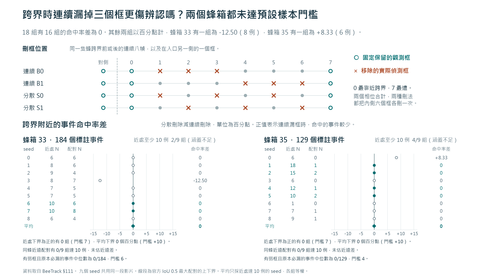

# §111 相同三個偵測框連續或分散消失,對進出辨認有何影響

在 BEE24-33-head 和 35-head 各取 3,950 幀,每片重播九個留一蜂箱偵測器 seed。先找到穿越蜂箱入口時清楚可見的同一隻蜂,再從 P0 第二次 NMS 的倖存框刪除指定觀測。每個位置有八個框,兩端和跨界對側的框保留。連續組兩相各刪第 1、2、3 或 4、5、6 格,分散組兩相各刪第 1、3、5 或 2、4、6 格。合計兩相後兩組刪掉的實框完全相同。結果描述整批刪框對這兩段實拍片的影響。每個 seed 都看同一支影片,因此統計也報跨 seed 去重的蜂隻事件數。[預登記](https://github.com/Jaccxc/BeeTrack/commit/6e2cda2)

**實測結果。** 18 個蜂箱與種子組合中,16 個的連續與分散刪框命中數相同。另兩組各涉及一個事件,方向相反。留 33 的 seed 3 在連續刪框後多辨認出一次出巢,整片窗誤差卻高於分散刪框。留 35 的 seed 0 在一個連續刪框條件下漏掉一次進巢,窗誤差卻下降。跨種子去重後,兩支影片共涵蓋 52 個真事件。事前的樣本門檻兩折均未達,適用結論限於本次觀測清楚的蜂。[逐格實測表](../../docs/experiment_log.md)



## 用公開資料重算

從已安裝專案鎖定環境的 repo 根目錄執行。重播包內有 18 組凍結資料、處理臂的 MOT 指紋、有號事件時間與兩種 IoU 的合法配對邊。正幀代表進、負幀代表出,幀從 1 開始。每臂重算全片 TP/FP/FN、F1、進出偏差、30 個起點的 30 秒窗誤差及選中 GT 的命中上下界。公開資料使用影片代號、片內蜂隻 ID 和快取列索引。重算這些量只需公開檔案與 CPU。[§111 重播包](../../docs/study111_replay.json.gz) · [原生 tracker 參照圖](../../docs/study111_tracker_graphs.json.gz)

```powershell
$env:PYTHONPATH = (Get-Location).Path
$env:CUDA_VISIBLE_DEVICES = '-1'
$graphs = 'docs/study111_tracker_graphs.json.gz'
uv run --offline --no-sync python tools/study111/release111.py --root . replay docs/study111_replay.json.gz --graphs $graphs --table
uv run --offline --no-sync python tools/study111/summary111.py --root . refs $graphs --hive 33 --seed 0
```

`--table` 先列各 seed 的近處 D、近遠差 I、弱框 GT 數與其中原生必漏數,再列各臂的兩種 F1、配對數與窗誤差。配對覆蓋未達標而未執行的臂,或 N=0 無法定義的比例,顯示為 `NA`。

`refs` 讀取 §§95、99 的結果表、§§103、104 的事件資料和原生 tracker 參照圖。兩蜂箱各有九組同偵測器 P0、預設 ByteTrack 與來源校正 ByteTrack,各有三組 seed 0–2 的來源重選 TOPICTrack。加 `--output references.json` 可存全部 60 列,包括九個 seed 及三個共同 seed 各自的等權平均。校正 ByteTrack 只調整分向計數倍率,事件 F1 留空。只有 P0 做刪框實驗,其餘 tracker 只供同 seed 的原生表現對照。

## 如何讀門檻

先用全片所有候選邊求官方事件的最大配對數,再求其中有多少個所選 GT 能被配上。計分器讓總 TP 優先於子組命中數。獨立核對程式分別對所選 GT 與其餘 GT 求最大配對數,重建子組可達的上下界,亦逐窗核對計數。官方門檻用 IoU 0.5,另報 0.3。

近處母體要求同一隻蜂只有一次跨界,跨界同側的連續八格與對側的保護格都有清楚的獨佔框,且被原生第一階段追到。遠處對照與近處至少相距 26 幀,最遠不超過跨界前後 100 幀。這些條件偏向可見時間長、較容易辨認的蜂。30 秒窗誤差按進、出分開加總,包含各起點的頭尾部分窗。假事件和漏事件在同一方向、同一窗可互相抵消,因此判讀時要並看事件 F1。

- **近處缺框。** 每個 seed 的 D 是兩相合計的分散減連續命中數,除以兩倍的近處入選事件數 N。正值代表連續缺框較傷。每折至少七個 N≥10 的 seed 要有 D 下界 > 1e−9,而且全部 N≥10 seed 的 D 下界等權平均要 ≥0.10。少於七個合格 seed 就記涵蓋不足。若上界平均 ≤−0.10,另報反向現象。
- **是否研究弱框補接。** 用另一個單獨選出的母體,對同一隻蜂比較入口附近和遠處兩個位置。I 的下界是 D近下界減 D遠上界。這個母體也要通過七個 seed 和 0.10 的同一門檻。另從自然三幀空缺中找有可用弱框的 GT,再數其中在原生官方事件圖沒有任何合法邊的 GT。九個 seed 的中位數要達全片 GT 的 3%(留 33 至少 6 個,留 35 至少 4 個)。同折的近處 D、近遠 I、自然弱框三項都成立,才支持另登記補接研究。

## 從偵測與完整 MOT 重建

這條路徑需要兩段 dev 的修正 GT、§95 的 18 份偵測快取和原生 P0 MOT、入口多邊形與 §32 的嚴格連結權重。請將權重路徑換成既有的 `m_dev_strict.json`。原始資料讀自專案的 `runs/`,所有新輸出寫入 `$out`。先讓無刪框輸出逐位元重現 §95,再固定近處與近遠兩份選樣、快取列索引及自然斷點。選樣用修正 GT 與原生第一階段軌跡,不以 P0 最終是否配到該 GT 選樣。

```powershell
$out = 'D:/beetrack_runs/study111_reproduction'
$strictWeights = 'D:/path/to/m_dev_strict.json'
$prereg = '6e2cda2a1372dc4a2540cc6bd762491c713e423e'
uv run --offline --no-sync python tools/study111/tracks111.py prepare --root $out --prereg $prereg --weights $strictWeights --workers 2
foreach ($hive in 33,35) {
    foreach ($seed in 0..8) {
        uv run --offline --no-sync python tools/study111/freeze111.py freeze $hive $seed $out --prereg $prereg
    }
}
uv run --offline --no-sync python tools/study111/freeze111.py inventory $out --prereg $prereg
```

以公布的選樣指紋核對 `freeze111.json` 後才產生處理臂。有近處事件的 seed 都做四種近處刪框。同一折至少七個 seed 各有十個近遠配對事件,才在該折加入近、遠各四臂。空遮罩沿用原生軌跡,N=0 的比例無定義。全部 18 格的輸出封存為 `tracks_done.json` 後,才開啟處理臂官方計分。以下兩個 SHA-256 分別取自選樣凍結與全臂封存紀錄。

```powershell
$freezeSha = 'c860746d3f288181fb4b91b23d41f2783529a08a890b064e7aa6c2caafe1c514'
uv run --offline --no-sync python tools/study111/tracks111.py treat --root $out --prereg $prereg --weights $strictWeights --freeze-sha $freezeSha --workers 2
$tracksSha = '5b8a96a13a9b3f44f581efc1ee845719b385ee6f67de9c97a0d6e747e408bd8d'
uv run --offline --no-sync python tools/study111/release111.py --root . score $out --freeze-sha $freezeSha --tracks-sha $tracksSha --workers 2
uv run --offline --no-sync python tools/study111/release111.py --root . pack $out "$out/study111_replay.json.gz" --freeze-sha $freezeSha --tracks-sha $tracksSha --graphs $graphs
```

如也持有 §95、§99 原生 ByteTrack 與來源重選 TOPICTrack 的完整 MOT,可用 `summary111.py build` 從原檔重建參照圖。獨立核對單格可直接比對完整軌跡與封存事件圖,整折則按 seed 0–8 順序餵入九份計分包重算門檻。

```powershell
uv run --offline --no-sync python tools/study111/summary111.py --root . build "$out/study111_tracker_graphs.json.gz"
uv run --offline --no-sync python tools/study111/verify111.py case "$out/scored/33_0.json.gz" --frozen "$out/target/33_0.json" --mots "$out/tracks/33_0"
foreach ($hive in 33,35) {
    $cases = 0..8 | ForEach-Object { "$out/scored/${hive}_$_.json.gz" }
    uv run --offline --no-sync python tools/study111/verify111.py fold @cases
}
```

合成案例可單獨檢查選樣、NMS 後刪框、配對同分及窗的邊界。

```powershell
uv run --offline --no-sync python tools/study111/episodes111.py self-check
uv run --offline --no-sync python tools/study111/tracks111.py synthetic
uv run --offline --no-sync python tools/study111/score111.py self-check
uv run --offline --no-sync python tools/study111/verify111.py self-check
```

繪圖使用 Matplotlib 及繁體中文字型。從專案根目錄可用下列指令由公開重播包重製上圖。追蹤所用的 Python、套件版本與 P0 檔案指紋見[執行環境](../../docs/study111_runtime.json)。

```powershell
uv run --offline --no-sync python tools/study111/dropout111.py --output docs/study111_dropout.png
```
