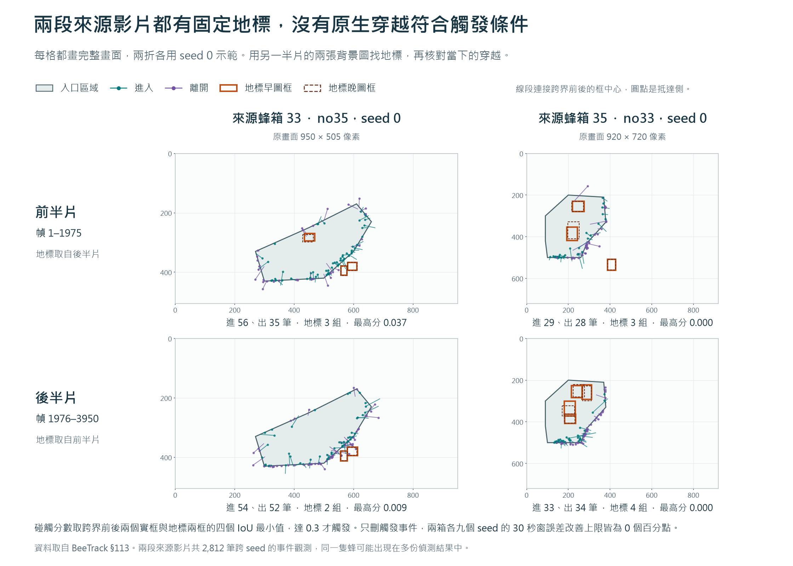

# §113 固定背景上的蜂框能涵蓋多少原生穿越事件

如果同一個偵測器在兩張不同時段的背景圖上反覆報出相同位置,真實影片中的 P0 穿越有多少筆經過那裡? §113 先估算只刪這些事件有多少改善計數的空間。留 33 折用 no33 的 seed 0–8 評來源 35-head,留 35 折用 no35 的 seed 0–8 評來源 33-head。每個 seed 的背景蜂框和 P0 軌跡都來自同一份偵測權重。每支影片長 3,950 幀,九個 seed 重複看同一場景。這兩支來源影片都曾用於各自偵測器的訓練。[預登記](https://github.com/Jaccxc/BeeTrack/commit/34fbedbb4c82fdfce1798627becf1f42e1695d8d)

**實測結果。** 來源 33 和 35 各九個偵測器 seed 都找到固定地標。九次重播各自累計 1667 與 1145 筆原生進出預測,符合事前規則的都是 0 筆。兩個來源的改善上限均為 0 個百分點。這兩段片只用於量來源覆蓋,尚無此規則在留出蜂箱的效益數據。[全部種子](../../docs/experiment_log.md)



## 從公開包重算

從已安裝專案鎖定環境的 repo 根目錄執行。獨立重播從四張背景圖的偵測輸出和原生穿越的前後兩個實框,重建地標、碰到地標的事件與逐折判讀。加上 `--table` 可看各 seed 的結果。[§113 來源重播包](../../docs/study113_replay.json.gz) · [§108 來源預測參照](../../docs/study108_source.json.gz)

```powershell
$env:PYTHONPATH = (Get-Location).Path
$env:CUDA_VISIBLE_DEVICES = '-1'
$source108 = 'docs/study108_source.json.gz'
uv run --offline --no-sync python tools/study113/release113.py replay docs/study113_replay.json.gz --source108 $source108 --table
```

公開包壓縮後共 118,121 位元組,SHA-256 為 `f646253f846167406f28380e7013fef733d26227f6658a714a55b36d53772e65`。包內保留兩份背景圖製作紀錄與一份涵蓋 18 格的凍結清單。每格記錄原權重、原生 MOT、入口多邊形、§108 預測表與背景圖製作紀錄的 SHA-256。背景框的五欄 `[x1,y1,x2,y2,分數]` 以原始 float32 精度保存,事件則保留片段 ID、有號抵達幀、前一實框的幀和兩框的百分之一像素座標。有號幀正值代表進、負值代表出。`release113.py` 需要同資料夾的 `lineage113.py` 核對 §108 的事件 ID、方向、抵達時刻與框,再核對還原的逐格紀錄及總表指紋。原 JPEG、背景像素、模型權重與完整 MOT 由下方原始流程核對。

## 怎麼讀地標與門檻

每片分四個連續時段,各等距取含首尾的 31 幀。在原尺寸 OpenCV BGR uint8 陣列逐位置、逐通道取中位數,得到四張背景圖,供同片九個 seed 共用。每一 seed 對每張跑一次單張 CPU FP32 推論。輸入尺寸 640、信心下限 0.05、NMS IoU 0.7、最多 300 框、關閉增強。每張只保留分數 ≥0.25 的偵測框。同半片兩張圖之間依 IoU 由高到低做一對一貪婪配對,門檻 0.5。同分時依兩框的固定排序決定。每對框是一個地標。

全片原生軌跡以最後一次同方向跨界的前後兩個實框定位,時間取抵達側第一個實框。若兩框分居第 1,975 幀切點兩側,事件保留在原生總數,另記為無法查地標。同半片的事件只查另一半片的地標。事件兩個實框分別對地標兩個背景框計算四個 IoU,四者皆 ≥0.3 才記一次。多個地標符合時,以四者最小 IoU 最高者代表該事件。每個原生 ID 至多算一次,不同事件可以反覆經過同一地標。結果按蜂箱、seed、方向及半片列數,並保留空地標與零候選的格子。

設單一 seed 碰到地標的進出事件共有 m 筆,全片 GT 進出總數為 G。每刪一筆,在任一窗起點最多只能少一單位的分向絕對誤差。因此只選這 m 筆刪除,30 個起點的窗誤差最多改善 `100m/G` 個百分點。凍結清單之後才代入既有的兩個 GT 總數,九個 seed 等權平均上界達 2 點才通過該折的容量門檻。即使通過,候選仍可能是真蜂。實際窗誤差、事件 F1 及留出蜂箱成效須另案檢驗。

| 偵測器留出折 | 本節來源影片 | G | 可查原生事件 | 配成的地標 | 碰到事件 m | 通過所需 m |
|---|---|---:|---:|---:|---:|---:|
| 留 33 | 35-head | 129 | 1,145 | 69 | 0 | 24 |
| 留 35 | 33-head | 184 | 1,667 | 39 | 0 | 34 |

事件數與地標數是同片九個 seed 的合計。兩片的每個 seed 都找到地標,全部原生事件都可查,但沒有一筆符合跨半片的四框接觸條件。兩折的改善上限均為 0 個百分點,依預登記停止這個固定位置刪除規則。總表仍列每折達 2 點的 seed 數、中位數與範圍。本節計算只使用兩個 G,沒有逐筆標示哪些事件為真或為假。

## 從影像、權重與完整軌跡重建

需要來源 head 的原始 JPEG、18 份原生 P0 MOT、相應的 18 份偵測權重與入口多邊形。§108 來源包記錄原生 MOT、多邊形及偵測器 tag。權重位元組由本節推論前後另取指紋。手上若已有 §108 `source_masks.json`,將 `$lineage` 指向該檔所在的資料夾。若只有公開來源包,下例會從 `masks` 欄位還原同一份純預測紀錄,SHA-256 為 `36fe1cc5470b9155a61bb8bed2f0f06242cccbbbda1b90842607976ce08e831e`。

```powershell
$out = 'D:/beetrack_runs/study113_reproduction'
$lineage = "$out/lineage"
@'
import gzip, json, sys
from pathlib import Path
from tools.study110.proposals110 import write_once
with gzip.open(sys.argv[1], "rt", encoding="utf-8") as archive:
    masks = json.load(archive)["masks"]
print(write_once(Path(sys.argv[2]) / "source_masks.json", masks))
'@ | uv run --offline --no-sync python - $source108 $lineage
```

先用 `paths` 確認檔名齊全。合成測試檢查半片切點、IoU 等於門檻、重複 ID 及配對同分。

```powershell
$prereg = '34fbedbb4c82fdfce1798627becf1f42e1695d8d'
uv run --offline --no-sync python tools/study113/probe113.py self-check
uv run --offline --no-sync python tools/study113/run113.py paths --role source --lineage-dir $lineage
uv run --offline --no-sync python tools/study113/run113.py freeze --role source --lineage-dir $lineage --prereg $prereg --outdir $out
uv run --offline --no-sync python tools/study113/run113.py inventory --prereg $prereg --outdir $out
```

`medians/` 存每個時段的背景像素與製作紀錄,含 31 個樣本幀號、各 JPEG 指紋、背景陣列和像素指紋。`source/` 存 18 份逐格紀錄。`source_inventory.json` 封存逐格檔與兩片製作紀錄的指紋。與原研究的凍結值相符後,才換算百分點、寫出 `source_summary.json` 並重新封裝。

```powershell
$inventorySha = '7d9c7ba842f21e9cc62a045b5ffa022b00bbfb266582ec96f9105be380bf6629'
uv run --offline --no-sync python tools/study113/run113.py summary --prereg $prereg --outdir $out --inventory-sha $inventorySha
uv run --offline --no-sync python tools/study113/release113.py pack $out "$out/study113_replay.json.gz" --inventory-sha $inventorySha --source108 $source108
uv run --offline --no-sync python tools/study113/release113.py replay "$out/study113_replay.json.gz" --source108 $source108 --table
```

從專案根目錄執行 `uv run --offline --no-sync python tools/study113/plot113.py --output docs/study113_probe.png` 可由公開座標重畫示意圖,需 Matplotlib 與繁體中文字型。
